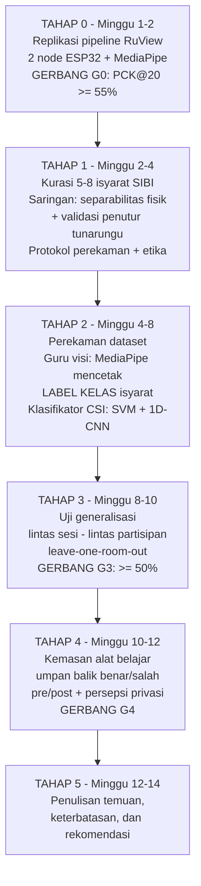
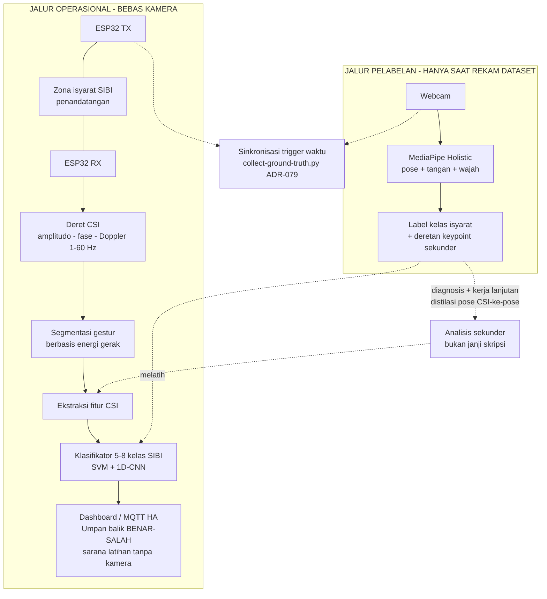

# DOSSIER BAHAN PENYUSUNAN PROPOSAL DPJ-4 (SIBI-ONLY)

**Dokumen kerja internal — bahan, metode, masalah, penyelesaian untuk penulisan ulang DPJ-4**
Disusun: 23 Oktober 2026 · Basis: draf DPJ-4 markdown (Task 6) + audit kode RuView + verifikasi Crossref + LLM Council atas alur metode

> **Status keputusan pemilik yang tercatat:** (1) DPJ-4 dipakai, **SIBI-only tanpa BISINDO**; (2) latar belakang harus berangkat dari **masalah lapangan sosial/pendidikan di luar teknologi** — teknologi hanya alat; (3) alat ditujukan bagi **orang yang ingin belajar SIBI** dan membuat penggunanya memahami **perspektif tunarungu**; (4) alat berposisi sebagai **sarana pembelajaran yang cepat**; (5) alur metode awal pemilik: melatih model *pose estimation* visi (YOLO/MediaPipe) lalu memakainya untuk "mengenalkan" pose SIBI ke model Wi-Fi CSI RuView; (6) diagram alur masuk BAB III.

---

## 0. RINGKASAN EKSEKUTIF

1. **Gagasan alur dua tahap pemilik benar arahnya — dan ternyata sudah setengah jadinya di RuView.** Repo RuView sudah memiliki pipeline *camera-supervised* (ADR-079): MediaPipe PoseLandmarker membaca keypoint dari webcam, disinkronkan dengan rekaman CSI ESP32 melalui `scripts/collect-ground-truth.py`, lalu hasilnya melatih model CSI→pose. Hasil jujur yang terukur: PCK@20 59,5% pada split terpisah, berbanding baseline *mean-pose* 50% (+9,4 pp sinyal nyata). Jadi tugas skripsi **bukan membangun guru visi dari nol** (baik YOLO maupun MediaPipe), melainkan **menginstansiasi pipeline yang sudah ada untuk bahasa isyarat SIBI**.
2. **Putusan dewan (5 advisor + peer review + chairman): alur dua tahap TEPAT sebagai infrastruktur pelabelan, TIDAK TEPAT sebagai tulang punggung metodologis satu semester.** Guru visi (MediaPipe) mencetak **label kelas isyarat**; murid CSI adalah **klasifikator langsung himpunan tertutup (5–8 kelas)**. Distilasi pose penuh (CSI→pose→kelas) diturunkan menjadi analisis lanjutan, bukan janji skripsi, karena rantai prediksi panjang menumpuk dua ketidakpaduan sekaligus dan guru sendiri baru PCK@20 59,5%.
3. **Jari dan ekspresi wajah tidak realistis sebagai target prediksi dari CSI.** Panjang gelombang Wi-Fi 2,4/5 GHz adalah 6–12 cm; resolusi 2–3 node ESP32 tidak menembus artikulasi jari. Cakupan yang jujur: **lintasan lengan, torso, kepala**. Jari/wajah ditulis eksplisit sebagai keterbatasan.
4. **Pergeseran framing utama:** proposal diarahkan dari "pengenalan gestur berbasis CSI" (teknologi dulu) menjadi "**alat pembelajaran SIBI tanpa kamera bagi pembelajar pendengar**" (masalah dulu). Masalah lapangan yang dijawab: 90–95% anak tunarungu lahir dari orang tua pendengar yang umumnya tidak menguasai isyarat; Indonesia hanya ±500 juru bahasa isyarat untuk ±1,92 juta orang tuli; dan pembelajar pendengar pendatang baru membutuhkan sarana latihan mandiri yang cepat, murah, dan tidak terasa mengawasi.
5. **Risiko framing terbesar yang harus diakui sejak BAB I:** survei BRIN 2026 menunjukkan BISINDO 77,7% vs SIBI 1,9% di komunitas Tuli (survei purposive, tidak nasional). Pembelaan SIBI-only harus eksplisit: SIBI adalah varian yang diajarkan di **pendidikan formal**, dan target pengguna alat ini memang pendengar yang masuk lewat pintu formal (calon guru, keluarga siswa, mahasiswa); arsitektur dibuat **bahasa-agnostik** sehingga penggantian ke BISINDO hanya mengganti dataset dan validasi penutur, bukan metode.
6. **Tangga gerbang (kriteria keputusan internal, bukan janji di proposal):** G0 replikasi PCK@20 ≥ 55% (M2); G1 separabilitas antar-repetisi (M3); G2 akurasi dalam-partisipan ≥ 70% pada 5–8 kelas (M6–7); G3 lintas pengguna/ruangan ≥ 50% (M10); G4 kegunaan alat belajar (pre/post + persepsi privasi + validator tunarungu) (M12).
7. **Hal yang tak ketinggalan dari dewan:** wajib ada **minimal satu validator penutur tunarungu** di dalam proyek; generalisasi lintas pengguna/ruangan diuji (leave-one-room-out + satu pengguna baru tanpa rekoleksi); paradoks privasi Wi-Fi ("diintip lewat dinding?") diuji sebagai persepsi, bukan diasumsikan; etika/izin subjek ditulis; hasil belajar pengguna diukur pre/post — akurasi model saja bukan bukti "belajar cepat".

---

## 1. ARAH LATAR BELAKANG (MENGIKUTI ARAHAN PEMILIK)

### 1.1 Prinsip penyusunan

Latar belakang dibangun dari **masalah manusia**, bukan dari keunggulan sinyal. Urutan logikanya: (1) kehidupan tunarungu dan keluarga pendengarnya di Indonesia; (2) kebutuhan orang pendengar yang ingin belajar SIBI tetapi kekurangan sarana; (3) mengapa sarana yang ada belum menjawab (interpreter langka, kursus terbatas, aplikasi kamera terasa mengawasi dan membutuhkan pencahayaan/ruang khusus); (4) barulah teknologi (Wi-Fi CSI pada ESP32) diperkenalkan sebagai **cara** menjawab kebutuhan itu, dengan justifikasi bebas-kamera yang jujur dan terukur. Aturan praktisnya: setiap paragraf teknis di BAB I harus bisa dilacak mundur ke satu masalah lapangan di paragraf sebelumnya.

### 1.2 Fakta lapangan siap kutip (sudah diverifikasi)

| # | Klaim yang dapat ditulis | Angka/Inti | Sumber | Status |
|---|--------------------------|------------|--------|--------|
| F1 | Kehilangan pendengaran adalah isu kesehatan global besar | > 430 juta orang (±5% populasi dunia) memerlukan layanan rehabilitasi pendengaran; diproyeksi ±700 juta (1 dari 10) pada 2050 | Chadha, Kamenov & Cieza (2021), *Bulletin of the WHO* 99(4), DOI 10.2471/blt.21.285643 | DOI terverifikasi |
| F2 | Hampir semua anak tunarungu tumbuh di keluarga pendengar | Mayoritas mutlak anak D/deaf lahir dari orang tua pendengar (survei-survei menunjukkan kisaran 90–95%); mitos "10% orang tua tuli" dibantah data | Mitchell & Karchmer (2004), *Sign Language Studies* 4(2), DOI 10.1353/sls.2004.0005; Mitchell & Karchmer (2005), 5(2), DOI 10.1353/sls.2005.0004 | DOI terverifikasi |
| F3 | Orang tua pendengar kesulitan mempelajari isyarat — justru merekalah pembelajar isyarat terbesar | Kajian campuran atas orang tua pendengar yang belajar ASL bersama anaknya: kebutuhan akses kurikulum dan dukungan pembelajaran terstruktur | Lieberman, Mitchiner & Pontecorvo (2022), *Applied Linguistics Review* 15(1), DOI 10.1515/applirev-2021-0120 | DOI terverifikasi |
| F4 | Pengalaman belajar isyarat bagi pendengar penuh hambatan praktis | Insight orang tua DHH tentang navigasi belajar isyarat | Ritmeester dkk. (2025), *JDSDE* 31(1):85–103, DOI 10.1093/jdsade/enaf059 | DOI terverifikasi |
| F5 | Juru bahasa isyarat Indonesia jauh dari cukup | ±500 JBI untuk ±1,92 juta penyandang tuli → rasio ±1 : 3.840 | Kemenko PMK (Okt 2025), rilis institusional | Institusional (non-DOI) |
| F6 | Peta penggunaan bahasa isyarat di Indonesia | BISINDO 77,7%; SIBI 1,9%; campuran 14,9%; lainnya 5,6% — survei daring purposive di 26 provinsi (bukan sampel nasional); SIBI berkembang di pendidikan formal | BRIN (Agu 2026), kajian Ekosistem Bahasa Isyarat bersama Kemenko PMK & UMM | Institusional (non-DOI) |
| F7 | Bahasa isyarat berkedudukan hukum dan wajib didukung pada layanan publik/pendidikan | UU No. 8/2016 tentang Penyandang Disabilitas mengakui bahasa isyarat dan mewajibkan aksesibilitas komunikasi | UU 8/2016 (dalam koleksi peraturan) | Institusional (non-DOI) |
| F8 | Riset pengenalan BISINDO/SIBI nyaris seluruhnya berbasis kamera | Belum ada pendekatan sensor nirkabel device-free untuk bahasa isyarat Indonesia | Sanjaya dkk. (2023), *IJCS* 12(6), DOI 10.33022/ijcs.v12i6.3539 (sudah di draf lama) | DOI terverifikasi |

**Cara memakai F6 dengan jujur:** jangan sembunyikan angka 1,9%. Tulis: komunitas Tuli sehari-hari memakai BISINDO, sedangkan SIBI adalah sistem yang diajarkan pada pendidikan formal; karena alat ini bergerak di pintu formal (pembelajar pendengar yang bergumul dengan kurikulum/guru/buku SIBI), SIBI dipilih sebagai objek pertama, dengan arsitektur yang sengaja dibuat bahasa-agnostik. Ini juga jawaban siap pakai saat sidang.

### 1.3 Kerangka narasi latar belakang (4 paragraf)

- **Paragraf 1 — manusia dan keluarga.** Buka dengan F2: hampir semua anak tunarungu tumbuh di rumah pendengar. Komunikasi harian keluarga bergantung pada kemampuan orang sekitar menguasai isyarat, tetapi orang tua/kakak jarang punya waktu dan sarana belajar (F3, F4). Di ruang publik dan sekolah, juru bahasa tidak tersedia (F5). Konsekuensinya bukan sekadar hambatan bahasa, tetapi keterasingan kecil yang terjadi setiap hari. Ditutup dengan F1 sebagai skala global dan F7 sebagai kewajiban hukum Indonesia.
- **Paragraf 2 — pembelajar pendengar sebagai subjek yang dilayani.** Orang yang ingin belajar SIBI menghadapi tiga hal: sumber belajar formal terbatas (kamus dan buku tidak memberi umpan balik atas latihan sendiri), kursus memerlukan akses, dan latihan mandiri di depan kamera/aplikasi visi terasa mengawasi serta butuh pencahayaan dan ruang yang tepat. Uraikan kebutuhan: **sarana latihan mandiri yang cepat memberi tahu benar/salah, murah, dan dapat dipakai di ruang pribadi tanpa kamera menyala.**
- **Paragraf 3 — teknologi sebagai jawaban, dengan kejujuran.** Wi-Fi CSI memungkinkan pengenalan gerakan tanpa kamera dan tanpa sensor di tubuh; preseden SignFi, DF-WiSLR, dan FSL-TENCON membuktikan isyarat dapat dikenali dari CSI; platform RuView menyediakan rantai perangkat murah. Nyatakan posisi SIBI-only di sini (F6) beserta pembelaannya, dan satu kalimat **justifikasi bebas-kamera yang bisa dipahami non-teknis**: "latihan yang tidak terasa diawasi lebih mudah dijadikan kebiasaan harian" — sebagai **hipotesis yang akan diuji persepsinya**, bukan klaim pemasaran.
- **Paragraf 4 — penutup ke rumusan.** Ringkas posisi: studi kelayakan alat pembelajaran SIBI tanpa kamera berbasis CSI pada ESP32, dengan validator penutur tunarungu di dalam proyek, ukuran keberhasilan model **dan** ukuran kegunaan bagi pembelajar. Jembatani ke Tabel 1.1 usulan judul.

### 1.4 Anti-pattern (jangan lakukan)

- Membuka latar belakang dengan definisi CSI atau keunggulan ESP32 (itu membalik urutan masalah).
- Mengklaim "meningkatkan empati" tanpa instrumen — dioperasionalkan (pre/post + kuesioner + validator) atau ditulis jujur sebagai aspirasi.
- Menyembunyikan angka 1,9% atau mengaburnya; penguji yang membaca survei BRIN akan menanyainya.
- Menjanjikan pengenalan bentuk jari/ekspresi wajah dari CSI — terbantahkan fisika (lihat §2.3 dan §4).

---

## 2. MASALAH

### 2.1 Masalah lapangan (sosial–pendidikan) yang dijawab alat

1. **Kesenjangan komunikasi di keluarga pendengar.** Anak tunarungu lahir di rumah yang mayoritas tidak menguasai isyaratnya (F2); orang tua belajar isyarat tanpa dukungan terstruktur (F3, F4) sehingga kemampuan bahasa anak berisiko tertunda sementara keluarga mencari cara.
2. **Kelangkaan juru bahasa di layanan publik dan pendidikan.** Rasio ±1 : 3.840 (F5) membuat komunikasi formal sering bergantung pada kemauan dan keberuntungan, bukan pada sistem yang menjamin akses.
3. **Kekurangan sarana latihan mandiri bagi pembelajar pendengar.** Sumber belajar SIBI yang mudah diakses lebih banyak berupa kamus statis; umpan balik atas latihan hampir selalu butuh guru, partner, atau kamera. Pembelajar pendatang baru butuh umpan balik **cepat** agar kebiasaan latihan bertahan.
4. **Hambatan psikologis latihan di depan kamera.** Pendatang baru sering malu dan merasa dihakimi saat latihan gerakan tangan di depan kamera (hipotesis yang diuji di G4); alat visi murni tidak dapat menawarkan mode latihan tanpa kamera sama sekali.

### 2.2 Masalah riset (celah akademik)

1. Belum ada satu pun publikasi pengenalan bahasa isyarat **SIBI** berbasis Wi-Fi CSI (draf lama sudah membuktikan kelengkapan pencarian literatur: kombinasi bahasa–platform–konteks adalah kebaruan kombinatif).
2. Riset isyarat Indonesia terkonsentrasi pada visi/kamera (F8) sehingga jalur bebas-kamera untuk kebutuhan pembelajaran belum terpetakan sama sekali.
3. Belum ada studi yang mengaitkan **keberhasilan klasifikasi mesin** dengan **pengalaman belajar pengguna** pada konteks isyarat — kebanyakan penelitian berhenti pada akurasi model; proposal ini menambahkan lapisan kegunaan (pre/post, persepsi, penilaian validator) yang selama ini jarang dilaporkan.
4. Preseden transfer visi→CSI (DensePose-from-WiFi; Person-in-WiFi) bekerja pada tugas umum; penerapan pada **pengajaran bahasa isyarat nasional** belum ada di literatur.

### 2.3 Masalah teknis yang harus dihadapi (ditulis jujur di proposal)

1. **Resolusi fisika:** λ Wi-Fi 6–12 cm; 2–3 node ESP32 tidak menembus artikulasi jari; pipeline CSI→pose terbaik di RuView baru mencapai +9,4 pp di atas baseline pada 17 keypoint tubuh. Implikasi: pilih isyarat yang **terpisahkan lewat lintasan lengan/torso/kepala**, bukan yang membedakan bentuk jari.
2. **Generalisasi lintas pengguna dan ruangan:** CSI terkenal mudah *overfit* pada orang dan ruangan. Tanpa protokol uji lintas domain, studi kelayakan bisa menghasilkan jawaban palsu. Solusi: uji leave-one-room-out (≥ 2 ruangan) dan satu pengguna baru tanpa rekoleksi (3–4 partisipan).
3. **Segmentasi/spotting:** asumsi draf lama tetap — isyarat **terisolasi** dengan segmentasi berbasis energi; spotting isyarat kontinu ditulis di luar cakupan.
4. **Kualitas label guru:** MediaPipe bisa gagal (orang tidak terdeteksi, jitter keypoint) — perlu aturan buang-segmen dan pengecekan sampel oleh validator tunarungu, agar dataset tidak "berlabel rapi tapi isinya salah".
5. **Persepsi privasi (paradoks):** sensor tanpa indikator bisa terasa "diintip lewat dinding" bagi sebagian orang; karena alat ini dijual sebagai aman-latihan, persepsi tersebut **diuji** dengan kuesioner, dan hasilnya apa adanya.

---

## 3. BAHAN (INVENTARIS LENGKAP)

### 3.1 Referensi inti terverifikasi

**Kelompok A — sensing Wi-Fi CSI & pengenalan isyarat dari CSI** (sudah ada di draf DPJ-4 lama, semua DOI terverifikasi):

| No. draf | Referensi | Peran di proposal |
|---|---|---|
| [4] | Ma, Zhou & Wang (2019), *ACM Computing Surveys* 52(3), DOI 10.1145/3310194 | Survey sensing Wi-Fi — dasar fisika & taksonomi |
| [6] | Ma, Zhou & Wang (2018), SignFi, *IMWUT* 2(1), DOI 10.1145/3191755 | Preseden utama: 276 isyarat ASL dari CSI |
| [8] | Shang & Wu (2017), WiSign, DOI 10.1145/3097620.3097624 | Preseden pengenalan isyarat multi-array |
| [9][10] | Thariq Ahmed dkk. (2020; 2021), DF-WiSLR + LSTM, DOI 10.1016/j.pmcj.2020.101289; 10.1109/IAICT52856.2021.9532548 | Preseden device-free + arsitektur sekuens |
| [11] | Zhang dkk. (2021), Widar3.0, *TPAMI*, DOI 10.1109/TPAMI.2021.3105387 | Strategi lintas domain; sumber strategi (bukan janji) |
| [12] | Chen, Zhou & Lin (2023), survey cross-domain, DOI 10.1145/3570325 | Peta strategi generalisasi |
| [13] | Hao dkk. (2020), Wi-SL, *Sensors* 20(14), DOI 10.3390/s20144025 | Preseden granularitas halus (jari) — sekaligus pembanding: butuh konfigurasi khusus |
| [14] | Sruthi dkk. (2024), HandFi, DOI 10.1016/j.procs.2024.04.042 | Fitur amplitudo-fase gestur tangan |
| [15] | Cai dkk. (2024), *Sensors* 24(11), DOI 10.3390/s24113414 | Komplementaritas amplitudo-fase |
| [16] | Qin dkk. (2023), WiASL, DOI 10.1016/j.measurement.2023.113125 | Arah aplikatif (tulisan-isyarat) |
| [7] | Baldeo dkk. (2024), FSL TENCON, DOI 10.1109/TENCON61640.2024.10903008 | Preseden bahasa isyarat nasional lain |
| [5] | Hernandez & Bulut (2020), WoWMoM, DOI 10.1109/WoWMoM49955.2020.00056; ESP32-CSI-Tool | Sensing pada IoT + basis capture ESP32 |

**Kelompok B — pose estimation visi & transfer visi→CSI** (baru; guru/metode):

| Ref. baru | Referensi | Peran |
|---|---|---|
| N1 | Wang, Zhou, Panev, Han & Huang (2019), Person-in-WiFi, ICCV, DOI 10.1109/iccv.2019.00555 | Preseden fine-grained person perception dari CSI (keypoint tubuh) |
| N2 | Geng, Huang & De la Torre (2023), DensePose From WiFi, arXiv:2301.00250, DOI 10.48550/arXiv.2301.00250 | Preseden kunci transfer jaringan visi→WiFi untuk dense pose (level region tubuh) — dasar argumen alur dua tahap |
| N3 | Lugaresi dkk. (2019), MediaPipe: A Modern, Open-Source ML Framework, arXiv:1906.08172 | Kerangka guru (framework) |
| N4 | Bazarevsky dkk. (2020), BlazePose, arXiv:2004.03486 | Model pose 33 landmark pada MediaPipe |
| N5 | Zhang dkk. (2020), MediaPipe Hands, arXiv:2006.10214 | Landmark tangan 21×2 — untuk label guru (bukan target prediksi CSI) |
| N6 | Kim, Choi, Ha & Choi (2023), *Applied Sciences* 13(4):2700, DOI 10.3390/app13042700 | Bukti jurnal: pipeline pose MediaPipe pada aplikasi nyata |
| N7 | (Opsional) Bazarevsky dkk. (2020), BlazeFace/FaceMesh, arXiv:2006.10963 | Landmark wajah — hanya untuk label guru |

**Kelompok C — tunarungu, pendidikan, pembelajar pendengar** (baru; latar belakang):

| Ref. baru | Referensi | Peran |
|---|---|---|
| N8 | Chadha, Kamenov & Cieza (2021), *Bull WHO* 99(4), DOI 10.2471/blt.21.285643 | Statistik global pendengaran (F1) |
| N9 | Mitchell & Karchmer (2004), *SLS* 4(2), DOI 10.1353/sls.2004.0005 | Orang tua pendengar (F2) |
| N10 | Mitchell & Karchmer (2005), *SLS* 5(2), DOI 10.1353/sls.2005.0004 | Orang tua pendengar & kebiasaan menandatangani (F2) |
| N11 | Lieberman, Mitchiner & Pontecorvo (2022), *Applied Linguistics Review* 15(1), DOI 10.1515/applirev-2021-0120 | Orang tua pendengar belajar isyarat (F3) |
| N12 | Ritmeester dkk. (2025), *JDSDE* 31(1):85–103, DOI 10.1093/jdsade/enaf059 | Navigasi belajar isyarat oleh pendengar (F4) |
| — | Rodríguez-Correa dkk. (2023), *Frontiers in Education*, DOI 10.3389/feduc.2023.1121597 (draf lama [1]) | Teknologi bantu komunikasi tunarungu — tinjauan sistematis |

**Kelompok D — isyarat Indonesia** (draf lama, DOI terverifikasi): Sanjaya dkk. (2023) [2]; Dwijayanti dkk. (2021) [3]; Kindy dkk. (2025) [17]; Wiguna & Rojali (2025) [18]; Sebastian dkk. (2025) [19].

**Sumber institusional (non-DOI, kutip sebagai sumber resmi):** BRIN (Agu 2026) survei ekosistem bahasa isyarat; Kemenko PMK (Okt 2025) rasio JBI; UU No. 8/2016; Kamus Sistem Isyarat Bahasa Indonesia (Kemendikbudristek/PUSBISIA) — untuk verifikasi bentuk isyarat SIBI.

### 3.2 Data & statistik yang perlu disitasi di BAB I

Sudah dirangkum pada Tabel §1.2 (F1–F8). Catatan penggunaan: angka BPS/disabilitas nasional bervariasi antar-sumber dan antar-tahun; agar aman, gunakan hanya angka yang punya sumber jelas di atas dan sebutkan keterbatasan survei BRIN (purposive, bukan nasional) tepat di tempat angkanya disebut.

### 3.3 Perangkat keras

| Item | Spesifikasi | Jumlah | Catatan |
|---|---|---|---|
| ESP32 DevKit | Node TX dan RX capture CSI | 2 ( + 1 cadangan) | Bawaan draf lama (Rp 120.000) |
| Aksesor elektronik | Breadboard, jumper, adaptor, dudukan | 1 set | Bawaan draf lama (Rp 150.000) |
| Webcam | Bawaan laptop | 1 | Hanya menyala saat sesi pelabelan |
| Laptop | Milik pribadi | 1 | Server RuView + pelatihan + demo alat |
| Node ketiga (opsional mesh) | ESP32 tambahan | 0–1 | Bila uji penempatan node membutuhkan keragaman sudut; masuk cadangan |
| Token apresiasi validator | Honorarium kecil validator tunarungu & guru | 1–2 orang | Opsional, ±Rp 150.000–300.000; konfirmasi pembimbing |

### 3.4 Perangkat lunak & platform (peta aset RuView yang sudah ada)

- **Pipeline guru-murid (sudah ada):** `scripts/collect-ground-truth.py` (ADR-079) — MediaPipe PoseLandmarker 33→17 keypoint COCO, sinkron dengan CSI ESP32, keluaran JSONL per-frame; mendukung opsi kalibrasi kamera-ruang (rays, PerceptAlign-style).
- **Disiplin evaluasi pose (sudah ada):** skill `harness/ruview/skills/train-pose.md` — wajib baseline *mean-pose*, lapor PCK sebagai delta, gate `train-gate`; riwayat klaim 92,9% yang ditarik menjadi peringatan resmi repo.
- **Jalur bebas kamera (referensi arah):** WiFlow (ADR-152) — camera-free training; dipakai sebagai konteks "arah pengembangan", bukan janji.
- **Mesh/swarm:** preset `scripts/swarm_presets/*.yaml` (standard, line_relay, dst.) — untuk eksperimen penempatan node bila diperlukan.
- **Rantai aplikasi:** dashboard + MQTT/Home Assistant (entitas semacam *gesture terdeteksi*) untuk demo alur alat belajar.
- **Tumpukan pelatihan:** Python + MediaPipe Tasks + PyTorch/Scikit-learn; klasifikator dimulai dari SVM + 1D-CNN (konsisten draf lama).

### 3.5 Dataset & protokol perekaman

- **Cakupan:** 5–8 isyarat SIBI terisolasi (turun dari 12 di draf lama — dewan menilai 5–8 realistis; 3–5 bila gerbang G2 gagal), ±30 repetisi per isyarat per sesi.
- **Dua saringan pemilihan isyarat:** (i) *separabilitas fisik* — dibedakan lintasan lengan/lokasi tubuh, bukan bentuk jari; (ii) *validitas pedagogis* — disetujui validator tunarungu sebagai kosakata awal berguna bagi pembelajar. Kandidat yang lazim di kamus SIBI untuk diaudit bersama validator (bukan keputusan final): sapa/halo, terima kasih, maaf, tolong, ya, tidak, nama, baik — **wajib dicek terhadap Kamus SIBI resmi dan validator sebelum ditulis ke proposal**.
- **Protokol elisitasi terisolasi:** satu isyarat per segmen, pemandu (kata/kartu) ditampilkan, jeda antar repetisi; satu penandatangan kompeten (guru/pembina) per sesi; metadata lengkap (tanggal, ruang, penandatangan, posisi node, kondisi latar).
- **Label guru:** MediaPipe Holistic (pose + tangan + wajah) pada video tersinkron → label **kelas isyarat** (utama) + deretan keypoint (sekunder, untuk diagnosis & kerja lanjutan); aturan buang-segmen (deteksi orang hilang, jitter) ditulis di protokol.
- **Luaran tetap:** dataset publik berlabel CSI-isyarat SIBI (klaim "pertama untuk SIBI" dipertahankan), protokol terdokumentasi.

### 3.6 Mitra & peran manusia (baru — hasil blind spot dewan)

| Peran | Siapa | Tanggung jawab |
|---|---|---|
| Penandatangan dataset | Guru/pembina (dapat: penutur tunarungu) | Menghasilkan isyarat acuan |
| **Validator tunarungu (WAJIB)** | Minimal 1 penutur asli | Memilih/mengesahkan kosakata, mengecek sampel label, menilai kewajaran umpan balik alat |
| Uji pengguna alat | 3–5 pendengar pemula | Pre/post kenal isyarat + kuesioner persepsi privasi |
| Mitra lokasi | 【Nama Sekolah/Lokasi】 | Ruang uji (target: 2 ruangan untuk uji generalisasi) |
| Peneliti | Mahasiswa | Seluruh rantai + jurnal harian kondisi latar |

### 3.7 Artefak pendukung yang perlu disiapkan untuk proposal

1. Tabel usulan judul (revisi §6 dokumen ini); 2. diagram alur metodologi (§4.3, masuk BAB III); 3. diagram arsitektur sistem (§4.3); 4. tabel perbandingan penelitian terdahulu (perluas tabel draf lama dengan Person-in-WiFi/DensePose-from-WiFi pada kolom modalitas); 5. tabel risiko (§4.7); 6. lembar definisi isyarat (bahan terpisah, dibuat bersama validator).

---

## 4. METODE (ALUR FINAL HASIL DEWAN)

### 4.1 Putusan dewan atas gagasan alur pemilik

**"Alur dua tahap TEPAT sebagai infrastruktur pelabelan; TIDAK TEPAT sebagai tulang punggung metodologis satu semester."** Kamera + MediaPipe tetap menjadi guru — tetapi guru mencetak **label kelas isyarat**, bukan pose yang harus dikejar murid CSI. Murid CSI adalah **klasifikator langsung himpunan tertutup**. Distilasi pose penuh (CSI→pose→kelas) menjadi **analisis sekunder/kerja lanjutan**. Alasan satu kalimat: dalam satu semester, rantai prediksi panjang (CSI→pose→kelas) menumpuk dua ketidakpastian sekaligus, padahal guru sendiri baru mencapai PCK@20 59,5% — pendekkan rantainya.

Jawaban langsung atas lima sub-pertanyaan pemilik:

| Sub | Pertanyaan pemilik | Putusan dewan |
|---|---|---|
| (a) | YOLO atau MediaPipe? | **MediaPipe** — sudah terintegrasi RuView (`collect-ground-truth.py`), tervalidasi, nol biaya adaptasi; melatih guru baru (YOLO) = bakar satu semester |
| (b) | Jari + tubuh atas + ekspresi wajah dari CSI? | **Tidak realistis sebagai target prediksi CSI** (λ 6–12 cm; bukti empiris PCK nyaris baseline; preseden sukses hanya level region tubuh). Cakupan: lintasan lengan/torso/kepala. Jari & wajah: label guru saja + keterbatasan eksplisit |
| (c) | Distilasi pose / klasifikasi langsung / hybrid? | **Klasifikasi langsung himpunan tertutup = jalur utama**; pose guru = sumber label + alat diagnosis; distilasi penuh = kerja lanjutan. (Hybrid minimal "CSI→pose atas-tubuh + classifier" hanya bila waktu bersisa setelah G3) |
| (d) | Koneksi ke tujuan belajar + empati? | Satu skenario konkret: *orang tua/kakak pendengar berlatih 10 menit tiap malam tanpa kamera; alat memberi tahu benar/salah per isyarat*. Dari skenario itu turun: umpan balik benar/salah, pre/post hasil belajar, kuesioner persepsi privasi, validator tunarungu. Empati tanpa instrumen = ditulis jujur sebagai aspirasi |
| (e) | Risiko terbesar + gerbang? | Risiko non-teknis: kontradiksi SIBI-only vs 77,7% BISINDO (jawab eksplisit di BAB I). Risiko teknis: generalisasi lintas pengguna/ruangan. Tangga gerbang G0–G4 di §4.4 |

### 4.2 Alur metode final — enam tahap

- **Tahap 0 — Replikasi (M1–M2).** Clone RuView, 2 ESP32, jalankan pipeline ADR-079, replikasi hasil PCK@20 pada split terpisah. Tanpa eksperimen baru. Uji ketergantungan: pipeline yang tak bisa direplikasi sendiri tidak boleh jadi fondasi skripsi.
- **Tahap 1 — Kurasi & protokol (M2–M4).** Pilih 5–8 isyarat melalui dua saringan (separabilitas fisik + validasi validator tunarungu); kalibrasi ruang mitra; protokol elisitasi & perekaman (30 repetisi, metadata, aturan buang-segmen).
- **Tahap 2 — Pelabelan guru & klasifikasi langsung (M4–M8).** Perekaman dataset dengan kamera tersinkron; MediaPipe mencetak label kelas (+ keypoint sekunder); ekstraksi fitur CSI (amplitudo, fase, Doppler 1–60 Hz); latih klasifikator (SVM baseline + 1D-CNN) dengan validasi silang per sesi.
- **Tahap 3 — Generalisasi (M8–M10).** Uji lintas sesi, lintas partisipan (3–4 orang), lintas ruangan (leave-one-room-out, ≥ 2 ruangan), dan satu pengguna baru tanpa rekoleksi.
- **Tahap 4 — Kemasan alat belajar (M10–M12).** Demo umpan balik benar/salah tanpa kamera di laptop; uji 3–5 pendengar pemula (pre/post); kuesioner persepsi privasi; validator menilai kewajaran umpan balik.
- **Tahap 5 — Penulisan temuan (M12–M14).** Keterbatasan (jari/wajah, isyarat terisolasi, cakupan pengguna), pembelaan SIBI-only, justifikasi bebas-kamera — ditulis sebagai temuan, bukan klaim.

### 4.3 Diagram untuk BAB III

**Catatan pemakaian:** dua diagram Mermaid di bawah dirancang untuk ditaruh di BAB III (3.1 tahapan / 3.3 arsitektur). Untuk versi DOCX final, gambar ulang dengan draw.io/Word SmartArt (konvensi 4 proposal sebelumnya), gunakan diagram ini sebagai acuan struktur.

**Diagram 1 — Alur metodologi penelitian (untuk 3.1 Tahapan Penelitian):**

**Diagram 2 — Arsitektur sistem dua jalur (untuk 3.3 Arsitektur Sistem):**

### 4.4 Tangga gerbang go/no-go (kriteria keputusan internal — tidak ditulis sebagai janji/angka target di proposal)

| Gerbang | Kapan | Ukuran | Lolos | Bila gagal |
|---|---|---|---|---|
| **G0** | Akhir M2 | Replikasi PCK@20 split terpisah | ≥ 55% | Jalur CSI dihentikan; skripsi beralih ke studi kamera-supervised (masih sah sebagai skripsi) |
| **G1** | M3 | Separabilitas antar-repetisi (nearest-centroid sederhana antar kelas) | Pengelompokan antar-repetisi isyarat sama lebih rapat daripada ke isyarat lain | Perbaiki penempatan/orientasi node SATU kali; gagal lagi → berhenti |
| **G2** | M6–7 | Akurasi dalam-partisipan, split temporal, 5–8 kelas (peluang ±12–20%) | ≥ 70% | 40–70% → pangkas ke 3–5 isyarat lintasan-dominan; di bawahnya → jalur CSI dinyatakan tak layak semester ini |
| **G3** | M10 | Lintas pengguna/ruangan (leave-one-room-out + 1 pengguna baru) | ≥ 50% | Runtuh → cakupan menjadi personalisasi per-pengguna; ditulis jujur sebagai temuan kelayakan |
| **G4** | M12 | Alat belajar: ≥ 3 dari 5 pemula meningkat pre/post; persepsi privasi tercatat; validator menyetujui umpan balik | Sesuai tiga syarat | Analisis; temuan negatif tetap sah sebagai hasil kelayakan |

Pemetaan gerbang ke bab (dari reviewer Executor): G0 → BAB III; G2/G3 → hasil (skripsi nanti); G4 → pembahasan manfaat. Setiap gerbang memiliki alokasi minggu eksplisit pada Tabel 3.1.

### 4.5 Rencana pengujian (menggantikan/memperluas 3.7 draf lama)

1. **Uji fisik Delta-CSI (M3):** ruang kosong vs terisi vs penandatangan aktif — digabung dengan G1.
2. **Uji klasifikasi:** akurasi per isyarat + confusion matrix pada skenario (i) dalam sesi, (ii) lintas sesi, (iii) lintas partisipan, (iv) leave-one-room-out, (v) satu pengguna baru. Lapor juga baseline peluang (1/jumlah kelas).
3. **Uji operasional:** alarm palsu per jam saat tidak ada gestur; latensi ujung-ke-ujung gestur→umpan balik.
4. **Uji kegunaan alat (baru):** pre/post skor kenal isyarat 3–5 pemula; kuesioner persepsi (privasi, kenyamanan, "terasa diawasi?"); penilaian validator atas kewajaran umpan balik.
5. **Diagnosis interpretabilitas (baru, sekunder):** korelasi kesalahan klasifikator dengan lintasan tubuh dari label guru — menjawab "model salah karena gerak mirip atau karena sinyal lemah".

### 4.6 Etika & keterlibatan tunarungu (memperluas 3.6 draf lama)

Persetujuan institusi; persetujuan tertulis subjek; hak menarik diri; kamera hanya menyala saat sesi pelabelan dan dinyatakan tertulis; mode privasi RuView aktif; identitas tidak disimpan. **Baru:** (1) validator tunarungu dilibatkan sejak tahap kurasi dengan masukan terdokumentasi; (2) token apresiasi validator; (3) persepsi privasi Wi-Fi ditanyakan terbuka ("apakah sensor tanpa kamera membuat Anda lebih atau kurang nyaman?") tanpa memimpin jawaban.

### 4.7 Analisis risiko (perluasan Tabel 3.3 draf lama)

| Risiko | Dampak | Rencana cadangan |
|---|---|---|
| G0 replikasi gagal berulang | Fondasi tidak sah | Beralih studi kamera-supervised (MediaPipe) untuk pembelajaran SIBI; temuan tetap dilaporkan |
| Label guru salah (MediaPipe gagal deteksi/jitter) | Dataset bernilai kosong | Aturan buang-segmen; pengecekan sampel validator; pencatatan tingkat kegagalan deteksi |
| Generalisasi lintas pengguna/ruangan runtuh | Klaim "alat siap pakai" gugur | Cakupan personalisasi per-pengguna; lapor biaya rekoleksi sebagai temuan |
| Isyarat terpilih mirip lintasannya | Confusion matrix penuh | Saringan separabilitas fisik saat kurasi; ganti pasangan isyarat; laporkan pasangan tak terpisahkan |
| Persepsi privasi negatif | Nilai "bebas kamera" melemah | Presentasikan temuan apa adanya; opsi indikator berkedip pada node sebagai rekomendasi desain |
| Validator tunarungu tidak ditemukan | Klaim empati gugur | Mulai pencarian M1 (lead time panjang); mitra SLB dari lini penelitian DPJ-2/DPJ-3; bila kosong, turunkan klaim dan catat sebagai keterbatasan |
| Perizinan mitra tertunda | Jadwal mundur | Mitra cadangan; urutan izin mulai M1 |

---

## 5. PENYELESAIAN (DESAIN ALAT & CARA ALAT MENJAWAB MASALAH)

### 5.1 Pemetaan masalah lapangan → fitur alat → bukti di penelitian

| Masalah (§2.1) | Fitur alat versi studi kelayakan | Bukti yang dihasilkan |
|---|---|---|
| Keluarga pendengar tak menguasai isyarat (M1) | Mode latihan mandiri: pengguna mengisyaratkan → sistem menampilkan isyarat yang terdeteksi + benar/salah | G2/G3 (akurasi) + G4 (pre/post pemula) |
| Juru bahasa langka (M2) | Alat bukan pengganti juru bahasa, tetapi mengurangi ketergantungan pada fase latihan harian; bentuk isyarat disahkan penutur tunarungu | Dokumentasi validasi kosakata + penilaian validator atas umpan balik |
| Sarana latihan mandiri terbatas (M3) | Umpan balik cepat per repetisi tanpa perlu guru/kursus; dataset & protokol dipublikasikan agar dapat dilanjutkan siapa pun | Dataset publik + laporan latensi umpan balik |
| Latihan di depan kamera terasa mengawasi (M4) | **Mode latihan bebas kamera** — kamera hanya menyala saat perekaman dataset, bukan saat pengguna berlatih | Kuesioner persepsi privasi (G4) + deskripsi arsitektur dua jalur |

### 5.2 Skenario pemakaian konkret (masuk BAB I/II sebagai ilustrasi)

*Seorang kakak pendengar dari siswa tunarungu menaruh dua node ESP32 di meja belakang dan laptop di sampingnya. Sepuluh menit setiap malam ia berlatih kosakata SIBI pekan ini. Kamera tidak menyala; ia isyaratkan "terima kasih", layar menampilkan isyarat yang dikenali dan indikator benar/salah; kalau salah, ia mengulang tanpa merasa dilihat siapa-siapa. Seminggu, kosakatanya berganti; alat tetap sama, isyaratnya bertambah — dan ia belajar menghadapi rasa "berbicara tanpa suara" yang dialami adiknya setiap hari.*

Skenario ini adalah **hipotesis pemakaian** yang diuji versi sederhananya di G4 (pemula berlatih, umpan balik jalan, persepsi dicatat) — bukan klaim bahwa produk final telah ada.

### 5.3 Unsur empati yang dioperasionalkan (bukan sekadar diklaim)

1. **Latihan tanpa diawasi** — mode bebas-kamera menjadikan pengalaman latihan analog dengan pengalaman tunarungu berkomunikasi secara visual tanpa sinyal suara; pengguna merasakan bergantung pada gerakan semata.
2. **Kosakata disahkan penutur tunarungu** — bentuk isyarat dan umpan balik dinilai penutur asli, sehingga alat tidak "mengajarkan bahasa" tanpa kehadiran komunitasnya (jawaban atas kritik Outsider).
3. **Instrumen ringan:** pre/post kenal isyarat (5 item per isyarat), kuesioner persepsi 5 item, catatan refleksi pendek. Ditulis jujur: ini instrumen kelayakan, bukan ukuran psikometrik empati penuh.
4. **Keterbukaan batas:** jika instrumen tidak membuang hasil, empati diturunkan statusnya menjadi aspirasi eksplisit — dewan menilai kejujuran ini lebih kuat di sidang daripada klaim kosong.

### 5.4 Kalimat klaim siap pakai (disiplin — pelajaran riwayat klaim 92,9% RuView)

- Layak: *"studi kelayakan alat pembelajaran isyarat SIBI terisolasi berbasis Wi-Fi CSI bagi pembelajar pendengar"*; *"umpan balik latihan tanpa kamera pada himpunan tertutup 5–8 isyarat"*; *"dataset publik CSI-isyarat SIBI pertama"*; *"arsitektur bahasa-agnostik yang dapat diperluas ke BISINDO"*.
- Tidak layak (jangan tulis): "penerjemah SIBI"; "mengenali bentuk jari/ekspresi wajah dari CSI"; "akurasi X%" sebagai janji; "meningkatkan empati" sebagai hasil terukur; "mewakili komunitas tuli".

---

## 6. PERUBAHAN TERHADAP DRAF DPJ-4 LAMA (DELTA)

| Aspek | Draf lama | Dossier ini (arah baru) |
|---|---|---|
| Cakupan bahasa | SIBI **dan** BISINDO | **SIBI-only** + pembelaan eksplisit (BRIN 77,7/1,9) + arsitektur bahasa-agnostik |
| Orientasi | Kelayakan pengenalan gestur (teknologi dulu) | **Alat pembelajaran bagi pendengar** (masalah dulu); empati dioperasionalkan |
| Latar belakang | Privasi kamera & keterbatasan visi sebagai pemicu | Keluarga pendengar, kelangkaan JBI, kebutuhan latihan mandiri; kamera/privasi jadi konsekuensi desain |
| Rumusan/tujuan | 3 rumusan (rancang, implementasi, uji) | Ditambah dimensi: validasi validator tunarungu + uji kegunaan alat + uji generalisasi |
| Batasan | 5–12 gestur; pose tidak dipakai (stub); 1 penandatangan | 5–8 isyarat (dengan dua saringan kurasi); jari/wajah **eksplisit keterbatasan**; kamera hanya pelabelan; spotting di luar cakupan |
| Metode | Kalibrasi → rekam → fitur → klasifikator → alert | Enam tahap T0–T5 + **gerbang G0–G4** + uji generalisasi + uji kegunaan + diagnosis interpretabilitas |
| Referensi | 19 | 19 + ±10 baru (Kelompok B & C + DensePose-from-WiFi) |
| Peran manusia | Guru/pembina penandatangan | + **validator tunarungu wajib** + 3–5 pemula uji alat |
| Diagram | Tidak ada diagram | Diagram alur + arsitektur (§4.3) masuk BAB III |
| Judul | "SIBI dan BISINDO … translasi tanpa kamera" | Usulan baru (§6.1) |

### 6.1 Usulan judul baru (SIBI-only, orientasi alat belajar)

- **Utama:** "ALAT PEMBELAJARAN ISYARAT SIBI TANPA KAMERA BERBASIS WI-FI CHANNEL STATE INFORMATION PADA ESP32: STUDI KELAYAKAN UMPAN BALIK LATIHAN BAGI PEMBELAJAR PENDENGAR"
- **Alternatif 1:** "Studi Kelayakan Klasifikasi Isyarat Terisolasi SIBI dari Wi-Fi CSI pada Platform RuView untuk Sarana Latihan Mandiri Pembelajar Pendengar"
- **Alternatif 2:** "Dataset Berlabel dan Klasifikasi Isyarat SIBI dari Wi-Fi CSI pada ESP32 sebagai Basis Alat Bantu Pembelajaran Bahasa Isyarat bagi Pendengar"

---

## 7. VERDICT DEWAN (LENGKAP — HASIL SINTESIS CHAIRMAN)

### 7.1 Titik sepakat

1. **(a) MediaPipe, bukan YOLO** — guru sudah tertanam di RuView (ADR-079), tervalidasi, menghasilkan keypoint yang memang dibutuhkan; melatih guru baru = semester terbuang; kontribusi skripsi = menginstansiasi untuk SIBI.
2. **(b) Jari dan wajah: TIDAK** — tiga advisor independen menolak berdasar fisika (λ 6–12 cm); PCK@20 59,5% nyaris baseline adalah bukti empirisnya; DensePose-from-WiFi pun bekerja pada level region tubuh; usulan "jari sebagai lapisan terpisah" ditolak dua reviewer karena melanggar logika informasi. Cakupan: lintasan lengan, torso, kepala; jari/wajah = keterbatasan eksplisit.
3. **Kamera-hanya-saat-pelabelan konsisten** — guru visi tetap dipakai untuk pelabelan; perdebatan hanya seberapa jauh murid mengejar guru.
4. **Kurasi isyarat berbasis fisika** — pilih yang terpisahkan lewat lintasan lengan/tubuh-atas, bukan 5–12 isyarat sembarangan.
5. **Jangan tulis target akurasi di proposal; tulis gerbang bertanggal; jangan sentuh stub on-device 3%** — demo di laptop.
6. **Angka SIBI 1,9% dibuka sendiri di BAB I** — pembelaannya (pendidikan formal + arsitektur bisa ganti bahasa) ditulis eksplisit, bukan diimprovisasi saat sidang.
7. **"Kenapa harus Wi-Fi?" wajib dijawab non-teknis di BAB I** — jawaban "karena RuView punya pipelinenya" = teknologi mencari masalah.
8. **Studi kelayakan = keputusan terukur, bukan sistem jadi.**

### 7.2 Titik perdebatan (dan penyelesaiannya)

1. **Distilasi pose vs klasifikasi langsung:** Expansionist menilai distilasi pose memberi kosakata yang bisa tumbuh tanpa retraining; Executor/Contrarian menilai satu semester tidak cukup; First Principles memberi kompromi hybrid minimal. **Putusan:** klasifikasi langsung utama; pose sebagai label + diagnosis; distilasi penuh ditunda — murid tak bisa lebih pandai dari gurunya yang baru 59,5%.
2. **"Bebas-kamera = fitur pembunuh" vs "pendengar tidak butuh bebas-kamera":** diputuskan sebagai **hipotesis yang diuji** (kuesioner persepsi di G4), bukan klaim pemasaran maupun dibuang.
3. **Flywheel dataset otomatis vs cacat logikanya:** pemula mengisyaratkan salah → guru melabeli kesalahan → model mempelajari kesalahan. **Putusan:** dataset diambil dari penandatangan **kompeten**; flywheel latihan pengguna bukan sumber data latihan; validator menyampling label.
4. **Status empati:** dekorasi (Contrarian) vs wedge (Expansionist) vs "operasionalkan atau hapus" (Outsider). **Putusan:** instrumen ringan + validator tunarungu di dalam proyek; tanpa itu, tulis jujur sebagai aspirasi.
5. **Ambang gerbang tak seragam antar advisor:** direkonsiliasi menjadi tangga G0–G4 (§4.4).

### 7.3 Blind spot yang tertangkap peer review

(1) Generalisasi lintas pengguna/ruangan diabaikan kelima advisor, ditangkap semua reviewer → protokol leave-one-room-out + pengguna baru masuk metodologi. (2) Spotting isyarat kontinu → elisitasi terisolasi, spotting di luar cakupan. (3) Kualitas label guru tanpa ambang → aturan buang-segmen + sampling validator. (4) Paradoks privasi Wi-Fi → diuji, bukan diasumsikan. (5) Tidak ada orang tuli di proyek → validator wajib. (6) Hasil belajar pengguna tidak diukur → pre/post. (7) Etika/izin tak disebut → paragraf etika diperluas. (8) Gerbang tanpa alokasi minggu → dipetakan ke Tabel jadwal.

### 7.4 Satu hal pertama yang harus dilakukan

**Senin pagi: clone RuView, pasang 2 ESP32, jalankan pipeline ADR-079, mulai replikasi PCK@20; keputusan G0 (≥ 55% split terpisah) dikunci Jumat pekan kedua.** Sambil jalan (dua jam kerja): kirim undangan ke calon validator tunarungu — jalur ini lead time-nya lebih panjang daripada pipeline.

---

## 8. PERTANYAAN TERBUKA UNTUK PEMBIMBING (bawa ke sesi bimbingan)

1. Apakah alokasi 5–8 isyarat dan dua ruangan mitra dapat dikunci sejak awal semester, atau perlu cadangan lokasi kedua?
2. Token apresiasi validator tunarungu — dianggarkan dari rencana biaya atau jalur sukarela komunitas?
3. Apakah pembimbing menerima pembelaan SIBI-only sebagaimana ditulis §1.2–1.3, atau ingin kosakata BISINDO disinggung sebagai kerja lanjutan saja?
4. Preferensi klasifikator utama: SVM baseline dulu (kejujuran data kecil) atau langsung 1D-CNN?
5. Apakah uji kegunaan alat (pre/post 3–5 pemula) cukup pada skala itu untuk klaim "sarana pembelajaran", atau perlu diperbesar?
6. Apakah hasil negatif pada G3 (generalisasi) boleh ditulis sebagai temuan kelayakan utama tanpa melanjutkan ke G4?

---

## 9. LAMPIRAN — SUMBER EKSTERNAL YANG DIRUJUK DOSSIER

- BRIN (26 Agu 2026), "BRIN Dorong Penguatan Ekosistem Bahasa Isyarat, BISINDO Dominan Digunakan Penyandang Tuli" — brin.go.id/news/130095 (angka 77,7% / 1,9% / 14,9% / 5,6%; catatan purposive sampling).
- Kemenko PMK (3 Okt 2025), "Kemenko PMK Bergerak Bersama Wujudkan Selaras Bahasa Isyarat" — kemenkopmk.go.id (±500 JBI; 1,92 juta penyandang tuli; rasio 1:3.840).
- World Federation of the Deaf via Komnas Perempuan (2020) — 72 juta orang tuli dunia, 80% di negara berkembang.
- UU No. 8 Tahun 2016 tentang Penyandang Disabilitas.
- RuView (github.com/ruvnet/RuView): `scripts/collect-ground-truth.py` (ADR-079), `harness/ruview/skills/train-pose.md` (disiplin PCK + riwayat klaim ditarik), ADR-152 WiFlow, `scripts/swarm_presets/`.
- arXiv:2301.00250 (DensePose From WiFi); arXiv:1906.08172 (MediaPipe); arXiv:2004.03486 (BlazePose); arXiv:2006.10214 (MediaPipe Hands); arXiv:2006.10963 (BlazeFace/FaceMesh).
- Verifikasi DOI seluruh referensi kelompok A & C: `/home/z/my-project/tool-results/dpj4-bahan/crossref/` (`verified_new_refs2.json`, `verified_new_refs.json`, 15 JSON `slb-refs`, 36 JSON `isyarat-refs/crossref`).
- Transkrip lengkap LLM Council (5 advisor, 5 peer review, chairman): `DPJ-4_Council-Transkrip-Alur.md` (dokumen pendamping dossier ini).

