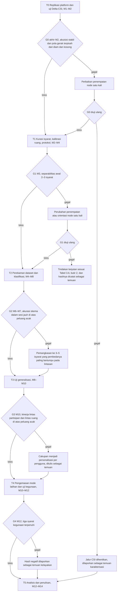
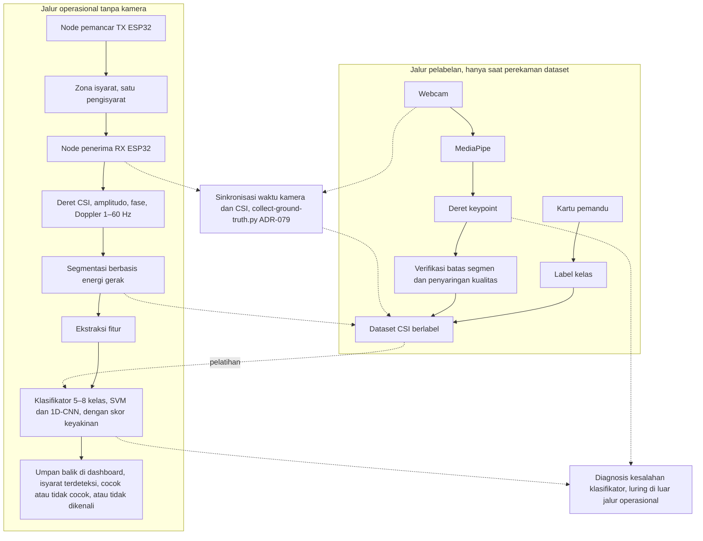

# Alat Pembelajaran Isyarat SIBI Tanpa Kamera Berbasis Wi-Fi Channel State Information pada ESP32: Studi Kelayakan Umpan Balik Latihan bagi Pembelajar Pendengar

**PROPOSAL PENELITIAN**

| Identitas | Keterangan |
|---|---|
| Judul | Alat Pembelajaran Isyarat SIBI Tanpa Kamera Berbasis Wi-Fi *Channel State Information* pada ESP32: Studi Kelayakan Umpan Balik Latihan bagi Pembelajar Pendengar |
| Jenis dokumen | Proposal penelitian (seminar proposal), BAB I–III + Daftar Pustaka |
| Disusun oleh | [PERLU DATA: nama penulis] |
| NIM | [PERLU DATA: NIM penulis] |
| Program studi | [PERLU DATA: program studi] |
| Universitas | [PERLU DATA: nama universitas] |
| Pembimbing | [PERLU DATA: nama pembimbing, bila sudah ditetapkan] |
| Tahun | [PERLU DATA: tahun penyusunan] |

> Catatan pengemasan: dokumen ini disusun dari materi `sempro/dpj4-sibi-csi` (23 Oktober 2026) tanpa mengubah teks. Penanda `[PERLU DATA: ...]` dan `[PERLU RUJUKAN: ...]` berarti data belum tersedia dan harus diisi pemiliknya; daftar lengkapnya ada pada `laporan-penanda.md`. Diagram Gambar 3.1 dan 3.2 tersimpan sebagai berkas PNG pada `assets/`.

---

# BAB I PENDAHULUAN

## 1.1 Latar Belakang

Sebagian besar anak tunarungu lahir di tengah keluarga pendengar. Mitchell dan Karchmer [1], [2] menunjukkan kondisi tersebut melalui data siswa tunarungu di Amerika Serikat sekaligus membantah anggapan lama bahwa sekitar 10% anak tunarungu memiliki orang tua tunarungu. Proporsi yang lazim dikutip untuk anak tunarungu dengan orang tua pendengar berkisar 90–95% [1], [2]. Angka sebanding untuk Indonesia belum ditemukan dalam penelusuran penelitian ini [PERLU DATA: proporsi anak tunarungu dari orang tua pendengar di Indonesia] sehingga angka dari Amerika Serikat itu dipakai sebagai gambaran umum. Keluarga pendengar dari anak yang berkomunikasi dengan isyarat perlu ikut mempelajari bahasa isyarat, padahal proses belajarnya tidak mudah. Lieberman dkk. [3] melaporkan bahwa orang tua pendengar yang belajar *American Sign Language* (ASL) bersama anak tunarungunya membutuhkan akses kurikulum dan dukungan belajar yang terstruktur. Ritmeester dkk. [4] juga mengungkap hambatan praktis yang dihadapi orang tua pendengar ketika mempelajari bahasa isyarat.

Di Indonesia, juru bahasa isyarat masih terbatas, yaitu sekitar 500 orang untuk sekitar 1,92 juta penyandang tunarungu atau kira-kira satu juru bahasa untuk 3.840 orang [5]. Secara hukum, Undang-Undang Nomor 8 Tahun 2016 tentang Penyandang Disabilitas mengakui bahasa isyarat dan mewajibkan aksesibilitas komunikasi [6]. Kewajiban itu sulit dipenuhi bila kemampuan berisyarat hanya dimiliki segelintir juru bahasa. Orang pendengar di sekitar tunarungu, terutama keluarga dan guru, perlu ikut menguasai bahasa isyarat. Penelitian ini menyasar kelompok tersebut, yaitu pembelajar pendengar seperti anggota keluarga siswa tunarungu, calon guru, dan mahasiswa.

Sistem Isyarat Bahasa Indonesia (SIBI) dipilih sebagai objek penelitian meskipun bukan bahasa isyarat yang paling banyak dipakai komunitas tunarungu. Survei ekosistem bahasa isyarat yang dilaporkan Badan Riset dan Inovasi Nasional mencatat penggunaan Bahasa Isyarat Indonesia (BISINDO) sebesar 77,7%, SIBI 1,9%, campuran 14,9%, dan lainnya 5,6% [7]. Survei itu dilakukan secara daring dengan pengambilan sampel *purposive* di 26 provinsi sehingga tidak mewakili populasi nasional, tetapi tetap menunjukkan kecenderungan bahwa komunitas tunarungu lebih banyak memakai BISINDO dalam keseharian. Di sisi lain, pembelajar dari jalur pendidikan formal mempelajari SIBI, yaitu sistem isyarat yang memang berkembang di jalur itu [7]. Bagi keluarga yang anaknya bersekolah di jalur formal, SIBI merupakan sistem isyarat yang dipakai di sekolah [PERLU RUJUKAN: penggunaan SIBI dalam pembelajaran di sekolah luar biasa atau kurikulum pendidikan khusus]. Sebaliknya, bila tujuan utama keluarga adalah berkomunikasi sehari-hari dengan komunitas tunarungu, BISINDO lebih relevan; kebutuhan itu berada di luar cakupan penelitian ini dan menjadi kerja lanjutan.

Isyarat dipelajari melalui gerak tubuh sehingga kemampuan berisyarat tidak cukup dibangun dengan membaca kamus atau menghafal gambar; pembelajar perlu memperagakan isyarat berulang kali [PERLU RUJUKAN: pentingnya praktik peragaan berulang dalam pembelajaran bahasa isyarat]. Latihan berulang itu lebih bermanfaat bila pembelajar segera mengetahui apakah gerakannya sesuai dengan isyarat target [PERLU RUJUKAN: peran umpan balik segera dalam latihan keterampilan gerak atau pembelajaran bahasa isyarat]. Dengan demikian, pembelajar membutuhkan sarana latihan yang cepat memberi umpan balik atas setiap peragaan isyarat. Sarana yang ditelusuri dalam penelitian ini masih terbatas untuk kebutuhan tersebut [PERLU DATA: aplikasi atau video belajar SIBI yang tersedia beserta bentuk umpan baliknya]. Pendampingan oleh guru atau kursus SIBI belum tentu tersedia bagi keluarga [PERLU DATA: ketersediaan guru atau kursus SIBI bagi keluarga dan calon guru]. *Kamus SIBI* [8] menyajikan acuan bentuk baku isyarat, sedangkan latihan dengan cermin atau rekaman diri memberi umpan balik visual; keduanya tidak menilai kesesuaian peragaan dengan isyarat target.

Teknologi bantu komunikasi bagi tunarungu terus berkembang [9]. Di antara pendekatan pengenalan isyarat, sensor yang dikenakan pada tangan dapat menangkap konfigurasi jari [PERLU RUJUKAN: pengenalan isyarat berbasis sarung tangan sensor atau sensor inersia], tetapi perangkatnya harus dipasang setiap kali berlatih [PERLU RUJUKAN: hambatan pemakaian sensor yang dikenakan dalam latihan isyarat]. Riset pengenalan isyarat di Indonesia yang ditelusuri dalam penelitian ini umumnya bertumpu pada citra atau video dari kamera [10]–[14]. Pendekatan berbasis kamera menuntut pencahayaan dan sudut pengambilan gambar tertentu [PERLU RUJUKAN: kepekaan pengenalan isyarat berbasis kamera terhadap pencahayaan dan sudut pandang]. Selain itu, berlatih di depan kamera yang menyala diduga terasa seperti diawasi sehingga sulit dijadikan kebiasaan harian; dugaan ini diperlakukan sebagai hipotesis yang ditelaah secara deskriptif melalui kuesioner persepsi pada kondisi kamera menyala dan kamera mati. Bila dugaan tersebut benar, sarana latihan yang tidak memerlukan kamera menyala dapat menjadi alternatif, dan penelitian ini menjajaki kemungkinan itu melalui penginderaan berbasis sinyal Wi-Fi.

Wi-Fi *Channel State Information* (CSI) memuat informasi amplitudo dan fase pada setiap *subcarrier*; kedua besaran itu berubah ketika gerak tubuh mengganggu jalur propagasi sinyal [15]. Gerak lengan juga menghasilkan komponen Doppler yang dapat diukur sehingga gerakan dapat dikenali tanpa kamera dan tanpa sensor yang dipasang pada tubuh. Ma dkk. [16] memanfaatkan sifat tersebut melalui SignFi yang mengenali 276 isyarat ASL dari CSI, sedangkan Shang dan Wu [17] membangun sistem pengenalan bahasa isyarat yang tangguh dengan beberapa perangkat Wi-Fi. Pendekatan serupa dikembangkan pada DF-WiSLR yang tidak memerlukan perangkat pada tubuh pengguna [18], pada model berbasis jaringan *Long Short-Term Memory* [19], dan pada pengenalan *Filipino Sign Language* [20]. WiASL [21] memperluas arah itu dengan mengenali tulisan ASL menggunakan perangkat Wi-Fi komersial. Meskipun demikian, penelusuran literatur dalam penelitian ini [PERLU DATA: basis data, kata kunci, dan rentang tahun penelusuran literatur] belum menemukan publikasi yang memakai CSI untuk mengenali isyarat SIBI maupun untuk memberi umpan balik latihan kepada pembelajar bahasa isyarat. Kebaruan yang diajukan tidak terletak pada jumlah kosakata, tetapi pada penerapan CSI dari dua node ESP32 untuk isyarat SIBI dan pada pemakaian keluaran klasifikator sebagai umpan balik latihan yang ditinjau validator penutur tunarungu.

Penelitian ini memakai ESP32, yaitu mikrokontroler murah dengan radio Wi-Fi yang dapat mengekspor CSI; basis akuisisi CSI pada ESP32 dikembangkan oleh Hernandez dan Bulut [22]. Platform RuView [23] melengkapi ESP32 dengan *firmware* penangkap CSI, *server* pengolahan sinyal, kalibrasi ruang, segmentasi berbasis energi gerak, *dashboard* web, dan mode privasi yang membuang fitur biometrik. Sebagai proyek sumber terbuka, RuView beserta kelayakan akuisisi CSI pada kedua node diverifikasi lebih dahulu pada tahap awal penelitian sebelum dipakai untuk perekaman. Kamera hanya dipakai saat perekaman *dataset*, yaitu untuk memverifikasi batas segmen isyarat melalui *keypoint* MediaPipe [24], dan pada satu kondisi uji persepsi. Rancangan yang dikerjakan dalam penelitian ini mencakup penempatan kedua node, protokol perekaman beserta kurasi kosakata, ekstraksi fitur dan klasifikasi, serta mode latihan umpan balik, sedangkan RuView menjadi basis akuisisinya. Rancangan itu tidak terikat pada satu bahasa isyarat sehingga perluasan ke BISINDO pada prinsipnya cukup dilakukan dengan mengganti *dataset* dan mengulang validasi bersama penutur BISINDO.

Panjang gelombang Wi-Fi pada pita 2,4 GHz dan 5 GHz berkisar 6–12 cm sehingga, pada satu tautan antara dua node ESP32, perbedaan konfigurasi jari dan ekspresi wajah diasumsikan terlalu halus untuk dibedakan secara andal [PERLU RUJUKAN: batas resolusi spasial CSI terhadap gerak jari dan ekspresi wajah]. Keberhasilan SignFi dan penelitian sejenis dalam mengenali isyarat tangan tidak serta-merta berlaku pada konfigurasi ini [PERLU DATA: perangkat, jumlah antena, dan lebar pita pada SignFi, Wi-SL, dan HandFi]. Oleh karena itu, penelitian ini membatasi pengenalan pada lintasan lengan, tubuh atas, dan kepala. Umpan balik ditampilkan di *dashboard* berupa isyarat yang terdeteksi klasifikator dan kecocokannya dengan isyarat target; skor di bawah ambang [PERLU DATA: ambang skor keyakinan, ditetapkan dari data validasi] ditampilkan sebagai "isyarat tidak dikenali, ulangi". Umpan balik "benar" berarti lintasan gerak sesuai, bukan bentuk jari yang tepat, sehingga peragaan dengan bentuk jari keliru tetapi lintasan sesuai tetap dapat dinyatakan cocok. Sistem dengan demikian diposisikan sebagai pelengkap guru, bukan penilai mutu peragaan.

Uraian tersebut menempatkan penelitian ini sebagai studi kelayakan yang menguji apakah CSI dari dua node ESP32 dapat menjadi dasar umpan balik latihan SIBI tanpa kamera bagi pembelajar pendengar. Tahapan penelitian dilengkapi gerbang keputusan sehingga penelitian tetap menghasilkan temuan kelayakan walaupun berhenti di salah satu tahap. Bila suatu gerbang tidak terpenuhi, cakupan dipersempit, misalnya jumlah isyarat dipangkas atau evaluasi beralih ke personalisasi per pengguna [PERLU DATA: keputusan bersama pembimbing apakah rentang 5–8 isyarat pada rumusan masalah dan batasan masalah disesuaikan dengan cabang pemangkasan menjadi 3–5 isyarat pada gerbang G2]. Seperti kamera, CSI pun peka terhadap lingkungan karena model berbasis CSI mudah mengalami *overfitting* pada orang dan ruang tempat data direkam [25]; keunggulan Wi-Fi atas kamera dengan demikian tidak diasumsikan. Oleh karena itu, kinerja klasifikasi diukur pada skenario dalam sesi, lintas partisipan, dan lintas ruang; skenario dalam sesi memakai pembagian data temporal per blok, bukan pembagian acak, dan setiap hasil dibandingkan dengan peluang acak. Widar3.0 [26] dijadikan sumber strategi lintas domain dalam merancang fitur.

Kinerja model saja belum cukup untuk menyatakan alat ini layak sebagai sarana latihan sehingga kelayakan juga ditinjau dari umpan balik latihan, latensi, persepsi kenyamanan pengguna, dan penilaian validator penutur tunarungu. Kosakata yang dilatihkan dikurasi bersama validator penutur tunarungu, yang juga menilai kebenaran bentuk isyarat dan kewajaran umpan balik. Karena model dilatih dari peragaan pengisyarat kompeten, sedangkan penggunanya adalah pemula, umpan balik latihan ditinjau dari kesesuaian status cocok atau tidak cocok yang ditampilkan sistem dengan penilaian validator atas peragaan pemula yang sama serta dari proporsi peragaan yang ditolak sistem. Kesesuaian tersebut menjadi salah satu syarat gerbang keputusan terakhir. Ketepatan peragaan sebelum dan sesudah latihan juga dinilai validator dengan rubrik, tetapi perubahan skornya hanya dilaporkan secara deskriptif sebagai gambaran capaian peserta dan tidak ditafsirkan sebagai efek kausal sistem. Latensi diukur dari selesainya isyarat hingga umpan balik tampil, sedangkan keandalan operasional ditinjau dari laju deteksi palsu per jam saat tidak ada isyarat [PERLU DATA: batas latensi ujung ke ujung, batas laju deteksi palsu per jam, dan batas tingkat penolakan yang dianggap layak, disepakati bersama pembimbing sebelum T4]. Rancangan sistem, kinerja klasifikasi, dan kelayakan sebagai sarana latihan selanjutnya dirumuskan sebagai masalah penelitian pada subbab berikut.

## 1.2 Rumusan Masalah

Berdasarkan latar belakang yang telah dipaparkan, masalah yang dikaji dalam penelitian ini dirumuskan sebagai berikut.

1. Bagaimana merancang sistem akuisisi CSI berbasis platform RuView pada dua node ESP32 beserta protokol perekaman *dataset* isyarat SIBI terisolasi yang kosakatanya divalidasi penutur tunarungu?
2. Bagaimana kinerja klasifikasi 5–8 isyarat SIBI terisolasi dari fitur amplitudo, fase, dan spektrum Doppler CSI pada skenario dalam sesi, lintas partisipan, dan lintas ruang?
3. Bagaimana kelayakan sistem sebagai sarana latihan SIBI tanpa kamera bagi pembelajar pendengar ditinjau dari umpan balik latihan, latensi, persepsi kenyamanan pengguna, dan penilaian validator penutur tunarungu?

## 1.3 Tujuan Penelitian

Berdasarkan rumusan masalah tersebut, tujuan penelitian ini adalah sebagai berikut.

1. Merancang sistem akuisisi CSI berbasis platform RuView pada dua node ESP32 beserta protokol perekaman *dataset* isyarat SIBI terisolasi yang kosakatanya divalidasi penutur tunarungu.
2. Mengukur kinerja klasifikasi 5–8 isyarat SIBI terisolasi dari fitur amplitudo, fase, dan spektrum Doppler CSI pada skenario dalam sesi, lintas partisipan, dan lintas ruang.
3. Menguji kelayakan sistem sebagai sarana latihan SIBI tanpa kamera bagi pembelajar pendengar berdasarkan umpan balik latihan, latensi, persepsi kenyamanan pengguna, dan penilaian validator penutur tunarungu.

## 1.4 Batasan Masalah

Ruang lingkup penelitian ini dibatasi sebagai berikut.

1. Objek penelitian adalah 5–8 isyarat SIBI terisolasi yang dipilih melalui dua saringan. Saringan pertama adalah separabilitas fisik, yaitu isyarat dibedakan oleh lintasan lengan, tubuh atas, atau kepala, bukan oleh bentuk jari. Saringan kedua adalah validitas pedagogis, yaitu isyarat disetujui validator penutur tunarungu dan dicocokkan dengan *Kamus SIBI* [8]. Sistem yang dikembangkan bukan penerjemah kalimat dan tidak menangani pengenalan isyarat kontinu.
2. Konfigurasi jari dan ekspresi wajah tidak dikenali sehingga umpan balik "benar" berarti lintasan gerak sesuai dengan isyarat target.
3. Setiap sesi hanya melibatkan satu pengisyarat di zona akuisisi; sistem tidak mengidentifikasi individu.
4. Perangkat terdiri atas dua node ESP32, yaitu node pemancar (TX) dan node penerima (RX), serta sebuah laptop. Kamera hanya menyala saat perekaman *dataset* dan pada satu kondisi uji persepsi, sedangkan mode latihan berjalan tanpa kamera.
5. Pengujian dilakukan di sedikitnya dua ruang mitra yang dikalibrasi dalam penelitian ini; penyiapan mandiri oleh pengguna di rumah berada di luar cakupan.
6. Uji pengguna dilakukan dalam skala kecil dengan 3–5 pembelajar pendengar pemula dan dianalisis secara deskriptif; empati tidak diukur secara psikometrik.

## 1.5 Manfaat Penelitian

Manfaat penelitian ini dibedakan menjadi manfaat teoretis dan manfaat praktis.

### 1.5.1 Manfaat Teoretis

Penelitian ini diharapkan memberikan bukti awal tentang kelayakan pengenalan sekelompok kecil isyarat SIBI terisolasi dari CSI dua node ESP32, yaitu isyarat yang dipilih karena dibedakan oleh lintasan gerak; bukti itu tidak berlaku bagi kosakata yang dibedakan oleh bentuk jari [PERLU DATA: proporsi kosakata Kamus SIBI yang dibedakan terutama oleh lintasan gerak]. *Dataset* direkam dari 3–4 pengisyarat kompeten di sedikitnya dua ruang sehingga kinerja pada skenario lintas partisipan dan lintas ruang bersifat indikatif. Karena penelitian ini dirancang sebagai studi kelayakan, hasil yang tidak sesuai harapan pun tetap memberikan informasi tentang batas pendekatan yang digunakan, misalnya jenis lintasan gerak yang masih dapat dibedakan dengan dua node ESP32. Penelitian ini juga menautkan ukuran kinerja model dengan ukuran kegunaan bagi pembelajar sehingga dapat menjadi bahan pertimbangan bagi penelitian penginderaan nirkabel yang menyasar kebutuhan pembelajaran.

### 1.5.2 Manfaat Praktis

Bagi lembaga pendidikan mitra, penelitian ini memberikan gambaran kelayakan sarana latihan pendamping dalam pembelajaran SIBI beserta protokol kurasi kosakata yang disusun bersama validator penutur tunarungu. Bila tahapan penelitian mencapai gerbang keputusan terakhir, penelitian ini diharapkan menghasilkan purwarupa sarana latihan SIBI yang memberi umpan balik atas lintasan gerak tanpa kamera menyala selama latihan; bila penelitian berhenti lebih awal, artefak yang dihasilkan berupa laporan karakterisasi sinyal, protokol, atau *dataset* berlabel. Purwarupa itu dimaksudkan sebagai pelengkap, bukan pengganti guru atau juru bahasa isyarat.

Bagi pembelajar pendengar, kosakata yang dilatihkan divalidasi penutur tunarungu sehingga latihan memakai bentuk isyarat yang diakui penuturnya. Keluarga siswa tunarungu merupakan sasaran jangka panjang karena penyiapan dan kalibrasi perangkat dilakukan dalam penelitian ini, bukan oleh pengguna; kemandirian pemakaian di rumah belum diuji dan menjadi syarat penelitian lanjutan.

Bagi komunitas riset penginderaan nirkabel, penelitian ini diharapkan menyediakan *dataset* CSI isyarat SIBI berlabel beserta protokol perekamannya. *Dataset* yang dipublikasikan hanya memuat CSI, label, dan *keypoint* tanpa identitas partisipan sehingga dapat dipakai untuk replikasi dan pembandingan metode. Rancangan yang tidak terikat pada satu bahasa isyarat juga memudahkan perluasan ke BISINDO.

## 1.6 Sistematika Penulisan

Proposal penelitian ini terdiri atas tiga bab dengan sistematika sebagai berikut.

**BAB I Pendahuluan** memuat latar belakang, rumusan masalah, tujuan penelitian, batasan masalah, manfaat penelitian, dan sistematika penulisan.

**BAB II Kajian Pustaka** memuat landasan teori tentang bahasa isyarat dan SIBI, pembelajaran bahasa isyarat oleh pendengar, Wi-Fi CSI, mikrokontroler ESP32 dan platform RuView, estimasi pose berbasis visi, pengenalan isyarat dan gestur berbasis CSI beserta ekstraksi fitur dan klasifikasinya, dan evaluasi kelayakan, serta penelitian terdahulu yang relevan.

**BAB III Metode Penelitian** memuat desain penelitian; tahapan penelitian beserta gerbang keputusan; waktu dan lokasi penelitian; alat dan bahan; perancangan sistem; protokol perekaman *dataset* beserta partisipan dan etika penelitian; pengolahan sinyal, ekstraksi fitur, dan klasifikasi; skenario pengujian dan metrik evaluasi; jadwal penelitian; serta parameter rancangan yang ditetapkan kemudian.

---

# BAB II KAJIAN PUSTAKA

## 2.1 Bahasa Isyarat dan Sistem Isyarat Bahasa Indonesia

Bahasa isyarat merupakan bahasa visual yang menyampaikan makna melalui gerak tangan, lengan, tubuh, dan ekspresi wajah [PERLU RUJUKAN: definisi bahasa isyarat]. Di Indonesia, Undang-Undang Nomor 8 Tahun 2016 tentang Penyandang Disabilitas mengakui bahasa isyarat dan mewajibkan penyediaan aksesibilitas komunikasi [6]. Kewajiban tersebut sulit dipenuhi oleh juru bahasa isyarat saja karena jumlahnya terbatas (Subbab 2.2). Penelitian ini memandang bahwa kemampuan berisyarat pihak pendengar di lingkungan tunarungu, termasuk di sekolah, ikut menentukan terpenuhinya aksesibilitas komunikasi tersebut.

Pemakaian bahasa isyarat di Indonesia tidak seragam. Survei ekosistem bahasa isyarat [7] menunjukkan bahwa Bahasa Isyarat Indonesia (BISINDO) jauh lebih banyak dipakai respondennya daripada Sistem Isyarat Bahasa Indonesia (SIBI), sedangkan SIBI berkembang di pendidikan formal; angka pemakaian dan keterbatasan sampel survei tersebut telah dipaparkan pada Subbab 1.1. SIBI dan BISINDO memiliki karakteristik yang berbeda [PERLU RUJUKAN: karakteristik SIBI dan perbedaannya dengan BISINDO]. Bentuk baku isyarat SIBI didokumentasikan dalam *Kamus Sistem Isyarat Bahasa Indonesia* [8], yang selanjutnya disebut *Kamus SIBI*.

Pemilihan SIBI dalam penelitian ini didasarkan pada jalur pendidikan formal yang ditempuh pembelajar sasarannya, bukan pada jumlah penggunanya (Subbab 1.1). Alat yang dirancang tidak dimaksudkan menggantikan pembelajaran BISINDO. Rancangan sistem tidak terikat pada satu bahasa isyarat tertentu. Perluasan ke BISINDO pada prinsipnya dapat dilakukan dengan mengganti *dataset*, menyeleksi ulang kosakata dengan kriteria yang sama (Subbab 2.3), dan melakukan validasi bersama validator penutur tunarungu pengguna BISINDO. Kelayakan perluasan tersebut tidak diuji dalam penelitian ini dan diusulkan sebagai penelitian lanjutan.

Secara struktural, sebuah isyarat tersusun atas bentuk tangan, lokasi, gerak, orientasi telapak tangan, dan komponen nonmanual seperti ekspresi wajah; perbedaan pada satu parameter saja dapat membedakan makna dua isyarat [PERLU RUJUKAN: parameter fonologis isyarat]. Dalam penelitian ini, kelima parameter tersebut menjadi acuan untuk memisahkan bagian isyarat yang dapat dinilai sistem dari bagian yang tetap memerlukan penilaian validator penutur tunarungu (Subbab 2.3).

## 2.2 Pembelajaran Bahasa Isyarat oleh Pendengar

Bahasa isyarat tidak hanya dipelajari oleh tunarungu, tetapi juga oleh keluarga pendengar. Sebagian besar anak tunarungu lahir dari orang tua pendengar [1], [2], dan orang tua pendengar yang belajar bahasa isyarat membutuhkan dukungan belajar yang terstruktur serta menghadapi hambatan praktis [3], [4]; data dan temuan tersebut telah dipaparkan pada Subbab 1.1. Kebutuhan serupa diduga juga dialami pembelajar pendengar SIBI yang masuk melalui jalur pendidikan formal [PERLU DATA: kebutuhan belajar pembelajar pendengar SIBI di Indonesia, termasuk calon guru dan mahasiswa]. Bagi rancangan sarana latihan, kebutuhan akan dukungan yang terstruktur menjadi alasan kosakata yang dilatihkan disusun lebih dahulu dan divalidasi bersama validator penutur tunarungu (Subbab 2.3).

Kebutuhan akan pendengar yang mampu berisyarat diperkuat oleh terbatasnya jumlah juru bahasa isyarat di Indonesia [5], sebagaimana dipaparkan pada Subbab 1.1. Keterbatasan tersebut menandakan bahwa komunikasi sehari-hari tunarungu tidak dapat bertumpu pada juru bahasa isyarat saja sehingga kemampuan isyarat pendengar di sekitarnya ikut menentukan kelancaran komunikasi tersebut. Kondisi itu berlaku bagi pembelajar pendengar pada umumnya dan tidak menentukan sistem isyarat yang dipelajari; pemilihan SIBI dalam penelitian ini didasarkan pada jalur pendidikan formal (Subbab 2.1). Upaya lain untuk menjembatani kesenjangan komunikasi adalah teknologi bantu komunikasi; Rodríguez-Correa dkk. [9] meninjau secara sistematis manfaat dan perkembangannya bagi tunarungu.

Bagi pembelajar pendengar, latihan mandiri memerlukan umpan balik atas isyarat yang diperagakannya. Kamus dan buku menyediakan bentuk acuan, tetapi tidak menilai apakah gerak yang diperagakan pembelajar sudah sesuai. Umpan balik yang segera memungkinkan pembelajar memperbaiki gerak pada repetisi berikutnya [PERLU RUJUKAN: peran umpan balik segera dalam latihan keterampilan gerak atau pembelajaran bahasa isyarat].

Pengenalan isyarat berbasis kamera (Subbab 2.8) dapat menjadi dasar umpan balik otomatis [PERLU RUJUKAN: sistem latihan bahasa isyarat dengan umpan balik otomatis berbasis kamera atau sensor], tetapi pendekatan tersebut menuntut pencahayaan dan sudut pengambilan gambar tertentu [PERLU RUJUKAN: kepekaan pengenalan isyarat berbasis kamera terhadap pencahayaan dan sudut pandang]. Sistem berbasis sinyal Wi-Fi dalam penelitian ini juga memiliki tuntutan sendiri. Pengguna harus berada di zona isyarat di antara dua node ESP32, dan ruang perlu dikalibrasi lebih dulu dengan kalibrasi bawaan yang berlangsung ±4 menit (Subbab 2.4). Kalibrasi tersebut dilakukan di ruang mitra, sedangkan penyiapan mandiri oleh pengguna di rumah berada di luar cakupan penelitian ini. Dengan demikian, pembeda utama yang ditelusuri adalah kehadiran kamera selama latihan.

Kehadiran kamera yang menyala diduga membuat pembelajar merasa diawasi, sedangkan rasa diawasi dapat memengaruhi kenyamanan dan kemauan untuk berlatih berulang [PERLU RUJUKAN: pengaruh rasa diawasi terhadap kenyamanan dan kemauan berlatih]. Atas dasar dugaan tersebut, mode latihan dalam penelitian ini memberikan umpan balik per repetisi tanpa kamera menyala. Dugaan itu diperlakukan sebagai hipotesis kerja yang ditelusuri secara deskriptif melalui kuesioner persepsi (BAB III), sedangkan pembentukan kebiasaan harian itu sendiri tidak diukur.

## 2.3 Wi-Fi *Channel State Information*

Wi-Fi *Channel State Information* (CSI) merupakan informasi amplitudo dan fase pada setiap *subcarrier* yang menggambarkan kondisi kanal propagasi antara pemancar dan penerima Wi-Fi [15]. Sinyal Wi-Fi tiba di penerima melalui beberapa jalur, yaitu jalur langsung dan jalur pantulan dari dinding, perabot, serta tubuh manusia [15]. Ketika tubuh bergerak di antara pemancar dan penerima, panjang jalur pantulan berubah sehingga amplitudo dan fase pada setiap *subcarrier* ikut berubah. Perubahan itulah yang dimanfaatkan untuk mengenali gerak tanpa sensor yang dikenakan di tubuh.

Amplitudo dan fase memuat informasi yang berbeda tentang perubahan kanal. Cai dkk. [27] memanfaatkan keduanya sebagai informasi yang saling melengkapi untuk pengenalan gestur. Setiap *subcarrier* menempati frekuensi yang sedikit berbeda sehingga satu gerak yang sama menghasilkan perubahan yang tidak identik pada setiap *subcarrier* [15]. Dengan demikian, CSI menyediakan banyak kanal pengamatan dari satu pasang pemancar dan penerima.

Gerak lengan juga menghasilkan komponen Doppler, yaitu pergeseran frekuensi yang sebanding dengan laju perubahan panjang jalur pantulan [15], [26]. Komponen tersebut dapat diukur dari deret CSI dan mencerminkan kecepatan gerak. Penelitian ini memusatkan analisis Doppler pada pita frekuensi gerak 1–60 Hz. Agar pita tersebut terwakili, laju pencuplikan (*sampling rate*) CSI harus sekurang-kurangnya dua kali frekuensi tertingginya, yaitu 120 Hz, sesuai kriteria Nyquist [PERLU RUJUKAN: teorema pencuplikan Nyquist]. Laju pencuplikan node ESP32 pada konfigurasi RuView adalah [PERLU DATA: laju pencuplikan CSI node ESP32 pada konfigurasi RuView] dan diukur pada tahap replikasi (BAB III). Bila laju terukur lebih rendah daripada 120 Hz, pita Doppler yang dapat diamati menyempit hingga setengah laju pencuplikan aktual; tindakan rancangan untuk kondisi tersebut diuraikan pada BAB III.

Pola CSI tidak hanya dipengaruhi oleh gerak isyarat, tetapi juga oleh pengisyarat yang memperagakannya dan ruang tempat perekaman. Akibatnya, model berbasis CSI mudah mengalami *overfitting* terhadap orang dan ruang tempat data pelatihan direkam [25]. Chen dkk. [25] merangkum strategi generalisasi lintas domain untuk mengatasi persoalan tersebut. Zhang dkk. [26] mengusulkan Widar3.0 yang mengenali gestur lintas domain tanpa pelatihan ulang dengan profil kecepatan yang diturunkan dari Doppler. Dalam penelitian ini, strategi lintas domain dijadikan acuan rancangan, sedangkan kemampuan generalisasi sistem diukur langsung melalui skenario pengujian yang diuraikan pada Subbab 2.7.

Panjang gelombang Wi-Fi pada pita 2,4 GHz dan 5 GHz berkisar 6–12 cm dan membatasi resolusi spasial CSI. Sejumlah penelitian melaporkan pengenalan isyarat dan gestur tangan dari CSI [16], [28], [29] dengan perangkat dan konfigurasi antena tertentu [PERLU DATA: perangkat, jumlah antena, dan lebar pita pada SignFi, Wi-SL, dan HandFi]. Penelitian ini tidak mengasumsikan kemampuan tersebut juga dimiliki perangkat yang digunakan. Dengan dua node ESP32, perbedaan konfigurasi jari dan ekspresi wajah diasumsikan terlalu halus untuk dibedakan secara andal [PERLU RUJUKAN: batas resolusi spasial CSI terhadap gerak jari dan ekspresi wajah] sehingga cakupan pengenalan dibatasi pada lintasan lengan, tubuh atas, dan kepala.

Batas resolusi tersebut menentukan dua keputusan penelitian. Pertama, isyarat yang dipilih harus dapat dibedakan melalui lintasan lengan, tubuh atas, atau kepala, bukan melalui bentuk jari. Kriteria tersebut menjadi saringan separabilitas fisik. Selain itu, isyarat harus lolos saringan validitas pedagogis, yaitu disetujui validator penutur tunarungu dan dicocokkan dengan *Kamus SIBI* [8]. Jumlah kandidat isyarat dalam *Kamus SIBI* yang lolos saringan separabilitas fisik adalah [PERLU DATA: perkiraan jumlah kandidat isyarat Kamus SIBI yang lolos saringan separabilitas fisik].

Kedua, umpan balik bersifat parsial. Umpan balik "benar", yang ditampilkan sebagai status cocok, hanya berarti lintasan gerak lengan, tubuh atas, dan kepala sesuai dengan isyarat target, bukan berarti bentuk jari sudah benar. Bentuk jari dan ekspresi wajah tidak dinilai sistem sehingga peragaan dengan lintasan sesuai tetapi bentuk tangan keliru tidak dapat dideteksi. Ketepatan isyarat secara utuh dinilai terpisah oleh validator penutur tunarungu dengan rubrik pada peragaan sebelum dan sesudah latihan (BAB III). Batas tersebut dinyatakan sebagai keterbatasan penelitian.

## 2.4 Mikrokontroler ESP32 dan Platform RuView

ESP32 merupakan mikrokontroler berbiaya rendah dengan radio Wi-Fi yang dapat mengekspor CSI [22]. Hernandez dan Bulut [22] mengembangkan sistem penginderaan Wi-Fi mandiri yang ringan berbasis *Internet of Things*, dan penelitian tersebut menjadi dasar alat akuisisi CSI pada ESP32. Varian papan yang digunakan dalam penelitian ini adalah [PERLU DATA: varian ESP32 yang dipakai, misalnya ESP32 DevKit atau ESP32-S3]. Dua node ESP32 berperan sebagai node pemancar (TX) dan node penerima (RX) yang mengapit zona isyarat. Laptop berperan sebagai *server* RuView, perangkat pelatihan model, dan tampilan umpan balik.

RuView merupakan proyek sumber terbuka yang menyediakan rantai akuisisi dan pengolahan CSI pada ESP32. Menurut dokumentasi repositorinya [23], komponen RuView meliputi *firmware* ESP32 penangkap CSI, *server* pengolahan sinyal, kalibrasi ruang bawaan, segmentasi berbasis energi gerak, *dashboard* web, dan mode privasi. *Firmware* tersebut memakai format *frame* yang ditetapkan dalam dokumen ADR-018 RuView [PERLU DATA: kepanjangan dan arti ADR pada repositori RuView] dan mengirimkan data secara *streaming* melalui *User Datagram Protocol* (UDP). Kalibrasi ruang bawaan memakai 600 *frame* dan 8 *anchor* dengan durasi ±4 menit. Mode privasi membuang fitur biometrik [PERLU DATA: fitur biometrik yang dibuang mode privasi RuView]. RuView juga menyediakan *pipeline* akuisisi tersinkron kamera–CSI melalui skrip `scripts/collect-ground-truth.py` (ADR-079) yang memakai MediaPipe PoseLandmarker.

Karena bersumber dari repositori perangkat lunak dan tidak melalui telaah sejawat, fungsi RuView diverifikasi lebih dulu pada tahap replikasi melalui gerbang keputusan G0 sebelum digunakan untuk perekaman (BAB III). Video yang direkam pada jalur pelabelan diatur terpisah oleh protokol etika penelitian (BAB III). Tabel 2.1 memetakan fitur RuView beserta perannya dalam penelitian ini, termasuk fitur yang tidak dipakai.

Tabel 2.1 Pemetaan fitur RuView terhadap peran dalam penelitian ini

| Fitur RuView | Peran dalam penelitian ini |
|---|---|
| *Firmware* ESP32 penangkap CSI (format *frame* ADR-018, *streaming* UDP) | Mengalirkan deret CSI dari node RX ke laptop |
| *Server* pengolahan sinyal | Menerima dan mengolah deret CSI sebelum segmentasi dan ekstraksi fitur |
| Kalibrasi ruang bawaan (600 *frame* + 8 *anchor*, ±4 menit) | Mengalibrasi ruang mitra pada awal setiap sesi perekaman |
| Segmentasi berbasis energi gerak | Memotong deret CSI menjadi segmen isyarat terisolasi |
| *Dashboard* web | Menampilkan umpan balik latihan: isyarat terdeteksi, cocok atau tidak cocok, atau "tidak dikenali" |
| Mode privasi | Membuang fitur biometrik selama penelitian |
| *Pipeline* akuisisi tersinkron kamera–CSI (`scripts/collect-ground-truth.py`, ADR-079) | Menyinkronkan video, *keypoint* MediaPipe, dan CSI pada jalur pelabelan |
| Modul estimasi pose *on-device* | Tidak dipakai |

Modul estimasi pose *on-device* RuView tidak dipakai karena klasifikasi isyarat dilakukan langsung dari fitur CSI. Dengan menggunakan RuView, penelitian ini tidak membangun rantai akuisisi dari awal sehingga upaya penelitian dapat dipusatkan pada kurasi isyarat SIBI, perekaman *dataset*, klasifikasi, dan umpan balik latihan.

## 2.5 Estimasi Pose Berbasis Visi dan Perannya dalam Perekaman *Dataset*

Estimasi pose merupakan tugas visi komputer (*computer vision*) untuk memperkirakan posisi *keypoint* tubuh manusia, seperti bahu, siku, dan pergelangan tangan, dari citra atau video [PERLU RUJUKAN: definisi estimasi pose manusia]. MediaPipe [24] merupakan kerangka kerja untuk membangun *pipeline* persepsi. BlazePose [30] melacak pose tubuh secara *real-time* di perangkat dan menghasilkan 33 *landmark* tubuh, sedangkan MediaPipe Hands [31] melacak tangan secara *real-time* dan menghasilkan 21 *landmark* per tangan. Kim dkk. [32] memberikan contoh penerapan MediaPipe Pose untuk estimasi pose manusia yang dioptimalkan dengan model *humanoid*. MediaPipe PoseLandmarker sudah terintegrasi pada *pipeline* akuisisi tersinkron ADR-079 di RuView (Subbab 2.4) sehingga penelitian ini menggunakan MediaPipe yang tersedia dan tidak melatih model visi baru. *Landmark* tangan dari MediaPipe Hands melengkapi *landmark* tubuh tersebut dalam deret *keypoint* yang dipakai pada jalur pelabelan (BAB III).

Pemakaian visi sebagai pemberi supervisi bagi pelatihan model Wi-Fi telah memiliki preseden. Wang dkk. [33] mengembangkan Person-in-WiFi yang memperoleh persepsi tubuh dari sinyal Wi-Fi dengan supervisi kamera. Geng dkk. [34] mengembangkan DensePose From WiFi yang memetakan sinyal Wi-Fi ke koordinat permukaan setiap bagian tubuh dengan jaringan visi sebagai guru. Kedua penelitian tersebut menjadi preseden konsep "guru visi, murid CSI": kamera menyediakan label acuan selama pelatihan, sedangkan model Wi-Fi belajar memperoleh informasi serupa dari sinyal. Namun, keduanya bekerja pada tingkat tubuh, bukan pada tingkat jari.

Dalam penelitian ini, konsep tersebut tidak diterapkan pada pelatihan klasifikator. Label kelas isyarat berasal dari protokol elisitasi: kartu pemandu ditampilkan sebelum setiap repetisi sehingga kelas setiap segmen sudah diketahui. MediaPipe hanya memberikan deret *keypoint* yang digunakan untuk tiga keperluan. Pertama, batas awal dan akhir segmen isyarat diverifikasi. Kedua, segmen buruk disaring, misalnya ketika orang tidak terdeteksi atau *keypoint* mengalami *jitter*. Ketiga, kesalahan klasifikator didiagnosis, yaitu apakah kesalahan terjadi karena lintasan dua isyarat mirip atau karena sinyal lemah. Distilasi pengetahuan (*knowledge distillation*) pose secara penuh, yaitu rantai CSI ke pose lalu ke kelas isyarat, diusulkan sebagai penelitian lanjutan. Kamera hanya menyala saat perekaman *dataset* dan pada satu kondisi uji persepsi, sedangkan mode latihan berjalan tanpa kamera.

## 2.6 Pengenalan Isyarat dan Gestur Berbasis CSI

Pengenalan bahasa isyarat dari CSI telah diteliti pada beberapa bahasa isyarat di luar Indonesia. Sebagian penelitian menargetkan kosakata besar, seperti SignFi yang diusulkan Ma dkk. [16] untuk mengenali 276 isyarat *American Sign Language* (ASL) dari CSI. Penelitian lain menekankan ketangguhan sistem dengan beberapa perangkat Wi-Fi [17], pengenalan tanpa perangkat yang dikenakan pengguna (*device-free*) melalui DF-WiSLR [18], atau model deret waktu berbasis jaringan *Long Short-Term Memory* [19]. Pengenalan berbasis CSI juga telah dicoba pada *Filipino Sign Language* [20]. Kelompok penelitian tersebut menjadi acuan pengenalan isyarat dari CSI dalam penelitian ini.

Penelitian pengenalan gestur berbasis CSI menjadi acuan rancangan fitur dan strategi generalisasi dalam penelitian ini. Profil kecepatan berbasis Doppler pada Widar3.0 [26] (Subbab 2.3) mendasari pemakaian fitur Doppler. Wi-SL [28] mengenali gestur isyarat yang halus dari CSI tanpa kontak, sedangkan HandFi [29] mengenali gestur tangan dari CSI. Pada sisi aplikasi, Qin dkk. [21] mengembangkan WiASL yang mengenali tulisan ASL dengan perangkat Wi-Fi komersial. Pendekatan Wi-SL dan HandFi pada gestur tangan tidak diterapkan secara langsung dalam penelitian ini karena detail jari tidak dijadikan target pada konfigurasi dua node ESP32 (Subbab 2.3).

Berdasarkan penelitian tersebut, fitur yang digunakan dalam penelitian ini meliputi amplitudo dan fase *subcarrier* terpilih, spektrum Doppler pada pita 1–60 Hz, serta statistik ringkas berupa energi, entropi, dan lintasan puncak [15], [26], [29], [27]. Amplitudo dan fase merekam perubahan kanal secara langsung, sedangkan spektrum Doppler merekam kecepatan gerak. Statistik ringkas mengubah setiap segmen menjadi vektor berukuran tetap yang dapat langsung diolah klasifikator.

*Support Vector Machine* (SVM) merupakan klasifikator yang mencari *hyperplane* pemisah dengan margin terbesar antarkelas [PERLU RUJUKAN: teori Support Vector Machine]. Dalam penelitian ini, SVM digunakan sebagai pembanding dasar (*baseline*). Pembandingnya adalah *one-dimensional Convolutional Neural Network* (1D-CNN) berukuran kecil, yaitu varian *Convolutional Neural Network* (CNN) yang menerapkan konvolusi sepanjang satu sumbu [PERLU RUJUKAN: teori 1D-CNN untuk data deret waktu]. Pada data deret waktu, sumbu tersebut adalah sumbu waktu sehingga pola gerak lokal dapat dipelajari dari urutan nilai di dalam segmen. Untuk SVM, fitur setiap segmen diringkas menjadi satu vektor, sedangkan untuk 1D-CNN fitur disusun sebagai deret per langkah waktu (BAB III). Ukuran 1D-CNN dibuat kecil karena *dataset* yang direkam terbatas, yaitu ±30 repetisi per isyarat per sesi.

Klasifikator himpunan tertutup (*closed-set*) selalu memilih salah satu kelas, termasuk ketika gerak yang diperagakan tidak termasuk kosakata yang dilatihkan atau bukan isyarat sama sekali [PERLU RUJUKAN: klasifikasi dengan opsi penolakan/open-set]. Untuk alat latihan, perilaku tersebut berisiko memberikan umpan balik yang menyesatkan. Oleh karena itu, keluaran klasifikator dilengkapi skor keyakinan. Jika skor berada di bawah ambang, sistem menampilkan pesan "isyarat tidak dikenali, ulangi"; jika berada di atas ambang, sistem menampilkan isyarat yang terdeteksi beserta kecocokannya dengan isyarat target. Nilai ambang ditetapkan dari data validasi [PERLU DATA: ambang skor keyakinan, ditetapkan dari data validasi]. Karena perekaman hanya memuat peragaan benar dari pengisyarat kompeten (BAB III), ambang yang ditetapkan dari data validasi diduga hanya mengurangi risiko umpan balik yang menyesatkan dan tidak menghilangkannya. Kecukupan ambang ditelusuri melalui laju deteksi palsu per jam saat tidak ada isyarat dan penilaian validator penutur tunarungu atas kewajaran umpan balik (Subbab 2.7). Makna kecocokan tersebut mengikuti batas yang diuraikan pada Subbab 2.3.

## 2.7 Evaluasi Kelayakan

Studi kelayakan (*feasibility study*) digunakan untuk menilai apakah suatu pendekatan dapat dijalankan sebelum dikembangkan lebih jauh [PERLU RUJUKAN: definisi studi kelayakan]. Dalam penelitian ini, kelayakan dinilai bertahap melalui gerbang keputusan G0–G4 (BAB III). Kriteria gerbang yang menyangkut kinerja klasifikasi dirumuskan relatif terhadap peluang acak, tidak sebagai target akurasi. Setiap tahap menghasilkan artefak tetap, yaitu laporan karakterisasi sinyal, protokol perekaman, *dataset* berlabel, model klasifikasi, atau laporan kelayakan. Dengan demikian, kegagalan pada suatu gerbang tetap dilaporkan sebagai temuan kelayakan.

Kinerja klasifikasi diukur dengan akurasi, presisi, *recall*, skor F1 makro, dan *confusion matrix* per isyarat [PERLU RUJUKAN: metrik evaluasi klasifikasi]. Skor F1 makro merata-ratakan skor setiap isyarat tanpa pembobotan sehingga setiap isyarat berbobot sama, sedangkan *confusion matrix* memperlihatkan pasangan isyarat yang saling tertukar. Setiap metrik dilaporkan bersama peluang acak, yaitu 1/jumlah kelas, dan tingkat penolakan karena akurasi yang tinggi dapat menyesatkan bila sebagian besar segmen ditolak.

Pengujian mencakup skenario dalam sesi, lintas sesi, lintas partisipan, lintas ruang, dan satu pengguna baru tanpa pelatihan ulang. Pada skenario lintas partisipan (*leave-one-subject-out*), data satu pengisyarat dijadikan data uji secara bergiliran, sedangkan pada skenario lintas ruang (*leave-one-room-out*), data satu ruang dijadikan data uji secara bergiliran. Bagi alat latihan, setiap pembelajar merupakan pengguna baru yang tidak terwakili dalam data latih karena *dataset* direkam oleh 3–4 pengisyarat kompeten. Karena itu, skenario lintas partisipan dan pengguna baru paling dekat dengan kondisi pemakaian, sedangkan skenario dalam sesi menggambarkan kinerja pada kondisi yang paling menguntungkan. Jalur cadangan berupa personalisasi per pengguna (BAB III) memerlukan contoh acuan yang diperagakan dengan benar, padahal pembelajar pemula belum tentu mampu memperagakannya [PERLU DATA: mekanisme perekaman acuan bagi pengguna baru].

Repetisi yang berurutan dalam satu sesi cenderung mirip sehingga pembagian acak dapat membocorkan informasi dari data latih ke data uji. Untuk mencegah kebocoran tersebut, skenario dalam sesi memakai pembagian data temporal per blok. Langkah yang bergantung pada data, seperti pemilihan *subcarrier*, normalisasi, dan penetapan ambang, juga dihitung tanpa memakai data uji pada setiap skenario (BAB III).

Kelayakan sebagai sarana latihan ditinjau dari umpan balik latihan, latensi, persepsi kenyamanan pengguna, dan penilaian validator penutur tunarungu. Latensi ujung ke ujung (*end-to-end latency*), yaitu selang waktu dari selesainya isyarat hingga umpan balik tampil, diukur karena umpan balik baru bermanfaat bila diterima segera (Subbab 2.2). Laju deteksi palsu per jam saat tidak ada isyarat diukur untuk mengetahui seberapa sering sistem bereaksi terhadap gangguan, seperti orang lewat, kipas angin, atau perabot yang bergeser. Persepsi pengguna diukur dengan kuesioner skala Likert [PERLU RUJUKAN: skala Likert] dan dianalisis secara deskriptif tanpa statistik inferensial. Ketepatan peragaan peserta sebelum dan sesudah latihan dinilai validator penutur tunarungu dengan rubrik yang independen dari sistem CSI, dan validator juga menilai kewajaran umpan balik sistem.

## 2.8 Penelitian Terdahulu

Penelitian ini disusun dengan mempertimbangkan penelitian terdahulu pada tiga topik, yaitu pengenalan bahasa isyarat dari sinyal Wi-Fi, transfer visi ke Wi-Fi, dan pengenalan bahasa isyarat di Indonesia (SIBI atau BISINDO) berbasis visi. Tabel 2.2 membandingkan penelitian tersebut berdasarkan modalitas, bahasa isyarat, kebebasan dari kamera saat sistem dipakai, dan fokus penelitian.

Tabel 2.2 Perbandingan penelitian terdahulu

| No. | Peneliti (Tahun) | Modalitas | Bahasa isyarat | Bebas kamera saat dipakai | Fokus penelitian |
|---|---|---|---|---|---|
| 1 | Shang dan Wu (2017) [17] | Wi-Fi, beberapa perangkat | [PERLU DATA: bahasa isyarat yang dikenali] | Ya | Pengenalan bahasa isyarat yang tangguh |
| 2 | Ma dkk. (2018) [16] | CSI | ASL | Ya | Pengenalan 276 isyarat |
| 3 | Ahmed dkk. (2020) [18] | Wi-Fi, tanpa perangkat yang dikenakan | [PERLU DATA: bahasa isyarat yang dikenali] | Ya | Pengenalan bahasa isyarat |
| 4 | Baldeo dkk. (2024) [20] | CSI | *Filipino Sign Language* | Ya | Pengenalan bahasa isyarat |
| 5 | Wang dkk. (2019) [33] | Wi-Fi; kamera sebagai supervisi saat pelatihan | Bukan bahasa isyarat | Ya | Persepsi tubuh dari Wi-Fi |
| 6 | Geng dkk. (2023) [34] | Wi-Fi; jaringan visi sebagai guru saat pelatihan | Bukan bahasa isyarat | Ya | Pose padat pada setiap bagian tubuh |
| 7 | Dwijayanti dkk. (2021) [11] | Citra; CNN | Bahasa isyarat di Indonesia [PERLU DATA: SIBI atau BISINDO] | Tidak | Pengenalan isyarat dari citra |
| 8 | Kindy dkk. (2025) [12] | Video | BISINDO tingkat kata | Tidak | Penyusunan *dataset* dan metode *baseline* |
| 9 | Wiguna dan Rojali (2025) [13] | Video | BISINDO tingkat kalimat | Tidak | Pengenalan kalimat |
| 10 | Sebastian dkk. (2025) [14] | Visi; gestur tubuh berbasis informasi spasial | BISINDO | Tidak | Pengenalan isyarat |
| 11 | [PERLU RUJUKAN: penelitian pengenalan isyarat SIBI berbasis kamera atau sensor] | [PERLU DATA: sesuai rujukan] | SIBI | [PERLU DATA: sesuai rujukan] | Pengenalan isyarat SIBI |
| 12 | [PERLU RUJUKAN: sistem latihan bahasa isyarat dengan umpan balik otomatis berbasis kamera atau sensor] | Kamera atau sensor | [PERLU DATA: sesuai rujukan] | [PERLU DATA: sesuai rujukan] | Latihan isyarat dengan umpan balik otomatis |
| 13 | [PERLU RUJUKAN: pengenalan isyarat berbasis sarung tangan sensor atau sensor inersia] | Sensor yang dikenakan pada tangan | [PERLU DATA: sesuai rujukan] | Ya | Pengenalan isyarat, termasuk konfigurasi jari |
| 14 | Penelitian ini | CSI pada dua node ESP32; kamera hanya untuk pelabelan dan satu kondisi uji persepsi | SIBI | Ya | Umpan balik latihan bagi pembelajar pendengar |

Tabel 2.2 memperlihatkan tiga kelompok penelitian. Kelompok pertama mengenali bahasa isyarat dari sinyal Wi-Fi [17], [16], [18], [20]. Kelompok ini menunjukkan bahwa isyarat dapat dikenali tanpa kamera saat sistem dipakai, dengan bahasa yang diteliti antara lain ASL dan *Filipino Sign Language*. Sasaran kelompok ini adalah pengenalan isyarat; orientasi pembelajaran belum ditemukan dalam penelusuran literatur penelitian ini [PERLU DATA: verifikasi apakah penelitian kelompok pertama memuat orientasi pembelajaran]. Kelompok kedua memindahkan pengetahuan visi ke Wi-Fi [33], [34]. Kamera hanya berperan saat pelatihan, dan sasarannya adalah persepsi tubuh umum.

Kelompok ketiga mengenali bahasa isyarat di Indonesia (SIBI atau BISINDO) dari citra atau video. Dwijayanti dkk. [11] menggunakan CNN pada citra, sedangkan Kindy dkk. [12] menyusun *dataset* video BISINDO tingkat kata beserta metode *baseline*. Wiguna dan Rojali [13] mengenali kalimat BISINDO dari video, dan Sebastian dkk. [14] menggunakan pengenalan gestur tubuh yang memperhitungkan informasi spasial (*spatially aware*). Tinjauan sistematis atas pengenalan BISINDO [10] juga berfokus pada teknik *deep learning* untuk pengolahan citra. Seluruh penelitian dalam kelompok ini memerlukan kamera saat sistem dipakai. Selain ketiga kelompok tersebut, Tabel 2.2 memuat dua pembanding yang paling dekat dengan penelitian ini, yaitu penelitian pengenalan isyarat SIBI dan sistem latihan bahasa isyarat dengan umpan balik otomatis; rujukan keduanya masih perlu dilengkapi. Tabel 2.2 juga memuat pengenalan isyarat berbasis sensor yang dikenakan pada tangan sebagai pendekatan lain yang tidak memerlukan kamera. Pendekatan tersebut dapat menangkap konfigurasi jari, tetapi perangkatnya harus dipasang setiap kali berlatih [PERLU RUJUKAN: hambatan pemakaian sensor yang dikenakan dalam latihan isyarat].

Dalam batas penelusuran literatur penelitian ini [PERLU DATA: basis data, kata kunci, dan rentang tahun penelusuran literatur], belum ditemukan penelitian yang mengenali isyarat SIBI dari CSI. Belum ditemukan pula penelitian yang memakai CSI pada ESP32 untuk memberikan umpan balik latihan isyarat bagi pembelajar pendengar.

Penelitian ini mengambil unsur dari dua kelompok pertama dan menempatkan diri sebagai alternatif bagi kelompok ketiga. Dari kelompok pertama, penelitian ini mengambil pengenalan isyarat dari CSI, tetapi menerapkannya pada 5–8 isyarat SIBI terisolasi dengan dua node ESP32 berbasis RuView. Dari kelompok kedua, penelitian ini mengambil gagasan perekaman kamera bersama CSI, tetapi kamera tidak menghasilkan label kelas dan tidak memberi supervisi bagi pelatihan model CSI; perannya terbatas pada verifikasi segmen, penyaringan kualitas, dan diagnosis. Berbeda dari kelompok ketiga yang berfokus pada pengenalan berbasis kamera, penelitian ini menyiapkan jalur latihan tanpa kamera menyala. Selain kinerja klasifikasi, penelitian ini menilai kelayakan sistem sebagai sarana latihan berdasarkan umpan balik latihan, latensi, persepsi kenyamanan pengguna, dan penilaian validator penutur tunarungu (Subbab 2.7). Karena merupakan studi kelayakan, penelitian ini tidak menetapkan target akurasi tertentu, dan hasil negatif pada tahap mana pun tetap dilaporkan sebagai temuan kelayakan (Subbab 2.7).

---

# BAB III METODE PENELITIAN

## 3.1 Desain Penelitian

Penelitian ini dirancang sebagai studi kelayakan kuantitatif bergerbang yang dilengkapi uji kegunaan deskriptif. Bagian kuantitatif mengukur sejauh mana Wi-Fi *Channel State Information* (CSI) dari dua node ESP32 dapat membedakan 5–8 isyarat terisolasi Sistem Isyarat Bahasa Indonesia (SIBI). Setelah klasifikator diuji, bagian deskriptif menilai kelayakan keluarannya sebagai umpan balik latihan bagi pembelajar pendengar. Struktur bergerbang dipilih karena kemampuan CSI membedakan isyarat SIBI belum dapat dipastikan sebelum data dikumpulkan. Sesuai Subbab 2.7, setiap tahap menghasilkan artefak tetap, kegagalan gerbang dicatat sebagai temuan, dan kriteria akurasi dirumuskan relatif terhadap peluang acak.

Rumusan masalah pertama dijawab pada tahap replikasi platform serta kurasi isyarat dan protokol. Rumusan masalah kedua dijawab melalui uji klasifikasi pada tahap perekaman dan generalisasi. Skenario dalam sesi, lintas partisipan, dan lintas ruang diuji sebagai skema 1, 3, dan 4 pada Tabel 3.3, sedangkan skema lintas sesi dan pengguna baru menjadi pelengkap. Rumusan masalah ketiga ditinjau melalui uji operasional, uji kegunaan, dan penilaian validator penutur tunarungu pada tahap pengemasan mode latihan.

## 3.2 Tahapan Penelitian

Penelitian berlangsung selama empat belas minggu (M1–M14) dalam enam tahap. Tahapan dimulai dari replikasi platform (T0), kemudian kurasi isyarat dan protokol (T1), perekaman *dataset* dan klasifikasi (T2), uji generalisasi (T3), pengemasan mode latihan dan uji kegunaan (T4), hingga analisis dan penulisan (T5). Lima tahap pertama ditutup oleh gerbang keputusan G0–G4, seperti ditunjukkan pada Gambar 3.1. Kriteria lolos dan tindakan bila gagal pada setiap gerbang direncanakan untuk ditetapkan sebelum gerbang terkait dinilai; parameter yang belum ditetapkan dihimpun pada Tabel 3.6 (Subbab 3.10). Tahap yang berurutan berbagi satu minggu peralihan.

Gambar 3.1 Tahapan penelitian dan gerbang keputusan

### 3.2.1 Tahap T0: Replikasi Platform dan Uji Delta-CSI (M1–M2)

Dua node ESP32 disiapkan dengan *firmware* RuView [23] (Subbab 2.4), lalu *pipeline* akuisisi tersinkron `scripts/collect-ground-truth.py` (ADR-079) diuji tanpa partisipan untuk memastikan CSI dan video dapat diselaraskan. Arti kode ADR adalah [PERLU DATA: kepanjangan dan arti ADR pada repositori RuView]. Tahap ini ditempatkan paling awal karena *pipeline* yang belum stabil tidak layak dijadikan dasar perekaman. Uji Delta-CSI (Subbab 3.8.1) dan pengukuran laju pencuplikan (Subbab 3.7.1) menghasilkan laporan karakterisasi sinyal sebagai bahan G0.

### 3.2.2 Tahap T1: Kurasi Isyarat dan Protokol (M2–M4)

T1 mencakup kurasi 5–8 isyarat (Subbab 3.6.2) bersama validator penutur tunarungu, kalibrasi ruang mitra, penyusunan protokol perekaman dan etika, serta perizinan. Keluarannya adalah daftar isyarat, lembar definisi isyarat, dan protokol perekaman. G1 menguji separabilitas awal 2–3 isyarat dengan uji *nearest-centroid* sederhana, yaitu setiap repetisi dikelompokkan ke isyarat dengan rata-rata fitur terdekat. Rata-rata tersebut dihitung tanpa repetisi yang sedang diuji agar hasilnya tidak optimistis.

### 3.2.3 Tahap T2: Perekaman *Dataset* dan Klasifikasi (M4–M8)

*Dataset* direkam dengan ±30 repetisi per isyarat per sesi disertai video tersinkron (Subbab 3.6). Fitur dari segmen yang lolos penyaringan dipakai untuk melatih *Support Vector Machine* (SVM) sebagai pembanding dasar (*baseline*) dan *one-dimensional Convolutional Neural Network* (1D-CNN) berukuran kecil (Subbab 3.7). Keluaran T2 adalah *dataset* CSI berlabel dan model klasifikasi. Bila G2 gagal, cakupan dipangkas menjadi 3–5 isyarat yang pembedanya paling bertumpu pada lintasan lengan, tubuh atas, atau kepala. Kriteria pemangkasan tidak memakai data uji dan ditetapkan sebelum G2 dinilai (Tabel 3.6, butir 8). Hasil pada 5–8 isyarat awal tetap dilaporkan berdampingan dengan hasil pada himpunan terpangkas.

### 3.2.4 Tahap T3: Uji Generalisasi (M8–M10)

Model CSI mudah mengalami *overfitting* pada orang dan ruang tempat data latih direkam [25]. Oleh karena itu, model diuji lintas sesi, lintas partisipan, lintas ruang, dan pada satu pengguna baru tanpa pelatihan ulang (Subbab 3.7.5). Strategi lintas domain Widar3.0 [26] dijadikan acuan tanpa mengasumsikan hasil yang sama pada isyarat SIBI (Tabel 3.6, butir 15). Bila G3 gagal, cakupan menjadi personalisasi per pengguna yang memerlukan data latih dari setiap pengguna, padahal pembelajar pemula diduga belum dapat memperagakan isyarat dengan tepat. Untuk itu, model, ruang, dan prosedur yang dipakai pada T4 untuk setiap hasil G3 tercantum pada Tabel 3.6, butir 17.

### 3.2.5 Tahap T4: Pengemasan Mode Latihan dan Uji Kegunaan (M10–M12)

Klasifikator dikemas menjadi mode latihan tanpa kamera dengan umpan balik di *dashboard*. Selanjutnya, dilakukan uji operasional, uji kegunaan dengan 3–5 pembelajar pendengar pemula, pengisian kuesioner persepsi, dan penilaian validator (Subbab 3.8). Uji operasional ditempatkan pada T4 karena latensi baru dapat diukur setelah mode latihan berjalan. G4 menilai tiga syarat, yaitu skor uji awal (*pre-test*) dan uji akhir (*post-test*) tercatat, persepsi tercatat, dan validator menyetujui kewajaran umpan balik.

### 3.2.6 Tahap T5: Analisis dan Penulisan (M12–M14)

Seluruh artefak dianalisis dan disusun menjadi laporan kelayakan beserta rekomendasi berdasarkan gerbang yang lolos dan yang gagal. Laporan tersebut memuat keterbatasan secara eksplisit, terutama bahwa konfigurasi jari dan ekspresi wajah tidak dikenali dan umpan balik "benar" hanya berarti lintasan gerak sesuai (Subbab 2.3).

## 3.3 Waktu dan Lokasi Penelitian

Penelitian dilaksanakan pada [PERLU DATA: bulan dan tahun pelaksanaan penelitian] di [PERLU DATA: nama sekolah/lembaga mitra]. Perekaman dan pengujian dilakukan di sedikitnya dua ruang, yaitu jumlah minimum bagi skema *leave-one-room-out*, dan setiap ruang dikalibrasi sebelum perekaman (Subbab 3.5.3). Penyiapan sistem secara mandiri oleh pengguna di rumah berada di luar cakupan.

## 3.4 Alat dan Bahan

Dua unit ESP32 berperan sebagai node pemancar (TX) dan node penerima (RX), sedangkan laptop dipakai untuk pengolahan sinyal, pelatihan model, dan penampilan umpan balik (Tabel 3.1). Perangkat lunak disajikan pada Tabel 3.2; modul estimasi pose *on-device* RuView tidak dipakai dan versi setiap perangkat lunak dicatat bersama log konfigurasi pelatihan agar eksperimen dapat diulang.

Tabel 3.1 Perangkat keras penelitian

| No. | Nama | Spesifikasi | Jumlah | Keterangan |
|---|---|---|---|---|
| 1 | ESP32 | [PERLU DATA: varian ESP32 yang dipakai, misalnya ESP32 DevKit atau ESP32-S3] | 2 unit (+1 cadangan) | Node TX dan node RX penangkap CSI |
| 2 | Aksesori node | Kabel, adaptor daya, dudukan setinggi dada pengisyarat | 1 set | Pemasangan dan catu daya node |
| 3 | Laptop | Milik pribadi; [PERLU DATA: spesifikasi laptop] | 1 unit | *Server* RuView, mesin pelatihan, dan tampilan umpan balik |
| 4 | *Webcam* | Bawaan laptop | 1 unit | Hanya menyala saat sesi pelabelan dan pada satu kondisi uji persepsi |

Tabel 3.2 Perangkat lunak penelitian

| No. | Nama | Fungsi dalam penelitian |
|---|---|---|
| 1 | *Firmware* RuView | Menangkap CSI pada node ESP32 dalam format *frame* ADR-018 dan mengirimkannya melalui *User Datagram Protocol* (UDP) |
| 2 | *Server* RuView | Mengolah sinyal, mengalibrasi ruang, dan memotong deret CSI menjadi segmen berdasarkan energi gerak |
| 3 | `scripts/collect-ground-truth.py` (ADR-079) | Menyinkronkan akuisisi kamera dan CSI dengan MediaPipe PoseLandmarker |
| 4 | MediaPipe (Pose, Hands) | Menghasilkan deret *keypoint* tubuh dan tangan dari video pada jalur pelabelan |
| 5 | Python | Mengimplementasikan ekstraksi fitur, pelatihan, dan evaluasi model |
| 6 | scikit-learn | Mengimplementasikan klasifikator SVM |
| 7 | PyTorch | Mengimplementasikan klasifikator 1D-CNN |
| 8 | *Dashboard* RuView | Menampilkan umpan balik pada mode latihan |

Bahan penelitian meliputi *dataset* CSI hasil perekaman sendiri, lembar definisi isyarat, formulir persetujuan partisipan, instrumen uji awal dan uji akhir, serta kuesioner persepsi. *Dataset* direkam sendiri karena penelitian yang mengenali isyarat SIBI dari CSI belum ditemukan dalam penelusuran literatur penelitian ini (Subbab 2.8).

## 3.5 Perancangan Sistem

### 3.5.1 Arsitektur Dua Jalur

Sistem dirancang dalam dua jalur yang dipisahkan berdasarkan keberadaan kamera, seperti ditunjukkan pada Gambar 3.2.

Gambar 3.2 Arsitektur sistem dua jalur

Pada jalur operasional, gerak pengisyarat di zona isyarat antara node TX dan node RX mengubah amplitudo, fase, dan komponen Doppler pada deret CSI [15]. Deret tersebut diolah hingga menjadi umpan balik di *dashboard* tanpa kamera (Subbab 3.7).

Jalur pelabelan hanya aktif selama perekaman *dataset*. Label kelas berasal dari kartu pemandu yang ditampilkan sebelum setiap repetisi, bukan dari kamera. MediaPipe [24] mengubah video *webcam* menjadi deret *keypoint* tubuh [30] dan tangan [31] yang diselaraskan dengan CSI melalui ADR-079 untuk memverifikasi batas segmen, menyaring segmen buruk, dan mendiagnosis kesalahan klasifikator secara luring. Berbeda dengan preseden Person-in-WiFi [33] dan DensePose From WiFi [34] (Subbab 2.5), dalam penelitian ini kamera tidak mengajarkan pose kepada model CSI; distilasi pengetahuan penuh ditempatkan sebagai penelitian lanjutan.

### 3.5.2 Penempatan Node

Kedua node dipasang pada dudukan setinggi dada pengisyarat dan mengapit zona isyarat agar gerak lengan dan tubuh atas berada di antara TX dan RX; kesesuaiannya diperiksa melalui uji Delta-CSI. Zona isyarat hanya ditempati satu pengisyarat dalam setiap sesi. Sistem tidak mengidentifikasi individu. Jarak antarnode dan ukuran zona isyarat ditetapkan pada T0 (Tabel 3.6, butir 27) dan dicatat dalam metadata sesi.

### 3.5.3 Kalibrasi Ruang

Setiap sesi diawali kalibrasi ruang bawaan RuView selama ±4 menit dengan 600 *frame* dan 8 *anchor* karena CSI peka terhadap perubahan kondisi ruang [25]. Posisi perabot, kipas angin atau pendingin ruangan yang menyala, dan orang yang lewat dicatat sebagai kovariat untuk menganalisis perbedaan kinerja antarsesi dan antarruang.

## 3.6 Protokol Perekaman *Dataset*, Partisipan, dan Etika

### 3.6.1 Partisipan

Partisipan terdiri atas 3–4 pengisyarat kompeten, sedikitnya satu validator penutur tunarungu, dan 3–5 pembelajar pendengar pemula dengan kriteria inklusi dan rekrutmen pada Tabel 3.6, butir 3. Pengisyarat kompeten adalah guru atau pembina SIBI yang memperagakan isyarat untuk *dataset* dan dapat berasal dari kalangan penutur tunarungu. Validator wajib terlibat dalam pemilihan kosakata, pemeriksaan sampel segmen, penilaian ketepatan peragaan peserta, dan penilaian kewajaran umpan balik, sedangkan pembelajar pemula mengikuti uji kegunaan. Setiap pengisyarat direkam dalam sedikitnya dua sesi agar skema lintas sesi dapat dijalankan. Skema lintas ruang hanya memisahkan pengaruh ruang dari pengaruh orang bila pengisyarat yang sama direkam di setiap ruang (butir 4); profil pengguna baru tercantum pada butir 14.

### 3.6.2 Kurasi Isyarat

Isyarat dipilih melalui saringan separabilitas fisik dan validitas pedagogis (Subbab 2.3) dengan acuan *Kamus SIBI* [8]. Hasilnya adalah 5–8 isyarat terisolasi [PERLU DATA: daftar isyarat SIBI terpilih] yang dideskripsikan dalam lembar definisi isyarat sebagai acuan perekaman dan penilaian.

### 3.6.3 Prosedur Perekaman

Perekaman memakai elisitasi terisolasi, yaitu satu isyarat per segmen dengan jeda antarrepetisi. Adapun prosedur perekaman setiap sesi adalah sebagai berikut.

1. Memasang node TX dan node RX, lalu mengaktifkan mode privasi RuView.
2. Menjalankan kalibrasi ruang dan mencatat metadata sesi, yaitu tanggal, ruang, kode pengisyarat, posisi node, dan kondisi latar.
3. Menjalankan `scripts/collect-ground-truth.py` agar perekaman CSI dan *webcam* tersinkron.
4. Menampilkan kartu pemandu isyarat target, merekam satu repetisi, memberi jeda, dan mengulanginya hingga setiap isyarat mencapai ±30 repetisi.
5. Membuang segmen bila orang tidak terdeteksi MediaPipe, *jitter* *keypoint* ekstrem, atau segmen terpotong, lalu mencatat tingkat segmen terbuang per isyarat dan per pengisyarat sebagai indikator kualitas.
6. Meminta validator mengambil sampel segmen untuk memeriksa kebenaran bentuk isyarat yang diperagakan.

### 3.6.4 Etika Penelitian

Perekaman dimulai setelah persetujuan institusi mitra dan persetujuan tertulis setiap partisipan diperoleh [PERLU DATA: lembaga atau komisi pemberi persetujuan etik]. Ketentuan tersebut juga berlaku untuk uji T0 dan G1 meskipun keduanya berlangsung sebelum atau bersamaan dengan perizinan [PERLU DATA: pengisyarat dan lokasi uji T0 dan G1 beserta status persetujuannya]. Partisipan berhak mengundurkan diri kapan saja tanpa konsekuensi. Formulir persetujuan menyatakan bahwa kamera hanya menyala pada sesi pelabelan dan satu kondisi uji persepsi. Mode privasi RuView, yang membuang fitur biometrik, aktif selama penelitian. Video hanya dipakai untuk verifikasi batas segmen, penyaringan kualitas, dan diagnosis kesalahan. Video tersebut disimpan secara terbatas dan tidak dipublikasikan. *Dataset* publik hanya memuat CSI, label, dan *keypoint* tanpa identitas partisipan, sedangkan risiko pengenalan ulang individu dari pola gerak pada deret *keypoint* ditangani sesuai Tabel 3.6, butir 5. Token apresiasi validator tercantum pada butir 6.

## 3.7 Pengolahan Sinyal, Ekstraksi Fitur, dan Klasifikasi

### 3.7.1 Laju Pencuplikan

Laju pencuplikan CSI node ESP32 pada konfigurasi RuView adalah [PERLU DATA: laju pencuplikan CSI node ESP32 pada konfigurasi RuView]. Pita Doppler 1–60 Hz hanya terwakili bila laju pencuplikan sedikitnya 120 Hz (Subbab 2.3). Bila laju yang diukur pada T0 lebih rendah, pita yang dianalisis dibatasi hingga setengah laju aktual dan pembatasan itu dilaporkan.

### 3.7.2 Segmentasi

Deret CSI dipotong menjadi segmen isyarat dengan segmentasi berbasis energi gerak RuView. Batas segmen diverifikasi dengan deret *keypoint* hanya selama perekaman *dataset*, sedangkan mode latihan berjalan tanpa verifikasi kamera.

### 3.7.3 Ekstraksi Fitur

Sesuai Subbab 2.6, fitur setiap segmen terdiri atas amplitudo dan fase *subcarrier* terpilih yang saling melengkapi [27], spektrum Doppler pita 1–60 Hz [26], serta statistik ringkas berupa energi, entropi, dan lintasan puncak. Susunan fitur tersebut mengikuti praktik pengenalan gestur berbasis CSI [15], [29]. Kriteria pemilihan *subcarrier* dan definisi lintasan puncak tercantum pada Tabel 3.6, butir 9 dan 10. Fitur diringkas menjadi satu vektor untuk SVM dan disusun sebagai deret per langkah waktu untuk 1D-CNN.

### 3.7.4 Klasifikasi

SVM mencari batas pemisah antarkelas dengan margin terbesar [PERLU RUJUKAN: teori Support Vector Machine] dan dipilih sebagai pembanding dasar karena dapat dilatih pada *dataset* berukuran kecil [PERLU RUJUKAN: kesesuaian SVM untuk data latih berukuran kecil]. Model 1D-CNN menerapkan konvolusi sepanjang sumbu waktu deret fitur [PERLU RUJUKAN: teori 1D-CNN untuk data deret waktu] dan dipilih karena dapat mempelajari pola temporal langsung dari deret tersebut. Ukuran jaringannya dibuat kecil agar sebanding dengan jumlah data. SVM dan 1D-CNN diimplementasikan pada laptop, berturut-turut dengan scikit-learn dan PyTorch. Hiperparameter kedua klasifikator dipilih berdasarkan data validasi yang terpisah dari data uji.

### 3.7.5 Skema Pembagian Data

Kinerja klasifikator diukur dengan lima skema pembagian data pada Tabel 3.3. Skema dalam sesi memakai pembagian data temporal per blok, yaitu blok repetisi awal untuk pelatihan dan blok akhir untuk pengujian. Pembagian acak tidak dipakai karena repetisi yang berurutan cenderung mirip sehingga informasi dapat bocor dari data latih ke data uji.

Tabel 3.3 Skema pembagian data

| No. | Skema | Data latih | Data uji | Aspek yang diukur |
|---|---|---|---|---|
| 1 | Dalam sesi (pembagian data temporal per blok) | Blok awal dalam satu sesi | Blok akhir pada sesi yang sama | Separabilitas pada orang, ruang, dan sesi yang sama |
| 2 | Lintas sesi | Sebagian sesi seorang pengisyarat di satu ruang | Sesi lain dari pengisyarat dan ruang yang sama | Ketahanan terhadap perubahan antarsesi |
| 3 | Lintas partisipan (*leave-one-subject-out*) | Semua pengisyarat kecuali satu | Pengisyarat yang ditinggalkan, bergiliran | Ketahanan terhadap pergantian orang |
| 4 | Lintas ruang (*leave-one-room-out*) | Semua ruang kecuali satu | Ruang yang ditinggalkan, bergiliran | Ketahanan terhadap pergantian ruang |
| 5 | Pengguna baru | Seluruh pengisyarat *dataset* | Satu pengguna baru tanpa pelatihan ulang | Kesiapan dipakai orang baru tanpa perekaman tambahan |

Skema kedua sampai kelima mengukur ketahanan terhadap perubahan domain [25]; karena jumlah pengisyarat dan ruang kecil, hasil lintas partisipan dan lintas ruang dilaporkan untuk setiap putaran (*fold*). Data validasi hanya diambil dari data latih sehingga data uji tidak dipakai untuk memilih *subcarrier*, menormalkan fitur, memilih hiperparameter, atau menetapkan ambang (Tabel 3.6, butir 11). Karena segmen *dataset* tersaring kamera, sedangkan mode latihan tidak, kinerja pada data uji dapat lebih optimistis daripada kinerja jalur operasional (butir 12).

### 3.7.6 Umpan Balik dengan Penolakan

Mekanisme penolakan pada Subbab 2.6 diterapkan dengan ambang skor keyakinan dari data validasi (Tabel 3.6, butir 13). Segmen dengan skor keyakinan di bawah ambang ditampilkan sebagai "isyarat tidak dikenali, ulangi" agar tidak dinilai benar atau salah, sedangkan untuk segmen lain *dashboard* menampilkan isyarat yang terdeteksi beserta kecocokannya dengan isyarat target. Umpan balik "benar" atau status cocok paling jauh menyangkut lintasan lengan, tubuh atas, dan kepala, bukan bentuk jari (Subbab 2.3). Karena klasifikator hanya dilatih dengan peragaan benar pengisyarat kompeten, status cocok berarti segmen paling mirip dengan target di antara 5–8 kelas sehingga peragaan dengan lintasan keliru masih dapat dinilai cocok. Ambang skor keyakinan yang ditetapkan dari data pengisyarat kompeten juga belum tentu menolak peragaan semacam itu. Kemungkinan tersebut diperiksa melalui penilaian validator (Subbab 3.8.5).

## 3.8 Skenario Pengujian dan Metrik Evaluasi

Uji Delta-CSI mendasari G0, uji *nearest-centroid* (Subbab 3.2.2) mendasari G1, uji klasifikasi mendasari G2 dan G3, serta uji kegunaan dan penilaian validator mendasari G4. Adapun uji operasional dan diagnosis kesalahan melengkapi analisis tanpa menjadi syarat gerbang.

### 3.8.1 Uji Delta-CSI

Uji Delta-CSI dilakukan untuk mengetahui apakah gerak tubuh menghasilkan perubahan CSI yang terpisah jelas dari kondisi tanpa gerak, dengan ukuran keterpisahan dan batas stabilitas akuisisi pada Tabel 3.6, butir 1. Adapun prosedurnya adalah sebagai berikut.

1. Memasang node TX dan node RX pada posisi awal yang mengapit zona isyarat.
2. Merekam CSI pada kondisi ruang kosong, pengisyarat diam, dan pengisyarat bergerak di zona isyarat.
3. Mencatat laju pencuplikan aktual dan hasil uji kestabilan *pipeline* akuisisi tersinkron yang dijalankan tanpa partisipan (Subbab 3.2.1).
4. Membandingkan pola CSI antarkondisi, lalu mencatat dan menganalisis hasilnya sebagai bahan keputusan G0.

### 3.8.2 Uji Klasifikasi

Uji klasifikasi pada kelima skema memakai metrik pada Subbab 2.7, yaitu akurasi, presisi, *recall*, skor F1 makro, dan *confusion matrix* antarisyarat. Presisi, *recall*, dan skor F1 dirata-ratakan tanpa pembobotan antarisyarat. Setiap metrik dilaporkan bersama peluang acak, yaitu 20% untuk lima kelas, 12,5% untuk delapan kelas, dan 33,3% bila cakupan dipangkas menjadi tiga isyarat. Tingkat penolakan, yaitu proporsi segmen dengan skor keyakinan di bawah ambang, juga dilaporkan. Akurasi dilaporkan dalam dua bentuk, yaitu akurasi tanpa penolakan yang dihitung atas seluruh segmen uji dan akurasi dengan penolakan yang dihitung atas segmen yang diterima saja.

### 3.8.3 Uji Operasional

Laju deteksi palsu per jam dihitung sebagai jumlah isyarat yang terdeteksi saat tidak ada peragaan dibagi lama pengamatan dalam jam. Pengamatan mencakup gangguan berupa orang lewat, kipas angin yang menyala, dan perabot yang bergeser. Latensi ujung ke ujung (*end-to-end latency*) diukur sesuai definisi pada Subbab 2.7. Batas kelayakan, lama pengamatan, dan penanda waktu selesainya isyarat tercantum pada Tabel 3.6, butir 18–20. Adapun prosedurnya adalah sebagai berikut.

1. Menjalankan mode latihan di ruang yang telah dikalibrasi.
2. Merekam kondisi tanpa peragaan isyarat, termasuk saat ada gangguan, dan mencatat setiap isyarat yang terdeteksi.
3. Meminta pengisyarat memperagakan isyarat target, lalu mencatat waktu selesainya isyarat dan waktu umpan balik tampil.
4. Menghitung laju deteksi palsu per jam dan latensi ujung ke ujung, lalu menganalisis hasilnya.

### 3.8.4 Uji Kegunaan

Selain mencatat capaian peserta, uji kegunaan dengan 3–5 pembelajar pendengar pemula menelusuri hipotesis bahwa latihan yang tidak terasa diawasi lebih mudah dijadikan kebiasaan harian. Hipotesis itu ditelusuri melalui persepsi rasa diawasi, kenyamanan, dan kemauan berlatih lagi; pembentukan kebiasaan tidak diukur. Langkah uji untuk setiap peserta adalah sebagai berikut.

1. Menjelaskan tujuan uji, kondisi kamera, dan hak mundur, lalu meminta persetujuan tertulis.
2. Meminta peserta memperagakan setiap isyarat target sebagai uji awal.
3. Menjalankan sesi latihan pada kondisi kamera menyala dan kamera mati dengan urutan acak, masing-masing diikuti kuesioner persepsi yang sama.
4. Meminta peserta memperagakan kembali setiap isyarat target sebagai uji akhir.
5. Merekapitulasi skor dan jawaban kuesioner, lalu menganalisisnya secara deskriptif.

Kedua kondisi hanya berbeda pada keberadaan *webcam* yang menyala dan terlihat, sedangkan umpan balik tetap berasal dari CSI. Rancangan *within-subject* dengan urutan acak dipakai agar setiap peserta mengalami kedua kondisi dan pengaruh urutan berkurang. Kuesioner terdiri atas ±5 butir skala Likert tentang kenyamanan, rasa diawasi, dan kemauan berlatih lagi; durasi sesi, pendamping di ruangan, dan rincian kuesioner tercantum pada Tabel 3.6, butir 21–23.

Ketepatan peragaan uji awal dan uji akhir dinilai validator dengan rubrik yang independen dari sistem CSI (Tabel 3.6, butir 24) sehingga ukuran kemampuan peserta tidak bergantung pada klasifikator yang diuji. Cara pengamatan tercantum pada butir 25; bila validator mengamati langsung, validator mengetahui mana uji awal dan mana uji akhir sehingga penilaiannya tidak buta. Keterbatasan itu dilaporkan. Data dianalisis secara deskriptif tanpa klaim kausal dan tanpa statistik inferensial karena peserta sedikit dan tidak ada kondisi latihan tanpa umpan balik sebagai pembanding. Oleh karena itu, perubahan skor dilaporkan sebagai gambaran capaian peserta. Sesuai Subbab 1.4, empati tidak diukur secara psikometrik.

### 3.8.5 Penilaian Validator dan Diagnosis Kesalahan

Validator penutur tunarungu menilai kewajaran umpan balik sistem, yaitu kesesuaian status cocok atau tidak cocok yang ditampilkan sistem dengan penilaian validator atas peragaan yang sama. Untuk setiap percobaan peserta, keluaran sistem berupa cocok, tidak cocok, atau tidak dikenali dicatat, lalu validator menilai secara independen apakah lintasan peragaan sesuai dengan isyarat target. Kesesuaian keduanya disajikan dalam tabel silang dan proporsi percobaan yang tidak dikenali dilaporkan sebagai tingkat penolakan pada peragaan pemula. Kasus ketika sistem menampilkan status cocok untuk peragaan yang dinilai tidak sesuai oleh validator dilaporkan tersendiri karena dapat menyesatkan pembelajar. Persetujuan validator atas kewajaran umpan balik menjadi syarat G4 dengan batas kesesuaian pada Tabel 3.6, butir 26. Sebagai analisis sekunder, kesalahan klasifikator dikaitkan secara luring dengan kemiripan lintasan tubuh dari deret *keypoint* MediaPipe untuk membedakan kesalahan akibat lintasan yang mirip dari kesalahan akibat sinyal CSI yang lemah.

### 3.8.6 Kriteria Gerbang Keputusan

Kriteria setiap gerbang beserta waktu, ukuran, dan tindakan bila gagal disajikan pada Tabel 3.4. Karena dua dari tiga syarat G4 hanya bersifat kelengkapan data, kelayakan pada rumusan masalah ketiga ditinjau per dimensi, bukan dari lolosnya G4 saja. Dimensi umpan balik latihan ditinjau dari tabel silang sistem dan validator serta tingkat penolakan pada peragaan pemula. Dimensi latensi ditinjau dari latensi ujung ke ujung dengan laju deteksi palsu sebagai pelengkap; dimensi persepsi kenyamanan dari kuesioner; dan dimensi penilaian validator dari persetujuan atas kewajaran umpan balik. Skor uji awal dan uji akhir tidak dijadikan indikator dimensi umpan balik latihan.

Tabel 3.4 Kriteria gerbang keputusan

| Gerbang | Waktu | Ukuran | Kriteria lolos | Tindakan bila gagal |
|---|---|---|---|---|
| G0 | Akhir M2 | Stabilitas akuisisi tersinkron dan uji Delta-CSI | Akuisisi stabil dan pola CSI saat bergerak terpisah jelas dari kondisi diam dan kosong (Tabel 3.6, butir 1) | Penempatan node diperbaiki satu kali; bila gagal lagi, jalur CSI dihentikan dan dilaporkan sebagai temuan karakterisasi |
| G1 | M3 | Separabilitas awal 2–3 isyarat dengan uji *nearest-centroid* | Repetisi isyarat yang sama lebih dekat satu sama lain daripada ke isyarat lain | Penempatan atau orientasi node diubah satu kali; bila gagal lagi, tindakan mengikuti Tabel 3.6, butir 2 |
| G2 | M6–M7 | Akurasi skema dalam sesi | Jauh di atas peluang acak (1/jumlah kelas); ambang pada Tabel 3.6, butir 7 | Cakupan dipangkas menjadi 3–5 isyarat yang pembedanya paling bertumpu pada lintasan (Tabel 3.6, butir 8) |
| G3 | M10 | Kinerja lintas partisipan dan lintas ruang | Di atas peluang acak; ambang pada Tabel 3.6, butir 16 | Cakupan menjadi personalisasi per pengguna dan ditulis sebagai temuan |
| G4 | M12 | Kelengkapan uji kegunaan dan persetujuan validator | Skor uji awal dan uji akhir tercatat, persepsi tercatat, dan validator menyetujui kewajaran umpan balik dengan batas kesesuaian pada Tabel 3.6, butir 26 | Hasil negatif tetap dilaporkan sebagai temuan kelayakan |

## 3.9 Jadwal Penelitian

Jadwal empat belas minggu disajikan pada Tabel 3.5. Tanda ■ menunjukkan minggu pelaksanaan. Minggu yang ditempati dua tahap menandai peralihan antartahap.

Tabel 3.5 Jadwal penelitian

| No. | Kegiatan | M1 | M2 | M3 | M4 | M5 | M6 | M7 | M8 | M9 | M10 | M11 | M12 | M13 | M14 | Gerbang |
|---|---|---|---|---|---|---|---|---|---|---|---|---|---|---|---|---|
| 1 | T0 Replikasi platform dan uji Delta-CSI | ■ | ■ | | | | | | | | | | | | | G0 (akhir M2) |
| 2 | T1 Kurasi isyarat, kalibrasi ruang mitra, protokol perekaman dan etika, perizinan | | ■ | ■ | ■ | | | | | | | | | | | G1 (M3) |
| 3 | T2 Perekaman *dataset*, penyaringan segmen, ekstraksi fitur, pelatihan SVM dan 1D-CNN | | | | ■ | ■ | ■ | ■ | ■ | | | | | | | G2 (M6–M7) |
| 4 | T3 Uji lintas sesi, lintas partisipan, lintas ruang, dan pengguna baru | | | | | | | | ■ | ■ | ■ | | | | | G3 (M10) |
| 5 | T4 Pengemasan mode latihan, uji operasional, uji kegunaan, kuesioner persepsi, penilaian validator | | | | | | | | | | ■ | ■ | ■ | | | G4 (M12) |
| 6 | T5 Analisis dan penulisan (keterbatasan dan rekomendasi) | | | | | | | | | | | | ■ | ■ | ■ | — |

## 3.10 Parameter Rancangan yang Ditetapkan Kemudian

Parameter rancangan yang bergantung pada kesepakatan dengan pembimbing, hasil tahap sebelumnya, atau data validasi dihimpun pada Tabel 3.6. Setiap parameter direncanakan untuk ditetapkan sebelum dipakai untuk menilai data uji atau gerbang terkait.

Tabel 3.6 Parameter rancangan yang ditetapkan kemudian

| No. | Parameter | Waktu atau dasar penetapan | Status |
|---|---|---|---|
| 1 | Kriteria G0 | Sebelum T0 | [PERLU DATA: ukuran keterpisahan Delta-CSI antarkondisi beserta ambangnya, misalnya selisih varians amplitudo; batas stabilitas akuisisi tersinkron, misalnya proporsi frame hilang] |
| 2 | Tindakan bila G1 gagal kedua kalinya | Sebelum eksperimen | [PERLU DATA: tindakan bila G1 gagal untuk kedua kalinya, disepakati bersama pembimbing] |
| 3 | Inklusi dan rekrutmen | Sebelum dipakai | [PERLU DATA: kriteria kompetensi pengisyarat (misalnya lama mengajar atau memakai SIBI), dasar kefasihan SIBI validator, kriteria pemula, sumber rekrutmen pemula dari kalangan sasaran alat (keluarga siswa, calon guru, atau mahasiswa), dan teknik pemilihan partisipan] |
| 4 | Sesi per ruang | Sebelum dipakai | [PERLU DATA: jumlah sesi perekaman per pengisyarat dan per ruang; konfirmasi bahwa setiap pengisyarat direkam di setiap ruang] |
| 5 | Publikasi *dataset* | Sebelum dipakai | [PERLU DATA: penanganan titik wajah pada keypoint, pernyataan risiko pengenalan ulang dan izin publikasi dataset pada formulir persetujuan, serta repositori dan lisensi dataset] |
| 6 | Token validator | Sebelum dipakai | [PERLU DATA: bentuk token apresiasi validator, dikonfirmasi pembimbing] |
| 7 | Ambang G2 | Sebelum eksperimen | [PERLU DATA: ambang G2 yang disepakati bersama pembimbing sebelum eksperimen] |
| 8 | Kriteria pemangkasan | Sebelum G2 dinilai | [PERLU DATA: kriteria pemangkasan yang tidak memakai data uji, misalnya peringkat separabilitas fisik dari T1 atau hasil pada data validasi, serta apakah G2 dinilai ulang pada himpunan terpangkas] |
| 9 | Pemilihan *subcarrier* | Sebelum dipakai | [PERLU DATA: kriteria pemilihan subcarrier] |
| 10 | Lintasan puncak | Sebelum dipakai | [PERLU DATA: definisi operasional lintasan puncak] |
| 11 | Pembagian data | Sebelum dipakai | [PERLU DATA: ukuran blok dan proporsi data latih, validasi, dan uji; sumber dan proporsi data validasi pada skema dalam sesi, lintas sesi, lintas partisipan, lintas ruang, dan pengguna baru] |
| 12 | Perlakuan data uji | Sebelum dipakai | [PERLU DATA: apakah data uji memakai segmen tersaring kamera, segmen hasil segmentasi berbasis energi tanpa koreksi kamera, atau keduanya dilaporkan berdampingan] |
| 13 | Ambang skor keyakinan | Dari data validasi | [PERLU DATA: ambang skor keyakinan, ditetapkan dari data validasi] |
| 14 | Pengguna baru | Sebelum dipakai | [PERLU DATA: profil pengguna baru (pengisyarat kompeten di luar dataset atau pembelajar pemula) dan jumlah repetisi uji] |
| 15 | Strategi Widar3.0 | Sebelum dipakai | [PERLU DATA: komponen strategi Widar3.0 yang diadopsi dan kesesuaiannya dengan satu tautan antara dua node] |
| 16 | Ambang G3 | Sebelum T3 | [PERLU DATA: ambang G3 dari pembimbing dan waktu penetapannya] |
| 17 | Personalisasi | Sebelum dipakai | [PERLU DATA: model dan ruang yang dipakai pada uji kegunaan untuk setiap hasil G3, serta prosedur personalisasi bila G3 gagal, yaitu pemeraga data latih, jumlah repetisi, verifikasi oleh validator, dan minggu pelaksanaannya] |
| 18 | Batas operasional | Sebelum T4 | [PERLU DATA: batas latensi ujung ke ujung, batas laju deteksi palsu per jam, dan batas tingkat penolakan yang dianggap layak, disepakati bersama pembimbing sebelum T4] |
| 19 | Lama pengamatan | Sebelum dipakai | [PERLU DATA: durasi perekaman tanpa isyarat] |
| 20 | Penanda latensi | Sebelum dipakai | [PERLU DATA: cara menandai waktu selesainya isyarat untuk pengukuran latensi tanpa kamera] |
| 21 | Durasi latihan | Sebelum dipakai | [PERLU DATA: durasi sesi latihan per kondisi] |
| 22 | Pendamping | Sebelum dipakai | [PERLU DATA: keberadaan dan posisi pendamping atau validator di ruangan selama sesi latihan] |
| 23 | Kuesioner | Sebelum dipakai | [PERLU DATA: butir kuesioner persepsi dan rentang skala Likert] |
| 24 | Rubrik | Sebelum dipakai | [PERLU DATA: butir rubrik penilaian ketepatan isyarat] |
| 25 | Pengamatan validator | Sebelum T4 untuk kondisi kamera mati | [PERLU DATA: cara validator menilai peragaan pada uji awal dan uji akhir serta mengamati percobaan pada kondisi kamera mati tanpa menambah pemakaian kamera, misalnya pengamatan langsung; cara pengamatan pada kondisi kamera mati disepakati bersama pembimbing] |
| 26 | Batas kesesuaian G4 | Sebelum T4 | [PERLU DATA: batas kesesuaian minimum antara sistem dan validator untuk menyetujui kewajaran umpan balik, disepakati bersama pembimbing sebelum T4] |
| 27 | Jarak antarnode dan zona isyarat | Pada T0 | [PERLU DATA: jarak antarnode dan ukuran zona isyarat] |

---

# DAFTAR PUSTAKA

[1] R. E. Mitchell and M. A. Karchmer, "Chasing the mythical ten percent: Parental hearing status of deaf and hard of hearing students in the United States," *Sign Language Studies*, vol. 4, no. 2, pp. 138–163, 2004, doi: 10.1353/sls.2004.0005.

[2] R. E. Mitchell and M. A. Karchmer, "Parental hearing status and signing among deaf and hard of hearing students," *Sign Language Studies*, vol. 5, no. 2, pp. 231–244, 2005, doi: 10.1353/sls.2005.0004.

[3] A. M. Lieberman, J. Mitchiner, and E. Pontecorvo, "Hearing parents learning American Sign Language with their deaf children: A mixed-methods survey," *Applied Linguistics Review*, vol. 15, no. 1, pp. 309–333, 2022, doi: 10.1515/applirev-2021-0120.

[4] J. Ritmeester, B. Sümer, M. Boonstra, M. de Meulder, B. van der Aa, and F. Roelofsen, "Navigating sign language learning: Insights from hearing parents of deaf and hard-of-hearing children," *Journal of Deaf Studies and Deaf Education*, vol. 31, no. 1, pp. 85–103, 2025, doi: 10.1093/jdsade/enaf059.

[5] Kementerian Koordinator Bidang Pembangunan Manusia dan Kebudayaan, "Kemenko PMK bergerak bersama wujudkan selaras bahasa isyarat," 3 Okt. 2025. [Online]. Available: [PERLU RUJUKAN: URL lengkap rilis di kemenkopmk.go.id dan tanggal akses]

[6] Republik Indonesia, *Undang-Undang Nomor 8 Tahun 2016 tentang Penyandang Disabilitas*. Jakarta, Indonesia, 2016.

[7] Badan Riset dan Inovasi Nasional, "BRIN dorong penguatan ekosistem bahasa isyarat, BISINDO dominan digunakan penyandang tuli," 26 Agu. 2026. [Online]. Available: https://brin.go.id/news/130095 [PERLU DATA: tanggal akses]

[8] [PERLU RUJUKAN: data terbitan resmi Kamus Sistem Isyarat Bahasa Indonesia (penerbit, tahun, edisi)]

[9] P. A. Rodríguez-Correa, A. Valencia-Arias, O. N. Patiño-Toro, Y. Oblitas Díaz, and R. Teodori De la Puente, "Benefits and development of assistive technologies for Deaf people's communication: A systematic review," *Frontiers in Education*, vol. 8, Art. no. 1121597, 2023, doi: 10.3389/feduc.2023.1121597.

[10] S. A. Sanjaya and H. F. Ilone, "BISINDO sign language recognition: A systematic literature review of deep learning techniques for image processing," *Indonesian Journal of Computer Science*, vol. 12, no. 6, 2023, doi: 10.33022/ijcs.v12i6.3539.

[11] S. Dwijayanti, Hermawati, S. I. Taqiyyah, H. Hikmarika, and B. Y. Suprapto, "Indonesia sign language recognition using convolutional neural network," *International Journal of Advanced Computer Science and Applications*, vol. 12, no. 10, 2021, doi: 10.14569/IJACSA.2021.0121046.

[12] G. O. Kindy, G. Leonali, and H. Lucky, "Word-level BISINDO: A novel video Indonesian sign language dataset and baseline methods," *Procedia Computer Science*, vol. 269, pp. 249–258, 2025, doi: 10.1016/j.procs.2025.08.277.

[13] K. L. Wiguna and Rojali, "Sentence-level Indonesian sign language (BISINDO) recognition using 3D CNN-LSTM and 3D CNN-BiLSTM models," *International Journal of Advanced Computer Science and Applications*, vol. 16, no. 9, 2025, doi: 10.14569/IJACSA.2025.0160941.

[14] C. Sebastian, J. Limanza, L. Laurentia, J. Harefa, and K. Jingga, "Indonesian sign language (BISINDO) recognition using spatially aware body gesture recognition," *Procedia Computer Science*, vol. 269, pp. 1002–1011, 2025, doi: 10.1016/j.procs.2025.09.042.

[15] Y. Ma, G. Zhou, and S. Wang, "WiFi sensing with channel state information: A survey," *ACM Computing Surveys*, vol. 52, no. 3, pp. 1–36, 2019, doi: 10.1145/3310194.

[16] Y. Ma, G. Zhou, S. Wang, H. Zhao, and W. Jung, "SignFi: Sign language recognition using WiFi," *Proceedings of the ACM on Interactive, Mobile, Wearable and Ubiquitous Technologies*, vol. 2, no. 1, pp. 1–21, 2018, doi: 10.1145/3191755.

[17] J. Shang and J. Wu, "A robust sign language recognition system with multiple Wi-Fi devices," in *Proc. Workshop on Mobility in the Evolving Internet Architecture (MobiArch)*, 2017, pp. 19–24, doi: 10.1145/3097620.3097624.

[18] H. F. Thariq Ahmed, H. Ahmad, K. Narasingamurthi, H. Harkat, and S. K. Phang, "DF-WiSLR: Device-free Wi-Fi-based sign language recognition," *Pervasive and Mobile Computing*, vol. 69, Art. no. 101289, 2020, doi: 10.1016/j.pmcj.2020.101289.

[19] H. F. Thariq Ahmed, H. Ahmad, S. K. Phang, H. Harkat, and K. Narasingamurthi, "Wi-Fi CSI based human sign language recognition using LSTM network," in *Proc. 2021 IEEE Int. Conf. Industry 4.0, Artificial Intelligence, and Communications Technology (IAICT)*, 2021, pp. 51–57, doi: 10.1109/IAICT52856.2021.9532548.

[20] J. M. E. G. Baldeo, J. A. P. Canlas, K. D. C. Clata, D. C. C. Flores, J. J. D. Surot, and J. M. R. Reyes, "Filipino sign language recognition using Wi-Fi channel state information," in *Proc. TENCON 2024 – 2024 IEEE Region 10 Conf.*, 2024, pp. 1026–1029, doi: 10.1109/TENCON61640.2024.10903008.

[21] Y. Qin, S. Pan, W. Zhou, D. Pan, and Z. Li, "WiASL: American Sign Language writing recognition system using commercial WiFi devices," *Measurement*, vol. 218, Art. no. 113125, 2023, doi: 10.1016/j.measurement.2023.113125.

[22] S. M. Hernandez and E. Bulut, "Lightweight and standalone IoT based WiFi sensing for active repositioning and mobility," in *Proc. 2020 IEEE 21st Int. Symp. "A World of Wireless, Mobile and Multimedia Networks" (WoWMoM)*, 2020, pp. 277–286, doi: 10.1109/WoWMoM49955.2020.00056.

[23] ruvnet, "RuView," GitHub repository. [Online]. Available: https://github.com/ruvnet/RuView [PERLU DATA: tanggal akses dan versi/commit yang dipakai]

[24] C. Lugaresi *et al.*, "MediaPipe: A framework for building perception pipelines," arXiv:1906.08172, 2019, doi: 10.48550/arXiv.1906.08172.

[25] C. Chen, G. Zhou, and Y. Lin, "Cross-domain WiFi sensing with channel state information: A survey," *ACM Computing Surveys*, vol. 55, no. 11, pp. 1–37, 2023, doi: 10.1145/3570325.

[26] Y. Zhang, Y. Zheng, K. Qian, G. Zhang, Y. Liu, C. Wu, and Z. Yang, "Widar3.0: Zero-effort cross-domain gesture recognition with Wi-Fi," *IEEE Transactions on Pattern Analysis and Machine Intelligence*, vol. 44, no. 11, pp. 8671–8685, 2022, doi: 10.1109/TPAMI.2021.3105387.

[27] Z. Cai, Z. Li, Z. Chen, H. Zhuo, L. Zheng, X. Wu, and Y. Liu, "Device-free wireless sensing for gesture recognition based on complementary CSI amplitude and phase," *Sensors*, vol. 24, no. 11, Art. no. 3414, 2024, doi: 10.3390/s24113414.

[28] Z. Hao, Y. Duan, X. Dang, Y. Liu, and D. Zhang, "Wi-SL: Contactless fine-grained gesture recognition uses channel state information," *Sensors*, vol. 20, no. 14, Art. no. 4025, 2020, doi: 10.3390/s20144025.

[29] P. Sruthi, S. Satapathy, and S. K. Udgata, "HandFi: WiFi sensing based hand gesture recognition using channel state information," *Procedia Computer Science*, vol. 235, pp. 426–435, 2024, doi: 10.1016/j.procs.2024.04.042.

[30] V. Bazarevsky, I. Grishchenko, K. Raveendran, T. Zhu, F. Zhang, and M. Grundmann, "BlazePose: On-device real-time body pose tracking," arXiv:2006.10204, 2020, doi: 10.48550/arXiv.2006.10204.

[31] F. Zhang *et al.*, "MediaPipe Hands: On-device real-time hand tracking," arXiv:2006.10214, 2020, doi: 10.48550/arXiv.2006.10214.

[32] J.-W. Kim, J.-Y. Choi, E.-J. Ha, and J.-H. Choi, "Human pose estimation using MediaPipe Pose and optimization method based on a humanoid model," *Applied Sciences*, vol. 13, no. 4, Art. no. 2700, 2023, doi: 10.3390/app13042700.

[33] F. Wang, S. Zhou, S. Panev, J. Han, and D. Huang, "Person-in-WiFi: Fine-grained person perception using WiFi," in *Proc. IEEE/CVF Int. Conf. Computer Vision (ICCV)*, 2019, pp. 5451–5460, doi: 10.1109/ICCV.2019.00555.

[34] J. Geng, D. Huang, and F. De la Torre, "DensePose from WiFi," arXiv:2301.00250, 2023, doi: 10.48550/arXiv.2301.00250.
