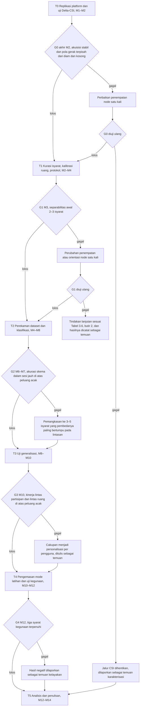
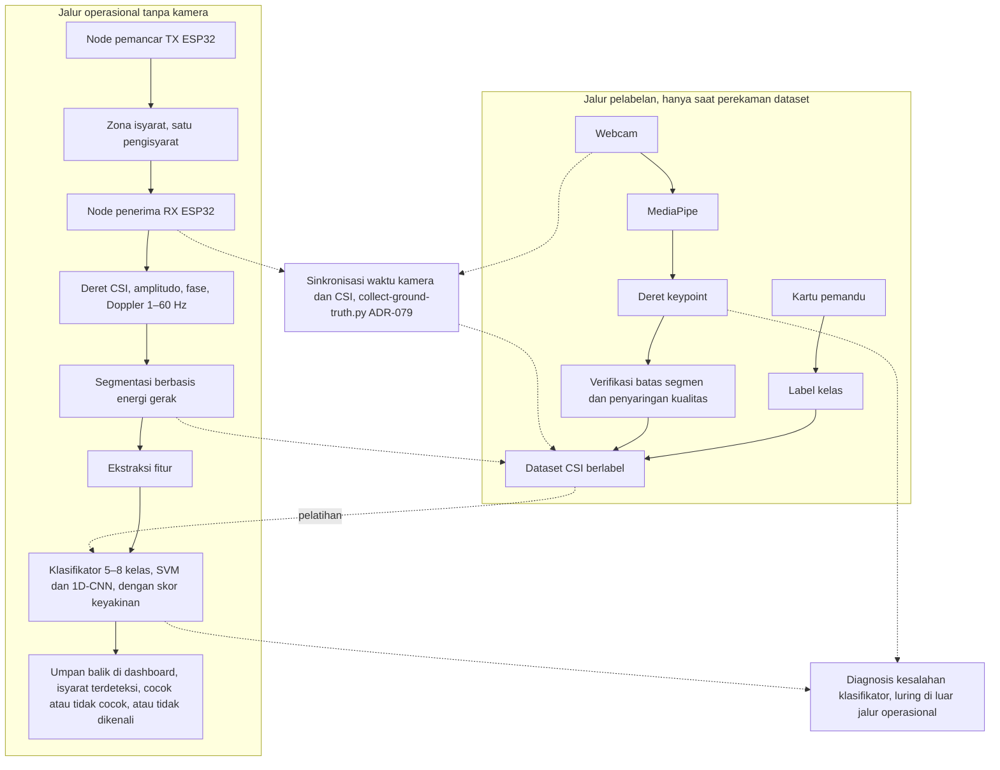

# BAB III METODE PENELITIAN

## 3.1 Desain Penelitian

Penelitian ini dirancang sebagai studi kelayakan kuantitatif bergerbang yang dilengkapi uji kegunaan deskriptif. Bagian kuantitatif mengukur sejauh mana Wi-Fi *Channel State Information* (CSI) dari dua node ESP32 dapat membedakan 5–8 isyarat terisolasi Sistem Isyarat Bahasa Indonesia (SIBI). Setelah klasifikator diuji, bagian deskriptif menilai kelayakan keluarannya sebagai umpan balik latihan bagi pembelajar pendengar. Struktur bergerbang dipilih karena kemampuan CSI membedakan isyarat SIBI belum dapat dipastikan sebelum data dikumpulkan. Sesuai Subbab 2.7, setiap tahap menghasilkan artefak tetap, kegagalan gerbang dicatat sebagai temuan, dan kriteria akurasi dirumuskan relatif terhadap peluang acak.

Rumusan masalah pertama dijawab pada tahap replikasi platform serta kurasi isyarat dan protokol. Rumusan masalah kedua dijawab melalui uji klasifikasi pada tahap perekaman dan generalisasi. Skenario dalam sesi, lintas partisipan, dan lintas ruang diuji sebagai skema 1, 3, dan 4 pada Tabel 3.3, sedangkan skema lintas sesi dan pengguna baru menjadi pelengkap. Rumusan masalah ketiga ditinjau melalui uji operasional, uji kegunaan, dan penilaian validator penutur tunarungu pada tahap pengemasan mode latihan.

## 3.2 Tahapan Penelitian

Penelitian berlangsung selama empat belas minggu (M1–M14) dalam enam tahap. Tahapan dimulai dari replikasi platform (T0), kemudian kurasi isyarat dan protokol (T1), perekaman *dataset* dan klasifikasi (T2), uji generalisasi (T3), pengemasan mode latihan dan uji kegunaan (T4), hingga analisis dan penulisan (T5). Lima tahap pertama ditutup oleh gerbang keputusan G0–G4, seperti ditunjukkan pada Gambar 3.1. Kriteria lolos dan tindakan bila gagal pada setiap gerbang direncanakan untuk ditetapkan sebelum gerbang terkait dinilai; parameter yang belum ditetapkan dihimpun pada Tabel 3.6 (Subbab 3.10). Tahap yang berurutan berbagi satu minggu peralihan.

Gambar 3.1 Tahapan penelitian dan gerbang keputusan

### 3.2.1 Tahap T0: Replikasi Platform dan Uji Delta-CSI (M1–M2)

Dua node ESP32 disiapkan dengan *firmware* RuView [@ruview] (Subbab 2.4), lalu *pipeline* akuisisi tersinkron `scripts/collect-ground-truth.py` (ADR-079) diuji tanpa partisipan untuk memastikan CSI dan video dapat diselaraskan. ADR adalah singkatan dari *architecture decision record* (catatan keputusan arsitektur), yaitu format dokumentasi keputusan desain yang dipakai repositori RuView [@ruview]. Tahap ini ditempatkan paling awal karena *pipeline* yang belum stabil tidak layak dijadikan dasar perekaman. Uji Delta-CSI (Subbab 3.8.1) dan pengukuran laju pencuplikan (Subbab 3.7.1) menghasilkan laporan karakterisasi sinyal sebagai bahan G0.

### 3.2.2 Tahap T1: Kurasi Isyarat dan Protokol (M2–M4)

T1 mencakup kurasi 5–8 isyarat (Subbab 3.6.2) bersama validator penutur tunarungu, kalibrasi ruang mitra, penyusunan protokol perekaman dan etika, serta perizinan. Keluarannya adalah daftar isyarat, lembar definisi isyarat, dan protokol perekaman. G1 menguji separabilitas awal 2–3 isyarat dengan uji *nearest-centroid* sederhana, yaitu setiap repetisi dikelompokkan ke isyarat dengan rata-rata fitur terdekat. Rata-rata tersebut dihitung tanpa repetisi yang sedang diuji agar hasilnya tidak optimistis.

### 3.2.3 Tahap T2: Perekaman *Dataset* dan Klasifikasi (M4–M8)

*Dataset* direkam dengan ±30 repetisi per isyarat per sesi disertai video tersinkron (Subbab 3.6). Fitur dari segmen yang lolos penyaringan dipakai untuk melatih *Support Vector Machine* (SVM) sebagai pembanding dasar (*baseline*) dan *one-dimensional Convolutional Neural Network* (1D-CNN) berukuran kecil (Subbab 3.7). Keluaran T2 adalah *dataset* CSI berlabel dan model klasifikasi. Bila G2 gagal, cakupan dipangkas menjadi 3–5 isyarat yang pembedanya paling bertumpu pada lintasan lengan, tubuh atas, atau kepala. Kriteria pemangkasan tidak memakai data uji dan ditetapkan sebelum G2 dinilai (Tabel 3.6, butir 8). Hasil pada 5–8 isyarat awal tetap dilaporkan berdampingan dengan hasil pada himpunan terpangkas.

### 3.2.4 Tahap T3: Uji Generalisasi (M8–M10)

Model CSI mudah mengalami *overfitting* pada orang dan ruang tempat data latih direkam [@chen2023]. Oleh karena itu, model diuji lintas sesi, lintas partisipan, lintas ruang, dan pada satu pengguna baru tanpa pelatihan ulang (Subbab 3.7.5). Strategi lintas domain Widar3.0 [@widar2021] dijadikan acuan tanpa mengasumsikan hasil yang sama pada isyarat SIBI (Tabel 3.6, butir 15). Bila G3 gagal, cakupan menjadi personalisasi per pengguna yang memerlukan data latih dari setiap pengguna, padahal pembelajar pemula diduga belum dapat memperagakan isyarat dengan tepat. Untuk itu, model, ruang, dan prosedur yang dipakai pada T4 untuk setiap hasil G3 tercantum pada Tabel 3.6, butir 17.

### 3.2.5 Tahap T4: Pengemasan Mode Latihan dan Uji Kegunaan (M10–M12)

Klasifikator dikemas menjadi mode latihan tanpa kamera dengan umpan balik di *dashboard*. Selanjutnya, dilakukan uji operasional, uji kegunaan dengan 3–5 pembelajar pendengar pemula, pengisian kuesioner persepsi, dan penilaian validator (Subbab 3.8). Uji operasional ditempatkan pada T4 karena latensi baru dapat diukur setelah mode latihan berjalan. G4 menilai tiga syarat, yaitu skor uji awal (*pre-test*) dan uji akhir (*post-test*) tercatat, persepsi tercatat, dan validator menyetujui kewajaran umpan balik.

### 3.2.6 Tahap T5: Analisis dan Penulisan (M12–M14)

Seluruh artefak dianalisis dan disusun menjadi laporan kelayakan beserta rekomendasi berdasarkan gerbang yang lolos dan yang gagal. Laporan tersebut memuat keterbatasan secara eksplisit, terutama bahwa konfigurasi jari dan ekspresi wajah tidak dikenali dan umpan balik "benar" hanya berarti lintasan gerak sesuai (Subbab 2.3).

## 3.3 Waktu dan Lokasi Penelitian

Penelitian dilaksanakan pada [PERLU DATA: bulan dan tahun pelaksanaan penelitian] di [PERLU DATA: nama sekolah/lembaga mitra]. Perekaman dan pengujian dilakukan di sedikitnya dua ruang, yaitu jumlah minimum bagi skema *leave-one-room-out*, dan setiap ruang dikalibrasi sebelum perekaman (Subbab 3.5.3). Penyiapan sistem secara mandiri oleh pengguna di rumah berada di luar cakupan.

## 3.4 Alat dan Bahan

Dua unit ESP32 berperan sebagai node pemancar (TX) dan node penerima (RX), sedangkan laptop dipakai untuk pengolahan sinyal, pelatihan model, dan penampilan umpan balik (Tabel 3.1). Perangkat lunak disajikan pada Tabel 3.2; modul estimasi pose *on-device* RuView tidak dipakai dan versi setiap perangkat lunak dicatat bersama log konfigurasi pelatihan agar eksperimen dapat diulang.

Tabel 3.1 Perangkat keras penelitian

| No. | Nama | Spesifikasi | Jumlah | Keterangan |
|---|---|---|---|---|
| 1 | ESP32-S3 | Papan pengembangan ESP32-S3, varian yang direkomendasikan RuView untuk node CSI [@ruview] | 2 unit (+1 cadangan) | Node TX dan node RX penangkap CSI |
| 2 | Aksesori node | Kabel, adaptor daya, dudukan setinggi dada pengisyarat | 1 set | Pemasangan dan catu daya node |
| 3 | Laptop | Milik pribadi; [PERLU DATA: spesifikasi laptop] | 1 unit | *Server* RuView, mesin pelatihan, dan tampilan umpan balik |
| 4 | *Webcam* | Bawaan laptop | 1 unit | Hanya menyala saat sesi pelabelan dan pada satu kondisi uji persepsi |

Tabel 3.2 Perangkat lunak penelitian

| No. | Nama | Fungsi dalam penelitian |
|---|---|---|
| 1 | *Firmware* RuView | Menangkap CSI pada node ESP32 dalam format *frame* ADR-018 dan mengirimkannya melalui *User Datagram Protocol* (UDP) |
| 2 | *Server* RuView | Mengolah sinyal, mengalibrasi ruang, dan memotong deret CSI menjadi segmen berdasarkan energi gerak |
| 3 | `scripts/collect-ground-truth.py` (ADR-079) | Menyinkronkan akuisisi kamera dan CSI dengan MediaPipe PoseLandmarker |
| 4 | MediaPipe (Pose, Hands) | Menghasilkan deret *keypoint* tubuh dan tangan dari video pada jalur pelabelan |
| 5 | Python | Mengimplementasikan ekstraksi fitur, pelatihan, dan evaluasi model |
| 6 | scikit-learn | Mengimplementasikan klasifikator SVM |
| 7 | PyTorch | Mengimplementasikan klasifikator 1D-CNN |
| 8 | *Dashboard* RuView | Menampilkan umpan balik pada mode latihan |

Bahan penelitian meliputi *dataset* CSI hasil perekaman sendiri, lembar definisi isyarat, formulir persetujuan partisipan, instrumen uji awal dan uji akhir, serta kuesioner persepsi. *Dataset* direkam sendiri karena penelitian yang mengenali isyarat SIBI dari CSI belum ditemukan dalam penelusuran literatur penelitian ini (Subbab 2.8).

## 3.5 Perancangan Sistem

### 3.5.1 Arsitektur Dua Jalur

Sistem dirancang dalam dua jalur yang dipisahkan berdasarkan keberadaan kamera, seperti ditunjukkan pada Gambar 3.2.

Gambar 3.2 Arsitektur sistem dua jalur

Pada jalur operasional, gerak pengisyarat di zona isyarat antara node TX dan node RX mengubah amplitudo, fase, dan komponen Doppler pada deret CSI [@ma2019survey]. Deret tersebut diolah hingga menjadi umpan balik di *dashboard* tanpa kamera (Subbab 3.7).

Jalur pelabelan hanya aktif selama perekaman *dataset*. Label kelas berasal dari kartu pemandu yang ditampilkan sebelum setiap repetisi, bukan dari kamera. MediaPipe [@mediapipe2019] mengubah video *webcam* menjadi deret *keypoint* tubuh [@blazepose2020] dan tangan [@mphands2020] yang diselaraskan dengan CSI melalui ADR-079 untuk memverifikasi batas segmen, menyaring segmen buruk, dan mendiagnosis kesalahan klasifikator secara luring. Berbeda dengan preseden Person-in-WiFi [@personinwifi2019] dan DensePose From WiFi [@densepose2023] (Subbab 2.5), dalam penelitian ini kamera tidak mengajarkan pose kepada model CSI; distilasi pengetahuan penuh ditempatkan sebagai penelitian lanjutan.

### 3.5.2 Penempatan Node

Kedua node dipasang pada dudukan setinggi dada pengisyarat dan mengapit zona isyarat agar gerak lengan dan tubuh atas berada di antara TX dan RX; kesesuaiannya diperiksa melalui uji Delta-CSI. Zona isyarat hanya ditempati satu pengisyarat dalam setiap sesi. Sistem tidak mengidentifikasi individu. Jarak antarnode dan ukuran zona isyarat ditetapkan pada T0 (Tabel 3.6, butir 27) dan dicatat dalam metadata sesi.

### 3.5.3 Kalibrasi Ruang

Setiap sesi diawali kalibrasi ruang bawaan RuView selama ±4 menit dengan 600 *frame* dan 8 *anchor* karena CSI peka terhadap perubahan kondisi ruang [@chen2023]. Posisi perabot, kipas angin atau pendingin ruangan yang menyala, dan orang yang lewat dicatat sebagai kovariat untuk menganalisis perbedaan kinerja antarsesi dan antarruang.

## 3.6 Protokol Perekaman *Dataset*, Partisipan, dan Etika

### 3.6.1 Partisipan

Partisipan terdiri atas 3–4 pengisyarat kompeten, sedikitnya satu validator penutur tunarungu, dan 3–5 pembelajar pendengar pemula dengan kriteria inklusi dan rekrutmen pada Tabel 3.6, butir 3. Pengisyarat kompeten adalah guru atau pembina SIBI yang memperagakan isyarat untuk *dataset* dan dapat berasal dari kalangan penutur tunarungu. Validator wajib terlibat dalam pemilihan kosakata, pemeriksaan sampel segmen, penilaian ketepatan peragaan peserta, dan penilaian kewajaran umpan balik, sedangkan pembelajar pemula mengikuti uji kegunaan. Setiap pengisyarat direkam dalam sedikitnya dua sesi agar skema lintas sesi dapat dijalankan. Skema lintas ruang hanya memisahkan pengaruh ruang dari pengaruh orang bila pengisyarat yang sama direkam di setiap ruang (butir 4); profil pengguna baru tercantum pada butir 14.

### 3.6.2 Kurasi Isyarat

Isyarat dipilih melalui saringan separabilitas fisik dan validitas pedagogis (Subbab 2.3) dengan acuan *Kamus SIBI* [@kamussibi]. Hasilnya adalah 5–8 isyarat terisolasi [PERLU DATA: daftar isyarat SIBI terpilih] yang dideskripsikan dalam lembar definisi isyarat sebagai acuan perekaman dan penilaian.

### 3.6.3 Prosedur Perekaman

Perekaman memakai elisitasi terisolasi, yaitu satu isyarat per segmen dengan jeda antarrepetisi. Adapun prosedur perekaman setiap sesi adalah sebagai berikut.

1. Memasang node TX dan node RX, lalu mengaktifkan mode privasi RuView.
2. Menjalankan kalibrasi ruang dan mencatat metadata sesi, yaitu tanggal, ruang, kode pengisyarat, posisi node, dan kondisi latar.
3. Menjalankan `scripts/collect-ground-truth.py` agar perekaman CSI dan *webcam* tersinkron.
4. Menampilkan kartu pemandu isyarat target, merekam satu repetisi, memberi jeda, dan mengulanginya hingga setiap isyarat mencapai ±30 repetisi.
5. Membuang segmen bila orang tidak terdeteksi MediaPipe, *jitter* *keypoint* ekstrem, atau segmen terpotong, lalu mencatat tingkat segmen terbuang per isyarat dan per pengisyarat sebagai indikator kualitas.
6. Meminta validator mengambil sampel segmen untuk memeriksa kebenaran bentuk isyarat yang diperagakan.

### 3.6.4 Etika Penelitian

Perekaman dimulai setelah persetujuan institusi mitra dan persetujuan tertulis setiap partisipan diperoleh [PERLU DATA: lembaga atau komisi pemberi persetujuan etik]. Ketentuan tersebut juga berlaku untuk uji T0 dan G1 meskipun keduanya berlangsung sebelum atau bersamaan dengan perizinan [PERLU DATA: pengisyarat dan lokasi uji T0 dan G1 beserta status persetujuannya]. Partisipan berhak mengundurkan diri kapan saja tanpa konsekuensi. Formulir persetujuan menyatakan bahwa kamera hanya menyala pada sesi pelabelan dan satu kondisi uji persepsi. Mode privasi RuView, yang membuang fitur biometrik, aktif selama penelitian. Video hanya dipakai untuk verifikasi batas segmen, penyaringan kualitas, dan diagnosis kesalahan. Video tersebut disimpan secara terbatas dan tidak dipublikasikan. *Dataset* publik hanya memuat CSI, label, dan *keypoint* tanpa identitas partisipan, sedangkan risiko pengenalan ulang individu dari pola gerak pada deret *keypoint* ditangani sesuai Tabel 3.6, butir 5. Token apresiasi validator tercantum pada butir 6.

## 3.7 Pengolahan Sinyal, Ekstraksi Fitur, dan Klasifikasi

### 3.7.1 Laju Pencuplikan

Firmware RuView membatasi pengiriman frame CSI paling sering setiap 20 ms sehingga laju maksimumnya adalah 50 frame per detik [@ruview]; laju aktual pada konfigurasi penelitian diukur pada T0. Pita Doppler 1–60 Hz hanya terwakili bila laju pencuplikan sedikitnya 120 Hz (Subbab 2.3). Bila laju yang diukur pada T0 lebih rendah, pita yang dianalisis dibatasi hingga setengah laju aktual dan pembatasan itu dilaporkan.

### 3.7.2 Segmentasi

Deret CSI dipotong menjadi segmen isyarat dengan segmentasi berbasis energi gerak RuView. Batas segmen diverifikasi dengan deret *keypoint* hanya selama perekaman *dataset*, sedangkan mode latihan berjalan tanpa verifikasi kamera.

### 3.7.3 Ekstraksi Fitur

Sesuai Subbab 2.6, fitur setiap segmen terdiri atas amplitudo dan fase *subcarrier* terpilih yang saling melengkapi [@cai2024], spektrum Doppler pita 1–60 Hz [@widar2021], serta statistik ringkas berupa energi, entropi, dan lintasan puncak. Susunan fitur tersebut mengikuti praktik pengenalan gestur berbasis CSI [@ma2019survey], [@sruthi2024]. Kriteria pemilihan *subcarrier* dan definisi lintasan puncak tercantum pada Tabel 3.6, butir 9 dan 10. Fitur diringkas menjadi satu vektor untuk SVM dan disusun sebagai deret per langkah waktu untuk 1D-CNN.

### 3.7.4 Klasifikasi

SVM mencari batas pemisah antarkelas dengan margin terbesar [@cortes1995] dan dipilih sebagai pembanding dasar karena dapat dilatih pada *dataset* berukuran kecil [@mountrakis2011]. Model 1D-CNN menerapkan konvolusi sepanjang sumbu waktu deret fitur [@kiranyaz2021] dan dipilih karena dapat mempelajari pola temporal langsung dari deret tersebut. Ukuran jaringannya dibuat kecil agar sebanding dengan jumlah data. SVM dan 1D-CNN diimplementasikan pada laptop, berturut-turut dengan scikit-learn dan PyTorch. Hiperparameter kedua klasifikator dipilih berdasarkan data validasi yang terpisah dari data uji.

### 3.7.5 Skema Pembagian Data

Kinerja klasifikator diukur dengan lima skema pembagian data pada Tabel 3.3. Skema dalam sesi memakai pembagian data temporal per blok, yaitu blok repetisi awal untuk pelatihan dan blok akhir untuk pengujian. Pembagian acak tidak dipakai karena repetisi yang berurutan cenderung mirip sehingga informasi dapat bocor dari data latih ke data uji.

Tabel 3.3 Skema pembagian data

| No. | Skema | Data latih | Data uji | Aspek yang diukur |
|---|---|---|---|---|
| 1 | Dalam sesi (pembagian data temporal per blok) | Blok awal dalam satu sesi | Blok akhir pada sesi yang sama | Separabilitas pada orang, ruang, dan sesi yang sama |
| 2 | Lintas sesi | Sebagian sesi seorang pengisyarat di satu ruang | Sesi lain dari pengisyarat dan ruang yang sama | Ketahanan terhadap perubahan antarsesi |
| 3 | Lintas partisipan (*leave-one-subject-out*) | Semua pengisyarat kecuali satu | Pengisyarat yang ditinggalkan, bergiliran | Ketahanan terhadap pergantian orang |
| 4 | Lintas ruang (*leave-one-room-out*) | Semua ruang kecuali satu | Ruang yang ditinggalkan, bergiliran | Ketahanan terhadap pergantian ruang |
| 5 | Pengguna baru | Seluruh pengisyarat *dataset* | Satu pengguna baru tanpa pelatihan ulang | Kesiapan dipakai orang baru tanpa perekaman tambahan |

Skema kedua sampai kelima mengukur ketahanan terhadap perubahan domain [@chen2023]; karena jumlah pengisyarat dan ruang kecil, hasil lintas partisipan dan lintas ruang dilaporkan untuk setiap putaran (*fold*). Data validasi hanya diambil dari data latih sehingga data uji tidak dipakai untuk memilih *subcarrier*, menormalkan fitur, memilih hiperparameter, atau menetapkan ambang (Tabel 3.6, butir 11). Karena segmen *dataset* tersaring kamera, sedangkan mode latihan tidak, kinerja pada data uji dapat lebih optimistis daripada kinerja jalur operasional (butir 12).

### 3.7.6 Umpan Balik dengan Penolakan

Mekanisme penolakan pada Subbab 2.6 diterapkan dengan ambang skor keyakinan dari data validasi (Tabel 3.6, butir 13). Segmen dengan skor keyakinan di bawah ambang ditampilkan sebagai "isyarat tidak dikenali, ulangi" agar tidak dinilai benar atau salah, sedangkan untuk segmen lain *dashboard* menampilkan isyarat yang terdeteksi beserta kecocokannya dengan isyarat target. Umpan balik "benar" atau status cocok paling jauh menyangkut lintasan lengan, tubuh atas, dan kepala, bukan bentuk jari (Subbab 2.3). Karena klasifikator hanya dilatih dengan peragaan benar pengisyarat kompeten, status cocok berarti segmen paling mirip dengan target di antara 5–8 kelas sehingga peragaan dengan lintasan keliru masih dapat dinilai cocok. Ambang skor keyakinan yang ditetapkan dari data pengisyarat kompeten juga belum tentu menolak peragaan semacam itu. Kemungkinan tersebut diperiksa melalui penilaian validator (Subbab 3.8.5).

## 3.8 Skenario Pengujian dan Metrik Evaluasi

Uji Delta-CSI mendasari G0, uji *nearest-centroid* (Subbab 3.2.2) mendasari G1, uji klasifikasi mendasari G2 dan G3, serta uji kegunaan dan penilaian validator mendasari G4. Adapun uji operasional dan diagnosis kesalahan melengkapi analisis tanpa menjadi syarat gerbang.

### 3.8.1 Uji Delta-CSI

Uji Delta-CSI dilakukan untuk mengetahui apakah gerak tubuh menghasilkan perubahan CSI yang terpisah jelas dari kondisi tanpa gerak, dengan ukuran keterpisahan dan batas stabilitas akuisisi pada Tabel 3.6, butir 1. Adapun prosedurnya adalah sebagai berikut.

1. Memasang node TX dan node RX pada posisi awal yang mengapit zona isyarat.
2. Merekam CSI pada kondisi ruang kosong, pengisyarat diam, dan pengisyarat bergerak di zona isyarat.
3. Mencatat laju pencuplikan aktual dan hasil uji kestabilan *pipeline* akuisisi tersinkron yang dijalankan tanpa partisipan (Subbab 3.2.1).
4. Membandingkan pola CSI antarkondisi, lalu mencatat dan menganalisis hasilnya sebagai bahan keputusan G0.

### 3.8.2 Uji Klasifikasi

Uji klasifikasi pada kelima skema memakai metrik pada Subbab 2.7, yaitu akurasi, presisi, *recall*, skor F1 makro, dan *confusion matrix* antarisyarat. Presisi, *recall*, dan skor F1 dirata-ratakan tanpa pembobotan antarisyarat. Setiap metrik dilaporkan bersama peluang acak, yaitu 20% untuk lima kelas, 12,5% untuk delapan kelas, dan 33,3% bila cakupan dipangkas menjadi tiga isyarat. Tingkat penolakan, yaitu proporsi segmen dengan skor keyakinan di bawah ambang, juga dilaporkan. Akurasi dilaporkan dalam dua bentuk, yaitu akurasi tanpa penolakan yang dihitung atas seluruh segmen uji dan akurasi dengan penolakan yang dihitung atas segmen yang diterima saja.

### 3.8.3 Uji Operasional

Laju deteksi palsu per jam dihitung sebagai jumlah isyarat yang terdeteksi saat tidak ada peragaan dibagi lama pengamatan dalam jam. Pengamatan mencakup gangguan berupa orang lewat, kipas angin yang menyala, dan perabot yang bergeser. Latensi ujung ke ujung (*end-to-end latency*) diukur sesuai definisi pada Subbab 2.7. Batas kelayakan, lama pengamatan, dan penanda waktu selesainya isyarat tercantum pada Tabel 3.6, butir 18–20. Adapun prosedurnya adalah sebagai berikut.

1. Menjalankan mode latihan di ruang yang telah dikalibrasi.
2. Merekam kondisi tanpa peragaan isyarat, termasuk saat ada gangguan, dan mencatat setiap isyarat yang terdeteksi.
3. Meminta pengisyarat memperagakan isyarat target, lalu mencatat waktu selesainya isyarat dan waktu umpan balik tampil.
4. Menghitung laju deteksi palsu per jam dan latensi ujung ke ujung, lalu menganalisis hasilnya.

### 3.8.4 Uji Kegunaan

Selain mencatat capaian peserta, uji kegunaan dengan 3–5 pembelajar pendengar pemula menelusuri hipotesis bahwa latihan yang tidak terasa diawasi lebih mudah dijadikan kebiasaan harian. Hipotesis itu ditelusuri melalui persepsi rasa diawasi, kenyamanan, dan kemauan berlatih lagi; pembentukan kebiasaan tidak diukur. Langkah uji untuk setiap peserta adalah sebagai berikut.

1. Menjelaskan tujuan uji, kondisi kamera, dan hak mundur, lalu meminta persetujuan tertulis.
2. Meminta peserta memperagakan setiap isyarat target sebagai uji awal.
3. Menjalankan sesi latihan pada kondisi kamera menyala dan kamera mati dengan urutan acak, masing-masing diikuti kuesioner persepsi yang sama.
4. Meminta peserta memperagakan kembali setiap isyarat target sebagai uji akhir.
5. Merekapitulasi skor dan jawaban kuesioner, lalu menganalisisnya secara deskriptif.

Kedua kondisi hanya berbeda pada keberadaan *webcam* yang menyala dan terlihat, sedangkan umpan balik tetap berasal dari CSI. Rancangan *within-subject* dengan urutan acak dipakai agar setiap peserta mengalami kedua kondisi dan pengaruh urutan berkurang. Kuesioner terdiri atas ±5 butir skala Likert tentang kenyamanan, rasa diawasi, dan kemauan berlatih lagi; durasi sesi, pendamping di ruangan, dan rincian kuesioner tercantum pada Tabel 3.6, butir 21–23.

Ketepatan peragaan uji awal dan uji akhir dinilai validator dengan rubrik yang independen dari sistem CSI (Tabel 3.6, butir 24) sehingga ukuran kemampuan peserta tidak bergantung pada klasifikator yang diuji. Cara pengamatan tercantum pada butir 25; bila validator mengamati langsung, validator mengetahui mana uji awal dan mana uji akhir sehingga penilaiannya tidak buta. Keterbatasan itu dilaporkan. Data dianalisis secara deskriptif tanpa klaim kausal dan tanpa statistik inferensial karena peserta sedikit dan tidak ada kondisi latihan tanpa umpan balik sebagai pembanding. Oleh karena itu, perubahan skor dilaporkan sebagai gambaran capaian peserta. Sesuai Subbab 1.4, empati tidak diukur secara psikometrik.

### 3.8.5 Penilaian Validator dan Diagnosis Kesalahan

Validator penutur tunarungu menilai kewajaran umpan balik sistem, yaitu kesesuaian status cocok atau tidak cocok yang ditampilkan sistem dengan penilaian validator atas peragaan yang sama. Untuk setiap percobaan peserta, keluaran sistem berupa cocok, tidak cocok, atau tidak dikenali dicatat, lalu validator menilai secara independen apakah lintasan peragaan sesuai dengan isyarat target. Kesesuaian keduanya disajikan dalam tabel silang dan proporsi percobaan yang tidak dikenali dilaporkan sebagai tingkat penolakan pada peragaan pemula. Kasus ketika sistem menampilkan status cocok untuk peragaan yang dinilai tidak sesuai oleh validator dilaporkan tersendiri karena dapat menyesatkan pembelajar. Persetujuan validator atas kewajaran umpan balik menjadi syarat G4 dengan batas kesesuaian pada Tabel 3.6, butir 26. Sebagai analisis sekunder, kesalahan klasifikator dikaitkan secara luring dengan kemiripan lintasan tubuh dari deret *keypoint* MediaPipe untuk membedakan kesalahan akibat lintasan yang mirip dari kesalahan akibat sinyal CSI yang lemah.

### 3.8.6 Kriteria Gerbang Keputusan

Kriteria setiap gerbang beserta waktu, ukuran, dan tindakan bila gagal disajikan pada Tabel 3.4. Karena dua dari tiga syarat G4 hanya bersifat kelengkapan data, kelayakan pada rumusan masalah ketiga ditinjau per dimensi, bukan dari lolosnya G4 saja. Dimensi umpan balik latihan ditinjau dari tabel silang sistem dan validator serta tingkat penolakan pada peragaan pemula. Dimensi latensi ditinjau dari latensi ujung ke ujung dengan laju deteksi palsu sebagai pelengkap; dimensi persepsi kenyamanan dari kuesioner; dan dimensi penilaian validator dari persetujuan atas kewajaran umpan balik. Skor uji awal dan uji akhir tidak dijadikan indikator dimensi umpan balik latihan.

Tabel 3.4 Kriteria gerbang keputusan

| Gerbang | Waktu | Ukuran | Kriteria lolos | Tindakan bila gagal |
|---|---|---|---|---|
| G0 | Akhir M2 | Stabilitas akuisisi tersinkron dan uji Delta-CSI | Akuisisi stabil dan pola CSI saat bergerak terpisah jelas dari kondisi diam dan kosong (Tabel 3.6, butir 1) | Penempatan node diperbaiki satu kali; bila gagal lagi, jalur CSI dihentikan dan dilaporkan sebagai temuan karakterisasi |
| G1 | M3 | Separabilitas awal 2–3 isyarat dengan uji *nearest-centroid* | Repetisi isyarat yang sama lebih dekat satu sama lain daripada ke isyarat lain | Penempatan atau orientasi node diubah satu kali; bila gagal lagi, tindakan mengikuti Tabel 3.6, butir 2 |
| G2 | M6–M7 | Akurasi skema dalam sesi | Jauh di atas peluang acak (1/jumlah kelas); ambang pada Tabel 3.6, butir 7 | Cakupan dipangkas menjadi 3–5 isyarat yang pembedanya paling bertumpu pada lintasan (Tabel 3.6, butir 8) |
| G3 | M10 | Kinerja lintas partisipan dan lintas ruang | Di atas peluang acak; ambang pada Tabel 3.6, butir 16 | Cakupan menjadi personalisasi per pengguna dan ditulis sebagai temuan |
| G4 | M12 | Kelengkapan uji kegunaan dan persetujuan validator | Skor uji awal dan uji akhir tercatat, persepsi tercatat, dan validator menyetujui kewajaran umpan balik dengan batas kesesuaian pada Tabel 3.6, butir 26 | Hasil negatif tetap dilaporkan sebagai temuan kelayakan |

## 3.9 Jadwal Penelitian

Jadwal empat belas minggu disajikan pada Tabel 3.5. Tanda ■ menunjukkan minggu pelaksanaan. Minggu yang ditempati dua tahap menandai peralihan antartahap.

Tabel 3.5 Jadwal penelitian

| No. | Kegiatan | M1 | M2 | M3 | M4 | M5 | M6 | M7 | M8 | M9 | M10 | M11 | M12 | M13 | M14 | Gerbang |
|---|---|---|---|---|---|---|---|---|---|---|---|---|---|---|---|---|
| 1 | T0 Replikasi platform dan uji Delta-CSI | ■ | ■ | | | | | | | | | | | | | G0 (akhir M2) |
| 2 | T1 Kurasi isyarat, kalibrasi ruang mitra, protokol perekaman dan etika, perizinan | | ■ | ■ | ■ | | | | | | | | | | | G1 (M3) |
| 3 | T2 Perekaman *dataset*, penyaringan segmen, ekstraksi fitur, pelatihan SVM dan 1D-CNN | | | | ■ | ■ | ■ | ■ | ■ | | | | | | | G2 (M6–M7) |
| 4 | T3 Uji lintas sesi, lintas partisipan, lintas ruang, dan pengguna baru | | | | | | | | ■ | ■ | ■ | | | | | G3 (M10) |
| 5 | T4 Pengemasan mode latihan, uji operasional, uji kegunaan, kuesioner persepsi, penilaian validator | | | | | | | | | | ■ | ■ | ■ | | | G4 (M12) |
| 6 | T5 Analisis dan penulisan (keterbatasan dan rekomendasi) | | | | | | | | | | | | ■ | ■ | ■ | — |

## 3.10 Parameter Rancangan yang Ditetapkan Kemudian

Parameter rancangan yang bergantung pada kesepakatan dengan pembimbing, hasil tahap sebelumnya, atau data validasi dihimpun pada Tabel 3.6. Setiap parameter direncanakan untuk ditetapkan sebelum dipakai untuk menilai data uji atau gerbang terkait.

Tabel 3.6 Parameter rancangan yang ditetapkan kemudian

| No. | Parameter | Waktu atau dasar penetapan | Status |
|---|---|---|---|
| 1 | Kriteria G0 | Sebelum T0 | [PERLU DATA: ukuran keterpisahan Delta-CSI antarkondisi beserta ambangnya, misalnya selisih varians amplitudo; batas stabilitas akuisisi tersinkron, misalnya proporsi frame hilang] |
| 2 | Tindakan bila G1 gagal kedua kalinya | Sebelum eksperimen | [PERLU DATA: tindakan bila G1 gagal untuk kedua kalinya, disepakati bersama pembimbing] |
| 3 | Inklusi dan rekrutmen | Sebelum dipakai | [PERLU DATA: kriteria kompetensi pengisyarat (misalnya lama mengajar atau memakai SIBI), dasar kefasihan SIBI validator, kriteria pemula, sumber rekrutmen pemula dari kalangan sasaran alat (keluarga siswa, calon guru, atau mahasiswa), dan teknik pemilihan partisipan] |
| 4 | Sesi per ruang | Sebelum dipakai | [PERLU DATA: jumlah sesi perekaman per pengisyarat dan per ruang; konfirmasi bahwa setiap pengisyarat direkam di setiap ruang] |
| 5 | Publikasi *dataset* | Sebelum dipakai | [PERLU DATA: penanganan titik wajah pada keypoint, pernyataan risiko pengenalan ulang dan izin publikasi dataset pada formulir persetujuan, serta repositori dan lisensi dataset] |
| 6 | Token validator | Sebelum dipakai | [PERLU DATA: bentuk token apresiasi validator, dikonfirmasi pembimbing] |
| 7 | Ambang G2 | Sebelum eksperimen | [PERLU DATA: ambang G2 yang disepakati bersama pembimbing sebelum eksperimen] |
| 8 | Kriteria pemangkasan | Sebelum G2 dinilai | [PERLU DATA: kriteria pemangkasan yang tidak memakai data uji, misalnya peringkat separabilitas fisik dari T1 atau hasil pada data validasi, serta apakah G2 dinilai ulang pada himpunan terpangkas] |
| 9 | Pemilihan *subcarrier* | Sebelum dipakai | [PERLU DATA: kriteria pemilihan subcarrier] |
| 10 | Lintasan puncak | Sebelum dipakai | [PERLU DATA: definisi operasional lintasan puncak] |
| 11 | Pembagian data | Sebelum dipakai | [PERLU DATA: ukuran blok dan proporsi data latih, validasi, dan uji; sumber dan proporsi data validasi pada skema dalam sesi, lintas sesi, lintas partisipan, lintas ruang, dan pengguna baru] |
| 12 | Perlakuan data uji | Sebelum dipakai | [PERLU DATA: apakah data uji memakai segmen tersaring kamera, segmen hasil segmentasi berbasis energi tanpa koreksi kamera, atau keduanya dilaporkan berdampingan] |
| 13 | Ambang skor keyakinan | Dari data validasi | [PERLU DATA: ambang skor keyakinan, ditetapkan dari data validasi] |
| 14 | Pengguna baru | Sebelum dipakai | [PERLU DATA: profil pengguna baru (pengisyarat kompeten di luar dataset atau pembelajar pemula) dan jumlah repetisi uji] |
| 15 | Strategi Widar3.0 | Sebelum dipakai | [PERLU DATA: komponen strategi Widar3.0 yang diadopsi dan kesesuaiannya dengan satu tautan antara dua node] |
| 16 | Ambang G3 | Sebelum T3 | [PERLU DATA: ambang G3 dari pembimbing dan waktu penetapannya] |
| 17 | Personalisasi | Sebelum dipakai | [PERLU DATA: model dan ruang yang dipakai pada uji kegunaan untuk setiap hasil G3, serta prosedur personalisasi bila G3 gagal, yaitu pemeraga data latih, jumlah repetisi, verifikasi oleh validator, dan minggu pelaksanaannya] |
| 18 | Batas operasional | Sebelum T4 | [PERLU DATA: batas latensi ujung ke ujung, batas laju deteksi palsu per jam, dan batas tingkat penolakan yang dianggap layak, disepakati bersama pembimbing sebelum T4] |
| 19 | Lama pengamatan | Sebelum dipakai | [PERLU DATA: durasi perekaman tanpa isyarat] |
| 20 | Penanda latensi | Sebelum dipakai | [PERLU DATA: cara menandai waktu selesainya isyarat untuk pengukuran latensi tanpa kamera] |
| 21 | Durasi latihan | Sebelum dipakai | [PERLU DATA: durasi sesi latihan per kondisi] |
| 22 | Pendamping | Sebelum dipakai | [PERLU DATA: keberadaan dan posisi pendamping atau validator di ruangan selama sesi latihan] |
| 23 | Kuesioner | Sebelum dipakai | [PERLU DATA: butir kuesioner persepsi dan rentang skala Likert] |
| 24 | Rubrik | Sebelum dipakai | [PERLU DATA: butir rubrik penilaian ketepatan isyarat] |
| 25 | Pengamatan validator | Sebelum T4 untuk kondisi kamera mati | [PERLU DATA: cara validator menilai peragaan pada uji awal dan uji akhir serta mengamati percobaan pada kondisi kamera mati tanpa menambah pemakaian kamera, misalnya pengamatan langsung; cara pengamatan pada kondisi kamera mati disepakati bersama pembimbing] |
| 26 | Batas kesesuaian G4 | Sebelum T4 | [PERLU DATA: batas kesesuaian minimum antara sistem dan validator untuk menyetujui kewajaran umpan balik, disepakati bersama pembimbing sebelum T4] |
| 27 | Jarak antarnode dan zona isyarat | Pada T0 | [PERLU DATA: jarak antarnode dan ukuran zona isyarat] |
