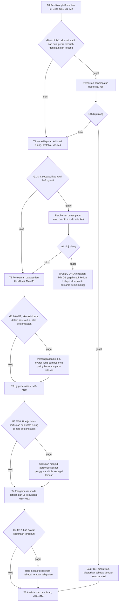
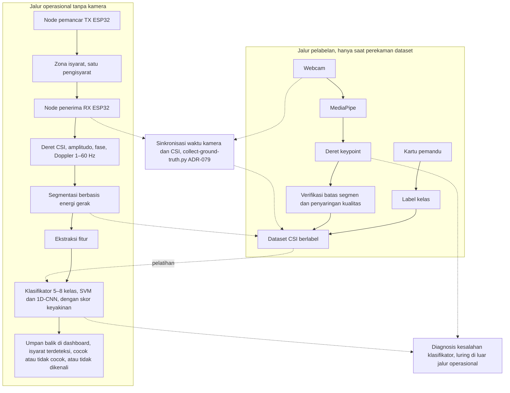

# BAB III METODE PENELITIAN

## 3.1 Desain Penelitian

Penelitian ini dirancang sebagai studi kelayakan kuantitatif bergerbang yang dilengkapi uji kegunaan deskriptif. Bagian kuantitatif mengukur sejauh mana Wi-Fi *Channel State Information* (CSI) yang ditangkap dua node ESP32 dapat membedakan 5–8 isyarat terisolasi Sistem Isyarat Bahasa Indonesia (SIBI). Bagian deskriptif menilai kelayakan keluaran klasifikasi tersebut sebagai umpan balik latihan bagi pembelajar pendengar. Kedua bagian dijalankan berurutan karena uji kegunaan memerlukan klasifikator yang sudah dilatih dan diuji.

Struktur bergerbang dipilih karena kemampuan CSI membedakan isyarat SIBI belum dapat dipastikan sebelum data dikumpulkan. Lima tahap pertama dari enam tahap penelitian masing-masing ditutup oleh gerbang keputusan, yaitu titik evaluasi dengan kriteria lolos dan tindakan bila gagal yang direncanakan untuk ditetapkan sebelum eksperimen dimulai. Setiap tahap juga menghasilkan artefak tetap berupa laporan karakterisasi sinyal, protokol perekaman, *dataset* berlabel, model klasifikasi, atau laporan kelayakan sehingga penelitian tetap memiliki keluaran yang dapat dimanfaatkan walaupun berhenti di salah satu gerbang. Dengan rancangan tersebut, kegagalan pada suatu gerbang dicatat sebagai temuan kelayakan. Kriteria gerbang yang menilai akurasi klasifikasi dirumuskan relatif terhadap peluang acak dan tidak dinyatakan sebagai target akurasi.

Ketiga rumusan masalah pada BAB I dijawab melalui tahap yang berbeda. Rumusan masalah pertama, yaitu rancangan sistem akuisisi dan protokol perekaman, dijawab melalui tahap replikasi platform serta tahap kurasi isyarat dan penyusunan protokol. Uji klasifikasi pada tahap perekaman dan tahap generalisasi menjawab rumusan masalah kedua tentang kinerja klasifikasi pada skenario dalam sesi, lintas partisipan, dan lintas ruang, sedangkan skema lintas sesi dan pengguna baru dilaporkan sebagai pelengkap. Adapun kelayakan sistem pada rumusan masalah ketiga ditinjau melalui uji operasional, uji kegunaan, dan penilaian validator penutur tunarungu pada tahap pengemasan mode latihan. Urutan dan keterkaitan tahap-tahap tersebut diuraikan pada Subbab 3.2.

## 3.2 Tahapan Penelitian

Penelitian dilaksanakan dalam enam tahap, yaitu T0 sampai T5, selama empat belas minggu yang diberi kode M1 sampai M14. Di antara tahap-tahap tersebut ditempatkan lima gerbang keputusan, yaitu G0 sampai G4. Alur tahapan beserta cabang yang ditempuh bila suatu gerbang gagal ditunjukkan pada Gambar 3.1.

Gambar 3.1 Tahapan penelitian dan gerbang keputusan

Penelitian dimulai dari replikasi platform akuisisi (T0), kemudian kurasi isyarat dan penyusunan protokol (T1), perekaman *dataset* dan klasifikasi (T2), uji generalisasi (T3), pengemasan mode latihan dan uji kegunaan (T4), hingga analisis dan penulisan (T5). Tahap yang berurutan berbagi satu minggu peralihan; misalnya, M2 menutup T0 sekaligus membuka T1. Uraian setiap tahap disajikan pada Subbab 3.2.1 sampai Subbab 3.2.6.

### 3.2.1 Tahap T0: Replikasi Platform dan Uji Delta-CSI (M1–M2)

Pada T0, dua node ESP32 disiapkan dengan *firmware* RuView [@ruview]. RuView merupakan proyek sumber terbuka yang menyediakan *firmware* penangkap CSI, *server* pengolahan sinyal, kalibrasi ruang, dan *dashboard* web (Subbab 2.4). Setelah node berjalan, *pipeline* akuisisi tersinkron kamera dan CSI pada skrip `scripts/collect-ground-truth.py` (ADR-079) dijalankan untuk memastikan rekaman CSI dan video dapat diselaraskan waktunya. Uji sinkronisasi tersebut dilakukan tanpa melibatkan partisipan sehingga bagi partisipan kamera tetap hanya menyala saat perekaman *dataset* dan pada satu kondisi uji persepsi (Subbab 3.6.4). Arti kode ADR yang dipakai pada repositori RuView adalah [PERLU DATA: kepanjangan dan arti ADR pada repositori RuView]. Replikasi ditempatkan paling awal karena *pipeline* yang belum berjalan stabil tidak layak dijadikan dasar perekaman *dataset*.

Pada tahap yang sama dilakukan uji Delta-CSI, yaitu perbandingan pola CSI pada tiga kondisi: ruang kosong, pengisyarat diam, dan pengisyarat bergerak. Laju pencuplikan (*sampling rate*) aktual node juga dicatat karena menentukan pita Doppler yang dapat diamati (Subbab 3.7.1). Laporan karakterisasi sinyal yang dihasilkan T0 menjadi bahan penilaian gerbang G0 pada akhir M2. G0 memeriksa dua syarat, yaitu akuisisi tersinkron berjalan stabil dan pola CSI saat pengisyarat bergerak terpisah jelas dari kondisi diam dan kosong. Bila G0 gagal, penempatan node diperbaiki satu kali, lalu uji diulang. Bila gagal kembali, jalur CSI dihentikan dan karakterisasi sinyal dilaporkan sebagai temuan.

### 3.2.2 Tahap T1: Kurasi Isyarat dan Protokol (M2–M4)

Pada T1, 5–8 isyarat SIBI dipilih bersama validator penutur tunarungu melalui dua saringan yang diuraikan pada Subbab 3.6.2. Pada tahap ini juga dilakukan kalibrasi ruang mitra, penyusunan protokol perekaman dan etika, serta pengurusan perizinan. Keluaran T1 adalah daftar isyarat terpilih, lembar definisi isyarat, dan protokol perekaman yang terdokumentasi.

Gerbang G1 pada M3 menguji separabilitas awal 2–3 isyarat sebelum perekaman penuh dimulai. Separabilitas diperiksa dengan uji *nearest-centroid* sederhana, yaitu setiap repetisi dikelompokkan ke isyarat yang rata-rata fiturnya paling dekat. Rata-rata fitur setiap isyarat dihitung tanpa repetisi yang sedang diuji agar hasil uji tidak optimistis. G1 dinyatakan lolos bila repetisi isyarat yang sama lebih dekat satu sama lain daripada ke isyarat lain. Bila G1 gagal, penempatan atau orientasi node diubah satu kali, lalu uji diulang. Tindakan bila G1 kembali gagal setelah perubahan tersebut adalah [PERLU DATA: tindakan bila G1 gagal untuk kedua kalinya, disepakati bersama pembimbing].

### 3.2.3 Tahap T2: Perekaman *Dataset* dan Klasifikasi (M4–M8)

Pada T2, *dataset* direkam dengan ±30 repetisi per isyarat per sesi, disertai video tersinkron untuk verifikasi batas segmen dan penyaringan kualitas. Segmen yang tidak memenuhi syarat kualitas dibuang, lalu fitur diekstraksi dari segmen yang tersisa. Dua klasifikator dilatih, yaitu *Support Vector Machine* (SVM) sebagai pembanding dasar (*baseline*) dan *one-dimensional Convolutional Neural Network* (1D-CNN) berukuran kecil. Protokol perekaman diuraikan pada Subbab 3.6, sedangkan pengolahan sinyal dan klasifikasi diuraikan pada Subbab 3.7. Keluaran T2 adalah *dataset* CSI berlabel dan model klasifikasi.

Gerbang G2 pada M6–M7 menilai akurasi pada skema dalam sesi (Subbab 3.7.5), yaitu pembagian data temporal per blok pada orang, ruang, dan sesi yang sama. G2 dinyatakan lolos bila akurasi tersebut berada jauh di atas peluang acak, yaitu 1/jumlah kelas, dengan ambang numerik [PERLU DATA: ambang G2 yang disepakati bersama pembimbing sebelum eksperimen]. Bila G2 gagal, cakupan dipangkas menjadi 3–5 isyarat yang pembedanya paling bertumpu pada lintasan lengan, tubuh atas, atau kepala, dan tahap berikutnya dijalankan pada himpunan isyarat tersebut. Agar pemilihan himpunan terpangkas tidak memanfaatkan hasil pada data uji, kriteria pemangkasan ditetapkan sebelum G2 dinilai [PERLU DATA: kriteria pemangkasan yang tidak memakai data uji, misalnya peringkat separabilitas fisik dari T1 atau hasil pada data validasi, serta apakah G2 dinilai ulang pada himpunan terpangkas]. Hasil pada 5–8 isyarat awal tetap dilaporkan berdampingan dengan hasil pada himpunan terpangkas.

### 3.2.4 Tahap T3: Uji Generalisasi (M8–M10)

Model yang dilatih dengan data CSI mudah mengalami *overfitting* pada orang dan ruang tempat data latih direkam [@chen2023]. Oleh karena itu, pada T3 model diuji pada kondisi yang datanya tidak dipakai saat pelatihan, yaitu lintas sesi, lintas partisipan, lintas ruang, dan satu pengguna baru tanpa pelatihan ulang. Pengujian lintas partisipan memakai skema *leave-one-subject-out*: model dilatih dengan data semua pengisyarat kecuali satu, lalu diuji pada pengisyarat yang ditinggalkan, dan langkah itu diulang untuk setiap pengisyarat. Pengujian lintas ruang memakai skema *leave-one-room-out* dengan prinsip yang sama, tetapi unit yang ditinggalkan adalah satu ruang. Strategi pengenalan gestur lintas domain pada Widar3.0 [@widar2021] dijadikan acuan, tanpa mengasumsikan bahwa hasilnya akan sama pada isyarat SIBI. Komponen strategi yang diadopsi beserta kesesuaiannya dengan konfigurasi penelitian ini adalah [PERLU DATA: komponen strategi Widar3.0 yang diadopsi dan kesesuaiannya dengan satu tautan antara dua node].

Gerbang G3 pada M10 dinyatakan lolos bila kinerja lintas partisipan dan lintas ruang berada di atas peluang acak, dengan ambang [PERLU DATA: ambang G3 dari pembimbing]. Bila G3 gagal, cakupan penelitian diubah menjadi personalisasi per pengguna dan perubahan itu ditulis sebagai temuan. Personalisasi memerlukan data latih dari setiap pengguna, sedangkan pembelajar pemula pada T4 diduga belum dapat memperagakan isyarat dengan tepat. Oleh karena itu, model dan prosedur yang dipakai pada T4 untuk setiap hasil G3 adalah [PERLU DATA: model dan ruang yang dipakai pada uji kegunaan untuk setiap hasil G3, serta prosedur personalisasi bila G3 gagal, yaitu pemeraga data latih, jumlah repetisi, verifikasi oleh validator, dan minggu pelaksanaannya].

### 3.2.5 Tahap T4: Pengemasan Mode Latihan dan Uji Kegunaan (M10–M12)

Pada T4, klasifikator dikemas menjadi mode latihan yang menampilkan umpan balik di *dashboard* dan berjalan tanpa kamera. Pada tahap ini dilakukan uji operasional, uji kegunaan dengan 3–5 pembelajar pendengar pemula, pengisian kuesioner persepsi, dan penilaian validator atas kewajaran umpan balik sebagaimana diuraikan pada Subbab 3.8. Uji operasional ditempatkan pada T4 karena latensi hingga umpan balik tampil di *dashboard* baru dapat diukur setelah mode latihan berjalan. Gerbang G4 pada M12 menilai tiga syarat, yaitu skor uji awal (*pre-test*) dan uji akhir (*post-test*) tercatat, persepsi peserta tercatat, dan validator menyetujui kewajaran umpan balik. Hasil negatif pada G4 tetap dilaporkan sebagai temuan kelayakan.

### 3.2.6 Tahap T5: Analisis dan Penulisan (M12–M14)

Pada T5, seluruh artefak dari tahap sebelumnya dianalisis dan disusun menjadi laporan kelayakan. Keterbatasan penelitian dituliskan secara eksplisit, terutama bahwa konfigurasi jari dan ekspresi wajah tidak dikenali dan bahwa umpan balik "benar" hanya berarti lintasan gerak sesuai. Rekomendasi pengembangan disusun berdasarkan gerbang yang lolos dan gerbang yang gagal.

## 3.3 Waktu dan Lokasi Penelitian

Penelitian dilaksanakan selama empat belas minggu (M1–M14) pada periode [PERLU DATA: bulan dan tahun pelaksanaan penelitian]. Perekaman *dataset* dan pengujian dilakukan di [PERLU DATA: nama sekolah/lembaga mitra] pada sedikitnya dua ruang. Jumlah tersebut merupakan syarat minimum skema *leave-one-room-out* karena model harus diuji pada ruang yang datanya tidak dipakai saat pelatihan. Setiap ruang dikalibrasi sebelum perekaman sebagaimana diuraikan pada Subbab 3.5.3. Penyiapan sistem secara mandiri oleh pengguna di rumah berada di luar cakupan penelitian ini.

## 3.4 Alat dan Bahan

Alat penelitian terdiri atas perangkat keras dan perangkat lunak. Dua unit ESP32 berperan sebagai node pemancar (TX) dan node penerima (RX), sedangkan pengolahan sinyal, pelatihan model, dan penampilan umpan balik dilakukan pada laptop. Modul estimasi pose *on-device* RuView tidak dipakai. Rincian perangkat keras beserta spesifikasi dan perannya disajikan pada Tabel 3.1.

Tabel 3.1 Perangkat keras penelitian

| No. | Nama | Spesifikasi | Jumlah | Keterangan |
|---|---|---|---|---|
| 1 | ESP32 | [PERLU DATA: varian ESP32 yang dipakai, misalnya ESP32 DevKit atau ESP32-S3] | 2 unit (+1 cadangan) | Node TX dan node RX penangkap CSI |
| 2 | Aksesori node | Kabel, adaptor daya, dudukan setinggi dada pengisyarat | 1 set | Pemasangan dan catu daya node |
| 3 | Laptop | Milik pribadi; [PERLU DATA: spesifikasi laptop] | 1 unit | *Server* RuView, mesin pelatihan, dan tampilan umpan balik |
| 4 | *Webcam* | Bawaan laptop | 1 unit | Hanya menyala saat sesi pelabelan dan pada satu kondisi uji persepsi |

Perangkat lunak yang digunakan beserta fungsinya disajikan pada Tabel 3.2. Versi setiap perangkat lunak dicatat bersama log konfigurasi pelatihan agar eksperimen dapat diulang.

Tabel 3.2 Perangkat lunak penelitian

| No. | Nama | Fungsi dalam penelitian |
|---|---|---|
| 1 | *Firmware* RuView | Menangkap CSI pada node ESP32 dalam format *frame* ADR-018 dan mengirimkannya melalui *User Datagram Protocol* (UDP) |
| 2 | *Server* RuView | Mengolah sinyal, mengalibrasi ruang, dan memotong deret CSI menjadi segmen berdasarkan energi gerak |
| 3 | `scripts/collect-ground-truth.py` (ADR-079) | Menyinkronkan akuisisi kamera dan CSI dengan MediaPipe PoseLandmarker |
| 4 | MediaPipe (Pose, Hands) | Menghasilkan deret *keypoint* tubuh dan tangan dari video pada jalur pelabelan |
| 5 | Python | Mengimplementasikan ekstraksi fitur, pelatihan, dan evaluasi model |
| 6 | scikit-learn | Mengimplementasikan klasifikator SVM |
| 7 | PyTorch | Mengimplementasikan klasifikator 1D-CNN |
| 8 | *Dashboard* RuView | Menampilkan umpan balik pada mode latihan |

Bahan penelitian meliputi *dataset* CSI isyarat SIBI hasil perekaman sendiri, lembar definisi isyarat, formulir persetujuan partisipan, instrumen uji awal dan uji akhir, serta kuesioner persepsi. *Dataset* direkam sendiri karena *dataset* CSI untuk isyarat SIBI belum ditemukan dalam penelusuran literatur penelitian ini (Subbab 2.8).

## 3.5 Perancangan Sistem

### 3.5.1 Arsitektur Dua Jalur

Sistem dirancang dalam dua jalur yang dipisahkan berdasarkan keberadaan kamera, seperti ditunjukkan pada Gambar 3.2. Jalur operasional bekerja tanpa kamera dan dipakai saat pengguna berlatih. Jalur pelabelan hanya aktif selama perekaman *dataset* dan berfungsi menjaga kualitas data latih.

Gambar 3.2 Arsitektur sistem dua jalur

Pada jalur operasional, node TX dan node RX mengapit zona isyarat sehingga gerak pengisyarat mengganggu jalur propagasi sinyal di antara keduanya. Node RX menghasilkan deret CSI yang memuat amplitudo dan fase setiap *subcarrier*, dan gerak lengan menimbulkan komponen Doppler yang dapat diukur pada deret tersebut [@ma2019survey]. Deret CSI dipotong menjadi segmen isyarat oleh modul segmentasi berbasis energi gerak, lalu setiap segmen diubah menjadi fitur, yaitu vektor fitur ringkas untuk SVM dan deret fitur temporal untuk 1D-CNN. Fitur tersebut diteruskan ke klasifikator 5–8 kelas yang mengeluarkan kelas isyarat beserta skor keyakinannya. Keluaran klasifikator ditampilkan di *dashboard* pada laptop sebagai isyarat terdeteksi, status cocok atau tidak cocok dengan isyarat target, atau pesan bahwa isyarat tidak dikenali.

Pada jalur pelabelan, label kelas tidak dihasilkan oleh kamera, tetapi oleh protokol elisitasi. Kartu pemandu ditampilkan sebelum setiap repetisi sehingga isyarat yang diperagakan sudah diketahui sejak awal. Secara bersamaan, *webcam* merekam pengisyarat dan MediaPipe [@mediapipe2019] mengubah video menjadi deret *keypoint*, yaitu 33 *landmark* tubuh dari BlazePose [@blazepose2020] dan 21 *landmark* untuk setiap tangan dari MediaPipe Hands [@mphands2020]. Deret *keypoint* dipakai untuk tiga keperluan, yaitu memverifikasi batas awal dan akhir segmen, menyaring segmen yang buruk, dan mendiagnosis kesalahan klasifikator secara luring di luar jalur operasional. Waktu kamera dan CSI diselaraskan melalui `scripts/collect-ground-truth.py` (ADR-079) sehingga setiap segmen CSI memiliki pasangan deret *keypoint* pada rentang waktu yang sama.

Pemakaian kamera sebagai sumber supervisi saat melatih sistem Wi-Fi memiliki preseden. Person-in-WiFi [@personinwifi2019] memakai supervisi kamera untuk persepsi tubuh dari Wi-Fi, sedangkan DensePose From WiFi [@densepose2023] mentransfer pengetahuan model visi komputer ke model Wi-Fi untuk memetakan permukaan tubuh per bagian tubuh. Keduanya bekerja pada tingkat tubuh, bukan jari. Penelitian ini memberi kamera peran yang lebih sempit, yaitu menjaga kualitas *dataset* dan membantu diagnosis kesalahan klasifikator tanpa mengajarkan pose kepada model CSI. Distilasi pengetahuan (*knowledge distillation*) penuh, yaitu pemetaan bertahap dari CSI ke pose lalu dari pose ke kelas isyarat dengan model visi sebagai pengajar, ditempatkan sebagai penelitian lanjutan.

### 3.5.2 Penempatan Node

Kedua node dipasang pada dudukan setinggi dada pengisyarat dan diletakkan mengapit zona isyarat. Ketinggian dada dipilih dengan harapan gerak lengan dan tubuh atas berada di antara TX dan RX. Kesesuaian penempatan tersebut diperiksa melalui uji Delta-CSI pada T0. Cakupan pengenalan dibatasi pada lintasan lengan, tubuh atas, dan kepala. Panjang gelombang Wi-Fi pada pita 2,4 GHz dan 5 GHz berkisar 6–12 cm sehingga perbedaan konfigurasi jari dan ekspresi wajah diasumsikan terlalu halus untuk dibedakan secara andal dengan dua node ESP32 (Subbab 2.3).

Zona isyarat hanya ditempati satu pengisyarat dalam setiap sesi, dan sistem tidak mengidentifikasi individu. Jarak antarnode dan ukuran zona isyarat ditetapkan pada T0 [PERLU DATA: jarak antarnode dan ukuran zona isyarat], sedangkan posisi node dicatat dalam metadata setiap sesi.

### 3.5.3 Kalibrasi Ruang

Setiap sesi perekaman diawali kalibrasi ruang bawaan RuView selama ±4 menit dengan 600 *frame* dan 8 *anchor*. Kalibrasi diulang pada setiap sesi karena CSI peka terhadap perubahan kondisi ruang [@chen2023]. Kondisi latar juga dicatat sebagai kovariat, yaitu posisi perabot, kipas angin atau pendingin ruangan yang menyala, dan orang yang lewat di sekitar zona isyarat. Catatan tersebut dipakai saat menganalisis perbedaan kinerja antarsesi dan antarruang.

## 3.6 Protokol Perekaman *Dataset*, Partisipan, dan Etika

### 3.6.1 Partisipan

Partisipan penelitian terdiri atas tiga kelompok dengan peran yang berbeda. Kelompok pertama adalah 3–4 pengisyarat kompeten yang memperagakan isyarat untuk *dataset*. Pengisyarat kompeten adalah guru atau pembina SIBI dan dapat berasal dari kalangan penutur tunarungu. Kelompok kedua terdiri atas sedikitnya satu validator penutur tunarungu yang keterlibatannya wajib. Validator ikut memilih kosakata, memeriksa sampel segmen, menilai ketepatan peragaan peserta uji kegunaan, dan menilai kewajaran umpan balik sistem. Adapun uji kegunaan diikuti oleh 3–5 pembelajar pendengar pemula sebagai kelompok ketiga.

Kriteria inklusi dan cara rekrutmen ketiga kelompok tersebut adalah [PERLU DATA: kriteria kompetensi pengisyarat (misalnya lama mengajar atau memakai SIBI), dasar kefasihan SIBI validator, kriteria pemula, sumber rekrutmen pemula dari kalangan sasaran alat (keluarga siswa, calon guru, atau mahasiswa), dan teknik pemilihan partisipan]. Profil satu pengguna baru pada skema pengguna baru (Tabel 3.3) adalah [PERLU DATA: profil pengguna baru (pengisyarat kompeten di luar dataset atau pembelajar pemula) dan jumlah repetisi uji]. Jumlah sesi perekaman untuk setiap pengisyarat adalah [PERLU DATA: jumlah sesi perekaman per pengisyarat dan per ruang], dengan sedikitnya dua sesi agar skema lintas sesi dapat dijalankan. Skema lintas ruang hanya memisahkan pengaruh ruang dari pengaruh orang bila pengisyarat yang sama direkam di setiap ruang [PERLU DATA: konfirmasi bahwa setiap pengisyarat direkam di setiap ruang].

### 3.6.2 Kurasi Isyarat

Isyarat dipilih melalui dua saringan. Saringan pertama adalah separabilitas fisik, yaitu isyarat harus dapat dibedakan oleh lintasan lengan, tubuh atas, atau kepala, bukan oleh bentuk jari. Saringan kedua adalah validitas pedagogis, yaitu isyarat disetujui validator penutur tunarungu dan dicocokkan dengan *Kamus SIBI* [@kamussibi]. Isyarat yang lolos kedua saringan ditetapkan sebagai himpunan 5–8 isyarat terisolasi [PERLU DATA: daftar isyarat SIBI terpilih]. Setiap isyarat dideskripsikan dalam lembar definisi isyarat yang menjadi acuan selama perekaman dan penilaian.

### 3.6.3 Prosedur Perekaman

Perekaman dilakukan dengan elisitasi terisolasi, yaitu satu isyarat diperagakan dalam satu segmen dengan jeda antarrepetisi. Adapun prosedur perekaman pada setiap sesi adalah sebagai berikut.

1. Memasang node TX dan node RX pada posisi yang telah ditetapkan dan mengaktifkan mode privasi RuView.
2. Menjalankan kalibrasi ruang sebanyak 600 *frame* dengan 8 *anchor*.
3. Mencatat metadata sesi, yaitu tanggal, ruang, kode pengisyarat, posisi node, dan kondisi latar.
4. Menjalankan `scripts/collect-ground-truth.py` agar perekaman CSI dan *webcam* tersinkron.
5. Menampilkan kartu pemandu isyarat target kepada pengisyarat, kemudian merekam satu repetisi isyarat tersebut.
6. Memberikan jeda, lalu mengulang langkah 5 hingga setiap isyarat mencapai ±30 repetisi dalam sesi tersebut.
7. Menerapkan aturan pembuangan segmen dan mencatat tingkat segmen terbuang.
8. Meminta validator mengambil sampel segmen untuk memeriksa kebenaran bentuk isyarat yang diperagakan.

Aturan pembuangan segmen menetapkan bahwa segmen dibuang bila orang tidak terdeteksi oleh MediaPipe, *jitter* *keypoint* tergolong ekstrem, atau segmen terpotong. Tingkat segmen terbuang dicatat per isyarat dan per pengisyarat sebagai indikator kualitas perekaman.

### 3.6.4 Etika Penelitian

Perekaman partisipan dimulai setelah persetujuan institusi mitra diperoleh dan setiap partisipan memberikan persetujuan tertulis [PERLU DATA: lembaga atau komisi pemberi persetujuan etik]. Ketentuan tersebut juga berlaku untuk uji Delta-CSI pada T0 dan uji G1 pada M3, yang berlangsung sebelum atau bersamaan dengan pengurusan perizinan pada T1 [PERLU DATA: pengisyarat dan lokasi uji T0 dan G1 beserta status persetujuannya]. Partisipan berhak mengundurkan diri kapan saja tanpa konsekuensi. Formulir persetujuan menyatakan bahwa kamera hanya menyala pada sesi pelabelan dan pada satu kondisi uji persepsi. Mode privasi RuView, yang membuang fitur biometrik, diaktifkan selama penelitian.

Video hanya dipakai untuk verifikasi batas segmen, penyaringan kualitas, dan diagnosis kesalahan, disimpan secara terbatas, dan tidak dipublikasikan. *Dataset* yang dibuka untuk publik hanya memuat CSI, label, dan *keypoint* tanpa nama dan data identitas partisipan. Risiko pengenalan ulang individu dari pola gerak pada deret *keypoint* ditangani melalui [PERLU DATA: penanganan titik wajah pada keypoint, pernyataan risiko pengenalan ulang dan izin publikasi dataset pada formulir persetujuan, serta repositori dan lisensi dataset]. Ketentuan token apresiasi bagi validator adalah [PERLU DATA: bentuk token apresiasi validator, dikonfirmasi pembimbing].

## 3.7 Pengolahan Sinyal, Ekstraksi Fitur, dan Klasifikasi

Pengolahan data mengikuti jalur operasional pada Gambar 3.2, mulai dari deret CSI hingga umpan balik. Subbab ini menguraikan laju pencuplikan, segmentasi, ekstraksi fitur, klasifikasi, skema pembagian data, dan mekanisme umpan balik.

### 3.7.1 Laju Pencuplikan

Laju pencuplikan CSI node ESP32 pada konfigurasi RuView adalah [PERLU DATA: laju pencuplikan CSI node ESP32 pada konfigurasi RuView]. Laju tersebut menentukan pita Doppler yang dapat diamati. Komponen Doppler gerak pada pita 1–60 Hz baru terwakili bila laju pencuplikan sedikitnya 120 Hz. Batas tersebut mengikuti kriteria Nyquist yang diuraikan pada Subbab 2.3. Laju pencuplikan aktual diukur pada T0 dan dibandingkan dengan batas tersebut. Bila laju aktual berada di bawah 120 Hz, pita Doppler yang dianalisis dibatasi hingga setengah laju pencuplikan aktual dan pembatasan itu dilaporkan.

### 3.7.2 Segmentasi

Deret CSI yang kontinu dipotong menjadi segmen isyarat dengan segmentasi berbasis energi gerak yang tersedia pada RuView. Segmentasi ini memisahkan rentang waktu yang memuat gerak dari rentang diam. Batas segmen diverifikasi dengan deret *keypoint* MediaPipe pada rentang waktu yang sama hanya selama perekaman *dataset*, sedangkan pada mode latihan segmentasi berjalan tanpa verifikasi kamera.

### 3.7.3 Ekstraksi Fitur

Setiap segmen diubah menjadi fitur yang terdiri atas tiga kelompok. Kelompok pertama berisi amplitudo dan fase *subcarrier* terpilih; kedua besaran itu dipakai bersama karena membawa informasi yang saling melengkapi [@cai2024]. Spektrum Doppler pada pita 1–60 Hz, yang berkaitan dengan kecepatan gerak lengan [@widar2021], membentuk kelompok kedua. Kelompok terakhir berupa statistik ringkas, yaitu energi, entropi, dan lintasan puncak [PERLU DATA: definisi operasional lintasan puncak]. Susunan fitur tersebut mengikuti praktik pengenalan gestur berbasis CSI [@ma2019survey], [@sruthi2024]. Kriteria pemilihan *subcarrier* adalah [PERLU DATA: kriteria pemilihan subcarrier]. Untuk SVM, fitur setiap segmen diringkas menjadi satu vektor, sedangkan untuk 1D-CNN fitur disusun sebagai deret per langkah waktu.

### 3.7.4 Klasifikasi

SVM merupakan klasifikator yang mencari batas pemisah antarkelas dengan margin terbesar [PERLU RUJUKAN: teori Support Vector Machine]. Metode ini dipilih sebagai pembanding dasar karena dapat dilatih pada *dataset* berukuran kecil [PERLU RUJUKAN: kesesuaian SVM untuk data latih berukuran kecil] dan bekerja langsung pada vektor fitur hasil ekstraksi. Dalam penelitian ini, SVM diimplementasikan dengan scikit-learn.

Model 1D-CNN merupakan jaringan saraf yang menerapkan konvolusi sepanjang satu sumbu, yaitu sumbu waktu deret fitur [PERLU RUJUKAN: teori 1D-CNN untuk data deret waktu]. Model ini dipilih karena dapat mempelajari pola temporal langsung dari deret fitur setiap segmen. Ukuran jaringan dibuat kecil agar sebanding dengan jumlah data yang terbatas. Dalam penelitian ini, 1D-CNN diimplementasikan dengan PyTorch dan dilatih pada laptop. Hiperparameter kedua klasifikator dipilih dengan data validasi yang terpisah dari data uji.

### 3.7.5 Skema Pembagian Data

Kinerja klasifikator diukur dengan lima skema pembagian data yang disajikan pada Tabel 3.3. Skema dalam sesi memakai pembagian data temporal per blok: repetisi dalam satu sesi dikelompokkan menjadi blok berurutan, blok awal dipakai untuk pelatihan, dan blok akhir dipakai untuk pengujian. Pembagian acak tidak dipakai karena repetisi yang berurutan cenderung mirip sehingga pembagian acak dapat membocorkan informasi dari data latih ke data uji. Ukuran blok dan proporsi data latih, validasi, dan uji adalah [PERLU DATA: ukuran blok dan proporsi data latih, validasi, dan uji].

Tabel 3.3 Skema pembagian data

| No. | Skema | Data latih | Data uji | Aspek yang diukur |
|---|---|---|---|---|
| 1 | Dalam sesi (pembagian data temporal per blok) | Blok awal dalam satu sesi | Blok akhir pada sesi yang sama | Separabilitas isyarat pada orang, ruang, dan sesi yang sama |
| 2 | Lintas sesi | Sebagian sesi seorang pengisyarat di satu ruang | Sesi lain dari pengisyarat dan ruang yang sama | Ketahanan terhadap perubahan antarsesi |
| 3 | Lintas partisipan (*leave-one-subject-out*) | Semua pengisyarat kecuali satu | Pengisyarat yang ditinggalkan, bergiliran untuk setiap pengisyarat | Ketahanan terhadap pergantian orang |
| 4 | Lintas ruang (*leave-one-room-out*) | Semua ruang kecuali satu | Ruang yang ditinggalkan, bergiliran untuk setiap ruang | Ketahanan terhadap pergantian ruang |
| 5 | Pengguna baru | Data seluruh pengisyarat *dataset* | Satu pengguna baru tanpa pelatihan ulang | Kesiapan model dipakai orang baru tanpa perekaman tambahan |

Skema kedua sampai kelima mengukur ketahanan model terhadap perubahan domain yang lazim terjadi ketika sistem dipakai di luar sesi perekaman [@chen2023]. Karena jumlah pengisyarat dan ruang kecil, hasil skema lintas partisipan dan lintas ruang dilaporkan untuk setiap putaran (*fold*), tidak hanya rata-ratanya.

Data validasi diambil hanya dari bagian data latih pada setiap skema sehingga data uji tidak dipakai untuk memilih *subcarrier*, menormalkan fitur, memilih hiperparameter, atau menetapkan ambang skor keyakinan. Sumber dan proporsi data validasi pada setiap skema adalah [PERLU DATA: sumber dan proporsi data validasi pada skema dalam sesi, lintas sesi, lintas partisipan, lintas ruang, dan pengguna baru].

Seluruh segmen *dataset* melewati verifikasi batas dan aturan pembuangan segmen berbasis *keypoint*, sedangkan mode latihan hanya memakai segmentasi berbasis energi gerak (Subbab 3.7.2). Akibatnya, kinerja pada data uji yang tersaring kamera dapat lebih tinggi daripada kinerja jalur operasional. Perlakuan data uji pada setiap skema adalah [PERLU DATA: apakah data uji memakai segmen tersaring kamera, segmen hasil segmentasi berbasis energi tanpa koreksi kamera, atau keduanya dilaporkan berdampingan].

### 3.7.6 Umpan Balik dengan Penolakan

Umpan balik disusun dari keluaran klasifikator dan skor keyakinannya. Bila skor keyakinan berada di bawah ambang, sistem menolak memberi label dan menampilkan pesan "isyarat tidak dikenali, ulangi". Bila skor berada di atas ambang, *dashboard* menampilkan isyarat yang terdeteksi beserta kecocokannya dengan isyarat target. Nilai ambang ditetapkan dari data validasi [PERLU DATA: ambang skor keyakinan, ditetapkan dari data validasi]. Mekanisme penolakan dipakai agar segmen yang meragukan tidak dinilai sebagai benar atau salah.

Umpan balik "benar" berarti lintasan gerak lengan, tubuh atas, dan kepala sesuai dengan isyarat target, bukan bentuk jari yang benar. Klasifikator juga hanya dilatih dengan peragaan benar dari pengisyarat kompeten sehingga status cocok berarti segmen paling mirip dengan isyarat target di antara 5–8 kelas yang dilatih. Peragaan isyarat target dengan lintasan yang keliru masih dapat dinilai cocok, dan ambang skor keyakinan yang ditetapkan dari data pengisyarat kompeten belum tentu menolak peragaan semacam itu. Kemungkinan tersebut diperiksa melalui penilaian validator pada Subbab 3.8.5.

## 3.8 Skenario Pengujian dan Metrik Evaluasi

Pengujian terdiri atas enam kelompok yang diuraikan pada Subbab 3.8.1 sampai Subbab 3.8.5. Uji Delta-CSI mendasari G0, uji *nearest-centroid* pada Subbab 3.2.2 mendasari G1, uji klasifikasi mendasari G2 dan G3, uji kegunaan dan penilaian validator mendasari G4, sedangkan uji operasional dan diagnosis kesalahan melengkapi analisis tanpa menjadi syarat gerbang. Kriteria seluruh gerbang dirangkum pada Tabel 3.4.

### 3.8.1 Uji Delta-CSI

Uji Delta-CSI membandingkan pola CSI pada tiga kondisi, yaitu ruang kosong, pengisyarat diam di zona isyarat, dan pengisyarat bergerak. Pengujian dilakukan untuk mengetahui apakah gerak tubuh menghasilkan perubahan CSI yang terpisah jelas dari kondisi tanpa gerak dengan ukuran [PERLU DATA: ukuran keterpisahan Delta-CSI antarkondisi beserta ambangnya, misalnya selisih varians amplitudo]. Kestabilan akuisisi tersinkron dinilai dengan [PERLU DATA: batas stabilitas akuisisi tersinkron, misalnya proporsi frame hilang]. Keluaran kedua penilaian tersebut menjadi dasar keputusan G0. Adapun prosedur uji Delta-CSI adalah sebagai berikut.

1. Memasang node TX dan node RX pada posisi awal yang mengapit zona isyarat.
2. Merekam CSI pada kondisi ruang kosong.
3. Merekam CSI saat pengisyarat diam di zona isyarat.
4. Merekam CSI saat pengisyarat bergerak di zona isyarat.
5. Mencatat laju pencuplikan aktual dan kestabilan *pipeline* akuisisi tersinkron.
6. Membandingkan pola CSI antarkondisi, lalu mencatat dan menganalisis hasilnya sebagai bahan keputusan G0.

### 3.8.2 Uji Klasifikasi

Uji klasifikasi dijalankan pada kelima skema dalam Tabel 3.3. Metrik yang dihitung adalah akurasi, presisi, *recall*, dan skor F1 makro, serta *confusion matrix* antarisyarat untuk setiap skema. Presisi, *recall*, dan skor F1 dihitung untuk setiap isyarat, lalu dirata-ratakan tanpa pembobotan sehingga setiap isyarat berbobot sama walaupun jumlah segmennya berbeda. *Confusion matrix* dipakai untuk melihat pasangan isyarat yang saling tertukar.

Setiap metrik dilaporkan bersama peluang acak dan tingkat penolakan. Peluang acak bernilai 1/jumlah kelas, yaitu 20% untuk lima kelas, 12,5% untuk delapan kelas, dan 33,3% bila cakupan dipangkas menjadi tiga isyarat pada G2. Tingkat penolakan adalah proporsi segmen yang ditolak karena skor keyakinannya di bawah ambang. Akurasi dilaporkan dalam dua bentuk, yaitu tanpa penolakan atas seluruh segmen uji dan dengan penolakan atas segmen yang diterima saja. Pelaporan berdampingan tersebut diperlukan karena akurasi yang tinggi dapat menyesatkan bila sebagian besar segmen ditolak.

### 3.8.3 Uji Operasional

Uji operasional mengukur laju deteksi palsu per jam dan latensi ujung ke ujung (*end-to-end latency*). Laju deteksi palsu per jam adalah jumlah isyarat yang terdeteksi saat tidak ada isyarat yang diperagakan dibagi lama pengamatan dalam jam. Gangguan yang diamati meliputi orang lewat, kipas angin yang menyala, dan perabot yang bergeser, dengan lama pengamatan [PERLU DATA: durasi perekaman tanpa isyarat]. Latensi ujung ke ujung adalah selang waktu dari selesainya isyarat hingga umpan balik tampil di *dashboard*. Waktu selesainya isyarat ditandai dengan [PERLU DATA: cara menandai waktu selesainya isyarat untuk pengukuran latensi tanpa kamera]. Acuan kelayakan kedua besaran tersebut beserta tingkat penolakan adalah [PERLU DATA: batas latensi ujung ke ujung, batas laju deteksi palsu per jam, dan batas tingkat penolakan yang dianggap layak, disepakati bersama pembimbing sebelum T4]. Adapun prosedur uji operasional adalah sebagai berikut.

1. Menjalankan mode latihan pada ruang yang telah dikalibrasi.
2. Merekam kondisi tanpa peragaan isyarat selama lama pengamatan yang ditetapkan, termasuk saat orang lewat, kipas angin menyala, dan perabot bergeser.
3. Mencatat setiap isyarat yang terdeteksi selama pengamatan tersebut.
4. Meminta pengisyarat memperagakan isyarat target, lalu mencatat waktu selesainya isyarat dan waktu umpan balik tampil di *dashboard*.
5. Menghitung laju deteksi palsu per jam dan latensi ujung ke ujung, lalu menganalisis hasilnya.

### 3.8.4 Uji Kegunaan

Uji kegunaan yang melibatkan 3–5 pembelajar pendengar pemula tidak hanya mencatat capaian peserta, tetapi juga menelusuri dugaan bahwa latihan yang tidak terasa diawasi lebih mudah dijadikan kebiasaan harian. Dugaan tersebut diperlakukan sebagai hipotesis dan ditelusuri melalui persepsi rasa diawasi, kenyamanan, dan kemauan berlatih lagi sebagai indikasi awal, sedangkan pembentukan kebiasaan harian tidak diukur. Uji kegunaan untuk setiap peserta dilaksanakan dengan langkah berikut.

1. Menjelaskan tujuan uji, kondisi kamera, dan hak mundur, lalu meminta persetujuan tertulis peserta.
2. Meminta peserta memperagakan setiap isyarat target sebagai uji awal.
3. Menentukan urutan kondisi kamera menyala dan kamera mati secara acak.
4. Menjalankan sesi latihan dengan umpan balik di *dashboard* pada kondisi pertama, lalu memberikan kuesioner persepsi.
5. Menjalankan sesi latihan pada kondisi kedua, lalu memberikan kuesioner persepsi yang sama.
6. Meminta peserta memperagakan kembali setiap isyarat target sebagai uji akhir.
7. Merekapitulasi skor uji awal, skor uji akhir, dan jawaban kuesioner, lalu menganalisisnya secara deskriptif.

Durasi setiap sesi latihan adalah [PERLU DATA: durasi sesi latihan per kondisi]. Pada kondisi kamera menyala, *webcam* dinyalakan dan terlihat oleh peserta, sedangkan umpan balik tetap berasal dari CSI sehingga kedua kondisi hanya berbeda pada keberadaan kamera. Ketentuan keberadaan pendamping atau validator di ruangan selama sesi latihan adalah [PERLU DATA: keberadaan dan posisi pendamping atau validator di ruangan selama sesi latihan]. Kuesioner persepsi terdiri atas ±5 butir skala Likert yang menanyakan kenyamanan, rasa diawasi, dan kemauan untuk berlatih lagi [PERLU DATA: butir kuesioner persepsi dan rentang skala Likert]. Rancangan *within-subject* dengan urutan kondisi yang diacak dipakai agar setiap peserta mengalami kedua kondisi dan pengaruh urutan dapat dikurangi.

Ketepatan peragaan pada uji awal dan uji akhir dinilai oleh validator dengan rubrik [PERLU DATA: butir rubrik penilaian ketepatan isyarat]. Penilaian tersebut independen dari sistem CSI sehingga ukuran kemampuan peserta tidak bergantung pada kinerja klasifikator yang sedang diuji. Cara validator mengamati peragaan adalah [PERLU DATA: cara validator menilai peragaan pada uji awal dan uji akhir tanpa menambah pemakaian kamera, misalnya pengamatan langsung]. Bila penilaian dilakukan secara langsung, validator mengetahui mana uji awal dan mana uji akhir sehingga penilaiannya tidak buta, dan keterbatasan tersebut dilaporkan.

Data uji kegunaan dianalisis secara deskriptif; karena jumlah peserta kecil, penelitian ini tidak menarik klaim kausal dan tidak menggunakan statistik inferensial. Perubahan skor uji awal dan uji akhir tidak dapat dianggap sebagai akibat umpan balik sistem karena tidak ada kondisi latihan tanpa umpan balik sebagai pembanding. Oleh karena itu, skor tersebut dilaporkan sebagai gambaran capaian peserta. Kuesioner persepsi tidak mengukur empati peserta secara psikometrik, sesuai batasan masalah pada BAB I.

### 3.8.5 Penilaian Validator dan Diagnosis Kesalahan

Validator penutur tunarungu menilai kewajaran umpan balik sistem, yaitu kesesuaian status cocok atau tidak cocok yang ditampilkan sistem dengan penilaian validator atas peragaan yang sama. Untuk setiap percobaan peserta, keluaran sistem berupa cocok, tidak cocok, atau tidak dikenali dicatat, lalu validator menilai secara independen apakah lintasan peragaan tersebut sesuai dengan isyarat target. Kesesuaian keduanya disajikan dalam tabel silang, sedangkan proporsi percobaan yang ditampilkan sebagai tidak dikenali dilaporkan sebagai tingkat penolakan pada peragaan pemula. Kasus ketika sistem menampilkan status cocok untuk peragaan yang dinilai tidak sesuai oleh validator dilaporkan tersendiri karena kasus tersebut dapat menyesatkan pembelajar. Penilaian ini menjadi salah satu syarat G4 dengan batas kesesuaian [PERLU DATA: batas kesesuaian minimum antara sistem dan validator untuk menyetujui kewajaran umpan balik, serta cara validator mengamati percobaan pada kondisi kamera mati, disepakati bersama pembimbing sebelum T4].

Sebagai analisis sekunder, kesalahan klasifikator dikaitkan dengan kemiripan lintasan tubuh yang dihitung dari deret *keypoint* MediaPipe. Analisis ini dilakukan secara luring di luar jalur operasional dan dipakai untuk membedakan kesalahan yang muncul karena dua isyarat memiliki lintasan yang mirip dari kesalahan yang muncul karena sinyal CSI lemah.

### 3.8.6 Kriteria Gerbang Keputusan

Kriteria setiap gerbang keputusan beserta waktu, ukuran, dan tindakan bila gagal disajikan pada Tabel 3.4. Ambang numerik G2 disepakati bersama pembimbing sebelum eksperimen, sedangkan ambang G3 ditetapkan berdasarkan arahan pembimbing [PERLU DATA: waktu penetapan ambang G3]. Agar keputusan gerbang tidak disesuaikan setelah data terkumpul, ambang G3 dan ukuran G0 pada Subbab 3.8.1 direncanakan untuk ditetapkan sebelum tahap terkait dimulai. Dua dari tiga syarat G4 bersifat kelengkapan data sehingga kelayakan sistem pada rumusan masalah ketiga tidak disimpulkan dari lolosnya G4 saja, tetapi ditinjau per dimensi. Dimensi umpan balik latihan ditinjau dari kesesuaian status cocok atau tidak cocok dengan penilaian validator serta dari tingkat penolakan pada peragaan pemula (Subbab 3.8.5). Dimensi latensi ditinjau dari latensi ujung ke ujung terhadap acuan pada Subbab 3.8.3, dengan laju deteksi palsu per jam sebagai pelengkap keandalan operasional. Dimensi persepsi kenyamanan pengguna ditinjau dari kuesioner persepsi (Subbab 3.8.4), sedangkan dimensi penilaian validator ditinjau dari persetujuan validator atas kewajaran umpan balik (Subbab 3.8.5). Skor uji awal dan uji akhir dilaporkan sebagai gambaran capaian peserta dan tidak dijadikan indikator dimensi umpan balik latihan.

Tabel 3.4 Kriteria gerbang keputusan

| Gerbang | Waktu | Ukuran | Kriteria lolos | Tindakan bila gagal |
|---|---|---|---|---|
| G0 | Akhir M2 | Stabilitas akuisisi tersinkron dan uji Delta-CSI | Akuisisi tersinkron stabil dan pola CSI saat bergerak terpisah jelas dari kondisi diam dan kosong, dengan ukuran dan ambang pada Subbab 3.8.1 | Penempatan node diperbaiki satu kali; bila gagal lagi, jalur CSI dihentikan dan dilaporkan sebagai temuan karakterisasi |
| G1 | M3 | Separabilitas awal 2–3 isyarat dengan uji *nearest-centroid* sederhana | Repetisi isyarat yang sama lebih dekat satu sama lain daripada ke isyarat lain | Penempatan atau orientasi node diubah satu kali; bila gagal lagi, [PERLU DATA: tindakan bila G1 gagal untuk kedua kalinya, disepakati bersama pembimbing] |
| G2 | M6–M7 | Akurasi pada skema dalam sesi (pembagian data temporal per blok) | Jauh di atas peluang acak (1/jumlah kelas); ambang [PERLU DATA: ambang G2 yang disepakati bersama pembimbing sebelum eksperimen] | Cakupan dipangkas menjadi 3–5 isyarat yang pembedanya paling bertumpu pada lintasan, dengan kriteria pada Subbab 3.2.3 |
| G3 | M10 | Kinerja lintas partisipan dan lintas ruang | Di atas peluang acak; ambang [PERLU DATA: ambang G3 dari pembimbing] | Cakupan menjadi personalisasi per pengguna dan ditulis sebagai temuan |
| G4 | M12 | Kelengkapan uji kegunaan | Skor uji awal dan uji akhir tercatat, persepsi tercatat, dan validator menyetujui kewajaran umpan balik | Hasil negatif tetap dilaporkan sebagai temuan kelayakan |

## 3.9 Jadwal Penelitian

Jadwal penelitian disusun untuk empat belas minggu dan disajikan pada Tabel 3.5. Tanda ■ menunjukkan minggu pelaksanaan setiap kegiatan, sedangkan kolom gerbang menunjukkan waktu penilaian gerbang keputusan. Minggu yang ditempati dua tahap sekaligus menandai peralihan antartahap.

Tabel 3.5 Jadwal penelitian

| No. | Kegiatan | M1 | M2 | M3 | M4 | M5 | M6 | M7 | M8 | M9 | M10 | M11 | M12 | M13 | M14 | Gerbang |
|---|---|---|---|---|---|---|---|---|---|---|---|---|---|---|---|---|
| 1 | T0 Replikasi platform dan uji Delta-CSI | ■ | ■ | | | | | | | | | | | | | G0 (akhir M2) |
| 2 | T1 Kurasi isyarat, kalibrasi ruang mitra, protokol perekaman dan etika, perizinan | | ■ | ■ | ■ | | | | | | | | | | | G1 (M3) |
| 3 | T2 Perekaman *dataset*, penyaringan segmen, ekstraksi fitur, pelatihan SVM dan 1D-CNN | | | | ■ | ■ | ■ | ■ | ■ | | | | | | | G2 (M6–M7) |
| 4 | T3 Uji lintas sesi, lintas partisipan, lintas ruang, dan pengguna baru | | | | | | | | ■ | ■ | ■ | | | | | G3 (M10) |
| 5 | T4 Pengemasan mode latihan, uji operasional, uji kegunaan, kuesioner persepsi, penilaian validator | | | | | | | | | | ■ | ■ | ■ | | | G4 (M12) |
| 6 | T5 Analisis dan penulisan (keterbatasan dan rekomendasi) | | | | | | | | | | | | ■ | ■ | ■ | — |
