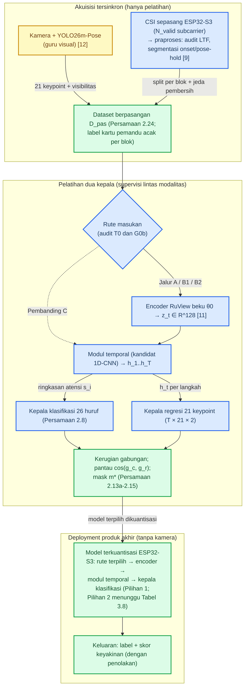
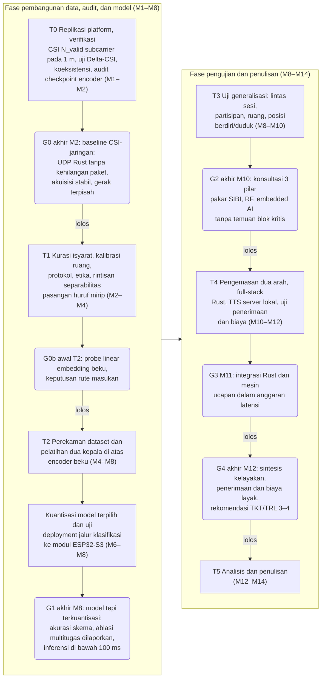
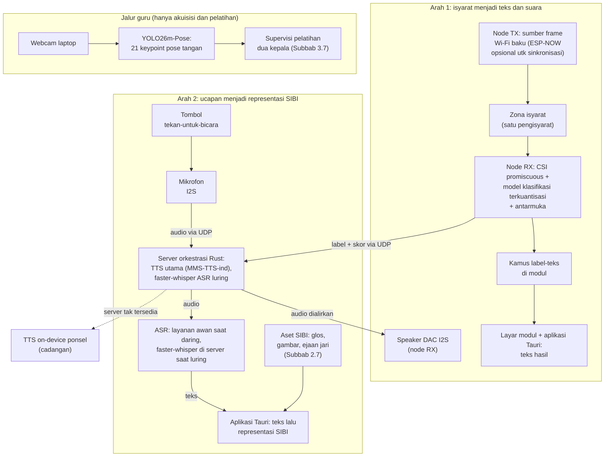
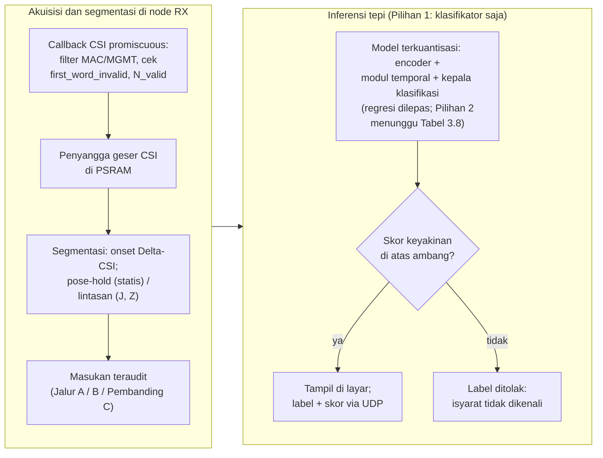

# STUDI KELAYAKAN PURWARUPA SenseSIBI: SISTEM PENERJEMAHAN DUA ARAH HURUF SIBI BERBASIS WI-FI CSI DENGAN INFERENSI ESP32-S3 DAN PEMROSESAN SERVER

**PROPOSAL PENELITIAN**

| Identitas | Keterangan |
|---|---|
| Judul | STUDI KELAYAKAN PURWARUPA SenseSIBI: SISTEM PENERJEMAHAN DUA ARAH HURUF SIBI BERBASIS WI-FI CSI DENGAN INFERENSI ESP32-S3 DAN PEMROSESAN SERVER |
| Jenis dokumen | Proposal penelitian (seminar proposal), BAB I sampai III + Daftar Pustaka; revisi v18 atas v17: paket perbaikan reviewer diterapkan (jalur masukan A/B1/B2 dan Pembanding C, uji permutasi G0b, *subcarrier* valid N_valid, mask gabungan 2.13a, kemiripan arah gradien 2.14a, latensi T_1/T_2 p50 dan p95, WER tanpa 1−WER, tabel BOM, Permenristekdikti 42/2016, DF-WiSLR, Wi-SignFi, DensePose From WiFi), ESP-NOW diturunkan menjadi fitur sinkronisasi opsional, BAB II dipadatkan dari 17 menjadi 12 subbab; 52 halaman (turun dari 55 pada v17 sambil menyerap seluruh paket perbaikan reviewer) |
| Disusun oleh | [PERLU DATA: nama penulis] |
| NIM | [PERLU DATA: NIM penulis] |
| Program studi | [PERLU DATA: program studi] |
| Universitas | [PERLU DATA: nama universitas] |
| Pembimbing | [PERLU DATA: nama pembimbing, jika sudah ditentukan] |
| Tahun | [PERLU DATA: tahun penyusunan] |

> Catatan penyusunan: versi ini menyunting naskah v17 sebagai revisi terarah sekaligus pemadatan menyeluruh; ruang lingkup sistem, objek 26 huruf, gerbang G0 sampai G4, dan seluruh komponen terkunci tidak berubah, dan tidak ada klaim yang dinaikkan. Mekanisme akuisisi CSI diluruskan: CSI ditangkap dari bingkai Wi-Fi biasa dalam mode *promiscuous* sebagaimana implementasi RuView, sedangkan ESP-NOW diturunkan menjadi fitur sinkronisasi opsional. Jalur masukan *encoder* dibedakan menjadi Jalur A, B1, dan B2 dengan Pembanding C; statistik G0b diganti uji permutasi; segmentasi memisahkan fase *onset* dan *pose-hold*; pembagian data dilakukan sebelum jendela bergulir dengan jeda pembersih; MMS-TTS-ind menjadi kandidat TTS utama operasional setelah verifikasi Kokoro tanpa bahasa Indonesia; tabel BOM ditambahkan tanpa harga tebakan; BAB II dipadatkan dari 17 menjadi 12 subbab dan tabel BAB III dinomori ulang menyusul penyisipan BOM. Penanda [PERLU DATA], [PERLU VALIDASI], dan [PERLU KONFIRMASI] tetap menandai hal yang belum dapat ditetapkan; rincian perubahan per subbab ada pada Log Perubahan gelombang 18 di ujung naskah.

---
# BAB I PENDAHULUAN

## 1.1 Latar Belakang

Sebagian besar anak tunarungu tumbuh di dalam keluarga penutur dengar yang belum menguasai bahasa isyarat sejak awal. Sejak hari-hari pertama, komunikasi di rumah kerap berjalan dalam dua saluran bahasa yang belum saling menjembatani: orang tua berbicara dengan suara, anak menjawab dengan isyarat, sementara waktu dan kesempatan belajar bahasa isyarat serba terbatas. Angkanya memang timpang. Di Indonesia ada sekitar 1,92 juta penyandang tunarungu, sementara juru bahasa isyarat hanya sekitar 500 orang [1], sehingga satu juru bahasa harus melayani hampir 4.000 orang. Untuk kebutuhan harian seperti menceritakan sakit atau bertanya kepada penjual di pasar, menunggu juru bahasa jelas bukan jalan keluar. Undang-Undang Nomor 8 Tahun 2016 sudah menjamin hak setiap penyandang disabilitas untuk berkomunikasi [2], tetapi tanpa alat bantu yang benar-benar terjangkau, jaminan itu berjalan lambat.

Kesenjangan itu paling terasa di ruang kelas: guru menjelaskan dengan suara, siswa tunarungu menangkap sebagian dan menebak sisanya. SIBI menjadi bahasa pengantar pendidikan formal dan dibakukan pemerintah dalam *Kamus Sistem Isyarat Bahasa Indonesia* [3]. Survei terhadap 100 responden tunarungu di Jawa dan Bali melaporkan 91% memakai BISINDO sehari-hari, sementara SIBI menempel pada konteks sekolah [4]. Karena penelitian ini menyasar alat bantu pembelajaran di sekolah, SIBI yang dipilih; pelaksanaannya direncanakan di Jawa Timur tanpa mengikat lembaga tertentu.

Alat bantu komunikasi dua arah yang tersedia baru menempuh setengah jalan: sistem yang mengubah ucapan menjadi animasi isyarat hanya melayani arah orang pendengar. Arah isyarat siswa yang dibaca mesin belum tersedia; riset di Indonesia masih berkutat di jalur kamera, misalnya pengenalan huruf BISINDO dari citra dengan CNN [5]. Kendalanya dua dan keduanya praktis: kamera menuntut pencahayaan serta posisi yang tepat sehingga akurasi jatuh begitu cahaya berubah, dan kamera yang terus menyala membuat penggunanya merasa diawasi sepanjang hari di kelas.

Untuk menghindari dua kendala itu, sinyal Wi-Fi membuka jalan lain tanpa kamera. Sinyal ini membawa informasi kanal bernama *Channel State Information* (CSI) [6]. Begitu tangan bergerak di antara pemancar dan penerima, jalur pantulan sinyal bergeser dan CSI berubah mengikuti pola gerakannya; perubahan itulah yang dibaca untuk mengenali gerak tanpa sensor yang dikenakan di tubuh. SignFi, contoh terkemukanya, mengenali 276 isyarat *American Sign Language* (ASL) dari CSI [7], dan CSI bahkan peka terhadap gerak halus sampai ke gerakan jari [6]. Penelusuran pada Google Scholar, Crossref, dan OpenAlex hingga Oktober 2026 belum menemukan satu pun penerapan CSI untuk isyarat SIBI maupun purwarupa dua arah sejenis; ketiadaan itu dicatat sebagai batas penelusuran basis data terkait (Subbab 2.10).

Perangkat yang dibutuhkan pun sederhana. Modul ESP32-S3, mikrokontroler seharga sekitar Rp150.000, sudah memiliki radio Wi-Fi 2,4 GHz dengan dukungan CSI resmi [8], [9]. Dua modul cukup untuk satu pasang: yang satu menyediakan lalu lintas Wi-Fi sebagai sumber bingkai CSI, yang lain menangkapnya dalam mode *promiscuous*; zona isyarat berada di antara keduanya. *Firmware* penangkap CSI yang teruji untuk modul ini tersedia pada platform terbuka RuView [10]. Sepasang modul inti diperkirakan sekitar Rp300.000, lebih ringan daripada kamera ditambah komputer pengolah citra. Total biaya node lengkap dengan layar, audio, baterai, dan *enclosure* disusun lewat daftar komponen (BOM) yang diisi dari survei dan dinilai pada gerbang G4 [PERLU DATA: total BOM purwarupa lengkap] (Tabel 3.2), bukan diklaim murah sebelum rinciannya ada. Harga yang terjangkau mengundang sekolah berani memasang alat ini di lebih dari satu ruang.

Jawabannya, penelitian ini merancang purwarupa bernama SenseSIBI, singkatan dari *Sensing & Translation of SIBI*. Arah pertamanya berjalan dari siswa: ia mengisyaratkan huruf, modul menangkap pola CSI, model yang berjalan langsung di modul mengenalinya, teks muncul di layar, lalu dibunyikan sebagai suara. Arah kedua berjalan dari guru: ia menekan tombol lalu berbicara, ucapannya dikenali menjadi teks, lalu bentuk isyaratnya tampil di layar. Model pengenal isyaratnya tidak dilatih dari nol: *encoder* CSI terpralatih dari RuView [11] menjadi tulang punggungnya. Representasinya dibekukan, lalu adapter masukan (jika dipakai), modul temporal, dan dua kepala tugas dilatih di atasnya, satu kepala mengenali 26 kelas huruf dan satu lagi memperkirakan 21 titik jari tangan, dengan YOLO26m-Pose yang terlatih pada data citra SIBI milik peneliti sebagai guru pemberi label [12]. Kamera hanya menyala saat data direkam; setelah kedua kepala terlatih, seluruh sistem bekerja tanpa kamera.

Sebagai studi kelayakan, penelitian ini membatasi klaimnya. Objek pengenalan dibatasi pada alfabet manual SIBI satu tangan sebanyak 26 huruf, yaitu 24 huruf statis ditambah dua huruf gerak J dan Z, bukan penerjemahan kalimat penuh. Kemampuan membedakan huruf diuji lebih dahulu, tiap tahap ditutup gerbang keputusan, dan kegagalan dilaporkan sebagai temuan. Dalam batas itu penelitian ini menjawab satu pertanyaan: apakah sepasang modul Wi-Fi murah sungguh bisa menjadi jembatan komunikasi dua arah antara siswa tunarungu dan gurunya di kelas?

## 1.2 Rumusan Masalah

Dari latar belakang yang telah dipaparkan, masalah yang dikaji dalam penelitian ini dirumuskan sebagai berikut.

1. Bagaimana merancang purwarupa penerjemah dua arah antara huruf SIBI dan teks beserta suara bahasa Indonesia dengan sepasang modul ESP32-S3 tanpa kamera, yang pada jalur isyarat menjadi teks memakai *encoder* CSI terpralatih RuView yang dibekukan dengan dua kepala tugas, yaitu kepala klasifikasi 26 huruf dan kepala regresi 21 *keypoint* tangan dengan label kelas dari protokol perekaman serta supervisi *keypoint* dari guru visual YOLO26m-Pose, menjalankan inferensi terkuantisasi langsung di modul, serta menghadirkan mesin ucapan dan pengenalan ucapan bahasa Indonesia?
2. Seberapa baik alfabet manual SIBI dikenali dari sinyal CSI oleh model *encoder* terpralatih berkepala dua, termasuk sumbangan kepala regresi yang diukur lewat ablasi, serta bagaimana kinerja kedua jalur penerjemahan pada skenario dalam sesi, lintas partisipan, dan lintas ruang?
3. Seberapa layak purwarupa menjadi alat bantu komunikasi jika ditinjau dari latensi inferensi terkuantisasi dan ujung ke ujung, cakupan kosakata, keandalan operasional, penerimaan pengguna, serta biaya perangkat dan layanan?

## 1.3 Tujuan Penelitian

Tujuan penelitian ini adalah sebagai berikut.

1. Merancang purwarupa penerjemah dua arah antara huruf SIBI dan teks beserta suara bahasa Indonesia dengan sepasang modul ESP32-S3 tanpa kamera, yang pada jalur isyarat menjadi teks memakai *encoder* CSI terpralatih RuView yang dibekukan dengan dua kepala tugas, yaitu kepala klasifikasi 26 huruf dan kepala regresi 21 *keypoint* tangan dengan label kelas dari protokol perekaman serta supervisi *keypoint* dari guru visual YOLO26m-Pose, menjalankan inferensi terkuantisasi langsung di modul, serta menghadirkan mesin ucapan dan pengenalan ucapan bahasa Indonesia.
2. Mengukur seberapa baik alfabet manual SIBI dikenali dari sinyal CSI oleh model *encoder* terpralatih berkepala dua, termasuk sumbangan kepala regresi yang diukur lewat ablasi, serta kinerja kedua jalur penerjemahan pada skenario dalam sesi, lintas partisipan, dan lintas ruang.
3. Menganalisis kelayakan purwarupa sebagai alat bantu komunikasi ditinjau dari latensi inferensi terkuantisasi dan ujung ke ujung, cakupan kosakata, keandalan operasional, penerimaan pengguna, serta biaya perangkat dan layanan.

## 1.4 Batasan Masalah

Agar fokus, ruang lingkup penelitian ini dibatasi sebagai berikut.

1. Objek pengenalan ialah alfabet manual SIBI satu tangan 26 huruf (24 statis serta huruf gerak J dan Z). Bentuk bakunya dicocokkan dengan *Kamus SIBI* [3] dan disetujui validator penutur tunarungu; sistem ini bukan penerjemah kalimat.
2. Pembeda utamanya adalah bentuk tangan dan jari beserta lintasan gerak J dan Z; ekspresi wajah serta penanda nonmanual tidak dikenali.
3. Penginderaan memakai sepasang modul ESP32-S3 (satu pemancar, satu penerima; 2,4 GHz, kanal 20 MHz) dengan layar, baterai, *speaker*, dan mikrofon pada node penerima; kamera hanya menyala saat perekaman data pelatihan.
4. YOLO26m-Pose berperan sebagai guru visual hanya pada saat akuisisi dan pelatihan; produk akhirnya bebas kamera dan bebas citra.
5. *Encoder* murid memakai *checkpoint* terpralatih `ruvnet/wifi-densepose-pretrained` dengan *embedding* 128 dimensi dan 9.280 parameter [11]; *encoder* dibekukan pada baseline, sedangkan LoRA dan pelatihan lanjutan diperlakukan sebagai eksperimen pembanding. Masukan *checkpoint* berupa delapan fitur turunan per jendela satu detik disesuaikan lewat jalur fitur turunan atau adapter masukan yang dipilih pada gerbang G0b [PERLU VALIDASI: parameter normalisasi masukan dan keputusan jalur G0b].
6. Sintesis ucapan utama berjalan di server lokal dan audio diputar pada *speaker* node penerima, dengan mesin *on-device* pada ponsel sebagai cadangan; pengenalan ucapan memakai layanan awan dengan faster-whisper lokal sebagai cadangan; pilihan final mesin dan layanan tetap ditetapkan pada gerbang G3.
7. Arah kedua terbatas pada kamus tingkat kata dengan *fallback* ejaan jari; cakupan kamusnya diukur lalu dilaporkan.
8. Satu sesi hanya melibatkan satu pengisyarat dan sistem tidak mengidentifikasi individu; pengujian berlangsung di sedikitnya dua ruang berbeda di Jawa Timur yang sudah dikalibrasi.
9. Uji pengguna berskala kecil (3–5 pengguna) dan dianalisis secara deskriptif, tanpa statistik inferensial.
10. Isyarat kontinu, tata bahasa isyarat penuh, BISINDO, serta klasifikasi gerakan otomatis dari video berada di luar pembahasan.
11. Seluruh hasil dilaporkan sebagai bukti awal pada populasi terbatas, yaitu 3–4 pengisyarat, sedikitnya dua ruang, dan satu konfigurasi perangkat; skema *leave-one-subject-out*, pengguna baru, dan *leave-one-room-out* dibaca sebagai indikasi ketahanan awal, bukan bukti generalisasi populasi; klaim lintas populasi tidak dibuat.

## 1.5 Manfaat Penelitian

Manfaat penelitian ini terbagi atas manfaat teoretis dan manfaat praktis.

### 1.5.1 Manfaat Teoretis

Secara teoretis, penelitian ini menyumbang bukti awal tentang satu pertanyaan yang tajam: apakah *embedding* hasil pretraining kontrastif pada CSI masih informatif untuk gestur jari apabila *encoder* dibekukan dan hanya adapter masukan (jika dipakai), modul temporal, serta kedua kepala tugasnya yang dilatih. Bukti itu terikat pada alfabet manual dan belum tentu berlaku untuk isyarat kata maupun isyarat kontinu. Penelitian ini juga menghasilkan formulasi multitugas lintas modalitas yang mengawasi klasifikasi isyarat dengan regresi bentuk jari pada satu *embedding* bersama, serta *dataset* CSI berlabel beserta protokol perekamannya. Peneliti berikutnya bisa memakainya untuk bahasa isyarat lain, termasuk perluasan ke BISINDO.

### 1.5.2 Manfaat Praktis

Bagi sekolah yang kelak memakainya, penelitian ini memberi gambaran nyata kelayakan alat bantu komunikasi dua arah berbahasa SIBI beserta biayanya. Purwarupa yang memunculkan teks, menyuarakan isyarat, dan memperagakan bentuk isyarat lahir jika seluruh tahap berhasil; jika berhenti lebih awal, laporan karakterisasi, protokol, dan *dataset* berlabel tetap menjadi warisan penelitian. Bagi keluarga siswa, kosakata tervalidasi memastikan isyarat di layar benar bentuknya; bagi komunitas riset, rancangan yang tidak terikat satu bahasa isyarat memudahkan replikasi.

## 1.6 Sistematika Penulisan

Proposal ini disusun atas tiga bab. **BAB I Pendahuluan** memuat latar belakang, rumusan, tujuan, batasan, manfaat, dan sistematika. **BAB II Kajian Pustaka** menghimpun teori dan penelitian terdahulu yang menjadi dasar perancangan, termasuk *encoder* CSI terpralatih, kedua kepala tugas, dan supervisi guru visual. **BAB III Metode Penelitian** memuat desain, tahapan, waktu dan lokasi, alat dan bahan, perancangan sistem, protokol perekaman, pengolahan sinyal dan pelatihan, skenario pengujian, jadwal, parameter lanjutan, serta risiko dan cadangannya.
# BAB II KAJIAN PUSTAKA

## 2.1 Bahasa Isyarat, SIBI, dan Kebutuhan Komunikasi Dua Arah

Bahasa isyarat menyampaikan makna lewat gerak tangan, lengan, tubuh, dan ekspresi wajah. Satu isyarat tersusun atas bentuk tangan, lokasi, gerak, serta orientasi telapak; cukup satu jari berubah bentuk, maknanya bisa ikut berubah. Susunan inilah acuan penelitian dalam memisahkan bagian isyarat yang bisa dinilai mesin dari bagian yang tetap memerlukan penilaian manusia [3]. SIBI ialah sistem isyarat baku pendidikan formal yang didokumentasikan kamus pemerintah [3], sedangkan BISINDO tumbuh alami di komunitas tunarungu; survei 100 responden tunarungu di Jawa dan Bali menemukan 91% memakai BISINDO sehari-hari, sementara SIBI menempel pada konteks sekolah [4]. Penelitian ini memilih SIBI karena sasarannya alat bantu pembelajaran di sekolah. Audit label pada dataset visual peneliti menegaskan pembagian kelas seluruh naskah: huruf C termasuk 24 huruf statis, sedangkan J dan Z satu-satunya huruf yang menuntut lintasan gerak.

Bicara antara pengguna isyarat dan orang pendengar menuntut dua arah, sementara jumlah juru bahasa jauh dari cukup [1]; alat bantu karena itu harus melayani kedua arah, dan kamus satu arah tidak menyelesaikan masalahnya. Sistem satu arah pengubah ucapan menjadi animasi isyarat sudah hadir di Indonesia, tetapi untuk arah isyarat menjadi teks riset dalam negeri bertumpu pada kamera, misalnya CNN untuk huruf BISINDO [5]. Kamera menuntut pencahayaan dan garis pandang yang baik, dan kamera yang terus menyala membuat pengguna merasa diawasi; dua kendala ini mendorong pencarian jalur penginderaan tanpa kamera dan tanpa perangkat yang dikenakan.

## 2.2 Wi-Fi CSI, Modul ESP32-S3, dan Akuisisi RuView

*Channel State Information* (CSI) memuat informasi amplitudo dan fase pada setiap *subcarrier* sinyal Wi-Fi, yang bersama-sama menggambarkan kondisi jalur propagasi [6]. Tubuh yang bergerak di antara pemancar dan penerima mengubah panjang jalur pantulan; amplitudo dan fase tiap *subcarrier* pun ikut bergeser. Karena tiap *subcarrier* menempati frekuensi berbeda, satu pasang perangkat sekaligus menyediakan banyak kanal pengamatan [6]. Bentuk formalnya: pada kanal 20 MHz, tiap *subcarrier* valid n membawa koefisien kanal kompleks

```rumus
h~n~(t) = |h~n~(t)| · exp( j · φ~n~(t) ), n ∈ N~valid~ (2.1)
```

dengan |h~n~(t)| amplitudo, φ~n~(t) fase, dan j satuan imajiner [6], [9]. Dokumentasi ESP-IDF membedakan total indeks 56 *subcarrier* pada kanal 20 MHz dari *subcarrier* data efektif: tanpa STBC, LLTF memuat 52 *subcarrier* data efektif sedangkan HT-LTF memuat 56, dan jika penanda *first_word_invalid* aktif maka 4 bita awal (2 *subcarrier*) tidak valid [9]. Himpunan N~valid~ karena itu ditetapkan dari audit T0 atas jenis paket, tipe LTF, filter MAC, *pilot/null/guard*, dan penanda tersebut, bukan diasumsikan 56.

Pemodelan CSI berpijak pada zona Fresnel [13]. Radius zona Fresnel ke-n pada suatu titik dihitung dari jarak titik itu ke pemancar d~1~ dan ke penerima d~2~ [13]:

```rumus
r~n~ = √( n · λ · d~1~ · d~2~ / ( d~1~ + d~2~ ) ) (2.2)
```

dengan λ panjang gelombang pembawa; pada 2,4 GHz, λ ≈ 12,5 cm. Pada jarak antarmodul 1 meter dengan tangan di titik tengah, radius zona pertama r~1~ ≈ 0,18 meter sehingga ruang gerak tangan berada di zona yang paling peka terhadap perubahan jalur. Artikulasi jari menggeser jalur pantulan pada orde sentimeter sampai milimeter, dan tiap bentuk huruf meninggalkan pola perubahan *subcarrier* yang khas. Gerak tubuh juga melahirkan pergeseran Doppler yang mengikuti kecepatan gerak v [6], [14]:

```rumus
f~D~ = ( v / λ ) · ( cos α + cos β ) (2.3)
```

dengan α dan β sudut antara arah gerak dan garis pandang ke pemancar serta ke penerima. Pita Doppler gerak isyarat kira-kira 1–60 Hz [6] dan kaidah Nyquist menuntut laju pencuplikan

```rumus
f~s~ ≥ 2 · f~maks~ (2.4)
```

Pada laju *firmware* RuView 50 bingkai per detik [10], pita teramati hanya sampai 25 Hz, sehingga gerak tangan yang masih teramati tanpa pelipatan kira-kira 1,6 meter per detik. Gerak jari yang lebih cepat berisiko terlipat, dan jika laju terukur lebih rendah, pita yang dianalisis ikut menyempit serta dilaporkan apa adanya.

Fase mentah tercemar derau osilator lokal; teknik CSI-ratio membersihkannya lewat rasio atau perkalian konjugat tanpa perangkat tambahan [13], yang diadaptasi menjadi rasio terhadap rekam acuan kalibrasi ruang:

```rumus
ρ~n~(t) = h~n~(t) / h~n~( t~0~ ) (2.5)
```

dengan t~0~ waktu kalibrasi ruang, yaitu 600 bingkai bawaan RuView [10]. Rumus ini didefinisikan sempit sebagai normalisasi terhadap *baseline* kalibrasi ruang: pembagian itu membuang tanggapan statis ruangan, tetapi tidak otomatis menghapus seluruh *phase drift* lambat; sisanya diukur pada T0 lalu dilaporkan. Bukti kepekaan CSI terhadap gerak halus memang banyak [6], tetapi lahir dari kondisi terkendali sehingga bagi penelitian ini statusnya hipotesis kerja. Model CSI juga mudah *overfitting* terhadap orang dan ruang; Widar3.0 menjawabnya dengan profil kecepatan Doppler untuk pengenalan lintas domain [14]. Kelayakan satu tautan berantena tunggal membedakan 26 bentuk tangan SIBI karenanya menjadi pertanyaan penelitian yang diuji lewat Delta-CSI dan gerbang G1; jika beberapa huruf terbukti tidak terpisahkan, himpunan huruf dipangkas (Tabel 3.8).

ESP32-S3 ialah mikrokontroler Wi-Fi 802.11 b/g/n 2,4 GHz berantena tunggal dengan inti ganda 240 MHz, SRAM 512 KB, dan PSRAM hingga 8 MB [8]. Dukungan CSI tersedia resmi lewat repositori esp-csi [9]. RuView merekomendasikan ESP32-S3 sebagai modul penangkap CSI sekaligus menyediakan rantai akuisisi lengkap [10] yang dipetakan pada Tabel 2.1, dan repositori yang sama menerbitkan *checkpoint encoder* terpralatih yang menjadi tulang punggung murid penelitian ini.

Tabel 2.1 Pemetaan fitur RuView terhadap peran dalam penelitian ini

| Fitur RuView | Peran dalam penelitian ini |
|---|---|
| *Firmware* penangkap CSI (UDP, mode *promiscuous*) | Mengalirkan CSI dan label ke server |
| *Station* + UDP + CSI *promiscuous* pada satu *chip*; ESP-NOW hanya fitur sinkronisasi opsional | Dasar topologi satu kanal (Subbab 3.5) |
| Kalibrasi ruang 600 bingkai + 8 *anchor* | Kalibrasi tiap sesi; pemotongan segmen isyarat |
| Mode privasi | Membuang fitur biometrik selama penelitian |
| Akuisisi tersinkron kamera-CSI | Jalur guru; estimator memakai YOLO26m-Pose |
| *Checkpoint encoder* CSI terpralatih (*embedding* 128 dimensi) [11] | *Encoder* murid yang dibekukan pada baseline (Subbab 2.3) |

Mekanisme akuisisinya dinyatakan tepat agar tidak tertukar: node penerima menangkap CSI dari bingkai Wi-Fi biasa yang melintasi kanal dalam mode *promiscuous*, sebagaimana diimplementasikan *firmware* RuView [10]; CSI bukan keluaran protokol khusus, dan node pemancar cukup menyediakan lalu lintas Wi-Fi baku pada zona. ESP-NOW bukan bagian arsitektur inti, hanya kandidat fitur sinkronisasi antarmodul dengan kecocokan sinkron terukur 99,56% [10]. Koeksistensi radio pada satu *chip* tetap disyaratkan: satu kanal untuk seluruh perangkat dan mode hemat daya dimatikan [10]; versi dan *commit firmware* yang dipakai dipin pada T0 [PERLU DATA: versi dan commit RuView]. Satu catatan jujur menyertainya: RuView belum melalui telaah sejawat, jadi fungsinya diverifikasi sendiri pada gerbang G0.

## 2.3 Encoder CSI Terpralatih RuView, Transfer Learning, dan Jalur Masukan

*Encoder* terpralatih yang menjadi tulang punggung jalur isyarat menjadi teks terdokumentasi pada kartu modelnya [11]: dua lapis *fully connected* dengan BatchNorm dan GELU memetakan fitur CSI menjadi *embedding* 128 dimensi ternormalisasi L2, seluruhnya hanya 9.280 parameter:

```rumus
z~i~ = f~θ0~( X~i~ ), z~i~ ∈ R^d^, d = 128 (2.6)
```

dengan X~i~ masukan ke-i, f~θ0~ pemetaan *encoder* bertetapan θ~0~, dan z~i~ vektor *embedding* keluaran. Pretrainingnya kontrastif dengan triplet loss dan InfoNCE pada temperatur 0,1; pasangan positif dari jendela berjarak 2 detik, negatif dari lebih 30 detik, selama 60 epoch dengan AdamW dan perlindungan EWC [11]. Kontrak masukannya diikat eksplisit: satu vektor delapan fitur turunan per jendela satu detik (*batch* (B, 8)), bukan deret *subcarrier*, dan keluarannya satu *embedding* per jendela; deret waktu hidup pada tingkat barisan jendela. Parameter normalisasi masukan belum dipublikasikan kartu modelnya sehingga dicari pada artefak *checkpoint* saat audit T0 [PERLU VALIDASI: parameter normalisasi masukan pada artefak checkpoint].

Dua model lain pada ekosistem yang sama sering tertukar dengan *encoder* ini. Model `wifi-densepose-mmfi-pose` [15] adalah *checkpoint* pose terpisah: amplitudo CSI [3, 114, 10] pada 100 Hz diproses *encoder* Transformer menjadi 17 *keypoint* tubuh COCO dengan sekitar 2,3 juta parameter. Kinerjanya PCK@20 82,69% (ansambel 83,59%), turun ke 64% lintas subjek *zero-shot* dan 17,5% lintas lingkungan, lalu naik ke 72–78% setelah kalibrasi 50–1.000 bingkai per orang [15]. Model itu dilatih pada dataset MM-Fi [16] (40 subjek, 27 kategori aksi, lebih 320 ribu bingkai) dan berlisensi CC BY-NC 4.0 mengikuti lisensi datanya. Model ketiga, YOLO26m-Pose [12], ialah model penglihatan yang berperan sebagai guru visual (Subbab 2.5); Tabel 2.2 merangkum pembedaan ketiganya.

Tabel 2.2 Pembedaan tiga model ekosistem yang tidak boleh tercampur dalam penelitian ini

| Aspek | Encoder CSI terpralatih [11] | Model pose MM-Fi [15] | Guru visual YOLO26m-Pose [12] |
|---|---|---|---|
| Berkas | `ruvnet/wifi-densepose-pretrained` (audit kedua set berkas model.* vs csi-embed-v2.* pada T0) | `ruvnet/wifi-densepose-mmfi-pose` | Repositori WPC peneliti (eksperimen exp11_huruf24) |
| Masukan | 8 fitur turunan CSI per jendela 1 detik (*batch* (B, 8)); bukan deret *subcarrier* | Amplitudo CSI [3, 114, 10] @ 100 Hz | Citra RGB kamera |
| Keluaran | *Embedding* 128 dimensi ternormalisasi L2 | 17 *keypoint* tubuh COCO dalam [0, 1] | Kelas isyarat dan 21 *keypoint* tangan |
| Parameter | 9.280 | ±2,3 juta (varian utama) | [PERLU DATA: jumlah parameter model juara WPC] |
| Peran | Representasi murid, dibekukan pada baseline | Pembanding temuan lintas domain, bukan komponen model | Pemberi label kelas dan *keypoint* saat akuisisi |
| Status bukti | Kartu model; triplet-temporal 82,3%; EWC tingkat lupa 32,97% | Kartu model; PCK@20 82,69%; lisensi CC BY-NC 4.0 | Data pra-penelitian peneliti; mAP50 0,9580 pada 24 huruf statis |

Status tiga dokumen rancangan pada repositori RuView juga dinyatakan terbuka: ADR-024 (model penyematan kontrastif AETHER), ADR-146 (*encoder* RF tujuh kepala tugas), dan ADR-150 (*foundation encoder* tahan pergantian orang dan ruang) semuanya berstatus Proposed, artinya belum diimplementasikan [10]. Penelitian ini bersandar hanya pada *checkpoint* yang benar-benar tersedia; angka estimasi dari ADR dikutip dengan label estimasi rancangan setiap kali muncul.
Audit langsung ke repositori Hugging Face dan GitHub RuView pada 14 November 2026 menambah tiga temuan wajib [10], [11]. Pertama, terdapat dua set artefak *checkpoint* (model.* serta csi-embed-v2.* yang memuat *standardizer* FP16) dan berkas model.safetensors mengalami *NUL-padding* pada *header* (isu #1522) sehingga tidak terbaca langsung oleh safetensors.torch.load_file; audit T0 memeriksa keduanya sebelum pelatihan. Kedua, dokumentasi RuView (isu #509) memperingatkan keterbatasan aliran CSI antena tunggal (SISO) 56 *subcarrier* ESP32 terhadap detail sendi distal tangan. Ketiga, kartu model mencatat tingkat lupa (*forgetting rate*) EWC 32,97% pada empat tugas pretraining meski memakai EWC. Angka triplet-temporal 82,3% juga dibaca sempit: ia menghitung peluang jarak anchor ke positif temporal lebih pendek daripada ke negatif pada satu ruangan, satu rekaman, dan dua node [11], bukan akurasi klasifikasi SIBI dan bukan galat *keypoint* yang justru hendak diukur penelitian ini.

Ketidaksesuaian bentuk masukan menjadi risiko ilmiah utama. Kartu model mencatat masukan delapan fitur turunan CSI (kehadiran, gerak, napas, detak jantung, varians fase, jumlah orang, deteksi jatuh, dan RSSI) pada laju 1 Hz [11], sedangkan jalur akuisisi menghasilkan N~valid~ *subcarrier* hingga 50 bingkai per detik [9], [10]. Delapan fitur itu harus dibaca jujur sebagai kontrak lingkungan, bukan kontrak artikulasi: napas, detak jantung, jumlah orang, dan deteksi jatuh hampir tidak berubah selama artikulasi jari, dan pretraining memakai data ruangan delapan jam dengan supervisi sensor PIR dan BME280 [11]. Jika detail jari hilang ketika CSI diringkas menjadi delapan fitur, membuka bobot *encoder* lewat LoRA maupun pelatihan lanjutan tidak dapat mengembalikan informasi yang sudah terbuang. Penelitian karena itu menyiapkan dua jalur implementasi masukan dan satu pembanding alternatif:

1. Jalur A (rekonstruksi fitur bawaan): menghitung ulang delapan fitur turunan RuView dari bingkai CSI, dengan unit, definisi, penanda waktu, dan normalisasi yang diverifikasi terhadap artefak asli pada T0.
2. Jalur B (adapter konvolusi 1D terlatih), dibedakan menjadi Jalur B1 (adapter rekonstruksi) yang dilatih meniru delapan fitur RuView, dan Jalur B2 (adapter tugas) yang dioptimalkan langsung oleh kerugian SIBI. Jika Jalur B2 berhasil sementara Jalur A gagal, kontribusi pemisahan kelas berasal dari adapter tugas dan tidak diklaim sebagai bukti kualitas representasi bawaan RuView.
3. Pembanding C (baseline CSI temporal lebih kaya): model temporal ringan yang menerima spektrum CSI yang belum dipersempit menjadi delapan fitur, untuk menjaga ketajaman analisis pada G0b tanpa mengganti desain utama secara diam-diam.

Baseline penelitian membekukan *encoder* pada θ~0~ dan melatih bersama adapter masukan (jika dipakai), modul temporal, serta kedua kepala tugas, sebagaimana dirumuskan Persamaan 2.15. Dengan *encoder* beku, kualitas *embedding* terpralatih untuk SIBI terbaca langsung dari kinerja kepala sehingga sumbangan pretraining terpisah dari penyetelan; *encoder* hanya 9.280 parameter sehingga membandingkan skema adaptasi lain pun murah. LoRA menambah pembaruan berperingkat rendah pada tetapan asli tanpa menyimpan gradien seluruh matriks [17]:

```rumus
W~akhir~ = W~0~ + B · A (2.7)
```

dengan W~0~ matriks tetapan asli yang dibekukan, B berukuran d~keluar~ × r dan A berukuran r × d~masukan~, serta r peringkat adapter yang jauh lebih kecil daripada ukuran matriks. Kartu model menyertakan adapter ruangan node-1.json dan node-2.json sekitar 21 KB [11], dan ADR-150 menaksir adapter sekitar 11 KB menyamai kinerja lintas subjek dengan 100–200 data berlabel per ruang [10] sebagai estimasi rancangan. Kompatibilitas LoRA dengan alur ekspor ke ESP32-S3 belum terverifikasi [PERLU VALIDASI: kompatibilitas LoRA dengan alur ekspor]. Pembanding ketiga ialah pelatihan lanjutan yang dijaga EWC seperti pretrainingnya [11]; ketiga skema (beku, beku plus LoRA, pelatihan lanjutan) menjadi eksperimen pembanding pada data dan seed yang sama, selalu berdampingan dengan Pembanding C karena penyetelan bobot tidak memulihkan informasi jari yang hilang pada masukan delapan fitur.


## 2.4 Dua Kepala Tugas, Modul Temporal, dan Kerugian Gabungan

Kepala klasifikasi mengubah ringkasan barisan *embedding* menjadi skor kelas. Untuk K = 26 kelas, skor logit dihitung dari

```rumus
a~i~ = W~c~ · s~i~ + b~c~ (2.8)
```

dengan s~i~ ∈ R^d^ vektor ringkasan atensi modul temporal (s~i~ = z~i~, d = 128 pada *probe* atau ablasi tanpa proyeksi temporal), W~c~ matriks K × d, dan b~c~ vektor bias. Skor diubah menjadi probabilitas lewat *softmax*

```rumus
q~ik~ = exp( a~ik~ ) / Σ~k~ exp( a~ik~ ) (2.9)
```

sehingga seluruh probabilitas berjumlah satu. Sebagai lantai pembanding, tebakan acak seragam bernilai 1/K ≈ 3,8%, dihitung ulang jika himpunan huruf dipangkas. Kerugian pelatihannya silang-entropi kategorikal; dengan label *one-hot* y~ik~ yang bernilai satu pada kelas benar, kerugian atas N sampel dalam *batch* berbunyi

```rumus
L~cls~ = − ( 1 / N ) · Σ~i~ Σ~k~ y~ik~ · log q~ik~ (2.10)
```

Jika data latih timpang antarhuruf, bobot kelas dipasang berbanding terbalik dengan frekuensi kelasnya, dihitung hanya dari data latih (Tabel 3.8). Klasifikator himpunan tertutup selalu memilih satu kelas, sehingga keluarannya dilengkapi skor keyakinan dan mekanisme penolakan [18]: keyakinan rendah memunculkan pesan isyarat tidak dikenali alih-alih menebak salah. Kelayakan operasionalnya dilaporkan lewat *accepted coverage*, akurasi pada segmen diterima (*selective accuracy*), akurasi keseluruhan, serta laju terima-salah dan tolak-salah dengan ambang dari data validasi (Subbab 3.7).

Kepala regresi memperkirakan bentuk jari kontinu. Target mengikuti skema 21 *landmark* tangan MediaPipe Hands [19]; sesuai `kpt_shape` [21, 3], tiap sampel memuat 21 titik dengan koordinat x, y, dan tanda visibilitas, dipakai berpasangan (x, y) dengan visibilitas sebagai mask. Kepala regresi membaca tiap keadaan tersembunyi modul temporal langsung sehingga keluarannya per langkah, Q~t~ = reshape( W~r~ · h~t~ + b~r~, 21, 2 ) dengan W~r~ berukuran 42 × 128 dan keluaran per segmen T × 21 × 2. Bentuk ini dipilih karena J dan Z dibedakan lintasan gerak, bukan satu pose. Varian peringkas tunggal yang memprediksi seluruh jendela dari satu vektor,

```rumus
Q~i~ = reshape( W~r~ · z~i~ + b~r~, T, 21, 2 ) (2.11)
```

dengan W~r~ berukuran 42T × 128, dipertahankan sebagai pembanding ablasi untuk huruf statis. Sistem koordinat target dibakukan sebelum pelatihan: koordinat piksel kamera tidak otomatis dapat diprediksi dari CSI dan tidak tahan perubahan posisi kamera, jarak, maupun orientasi. Kandidat kuatnya koordinat ternormalisasi terhadap kotak deteksi guru atau titik pergelangan tangan. Konvensi *handedness*, skala acuan d~ref~, ambang PCK α, dan pemetaan target temporal ke pusat jendela ditetapkan pada T0 lalu dipakai konsisten oleh guru dan murid [PERLU VALIDASI: sistem koordinat, handedness, skala acuan, dan ambang PCK]. Proyeksi XY dua dimensi tidak merepresentasikan kedalaman dan orientasi telapak penuh; keterbatasan itu dinyatakan pada laporan.

Kerugian regresinya Smooth L1 yang dibobot mask [20]. Fungsi Smooth L1 berperilaku kuadratik dekat nol dan linear untuk galat besar,

```rumus
SmoothL1~δ~( x ) = 0,5 · x^2^ / δ untuk |x| ≤ δ, dan |x| − 0,5 · δ untuk |x| > δ (2.12)
```

dengan δ ambang peralihan, sehingga pencilan anotasi tidak mendominasi gradien. Kerugian bermask dihitung hanya pada titik dan langkah yang valid, dijumlahkan pada kedua koordinat:

```rumus
L~reg~ = ( Σ~i,t,j~ m*~itj~ · Σ~c~ SmoothL1~δ~( Q~itj,c~ − P~itj,c~ ) ) / ( 2 · Σ~i,t,j~ m*~itj~ + ε ) (2.13)
```

dengan m*~itj~ mask gabungan, c ∈ {x, y}, P~itj~ koordinat acuan guru, dan ε penahan pembagi nol; mask gabungan itu menggabungkan validitas langkah temporal dan visibilitas titik:

```rumus
m*~itj~ = m^valid^~it~ · m^vis^~itj~ (2.13a)
```

dengan m^valid^~it~ bernilai nol pada langkah *padding* dan m^vis^~itj~ mask visibilitas guru. Jika prediksi visibilitas juga diinginkan, kepala tambahan dengan silang-entropi biner disiapkan sebagai perluasan (Tabel 3.8).

Pembelajaran multitugas melatih beberapa tugas berbarengan di atas representasi yang dibagi, dan representasi yang baik untuk satu tugas kerap menolong tugas lain yang berkaitan [21]. Kedua tugas penelitian ini dua pandangan atas isyarat yang sama, klasifikasi sebagai kelas diskret dan regresi sebagai bentuk jari kontinu; hipotesisnya, supervisi *keypoint* ikut merapikan batas antarhuruf yang mirip. Kerugian gabungan menjumlah keduanya dengan bobot:

```rumus
L~total~ = λ~cls~ · L~cls~ + λ~reg~ · L~reg~ (2.14)
```

Skala keduanya disamakan lebih dulu, misalnya dengan membagi tiap kerugian oleh nilai rata-ratanya pada epoch pertama, sebelum bobot λ ditala dari data validasi (Tabel 3.8). Konflik gradien antartugas dipantau lewat besar gradien tiap kepala dan kemiripan arahnya,

```rumus
cos( g~c~, g~r~ ) = ( g~c~^T^ · g~r~ ) / ( ||g~c~|| · ||g~r~|| + ε ) (2.14a)
```

dengan g~c~ dan g~r~ gradien kerugian klasifikasi dan regresi terhadap tetapan bersama; jika keduanya menarik representasi ke arah berlawanan (kemiripan arah menurun), penyeimbangan gradien atau pelatihan bergantian dipertimbangkan dan perlakuannya dilaporkan. Pada baseline, pembaruan tetapan menyentuh seluruh tetapan di luar *encoder*:

```rumus
Θ~train~ = { φ~adapter~, θ~temporal~, θ~c~, θ~r~ }, θ~encoder~ = θ~0~ (2.15)
```

dengan φ~adapter~ tetapan adapter masukan yang hanya hadir jika jalur adapter terpilih pada G0b, θ~temporal~ tetapan modul temporal, serta θ~c~ dan θ~r~ tetapan kedua kepala; pembaruannya mengikuti Θ~train~ ← Optimizer( ∇ L~total~ ). Modul temporal sendiri bukan kepala tugas: ia memproses barisan *embedding* per langkah dan mengeluarkan keadaan tersembunyi per langkah, h~1~ sampai h~T~. Kandidatnya 1D-CNN ringan dari rancangan lama yang memelihara urutan waktu; agregasi statistik hanya kandidat bagi jalur klasifikasi, dan pilihan di antara keduanya diambil dari hasil ablasi pada data yang sama. Kepala tunggal yang dilatih sendiri-sendiri juga disiapkan sebagai pembanding pada split yang sama; keputusan modul temporal dicatat pada Tabel 3.8.

## 2.5 Guru Visual YOLO26m-Pose dan Supervisi Lintas Modalitas

Guru visual bekerja hanya pada tahap akuisisi data. Kamera laptop dan node penerima CSI merekam serentak dengan penanda waktu yang sama; pada tiap bingkai, YOLO26m-Pose [12] menghasilkan kelas isyarat beserta 21 *keypoint* tangan dan visibilitasnya, dan label kelas dicocokkan dengan kartu pemandu protokol sehingga derau label terkendali. Kemampuan guru teruji pada pra-penelitian di repositori WPC peneliti: dataset versi 2 memuat 49 kelas isyarat dengan 7.210 gambar (6.231 latih, 650 validasi, 329 uji), dan eksperimen exp11_huruf24 mencatat *pose* mAP50 0,9580 dengan akurasi huruf 97,6% pada 24 huruf statis [PERLU DATA: commit/hash checkpoint WPC exp11_huruf24]. Angka itu berlaku untuk data visual dan tidak dikutip sebagai kemampuan mengenali J dan Z; supervisi kedua huruf gerak diambil dari lintasan *keypoint* dan label protokol, dengan kualitas deteksi dievaluasi khusus (deteksi berhasil, *jitter*, bingkai hilang) karena performa exp11 hanya terukur pada pose statis (Subbab 3.6). Dari angka itu terbaca 21 titik artikulasi jari memuat informasi cukup untuk gestur mikro SIBI. Dua hal ditegaskan: seluruh angka itu hasil model visual pada data visual, bukan hasil model Wi-Fi, dan dataset itu tidak memuat rekaman CSI sehingga pasangan data baru direkam sendiri pada T2.

Peran guru dipisahkan menurut jenis target. Untuk 24 huruf statis, label kelas pelatihan diambil dari protokol perekaman dan guru menyumbang deret 21 *keypoint* beserta visibilitasnya. Untuk J dan Z, label juga berasal dari protokol, dan guru tidak diposisikan sebagai pengklasifikasi kedua huruf gerak itu kecuali model guru terbukti memuat kelasnya [PERLU VALIDASI: kelas J dan Z pada model juara WPC]. Istilahnya dipilih hati-hati: karena murid hanya menerima label keras berupa kelas dan koordinat, pola yang presisi ialah supervisi lintas modalitas berpandu guru; distilasi pengetahuan klasik yang memindahkan probabilitas lunak tidak menggambarkan bentuk transfer ini [22]. Konsep guru-murid tetap dipertahankan: YOLO26m-Pose guru visual saat akuisisi dan pelatihan, model CSI murid yang dipakai tanpa kamera pada inferensi. Status pseudo-label dijalani jujur: keluaran guru yang belum diperiksa manusia bukan kebenaran sempurna, sehingga protokol menyertakan verifikasi sampel oleh validator, penyaringan bingkai gagal deteksi, dan pencatatan *jitter keypoint* (Subbab 3.6). Ekspektasi generalisasinya dijaga temuan model pose MM-Fi [15]: lintas subjek *zero-shot* hanya 64% dan lintas lingkungan 17,5%, naik ke 72–78% setelah kalibrasi 50–1.000 bingkai per orang; angka itu menjadi acuan ekspektasi sekaligus alasan skema kalibrasi per orang dan per ruang disiapkan sebagai jalur cadangan (Tabel 3.9).

## 2.6 Pengenalan Isyarat Berbasis CSI dan Inferensi pada Perangkat

Riset pengenalan bahasa isyarat dari CSI sudah berjalan di beberapa negara. SignFi mengenali 276 isyarat ASL dengan akurasi hingga 99,8% di laboratorium, walau turun menjadi 86,66% pada lima pengguna baru [7]; jalur ini belum menyentuh SIBI. Model utama penelitian ini tiga bagian: *encoder* terpralatih yang dibekukan (Subbab 2.3), modul temporal untuk deret waktu (Subbab 2.4), dan dua kepala tugas. Pembandingnya sesama model CSI pada data dan seed sama: varian kepala tunggal tanpa kepala regresi serta Pembanding C yang tidak melewati penyempitan delapan fitur (Subbab 3.7). Inferensi dirancang berjalan langsung di modul. ESP-DL membuktikan eksekusi model int8 pada keluarga ESP32 dengan tolok ukur 69,2 ms untuk model citra MobileNetV2-0,5 (RGB 128×128×3; total 73,9 ms termasuk pra- dan pasca-proses) [23]; angka itu membuktikan kemampuan eksekusi terkuantisasi pada perangkat kerasnya, bukan latensi model CSI. TensorFlow Lite Micro menjadi alternatifnya. Tolok ukur CSI-isyarat pada ESP32-S3 belum ada, jadi waktu inferensi aktual diukur sendiri (Subbab 3.7).

## 2.7 TTS, ASR, dan Pemetaan Teks ke Representasi SIBI

Purwarupa membutuhkan mesin sintesis ucapan (TTS) dan pengenalan ucapan (ASR) dengan tiga kriteria: dukungan bahasa Indonesia terverifikasi, jalur lokal dan *on-device* tersedia, serta biaya berkelanjutan bagi sekolah. Verifikasi langsung ke berkas VOICES.md resmi Kokoro-82M v1.0 pada 14 November 2026 menunjukkan sembilan kelompok suara untuk delapan bahasa tanpa bahasa Indonesia, serta kelemahan pada ujaran sangat pendek [24]. MMS-TTS-ind, model TTS Indonesia dari Meta [25], karena itu menjadi kandidat utama operasional. Kokoro tetap tercatat untuk verifikasi ulang jika suara Indonesia tersedia pada rilis berikutnya [PERLU KONFIRMASI: keputusan final mesin TTS, Tabel 3.8 #17]. Keduanya berjalan di server lokal sebagai jalur utama dan di ponsel melalui ONNX Runtime sebagai cadangan, lalu diuji banding pada G3. Pada sisi ASR, Whisper dilatih lima juta jam audio dan mendukung lebih dari 100 bahasa termasuk Indonesia [26]; saat internet terputus, server lokal mengambil alih dengan faster-whisper. Galat katanya untuk percakapan Indonesia belum terverifikasi dari sumber primer, jadi akurasinya diukur sendiri (Subbab 3.8).

Terjemahan teks menjadi isyarat tidak mungkin dilakukan kata demi kata karena bahasa isyarat memiliki tata bahasa sendiri. Arah kedua karenanya dirancang pada tingkat kamus kata dengan ejaan jari sebagai cadangan; struktur SIBI mendukung rancangan ini sebab alfabet manualnya lengkap, 26 huruf dan 9 angka [3]. Tampilannya dua lapis: lapis utama memunculkan glos dan gambar bentuk tangan untuk kata yang tersedia di kamus (ukuran gambar sekitar dua puluh sampai tiga puluh kilobita sehingga muat di penyimpanan modul), dan lapis kedua berupa animasi yang dialirkan dari server jika waktu pengembangan memungkinkan. Kata di luar kamus dialihkan ke ejaan jari; untuk huruf dinamis J dan Z, ejaan jari memerlukan representasi animasi atau urutan lintasan karena satu gambar statis tidak memadai. Cakupan kamus, yaitu proporsi kata uji yang terwakili, menjadi metrik utama arah ini (Subbab 3.8).

## 2.8 Komunikasi Modul, Server, dan Topologi Jaringan

Seluruh perangkat, dari kedua modul penginderaan sampai ponsel, berbagi satu kanal Wi-Fi yang sama sehingga penangkapan CSI berjalan serentak dengan komunikasi data [10]. Peran jembatan jaringan sekaligus penjangkar kanal dipegang *access point*, berupa *router* sekolah maupun *hotspot* ponsel; aliran data ke server memakai UDP, sedangkan sinkronisasi antarmodul, jika diperlukan, memakai ESP-NOW sebagai fitur opsional (Subbab 2.2). Lapisan orkestrasi server, penelan UDP, dasbor, dan klien ditulis dalam Rust: Tokio menangani konkurensi, Axum menyediakan HTTP dan WebSocket, Leptos membangun dasbor WASM, dan Tauri menjadi aplikasi klien ponsel, sementara mesin ASR dan TTS (faster-whisper, ONNX Runtime) dijalankan lewat *runtime* ML yang sesuai. Alasannya praktis: tanpa pengumpul sampah pemrosesan bingkai UDP tetap cepat, binernya hemat memori, dan satu sistem tipe mendeteksi perubahan format bingkai saat kompilasi. Target *parsing* di bawah 0,2 ms dan memori server di bawah 40 MB adalah target rancangan yang baru diukur pada G3; server lokal pada laptop menjalankan seluruh layanan luring sehingga pemrosesan teks dan suara tetap berjalan tanpa internet. Pemisahan bahasanya tegas: pelatihan model berjalan dengan Python dan PyTorch (Subbab 3.7), Rust untuk *runtime* server dan klien; keduanya tidak saling menggantikan.

## 2.9 Evaluasi Kelayakan

Penilaian kelayakan berjalan bertahap lewat lima gerbang G0 sampai G4 (BAB III), dan tiap tahap menghasilkan artefak tetap sehingga kegagalan pun terdokumentasi. Rekomendasi akhirnya menyatakan posisi purwarupa pada kerangka *technology readiness level* [27]. Kinerja klasifikasi diukur dengan akurasi, presisi, *recall*, skor F1 makro, serta *confusion matrix* per isyarat, selalu dibandingkan terhadap peluang acak. Untuk kelas huruf k, presisi dan *recall* dihitung dari jumlah benar positif TP~k~, salah positif FP~k~, serta salah negatif FN~k~:

```rumus
P~k~ = TP~k~ / ( TP~k~ + FP~k~ ) (2.16)
```

```rumus
R~k~ = TP~k~ / ( TP~k~ + FN~k~ ) (2.17)
```

```rumus
F1~k~ = 2 · P~k~ · R~k~ / ( P~k~ + R~k~ ) (2.18)
```

```rumus
F1~makro~ = ( 1 / K ) · Σ~k~ F1~k~ (2.19)
```

```rumus
p~acak~ = 1 / K (2.20)
```

Untuk K = 26 huruf, p~acak~ ≈ 3,8%, dihitung ulang jika himpunan huruf dipangkas (Subbab 3.8.2). Kinerja kepala regresi diukur dengan MPJPE, rata-rata jarak Euclid antara prediksi dan acuan pada titik dan langkah valid,

```rumus
MPJPE = ( Σ~i,t,j~ m*~itj~ · || Q~itj~ − P~itj~ || ) / Σ~i,t,j~ m*~itj~ (2.21)
```

serta PCK, proporsi *keypoint* yang galatnya masuk ambang relatif,

```rumus
PCK@α = ( Σ~i,t,j~ m*~itj~ · 1( || Q~itj~ − P~itj~ || ≤ α · d~ref~ ) ) / Σ~i,t,j~ m*~itj~ (2.22)
```

dengan 1(·) bernilai satu jika kondisinya terpenuhi, α ambang relatif, dan d~ref~ skala acuan yang mengikuti sistem koordinat terbakukan (Subbab 2.4); NME dilaporkan sebagai alternatif ternormalisasi, dan galat per *keypoint* diringkas untuk mengenali titik jari yang paling sulit diprediksi. Pada baseline Pilihan 1, MPJPE dan PCK@α berstatus metrik pemantauan; jika Pilihan 2 terpilih, ambang kelayakan regresi ditetapkan lebih dulu pada Tabel 3.8 sebelum G1 dinilai. Pada jalur ucapan, kesalahan pengenalan kata diukur dengan laju galat kata (WER), yaitu jumlah substitusi S, penghapusan D, dan penyisipan I terhadap N kata acuan:

```rumus
WER = ( S + D + I ) / N (2.23)
```

WER dilaporkan beserta rinciannya (S, D, I, N) karena nilai itu bisa melebihi satu akibat penyisipan. Empat dimensi tambahan menilai kelayakan alat komunikasinya: latensi ujung ke ujung, cakupan kamus, keandalan operasional, dan biaya. Persepsi pengguna diukur dengan kuesioner skala Likert [28] lalu dianalisis secara deskriptif, sedangkan kewajaran keluaran dinilai validator penutur tunarungu. Rekomendasi akhir menyatakan posisi purwarupa pada skala TKT nasional yang mengikuti Permenristekdikti Nomor 42 Tahun 2016 tentang Pengukuran dan Penetapan Tingkat Kesiapterapan Teknologi [29], selaras dengan kerangka TRL [27].

## 2.10 Penelitian Terdahulu

Penelitian terdahulu yang paling relevan dibandingkan pada Tabel 2.3, mencakup pengenalan isyarat dan gestur dari sinyal Wi-Fi serta pengenalan isyarat berbasis kamera di Indonesia.

Tabel 2.3 Perbandingan penelitian terdahulu

| No. | Peneliti (Tahun) | Modalitas dan arah | Bahasa isyarat | Bebas kamera | Fokus |
|---|---|---|---|---|---|
| 1 | Ma dkk. (2018) [7] | CSI; isyarat menjadi teks | ASL, 276 isyarat | Ya | Pengenalan berskala besar |
| 2 | Zhang dkk. (2022) [14] | CSI; gestur lintas domain | Gestur umum | Ya | Generalisasi lintas orang dan ruang |
| 3 | Geng dkk. (2022) [30] | CSI NIC riset; pose padat tubuh | Bukan isyarat | Ya | Estimasi pose padat dari WiFi |
| 4 | Ahmed dkk. (2020) [31] | CSI; isyarat statis dan dinamis | ISL, 49 gestur (30 statis, 19 dinamis) | Ya | Pengenalan lintas ruang rumah dan kantor |
| 5 | Gao dkk. (2023) [32] | CSI; multitugas pengenalan isyarat dan identifikasi pengguna/ruang | ASL (dataset SignFi) | Ya | Multitugas CNN dan KNN |
| 6 | Dwijayanti dkk. (2021) [5] | Citra; isyarat menjadi teks | BISINDO | Tidak | CNN pengenalan citra |
| 7 | Penelitian ini | CSI sepasang ESP32-S3; encoder terpralatih berkepala dua; supervisi guru visual; inferensi tepi; TTS dan ASR Indonesia | SIBI, alfabet 26 huruf | Ya | Studi kelayakan purwarupa dua arah |

Tiga kelompok bisa dibaca dari tabel itu. Pengenalan isyarat dan gestur dari Wi-Fi berjalan tanpa kamera tetapi belum menjangkau SIBI: SignFi mengenali 276 isyarat ASL [7], Widar3.0 menggeneralisasi gestur lintas orang dan ruang [14], DF-WiSLR membuktikan 49 gestur ISL (30 statis, 19 dinamis) terpisah lintas ruang rumah dan kantor [31], dan Wi-SignFi menjalankan multitugas pengenalan isyarat sekaligus identifikasi pengguna dan lingkungan pada dataset SignFi [32]. Estimasi pose dari Wi-Fi telah dibuka DensePose From WiFi yang memetakan fase dan amplitudo CSI menjadi koordinat UV pada 24 wilayah tubuh [30]; garis itu dilanjutkan model pose MM-Fi pada ekosistem RuView [15]. Wi-SignFi sendiri mencatat CNN ringannya belum menangkap dinamika temporal secara optimal sehingga modul temporal diusulkan penulisnya; catatan itu menguatkan keputusan mempertahankan modul temporal pada penelitian ini. Karena karya-karya itu memakai NIC riset multi-antena atau data laboratorium, keberhasilannya tidak otomatis berlaku pada tautan tunggal ESP32-S3 yang menjadi pertanyaan penelitian ini. Riset Indonesia berbasis kamera [5] membuktikan tingginya minat, namun tetap terikat pencahayaan dan garis pandang. Dalam batas penelusuran (Google Scholar, Crossref, dan OpenAlex hingga Oktober 2026; log kueri dilampirkan [PERLU DATA: log kueri penelusuran literatur]), publikasi pengenalan isyarat SIBI dari CSI maupun purwarupa dua arah yang memadukannya dengan TTS dan ASR bahasa Indonesia pada ESP32-S3 belum ditemukan. Kebaruan penelitian ini karenanya diklaim secara kombinatif dan terukur: penerapan CSI satu tautan ESP32-S3 untuk alfabet SIBI, penggunaan encoder RuView sebagai representasi beku, supervisi 21 *keypoint* tangan lintas modalitas, serta integrasi dua arah dengan pemrosesan bahasa Indonesia. Di luar itu, pengenalan isyarat dari CSI, gestur statis-dinamis dari Wi-Fi, dan multitask learning pada isyarat sudah ada [31], [32], jadi tidak diklaim sebagai kebaruan global; kebaruan juga tidak diklaim untuk isyarat kontinu maupun penerjemahan kalimat penuh.

## 2.11 Matriks Justifikasi Pemilihan Komponen

Tabel 2.4 merangkum jawaban atas pertanyaan mengapa X dan bukan Y untuk delapan keputusan arsitektur. Seluruh target kinerja di dalamnya adalah target rancangan yang baru diukur pada gerbang BAB III, bukan hasil yang dijanjikan.

Tabel 2.4 Matriks justifikasi pemilihan komponen (Mengapa X dan Bukan Y?)

| No. | Keputusan | Komponen dipilih | Alternatif ditinggalkan | Justifikasi |
|---|---|---|---|---|
| 1 | Tumpukan server dan klien | Orkestrasi server dan klien dalam Rust (Tokio/Axum, Leptos WASM, Tauri) plus runtime ML ucapan | Node.js, Streamlit, Electron, React/JS | Parsing UDP di bawah 0,2 ms; memori di bawah 40 MB; satu sistem tipe (Subbab 2.8) |
| 2 | Mesin TTS | MMS-TTS-ind sebagai kandidat utama operasional; Kokoro jika suara Indonesia tersedia [24], [25] | TTS awan, VITS/Tacotron penuh | Kokoro v1.0 terverifikasi tanpa bahasa Indonesia (14 Nov. 2026); kedua kandidat luring di server lokal (utama) dan ponsel (cadangan) (Subbab 2.7) |
| 3 | Node penginderaan | ESP32-S3 [8] | ESP32 biasa, C3/C6, Arduino Uno | Instruksi vektor int8; PSRAM penyangga CSI dan model; API CSI resmi (Subbab 2.2) |
| 4 | Penginderaan radio | Normalisasi rasio terhadap baseline kalibrasi ruang, kanal 20 MHz [13] | RSSI, radar khusus, time of flight | RSSI terlalu kasar; rasio membersihkan derau fase tanpa perangkat tambahan (Subbab 2.2) |
| 5 | Model guru visi | YOLO26m-Pose 21 keypoint [12] | YOLOv8-pose, MediaPipe langsung, UNet | 21 titik artikulasi vital untuk membedakan huruf mirip dan lintasan J/Z; mAP50 0,9580 dan akurasi 97,6% pada 24 huruf statis (Subbab 2.5) |
| 6 | Model murid tepi | Encoder CSI terpralatih dibekukan + modul temporal + dua kepala; Jalur A/B1/B2 dengan Pembanding C [11] | SVM, MLP berat, pelatihan dari nol | Checkpoint 9.280 parameter teruji kontrastif; beku memisahkan sumbangan pretraining; penyempitan 8 fitur diuji eksplisit lewat Pembanding C (Subbab 2.3 dan 2.4) |
| 7 | Dua kepala tugas | Klasifikasi 26 huruf + regresi 21 keypoint dengan kerugian gabungan [21] | Kepala klasifikasi saja | Supervisi keypoint berpotensi merapikan batas kelas yang mirip; manfaatnya diuji lewat ablasi (Subbab 3.7) |
| 8 | Metode supervisi | Supervisi lintas modalitas berpandu guru; label keras kelas dan keypoint [22] | Pelatihan CSI murni; distilasi soft target | CSI abstrak memerlukan supervisi spasial guru; bentuk transfer yang dipakai memang label keras (Subbab 2.5) |

## 2.12 Kerangka Pemikiran dan Arsitektur Model

Kerangka pemikiran penelitian ini mengalir dari data sampai perangkat, seperti dirangkum Gambar 2.1. Jalur guru mengunci label: kamera tersinkron dan YOLO26m-Pose menghasilkan kelas serta 21 *keypoint* acuan hanya saat akuisisi data. Jalur model memproses CSI sepasang ESP32-S3 lewat praproses, rute masukan terpilih hasil audit T0 dan G0b (Jalur A, B1, atau B2, dengan Pembanding C sebagai alternatif evaluasi), *encoder* beku yang menghasilkan barisan *embedding* 128 dimensi, dan modul temporal. Saat pelatihan, kepala klasifikasi dan kepala regresi berjalan bersama di bawah kerugian gabungan; saat *deployment* Pilihan 1, kepala regresi dilepas dan model terkuantisasi yang tersisa dijalankan di modul, sementara arah kedua sistem tetap berjalan lewat ASR, kamus, dan TTS (Subbab 3.5).



Gambar 2.1 Arsitektur model: akuisisi terpandu guru hanya saat pelatihan, pelatihan dua kepala di atas encoder beku dengan rute masukan hasil audit (Jalur A, B1, B2, dan Pembanding C), serta deployment Pilihan 1 yang menjalankan klasifikator saja; simpul kuning = jalur guru, biru = jalur model Wi-Fi, hijau = pelatihan dan deployment

Dataset yang menopang kerangka ini dirumuskan sebagai pasangan berunsur:

```rumus
D~pas~ = { ( X~i~, y~i~, P~i~, m~i~, s~i~, q~i~ ) }, i = 1, ..., N (2.24)
```

dengan X~i~ jendela CSI, y~i~ label kelas isyarat, P~i~ koordinat 21 *keypoint* acuan, m~i~ mask visibilitasnya, s~i~ metadata subjek, sesi, ruang, serta perangkat, dan q~i~ skor kualitas anotasi guru; keseluruhan pasangan direkam sendiri pada T2 karena tidak ada sumber lain yang menyediakannya. Dengan rumusan itu, teori CSI dan zona Fresnel (Subbab 2.2) menyediakan sinyal, *encoder* terpralatih (Subbab 2.3) menyediakan representasi, dan kedua formulasi kepala (Subbab 2.4) menyediakan keluaran tugas. Guru visual (Subbab 2.5) menyediakan labelnya, dan hasilnya diukur di tepi (Subbab 2.6) sebelum kedua arah disatukan menjadi purwarupa (BAB III).

# BAB III METODE PENELITIAN

## 3.1 Desain Penelitian

Penelitian ini berbentuk studi kelayakan kuantitatif bergerbang yang mengukur tiga hal: kemampuan CSI satu tautan antarmodul ESP32-S3 membedakan 26 huruf alfabet manual SIBI, kemampuan model terkuantisasi berjalan di modul, dan kinerja kedua jalur penerjemahan. Komponen yang lulus uji dikemas menjadi purwarupa lalu dinilai lewat uji operasional, uji kegunaan skala kecil, dan penilaian validator penutur tunarungu. Bergerbang karena belum ada yang membuktikan CSI mampu membedakan isyarat SIBI dan kemampuan itu tidak boleh diasumsikan: tiap tahap menghasilkan artefak tetap, kegagalan gerbang dicatat sebagai temuan, dan kriteria akurasi dirumuskan relatif peluang acak (Subbab 2.9). Inti pelatihannya supervisi lintas modalitas berpandu guru (Subbab 3.7): label kelas dari protokol perekaman dan deret 21 *keypoint* dari guru kamera YOLO26m-Pose mengawasi pelatihan adapter masukan (jika dipakai), modul temporal, serta dua kepala tugas di atas *encoder* terpralatih yang dibekukan. Model terpilihnya lalu dijalankan langsung di modul. Rumusan pertama dijawab pada replikasi platform hingga perancangan model, kedua pada uji klasifikasi, regresi, dan *deployment*, ketiga pada uji operasional, kegunaan, dan penilaian validator.

## 3.2 Tahapan Penelitian

Empat belas minggu (M1 sampai M14) dibagi ke dalam enam tahap: replikasi platform dan karakterisasi (T0), kurasi isyarat dan protokol (T1), perekaman *dataset* serta pelatihan dua kepala (T2), uji generalisasi (T3), pengemasan purwarupa dan uji penerimaan (T4), serta analisis dan penulisan (T5). Lima gerbang keputusan menutup rangkaian itu, ditambah sub-gerbang G0b yang mengaudit kompatibilitas representasi *encoder* atas data pilot sebelum pelatihan penuh; kriteria dan tindakan jika gagal dirinci pada Tabel 3.6; penerimaan pengguna dan biaya dinilai G4, yang kemudian menyusun rekomendasi posisi TKT/TRL 3–4 [27], [29]. Alur lolosnya dirangkum pada Gambar 3.1. Jika G0 gagal dua kali, jalur CSI dihentikan dan dilaporkan sebagai temuan; kriteria seluruh gerbang difinalkan bersama pembimbing sebelum dinilai (Tabel 3.8).



Gambar 3.1 Tahapan penelitian T0–T5 dan gerbang keputusan G0–G4 beserta sub-gerbang G0b (jalur lolos; tindakan jika gagal pada Tabel 3.6)

Tahap T0 sampai T2 membangun dasar data. T0 menyiapkan dua modul dengan *firmware* `esp32-csi-node` RuView [10] lalu menjalankan empat uji tanpa partisipan: verifikasi N~valid~ *subcarrier* pada jarak baku 1 meter, uji Delta-CSI (Subbab 3.8.1), koeksistensi radio dengan *streaming* audio [PERLU DATA: format audio, laju cuplik, pengaliran, dan penanganan paket hilang], serta pengukuran laju pencuplikan. T0 juga mengaudit *checkpoint encoder* [11]: bentuk masukan, parameter normalisasi, jumlah parameter, normalisasi L2, dukungan ekspor, kompatibilitas LoRA, kedua set berkas (model.* dan csi-embed-v2.*), jenis bingkai sumber CSI, serta versi dan *commit* RuView [PERLU DATA: versi dan commit RuView] (Subbab 3.7). T1 meliputi kurasi 26 huruf bersama validator, kalibrasi ruang, protokol, etika, perizinan, serta penetapan pasangan huruf paling mirip sebagai bahan G1 (Subbab 3.6).

Pada T2, *dataset* kurang lebih 30 repetisi per isyarat per sesi direkam disertai video tersinkron (Subbab 3.6). Alurnya supervisi berpandu guru: segmen disaring lewat *keypoint* guru, jendela CSI disandingkan dengan label berdasarkan penanda waktu, lalu kedua kepala dilatih di atas *encoder* beku dengan kerugian gabungan; model terpilih dikuantisasi dan diuji di modul (Subbab 3.7). T2 melahirkan *dataset* berlabel, model terlatih, dan laporan *deployment*. G1 menilai hasilnya; jika gagal, cakupan dipangkas menjadi himpunan huruf berpembeda CSI terkuat (Tabel 3.8).

Tahap T3 sampai T5 berisi pengujian dan pelaporan. Generalisasi lintas sesi, partisipan, ruang, serta posisi berdiri-duduk diuji pada T3, termasuk pada satu pengguna baru tanpa pelatihan ulang dengan acuan Widar3.0 [14]; jika ketahanan lintas pengguna rendah, cakupan berubah menjadi personalisasi per pengguna dan dilaporkan sebagai temuan. T4 mengemas model menjadi purwarupa dua arah (Subbab 3.5) lalu menjalankan uji operasional dan jalur ucapan (Subbab 3.8) yang dinilai G3; rangkaian ditutup uji penerimaan, penilaian validator, dan analisis biaya yang dinilai G4. Pada T5, seluruh artefak dianalisis dan laporan kelayakan disusun lengkap dengan rekomendasi TKT/TRL 3–4 [27], [29] beserta keterbatasan eksplisitnya (Subbab 1.4).

## 3.3 Waktu dan Lokasi Penelitian

Pelaksanaan penelitian jatuh pada [PERLU DATA: bulan dan tahun pelaksanaan penelitian] di Jawa Timur. Penelitian ini tidak bersandar pada mitra lembaga; partisipan direkrut langsung oleh peneliti, sedangkan perekaman dan pengujian berlangsung di sedikitnya dua ruang berbeda, misalnya ruang kelas dan ruang kerja, sebagai jumlah minimum skema *leave-one-room-out*. Tiap ruang dikalibrasi lebih dulu sebelum perekaman (Subbab 3.5).

## 3.4 Alat dan Bahan

Tabel 3.1 dan Tabel 3.3 menyajikan perangkat keras dan perangkat lunak penelitian. Node penginderaan dipegang sepasang modul ESP32-S3: TX menyediakan lalu lintas Wi-Fi baku sebagai sumber bingkai CSI, sedangkan RX mengekstrak CSI N~valid~ *subcarrier* pada 2,4 GHz kanal 20 MHz sekaligus memuat antarmuka; ESP-NOW hanya kandidat fitur sinkronisasi opsional (Subbab 2.2). Versi perangkat lunak dicatat bersama log pelatihan agar eksperimen bisa diulang. Bahan penelitiannya meliputi *checkpoint encoder* terpralatih [11], *dataset* CSI berpasangan yang direkam sendiri, dataset citra WPC beserta model guru YOLO26m-Pose dari repositori peneliti, lembar definisi huruf, aset tampilan arah kedua, formulir persetujuan, instrumen uji, dan kuesioner persepsi; perekaman dilakukan sendiri karena pengenalan isyarat SIBI dari CSI belum ditemukan dalam penelusuran (Subbab 2.10).

Tabel 3.1 Perangkat keras penelitian

| No. | Nama | Spesifikasi | Jumlah | Keterangan |
|---|---|---|---|---|
| 1 | Modul ESP32-S3 | PSRAM 8 MB; 2,4 GHz 802.11b/g/n, kanal 20 MHz (56 *subcarrier*), 1T1R; varian yang direkomendasikan RuView [10] | 2 unit | Node TX (sumber lalu lintas Wi-Fi) dan node RX (penerima CSI dan antarmuka) |
| 2 | Layar modul | OLED 0,96 inci I2C (128×64) atau TFT 1,3 inci SPI (240×240) [PERLU DATA: model final] | 1 unit | Tampilan huruf, baterai, kanal, mode kerja |
| 3 | *Rotary encoder* EC11 dan tombol tekan | Putar 360 derajat, 20 detak per putaran, tombol terintegrasi; sakelar sesaat *pull-up* internal | 1–2 unit | Navigasi menu, sensitivitas, tekan-untuk-bicara, reset |
| 4 | Pengeras suara dengan DAC I2S | Mini 8 Ohm 3 W, penguat kelas D MAX98357A | 1 set | Pemutaran suara TTS hasil sintesis server yang dialirkan ke modul (keputusan D3 pada Tabel 3.8); *speaker* ponsel sebagai cadangan |
| 5 | Mikrofon I2S | INMP441, MEMS omnidireksional, SNR 61 dBA | 1 unit | Pintu suara arah kedua |
| 6 | Baterai Li-Po, BMS 1S, pengisi TP4056 | Li-Po 3,7 V 2.500–3.000 mAh [PERLU DATA: kapasitas final berdasarkan uji arus]; proteksi; pengisi 1 A USB-C | 1–2 set | Daya portabel, proteksi, dan pengisian |
| 7 | Laptop | ASUS TUF Dash F15 FX516PR: i7-11370H, RTX 3070 Laptop 8 GB VRAM, RAM 16 GB | 1 unit | Server Rust (penelan CSI, orkestrasi, ASR lokal cadangan, TTS lokal utama, dasbor); akuisisi jalur guru; pelatihan dua kepala; evaluasi |
| 8 | Ponsel pintar | Poco F4 5G: Snapdragon 870, RAM 6 GB, Android | 1 unit | Klien Tauri (tampilan teks dan representasi SIBI), mesin TTS *on-device* sebagai cadangan, *hotspot* cadangan |
| 9 | *Access point* | *Router* Wi-Fi 2,4 GHz dengan internet [PERLU DATA: pilihan final] | 1 unit | Jembatan jaringan dan penjangkar kanal, bukan penginderaan |
| 10 | *Webcam* | Bawaan laptop | 1 unit | Hanya untuk jalur guru |

Harga komponen dirangkum pada Tabel 3.2 sebagai kerangka daftar komponen (BOM) rencana; seluruh harga diisi dari survei pemasok sebelum gerbang G4 dan tidak ditebak lebih dahulu [PERLU DATA: harga satuan komponen dan sumber rujukan].

Tabel 3.2 Kerangka BOM rencana sepasang node lengkap

| No. | Komponen | Jumlah | Harga satuan (Rp) | Subtotal (Rp) | Sumber harga |
|---|---|---|---|---|---|
| 1 | Modul ESP32-S3 (TX dan RX) | 2 unit | [PERLU DATA] | [PERLU DATA] | [PERLU DATA] |
| 2 | Layar modul final (OLED 0,96 inci atau TFT 1,3 inci) | 1 unit | [PERLU DATA] | [PERLU DATA] | [PERLU DATA] |
| 3 | *Rotary encoder* EC11 dan tombol PTT/reset | 1–2 set | [PERLU DATA] | [PERLU DATA] | [PERLU DATA] |
| 4 | Mikrofon I2S INMP441 | 1 unit | [PERLU DATA] | [PERLU DATA] | [PERLU DATA] |
| 5 | DAC I2S MAX98357A dan *speaker* 8 Ohm 3 W | 1 set | [PERLU DATA] | [PERLU DATA] | [PERLU DATA] |
| 6 | Baterai Li-Po (kapasitas final), BMS 1S, TP4056, dan komponen pasif | 1–2 set | [PERLU DATA] | [PERLU DATA] | [PERLU DATA] |
| 7 | *Enclosure* cetak 3D serta kabel, *header*, dan PCB | 2 set | [PERLU DATA] | [PERLU DATA] | [PERLU DATA] |
| — | Total sepasang node lengkap (di luar laptop, ponsel, dan AP) | — | — | [PERLU DATA] | — |

Foto pada Gambar 3.2 memudahkan mengenali bentuk sembilan perangkat pada Tabel 3.1; webcam memakai bawaan laptop sehingga tidak difoto terpisah. Foto produk hanya menjadi pengenal bentuk, bukan acuan merek maupun spesifikasi, dan rujukan spesifikasinya tetap Tabel 3.1 [PERLU ILUSTRASI: foto dokumentasi sendiri setelah seluruh perangkat dibeli].

```gambar
Sumber skrip: scripts/sensesibi-v10/gambar_g15_alatbahan.py (grid foto hasil pencarian gambar daring) -> assets-v16/gambar-3.2.png
```

Gambar 3.2 Perangkat keras penelitian; huruf pada tiap foto mengikuti baris Tabel 3.1 (foto produk hanya ilustrasi pengenal bentuk sebelum pengadaan dan perakitan, bukan acuan merek)

Tabel 3.3 Perangkat lunak penelitian

| No. | Nama | Fungsi dalam penelitian |
|---|---|---|
| 1 | *Firmware* dan *server* RuView [10] | Menangkap CSI, mengirim UDP, kalibrasi ruang, segmentasi |
| 2 | *Checkpoint* encoder CSI terpralatih `ruvnet/wifi-densepose-pretrained` beserta adapter LoRA ruangannya [11] | *Encoder* murid yang dibekukan pada baseline; kandidat adaptasi LoRA |
| 3 | `scripts/collect-ground-truth.py` (diadaptasi) | Sinkron kamera-CSI; estimator memakai YOLO26m-Pose |
| 4 | Model guru YOLO26m-Pose dan repositori alur kerja YOLO26 peneliti [12] | Ekstraksi *keypoint*; konversi *dataset*, pelatihan deterministik, pencatatan eksperimen (Subbab 3.7) |
| 5 | Layanan GPU Kaggle | Pelatihan lanjutan guru dan pembanding adaptasi *encoder* jika GPU lokal tidak cukup |
| 6 | Python dan PyTorch | Pelatihan dua kepala, LoRA, pelatihan lanjutan, evaluasi; kompatibel dengan *checkpoint* dan mendukung autograd |
| 7 | ESP-DL dengan akselerasi ESP-NN (alternatif: TensorFlow Lite Micro) [23] | Menjalankan model terkuantisasi pada node RX |
| 8 | faster-whisper [26]; MMS-TTS-ind [25]; layanan ASR awan [PERLU DATA: layanan final hasil uji banding] | ASR luring (faster-whisper); kandidat utama TTS Indonesia (MMS-TTS-ind); ASR utama saat daring |
| 9 | Rust, Tokio, Axum, Leptos, Tauri | Server seluruhnya Rust, dasbor WASM, aplikasi klien ponsel |
| 10 | Kokoro TTS ONNX dan ONNX Runtime [24] | Kokoro terverifikasi tanpa bahasa Indonesia (14 Nov. 2026), diuji ulang jika rilis berikutnya menyediakannya [PERLU KONFIRMASI: Tabel 3.8 #17]; ONNX Runtime menjalankan TTS *on-device* di ponsel |
| 11 | Kamus label-teks dan teks-isyarat | Dikembangkan sendiri; kamus label-teks dimuat pada modul |

## 3.5 Perancangan Sistem

Gambar 3.3 memperlihatkan keseluruhan sistem: dua jalur operasional tanpa kamera dan satu jalur guru yang hanya aktif saat akuisisi serta pelatihan. Pada arah pertama, lalu lintas Wi-Fi node pemancar melintasi zona isyarat, gerak pengisyarat mengubah deret CSI yang ditangkap node penerima, dan model klasifikasi terkuantisasi yang berjalan langsung di modul menghasilkan label beserta skor keyakinan. Label dikirim via UDP ke server Rust, dipetakan menjadi teks Indonesia, tampil di layar modul dan aplikasi Tauri, lalu disintesis mesin TTS di server lokal; audionya dialirkan kembali ke modul dan diputar pada *speaker* DAC I2S. Jika aliran audio tidak stabil atau server tidak tersedia, sintesis beralih ke mesin *on-device* pada ponsel dan peralihan itu dicatat. Dengan *deployment* Pilihan 1 (Tabel 3.8), kepala regresi hanya supervisi tambahan saat pelatihan dan dilepas pada *deployment* sehingga keluaran perangkat ialah label huruf beserta skor keyakinan.

Pada arah kedua, tombol tekan-untuk-bicara mengaktifkan mikrofon I2S node penerima; audio ditangkap lalu dialirkan ke server Rust, yang meneruskannya ke layanan ASR awan saat daring atau memprosesnya sendiri dengan faster-whisper. Teks hasil pengenalan dipetakan ke representasi SIBI dari aset modul dan tampil pada aplikasi Tauri dengan indikator opsional di layar modul. Saat internet terputus, kedua arah tetap berjalan karena ASR dan TTS beralih ke server lokal; pemrosesan audio di node penerima sebatas penangkapan dan pengaliran. Jalur guru memakai *webcam* dan YOLO26m-Pose untuk mengekstrak deret *keypoint* sebagai supervisi pelatihan dan bukan bagian produk akhir.



Gambar 3.3 Arsitektur produk akhir tanpa kamera. Subgraf arah 1 = isyarat menjadi teks dan suara; subgraf arah 2 = ucapan menjadi representasi SIBI; subgraf jalur guru hanya aktif saat akuisisi dan pelatihan; garis putus-putus = jalur cadangan TTS on-device pada ponsel jika server tidak tersedia.

Topologinya menyatukan seluruh perangkat pada satu *access point* dan satu kanal sehingga penangkapan CSI berjalan serentak dengan komunikasi data (Subbab 2.2). Node pemancar menyediakan lalu lintas Wi-Fi baku sebagai sumber bingkai CSI; node penerima mengirim bingkai, label, dan skor melalui UDP kepada server Rust sebagai telemetri riset, dengan ESP-NOW hanya fitur sinkronisasi opsional. Server lokal menjalankan server RuView, server Rust, faster-whisper sebagai ASR luring, serta mesin TTS dengan MMS-TTS-ind sebagai kandidat utama dan Kokoro jika suara Indonesia tersedia.

Kedua modul dipasang setinggi dada dan saling mengapit zona isyarat; uji Delta-CSI memeriksa kesesuaiannya. Zona hanya ditempati satu pengisyarat per sesi, sistem tidak mengidentifikasi individu, dan jarak antarmodul (baku 1 meter) ditetapkan pada T0 lalu dicatat dalam metadata sesi (Tabel 3.8). Karena CSI peka terhadap perubahan ruang [10], [14], setiap sesi diawali kalibrasi ruang bawaan RuView selama kurang lebih empat menit dengan 600 bingkai dan 8 *anchor*. Posisi perabot, pendingin ruangan, serta orang yang lewat dicatat sebagai kovariat analisis.

*Enclosure* cetak tiga dimensi bahan PLA atau ABS menampung papan, baterai, BMS, TP4056, dan seluruh antarmuka node penerima: layar, pengeras suara, dan mikrofon di muka depan atau atas, *rotary encoder* dan tombol di samping, port USB-C di bawah; node pemancar dikemas serupa tanpa antarmuka. Pemetaan pin GPIO pada Tabel 3.4 dipilih agar tidak menabrak pin *strapping* (GPIO 0, 3, 45, 46) maupun kanal USB [8] dan diverifikasi ulang pada unit papan fisik saat T0, mencakup jalur USB, kanal ADC1, konflik periferal I2C/I2S/SPI, dan revisi papan [PERLU DATA: revisi papan final]. Rantai dayanya tersusun atas baterai, BMS 1S, TP4056, dan regulator 3,3 volt papan; tegangan baterai diukur lewat pembagi tegangan. Kecukupan arus puncak saat Wi-Fi dan *speaker* aktif serta keamanan pengisian sambil beroperasi diverifikasi pada uji bangku T0/G3 [PERLU DATA: profil arus puncak, regulasi beban saat pengisian, dan kapasitas baterai final]. [PERLU DATA: berkas model enclosure final] [PERLU ILUSTRASI: foto atau render enclosure dan tata letak komponennya]

Skema tiga dimensi pada Gambar 3.4 merangkum penempatan seluruh komponen node penerima di dalam enclosure; pemetaan pinnya mengikuti Tabel 3.4 dan dimensinya difinalkan setelah uji T0.

```gambar
Sumber skrip: scripts/sensesibi-v10/gambar_g15_rxnode.py (matplotlib mplot3d) -> assets-v16/gambar-3.4.png
```

Gambar 3.4 Skema penempatan komponen node penerima di dalam enclosure (ilustrasi tiga dimensi, tidak berskala)

Tabel 3.4 Matriks pinout wiring GPIO node penerima

| No. | Subsistem | Pin modul | GPIO ESP32-S3 | Fungsi |
|---|---|---|---|---|
| 1 | Layar I2C (OLED) | SDA / SCL | GPIO 8 / GPIO 9 | Jalur data dan *clock* bus I2C |
| 2 | *Rotary encoder* EC11 | CLK (A) / DT (B) / SW | GPIO 10 / GPIO 11 / GPIO 12 | Detak, arah putaran, tombol |
| 3 | Tombol tekan | OUT | GPIO 13 | Tekan-untuk-bicara dan reset; *pull-up* internal |
| 4 | Mikrofon INMP441 | SCK / WS / SD | GPIO 14 / GPIO 15 / GPIO 16 | *Clock*, *word select*, data I2S penerima |
| 5 | DAC MAX98357A | BCLK / LRC / DIN | GPIO 17 / GPIO 18 / GPIO 21 | *Clock*, penanda kiri-kanan, data I2S pengirim |
| 6 | Pemantau tegangan baterai | ADC | GPIO 1 (ADC1_CH0) | Keluaran pembagi tegangan baterai |

Seluruh perangkat lunak server dan klien ditulis dalam Rust (Subbab 2.8): pendengar UDP bingkai CSI berjalan di atas Tokio, Axum menyediakan HTTP dan WebSocket bagi dasbor Leptos WASM, dan aplikasi Tauri pada ponsel menjadi klien antarmuka dua arah. Target *parsing* bingkai di bawah 0,2 ms dan memori server di bawah 40 MB baru diukur pada G3 (Subbab 3.8.3). Mesin sintesis utamanya berjalan di server lokal dengan MMS-TTS-ind sebagai kandidat utama operasional [25], setelah verifikasi 14 November 2026 membuktikan Kokoro-82M v1.0 tanpa suara bahasa Indonesia [24]; Kokoro diuji ulang jika rilis berikutnya menyediakannya [PERLU KONFIRMASI: Tabel 3.8 #17]. Jalur cadangan *on-device* berjalan di ponsel lewat ONNX Runtime di dalam Tauri. Target latensinya didefinisikan sebagai waktu menuju audio pertama (*time-to-first-audio*, TTFA) di bawah 100 ms pada frasa uji paling banyak lima kata. Pelaporannya menurut persentil p50 dan p95 pada lingkungan uji terdokumentasi [PERLU DATA: konfigurasi CPU/GPU, runtime, presisi model, dan opsi pre-cache audio huruf tunggal], dan durasi sintesis keseluruhan dilaporkan terpisah.

## 3.6 Protokol Perekaman Dataset, Partisipan, dan Etika

Partisipan terdiri atas 3–4 pengisyarat kompeten, sedikitnya satu validator penutur tunarungu, serta 3–5 pengguna uji dari kelompok sasaran, yaitu guru, siswa tunarungu, dan wali murid. Agar skema lintas sesi bisa dijalankan, setiap pengisyarat direkam dalam sedikitnya dua sesi. Kurasi isyarat mengacu pada *Kamus SIBI* [3]: lembar definisi memuat konfigurasi tangan-jari serta lintasan J dan Z, lalu validator menyetujuinya. Pasangan huruf paling mirip ditetapkan sebagai bahan G1, sedangkan kosakata tampilan arah kedua meliputi 26 huruf dan 9 angka [3] serta kata terpilih. Perekaman memakai *elisitasi* terisolasi, satu huruf per segmen dengan jeda antarrepetisi: huruf statis diperagakan sebagai pose yang ditahan sejenak, J dan Z sebagai lintasan gerak. Prosedur perekaman setiap sesi adalah sebagai berikut.

1. Menyiapkan seluruh peralatan yang dipakai.
2. Memasang kedua modul, pemancar dan penerima, lalu menghubungkan seluruh perangkat ke *access point* pada satu kanal.
3. Menjalankan kalibrasi ruang seraya mencatat metadata sesi: tanggal, ruang, kode pengisyarat, posisi modul, dan kondisi latar.
4. Menjalankan `scripts/collect-ground-truth.py` dengan sumber penanda waktu tunggal supaya perekaman CSI dan *webcam* berjalan sinkron. Kualitas sinkronisasi diverifikasi ulang lewat uji kejadian di awal sesi, misalnya satu ketukan tangan yang terbaca kedua sensor [PERLU DATA: sumber clock final, resolusi waktu, toleransi sinkronisasi, metode penyelarasan dan pensampelan ulang keypoint ke pusat jendela, serta penanganan bingkai hilang].
5. Memunculkan kartu pemandu huruf target dengan urutan huruf yang diacak di dalam setiap blok, merekam satu repetisi, memberi jeda, lalu mengulanginya sampai setiap huruf mencapai kurang lebih 30 repetisi; jumlah repetisi yang benar-benar terpakai per kelas dan per sesi dicatat setelah pembuangan segmen bermasalah.
6. Membuang segmen yang tangan tidak terdeteksi model guru, yang mengalami *jitter* *keypoint* ekstrem, atau yang terpotong, lalu mencatat tingkat segmen terbuang dan skor kualitas anotasi tiap segmen. Kualitas deteksi *keypoint* pada gerakan dinamis J dan Z dievaluasi khusus (laju deteksi berhasil, *jitter*, bingkai hilang, dan validitas lintasan) karena performa exp11_huruf24 hanya terukur pada 24 pose statis [PERLU DATA: ambang batas jitter dan laju deteksi minimum].
7. Meminta validator mengambil sampel segmen untuk memeriksa kebenaran bentuk isyarat [PERLU DATA: proporsi sampel dan jumlah penilai]; label guru berstatus *pseudo-label* sampai pemeriksaan ini selesai.

Beban perekaman dihitung agar protokolnya realistis dan etis. Dengan 26 huruf dan kurang lebih 30 repetisi, satu sesi memuat sekitar 780 repetisi; pada asumsi lima detik per repetisi, perekaman murni sekitar 65 menit, dan dengan jeda blok, kalibrasi, serta persiapan menjadi sekitar 97 menit. Sesi dibagi blok sepuluh menit dengan jeda wajib sekurang-kurangnya tiga menit, paling banyak dua sesi per hari per pengisyarat, dan pengisyarat boleh berhenti kapan saja tanpa konsekuensi; kelelahan diamati dari penurunan mutu segmen pada blok akhir dan dilaporkan bersama tingkat segmen terbuang.

Baru setelah persetujuan etik dari [PERLU DATA: lembaga atau komisi pemberi persetujuan etik] serta persetujuan tertulis setiap partisipan diperoleh, perekaman dimulai; partisipan berhak mengundurkan diri kapan saja. Formulir persetujuan menerangkan bahwa kamera hanya menyala pada sesi akuisisi jalur guru, produk akhir bebas kamera, dan mode privasi RuView aktif. Video semata-mata dipakai untuk verifikasi batas segmen, penyaringan kualitas, dan diagnosis; penyimpanannya terbatas, tidak dipublikasikan, dan dihapus permanen setelah verifikasi serta ekstraksi selesai [PERLU DATA: durasi retensi, batas kontrol akses berkas, dan prosedur penghapusan]. Formulir persetujuan disajikan dalam format yang mudah diakses dan dipahami partisipan tunarungu; jika ada partisipan di bawah umur, persetujuan orang tua atau wali beserta *assent* anak wajib disertakan, atau partisipan dibatasi pada kelompok dewasa. Potensi risiko identifikasi ulang dari metadata, pola kinematika, dan suara diakui secara terbuka tanpa klaim anonimitas mutlak. Karena audio arah kedua dikirim ke layanan awan, tujuannya diungkapkan pada formulir dan kebijakan penyimpanan layanan diperiksa sebelum dipakai. *Dataset* yang dipublikasikan hanya memuat CSI, label, *keypoint*, dan metadata tanpa identitas.

## 3.7 Pengolahan Sinyal, Pelatihan Dua Kepala, dan Deployment

Bingkai CSI dibatasi *firmware* RuView paling sering setiap 20 ms atau 50 bingkai per detik [10]; laju aktualnya diukur pada T0, dan jika terukur lebih rendah, pita Doppler yang dianalisis dipangkas hingga setengah laju aktual. Deret CSI dipotong menjadi segmen huruf dengan segmentasi energi gerak memakai Delta-CSI, yaitu rata-rata besar perubahan koefisien kanal kompleks antarbingkai pada seluruh *subcarrier* valid n ∈ N~valid~ (himpunan *subcarrier* data efektif hasil audit T0; Subbab 2.2):

```rumus
d( t ) = ( 1 / |N~valid~| ) · Σ~n∈Nvalid~ | h~n~(t) − h~n~( t − 1 ) | (3.1)
```

Segmentasi memisahkan dua fase: deteksi *onset* gerak dari Delta-CSI (d(t) melampaui ambang τ), lalu untuk 24 huruf statis jendela penahanan pose (*pose-hold*) selama durasi observasi tetap untuk klasifikasi statis. Untuk J dan Z digunakan jendela lintasan penuh dari *onset* sampai *offset* gerak; seluruh ambang dan durasi ditetapkan dari data validasi, bukan dari data uji (Tabel 3.8) [PERLU VALIDASI: ambang onset, durasi pose-hold, dan offset]. Sebagai pembanding sensitivitas pada uji Delta-CSI (Subbab 3.8.1), varian berbasis amplitudo saja juga dihitung dan dilaporkan berdampingan:

```rumus
d~|H|~( t ) = ( 1 / |N~valid~| ) · Σ~n∈Nvalid~ | |h~n~(t)| − |h~n~( t − 1 )| |
```

Bentuk masukan *checkpoint* harus disesuaikan sebelum dipakai (Subbab 2.3): masukan kartu model delapan fitur turunan pada laju 1 Hz [11] berhadapan dengan N~valid~ *subcarrier* hingga 50 bingkai per detik [9], [10]. Tiga rute karenanya disiapkan. Jalur A menghitung ulang delapan fitur turunan RuView, Jalur B1/B2 melatih adapter konvolusi satu dimensi (rekonstruksi atau tugas), dan Pembanding C memakai spektrum CSI tanpa penyempitan delapan fitur; keputusan rutenya diambil pada G0b [PERLU VALIDASI: bentuk masukan checkpoint dan rancangan adapter]. Alur fitur dibakukan pada tiga tingkat: bingkai CSI (N~valid~ *subcarrier*, hingga 50 bingkai per detik), jendela fitur sepanjang W = 1 detik yang diringkas menjadi satu vektor masukan, dan langkah *embedding*, yaitu satu keluaran *encoder* per jendela. *Encoder* diterapkan per jendela, bukan per bingkai, sesuai kontrak laju 1 Hz kartu model [11].

Resolusi temporal dijaga dengan jendela bergulir sepanjang W = 1 detik berlompatan H = 0,25 detik (usulan; dikalibrasi pada T2). Empat langkah per detik itu adalah laju awal jendela dengan tumpang-tindih 75%, bukan empat observasi independen; satu segmen huruf menghasilkan satu sampai sekitar tiga belas langkah *embedding* tergantung durasinya. Untuk J dan Z, kelas tidak dibaca dari satu jendela: barisan langkah diproses modul temporal secara berurutan dan klasifikasinya diambil dari ringkasan barisan tersebut, sehingga lintasan gerak tetap terbaca tanpa melanggar kontrak masukan *encoder*. Konfigurasi (W, H) yang lebih pendek khusus J dan Z dibandingkan pada data pilot [PERLU VALIDASI: finalisasi W, H, dan T dari data pilot]. Kandidat modul temporal ialah 1D-CNN ringan yang memelihara urutan waktu per langkah; agregasi statistik hanya kandidat bagi jalur klasifikasi, dan pilihan di antara keduanya diambil dari hasil ablasi pada data yang sama (Subbab 2.4).

Kompatibilitas representasi diuji pada gerbang G0b sebagai eksperimen sungguh-sungguh, bukan asumsi. G0b dinilai setelah G0 atas data pilot satu pengisyarat satu sesi (sekitar 97 menit) yang direkam lebih dulu atau diambil dari sesi pertama T2; statusnya penyaringan awal, bukan bukti final. Alat ujinya *probe* linear di atas *embedding* beku: *probe* 24 huruf statis pada skema blok temporal, *probe* sekuensial atas gabungan langkah tiap segmen, dan *probe* biner J terhadap Z. Dua kontrol menyertainya, yaitu *probe* pada fitur mentah ringkas dan uji permutasi label pada unit blok repetisi (p_perm < 0,05, skor label asli melampaui distribusi nol permutasi), agar hasilnya tidak menipu. Ambang usulannya: F1 makro sekurang-kurangnya 0,30 dan tiga kali peluang acak, *probe* biner J terhadap Z sekurang-kurangnya 70%, seluruhnya difinalkan bersama pembimbing sebelum gerbang dinilai. Jalur fitur turunan dipakai jika lulus; jika gagal tetapi adapter lulus, adapter yang dipilih; jika keduanya gagal, Pembanding C dijalankan berdampingan dengan skema adaptasi LoRA dan pelatihan lanjutan (Subbab 2.3), dan hasilnya dilaporkan sebagai temuan.

*Dataset* murid terbentuk dengan menyelaraskan tiga deret menurut penanda waktu: jendela CSI hasil segmentasi, label huruf dari kartu pemandu protokol, dan deret *keypoint* guru pemakai model juara pra-penelitian dari repositori peneliti [12]. Keluaran kelas guru hanya salinan pembanding untuk penyaringan kualitas, bukan label kebenaran; ketidakcocokannya dengan label protokol dicatat sebagai temuan kualitas anotasi dan dilaporkan bersama tingkat segmen terbuang. Jika rekaman baru memperlihatkan pergeseran domain yang menurunkan kualitas deteksi, guru menjalani pelatihan lanjutan di layanan GPU Kaggle dengan alur teruji sebelum labelnya dipakai. Seluruh pasangan direkam dalam struktur *dataset* berpasangan Subbab 2.12 beserta mask visibilitas, metadata sesi, dan skor kualitas anotasi.

Deret *keypoint* guru disampel ulang ke pusat tiap jendela fitur sehingga tiap langkah *embedding* memiliki satu target 21 × 2; keluaran regresi model didefinisikan pada laju yang sama. Metrik galat lintasan J dan Z dilaporkan pada resolusi langkah model sebagai metrik utama; interpolasi prediksi ke laju kamera hanya pembanding sekunder karena tidak menambah informasi temporal yang belum teramati, dan metodenya dinyatakan pada laporan. Panjang T ditetapkan 16 langkah per segmen (usulan; difinalkan dari distribusi durasi segmen pada data pilot T2): pada lompatan 0,25 detik, jarak jendela awal ke akhir 3,75 detik dan cakupan data mentah gabungannya sampai sekitar 4,75 detik. Segmen lebih pendek diberi *padding* nol dengan mask valid m^valid^ (Persamaan 2.13a), dan kerugian regresi dinormalisasi oleh jumlah langkah valid. Resampling ke panjang tetap tidak dipakai untuk pelatihan J dan Z karena menyeragamkan durasi dan menghapus petunjuk kecepatan yang justru membedakan kedua huruf itu.

Enam skema pada Tabel 3.5 mengukur kinerja. Pembagian latih-validasi-uji dilakukan pada level rekaman mentah, sesi, atau blok repetisi sebelum jendela bergulir dibentuk, disertai jeda pembersih (*purge gap*) sekurang-kurangnya selebar W antarbagian, sehingga tumpang-tindih 75% tidak membocorkan data latih ke data uji. Data validasi hanya berasal dari data latih, sehingga data uji tidak pernah dipakai untuk memilih *subcarrier*, menormalkan fitur, menetapkan ambang, ataupun menala bobot kerugian (Tabel 3.8).

Tabel 3.5 Skema pembagian data

| No. | Skema | Data latih | Data uji | Aspek yang diukur |
|---|---|---|---|---|
| 1 | Dalam sesi (blok temporal) | Blok awal satu sesi | Blok akhir sesi yang sama | Separabilitas orang, ruang, sesi sama |
| 2 | Lintas sesi | Sebagian sesi pengisyarat di satu ruang | Sesi lain, ruang sama | Ketahanan antarsesi |
| 3 | Lintas partisipan (*leave-one-subject-out*) | Semua pengisyarat kecuali satu | Pengisyarat yang ditinggalkan, bergiliran | Ketahanan pergantian orang |
| 4 | Lintas ruang (*leave-one-room-out*) | Semua ruang kecuali satu | Ruang yang ditinggalkan, bergiliran | Ketahanan pergantian ruang |
| 5 | Pengguna baru | Seluruh pengisyarat | Satu pengguna baru tanpa pelatihan ulang | Kesiapan orang baru |
| 6 | Lintas posisi | Posisi berdiri (atau sebaliknya) | Posisi duduk | Ketahanan pergeseran posisi |

Pelatihan berjalan di komputer dengan Python dan PyTorch yang kompatibel dengan *checkpoint* serta mendukung autograd dan pengoptimal; layanan GPU Kaggle dipakai jika GPU lokal tidak cukup. Baselinenya eksplisit: *encoder* dimuat lalu dibekukan, geometri *embedding*-nya diverifikasi lewat uji triplet kecil, lalu kedua kepala beserta modul temporal dilatih serentak dengan kerugian gabungan Persamaan 2.14 dan 2.15 memakai seed tetap dan *early stopping* pada data validasi. Ablasi berjalan pada data dan seed yang sama: kepala klasifikasi saja, multitugas penuh, variasi bobot λ~reg~, dan Pembanding C; manfaat supervisi *keypoint* dibaca dari selisihnya, termasuk jika nihil. Adaptasi LoRA (Persamaan 2.7) [17] dan pelatihan lanjutan dijalankan pada pembagian yang sama jika waktu dan data mencukupi, dan seluruh hasilnya dilaporkan berdampingan.

Keluaran klasifikator dilengkapi skor keyakinan dan mekanisme penolakan [18]. Segmen di bawah ambang berujung status penolakan pada kedua arah: *speaker* tidak mengucapkan apa pun dan layar memunculkan pesan isyarat tidak dikenali. Menolak lebih aman daripada menebak kelas yang salah; ambangnya ditetapkan dari data validasi, dan pelaporannya mencakup *accepted coverage*, akurasi pada segmen diterima, akurasi keseluruhan, serta laju terima-salah dan tolak-salah yang diperiksa lewat uji operasional serta penilaian validator (Subbab 3.8).

Setelah terpilih, model *deployment* disusun menurut Pilihan 1 sebagai rancangan utama naskah ini: *encoder*, adapter (jika dipakai), modul temporal, dan kepala klasifikasi digabung menjadi satu *graph* inferensi lalu dikuantisasi; kepala regresi dilepas setelah pelatihan karena perannya supervisi tambahan. Keputusan finalnya menunggu hasil ablasi dan konfirmasi (Tabel 3.8 #19) [PERLU DATA: keputusan deployment final]. Kepala regresi ikut dijalankan pada *deployment* (Pilihan 2) hanya jika keputusan itu menyatakannya, dengan tambahan biaya memori, komputasi, dan kuantisasi yang diukur serta dilaporkan. Skema kuantisasinya affine 8-bit [23]: nilai x dipetakan ke bilangan bulat q lewat skala s dan titik nol z~0~

```rumus
q = round( x / s ) + z~0~, dengan s = ( x~maks~ − x~min~ ) / 255 (3.2)
```

dengan parameter s dan z~0~ dihitung dari data kalibrasi; varian float16, int8, dan int4 dievaluasi sesuai dukungan operator *runtime*. Jalur ekspornya bertahap: format bobot *checkpoint* diperiksa lebih dulu, lalu operator BatchNorm dan GELU diverifikasi pada *runtime* kandidat di ESP32-S3, baik lewat ESP-DL dengan akselerasi ESP-NN maupun TensorFlow Lite Micro [23]; klaim dukungan operator tidak dibuat sebelum terverifikasi [PERLU VALIDASI: dukungan operator runtime tepi]. Radio tetap terikat satu kanal bersama *access point* dengan *power save* dimatikan [10]. Alur inferensinya tampak pada Gambar 3.5. Waktu inferensi per segmen, pemakaian memori, serta pengaruhnya pada laju pemrosesan diukur lalu dilaporkan; jika model terbukti terlalu berat, klasifikasi pindah ke server menurut jalur cadangan (Subbab 3.11).



Gambar 3.5 Inferensi langsung pada ESP32-S3 menurut Pilihan 1 (klasifikator saja; aktivasi kepala regresi menunggu keputusan Tabel 3.8); seluruh waktunya diukur, bukan dijanjikan

## 3.8 Skenario Pengujian dan Metrik Evaluasi

G0 berdiri di atas uji Delta-CSI dan koeksistensi, G1 di atas uji model pada Subbab 3.8.2, G2 di atas konsultasi tiga pilar, G3 di atas uji operasional dan jalur ucapan, serta G4 di atas uji kegunaan, penilaian validator, dan analisis biaya. Cakupan kamus melengkapi analisis tanpa menjadi syarat gerbang, dan seluruh hasil dilaporkan sebagai bukti awal pada populasi terbatas sesuai Batasan no. 11 (Subbab 1.4).

### 3.8.1 Uji Delta-CSI dan Koeksistensi

Uji Delta-CSI menjawab satu pertanyaan: apakah gerak tubuh menghasilkan perubahan CSI yang terpisah jelas dari kondisi tanpa gerak (ukuran keterpisahannya pada Tabel 3.8). Prosedurnya sebagai berikut.

1. Memasang kedua modul pada posisi awal sehingga mengapit zona isyarat.
2. Merekam CSI dalam tiga kondisi (ruang kosong, pengisyarat diam, dan pengisyarat bergerak) serta beberapa konfigurasi tangan statis, orientasi telapak berbeda, dan lintasan J dan Z sebagai rintisan separabilitas.
3. Menjalankan modul penerima dengan CSI, koneksi *station*, dan UDP secara serentak, termasuk saat *streaming* audio, serta mencatat laju CSI aktual dan paket yang hilang.
4. Membandingkan pola antarkondisi, lalu mencatat dan menganalisis hasilnya sebagai bahan G0.

### 3.8.2 Uji Klasifikasi, Regresi, dan Ablasi

Keenam skema Tabel 3.5 diuji dengan metrik Subbab 2.9, selalu dibandingkan terhadap peluang acak sekitar 3,8% untuk 26 kelas; angka acak itu dihitung ulang jika cakupan dipangkas. Kelayakan ilmiah, yaitu apakah sinyal memuat informasi kelas, dibedakan dari kebergunaan operasional, yaitu apakah mekanisme penolakan menghasilkan alat yang bisa dipakai. Akurasi dilaporkan dalam dua versi (tanpa penolakan pada seluruh segmen uji, dan dengan penolakan pada segmen yang diterima) bersama *accepted coverage*, akurasi pada segmen diterima, akurasi keseluruhan, serta laju terima-salah dan tolak-salah. *Recall* tiap kelas dilaporkan, dengan *recall* J dan Z terpisah beserta *confusion* terhadap huruf paling mirip. Kinerja kepala regresi dilaporkan dengan MPJPE, NME, PCK@α, dan galat per *keypoint* (Subbab 2.9), dirinci untuk pasangan huruf paling mirip serta lintasan J dan Z. Pembanding ablasi dilaporkan berdampingan: kepala klasifikasi saja, multitugas penuh, variasi bobot λ_reg, dan Pembanding C; manfaat supervisi *keypoint* dinyatakan dari selisihnya, termasuk jika manfaatnya nihil.

### 3.8.3 Uji Operasional

Tiga hal diukur pada uji operasional: deteksi palsu per jam tanpa peragaan, latensi ujung ke ujung tiap arah, dan konsumsi arus modul. Prosedurnya sebagai berikut.

1. Menjalankan purwarupa di ruang yang sudah terkalibrasi.
2. Merekam kondisi tanpa peragaan, termasuk ketika orang lewat dan kipas menyala, lalu mencatat isyarat yang terdeteksi.
3. Meminta pengisyarat memperagakan isyarat target, lalu mencatat waktu selesainya isyarat dan terdengarnya suara; pada arah kedua, mengucapkan frasa uji dan mencatat waktu representasi tampil.
4. Mengukur arus modul pada beberapa kondisi kerja, kemudian menghitung estimasi ketahanan baterai.
5. Menghitung biaya purwarupa dari Tabel 3.2 (BOM) serta perkiraan biaya layanan ucapan per jam pemakaian.
6. Menganalisis deteksi palsu, latensi pada kedua arah, dan ketahanan baterai terhadap indikator layak yang ditetapkan kemudian (Tabel 3.8).

Tiga perhitungan penunjang dirumuskan lebih dulu agar hasilnya bisa diperiksa ulang. Latensi tiap arah ialah penjumlahan waktu tahapnya:

```rumus
T~1~ = t~CSI-buf~ + t~segmentasi~ + t~inferensi~ + t~telemetri~ + t~pemetaan~ + t~TTS~ + t~pengaliran-audio~ + t~pemutaran~ (3.3a)
T~2~ = t~penangkapan~ + t~pengunggahan-audio~ + t~ASR~ + t~pemetaan-kamus~ + t~penampilan~ (3.3b)
```

dengan T~1~ latensi arah pertama (isyarat menjadi teks dan suara) dan T~2~ latensi arah kedua (ucapan menjadi representasi isyarat); keduanya dilaporkan menurut persentil p50 dan p95 pada jalur daring dan luring, dan anggaran per tahap serta ambang totalnya diuji pada G3 (Tabel 3.6). Ketahanan baterai diestimasi dari kapasitas baterai C~baterai~ dan arus rata-rata terukur I~rata~:

```rumus
T~baterai~ ≈ 0,8 · C~baterai~ / I~rata~ (3.4)
```

Faktor 0,8 menampung efisiensi konverter dan penuaan baterai; sebagai ilustrasi, baterai 2.500 mAh pada arus rata-rata 250 mA bertahan kira-kira delapan jam, dengan arus sebenarnya diukur, bukan diasumsikan. Biaya total purwarupa menjumlahkan harga seluruh komponen b~j~ dan biaya layanan ucapan per jam:

```rumus
B~total~ = Σ~j~ b~j~ + b~layanan~ · t~pakai~ (3.5)
```

dengan t~pakai~ jam pemakaian layanan selama uji.

### 3.8.4 Uji Jalur Ucapan dan Cakupan Kamus

Komponen bahasa pada kedua arah dinilai lewat uji jalur ucapan, yang membandingkan jalur *on-device*, awan, dan server lokal disertai cakupan kamus arah kedua. Prosedurnya sebagai berikut.

1. Menyiapkan daftar frasa uji pendek berbahasa Indonesia [PERLU DATA: daftar frasa uji dan jumlah penutur] yang memuat kata di dalam dan di luar kamus.
2. Merekam teks keluaran layanan ASR awan, lalu menghitung akurasi katanya terhadap teks acuan.
3. Mengukur waktu pengenalan, pemetaan, waktu menuju audio pertama (TTFA) sintesis TTS menurut p50 dan p95, serta total ujung ke ujung pada kedua arah.
4. Mengulang pengukuran pada kedua kandidat mesin (MMS-TTS-ind sebagai kandidat utama dan Kokoro ONNX sebagai pembanding) di server lokal maupun *on-device* ponsel serta jalur pembanding awan, lalu menimbang mutu dan latensinya.
5. Memverifikasi prasyarat suara Indonesia sambil mengukur *parsing* UDP dan memori server Rust (Subbab 2.8).
6. Mencatat proporsi kata uji yang tampil sebagai representasi isyarat, ejaan jari, dan gagal tampil, kemudian menganalisis mutu, latensi, serta ketergantungan internet sebagai bahan keputusan G3 (Tabel 3.8).

### 3.8.5 Uji Kegunaan dan Penilaian Validator

Uji kegunaan diposisikan sebagai evaluasi formatif skala kecil: hasilnya dianalisis secara deskriptif (median, sebaran, skor tiap partisipan, dan catatan kualitatif) untuk menemukan hambatan pemakaian dan mengarahkan perbaikan purwarupa, tanpa klaim efektivitas populasi maupun kesimpulan kausal; rumusan ini selaras dengan Batasan no. 9. Keterpakaian purwarupa ditelaah lewat uji kegunaan bersama 3–5 pengguna kelompok sasaran pada skenario tugas terbimbing, yaitu saling menyampaikan pesan pendek melalui ejaan huruf dan kosakata tampilan. Tiap pengguna menjalani langkah berikut.

1. Menjelaskan tujuan uji, batas kosakata, kenyataan bahwa kamera tidak menyala, dan hak mundur, lalu meminta persetujuan tertulis.
2. Memberi waktu berlatih singkat bersama kamus tampilan.
3. Menjalankan tugas komunikasi dua arah sambil mencatat keberhasilan, waktu penyelesaian, dan keluaran yang menyesatkan.
4. Meminta pengguna mengisi kuesioner skala Likert [28] mengenai kegunaan, kejelasan, dan keinginan memakai ulang.
5. Merekapitulasi hasil, lalu menganalisisnya secara deskriptif tanpa klaim kausal.

Kewajaran keluaran kedua arah dinilai validator penutur tunarungu; keluaran sistem dan penilaian independennya dicatat dalam tabel silang, sedangkan kasus yang dinilai keliru dilaporkan tersendiri. Rubrik penilaian tertulis, identitas dan kompetensi pakar, serta batas temuan kritis difinalkan sebelum G2 dan T4 dijalankan [PERLU DATA: rubrik pakar, nama dan kompetensi, kuesioner, dan kriteria temuan kritis]. Sebagai analisis sekunder, kesalahan klasifikator dikaitkan luring dengan kemiripan pose pada deret *keypoint* guru agar kesalahan konfigurasi mirip dapat dibedakan dari kesalahan sinyal lemah.

### 3.8.6 Kriteria Gerbang Keputusan

Tabel 3.6 menyajikan kriteria tiap gerbang beserta tindakan jika gagal. Kelayakan pada rumusan ketiga ditinjau per dimensi, bukan semata dari lolosnya G4, dan ambang kuantitatifnya difinalkan bersama pembimbing sebelum gerbang dinilai.

Tabel 3.6 Kriteria gerbang keputusan

| Gerbang | Nama dan waktu | Kriteria lolos (ambang usulan) | Tindakan jika gagal |
|---|---|---|---|
| G0 | Baseline CSI dan jaringan, akhir M2 | Akuisisi N_valid *subcarrier* hasil audit (tipe LTF, *pilot/null/guard*, *first_word_invalid*) stabil 1 m ke UDP Rust; laju sekurang-kurangnya 25 bingkai per detik; paket hilang tidak melampaui 0,1%; pola bergerak terpisah dari diam; audit *checkpoint encoder* dan versi/commit RuView selesai | Perbaikan penempatan satu kali; gagal lagi berarti jalur CSI dihentikan dan dilaporkan |
| G0b | Audit kompatibilitas representasi *encoder*, setelah G0 atas data pilot (awal T2) | *Probe* linear di atas *embedding* beku: F1 makro 24 huruf statis sekurang-kurangnya 0,30 dan sekurang-kurangnya tiga kali peluang acak; *probe* biner J–Z sekurang-kurangnya 70% [usulan]; uji permutasi label pada unit blok repetisi (p_perm < 0,05, skor label asli melampaui distribusi nol permutasi); keputusan rute masukan tercatat | Jalur fitur turunan gagal maka jalur adapter diuji; keduanya gagal maka Pembanding C dijalankan berdampingan dengan skema adaptasi LoRA/pelatihan lanjutan (Subbab 2.3) dan hasilnya dilaporkan sebagai temuan |
| G1 | Model tepi terkuantisasi dan dua kepala, akhir M8 | Akurasi dalam sesi sekurang-kurangnya 50% (sekitar 13 kali acak); F1 makro sekurang-kurangnya 0,45 [usulan]; tanpa kelas *recall* nol; melampaui ablasi kepala tunggal, variasi bobot, dan Pembanding C; *recall* J dan Z terpisah beserta *confusion*; laporan *coverage* dan akurasi selektif; MPJPE sebagai pemantauan; inferensi di bawah 100 ms; ambang difinalkan bersama pembimbing sebelum G1 dinilai | Pangkas himpunan huruf pembeda terkuat, lalu nilai ulang |
| G2 | Tiga pilar pakar, akhir M10 | Penilaian tertulis pakar SIBI-aksesibilitas, RF-*wireless sensing*, dan *embedded AI* masuk semua; tanpa temuan blok kritis; skor rata-rata per pilar sekurang-kurangnya 3 dari 5 | Perbaiki temuan blok atau sempitkan klaim, lalu nilai ulang |
| G3 | Integrasi Rust dan mesin ucapan, M11 | Latensi arah 1 (T_1) tidak melampaui 2 detik dan arah 2 (T_2) tidak melampaui 3 detik pada jalur utama server lokal, dilaporkan p50 dan p95 (5 detik untuk jalur cadangan *on-device*); TTFA p50 di bawah 100 ms pada frasa uji paling banyak lima kata; *parsing* UDP di bawah 0,2 ms; memori server di bawah 40 MB; status mesin TTS (MMS-TTS-ind atau Kokoro) tercatat | Beralih ke mesin alternatif, lalu jalur *on-device* ponsel atau awan; melampaui berarti temuan |
| G4 | Sintesis kelayakan, akhir M12 | Skor persepsi rata-rata sekurang-kurangnya 3,0 dari 5; validator menyetujui kewajaran; biaya lengkap dari BOM; rekomendasi posisi TKT 3–4 menurut Permenristekdikti 42/2016 [29] dan TRL [27] tertulis | Hasil negatif tetap dilaporkan; rekomendasi menyatakan posisi lebih rendah beserta alasan |

## 3.9 Jadwal Penelitian

Tabel 3.7 memuat jadwal empat belas minggu; tanda ■ menandai minggu pelaksanaan.

Tabel 3.7 Jadwal penelitian

| No. | Kegiatan | M1 | M2 | M3 | M4 | M5 | M6 | M7 | M8 | M9 | M10 | M11 | M12 | M13 | M14 | Gerbang |
|---|---|---|---|---|---|---|---|---|---|---|---|---|---|---|---|---|---|
| 1 | T0 Replikasi platform, audit *checkpoint*, uji Delta-CSI, dan koeksistensi | ■ | ■ | | | | | | | | | | | | | G0 (akhir M2) |
| 2 | T1 Kurasi alfabet SIBI dan kosakata, kalibrasi ruang, protokol, perizinan | | ■ | ■ | ■ | | | | | | | | | | | — |
| 2b | G0b Probe linear kompatibilitas representasi *encoder* atas data pilot (Subbab 3.7) | | | | ■ | | | | | | | | | | | G0b (awal T2) |
| 3 | T2 Perekaman *dataset*, pelatihan dua kepala, kuantisasi, uji *deployment* | | | | ■ | ■ | ■ | ■ | ■ | | | | | | | G1 (akhir M8) |
| 4 | T3 Uji lintas sesi, partisipan, ruang, dan pengguna baru | | | | | | | | ■ | ■ | ■ | | | | | G2 (akhir M10) |
| 5 | T4 Pengemasan dua arah, Rust, TTS server lokal, uji operasional, jalur ucapan, kegunaan, validator | | | | | | | | | | ■ | ■ | ■ | | | G3 (M11), G4 (akhir M12) |
| 6 | T5 Analisis dan penulisan | | | | | | | | | | | | ■ | ■ | ■ | — |

## 3.10 Parameter Rancangan yang Ditetapkan Kemudian

Sebagian parameter bergantung pada kesepakatan pembimbing, hasil tahap sebelumnya, atau data validasi. Parameter semacam itu dihimpun pada Tabel 3.8 dan ditetapkan lebih dulu sebelum dipakai menilai data uji maupun gerbang terkait.

Tabel 3.8 Parameter rancangan yang ditetapkan kemudian

| No. | Parameter | Waktu atau dasar penetapan | Status |
|---|---|---|---|
| 1 | Finalisasi ambang seluruh gerbang G0–G4 | Sebelum gerbang dinilai | [PERLU DATA: finalisasi ambang Tabel 3.6 bersama pembimbing] |
| 2 | Ambang G1, tindakan gagal kedua, dan kriteria pemangkasan himpunan huruf | Sebelum eksperimen | [PERLU DATA: ambang, tindakan, dan kriteria pemangkasan tanpa data uji] |
| 3 | Kriteria kualitas model guru | Sebelum pelatihan murid | [PERLU DATA: ambang deteksi tangan, batas jitter, prosedur sampel] |
| 4 | Pemilihan *subcarrier*, lintasan puncak, dan segmentasi huruf statis | Sebelum dipakai | [PERLU DATA: kriteria, definisi operasional, ambang *pose-hold*] |
| 5 | Pembagian data dan strategi Widar3.0 | Sebelum dipakai | [PERLU DATA: blok, proporsi latih-validasi-uji, komponen strategi, repetisi uji] |
| 6 | Rute masukan *encoder* (A, B1, atau B2), parameter normalisasi masukan, dan panjang barisan T | Hasil audit T0 dan gerbang G0b | [PERLU VALIDASI: parameter normalisasi masukan; keputusan rute G0b; finalisasi T dari pilot] |
| 7 | Sistem koordinat target regresi, skala acuan d_ref, konvensi *handedness*, dan ambang α | Sebelum pelatihan | [PERLU VALIDASI: sistem koordinat, handedness, dan ambang PCK] |
| 8 | Status modul temporal final (1D-CNN atau agregasi statistik) | Dari hasil ablasi | [PERLU DATA: keputusan modul temporal beserta bukti ablasi] |
| 9 | Bobot λ_cls, λ_reg, normalisasi skala kerugian, dan ambang keyakinan | Dari data validasi | [PERLU DATA: nilai bobot, skema normalisasi, dan ambang] |
| 10 | Peringkat LoRA r dan lapis yang disadap | Sebelum adaptasi dijalankan | [PERLU VALIDASI: kompatibilitas LoRA dengan alur ekspor dan pilihan r] |
| 11 | Perlakuan data uji | Sebelum dipakai | [PERLU DATA: segmen tersaring kamera atau segmentasi tanpa koreksi] |
| 12 | Inklusi partisipan, sesi per ruang, dan token apresiasi | Sebelum dipakai | [PERLU DATA: kriteria kompetensi, kefasihan validator, pengguna uji, token] |
| 13 | Publikasi *dataset* dan persetujuan etik | Sebelum dipakai | [PERLU DATA: izin, repositori, lisensi, lembaga persetujuan etik] |
| 14 | Rubrik tiga pilar pakar dan personalisasi jika G2 gagal | Sebelum G2 dinilai | [PERLU DATA: rubrik, ambang skor, prosedur data latih pengguna] |
| 15 | Indikator layak operasional dan durasi pengamatan deteksi palsu | Sebelum G3 dinilai | [PERLU DATA: anggaran latensi, batas deteksi palsu, baterai minimum, durasi] |
| 16 | Kanal, jarak antarmodul, zona, model layar, audio, dan kapasitas baterai | Pada T0 atau sebelum T4 | [PERLU DATA: penetapan, model layar final, kapasitas dari uji arus] |
| 17 | Lokasi sintesis dan pemutaran TTS (server lokal utama, ponsel cadangan), mesin final, layanan ASR, dan frasa uji | Pada G3 | [PERLU KONFIRMASI: keputusan final mesin; MMS-TTS-ind kandidat utama operasional setelah verifikasi Kokoro tanpa bahasa Indonesia; daftar frasa dari uji banding] |
| 18 | Kuesioner, rubrik validator dan pakar, serta asumsi biaya G4 | Sebelum T4 | [PERLU DATA: butir kuesioner, rubrik, batas kesesuaian, harga dan asumsi] |
| 19 | Model *deployment* (Pilihan 1: klasifikator saja; Pilihan 2: dua kepala aktif) | Tujuan eksperimen dan hasil ablasi manfaat regresi | [PERLU DATA: keputusan final; Pilihan 1 rancangan utama naskah menunggu hasil ablasi dan konfirmasi] |
| 20 | Akhiran judul (PEMROSESAN SERVER atau CLOUD PROCESSING) | Kesesuaian dengan arsitektur aktual yang berpusat di server | [PERLU DATA: keputusan akhiran judul bersama pembimbing] |

## 3.11 Risiko dan Alternatif Cadangan

Tabel 3.9 merangkum risiko utama beserta mitigasinya. Cadangan disusun bertingkat mengikuti titik kegagalan, sehingga kegagalan komponen hanya mempersempit klaim tanpa menghentikan penelitian; setiap pemakaian cadangan tercatat dalam laporan akhir.

Tabel 3.9 Risiko dan mitigasi

| No. | Risiko | Dampak | Mitigasi dan cadangan |
|---|---|---|---|
| 1 | Pola CSI isyarat tidak terpisah pada konfigurasi dua modul | G0 gagal; jalur CSI tidak layak | Perbaikan penempatan satu kali; gagal lagi berarti dihentikan dan dilaporkan |
| 2 | Bentuk masukan *checkpoint* tidak sesuai jendela CSI (delapan fitur turunan lawan N_valid *subcarrier*) | *Encoder* tidak bisa dipakai langsung | Jalur A (fitur turunan), Jalur B1/B2 (adapter), atau Pembanding C (CSI tanpa penyempitan); hasil audit T0 dan G0b dilaporkan |
| 3 | *Embedding encoder* beku tidak memisahkan kelas huruf | Kepala tidak dapat belajar | Pembanding C dijalankan berdampingan dengan adaptasi LoRA dan pelatihan lanjutan; hasilnya dibandingkan apa adanya |
| 4 | Konflik gradien antartugas multitugas | Salah satu tugas terhambat | Penyeimbangan gradien atau pelatihan bergantian; kepala tunggal pembanding |
| 5 | Akurasi lintas partisipan, ruang, atau posisi rendah (G2 gagal) | Klaim pengguna baru tak dapat dibuat | Personalisasi per pengguna (cadangan A); dilaporkan |
| 6 | Model terkuantisasi terlalu berat atau lambat di modul | Inferensi tepi tidak tercapai | Klasifikasi dipindah ke server, modul kirim fitur (cadangan B) |
| 7 | Beban radio gabungan CSI, UDP, dan audio bermasalah | Purwarupa tidak stabil | Modul ketiga khusus antarmuka (cadangan C) |
| 8 | Layanan ucapan tidak memadai (Kokoro terverifikasi tanpa bahasa Indonesia, 14 Nov. 2026) | Jalur ucapan terganggu | MMS-TTS-ind sebagai kandidat utama operasional, lalu server lokal atau awan (cadangan D) |
| 9 | Aset representasi isyarat mahal | Cakupan arah kedua sempit | Batasi ke glos dan gambar plus ejaan jari |
| 10 | Ketahanan baterai di bawah target | Klaim portabilitas melemah | Ukur arus, sesuaikan target, laporkan apa adanya |
| 11 | Rekrutmen, etika, atau kuota GPU terlambat | Jadwal mundur | Dua ruang dan pengisyarat cadangan; pelatihan terkompresi; minggu transisi |
| 12 | Huruf sangat mirip tak terpisahkan CSI | Himpunan kelas menyempit | Pangkas himpunan pada G1 sesuai Tabel 3.8; laporkan pasangan gagal |
# DAFTAR PUSTAKA

[1] Kementerian Koordinator Bidang Pembangunan Manusia dan Kebudayaan, "Kemenko PMK bergerak bersama wujudkan selaras bahasa isyarat," 3 Okt. 2025. [Online]. Available: https://www.kemenkopmk.go.id/kemenko-pmk-bergerak-bersama-wujudkan-selaras-bahasa-isyarat, diakses 24 Okt. 2026.

[2] Republik Indonesia, *Undang-Undang Nomor 8 Tahun 2016 tentang Penyandang Disabilitas*. Jakarta, Indonesia, 2016.

[3] Departemen Pendidikan dan Kebudayaan, *Kamus Sistem Isyarat Bahasa Indonesia* (edisi pertama). Jakarta, Indonesia: Departemen Pendidikan dan Kebudayaan, 1994.

[4] R. A. Mursita, "Respon tunarungu terhadap penggunaan Sistem Bahasa Isyarat Indonesia (SIBI) dan Bahasa Isyarat Indonesia (BISINDO) dalam komunikasi," *INKLUSI*, vol. 2, no. 2, p. 221, 2015, doi: 10.14421/ijds.2202.

[5] S. Dwijayanti, Hermawati, S. I. Taqiyyah, H. Hikmarika, and B. Y. Suprapto, "Indonesia sign language recognition using convolutional neural network," *International Journal of Advanced Computer Science and Applications*, vol. 12, no. 10, 2021, doi: 10.14569/IJACSA.2021.0121046.

[6] Y. Ma, G. Zhou, and S. Wang, "WiFi sensing with channel state information: A survey," *ACM Computing Surveys*, vol. 52, no. 3, pp. 1–36, 2019, doi: 10.1145/3310194.

[7] Y. Ma, G. Zhou, S. Wang, H. Zhao, and W. Jung, "SignFi: Sign language recognition using WiFi," *Proceedings of the ACM on Interactive, Mobile, Wearable and Ubiquitous Technologies*, vol. 2, no. 1, pp. 1–21, 2018, doi: 10.1145/3191755.

[8] Espressif Systems, *ESP32-S3 Series Datasheet*, versi 2.2, 2026. [Online]. Available: https://www.espressif.com/sites/default/files/documentation/esp32-s3_datasheet_en.pdf, diakses 25 Okt. 2026.

[9] Espressif Systems, "esp-csi: Wi-Fi channel state information based sensing," repositori GitHub. [Online]. Available: https://github.com/espressif/esp-csi, diakses 25 Okt. 2026.

[10] ruvnet, "RuView," repositori GitHub. [Online]. Available: https://github.com/ruvnet/RuView, diakses 13 Nov. 2026.

[11] ruvnet, "wifi-densepose-pretrained," model card Hugging Face. [Online]. Available: https://huggingface.co/ruvnet/wifi-densepose-pretrained, diakses 13 Nov. 2026.

[12] Ultralytics, "Pose estimation" dan "Hand keypoints pose estimation dataset," Ultralytics YOLO Docs. [Online]. Available: https://docs.ultralytics.com/tasks/pose/ dan https://docs.ultralytics.com/datasets/pose/hand-keypoints/, diakses 8 Nov. 2026.

[13] D. Wu, Y. Zeng, F. Zhang, and D. Zhang, "WiFi CSI-based device-free sensing: From Fresnel zone model to CSI-ratio model," *CCF Transactions on Pervasive Computing and Interaction*, vol. 4, no. 1, pp. 88–102, 2022, doi: 10.1007/s42486-021-00077-z.

[14] Y. Zhang, Y. Zheng, K. Qian, G. Zhang, Y. Liu, C. Wu, and Z. Yang, "Widar3.0: Zero-effort cross-domain gesture recognition with Wi-Fi," *IEEE Transactions on Pattern Analysis and Machine Intelligence*, vol. 44, no. 11, pp. 8671–8685, 2022, doi: 10.1109/TPAMI.2021.3105387.

[15] ruvnet, "wifi-densepose-mmfi-pose," model card Hugging Face. [Online]. Available: https://huggingface.co/ruvnet/wifi-densepose-mmfi-pose, diakses 13 Nov. 2026.

[16] J. Yang, H. Huang, Y. Zhou, X. Chen, Y. Xu, S. Yuan, H. Zou, C. X. Lu, and L. Xie, "MM-Fi: Multi-modal non-intrusive 4D human dataset for versatile wireless sensing," in *Proc. NeurIPS Datasets and Benchmarks Track*, 2023. [Online]. Available: https://arxiv.org/abs/2305.10345, doi: 10.48550/arXiv.2305.10345.

[17] E. J. Hu, Y. Shen, P. Wallis, Z. Allen-Zhu, Y. Li, S. Wang, L. Wang, and W. Chen, "LoRA: Low-rank adaptation of large language models," in *Proc. 10th International Conference on Learning Representations (ICLR)*, 2022.

[18] C. K. Chow, "On optimum recognition error and reject tradeoff," *IEEE Transactions on Information Theory*, vol. 16, no. 1, pp. 41–46, 1970, doi: 10.1109/TIT.1970.1054406.

[19] F. Zhang, V. Bazarevsky, A. Vakunov, A. Tkachenka, G. Sung, C.-L. Chang, and M. Grundmann, "MediaPipe Hands: On-device real-time hand tracking," arXiv:2006.10214, 2020, doi: 10.48550/arXiv.2006.10214.

[20] R. Girshick, "Fast R-CNN," in *Proceedings of the IEEE International Conference on Computer Vision (ICCV)*, 2015, pp. 1440–1448.

[21] R. Caruana, "Multitask learning," *Machine Learning*, vol. 28, no. 1, pp. 41–75, 1997, doi: 10.1023/A:1007379606734.

[22] G. Hinton, O. Vinyals, and J. Dean, "Distilling the knowledge in a neural network," arXiv:1503.02531, 2015, doi: 10.48550/arXiv.1503.02531.

[23] Espressif Systems, "esp-dl: Espressif deep-learning library for ESP32-S3," repositori GitHub. [Online]. Available: https://github.com/espressif/esp-dl, diakses 25 Okt. 2026.

[24] hexgrad, "Kokoro-82M," model card Hugging Face. [Online]. Available: https://huggingface.co/hexgrad/Kokoro-82M dan https://doi.org/10.57967/hf/4329, diakses 25 Okt. 2026.

[25] Meta AI, "Massively Multilingual Speech (MMS): Indonesian text-to-speech," model card Hugging Face facebook/mms-tts-ind. [Online]. Available: https://huggingface.co/facebook/mms-tts-ind, diakses 25 Okt. 2026.

[26] A. Radford *et al.*, "Robust speech recognition via large-scale weak supervision," arXiv:2212.04356, 2022, doi: 10.48550/arXiv.2212.04356.

[27] J. C. Mankins, "Technology readiness assessments: A retrospective," *Acta Astronautica*, vol. 65, no. 9-10, pp. 1216–1223, 2009, doi: 10.1016/j.actaastro.2009.03.058.

[28] R. Likert, "A technique for the measurement of attitudes," *Archives of Psychology*, no. 140, pp. 5–55, 1932.

[29] Peraturan Menteri Riset, Teknologi, dan Pendidikan Tinggi Republik Indonesia, Nomor 42 Tahun 2016 tentang Pengukuran dan Penetapan Tingkat Kesiapterapan Teknologi. Jakarta, Indonesia, 2016. [Online]. Available: https://peraturan.bpk.go.id/Details/141280/permen-ristekdikti-no-42-tahun-2016, diakses 14 Nov. 2026.

[30] J. Geng, D. Huang, and F. De la Torre, "DensePose From WiFi," arXiv:2301.00250, 2022, doi: 10.48550/arXiv.2301.00250.

[31] H. F. T. Ahmed, H. Ahmad, K. Narasingamurthi, H. Harkat, and S. K. Phang, "DF-WiSLR: Device-free Wi-Fi-based sign language recognition," *Pervasive and Mobile Computing*, art. 101289, 2020, doi: 10.1016/j.pmcj.2020.101289.

[32] Z. Gao et al., "A multitask sign language recognition system using commodity Wi-Fi," *Mobile Information Systems*, vol. 2023, art. 7959916, 2023, doi: 10.1155/2023/7959916.
<!-- ===== AKHIR NASKAH (jangan hapus penanda ini) ===
## Log Perubahan — Revisi 14 November 2026, gelombang 18 (paket perbaikan reviewer v17, ESP-NOW opsional, pemadatan, empat rujukan baru)

Permintaan: pemilik menugaskan revisi v17 ke v18 sesuai paket perbaikan reviewer (issue ledger ISS-01 sampai ISS-25, prioritas P0/P1/P2), koreksi mekanisme akuisisi CSI (ESP-NOW bukan sumber CSI, hanya kandidat fitur sinkronisasi), penambahan rujukan DensePose From WiFi, serta pemadatan menyeluruh memakai kaidah humanizer-indonesia v1.7 register akademik. Identitas SenseSIBI, ruang lingkup 26 huruf, gerbang G0 sampai G4, dan seluruh komponen terkunci dipertahankan; tidak ada asumsi yang dinaikkan menjadi fakta.

Perubahan utama:

1. ESP-NOW dikeluarkan dari arsitektur inti (Tabel 2.1, Subbab 2.2, 2.8, 3.4, 3.5, Tabel 3.1, Gambar 3.1 dan 3.3): CSI ditangkap node RX dari bingkai Wi-Fi biasa dalam mode promiscuous sebagaimana implementasi RuView [10]; node TX menyediakan lalu lintas Wi-Fi baku sebagai sumber bingkai; ESP-NOW hanya kandidat fitur sinkronisasi opsional (kecocokan sinkron terukur 99,56% pada dokumentasi RuView). Jenis bingkai TX dan versi/commit RuView diaudit pada T0 [PERLU DATA].
2. Jalur masukan encoder dibedakan eksplisit (Subbab 2.3, 3.7, Tabel 3.9, Gambar 2.1): Jalur A (rekonstruksi 8 fitur bawaan), Jalur B1 (adapter rekonstruksi), Jalur B2 (adapter tugas), dan Pembanding C (baseline CSI temporal tanpa penyempitan 8 fitur); keputusan pada G0b. Temuan audit primer 14 Nov 2026 dicatat: dua set artefak checkpoint (model.* dan csi-embed-v2.*), NUL-padding model.safetensors (isu #1522), peringatan SISO #509, tingkat lupa EWC 32,97%, konteks triplet 82,3% satu ruangan satu rekaman dua node. Pernyataan "melatih hanya kedua kepala" (1.5.1, 2.5 lama, 3.1) diluruskan konsisten dengan Persamaan 2.15.
3. Persamaan: (2.1) dan (3.1) memakai himpunan subcarrier valid N_valid dengan audit T0 (tipe LTF LLTF 52 vs HT-LTF 56, pilot/null/guard, first_word_invalid); (2.5) didefinisikan sempit sebagai normalisasi baseline kalibrasi ruang; (2.8) memakai vektor ringkasan atensi temporal s_i; baru (2.13a) mask gabungan m* = m_valid x m_vis yang dipakai (2.13), (2.21), (2.22) dengan sumasi koordinat (x,y); baru (2.14a) kemirian arah gradien cos(g_c, g_r); (2.15') dirapikan menjadi (2.15); (2.23) WER tanpa "1 - WER" dengan pelaporan (S, D, I, N); (3.3) dipecah menjadi (3.3a) T_1 dan (3.3b) T_2 dengan pelaporan p50 dan p95.
4. Temporal J/Z diluruskan (Subbab 3.7): 4 langkah per detik adalah laju awal jendela dengan tumpang-tindih 75%, bukan empat observasi independen; T=16 berjarak jendela awal-akhir 3,75 detik dengan cakupan data mentah sampai sekitar 4,75 detik (usulan, difinalkan dari pilot); metrik interpolasi ke laju kamera diturunkan menjadi pembanding sekunder; segmentasi memisahkan onset gerak dan jendela pose-hold untuk 24 huruf statis.
5. Statistik G0b (Subbab 3.7, Tabel 3.6): kontrol label-acak (p < 0,05) diganti uji permutasi label pada unit blok repetisi (p_perm < 0,05, skor label asli melampaui distribusi nol); G0b dinyatakan penyaringan awal satu pengisyarat satu sesi; kegagalan jalur 8 fitur kini memicu Pembanding C berdampingan LoRA/pelatihan lanjutan. Pembagian data wajib pada level rekaman mentah/sesi/blok sebelum jendela bergulir dengan jeda pembersih >= W.
6. Deployment Pilihan 1 disinkronkan (Subbab 3.7, Gambar 2.1 dan 3.5, Tabel 3.8 #19): Pilihan 1 menjadi rancangan utama naskah (klasifikator saja, regresi dilepas), keputusan final menunggu hasil ablasi dan konfirmasi; Gambar 3.5 digambar ulang classifier-only dengan catatan Pilihan 2.
7. TTS Indonesia (Subbab 2.7, 3.5, Tabel 3.3 dan 3.8, 3.9): hasil verifikasi primer 14 Nov 2026 (berkas VOICES.md resmi) dicatat; Kokoro-82M v1.0 memuat sembilan kelompok suara delapan bahasa tanpa bahasa Indonesia dan lemah pada ujaran pendek, sehingga MMS-TTS-ind menjadi kandidat utama operasional [PERLU KONFIRMASI: Tabel 3.8 #17]; TTFA dilaporkan p50 dan p95 dengan konfigurasi uji terdokumentasi.
8. Biaya diluruskan (1.1, 3.4, 3.8.3): klaim "di bawah Rp350.000" diganti pemisahan pasangan modul inti (sekitar Rp300.000) dari total BOM node lengkap; Tabel 3.2 baru (kerangka BOM rencana, seluruh harga [PERLU DATA]); tabel BAB III berikutnya dinomori ulang (3.3 perangkat lunak sampai 3.9 risiko).
9. BAB II dipadatkan dari 17 menjadi 12 subbab: 2.2+2.3 menjadi 2.2 (CSI, ESP32-S3, akuisisi RuView), 2.4+2.5 menjadi 2.3 (encoder, transfer learning, jalur masukan), 2.6+2.7+2.8 menjadi 2.4 (dua kepala, modul temporal, kerugian gabungan), 2.11+2.12 menjadi 2.7 (TTS, ASR, pemetaan representasi); Gambar 2.1 (ilustrasi zona Fresnel) dihapus dan perhitungan radius tetap di teks; Gambar 2.2 menjadi Gambar 2.1 dengan pemisahan eksplisit graf akuisisi, pelatihan, dan deployment; seluruh referensi silang dinomori ulang satu kali dan diverifikasi.
10. Kajian pustaka diperkuat (Subbab 2.10, Tabel 2.3): ditambah [30] DensePose From WiFi (Geng dkk., 2022), [31] DF-WiSLR (Ahmed dkk., 2020; 49 gestur ISL 30 statis 19 dinamis), [32] Wi-SignFi (Gao dkk., 2023; multitugas CNN dan KNN pada dataset SignFi); klaim kebaruan dipersempit menjadi kombinatif (CSI satu tautan ESP32-S3 untuk SIBI, encoder RuView beku, supervisi 21 keypoint lintas modalitas, integrasi dua arah Indonesia); acuan TKT ditambah [29] Permenristekdikti 42/2016; klaim demografi 1.1 diperlunak dan batas penelusuran dinyatakan dengan log kueri [PERLU DATA].
11. Protokol dan etika (Subbab 3.6): sumber penanda waktu tunggal; urutan kartu diacak per blok; pencatatan repetisi terpakai; evaluasi kualitas keypoint khusus J/Z (laju deteksi, jitter, bingkai hilang); commit/hash checkpoint WPC [PERLU DATA]; persetujuan format aksesibel, persetujuan wali dan assent anak, masa retensi dan penghapusan permanen video, kontrol akses, dan pengakuan risiko identifikasi ulang.
12. Jadwal (Tabel 3.7): baris G0b disisipkan (awal T2, M4) sinkron dengan Gambar 3.1 dan Tabel 3.6; kuantisasi dan G1 dipindah ke fase M1-M8 pada Gambar 3.1; jadwal, gerbang, parameter, dan risiko selaras.
13. Pemadatan menyeluruh (1.1, 2.1-2.12, 3.1, 3.2, 3.5, 3.7, 3.8): prosa dirapatkan mengikuti kaidah humanizer-indonesia register akademik (satu gagasan per kalimat, verba kerja, tanpa nominalisasi menumpuk); seluruh angka, sitasi, persamaan bernomor, tabel, gerbang, penanda PERLU, dan batasan klaim dipertahankan; uji kegunaan ditegaskan formatif dan deskriptif; G1 menambah pelaporan coverage dan akurasi selektif.

Verifikasi: sitasi monoton [1] sampai [32] seluruhnya tersitasi; 32 entri daftar pustaka ([29] Permenristekdikti, [30] DensePose From WiFi, [31] DF-WiSLR, [32] Wi-SignFi terverifikasi 14 Nov 2026); persamaan (2.1) sampai (2.24) dengan (2.13a) dan (2.14a) serta (3.1) sampai (3.5) dengan (3.3a)/(3.3b) lengkap dan berurutan; tabel 2.1-2.4 dan 3.1-3.9 berurutan sesuai kemunculan; gambar 2.1 dan 3.1-3.5; G0b hadir di Gambar 3.1, Tabel 3.6, dan Tabel 3.7; tidak ada sisa "beacon ESP-NOW", "Persamaan 2.15'", "1 - WER", "( 1 / 56 )", "kehati-hatianya", "lambda~cls~", "d~ref~".

## Log Perubahan — Revisi 14 November 2026, gelombang 17 (revisi terarah v16 ke v17: kontrak input, supervisi, persamaan, deployment, audio, parameter)

Permintaan: evaluasi kritis pemilik atas v16 (kesesuaian visi 8,5 dari 10; kesiapan metodologi 6 dari 10, penilaian kualitatif) dengan lima kelompok masalah dan delapan temuan tambahan; revisi bersifat aditif dan terarah mengikuti enam langkah, tanpa menulis ulang bab; dokumen kerja: Dokumen-Revisi-Terarah-SenseSIBI-v16-ke-v17.pdf; kaidah bahasa mengikuti skill sempro-mepet (register baku naskah akademik).

- D1 (judul): akhiran judul diputuskan "PEMROSESAN SERVER" dan disatukan ke H1, tabel identitas, dan sampul (sampul memang sudah memakai frasa itu; H1 dan tabel identitas yang diselaraskan; rekomendasi dokumen revisi: arsitektur v16 berpusat di server); keputusan dicatat pada Tabel 3.7 no. 20.
- Langkah 1 (kontrak input): 2.4 kalimat terakhir paragraf pertama diganti blok A-1 (himpunan tetapan terlatih utuh + kontrak masukan (B, 8) per jendela 1 detik + penanda normalisasi masukan); paragraf baru A-2 (delapan fitur sebagai kontrak lingkungan, bukan kontrak artikulasi; hipotesis diuji G0b); Tabel 2.2 sel masukan diperbarui; 3.7 paragraf "encoder diterapkan pada tiap bingkai" diganti A-3 (tiga tingkat: bingkai CSI, jendela fitur 1 detik, langkah embedding; encoder per jendela, bukan per bingkai) + A-4 (jendela bergulir H = 0,25 detik; J/Z dibaca dari barisan langkah); 3.2 daftar audit T0 ditambah parameter normalisasi masukan; Batasan no. 5 diselaraskan (jalur dipilih pada G0b).
- Langkah 2 (supervisi): 2.9 paragraf baru B-1 (label kelas dari protokol perekaman; guru menyumbang deret keypoint; penanda kelas J/Z pada model juara WPC) + kalimat B-2 (angka mAP50 0,9580 dan akurasi 97,6% terbatas 24 huruf statis pada data visual); 3.7 B-3 (keluaran kelas guru hanya pembanding penyaringan kualitas); rumusan no. 1 dan tujuan no. 1 diselaraskan (label kelas dari protokol); Tabel 2.4 baris 5 dibatasi 24 huruf statis; 3.1 kalimat inti pelatihan diselaraskan.
- Langkah 3 (persamaan/temporal): Persamaan 2.15 diganti 2.15′ (Θtrain = {φadapter, θtemporal, θc, θr}, θencoder = θ0) dengan klausa kehadiran φadapter hanya jika jalur adapter terpilih; paragraf modul temporal 2.8 diganti C-2 (keadaan tersembunyi per langkah h1–hT; kepala klasifikasi lewat ringkasan beratensi; kepala regresi per langkah Qt = reshape(Wr·ht + br, 21, 2) dengan Wr 42 × 128; varian peringkas tunggal Persamaan 2.11 menjadi ablasi; agregasi statistik hanya jalur klasifikasi); rujukan Persamaan 2.11 pada 2.7 disesuaikan (varian ablasi vs varian utama per langkah); C-3 (T = 16 langkah, padding nol + mask valid, resampling ditolak untuk J/Z) dan C-4 (resampel keypoint ke pusat jendela; interpolasi balik ke laju kamera untuk pelaporan) masuk 3.7; 2.17 kerangka dan Gambar 2.2 (EMT per langkah jendela; HRG per langkah) diselaraskan.
- Langkah 4 (deployment): 3.7 kalimat deployment diganti D-1 (Pilihan 1: graph = encoder + adapter + modul temporal + kepala klasifikasi; kepala regresi dilepas setelah pelatihan; Pilihan 2 terbuka via Tabel 3.7); Gambar 3.5 (simpul model dan keluaran hanya label + skor) serta keterangannya disesuaikan D-2; kalimat "keluaran tambahan" 3.5 diganti pernyataan Pilihan 1; klausul MPJPE/PCK sebagai metrik pemantauan ditambah di 2.14; baris Tabel 3.7 no. 19 (model deployment) baru.
- Langkah 5 (audio): dua paragraf alur arah 3.5 diganti E-1 (label via UDP ke server Rust sebagai telemetri; TTS Kokoro di server lokal; audio dialirkan ke speaker node RX; arah 2 audio via server ke ASR awan/faster-whisper; saat luring kedua arah tetap jalan); Gambar 3.3 dirakit ulang (server Rust menjadi simpul orkestrasi utama; TTS ponsel menjadi cadangan); Tabel 3.1 baris 4, 7, 8 diperbarui E-2; Batasan no. 6, 2.11, 2.13, paragraf topologi dan paragraf Rust/TTS 3.5, Tabel 2.4 baris 2, Tabel 3.2 baris 8 dan 10, Gambar 3.1 (T2B, T4, G3), Tabel 3.6 baris 5 diselaraskan dengan keputusan D3; Tabel 3.7 no. 17 memuat D3.
- Langkah 6 (parameter/temuan): definisi Delta-CSI diperbaiki ke koefisien kanal kompleks dengan varian amplitudo sebagai pembanding (F-1); beban perekaman (780 repetisi per sesi, 65 menit perekaman murni, sekitar 97 menit per sesi, blok sepuluh menit dengan jeda tiga menit, paling banyak dua sesi per hari) masuk 3.6 (F-3); kriteria G1 diperkuat (F1 makro 0,45, tanpa kelas recall nol, recall J/Z terpisah) pada Tabel 3.5 dan 3.8.2 (F-4); target TTS didefinisikan sebagai waktu menuju audio pertama (TTFA) pada 3.5, baris G3 Tabel 3.5, dan 3.8.4 (F-5); batas klaim populasi masuk Batasan no. 11 dan 3.8 (F-2); framing uji kegunaan skala kecil masuk 3.8.5 (F-6); sub-gerbang G0b (probe linear dengan dua kontrol, ambang F1 makro 0,30 dan tiga kali acak, probe J-Z 70%, dinilai atas data pilot sekitar 97 menit) baru pada 3.7, Tabel 3.5, Gambar 3.1, dan 3.2 (A-5).
- Verifikasi: sitasi tetap [1] sampai [28] monoton urut kemunculan; penanda PERLU VALIDASI bertambah dua (kelas J/Z model juara WPC; parameter normalisasi masukan); delapan pagar klaim v16 (encoder beku baseline, guru hanya akuisisi, 1D-CNN via ablasi, MM-Fi pembanding, ADR Proposed, tanpa klaim hasil, keputusan terbuka diputuskan data, ruang lingkup tetap) dipertahankan; seluruh angka baru (780, 65, 97, 16, 0,25, 0,30, 0,45, 70%) diperiksa aritmetikanya; "bila" tidak dipakai di badan naskah; tanpa em dash prosa baru.

## Log Perubahan — Revisi 13 November 2026, gelombang 16 (revisi additif: dua kepala tugas pada encoder CSI terpralatih)

Permintaan: memperkuat proposal dengan pengembangan head klasifikasi dan regresi pada encoder Wi-Fi CSI terpralatih untuk jalur isyarat menjadi teks, tanpa mengubah ruang lingkup sistem SenseSIBI dua arah; judul dokumen acuan pemilik memakai frasa "CLOUD PROCESSING". Kaidah humanizer-indonesia (adhiprib v1.7, register akademik) dan pedoman scientific-agent-skills (scientific-writing, citation-management, markdown-mermaid-writing) tetap dipakai. Seluruh audit sumber di bawah dilakukan dengan membuka langsung kartu model Hugging Face, model card repositori, dan ADR pada 13 November 2026; matriks klaim lengkap pada Audit-Klaim-v16.md.

Changelog per subbab:

- Sampul: judul diganti mengikuti dokumen acuan pemilik (frasa "PEMROSESAN SERVER" menjadi "CLOUD PROCESSING"); kolom jenis dokumen dan catatan penyusunan ditulis ulang.
- 1.1 Latar belakang: paragraf keenam (model) ditulis ulang; kalimat arah 1 dan arah 2 serta paragraf studi kelayakan dipertahankan.
- 1.2 dan 1.3: butir 1 dan 2 diperbarui (encoder terpralatih beku, dua kepala tugas, supervisi lintas modalitas, ablasi); butir 3 (kelayakan) tetap; cermin rumusan-tujuan tetap 3:3.
- 1.4 Batasan: ditambah butir 5 tentang checkpoint encoder (bentuk masukan diaudit, LoRA berstatus pembanding); butir lama menjadi 1-4 dan 6-10.
- 1.5.1 Manfaat teoretis: ditambah pertanyaan embedding kontrastif untuk gestur jari dan formulasi multitugas lintas modalitas.
- 1.6 Sistematika: disesuaikan dengan subbab baru.
- 2.1: ditambah satu kalimat audit kelas (C statis; J dan Z dinamis) sebagai pemastian konsistensi seluruh naskah.
- 2.2 sampai 2.3: teks v15 dipertahankan; Tabel 2.1 baris "Model WiFi-DensePose terpralatih int8" diganti "Checkpoint encoder CSI terpralatih (embedding 128 dimensi)".
- 2.4 (baru) Encoder CSI terpralatih dan pembedaan tiga model: kartu model encoder (dua lapis FC BatchNorm+GELU, 9.280 parameter, embedding 128 ternormalisasi L2, triplet+InfoNCE temperatur 0,1, positif 2 detik, negatif 30 detik, 60 epoch AdamW, EWC); penegasan 82,3% sebagai akurasi triplet-temporal held-out (pembanding 66,4% fitur mentah dan 69,6% encoder acak), bukan akurasi SIBI; temuan ketidaksesuaian bentuk masukan (delapan fitur turunan pada 1 Hz lawan 56 subcarrier pada 50 bingkai per detik) beserta dua jalur penyelesaian; pembedaan model pose MM-Fi 17 keypoint tubuh (masukan [3, 114, 10] @ 100 Hz, PCK@20 82,69%/83,59%, lintas subjek ±64%, lintas lingkungan 17,5%, lisensi CC BY-NC 4.0) dan YOLO26m-Pose guru visual; status ADR-024, ADR-146, ADR-150 dinyatakan Proposed; Tabel 2.2 pembedaan tiga model; persamaan (2.6).
- 2.5 (baru) Transfer learning: alasan encoder beku; LoRA W = W0 + BA (persamaan 2.7) sebagai opsi adaptasi bukan prasyarat; adapter ruangan node-1/node-2 ±21 KB terdokumentasi; estimasi ADR-150 dilabeli estimasi rancangan; kompatibilitas ekspor ditandai [PERLU VALIDASI].
- 2.6 (baru) Kepala klasifikasi: logits, softmax, silang-entropi 26 kelas (persamaan 2.8-2.10); bobot kelas dari data latih; penolakan dengan skor keyakinan [18].
- 2.7 (baru) Kepala regresi: skema 21 landmark MediaPipe; komponen ketiga kpt_shape [21, 3] ditegaskan sebagai visibilitas, bukan koordinat kedalaman; keluaran (T, 21, 2) karena lintasan J dan Z (persamaan 2.11); pembakuan sistem koordinat [PERLU VALIDASI]; Smooth L1 bermask per keypoint (persamaan 2.12-2.13) [20].
- 2.8 (baru) Multitugas, modul temporal, kerugian gabungan: hipotesis supervisi keypoint merapikan batas kelas; persamaan 2.14-2.15 dengan θ0 beku; normalisasi skala kerugian dan pemantauan konflik gradien; 1D-CNN dari rancangan lama dievaluasi ulang sebagai kandidat modul temporal (peringkas barisan embedding), bukan kepala tugas.
- 2.9 Guru visual YOLO26m-Pose: istilah "distilasi pengetahuan" dikoreksi menjadi supervisi lintas modalitas berpandu guru / pseudo-label [22]; angka WPC (49 kelas, 7.210 gambar, 6.231/650/329, mAP50 0,8944 dan 0,9580, akurasi 97,6%) ditegaskan sebagai hasil visual pada data visual dan dataset tanpa CSI; ekspektasi generalisasi dari temuan MM-Fi.
- 2.10: kalimat SVM diganti pembanding ablasi kepala tunggal; ESP-DL [23] tetap.
- 2.11 sampai 2.13 (dulu 2.6 sampai 2.8): teks v15 dipertahankan; ditambah satu kalimat pemisahan bahasa pelatihan (Python/PyTorch) dan bahasa runtime (Rust).
- 2.14 Evaluasi (dulu 2.9): ditambah metrik regresi MPJPE, NME, PCK@α, dan galat per keypoint (persamaan 2.21-2.22) serta definisi d_ref yang mengikuti pembakuan koordinat; persamaan presisi-recall-F1-WER dipertahankan dengan nomor baru.
- 2.15 Penelitian terdahulu (dulu 2.10): baris "Penelitian ini" diperbarui (encoder terpralatih berkepala dua, supervisi guru visual).
- 2.16 Matriks justifikasi (dulu 2.11): baris model murid diperbarui; ditambah baris 7 (dua kepala lawan satu kepala) dan baris 8 (supervisi lintas modalitas lawan distilasi soft target); SVM keluar dari matriks.
- 2.17 (baru) Kerangka pemikiran: Gambar 2.2 arsitektur model dua kepala (encoder beku, adapter masukan bila perlu, modul temporal, dua kepala, jalur guru visual, deployment); dataset berpasangan D_pas diperluas dengan skor kualitas anotasi q_i (persamaan 2.24).
- 3.1 dan 3.2: kalimat model diperbarui (supervisi lintas modalitas; dua kepala); T0 menambah audit checkpoint; T2 menambah pelatihan dua kepala; Gambar 3.1 digambar ulang (label T0, T2, G1).
- 3.3 dan 3.4: Tabel 3.1 perangkat keras dipertahankan sepuluh baris; Tabel 3.2 diperbarui (checkpoint encoder masuk baris 2; scikit-learn keluar; Kaggle hanya pelatihan lanjutan guru dan pembanding adaptasi; sebelas baris).
- 3.5: Gambar 3.3 node RX diganti labelnya (encoder terpralatih berkepala dua terkuantisasi); teks topologi, kalibrasi, enclosure, Tabel 3.3 pinout, dan Gambar 3.4 dipertahankan.
- 3.6: langkah 4 menambah verifikasi sinkronisasi lewat uji kejadian [PERLU DATA: toleransi sinkronisasi]; langkah 6 menambah skor kualitas anotasi; langkah 7 menegaskan status pseudo-label.
- 3.7 (ditulis ulang): audit bentuk masukan dan adapter; encoder per bingkai plus modul temporal; dataset murid tiga deret selaras waktu; pelatihan Python/PyTorch di komputer (laptop atau Kaggle) dengan seed tetap dan early stopping; rangkaian ablasi (kepala klasifikasi saja, multitugas, variasi bobot λ); LoRA dan pelatihan lanjutan sebagai pembanding opsional; Tabel 3.4 skema pembagian dipertahankan enam baris; ekspor satu graph lalu kuantisasi affine (persamaan 3.2) dengan verifikasi operator runtime [PERLU VALIDASI]; Gambar 3.5 digambar ulang.
- 3.8: 3.8.2 menjadi "Uji Klasifikasi, Regresi, dan Ablasi" (menambah MPJPE, NME, PCK, galat per keypoint, pasangan mirip dan lintasan J/Z, ablasi berdampingan); 3.8.3 persamaan dinomori ulang (3.3 latensi, 3.4 baterai, 3.5 biaya); gerbang G1 pada Tabel 3.5 menambah pembanding ablasi dan laporan MPJPE; subbab lain dipertahankan.
- 3.9: jadwal M1-M14 dipertahankan; label baris 1 dan 3 diperbarui.
- 3.10: Tabel 3.7 dari 14 menjadi 18 baris (bentuk masukan dan adapter; koordinat, bentuk keluaran, dan ambang PCK; status modul temporal; peringkat LoRA; bobot λ dan skala kerugian).
- 3.11: Tabel 3.8 dari 9 menjadi 12 baris (risiko ketidaksesuaian bentuk masukan; embedding beku tidak memisahkan; konflik gradien).
- Daftar pustaka: 22 menjadi 28 entri. Masuk tujuh rujukan primer baru yang diverifikasi dengan membuka sumbernya pada 13 November 2026: kartu model encoder [11], kartu model pose MM-Fi [15], dataset MM-Fi [16], LoRA [17], MediaPipe Hands [19], Fast R-CNN untuk Smooth L1 [20], dan multitask learning [21]. Keluar satu rujukan bersama pembanding lamanya: SVM (Cortes dan Vapnik), karena pembanding klasifikasi kini berupa ablasi kepala tunggal pada model yang sama. Sitasi dinomori ulang menurut kemunculan pertama dan diverifikasi monoton 1-28; tanggal akses RuView dan kedua kartu model diperbarui ke 13 Nov 2026.
- Persamaan: 18 menjadi 29 bernomor (2.1-2.24 dan 3.1-3.5); seluruh persamaan lama dipertahankan isinya dengan nomor baru.
- Gambar: 6 menjadi 7. Gambar 2.1 zona Fresnel dan Gambar 3.2 foto perangkat serta Gambar 3.4 skema node dipertahankan dari gelombang 15; Gambar 2.2 arsitektur model dua kepala baru; Gambar 3.1, 3.3, dan 3.5 digambar ulang dengan label model baru, lengkap accTitle/accDescr dan subgraf berlabel.
- Penanda: [PERLU DATA] 23 sampul-isi, [PERLU VALIDASI] 9 (bentuk masukan dan adapter; koordinat dan ambang PCK; kompatibilitas LoRA; dukungan operator runtime; sistem koordinat; bentuk keluaran regresi), [PERLU ILUSTRASI] 1; penanda VALIDASI baru ditambahkan pada regex parser DOCX agar ikut tersorot.
- Yang tidak berubah: seluruh komponen sistem dua arah (TTS on-device Kokoro dengan prasyarat G3, ASR awan dengan cadangan faster-whisper, kamus representasi SIBI dengan fallback ejaan jari, server Rust, topologi satu kanal, enclosure dan pinout), gerbang G0-G4, jadwal M1-M14, uji kegunaan dan validator, analisis biaya, konteks Jawa Timur tanpa mitra lembaga, register mahasiswa D4/S1, dan seluruh angka pra-penelitian yang dipertahankan tetap bersumber sama.
- Pemetaan nomor ke kunci: [1]kemenkopmk, [2]uu-disabilitas, [3]kamus-cetak, [4]mursita, [5]dwijayanti, [6]ma-csur, [7]signfi, [8]esp32s3, [9]esp-csi, [10]ruview, [11]encoder-card, [12]ultralytics, [13]csi-ratio, [14]widar3, [15]mmfi-card, [16]mmfi-paper, [17]lora, [18]chow, [19]mediapipe, [20]girshick, [21]caruana, [22]hinton, [23]esp-dl, [24]kokoro-card, [25]mms-card, [26]whisper, [27]trl, [28]likert

## Log Perubahan — Revisi 11 November 2026, gelombang 12 (parafrase anti-ai-writer)

Permintaan: memparafrasekan ketiga dokumen (md, docx, pdf) memakai skill anti-ai-writer (mchardyan/anti-ai-writer v2) di atas naskah v11, tanpa mengubah isi. Pekerjaan tetap menjaga kaidah naskah-id (EYD V), register mahasiswa D4/S1, dan seluruh keputusan gelombang 11 (konteks Jawa Timur, prioritas sumber Indonesia, DP 46 entri, istilah asing tidak dipaksakan diterjemahkan):

- Kosakata dan frasa terlarang daftar hitam anti-ai-writer dibersihkan dari prosa: menegaskan (2), mencakup (4), menampilkan (8) diganti padanan konkret yang bervariasi (memunculkan, muncul, memperlihatkan, memuat, meliputi, menunjukkan).
- Ritme kalimat dirombak: 10 deretan tiga kalimat berpanjang seragam pada v11 (toleransi dua kata) dipecah menjadi nol melalui penggabungan, pemenggalan, dan pemanjangan kalimat terpilih; panjang kalimat kini menyebar dari 3 sampai 53 kata (13% kalimat pendek 10 kata ke bawah, 23% kalimat panjang 28 kata ke atas).
- Pola khas AI lain yang dihapus: enumerasi retoris "Pertama, ... Kedua, ..." pada latar belakang (diganti prosa mengalir), pembuka klise, dan ketergantungan pada transisi; beberapa paragraf kini ditutup tiba-tiba dan satu pertanyaan retoris dipertahankan sebagai penutup latar belakang.
- Yang tidak berubah: 46 kunci sitasi beserta urutan kemunculan dan penomoran, seluruh angka pra-penelitian (token angka pada prosa identik dengan v11), 25 penanda [PERLU DATA]/[PERLU ILUSTRASI], 12 tabel, 3 gambar beserta blok mermaid-nya, 39 heading, struktur gerbang G0-G4, jadwal M1-M14, dan keenam prosedur.
- Rumusan masalah dan tujuan diparafrase tercermin tetap 3:3; batasan tetap sembilan butir.

## Log Perubahan — Revisi 12 November 2026, gelombang 13 (humanizer-indonesia + tanpa mitra)

Permintaan: menyunting naskah v12 memakai skill humanizer-indonesia (adhiprib v1.7, register akademik) sekaligus menghapus seluruh klaim kemitraan karena penelitian dijalankan tanpa mitra lembaga. Pengukuran memakai scripts/metrik.py bawaan skill (preset akademik); kalibrasi suara penulis tidak dilakukan karena tidak ada contoh tulisan pemilik, sehingga dipakai suara netral register akademik.

- Klaim kemitraan dihapus dari lima titik (1.1, batasan butir 7, manfaat praktis, 3.3, 3.6): 3.3 kini menyatakan partisipan direkrut langsung oleh peneliti dan pengujian berlangsung di dua ruang berbeda tanpa mengikat lembaga; placeholder nama SLB mitra dihapus dari naskah.
- Sembilan metrik berambang kini lulus semua (sebelumnya tiga PERIKSA): rerata panjang kalimat 20,5 menjadi 19,1 kata; kalimat 28 kata ke atas 20,6% menjadi 13,9%; em dash/en dash di prosa 8 menjadi 0.
- Pola khas keluaran model yang dibersihkan: konstruksi verba ringan diganti verba kerja; penyangkalan antisipatif dinyatakan positif; 18 kemunculan konjungsi "bila" menjadi "jika" (kaidah register akademik skill); rentang alfanumerik di prosa menjadi bentuk "sampai".
- Ritme dirombak tanpa mengubah isi: 24 kalimat panjang dipecah; kalimat pendek lepas diberi partikel atau penghubung sesuai temuan skill bahwa kalimat pendek berpartikel terbaca manusiawi.
- Yang dikecualikan dari suntingan ritme menurut katalog skill: butir prosedur dan daftar batasan yang memang paralel, daftar teknis yang seluruh butirnya membawa isi, pasif bagian metode, dan metafora baku literatur teknik.
- Yang tidak berubah: 46 kunci sitasi beserta urutan kemunculan dan penomoran, seluruh angka pra-penelitian, 12 tabel, 3 gambar beserta blok mermaid, struktur heading, struktur gerbang G0-G4, jadwal M1-M14, keenam prosedur, dan konteks Jawa Timur.

## Log Perubahan — Revisi 12 November 2026, gelombang 14 (daftar pustaka 22 entri, sekitar 30 halaman, diagram direvisi)

Permintaan: memangkas daftar pustaka menjadi sekitar 20-an entri, memadatkan keseluruhan proposal menjadi sekitar 30 halaman, dan merevisi diagram dengan pedoman scientific-agent-skills di atas kaidah humanizer-indonesia.

- Daftar pustaka dipangkas dari 46 menjadi 22 entri dan sitasi dinomori ulang 1 sampai 22 menurut urutan kemunculan.
- Klaim yang kehilangan rujukan diperlunak, bukan dibiarkan tanpa sumber.
- Naskah dipadatkan menjadi sekitar 30 halaman.
- Tiga diagram direvisi mengikuti pedoman scientific-agent-skills: anotasi aksesibilitas accTitle/accDescr ditambahkan, subgraf tanpa judul diberi judul bermakna, setiap label simpul ditelusur ulang ke teks.
- Yang tidak berubah: struktur BAB I sampai III, tabel, gambar beserta semantik alurnya, jadwal, prosedur pengujian, batasan, rumusan dan tujuan, serta penanda [PERLU DATA]/[PERLU ILUSTRASI].

## Log Perubahan — Revisi 12 November 2026, gelombang 15 (rumusan teknologi, persamaan bernomor, ilustrasi tiga dimensi)

Permintaan: rumusan masalah mencantumkan teknologi inti (WiFi-DensePose, YOLO26m-Pose, dan lain-lain), menambah model perhitungan berupa rumus matematika, serta menambah gambar tiga dimensi dan gambar alat-bahan; kaidah humanizer-indonesia dan pedoman scientific-agent-skills tetap dipakai.

- Rumusan masalah dan tujuan kini mencantumkan teknologi intinya dengan cermin 3:3.
- Delapan belas persamaan bernomor ditambahkan beserta definisi lambang dan contoh perhitungan.
- Tiga ilustrasi baru ditambahkan (zona Fresnel tiga dimensi, foto perangkat, skema node penerima) sehingga gambar menjadi enam.
- Pipeline DOCX ditambah dukungan blok rumus serta token subskrip dan superskrip; daftar pustaka tetap 22 entri.
- Yang tidak berubah: struktur BAB I-III, tabel, gerbang, jadwal, prosedur, batasan, konteks Jawa Timur tanpa mitra, dan seluruh angka pra-penelitian.
