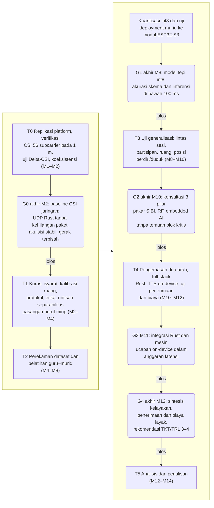
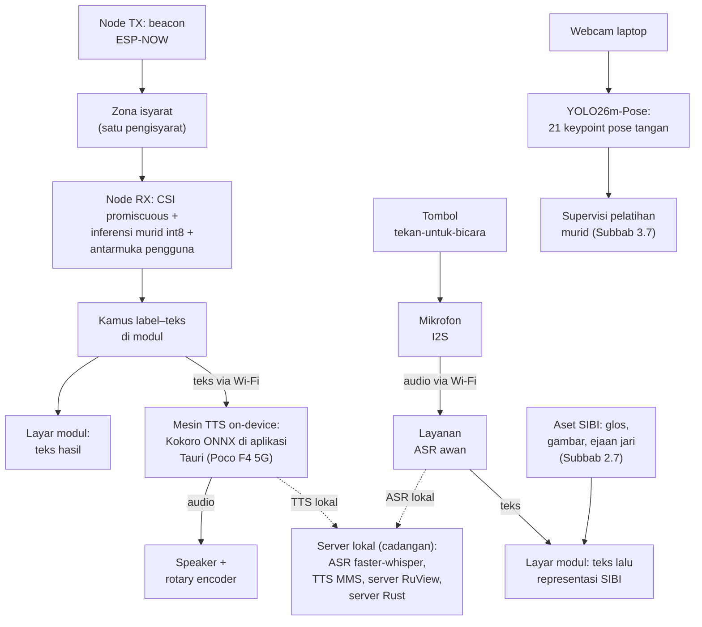
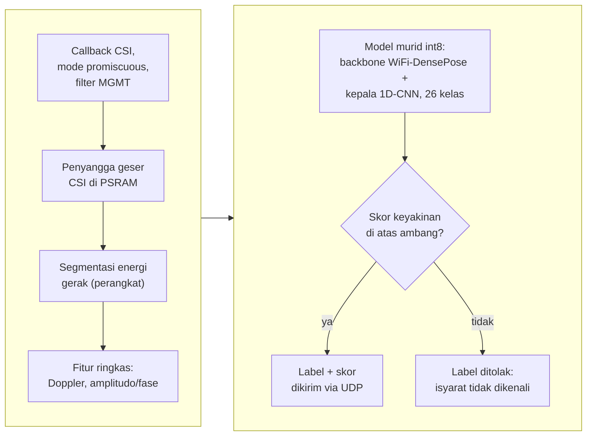

# STUDI KELAYAKAN PURWARUPA SenseSIBI: SISTEM PENERJEMAHAN DUA ARAH HURUF SIBI BERBASIS WI-FI CSI DENGAN INFERENSI ESP32-S3 DAN PEMROSESAN SERVER

**PROPOSAL PENELITIAN**

| Identitas | Keterangan |
|---|---|
| Judul | STUDI KELAYAKAN PURWARUPA SenseSIBI: SISTEM PENERJEMAHAN DUA ARAH HURUF SIBI BERBASIS WI-FI CSI DENGAN INFERENSI ESP32-S3 DAN PEMROSESAN SERVER |
| Jenis dokumen | Proposal penelitian (seminar proposal), BAB I–III + Daftar Pustaka — versi ringkas ±40 halaman |
| Disusun oleh | [PERLU DATA: nama penulis] |
| NIM | [PERLU DATA: NIM penulis] |
| Program studi | [PERLU DATA: program studi] |
| Universitas | [PERLU DATA: nama universitas] |
| Pembimbing | [PERLU DATA: nama pembimbing, bila sudah ditentukan] |
| Tahun | [PERLU DATA: tahun penyusunan] |

> Catatan penyusunan: versi ringkas ini dipadatkan dari naskah v10 (91 halaman, revisi 10 November 2026) menjadi sekitar 40 halaman dengan register korpus sempro-mepet, kaidah bahasa naskah-id (EYD V), kaidah humanizer-id (Mode Akademik Ketat), serta optimasi kata GEPA pada kalimat kritis; pemadatan dilakukan pada tingkat paragraf, gambar, dan tabel tanpa mengubah angka, sitasi, dan penanda `[PERLU DATA: ...]`. Subbab 2.13 (rincian komponen BoM) dan matriks komponen arsitektur lama dilebur ke Tabel 3.1, Tabel 3.2, dan prosa Subbab 3.5, dan Subbab 2.1+2.12 lama dipadatkan menjadi 11 subbab (2.1-2.11) dengan rujukan silang diperbarui menyeluruh termasuk di dalam gambar; tabel BAB III menjadi Tabel 3.1-3.8. Gambar dipadatkan dari sepuluh menjadi tiga inti, yaitu Gambar 3.1 tahapan-gerbang, Gambar 3.2 arsitektur akhir, dan Gambar 3.3 inferensi tepi; diagram distilasi data-pelatihan, jalur gagal, topologi, *enclosure*, alur perangkat lunak, dan alur evaluasi diwakili uraian prosa beserta tabelnya. Subsubbab 3.2.x, 3.5.x, 3.6.x, dan 3.7.x dilebur menjadi prosa mengalir; Subbab 3.8 tetap enam subsubbab prosedur. Metode utama tetap distilasi guru–murid: YOLO26m-Pose sebagai guru kamera pose tangan 21 *keypoint* yang mensupervisi pelatihan murid CSI untuk inferensi tepi pada ESP32-S3.

---

# BAB I PENDAHULUAN

## 1.1 Latar Belakang

Sebagian besar anak tunarungu lahir di tengah keluarga pendengar; Mitchell dan Karchmer [1], [2] mencatat proporsi itu sebesar 90–95% pada data siswa tunarungu di Amerika Serikat dan membantah anggapan lama bahwa sekitar 10% anak tunarungu memiliki orang tua tunarungu, sedangkan angka sebanding untuk Indonesia belum ditemukan dalam penelusuran pada Google Scholar, Crossref, dan OpenAlex hingga Oktober 2026. Keluarga pendengar dari anak yang berkomunikasi dengan isyarat perlu ikut mempelajari bahasa isyarat, padahal prosesnya membutuhkan dukungan terstruktur [3] dan menghadapi hambatan praktis sehari-hari [4]. Komunikasi yang dimaksud bersifat dua arah, sedangkan juru bahasa isyarat yang dapat menjembatani kedua arah masih terbatas: sekitar 500 orang untuk sekitar 1,92 juta penyandang tunarungu, atau kira-kira satu juru bahasa untuk 3.840 orang [5]. Undang-Undang Nomor 8 Tahun 2016 tentang Penyandang Disabilitas mewajibkan aksesibilitas komunikasi [6], kebutuhan itu paling terasa di lingkungan pendidikan formal [7], dan teknologi bantu komunikasi yang murah menjadi jalur pelengkap yang penting [8].

Sistem Isyarat Bahasa Indonesia (SIBI) dipilih sebagai objek penelitian meskipun bukan moda yang paling banyak dipakai sehari-hari: survei Badan Riset dan Inovasi Nasional mencatat BISINDO 77,7%, SIBI 1,9%, campuran 14,9%, dan lainnya 5,6% [9], dan survei 100 responden tunarungu di Jawa dan Bali melaporkan 91% memakai BISINDO [10]. Kedua survei itu menegaskan komunitas tunarungu lebih dekat ke BISINDO, tetapi juga menunjukkan tempat SIBI hidup, yaitu jalur pendidikan formal tempat sekolah komunikasi total diwajibkan memakai sistem isyarat baku [11] dan murid tunarungu memakai SIBI dalam pembelajaran [7]. Purwarupa untuk konteks pendidikan formal karena itu lebih tepat memakai SIBI; perluasan ke BISINDO menuntut penggantian kosakata dan validasi ulang bersama penuturnya.

Teknologi yang telah tersedia masih terbagi menurut arah: KASIBI mengubah suara menjadi teks lalu menampilkan animasi peraga tiga dimensi [12], OpenSIBI mencocokkan kata ke model tiga dimensi yang dianimasikan [13], dan keduanya mengakui cakupan kosakatanya sangat terbatas. Pada arah isyarat menjadi teks, penelitian di Indonesia bertumpu pada citra atau video kamera [14], [15], termasuk penerapan *smartphone* untuk huruf SIBI statis [16], [17]; kamera menuntut pencahayaan dan garis pandang tertentu, melemah saat kondisi berubah [18], dan paparannya yang terus menyala diduga menimbulkan kelelahan nonverbal [19]. Keterbatasan itulah yang mendorong penginderaan nirsentuh (*device-free*) dan bebas kamera (*camera-free*) berbasis gelombang radio Wi-Fi yang menjaga privasi sekaligus menekan biaya; kesenjangan itulah titik berangkat penelitian ini.

Gelombang Wi-Fi juga dapat dimanfaatkan secara pasif untuk penginderaan spasial nirsentuh, seperti Widar2.0 yang melacak posisi manusia dari satu tautan Wi-Fi [20], dan itulah dasar penginderaan berbasis Wi-Fi *Channel State Information* (CSI): CSI memuat amplitudo dan fase pada setiap *subcarrier* yang berubah ketika gerak tubuh mengganggu jalur propagasi [21]. SignFi mengenali 276 isyarat *American Sign Language* (ASL) dari CSI [22], DF-WiSLR mengenali 49 gestur tanpa perangkat dikenakan [23], dan WiSign mengenali kalimat ASL kontinu dari perangkat komersial [24], sedangkan kepekaan CSI pada gerak halus dilaporkan untuk ketukan tombol [25], pernapasan [26], gestur jari [27], gerak skala subgelombang [28], dan identifikasi pengguna [29]. Meskipun demikian, belum ditemukan publikasi CSI untuk isyarat SIBI maupun purwarupa dua arah yang memadukannya dengan pemrosesan bahasa Indonesia; penelusuran mencakup Google Scholar, Crossref, dan OpenAlex hingga Oktober 2026 (Subbab 2.10).

Perangkat penginderaan penelitian ini adalah modul ESP32-S3, mikrokontroler murah dengan radio Wi-Fi 2,4 GHz dengan dukungan CSI resmi [30], inti ganda 240 MHz, SRAM 512 KB, dan PSRAM hingga 8 MB [31], yang direkomendasikan RuView untuk modul penangkap CSI [32]. Dua fakta menjadi dasar kelayakan rancangan: satu *chip* ESP32-S3 terbukti menjalankan penangkapan CSI, koneksi *station*, dan pengiriman data serentak sebagaimana *firmware* RuView [32], dan inferensi terkuantisasi didukung tolok ukur resmi, yaitu ESP-NN mempercepat model pendeteksi orang dari 2.300 ms menjadi 54 ms [33] serta contoh pengenalan gestur tangan ESP-DL 69,2 ms [34]. Filosofi anggarannya *social-first*: satu modul sekitar Rp150.000 menurut rencana anggaran sehingga sepasang node diperoleh di bawah Rp350.000, jauh lebih murah daripada kamera dan komputer pengolah citra (Subbab 2.9 dan 3.8).

Purwarupa yang dirancang terdiri atas sepasang modul ESP32-S3 portabel yang mengapit zona isyarat; node penerima sekaligus memuat layar kecil, baterai, *speaker*, mikrofon, tombol tekan-untuk-bicara, dan *rotary encoder* volume (Tabel 3.1). Pada arah pertama, node penerima menangkap CSI dari *beacon* ESP-NOW, mengenali isyarat melalui model murid pada perangkat, memetakan label menjadi teks, lalu mengirim teks ke server purna Rust (Tokio, Axum, Leptos WASM) [35], [36], [37] dan menampilkannya di layar. Pada arah kedua, tombol mengaktifkan mikrofon; ucapan dikenali layanan awan, lalu teks dipetakan ke representasi SIBI di layar. Sintesis ucapan berjalan *on-device* pada ponsel Poco F4 5G (Snapdragon 870) sebagai *hotspot* portabel, klien Tauri, dan mesin TTS lokal: Kokoro-82M ONNX diinferensikan luring melalui ONNX Runtime sehingga bebas latensi seluler dan menjaga privasi [38], [39], [40], [41]; *model card* resminya mencantumkan delapan bahasa dan 54 suara tanpa bahasa Indonesia sehingga suara Indonesia diverifikasi pada gerbang G3, dengan alternatif MMS-TTS-ind [42], [43] serta layanan Google dan Azure [44], [45]. Laptop ASUS TUF Dash F15 FX516PR menjadi mesin akuisisi jalur guru dan server lokal cadangan, pelatihan dijalankan pada layanan server GPU Kaggle, dan Whisper yang mendukung lebih dari 100 bahasa termasuk Indonesia [46] dijalankan jauh lebih cepat daripada waktu nyata oleh faster-whisper pada GPU 8 GB [47].

Sisi visi telah dibuktikan pada tahap pra-penelitian: YOLO26m-Pose yang dilatih pada *dataset* visual SIBI dari repositori peneliti (Subbab 2.4 dan 3.7) mengestimasi 21 titik artikulasi tangan dan mengenali 26 huruf SIBI, termasuk membedakan V dan U serta lintasan telunjuk J dan Z. Model murid dilatih dengan distilasi guru–murid (*teacher–student*): keluaran guru direkam tersinkron dengan CSI sebagai *ground truth* sekaligus supervisi, lalu murid berjalan sendiri tanpa kamera [48], [49]. Sebagai studi kelayakan, penelitian ini tidak mengklaim penerjemahan kontinu: objeknya alfabet manual SIBI 26 huruf (24 statis serta J dan Z), kemampuan satu tautan membedakannya diuji melalui uji Delta-CSI dan gerbang G1 (Subbab 2.2 dan BAB III), dan kinerja diukur lintas partisipan serta lintas ruang dengan acuan Widar3.0 karena model CSI mudah *overfitting* terhadap orang dan ruang [50], [51]. Arah kedua dibatasi pada kamus kata-level dengan *fallback* ejaan jari sebagaimana preseden KASIBI dan OpenSIBI karena penerjemahan tata bahasa penuh masih masalah terbuka [52], [53]. Setiap tahapan ditutup gerbang keputusan dan kegagalan tetap dilaporkan sebagai temuan. Penelitian ini dengan demikian merancang dan membangun penerjemahan dua arah antara SIBI dan teks atau ujaran berbasis Wi-Fi CSI itu dinamai SenseSIBI, singkatan dari *Sensing & Translation of SIBI*, dan kelayakannya diuji sebagai alat bantu komunikasi kosakata terbatas pada konteks pendidikan formal.

## 1.2 Rumusan Masalah

Berdasarkan latar belakang yang telah dipaparkan, masalah yang dikaji dalam penelitian ini dapat dirumuskan sebagai berikut.

1. Bagaimana merancang purwarupa sistem penerjemahan dua arah antara SIBI dan teks atau ujaran bahasa Indonesia berbasis sepasang modul ESP32-S3, dengan inferensi model pada perangkat, pemrosesan bahasa pada server purna Rust, sintesis ucapan *on-device*, distilasi guru–murid YOLO26m-Pose, dan protokol perekaman *dataset* isyarat terisolasi?
2. Bagaimana kinerja pengenalan 24 huruf statis dan dua huruf gerak (J dan Z) alfabet manual SIBI dari CSI melalui inferensi pada perangkat, serta kinerja kedua jalur penerjemahan pada skenario dalam sesi, lintas partisipan, dan lintas ruang?
3. Bagaimana kelayakan purwarupa sebagai alat bantu komunikasi dua arah untuk kosakata terbatas ditinjau dari latensi ujung ke ujung, cakupan kosakata, keandalan operasional, penilaian tiga pilar pakar, penerimaan pengguna akhir, dan biaya purwarupa?

## 1.3 Tujuan Penelitian

Berdasarkan rumusan masalah tersebut, penelitian ini bertujuan:

1. Merancang purwarupa sistem penerjemahan dua arah antara SIBI dan teks atau ujaran bahasa Indonesia berbasis sepasang modul ESP32-S3, dengan inferensi model pada perangkat, pemrosesan bahasa pada server purna Rust, sintesis ucapan *on-device*, distilasi guru–murid YOLO26m-Pose, dan protokol perekaman *dataset* isyarat terisolasi.
2. Mengukur kinerja pengenalan 24 huruf statis dan dua huruf gerak (J dan Z) alfabet manual SIBI dari CSI melalui inferensi pada perangkat, serta kinerja kedua jalur penerjemahan pada skenario dalam sesi, lintas partisipan, dan lintas ruang.
3. Menganalisis kelayakan operasional purwarupa sebagai alat bantu komunikasi dua arah untuk kosakata terbatas melalui pengujian bergerbang lima tahap (G0 hingga G4) pada keenam dimensi kelayakan yang dirumuskan.

## 1.4 Batasan Masalah

Ruang lingkup penelitian ini dibatasi sebagai berikut.

1. Objek pengenalan adalah alfabet manual SIBI satu tangan 26 huruf (24 statis serta huruf gerak J dan Z) dengan bentuk baku yang dicocokkan dengan *Kamus SIBI* [54] dan disetujui validator penutur tunarungu; sistem bukan penerjemah kalimat.
2. Konfigurasi tangan dan jari menjadi pembeda utama kelas; ekspresi wajah dan penanda nonmanual tidak dikenali.
3. Perangkat keras penginderaan adalah sepasang modul ESP32-S3 (TX dan RX, 2,4 GHz, kanal 20 MHz, 1T1R) dengan antarmuka pada node RX, disertai laptop ASUS TUF Dash F15 FX516PR, ponsel Poco F4 5G, dan satu *access point* sebagai jembatan jaringan, bukan penginderaan (Tabel 3.1); pelatihan dijalankan pada layanan server GPU Kaggle.
4. Kamera dan YOLO26m-Pose hanya dipakai sebagai model guru saat akuisisi dan pelatihan; produk akhir tanpa kamera dan tanpa citra.
5. Sintesis ucapan berjalan *on-device* melalui ONNX Runtime (Kokoro TTS ONNX, alternatif MMS-TTS-ind); pengenalan ucapan memakai layanan awan dengan faster-whisper lokal sebagai cadangan; pilihan final ditetapkan pada G3 (Tabel 3.7).
6. Arah kedua dibatasi pada kamus kata-level dengan *fallback* ejaan jari (26 huruf dan angka 1–9) sebagaimana preseden OpenSIBI; cakupan kamus diukur dan dilaporkan.
7. Setiap sesi melibatkan satu pengisyarat; sistem tidak mengidentifikasi individu; pengujian dilakukan di sedikitnya dua ruang mitra yang dikalibrasi.
8. Uji pengguna berskala kecil (3–5 pengguna) dan dianalisis deskriptif tanpa statistik inferensial.
9. Penelitian ini tidak membahas isyarat kontinu, tata bahasa isyarat penuh beserta penanda nonmanual, BISINDO, maupun klasifikasi gerakan otomatis dari video.

## 1.5 Manfaat Penelitian

Manfaat penelitian ini dibedakan menjadi manfaat teoretis dan manfaat praktis.

### 1.5.1 Manfaat Teoretis

Penelitian ini diharapkan memberikan bukti awal kelayakan pengenalan alfabet manual SIBI dari CSI satu tautan antarmodul ESP32-S3 disertai bukti kelayakan inferensi terkuantisasi pada perangkat, yang terikat pada alfabet manual dan tidak otomatis berlaku bagi isyarat kata maupun kontinu. Penelitian ini juga menyediakan *dataset* CSI berlabel beserta deret *keypoint* guru dan protokol perekamannya sebagai pembanding penelitian penginderaan nirkabel untuk bahasa isyarat lain, termasuk perluasan ke BISINDO.

### 1.5.2 Manfaat Praktis

Bagi lembaga pendidikan mitra, penelitian ini memberikan gambaran kelayakan purwarupa alat bantu komunikasi dua arah berbahasa SIBI beserta protokol kurasi kosakata yang disusun bersama validator penutur tunarungu. Bila tahapan mencapai gerbang terakhir, dihasilkan purwarupa yang menampilkan teks, menyuarakan isyarat yang dikenali, dan menampilkan representasi isyarat bagi lawan bicara; bila berhenti lebih awal, artefak berupa laporan karakterisasi, protokol, atau *dataset* berlabel tetap dihasilkan. Bagi keluarga siswa tunarungu, kosakata tervalidasi memastikan isyarat yang ditampilkan baku, sedangkan bagi komunitas riset, *dataset* dan rancangan yang tidak terikat satu bahasa isyarat memudahkan replikasi.

## 1.6 Sistematika Penulisan

Proposal ini terdiri atas tiga bab. **BAB I Pendahuluan** memuat latar belakang, rumusan masalah, tujuan, batasan, manfaat, dan sistematika. **BAB II Kajian Pustaka** memuat teori dan penelitian terdahulu yang menjadi dasar perancangan, dari bahasa isyarat dan SIBI hingga matriks justifikasi komponen. **BAB III Metode Penelitian** memuat desain, tahapan dan gerbang keputusan, waktu dan lokasi, alat dan bahan, perancangan sistem, protokol perekaman dan etika, pengolahan sinyal dan pelatihan guru–murid, skenario pengujian, jadwal, parameter yang ditetapkan kemudian, serta risiko dan cadangan.

# BAB II KAJIAN PUSTAKA

## 2.1 Bahasa Isyarat, SIBI, dan Kebutuhan Komunikasi Dua Arah

Bahasa isyarat merupakan bahasa visual yang menyampaikan makna melalui gerak tangan, lengan, tubuh, dan ekspresi wajah; sebuah isyarat tersusun atas bentuk tangan, lokasi, gerak, orientasi telapak, dan komponen nonmanual, dan perbedaan satu parameter saja dapat membedakan makna dua isyarat [55], [56]. Parameter itulah yang menjadi acuan memisahkan bagian isyarat yang dapat dinilai mesin dari bagian yang tetap memerlukan penilaian manusia (Subbab 2.2 dan 2.7). SIBI merupakan sistem isyarat baku untuk pendidikan formal, sedangkan BISINDO berkembang alami di komunitas tunarungu [57], [58]; bentuk baku SIBI didokumentasikan dalam *Kamus Sistem Isyarat Bahasa Indonesia* (selanjutnya *Kamus SIBI*) [54] dan tersedia digital [11]. Pemilihan SIBI didasarkan pada konteks pendidikan formal (Subbab 1.1), bukan jumlah penutur; perluasan ke BISINDO menuntut penggantian *dataset* dan validasi ulang bersama penuturnya sebagai penelitian lanjutan.

Komunikasi penutur isyarat dan pendengar menuntut kemampuan pada kedua arah; keluarga pendengar berada di barisan pertama yang merasakannya [1], [3], [4], juru bahasa profesional terbatas [5], dan teknologi bantu komunikasi berperan sebagai pelengkap [8], sehingga penelitian ini menerjemahkannya menjadi purwarupa dua arah, bukan kamus satu arah. Sistem terdahulu terbagi menurut arah: KASIBI menampilkan animasi peraga tiga dimensi untuk kata hasil pengenalan ucapan dan memperoleh rata-rata skor 3,362 dari 4 [12], OpenSIBI menganimasikan model Collada dari *application programming interface* (API) dengan cakupan 50 kosakata (9 angka, 26 huruf, 15 kata) [13], dan aplikasi lain menyasar manusia belajar isyarat [59]. Pada arah isyarat menjadi teks, riset bertumpu pada kamera [14]: CNN untuk citra huruf BISINDO [15], *dataset* video tingkat kata [60], pengenalan kalimat [61], gestur tubuh spasial [62], serta aplikasi MediaPipe 24 huruf statis [16] dan berbasis TensorFlow Lite [17]. Kamera bergantung pada pencahayaan dan garis pandang [18], [56], sensor yang dikenakan harus dikalibrasi setiap kali [56], [63], dan paparan kamera terus-menerus dikaitkan dengan kelelahan nonverbal [19]; penelitian ini karenanya menelusuri penginderaan Wi-Fi tanpa kamera dan tanpa perangkat dikenakan, dengan KASIBI dan OpenSIBI sebagai preseden jalur kedua (Subbab 2.7).

## 2.2 Wi-Fi Channel State Information

Wi-Fi *Channel State Information* (CSI) merupakan informasi amplitudo dan fase pada setiap *subcarrier* yang menggambarkan kondisi kanal propagasi [21]; ketika tubuh bergerak di antara kedua perangkat, panjang jalur pantulan berubah sehingga amplitudo dan fase tiap *subcarrier* ikut berubah, dan perubahan itulah yang dimanfaatkan untuk mengenali gerak tanpa sensor yang dikenakan [21]. Amplitudo dan fase saling melengkapi [64], dan karena tiap *subcarrier* menempati frekuensi berbeda, CSI menyediakan banyak kanal pengamatan dari satu pasang pemancar-penerima [21].

Perubahan kanal itu berdasar model zona Fresnel [65]: artikulasi 21 titik jari menggeser jalur pantulan pada orde sentimeter hingga milimeter sehingga setiap konfigurasi huruf membentuk pola perubahan *subcarrier* yang khas. Fase mentah tercemar derau osilator lokal dan offset acak; model CSI-ratio mengatasinya melalui rasio atau perkalian konjugat tanpa perangkat tambahan [65], dan teknik konjugat serupa menjadi dasar kalibrasi fase Widar2.0 [20]. Dalam penelitian ini prinsip CSI-ratio diterapkan pada modul penerima sebagai rasio terhadap rekam acuan kalibrasi ruang (Subbab 3.7). Gerak lengan juga menghasilkan komponen Doppler [21], [51]; pita analisis 1–60 Hz menuntut laju pencuplikan sekurang-kurangnya 120 Hz sesuai Nyquist [66], [67], sedangkan *firmware* RuView membatasi bingkai paling sering setiap 20 ms atau 50 bingkai per detik [32]; bila laju terukur lebih rendah, pita teramati menyempit hingga setengah laju aktual dan hal itu dilaporkan.

Kepekaan CSI terhadap gerak halus telah dibuktikan untuk ketukan tombol [25], pernapasan [26], gestur jari [27], gerak subgelombang [28], dan identifikasi pengguna [29], tetapi seluruh preseden bekerja pada kondisi terkendali sehingga bukti itu hanya hipotesis kerja. Model CSI juga mudah *overfitting* terhadap orang dan ruang [50]; Widar3.0 mengusulkan profil kecepatan Doppler untuk pengenalan lintas domain [51] dan dijadikan acuan rancangan fitur, sedangkan generalisasi diukur langsung pada skenario pengujian (Subbab 2.9 dan 3.8). Panjang gelombang 2,4 GHz sekitar 12,5 cm membatasi resolusi spasial; preseden isyarat umumnya memakai perangkat multiantena [22], [68], [69], meskipun satu pemancar satu penerima pun mencapai akurasi 98,3% [64]. Kelayakan satu tautan dua modul berantena tunggal membedakan 26 konfigurasi tangan SIBI karenanya diperlakukan sebagai pertanyaan penelitian; uji Delta-CSI dan gerbang G1 mengujinya pada pasangan huruf paling mirip, dan bila tidak terpisahkan, himpunan huruf dipangkas sesuai Tabel 3.7.

## 2.3 Modul ESP32-S3, Platform RuView, dan Koeksistensi Radio

ESP32-S3 merupakan mikrokontroler Wi-Fi 802.11 b/g/n 2,4 GHz berantena tunggal (1T1R), inti ganda Xtensa LX7 240 MHz berinstruksi vektor, SRAM 512 KB, dan PSRAM hingga 8 MB [31]; dukungan CSI tersedia resmi melalui esp-csi [30], pada kanal 20 MHz 802.11n CSI mencakup 56 *subcarrier* (52 data dan 4 pilot) [30], dan ESP32-S3 direkomendasikan RuView untuk modul penangkap CSI [32]. RuView menyediakan rantai akuisisi dan pengolahan CSI pada ESP32 yang dipetakan pada Tabel 2.1, termasuk *firmware* penangkap berformat ADR-018 melalui *User Datagram Protocol* (UDP), kalibrasi ruang 600 bingkai dan 8 *anchor*, dan *pipeline* akuisisi tersinkron kamera–CSI (ADR-079) [32]. Repositori itu juga menerbitkan keluarga model WiFi-DensePose, mengikuti DensePose from WiFi yang memetakan sinyal Wi-Fi ke permukaan tubuh dengan jaringan visi sebagai guru [70]; enkode terpralatih ruvnet/wifi-densepose-pretrained mencapai akurasi *triplet* temporal 82,3%, tersedia pula varian mmfi-pose dari 40 partisipan [32], [71], keduanya berkuantisasi int8 [32] dan dipakai sebagai *backbone* murid CSI (Subbab 2.5 dan 3.7).

Fakta paling menentukan adalah koeksistensi radio pada satu *chip*: *firmware* RuView menjalankan penangkapan CSI mode *promiscuous*, koneksi *station* UDP, dan sinkronisasi ESP-NOW (hingga 250 bita per paket) serentak [32] dengan syarat satu kanal, penyaringan paket manajemen, dan mode hemat daya dimatikan, sehingga purwarupa tidak memerlukan modul gerbang khusus (Subbab 3.5); karena RuView tidak melalui telaah sejawat, fungsinya diverifikasi pada G0. Tabel 2.1 memetakan fitur RuView terhadap perannya.

Tabel 2.1 Pemetaan fitur RuView terhadap peran dalam penelitian ini

| Fitur RuView | Peran dalam penelitian ini |
|---|---|
| *Firmware* penangkap CSI (ADR-018, UDP) | Mengalirkan CSI dan label ke server |
| Station + UDP + CSI promiscuous + ESP-NOW pada satu chip | Dasar topologi satu kanal (Subbab 3.5) |
| Kalibrasi ruang 600 bingkai + 8 *anchor* dan segmentasi energi gerak | Kalibrasi tiap sesi; pemotongan segmen isyarat |
| Mode privasi | Membuang fitur biometrik selama penelitian |
| Akuisisi tersinkron kamera–CSI (ADR-079) | Jalur guru; estimator diganti YOLO26m-Pose |
| Model WiFi-DensePose terpralatih int8 | Inisialisasi *backbone* murid |
| *Dashboard* web; modul estimasi pose *on-device* | Pemantauan sesi; modul estimasi pose tidak dipakai |

## 2.4 Estimasi Pose Berbasis Visi sebagai Model Guru Kamera

Estimasi pose memperkirakan posisi *keypoint* manusia dari citra atau video [72], dan YOLO26 dari Ultralytics mendukungnya dalam satu kerangka bersama deteksi, segmentasi, dan klasifikasi [48] dengan *dataset* *hand-keypoints* beranotasi 21 *keypoint* per tangan [49] serta efisiensi untuk perangkat tepi [73]. Dalam penelitian ini YOLO26m-Pose menjadi model guru kamera (*camera teacher*) pada akuisisi dan pelatihan; *pipeline* tersinkron mengikuti ADR-079 yang aslinya memakai MediaPipe PoseLandmarker [74], estimatornya diganti model guru dari repositori peneliti (Subbab 3.7). Visi sebagai pemberi supervisi pelatihan model Wi-Fi memiliki preseden Person-in-WiFi [75] dan DensePose from WiFi [70], dan distilasi pengetahuan melatih murid ringan meniru keluaran guru yang lebih kuat [76]; selama akuisisi, deret 21 *keypoint* dan label guru direkam sebagai *ground truth* sekaligus supervisi distilasi, dan kartu pemandu protokol dicocokkan dengan label guru untuk menjaga konsistensi anotasi (Subbab 3.6 dan 3.7).

Kemampuan pembedaan guru telah dibuktikan pada tahap pra-penelitian (Subbab 3.7): model juara mencatat *pose* mAP50 0,8944 pada 49 kelas isyarat, serta mAP50 0,9580 dan akurasi huruf 97,6% pada 24 huruf statis, termasuk membedakan V dan U serta mengikuti lintasan J dan Z. Bukti itu menegaskan 21 titik artikulasi jari memuat informasi cukup untuk gestur mikro SIBI; pertanyaan penelitian ini adalah apakah CSI mampu mereplikasinya tanpa kamera. Peran kamera terbatas pada akuisisi dan pelatihan; setelah murid di-*deploy*, seluruh jalur operasional berjalan tanpa kamera dan tanpa citra (Subbab 3.7).

## 2.5 Pengenalan Isyarat dan Gestur Berbasis CSI serta Inferensi pada Perangkat

Pengenalan isyarat dari CSI telah diteliti di luar Indonesia: SignFi mengenali 276 isyarat ASL [22], sistem multiperangkat tangguh diajukan Shang dan Wu [77], DF-WiSLR mengenali 49 gestur tanpa perangkat dikenakan [23], WiASL mengenali tulisan ASL perangkat komersial [78], dan pendekatan CSI pada *Filipino Sign Language* mencapai akurasi 69,3% [63]; akurasi yang dilaporkan berkisar hingga 99,8% pada kondisi laboratorium [22], [79] dan menurun pada pengguna baru (86,66% lintas lima pengguna [22]), sedangkan WiSign mengenali kalimat ASL kontinu [24]. Kebaruan penelitian ini karenanya bukan pada kontinu, melainkan pada penerapan CSI untuk SIBI dan integrasi dua arah dengan pemrosesan bahasa (Subbab 2.10).

Rancangan fitur mengikuti praktik tersebut: amplitudo dan fase *subcarrier* terpilih [64], spektrum Doppler 1–60 Hz [51], serta energi, entropi, dan lintasan puncak [21], [69]; *Support Vector Machine* (SVM) menjadi pembanding dasar karena kuat pada *dataset* kecil [80], [81]. Model utamanya murid dua bagian, yaitu *backbone* WiFi-DensePose int8 [32], [70] dan kepala *one-dimensional Convolutional Neural Network* (1D-CNN) yang ringan untuk deret waktu [82], dilatih dari jendela CSI di bawah supervisi label dan deret pose guru (Subbab 3.7). Klasifikator himpunan tertutup selalu memilih satu kelas; mekanisme penolakan menambahkan skor keyakinan [83] sehingga keluaran berkeyakinan rendah menampilkan pesan isyarat tidak dikenali, (ambang dari data validasi, Tabel 3.7). Inferensi dirancang berjalan langsung pada modul: ESP-NN mempercepat model pendeteksi orang 293,5 KB dari 2.300 ms menjadi 54 ms pada ESP32-S3 [33], ESP-DL menyediakan contoh int8 pengenalan gestur tangan 69,2 ms [34], dan TensorFlow Lite Micro berjalan dengan penyangga terkendali [84]; karena belum ada tolok ukur CSI-isyarat pada ESP32-S3, waktu inferensi aktual diukur pada *deployment* (Subbab 3.7).

## 2.6 TTS dan ASR Bahasa Indonesia

Purwarupa memerlukan *text-to-speech* (TTS) dan *automatic speech recognition* (ASR); kriteria pemilihannya adalah dukungan bahasa Indonesia terverifikasi dari sumber resmi, ketersediaan jalur *on-device* serta awan dan server lokal, dan biaya berkelanjutan, dengan audit langsung *model card* dan dokumentasi layanan. Mesin *on-device* yang direncanakan adalah Kokoro-82M ONNX terkuantisasi: berparameter sekitar 82 juta [41], terekspor 100–300 MB [40], dan diinferensikan luring pada ponsel Poco F4 5G melalui ONNX Runtime [39] dalam aplikasi Tauri; *model card* resminya mencantumkan delapan bahasa dan 54 suara tanpa bahasa Indonesia [41] sehingga suara Indonesia diverifikasi pada G3, dan bila belum tersedia, jalur beralih ke ekspor ONNX MMS-TTS-ind, model VITS Indonesia berlisensi CC-BY-NC 4.0 [42], [43], sedangkan Google Cloud TTS (sekitar empat dolar AS per juta karakter) [44] dan Azure (suara neural id-ID) [45] menjadi pembanding dan cadangan.

Untuk ASR, Whisper dilatih pada lima juta jam data dan mendukung lebih dari 100 bahasa termasuk Indonesia [46]; faster-whisper pada GPU RTX 3070 Ti 8 GB mencatat model large-v3 int8 memakai sekitar 2,9 GB VRAM dan menyelesaikan 13 menit audio dalam 59 detik, sekitar tiga belas kali lebih cepat daripada waktu nyata [47], sehingga server menjalankan faster-whisper dan TTS MMS bersamaan. Pilihan jalur ditetapkan dari uji banding pada T4 (Tabel 3.7), dan karena galat kata Whisper untuk percakapan Indonesia belum terverifikasi dari sumber primer, akurasinya diukur sendiri (Subbab 3.8). Pembagian jalur: sintesis utama *on-device* pada ponsel, pengenalan ucapan utama layanan awan karena model ASR Indonesia tervalidasi yang muat pada ponsel belum terverifikasi, dan seluruh angka latensi diukur sendiri sebelum dipakai sebagai klaim (Subbab 2.8).

## 2.7 Pemetaan Teks ke Representasi SIBI di Layar

Pemetaan teks menjadi isyarat tidak dapat dilakukan dengan substitusi kata demi kata: bahasa isyarat memiliki tata bahasa berbeda termasuk ruang dan penanda nonmanual, penerjemahan tingkat kalimat masih masalah terbuka [52], dan *mouthing* terbukti menjadi isu kelas satu keterbacaan avatar [53]. Arah kedua karenanya dirancang pada tingkat kamus kata dengan ejaan jari sebagai cadangan; struktur SIBI mendukungnya karena alfabet manualnya lengkap (26 huruf dan 9 angka [13]; *dataset* citra statis hanya memuat 24 kelas tanpa J dan Z [85], [16]) dan memiliki kata berinfleksi yang telah dikenali *Hidden Markov Model* [86] serta diurai karyanya [87]. Preseden Indonesia berbentuk kamus kata: KASIBI memetakan kata ke satu animasi peraga [12] dan OpenSIBI menganimasikan model Collada cakupan 50 kosakata [13], dengan preseden internasional sejak Sagawa dan Takeuchi [88]; keduanya menunjukkan arah balik layak dibangun dan biaya aset per isyarat adalah hambatan utama.

Tampilan arah kedua dirancang dua lapis: lapis utama menampilkan glos dan gambar konfigurasi tangan untuk kosakata tersedia (sekitar dua puluh hingga tiga puluh kilobita per gambar sehingga muat di penyimpanan modul), dan lapis kedua berupa animasi yang dialirkan dari server bila waktu pengembangan memungkinkan. Kata di luar kamus dialihkan ke ejaan jari; notasi SignWriting tidak dipakai karena penerapannya untuk SIBI belum ditemukan dan keterbacaannya bagi awam rendah. Cakupan kamus, yaitu proporsi kata uji yang terwakili, diukur dan dilaporkan sebagai metrik utama arah ini (Subbab 3.8).

## 2.8 Komunikasi Modul, Server, dan Topologi Jaringan

Seluruh komunikasi berlangsung pada satu kanal Wi-Fi mengikuti kanal *access point* sehingga penangkapan CSI dan komunikasi data serentak (Subbab 2.3); *access point* berfungsi murni sebagai jembatan jaringan dan penjangkar kanal, dan perannya dapat dipegang *router* mitra atau *hotspot* ponsel Poco F4 5G. Sinkronisasi antarmodul memakai ESP-NOW (hingga 250 bita per paket) [32] dan aliran modul-ke-server memakai UDP [32]; aliran audio memakai protokol tingkat aplikasi yang dipilih saat perancangan detail dan bukan risiko kelayakan karena dokumentasi resmi ESP32 menyediakan contohnya.

Tumpukan perangkat lunak ditulis purna Rust: Tokio untuk konkurensi server [35], Axum untuk HTTP dan WebSocket telemetri [36], Leptos dikompilasi ke WASM untuk dasbor [37], dan Tauri untuk aplikasi klien ponsel [38]. Justifikasinya: tanpa pengumpulan sampah target *parsing* bingkai UDP di bawah 0,2 ms terjaga, biner terkompilasi hemat memori di bawah 40 MB RAM, dan satu sistem tipe ujung ke ujung mendeteksi perubahan format bingkai saat kompilasi; seluruh klaim kinerja adalah target rancangan yang diukur pada G3. Server lokal menjalankan server RuView untuk riset, server Rust, faster-whisper, dan TTS MMS; VRAM 8 GB memadai karena faster-whisper int8 memakai sekitar 2,9 GB [47], kamus label-teks dimuat kecil pada modul, dan aset representasi kata tersimpan pada modul (Subbab 2.7).

## 2.9 Evaluasi Kelayakan

Studi kelayakan menilai apakah suatu pendekatan dapat dijalankan sebelum dikembangkan lebih jauh [89]; dalam penelitian ini kelayakan dinilai bertahap melalui lima gerbang G0–G4 (BAB III), kriteria klasifikasi dirumuskan relatif terhadap peluang acak, tiap tahap menghasilkan artefak tetap sehingga kegagalan tetap dilaporkan, dan rekomendasi akhir menyatakan posisi purwarupa pada skala kesiapterapan teknologi (TKT) mengikuti kerangka *technology readiness level* (TRL) [90]. Kinerja klasifikasi diukur dengan akurasi, presisi, *recall*, skor F1 makro, dan *confusion matrix* per isyarat [91] pada skenario dalam sesi, lintas sesi, lintas partisipan, dan lintas ruang, selalu dibandingkan peluang acak (satu dibagi jumlah kelas), dan tanpa pembagian acak dalam sesi karena repetisi berurutan berpotensi membocorkan informasi latih ke uji. Kelayakan alat komunikasi dinilai dari empat dimensi tambahan: latensi ujung ke ujung tiap arah, cakupan kamus arah kedua, keandalan operasional (deteksi palsu per jam dan konsumsi arus modul), serta biaya purwarupa; persepsi pengguna diukur dengan kuesioner skala Likert [92] secara deskriptif, dan kewajaran keluaran dinilai validator penutur tunarungu.

## 2.10 Penelitian Terdahulu

Penelitian ini disusun dengan mempertimbangkan penelitian terdahulu pada empat topik, yaitu pengenalan bahasa isyarat dari sinyal Wi-Fi, kepekaan CSI terhadap gerak halus, transfer visi ke Wi-Fi, dan sistem SIBI atau BISINDO di Indonesia. Tabel 2.2 membandingkan yang paling relevan menurut modalitas, arah, bahasa isyarat, kebebasan kamera, dan fokus.

Tabel 2.2 Perbandingan penelitian terdahulu

| No. | Peneliti (Tahun) | Modalitas dan arah | Bahasa isyarat | Bebas kamera | Fokus |
|---|---|---|---|---|---|
| 1 | Ma dkk. (2018) [22] | CSI; isyarat menjadi teks | ASL, 276 isyarat | Ya | Pengenalan berskala besar |
| 2 | Zhang dkk. (2020) [24] | CSI; isyarat menjadi teks | ASL, kalimat kontinu | Ya | Pengenalan kontinu |
| 3 | Ahmed dkk. (2020) [23] | CSI; isyarat menjadi teks | 49 gestur | Ya | Tanpa perangkat dikenakan |
| 4 | Baldeo dkk. (2024) [63] | CSI; isyarat menjadi teks | Filipino Sign Language | Ya | Pengenalan bahasa isyarat |
| 5 | Ali dkk. (2015) [25] | CSI; ketukan tombol | Bukan bahasa isyarat | Ya | Kepekaan gerak jari |
| 6 | Wang dkk. (2019) [75] | Wi-Fi dengan supervisi kamera | Bukan bahasa isyarat | Ya | Persepsi tubuh dari Wi-Fi |
| 7 | Geng dkk. (2023) [70] | Wi-Fi dengan guru visi | Bukan bahasa isyarat | Ya | Pose padat tubuh |
| 8 | Dwijayanti dkk. (2021) [15] | Citra; isyarat menjadi teks | BISINDO | Tidak | CNN pengenalan citra |
| 9 | Soekarta dkk. (2024) [16] | Citra; isyarat menjadi teks | SIBI, 24 huruf statis | Tidak | Aplikasi MediaPipe |
| 10 | Zikky dan Akbar (2019) [12]; Fatmawati dkk. (2022) [13] | Suara menjadi animasi 3D | SIBI | Ya | Kamus suara-isyarat; OpenSIBI 50 kosakata |
| 11 | Penelitian ini | CSI sepasang ESP32-S3, distilasi guru–murid YOLO26m-Pose, inferensi tepi, dua arah, server Rust, TTS *on-device* | SIBI, alfabet 26 huruf | Ya | Purwarupa penerjemah dua arah |

Tabel 2.2 memperlihatkan empat kelompok: pengenalan isyarat dari Wi-Fi [22], [24], [23], [63] tanpa kamera tetapi tidak menjangkau SIBI; bukti kepekaan gerak halus [25], [26], [27], [28], [29] yang bukan sistem isyarat; transfer visi ke Wi-Fi [75], [70] sebagai preseden distilasi guru–murid; serta karya SIBI dan BISINDO [15], [16] berbasis kamera, sementara dua kamus suara-animasi [12], [13] satu arah berkosakata terbatas. Dalam batas penelusuran, belum ditemukan publikasi pengenalan isyarat SIBI dari CSI maupun purwarupa dua arah yang memadukan CSI dengan TTS dan ASR bahasa Indonesia pada ESP32-S3. Kebaruan penelitian ini karenanya kombinatif: CSI satu tautan pada sepasang ESP32-S3 untuk alfabet manual SIBI, distilasi YOLO26m-Pose ke murid WiFi-DensePose int8, inferensi tepi, dan integrasi dua arah dengan pemrosesan bahasa Indonesia purna Rust dan TTS *on-device*; kebaruan tidak diklaim pada pengenalan kontinu [24], arah balik tingkat kata [12], [13], maupun penerjemahan kalimat penuh [52].

## 2.11 Matriks Justifikasi Pemilihan Komponen

Tabel 2.3 merangkum jawaban atas pertanyaan "mengapa X dan bukan Y" untuk tujuh keputusan arsitektur; seluruh target kinerja adalah target rancangan yang diukur pada gerbang BAB III, bukan hasil yang dijanjikan.

Tabel 2.3 Matriks justifikasi pemilihan komponen (Mengapa X dan Bukan Y?)

| No. | Keputusan | Komponen dipilih | Alternatif ditinggalkan | Justifikasi |
|---|---|---|---|---|
| 1 | Tumpukan UI dan server | Purna Rust: Tokio/Axum, Leptos (WASM), Tauri [35], [36], [37], [38] | Node.js, Streamlit, Electron, React/JS | *Parsing* UDP di bawah 0,2 ms; memori di bawah 40 MB; satu sistem tipe (Subbab 2.8) |
| 2 | Mesin TTS | Kokoro TTS ONNX *on-device*; prasyarat suara Indonesia pada G3; alternatif MMS-TTS-ind [40], [39], [41] | TTS awan, VITS/Tacotron penuh | Model 82 juta parameter 100–300 MB diinferensikan luring pada Snapdragon 870 (Subbab 2.6) |
| 3 | Node penginderaan | ESP32-S3: inti ganda vektor, PSRAM 8 MB [31] | ESP32 biasa, C3/C6, Arduino Uno | Instruksi vektor int8; PSRAM penyangga CSI dan model; API CSI resmi (Subbab 2.3) |
| 4 | Penginderaan radio | CSI-Ratio 2,4 GHz kanal 20 MHz [65] | RSSI, radar khusus, *time of flight* | RSSI terlalu kasar; CSI-ratio menghapus derau fase tanpa perangkat tambahan [20] (Subbab 2.2) |
| 5 | Model guru visi | YOLO26m-Pose 21 *keypoint* [48], [49] | YOLOv8-pose, MediaPipe, UNet | 21 titik artikulasi vital beda V/U dan lintasan J/Z; mAP50 0,9580; akurasi 97,6% (Subbab 2.4) |
| 6 | Model murid tepi | WiFi-DensePose int8 + 1D-CNN [32], [70], [82] | SVM utama, MLP berat | Int8 berjalan pada modul, target di bawah 100 ms; SVM pembanding (Subbab 2.5) |
| 7 | Metode distilasi | Distilasi visual-ke-Wi-Fi akuisisi ADR-079 [76], [70], [75] | Pelatihan Wi-Fi murni | CSI abstrak butuh supervisi spasial guru; manfaat diuji lewat ablasi (Subbab 3.7) |

# BAB III METODE PENELITIAN

## 3.1 Desain Penelitian

Penelitian ini dirancang sebagai studi kelayakan kuantitatif bergerbang yang menghasilkan purwarupa penerjemah dua arah: bagian kuantitatif mengukur kemampuan CSI tautan antarmodul ESP32-S3 membedakan 26 huruf alfabet manual SIBI, kemampuan model terkuantisasi berjalan pada perangkat, dan kinerja kedua jalur penerjemahan pada skenario yang ditetapkan; setelah komponen diuji, purwarupa dikemas lalu dikaji kelayakannya melalui uji operasional, uji kegunaan skala kecil, dan penilaian validator penutur tunarungu. Struktur bergerbang dipilih karena kemampuan CSI membedakan isyarat SIBI belum dapat dipastikan sebelum data dikumpulkan; setiap tahap menghasilkan artefak tetap, kegagalan gerbang dicatat sebagai temuan, dan kriteria akurasi dirumuskan relatif terhadap peluang acak (Subbab 2.9). Inti metode pelatihannya adalah distilasi guru–murid: keluaran guru kamera YOLO26m-Pose berupa deret 21 *keypoint* dan label menjadi *ground truth* sekaligus supervisi murid ber-*backbone* WiFi-DensePose int8 dengan kepala 1D-CNN yang berjalan langsung pada modul (Subbab 3.7). Rumusan masalah pertama dijawab pada tahap replikasi platform hingga distilasi, kedua pada uji klasifikasi, *deployment*, dan jalur bahasa, ketiga pada uji operasional, kegunaan, dan penilaian validator.

## 3.2 Tahapan Penelitian

Penelitian berlangsung empat belas minggu (M1–M14) dalam enam tahap, yaitu replikasi platform dan karakterisasi (T0), kurasi isyarat dan protokol (T1), perekaman *dataset* dan pelatihan guru–murid (T2), uji generalisasi (T3), pengemasan purwarupa dan uji penerimaan (T4), serta analisis dan penulisan (T5). Lima gerbang keputusan menutup rangkaian itu dengan kriteria, ukuran, dan tindakan bila gagal yang dirinci pada Tabel 3.5; G4 menilai penerimaan pengguna dan biaya lalu menyusun rekomendasi posisi TKT/TRL 3–4 [90]. Jalur lolos dirangkum pada Gambar 3.1; bila G0 gagal kedua kalinya, jalur CSI dihentikan dan dilaporkan sebagai temuan karakterisasi, kriteria difinalkan bersama pembimbing sebelum gerbang dinilai, dan parameternya dihimpun pada Tabel 3.7.

Gambar 3.1 Tahapan penelitian T0–T5 dan gerbang keputusan G0–G4 (jalur lolos; tindakan bila gagal pada Tabel 3.5)

Tahap T0–T2 membangun dasar data. T0 menyiapkan dua modul dengan *firmware* `esp32-csi-node` RuView [32] dan menjalankan empat uji tanpa partisipan: verifikasi 56 *subcarrier* terbaca stabil pada jarak baku 1 meter, uji Delta-CSI (Subbab 3.8.1) untuk memisahkan pola CSI bergerak dari diam dan ruang kosong, uji koeksistensi radio dengan *streaming* audio aktif beserta pengukuran laju dan kehilangan paket memakai pendengar UDP server Rust, serta pengukuran laju pencuplikan untuk pita Doppler (Subbab 3.7). T1 mencakup kurasi 26 huruf bersama validator, kalibrasi ruang, protokol dan etika, serta perizinan (Subbab 3.6), termasuk penetapan pasangan huruf paling mirip sebagai bahan G1; rintisan separabilitasnya memakai uji *nearest-centroid* sederhana, bukan gerbang.

T2 merekam *dataset* kurang lebih 30 repetisi per isyarat per sesi disertai video tersinkron melalui adaptasi `scripts/collect-ground-truth.py` (ADR-079) (Subbab 3.6). Alur pelatihannya berbentuk distilasi: segmen disaring lewat *keypoint* guru, guru menjalani pelatihan lanjutan pada data visual SIBI di GPU Kaggle dan dievaluasi, jendela CSI disandingkan dengan *ground truth* guru berdasarkan penanda waktu, murid dilatih dengan supervisi label dan deret pose guru, model terpilih dikuantisasi int8 dan di-*deploy* lalu diukur (Subbab 3.7). Keluaran T2 adalah *dataset* berlabel, model terlatih, dan laporan *deployment*; G1 menilai hasilnya, dan bila gagal, cakupan dipangkas menjadi himpunan huruf yang pembeda CSI-nya paling kuat (Tabel 3.7).

Tahap T3–T5 menguji dan melaporkan: T3 menguji generalisasi lintas sesi, partisipan, ruang, posisi berdiri-duduk, serta satu pengguna baru tanpa pelatihan ulang (Subbab 3.7) dengan acuan Widar3.0 [50], [51], dan bila ketahanan lintas pengguna rendah, cakupan menjadi personalisasi per pengguna yang dilaporkan sebagai temuan. T4 mengemas model menjadi purwarupa dua arah (Subbab 3.5), menjalankan uji operasional, jalur ucapan, dan cakupan kamus (Subbab 3.8) yang dinilai G3, lalu ditutup uji penerimaan kelompok sasaran, penilaian validator, dan analisis biaya yang dinilai G4. T5 menganalisis seluruh artefak dan menyusun laporan kelayakan dengan rekomendasi TKT/TRL 3–4 [90] beserta keterbatasan eksplisit (Subbab 1.4).

## 3.3 Waktu dan Lokasi Penelitian

Penelitian dilaksanakan pada [PERLU DATA: bulan dan tahun pelaksanaan penelitian] di [PERLU DATA: nama sekolah/lembaga mitra]. Perekaman dan pengujian dilakukan di sedikitnya dua ruang, jumlah minimum skema *leave-one-room-out*, dan setiap ruang dikalibrasi sebelum perekaman (Subbab 3.5).

## 3.4 Alat dan Bahan

Perangkat keras dan perangkat lunak penelitian disajikan pada Tabel 3.1 dan Tabel 3.2: sepasang modul ESP32-S3 menjadi node penginderaan (TX memancarkan *beacon* ESP-NOW; RX mengekstrak CSI 56 *subcarrier* pada 2,4 GHz kanal 20 MHz 1T1R sekaligus memuat antarmuka); versi perangkat lunak dicatat bersama log konfigurasi pelatihan agar eksperimen dapat diulang. Bahan penelitian meliputi *dataset* CSI beserta deret pose guru hasil perekaman sendiri, kode dan data pelatihan model guru dari repositori peneliti, lembar definisi huruf, aset tampilan arah kedua, formulir persetujuan, instrumen uji, dan kuesioner persepsi; *dataset* direkam sendiri karena pengenalan isyarat SIBI dari CSI belum ditemukan dalam penelusuran (Subbab 2.10).

Tabel 3.1 Perangkat keras penelitian

| No. | Nama | Spesifikasi | Jumlah | Keterangan |
|---|---|---|---|---|
| 1 | Modul ESP32-S3 | PSRAM 8 MB; 2,4 GHz 802.11b/g/n, kanal 20 MHz (56 *subcarrier*), 1T1R; varian yang direkomendasikan RuView [32] | 2 unit | Node TX (pemancar *beacon*) dan node RX (penerima CSI dan antarmuka) |
| 2 | Layar modul | OLED 0,96 inci I2C (128×64) atau TFT 1,3 inci SPI (240×240) [PERLU DATA: model final] | 1 unit | Tampilan huruf, baterai, kanal, mode kerja |
| 3 | *Rotary encoder* EC11 dan tombol tekan | Putar 360 derajat, 20 detak per putaran, tombol terintegrasi; sakelar sesaat *pull-up* internal | 1–2 unit | Navigasi menu, sensitivitas, tekan-untuk-bicara, reset |
| 4 | Pengeras suara dengan DAC I2S | Mini 8 Ohm 3 W, penguat kelas D MAX98357A | 1 set | Pemutaran suara TTS dari modul |
| 5 | Mikrofon I2S | INMP441, MEMS omnidireksional, SNR 61 dBA [93] | 1 unit | Pintu suara arah kedua |
| 6 | Baterai Li-Po, BMS 1S, pengisi TP4056 | Li-Po 3,7 V 2.500–3.000 mAh [PERLU DATA: kapasitas final berdasarkan uji arus]; proteksi; pengisi 1 A USB-C | 1–2 set | Daya portabel, proteksi, dan pengisian |
| 7 | Laptop | ASUS TUF Dash F15 FX516PR: i7-11370H, RTX 3070 Laptop 8 GB VRAM, RAM 16 GB | 1 unit | Akuisisi jalur guru, pengembangan, pelatihan, server cadangan |
| 8 | Ponsel pintar | Poco F4 5G: Snapdragon 870, RAM 6 GB, Android | 1 unit | *Hotspot* portabel, klien Tauri, mesin TTS *on-device* |
| 9 | *Access point* | *Router* Wi-Fi 2,4 GHz dengan internet [PERLU DATA: pilihan final] | 1 unit | Jembatan jaringan dan penjangkar kanal, bukan penginderaan |
| 10 | *Webcam* | Bawaan laptop | 1 unit | Hanya untuk jalur guru |

Tabel 3.2 Perangkat lunak penelitian

| No. | Nama | Fungsi dalam penelitian |
|---|---|---|
| 1 | *Firmware* dan *server* RuView [32] | Menangkap CSI, mengirim UDP, kalibrasi ruang, segmentasi |
| 2 | `scripts/collect-ground-truth.py` (ADR-079, diadaptasi) | Sinkron kamera–CSI; estimator diganti YOLO26m-Pose |
| 3 | Model guru YOLO26m-Pose dan repositori pipeline YOLO26 peneliti | Ekstraksi *keypoint*; konversi *dataset*, pelatihan deterministik, pencatatan eksperimen (Subbab 3.7) |
| 4 | Layanan GPU Kaggle dan model WiFi-DensePose terpralatih [32] | Pelatihan guru dan murid; inisialisasi *backbone* murid |
| 5 | Python, scikit-learn, PyTorch | Ekstraksi fitur, pelatihan SVM dan murid, evaluasi |
| 6 | ESP-DL dengan akselerasi ESP-NN (alternatif: TensorFlow Lite Micro) | Menjalankan murid int8 pada node RX |
| 7 | faster-whisper, MMS-TTS-ind, dan layanan ucapan awan | ASR dan TTS cadangan lokal; jalur utama pengenalan ucapan [PERLU DATA: layanan final hasil uji banding] |
| 8 | Rust, Tokio, Axum [35], [36]; Leptos [37]; Tauri [38] | Server purna Rust, dasbor WASM, aplikasi klien ponsel |
| 9 | Kokoro TTS ONNX dan ONNX Runtime [40], [39] | Mesin TTS *on-device*; prasyarat suara Indonesia pada G3 |
| 10 | Kamus label-teks dan teks-isyarat | Dikembangkan sendiri; kamus label-teks dimuat pada modul |

## 3.5 Perancangan Sistem

Sistem dirancang dalam dua jalur operasional tanpa kamera dan satu jalur guru yang hanya aktif saat akuisisi dan pelatihan, seperti ditunjukkan pada Gambar 3.2. Pada arah pertama, *beacon* ESP-NOW dari node pemancar mengalir ke zona isyarat; gerak pengisyarat mengubah deret CSI yang ditangkap node penerima; model murid int8 menghasilkan label beserta skor keyakinan; label dipetakan menjadi teks Indonesia melalui kamus label-teks, tampil di layar, lalu dikirim ke aplikasi Tauri pada ponsel yang menginferensikan Kokoro TTS ONNX secara luring, dan audio diputar pada pengeras suara modul. Pada arah kedua, tombol tekan-untuk-bicara mengaktifkan mikrofon; ucapan dikenali layanan ASR, teks tampil di layar, lalu dipetakan ke representasi SIBI dari aset modul (Subbab 2.7). Saat internet tidak tersedia, sintesis tetap *on-device* sedangkan ASR beralih ke server lokal faster-whisper dan MMS-TTS-ind menjadi cadangan sintesis. Jalur guru memakai *webcam* dan YOLO26m-Pose untuk mengekstrak deret *keypoint* sebagai supervisi pelatihan murid; jalur ini bukan bagian produk akhir.

Gambar 3.2 Arsitektur produk akhir tanpa kamera. Rantai kiri = arah 1 (isyarat menjadi teks dan suara); rantai tengah = arah 2 (ucapan menjadi representasi SIBI); rantai kanan = jalur guru yang hanya aktif saat akuisisi dan pelatihan; garis putus-putus = beralih ke server lokal ketika internet tidak tersedia.

Pada topologi jaringan, seluruh perangkat, yaitu sepasang modul, server lokal laptop, dan ponsel Poco F4 5G, terhubung ke satu *access point* pada kanal yang sama sehingga penangkapan CSI dan komunikasi data serentak (Subbab 2.3); *access point* dapat dipegang *router* mitra atau *hotspot* ponsel. Node pemancar memancarkan *beacon* sebagai sumber bingkai CSI, node penerima mengirim bingkai, label, dan skor melalui UDP kepada server Rust sebagai telemetri riset serta meneruskan teks hasil isyarat ke aplikasi Tauri dan audio singkat ucapan ke layanan ASR; server lokal menjalankan server RuView, server Rust, faster-whisper, dan MMS-TTS-ind sebagai jalur cadangan.

Modul pemancar dan penerima dipasang setinggi dada dan mengapit zona isyarat; kesesuaiannya diperiksa melalui uji Delta-CSI, zona hanya ditempati satu pengisyarat per sesi, sistem tidak mengidentifikasi individu, dan jarak antarmodul (konfigurasi baku 1 meter) ditetapkan pada T0 serta dicatat dalam metadata sesi (Tabel 3.7). Setiap sesi diawali kalibrasi ruang bawaan RuView kurang lebih empat menit dengan 600 bingkai dan 8 *anchor* karena CSI peka terhadap perubahan ruang [32], [50]; posisi perabot, pendingin ruangan, dan orang yang lewat dicatat sebagai kovariat analisis antarsesi dan antarruang.

Node penerima dikemas dalam *enclosure* cetak tiga dimensi bahan PLA atau ABS yang menampung papan, baterai, BMS, TP4056, dan seluruh antarmuka: layar, pengeras suara, dan mikrofon pada muka depan atau atas, *rotary encoder* dan tombol pada samping, port USB-C pada bawah; node pemancar dikemas serupa tanpa antarmuka. Pemetaan pin GPIO pada Tabel 3.3 dipilih agar tidak menabrak pin *strapping* (GPIO 0, 3, 45, 46) maupun kanal USB bawaan papan [31]; penetapan pin diverifikasi ulang pada T0 dan bila papan menetapkan pin I2C bawaan berbeda, matriks diperbarui serta dicatat pada metadata sesi. Rantai daya terdiri atas baterai, BMS 1S, TP4056, dan regulator 3,3 volt papan; tegangan baterai diukur melalui pembagi tegangan sehingga persentase baterai tampil di layar dan dicatat sebagai kovariat uji operasional. [PERLU DATA: berkas model enclosure final] [PERLU ILUSTRASI: foto atau render enclosure dan tata letak komponennya]

Tabel 3.3 Matriks pinout wiring GPIO node penerima

| No. | Subsistem | Pin modul | GPIO ESP32-S3 | Fungsi |
|---|---|---|---|---|
| 1 | Layar I2C (OLED) | SDA / SCL | GPIO 8 / GPIO 9 | Jalur data dan *clock* bus I2C |
| 2 | *Rotary encoder* EC11 | CLK (A) / DT (B) / SW | GPIO 10 / GPIO 11 / GPIO 12 | Detak, arah putaran, tombol |
| 3 | Tombol tekan | OUT | GPIO 13 | Tekan-untuk-bicara dan reset; *pull-up* internal |
| 4 | Mikrofon INMP441 | SCK / WS / SD | GPIO 14 / GPIO 15 / GPIO 16 | *Clock*, *word select*, data I2S penerima |
| 5 | DAC MAX98357A | BCLK / LRC / DIN | GPIO 17 / GPIO 18 / GPIO 21 | *Clock*, penanda kiri-kanan, data I2S pengirim |
| 6 | Pemantau tegangan baterai | ADC | GPIO 1 (ADC1_CH0) | Keluaran pembagi tegangan baterai |

Perangkat lunak ditulis purna Rust (Subbab 2.8): Tokio menjalankan pendengar UDP bingkai CSI ADR-018 dan telemetri [35], Axum menyediakan HTTP dan WebSocket bagi dasbor Leptos WASM [36], [37], dan aplikasi Tauri pada ponsel menerima teks hasil isyarat, menjalankan Kokoro TTS ONNX, serta mengirim audio ucapan ke layanan ASR [38]; target *parsing* bingkai di bawah 0,2 ms dan memori server di bawah 40 MB diukur pada G3 (Subbab 3.8.3). Mesin sintesis berjalan sepenuhnya pada ponsel: Kokoro-82M ONNX 100–300 MB terkuantisasi dijalankan ONNX Runtime di dalam Tauri [39], [40], [41] sehingga latensi seluler tereliminasi dan privasi terjaga, dengan target inferensi frasa pendek di bawah 100 ms pada Snapdragon 870; prasyaratnya satu, yaitu suara bahasa Indonesia pada Kokoro, dan bila belum tersedia, mesin *on-device* beralih ke ekspor ONNX MMS-TTS-ind [42], [43] dengan peralihan dilaporkan, sedangkan layanan awan dan TTS MMS lokal menjadi pembanding (Subbab 2.6).

## 3.6 Protokol Perekaman Dataset, Partisipan, dan Etika

Partisipan terdiri atas 3–4 pengisyarat kompeten, sedikitnya satu validator penutur tunarungu yang memeriksa lembar definisi huruf, sampel segmen, dan kewajaran keluaran, serta 3–5 pengguna uji dari kelompok sasaran (guru, siswa tunarungu, wali murid); kriteria inklusi dan rekrutmen tercantum pada Tabel 3.7. Setiap pengisyarat direkam dalam sedikitnya dua sesi agar skema lintas sesi dapat dijalankan, dan skema lintas ruang hanya memisahkan pengaruh ruang dari orang bila pengisyarat yang sama direkam di setiap ruang. Kurasi isyarat mengacu pada *Kamus SIBI* [54]: lembar definisi memuat konfigurasi tangan-jari serta lintasan J dan Z, validator menyetujuinya, pasangan huruf paling mirip ditetapkan sebagai bahan G1, dan kosakata tampilan arah kedua mencakup 26 huruf, 9 angka, serta kata terpilih [13]. Perekaman memakai *elisitasi* terisolasi, satu huruf per segmen dengan jeda antarrepetisi: huruf statis diperagakan sebagai pose yang ditahan sejenak, J dan Z sebagai lintasan gerak. Prosedur perekaman setiap sesi adalah sebagai berikut.

1. Menyiapkan peralatan yang digunakan.
2. Memasang modul pemancar dan penerima, lalu menghubungkan seluruh perangkat ke *access point* pada satu kanal.
3. Menjalankan kalibrasi ruang dan mencatat metadata sesi, yaitu tanggal, ruang, kode pengisyarat, posisi modul, dan kondisi latar.
4. Menjalankan `scripts/collect-ground-truth.py` agar perekaman CSI dan *webcam* sinkron.
5. Menampilkan kartu pemandu huruf target, merekam satu repetisi, memberi jeda, dan mengulanginya hingga setiap huruf mencapai kurang lebih 30 repetisi.
6. Membuang segmen bila tangan tidak terdeteksi model guru, terjadi *jitter* *keypoint* ekstrem, atau segmen terpotong, lalu mencatat tingkat segmen terbuang.
7. Meminta validator mengambil sampel segmen untuk memeriksa kebenaran bentuk isyarat.

Perekaman dimulai setelah persetujuan lembaga mitra dan persetujuan tertulis setiap partisipan diperoleh [PERLU DATA: lembaga atau komisi pemberi persetujuan etik]; partisipan berhak mengundurkan diri kapan saja. Formulir persetujuan menyatakan bahwa kamera hanya menyala pada sesi akuisisi dan pelatihan jalur guru, produk akhir bebas kamera, dan mode privasi RuView aktif; video hanya dipakai untuk verifikasi batas segmen, penyaringan kualitas, dan diagnosis, disimpan terbatas, dan tidak dipublikasikan. Audio arah kedua dikirim ke layanan awan sehingga tujuannya diungkapkan pada formulir dan kebijakan penyimpanan layanan diperiksa sebelum dipakai; *dataset* publik hanya memuat CSI, label, dan *keypoint* tanpa identitas, dan token apresiasi validator tercantum pada Tabel 3.7.

## 3.7 Pengolahan Sinyal, Ekstraksi Fitur, Pelatihan Guru–Murid, dan Deployment

*Firmware* RuView membatasi bingkai CSI paling sering setiap 20 ms (laju maksimum 50 bingkai per detik) [32]; laju aktual diukur pada T0, dan karena pita Doppler 1–60 Hz menuntut laju sekurang-kurangnya 120 Hz (Subbab 2.2), pita yang dianalisis dibatasi hingga setengah laju aktual bila terukur lebih rendah serta dilaporkan. Deret CSI dipotong menjadi segmen huruf dengan segmentasi energi gerak RuView [32]; J dan Z terpotong jelas dari energinya, huruf statis memakai jendela tahan pose yang ambang dan panjangnya ditetapkan pada Tabel 3.7, dan batas segmen diverifikasi deret *keypoint* hanya selama perekaman. Fitur tiap segmen terdiri atas amplitudo dan fase *subcarrier* terpilih [64], spektrum Doppler pita pasca-T0 [51], serta energi, entropi, dan lintasan puncak [21]; fitur diringkas menjadi vektor untuk SVM dan deret waktu untuk 1D-CNN.

Model guru YOLO26m-Pose menjalani pelatihan lanjutan pada data visual SIBI hasil T2 di layanan server GPU Kaggle; pelatihan tidak dibangun dari nol karena repositori milik peneliti (Tabel 3.2) memuat alur kerja YOLO26 lengkap dan teruji hingga bobot model pose SIBI terlatih [76]. Sembilan eksperimen tercatat menghasilkan model juara *pose* mAP50 0,8944 pada 49 kelas (25 huruf dan 24 kata), dan eksperimen lanjutan pada 24 huruf statis mencatat mAP50 0,9580 dengan akurasi huruf 97,6%; struktur keluarannya standar 21 *keypoint* (satu pergelangan dan empat titik tiap jari) [49] sehingga model juara dipakai sebagai bentuk awal guru dan penyesuaiannya hanya penyiapan data T2 mengikuti alur baku Ultralytics [49]. Sebelum dipakai, kualitas guru dievaluasi dari proporsi bingkai tangan terdeteksi, *jitter* *keypoint*, dan pemeriksaan sampel (Tabel 3.7); selama akuisisi keluaran guru direkam tersinkron ADR-079, kartu pemandu protokol menentukan huruf per repetisi sehingga label guru dapat dicocokkan dengan perintah protokol, dan klasifikasi gerakan otomatis dari video tanpa perintah protokol berada di luar cakupan penelitian.

*Dataset* murid dibentuk dengan menyelaraskan tiga deret berdasarkan penanda waktu, yaitu jendela CSI hasil segmentasi, label huruf guru, dan deret pose guru; masukan murid berupa jendela deret CSI karena huruf statis memerlukan pola kanal saat pose ditahan dan J serta Z bersifat temporal (Subbab 2.2). Murid ber-*backbone* WiFi-DensePose int8 yang diinisialisasi dari ruvnet/wifi-densepose-pretrained [32] dengan kepala 1D-CNN dilatih dengan PyTorch [82] pada GPU Kaggle memakai kerugian gabungan, yaitu kerugian klasifikasi ditambah suku supervisi guru yang mengikat representasi murid pada deret pose guru, dengan bentuk dan bobot suku dari data validasi (Tabel 3.7). Dua pembanding dilatih pada data yang sama, yaitu SVM atas fitur ringkas [80], [81] dan murid ablasi tanpa suku supervisi guru sehingga manfaat supervisi dinilai langsung dari data; setelah pelatihan murid memprediksi kelas dari jendela CSI saja, dan model terpilih adalah yang berkinerja validasi terbaik dengan biaya inferensi terendah.

Kinerja diukur dengan enam skema pada Tabel 3.4; skema dalam sesi memakai pembagian temporal per blok tanpa pembagian acak karena repetisi berurutan berpotensi membocorkan informasi latih ke uji. Skema kedua sampai keenam mengukur ketahanan terhadap perubahan domain [50]; karena jumlah pengisyarat dan ruang kecil, hasil lintas partisipan dan lintas ruang dilaporkan per putaran, dan data validasi hanya dari data latih sehingga data uji tidak dipakai memilih *subcarrier*, menormalkan fitur, memilih hiperparameter, atau menetapkan ambang (Tabel 3.7).

Tabel 3.4 Skema pembagian data

| No. | Skema | Data latih | Data uji | Aspek yang diukur |
|---|---|---|---|---|
| 1 | Dalam sesi (blok temporal) | Blok awal satu sesi | Blok akhir sesi yang sama | Separabilitas orang, ruang, sesi sama |
| 2 | Lintas sesi | Sebagian sesi pengisyarat di satu ruang | Sesi lain, ruang sama | Ketahanan antarsesi |
| 3 | Lintas partisipan (*leave-one-subject-out*) | Semua pengisyarat kecuali satu | Pengisyarat yang ditinggalkan, bergiliran | Ketahanan pergantian orang |
| 4 | Lintas ruang (*leave-one-room-out*) | Semua ruang kecuali satu | Ruang yang ditinggalkan, bergiliran | Ketahanan pergantian ruang |
| 5 | Pengguna baru | Seluruh pengisyarat | Satu pengguna baru tanpa pelatihan ulang | Kesiapan orang baru |
| 6 | Lintas posisi | Posisi berdiri (atau sebaliknya) | Posisi duduk | Ketahanan pergeseran posisi |

Keluaran klasifikator dilengkapi skor keyakinan [83]; segmen di bawah ambang menghasilkan status penolakan pada kedua arah, yaitu *speaker* tidak mengucapkan apa pun dan layar menampilkan pesan isyarat tidak dikenali. Penolakan lebih aman daripada menebak kelas salah; ambang ditetapkan dari data validasi dan kecukupannya diperiksa melalui laju deteksi palsu serta penilaian validator (Subbab 3.8).

Model terpilih dikuantisasi int8 lalu dijalankan pada modul penerima melalui ESP-DL dengan akselerasi ESP-NN dan penyangga PSRAM; TensorFlow Lite Micro menjadi alternatif, dan radio terikat satu kanal bersama *access point* dengan *power save* dimatikan (WIFI_PS_NONE) [32]. Alur inferensi pada perangkat ditunjukkan pada Gambar 3.3: bingkai *promiscuous* masuk ke penyangga geser, segmen terdeteksi dari energi gerak, fitur dihitung, model int8 menghasilkan kelas dan skor, dan keluaran di atas ambang dikirim melalui UDP; waktu inferensi per segmen, pemakaian memori, dan pengaruhnya pada laju pemrosesan diukur dan dilaporkan, dan bila model terlalu berat, klasifikasi dipindahkan ke server sesuai jalur cadangan (Subbab 3.11).

Gambar 3.3 Inferensi langsung pada ESP32-S3

## 3.8 Skenario Pengujian dan Metrik Evaluasi

Uji Delta-CSI dan koeksistensi mendasari G0, uji klasifikasi dan *deployment* mendasari G1, konsultasi tiga pilar mendasari G2, uji operasional dan jalur ucapan mendasari G3, serta uji kegunaan, penilaian validator, dan analisis biaya mendasari G4; uji cakupan kamus melengkapi analisis tanpa menjadi syarat gerbang.

### 3.8.1 Uji Delta-CSI dan Koeksistensi

Uji Delta-CSI mengetahui apakah gerak tubuh menghasilkan perubahan CSI yang terpisah jelas dari kondisi tanpa gerak (ukuran keterpisahan pada Tabel 3.7). Prosedurnya adalah sebagai berikut.

1. Memasang kedua modul pada posisi awal yang mengapit zona isyarat.
2. Merekam CSI pada kondisi ruang kosong, pengisyarat diam, dan pengisyarat bergerak.
3. Menjalankan modul penerima dengan CSI, koneksi *station*, dan UDP serentak, termasuk saat *streaming* audio, lalu mencatat laju CSI aktual dan paket hilang.
4. Membandingkan pola antarkondisi, lalu mencatat dan menganalisis hasilnya sebagai bahan G0.

### 3.8.2 Uji Klasifikasi

Uji klasifikasi pada keenam skema memakai metrik Subbab 2.9, selalu dibandingkan peluang acak sekitar 3,8% untuk 26 kelas dan dihitung ulang bila cakupan dipangkas. Akurasi dilaporkan tanpa penolakan (seluruh segmen uji) dan dengan penolakan (segmen diterima); murid ablasi dilaporkan berdampingan murid utama dan SVM sebagai pembanding dasar.

### 3.8.3 Uji Operasional

Uji operasional mengukur deteksi palsu per jam tanpa peragaan, latensi ujung ke ujung tiap arah, dan konsumsi arus modul. Prosedurnya adalah sebagai berikut.

1. Menjalankan purwarupa di ruang terkalibrasi.
2. Merekam kondisi tanpa peragaan, termasuk saat orang lewat dan kipas menyala, lalu mencatat isyarat yang terdeteksi.
3. Meminta pengisyarat memperagakan isyarat target dan mencatat waktu selesainya isyarat serta suara terdengar; pada arah kedua, mengucapkan frasa uji dan mencatat waktu representasi tampil.
4. Mengukur arus modul pada beberapa kondisi kerja, lalu menghitung estimasi ketahanan baterai.
5. Menghitung biaya purwarupa dari harga komponen dan perkiraan biaya layanan ucapan per jam pemakaian.
6. Menganalisis deteksi palsu, latensi kedua arah, dan ketahanan baterai terhadap indikator layak (Tabel 3.7).

### 3.8.4 Uji Jalur Ucapan dan Cakupan Kamus

Uji jalur ucapan menilai komponen bahasa kedua arah dengan membandingkan jalur *on-device*, awan, dan server lokal, disertai cakupan kamus arah kedua. Prosedurnya adalah sebagai berikut.

1. Menyiapkan daftar frasa uji pendek berbahasa Indonesia [PERLU DATA: daftar frasa uji dan jumlah penutur] yang mencakup kata dalam dan di luar kamus.
2. Merekam teks hasil layanan ASR awan, lalu menghitung akurasi kata terhadap teks acuan.
3. Mengukur waktu pengenalan, pemetaan, inferensi TTS *on-device*, dan total ujung ke ujung kedua arah.
4. Mengulang pengukuran pada kedua kandidat mesin *on-device* (Kokoro ONNX dan ekspor ONNX MMS-TTS-ind) serta jalur pembanding awan dan server lokal, lalu membandingkan mutu dan latensi.
5. Memverifikasi prasyarat suara Indonesia serta mengukur *parsing* UDP dan memori server Rust (Subbab 2.8).
6. Mencatat proporsi kata uji yang tampil sebagai representasi isyarat, ejaan jari, dan gagal tampil, lalu menganalisis mutu, latensi, dan ketergantungan internet sebagai bahan keputusan G3 (Tabel 3.7).

### 3.8.5 Uji Kegunaan dan Penilaian Validator

Uji kegunaan dengan 3–5 pengguna kelompok sasaran menelaah keterpakaian purwarupa pada skenario tugas terbimbing, yaitu saling menyampaikan pesan pendek melalui ejaan huruf dan kosakata tampilan. Langkah uji tiap pengguna adalah sebagai berikut.

1. Menjelaskan tujuan uji, batas kosakata, kondisi kamera tidak menyala, dan hak mundur, lalu meminta persetujuan tertulis.
2. Memberi waktu berlatih singkat dengan kamus tampilan.
3. Menjalankan tugas komunikasi dua arah, mencatat keberhasilan, waktu penyelesaian, dan keluaran menyesatkan.
4. Meminta pengguna mengisi kuesioner skala Likert tentang kegunaan, kejelasan, dan keinginan memakai ulang.
5. Merekapitulasi hasil, lalu menganalisis secara deskriptif tanpa klaim kausal.

Validator penutur tunarungu menilai kewajaran keluaran kedua arah; keluaran sistem dan penilaian independen dicatat dalam tabel silang dan kasus yang dinilai keliru dilaporkan tersendiri. Sebagai analisis sekunder, kesalahan klasifikator dikaitkan luring dengan kemiripan pose pada deret *keypoint* guru untuk membedakan kesalahan konfigurasi mirip dari kesalahan sinyal lemah.

### 3.8.6 Kriteria Gerbang Keputusan

Kriteria tiap gerbang dan tindakan bila gagal disajikan pada Tabel 3.5; kelayakan rumusan ketiga ditinjau per dimensi, bukan dari lolosnya G4 semata, dan ambang kuantitatif difinalkan bersama pembimbing sebelum gerbang dinilai.

Tabel 3.5 Kriteria gerbang keputusan

| Gerbang | Nama dan waktu | Kriteria lolos (ambang usulan) | Tindakan bila gagal |
|---|---|---|---|
| G0 | Baseline CSI dan jaringan, akhir M2 | Akuisisi 56 *subcarrier* 1 m ke UDP Rust terbaca stabil; laju sekurang-kurangnya 25 bingkai per detik; paket hilang tidak melampaui 0,1%; pola bergerak terpisah dari diam | Perbaikan penempatan satu kali; gagal lagi berarti jalur CSI dihentikan dan dilaporkan |
| G1 | Model tepi int8 dan distilasi, akhir M8 | Akurasi dalam sesi sekurang-kurangnya 50% (sekitar 13 kali acak 3,8%) dan melampaui SVM; inferensi int8 di bawah 100 ms; pembanding ablasi dilaporkan | Pangkas himpunan huruf pembeda terkuat, lalu nilai ulang |
| G2 | Tiga pilar pakar, akhir M10 | Penilaian tertulis pakar SIBI-aksesibilitas, RF-*wireless sensing*, dan *embedded AI* masuk semua; tanpa temuan blok kritis; skor rata-rata per pilar sekurang-kurangnya 3 dari 5 | Perbaiki temuan blok atau sempitkan klaim, lalu nilai ulang |
| G3 | Integrasi Rust dan mesin ucapan, M11 | Latensi arah 1 tidak melampaui 2 detik dan arah 2 tidak melampaui 3 detik pada jalur *on-device* (5 detik cadangan); TTS di bawah 100 ms; *parsing* UDP di bawah 0,2 ms; memori server di bawah 40 MB; suara Indonesia tersedia atau peralihan dilaporkan | Beralih ke mesin *on-device* alternatif, lalu server lokal atau awan; melampaui berarti temuan |
| G4 | Sintesis kelayakan, akhir M12 | Skor persepsi rata-rata sekurang-kurangnya 3,0 dari 5; validator menyetujui kewajaran; biaya lengkap; rekomendasi TKT/TRL 3–4 tertulis | Hasil negatif tetap dilaporkan; rekomendasi menyatakan posisi lebih rendah beserta alasan |

## 3.9 Jadwal Penelitian

Jadwal empat belas minggu disajikan pada Tabel 3.6; tanda ■ menunjukkan minggu pelaksanaan dan minggu berisir dua tahap menandai peralihan.

Tabel 3.6 Jadwal penelitian

| No. | Kegiatan | M1 | M2 | M3 | M4 | M5 | M6 | M7 | M8 | M9 | M10 | M11 | M12 | M13 | M14 | Gerbang |
|---|---|---|---|---|---|---|---|---|---|---|---|---|---|---|---|---|
| 1 | T0 Replikasi platform, uji Delta-CSI, dan koeksistensi | ■ | ■ | | | | | | | | | | | | | G0 (akhir M2) |
| 2 | T1 Kurasi alfabet SIBI dan kosakata, kalibrasi ruang, protokol, perizinan | | ■ | ■ | ■ | | | | | | | | | | | — |
| 3 | T2 Perekaman *dataset*, pelatihan guru–murid, kuantisasi, uji *deployment* | | | | ■ | ■ | ■ | ■ | ■ | | | | | | | G1 (akhir M8) |
| 4 | T3 Uji lintas sesi, partisipan, ruang, dan pengguna baru | | | | | | | | ■ | ■ | ■ | | | | | G2 (akhir M10) |
| 5 | T4 Pengemasan dua arah, Rust, TTS *on-device*, uji operasional, jalur ucapan, kamus, kegunaan, validator | | | | | | | | | | ■ | ■ | ■ | | | G3 (M11), G4 (akhir M12) |
| 6 | T5 Analisis dan penulisan | | | | | | | | | | | | ■ | ■ | ■ | — |

## 3.10 Parameter Rancangan yang Ditetapkan Kemudian

Parameter yang bergantung pada kesepakatan pembimbing, hasil tahap sebelumnya, atau data validasi dihimpun pada Tabel 3.7 dan ditetapkan sebelum dipakai menilai data uji atau gerbang terkait.

Tabel 3.7 Parameter rancangan yang ditetapkan kemudian

| No. | Parameter | Waktu atau dasar penetapan | Status |
|---|---|---|---|
| 1 | Finalisasi ambang seluruh gerbang G0–G4 | Sebelum gerbang dinilai | [PERLU DATA: finalisasi ambang usulan Tabel 3.5 bersama pembimbing] |
| 2 | Ambang G1, tindakan gagal kedua, dan kriteria pemangkasan himpunan huruf | Sebelum eksperimen | [PERLU DATA: ambang, tindakan, dan kriteria pemangkasan tanpa data uji] |
| 3 | Kriteria kualitas model guru | Sebelum pelatihan murid | [PERLU DATA: ambang deteksi tangan, batas jitter, prosedur sampel] |
| 4 | Pemilihan *subcarrier*, lintasan puncak, dan segmentasi huruf statis | Sebelum dipakai | [PERLU DATA: kriteria, definisi operasional, ambang dan jendela tahan pose] |
| 5 | Pembagian data, strategi Widar3.0, dan profil pengguna baru | Sebelum dipakai | [PERLU DATA: blok, proporsi latih-validasi-uji, komponen strategi, repetisi uji] |
| 6 | Suku supervisi guru dan ambang keyakinan | Dari data validasi | [PERLU DATA: bentuk suku distilasi, bobot, dan ambang] |
| 7 | Perlakuan data uji | Sebelum dipakai | [PERLU DATA: segmen tersaring kamera atau segmentasi tanpa koreksi] |
| 8 | Inklusi partisipan, sesi per ruang, dan token apresiasi | Sebelum dipakai | [PERLU DATA: kriteria kompetensi, kefasihan validator, pengguna uji, token] |
| 9 | Publikasi *dataset* dan persetujuan etik | Sebelum dipakai | [PERLU DATA: izin, repositori, lisensi, lembaga persetujuan etik] |
| 10 | Rubrik tiga pilar pakar dan personalisasi bila G2 gagal | Sebelum G2 dinilai | [PERLU DATA: rubrik, ambang skor, prosedur data latih pengguna] |
| 11 | Indikator layak operasional dan durasi pengamatan deteksi palsu | Sebelum G3 dinilai | [PERLU DATA: anggaran latensi, batas deteksi palsu, baterai minimum, durasi] |
| 12 | Kanal, jarak antarmodul, zona, model layar, audio, dan kapasitas baterai | Pada T0 atau sebelum T4 | [PERLU DATA: penetapan, model layar final, kapasitas dari uji arus] |
| 13 | Mesin TTS *on-device* final, layanan ASR, dan frasa uji | Pada G3 | [PERLU DATA: keputusan mesin, layanan, dan daftar frasa dari uji banding] |
| 14 | Kuesioner, rubrik validator dan pakar, serta asumsi biaya G4 | Sebelum T4 | [PERLU DATA: butir kuesioner, rubrik, batas kesesuaian, harga dan asumsi] |

## 3.11 Risiko dan Alternatif Cadangan

Risiko utama dan mitigasinya dirangkum pada Tabel 3.8; cadangan disusun bertingkat sesuai titik kegagalan sehingga kegagalan komponen tidak menghentikan penelitian, tetapi mempersempit klaimnya, dan setiap pemakaian cadangan dicatat dalam laporan akhir.

Tabel 3.8 Risiko dan mitigasi

| No. | Risiko | Dampak | Mitigasi dan cadangan |
|---|---|---|---|
| 1 | Pola CSI isyarat tidak terpisah pada konfigurasi dua modul | G0 gagal; jalur CSI tidak layak | Perbaikan penempatan satu kali; gagal lagi berarti dihentikan dan dilaporkan |
| 2 | Akurasi lintas partisipan, ruang, atau posisi rendah (G2 gagal) | Klaim pengguna baru tak dapat dibuat | Personalisasi per pengguna (cadangan A); dilaporkan |
| 3 | Model int8 terlalu berat atau lambat di modul | Inferensi tepi tidak tercapai | Klasifikasi dipindah ke server, modul kirim fitur (cadangan B) |
| 4 | Beban radio gabungan CSI, UDP, dan audio bermasalah | Purwarupa tidak stabil | Modul ketiga khusus antarmuka (cadangan C) |
| 5 | Layanan ucapan tidak memadai, termasuk suara Kokoro belum tersedia | Jalur ucapan terganggu | Beralih ke MMS-TTS-ind ONNX, lalu server lokal atau awan (cadangan D) |
| 6 | Aset representasi isyarat mahal | Cakupan arah kedua sempit | Batasi ke glos dan gambar plus ejaan jari |
| 7 | Ketahanan baterai di bawah target | Klaim portabilitas melemah | Ukur arus, sesuaikan target, laporkan apa adanya |
| 8 | Rekrutmen, etika, atau kuota GPU terlambat | Jadwal mundur | Dua ruang dan pengisyarat cadangan; pelatihan terkompresi; minggu transisi |
| 9 | Huruf sangat mirip tak terpisahkan CSI | Himpunan kelas menyempit | Pangkas himpunan pada G1 sesuai Tabel 3.7; laporkan pasangan gagal |

# DAFTAR PUSTAKA

[1] R. E. Mitchell and M. A. Karchmer, "Chasing the mythical ten percent: Parental hearing status of deaf and hard of hearing students in the United States," *Sign Language Studies*, vol. 4, no. 2, pp. 138–163, 2004, doi: 10.1353/sls.2004.0005.

[2] R. E. Mitchell and M. A. Karchmer, "Parental hearing status and signing among deaf and hard of hearing students," *Sign Language Studies*, vol. 5, no. 2, pp. 231–244, 2005, doi: 10.1353/sls.2005.0004.

[3] A. M. Lieberman, J. Mitchiner, and E. Pontecorvo, "Hearing parents learning American Sign Language with their deaf children: A mixed-methods survey," *Applied Linguistics Review*, vol. 15, no. 1, pp. 309–333, 2022, doi: 10.1515/applirev-2021-0120.

[4] J. Ritmeester, B. Sümer, M. Boonstra, M. de Meulder, B. van der Aa, and F. Roelofsen, "Navigating sign language learning: Insights from hearing parents of deaf and hard-of-hearing children," *Journal of Deaf Studies and Deaf Education*, vol. 31, no. 1, pp. 85–103, 2025, doi: 10.1093/jdsade/enaf059.

[5] Kementerian Koordinator Bidang Pembangunan Manusia dan Kebudayaan, "Kemenko PMK bergerak bersama wujudkan selaras bahasa isyarat," 3 Okt. 2025. [Online]. Available: https://www.kemenkopmk.go.id/kemenko-pmk-bergerak-bersama-wujudkan-selaras-bahasa-isyarat, diakses 24 Okt. 2026.

[6] Republik Indonesia, *Undang-Undang Nomor 8 Tahun 2016 tentang Penyandang Disabilitas*. Jakarta, Indonesia, 2016.

[7] P. A. Rodríguez-Correa, A. Valencia-Arias, O. N. Patiño-Toro, Y. Oblitas Díaz, and R. Teodori De la Puente, "Benefits and development of assistive technologies for Deaf people's communication: A systematic review," *Frontiers in Education*, vol. 8, Art. no. 1121597, 2023, doi: 10.3389/feduc.2023.1121597.

[8] Badan Riset dan Inovasi Nasional, "BRIN dorong penguatan ekosistem bahasa isyarat, BISINDO dominan digunakan penyandang tuli," 26 Agu. 2026. [Online]. Available: https://brin.go.id/news/130095, diakses 24 Okt. 2026.

[9] R. A. Mursita, "Respon tunarungu terhadap penggunaan Sistem Bahasa Isyarat Indonesia (SIBI) dan Bahasa Isyarat Indonesia (BISINDO) dalam komunikasi," *INKLUSI*, vol. 2, no. 2, p. 221, 2015, doi: 10.14421/ijds.2202.

[10] Lembaga Penelitian dan Pengembangan Sistem Isyarat Bahasa Indonesia, "Kamus SIBI Digital," Direktorat Pendidikan Masyarakat dan Pendidikan Khusus, Kementerian Pendidikan dan Kebudayaan RI, 2020. [Online]. Available: https://pkplk.kemendikdasmen.go.id/sibi, diakses 24 Okt. 2026.

[11] S. As Satillah, K. Khotimah, N. N. Muslihah, R. Rahmayanti, W. Mirip, Y. D. Suryani, and L. D. A. Pagarwati, "Ragam bahasa anak tunarungu dengan SIBI di SLB N Ogan Ilir," *Jurnal Anak Usia Dini Holistik Integratif (AUDHI)*, vol. 7, no. 1, pp. 31–43, 2024, doi: 10.36722/jaudhi.v7i1.2876.

[12] M. Zikky and Z. F. Akbar, "Kamus sistem isyarat bahasa Indonesia (KASIBI) dengan voice recognition sebagai pendukung belajar bahasa isyarat berbasis Android," *Jurnal Sains Terapan*, vol. 5, no. 2, 2019, doi: 10.32487/jst.v5i2.732.

[13] R. Fatmawati, R. Asmara, Y. R. Prayogi, and R. Y. Hakkun, "Aplikasi pembelajaran sistem isyarat bahasa Indonesia (SIBI) berbasis voice menggunakan OpenSIBI," *Technomedia Journal*, vol. 7, no. 1, pp. 22–39, 2022, doi: 10.33050/tmj.v7i1.1690.

[14] S. A. Sanjaya and H. F. Ilone, "BISINDO sign language recognition: A systematic literature review of deep learning techniques for image processing," *Indonesian Journal of Computer Science*, vol. 12, no. 6, 2023, doi: 10.33022/ijcs.v12i6.3539.

[15] S. Dwijayanti, Hermawati, S. I. Taqiyyah, H. Hikmarika, and B. Y. Suprapto, "Indonesia sign language recognition using convolutional neural network," *International Journal of Advanced Computer Science and Applications*, vol. 12, no. 10, 2021, doi: 10.14569/IJACSA.2021.0121046.

[16] R. Soekarta, S. Aras, R. Rezki, and N. K. D. P. Ainun, "Sistem deteksi simbol isyarat pada SIBI (Sistem Isyarat Bahasa Indonesia) menggunakan Mediapipe berbasis Android," *Insect (Informatics and Security): Jurnal Teknik Informatika*, vol. 10, no. 2, pp. 90–100, 2024, doi: 10.33506/insect.v10i2.4079.

[17] R. A. Maulana, A. R. Adriansyah, and Z. Imaduddin, "Integrasi model deep learning pada pengembangan aplikasi Android pendeteksi bahasa isyarat SIBI menggunakan Jetpack Compose," *DBESTI: Journal of Digital Business and Technology Innovation*, vol. 3, no. 1, pp. 78–85, 2026, doi: 10.54914/dbesti.v3i1.2081.

[18] A. Sadeghzadeh, A. F. M. Shahen Shah, and M. B. Islam, "MLMSign: Multi-lingual multi-modal illumination-invariant sign language recognition," *Intelligent Systems with Applications*, vol. 22, Art. no. 200384, 2024, doi: 10.1016/j.iswa.2024.200384.

[19] J. N. Bailenson, "Nonverbal overload: A theoretical argument for the causes of Zoom fatigue," *Technology, Mind, and Behavior*, vol. 2, no. 1, 2021, doi: 10.1037/tmb0000030.

[20] P. Sruthi, S. Satapathy, and S. K. Udgata, "HandFi: WiFi sensing based hand gesture recognition using channel state information," *Procedia Computer Science*, vol. 235, pp. 426–435, 2024, doi: 10.1016/j.procs.2024.04.042.

[21] Y. Ma, G. Zhou, and S. Wang, "WiFi sensing with channel state information: A survey," *ACM Computing Surveys*, vol. 52, no. 3, pp. 1–36, 2019, doi: 10.1145/3310194.

[22] Y. Ma, G. Zhou, S. Wang, H. Zhao, and W. Jung, "SignFi: Sign language recognition using WiFi," *Proceedings of the ACM on Interactive, Mobile, Wearable and Ubiquitous Technologies*, vol. 2, no. 1, pp. 1–21, 2018, doi: 10.1145/3191755.

[23] H. F. Thariq Ahmed, H. Ahmad, K. Narasingamurthi, H. Harkat, and S. K. Phang, "DF-WiSLR: Device-free Wi-Fi-based sign language recognition," *Pervasive and Mobile Computing*, vol. 69, Art. no. 101289, 2020, doi: 10.1016/j.pmcj.2020.101289.

[24] L. Zhang, Y. Zhang, and X. Zheng, "WiSign: Ubiquitous American Sign Language recognition using commercial Wi-Fi devices," *ACM Transactions on Intelligent Systems and Technology*, vol. 11, no. 3, pp. 1–24, 2020, doi: 10.1145/3377553.

[25] K. Ali, A. X. Liu, W. Wang, and M. Shahzad, "Keystroke recognition using WiFi signals," in *Proc. 21st Annual Int. Conf. Mobile Computing and Networking (MobiCom)*, 2015, pp. 90–102, doi: 10.1145/2789168.2790109.

[26] S. Mosleh, J. B. Coder, C. G. Scully, K. Forsyth, and M. O. Al Kalaa, "Monitoring respiratory motion with Wi-Fi CSI: Characterizing performance and the BreatheSmart algorithm," *IEEE Access*, vol. 10, pp. 131932–131951, 2022, doi: 10.1109/ACCESS.2022.3230003.

[27] S. Tan and J. Yang, "WiFinger: Leveraging commodity WiFi for fine-grained finger gesture recognition," in *Proc. 17th ACM Int. Symp. Mobile Ad Hoc Networking and Computing (MobiHoc)*, 2016, doi: 10.1145/2942358.2942393.

[28] D. Wu, R. Gao, Y. Zeng, J. Liu, L. Wang, T. Gu, and D. Zhang, "FingerDraw: Sub-wavelength level finger motion tracking with WiFi signals," *Proceedings of the ACM on Interactive, Mobile, Wearable and Ubiquitous Technologies*, vol. 4, no. 1, 2020, doi: 10.1145/3380981.

[29] W. Zheng, Y. Zhang, L. Jiang, D. Zhang, and T. Gu, "MeshID: Few-shot finger gesture based user identification using orthogonal signal interference," *Sensors*, vol. 24, no. 6, Art. no. 1978, 2024, doi: 10.3390/s24061978.

[30] Espressif Systems, "esp-csi: Wi-Fi channel state information based sensing," repositori GitHub. [Online]. Available: https://github.com/espressif/esp-csi, diakses 25 Okt. 2026.

[31] Espressif Systems, *ESP32-S3 Series Datasheet*, versi 2.2, 2026. [Online]. Available: https://www.espressif.com/sites/default/files/documentation/esp32-s3_datasheet_en.pdf, diakses 25 Okt. 2026.

[32] ruvnet, "RuView," repositori GitHub. [Online]. Available: https://github.com/ruvnet/RuView, commit fefb0f9, diakses 24 Okt. 2026.

[33] Espressif Systems, "esp-nn: Neural network kernel library for Espressif chips," repositori GitHub. [Online]. Available: https://github.com/espressif/esp-nn, diakses 25 Okt. 2026.

[34] Espressif Systems, "esp-dl: Espressif deep-learning library for ESP32-S3," repositori GitHub. [Online]. Available: https://github.com/espressif/esp-dl, diakses 25 Okt. 2026.

[35] Tokio, "tokio: A runtime for writing reliable asynchronous applications with Rust," repositori GitHub. [Online]. Available: https://github.com/tokio-rs/tokio, diakses 9 Nov. 2026.

[36] tokio-rs, "axum: Ergonomic and modular web framework built with Tokio," repositori GitHub. [Online]. Available: https://github.com/tokio-rs/axum, diakses 9 Nov. 2026.

[37] leptos-rs, "leptos: Build fast full-stack web apps in Rust," repositori GitHub. [Online]. Available: https://github.com/leptos-rs/leptos, diakses 9 Nov. 2026.

[38] Tauri, "tauri: Build smaller, faster, and more secure desktop and mobile applications," repositori GitHub. [Online]. Available: https://github.com/tauri-apps/tauri, diakses 9 Nov. 2026.

[39] Microsoft, "onnxruntime: Cross-platform, high performance ML inference and training accelerator," repositori GitHub. [Online]. Available: https://github.com/microsoft/onnxruntime, diakses 9 Nov. 2026.

[40] thewh1teagle, "kokoro-onnx: ONNX versions of the Kokoro TTS model," repositori GitHub. [Online]. Available: https://github.com/thewh1teagle/kokoro-onnx, diakses 9 Nov. 2026.

[41] hexgrad, "Kokoro-82M," model card Hugging Face. [Online]. Available: https://huggingface.co/hexgrad/Kokoro-82M dan https://doi.org/10.57967/hf/4329, diakses 25 Okt. 2026.

[42] V. Pratap *et al.*, "Scaling speech technology to 1,000+ languages," arXiv:2305.13516, 2023, doi: 10.48550/arXiv.2305.13516.

[43] Meta AI, "Massively Multilingual Speech (MMS): Indonesian text-to-speech," model card Hugging Face facebook/mms-tts-ind. [Online]. Available: https://huggingface.co/facebook/mms-tts-ind, diakses 25 Okt. 2026.

[44] Google Cloud, "Supported voices and languages for Text-to-Speech" dan "Text-to-Speech pricing," dokumentasi resmi. [Online]. Available: https://cloud.google.com/text-to-speech/docs/list-voices-and-types dan https://cloud.google.com/text-to-speech/pricing, diakses 25 Okt. 2026.

[45] Microsoft, "Language and voice support for Azure AI Speech service," Microsoft Learn. [Online]. Available: https://learn.microsoft.com/azure/ai-services/speech-service/language-support, diakses 25 Okt. 2026.

[46] A. Radford *et al.*, "Robust speech recognition via large-scale weak supervision," arXiv:2212.04356, 2022, doi: 10.48550/arXiv.2212.04356.

[47] SYSTRAN, "faster-whisper: Whisper transcription with CTranslate2," repositori GitHub. [Online]. Available: https://github.com/SYSTRAN/faster-whisper, diakses 25 Okt. 2026.

[48] K. Hakozaki, T. Murakami, T. Uchida, and H. Kaneko, "Evaluation of Japanese Sign Language avatar with mouthing in news content," in *Proc. 27th Int. ACM SIGACCESS Conf. Computers and Accessibility (ASSETS)*, 2025, pp. 1–5, doi: 10.1145/3663547.3759693.

[49] Departemen Pendidikan dan Kebudayaan, *Kamus Sistem Isyarat Bahasa Indonesia* (edisi pertama). Jakarta, Indonesia: Departemen Pendidikan dan Kebudayaan, 1994.

[50] Ultralytics, "Pose estimation" dan "Hand Keypoints Pose Estimation Dataset," Ultralytics YOLO Docs. [Online]. Available: https://docs.ultralytics.com/tasks/pose/ dan https://docs.ultralytics.com/datasets/pose/hand-keypoints/, diakses 8 Nov. 2026.

[51] F. Picron, D. Van Landuyt, and R. Omardeen, "(Towards) Sign language machine translation in practice," in *Machine Translation: Technologies and Applications*. Cham, Switzerland: Springer, 2024, pp. 327–343, doi: 10.1007/978-3-031-47362-3_14.

[52] W. C. Stokoe, "Sign language structure: An outline of the visual communication systems of the American deaf," *Journal of Deaf Studies and Deaf Education*, vol. 10, no. 1, pp. 3–37, 2005, doi: 10.1093/deafed/eni001 (cetak ulang monograf 1960).

[53] S. C. W. Ong and S. Ranganath, "Automatic sign language analysis: A survey and the future beyond lexical meaning," *IEEE Transactions on Pattern Analysis and Machine Intelligence*, vol. 27, no. 6, pp. 873–891, 2005, doi: 10.1109/TPAMI.2005.112.

[54] A. S. Nugraheni, A. P. Husain, and H. Unayah, "Optimalisasi penggunaan bahasa isyarat dengan SIBI dan BISINDO pada mahasiswa difabel tunarungu di Prodi PGMI UIN Sunan Kalijaga," *Jurnal Holistika*, vol. 5, no. 1, pp. 28–33, 2023, doi: 10.24853/holistika.5.1.28-33.

[55] M. Malika and Berlianti, "Penggunaan bahasa isyarat SIBI dan BISINDO untuk siswa tuli di Sekolah Luar Biasa Negeri Pembina Medan," *Concept: Journal of Social Humanities and Education*, vol. 4, no. 3, pp. 78–87, 2025, doi: 10.55606/concept.v4i3.2178.

[56] B. I. Rodhiyah and S. Wulandari, "Aplikasi berbasis mobile sebagai sarana pembelajaran dasar bahasa isyarat," *INTECOMS: Journal of Information Technology and Computer Science*, vol. 7, no. 1, pp. 58–63, 2024, doi: 10.31539/intecoms.v7i1.8326.

[57] G. O. Kindy, G. Leonali, and H. Lucky, "Word-level BISINDO: A novel video Indonesian sign language dataset and baseline methods," *Procedia Computer Science*, vol. 269, pp. 249–258, 2025, doi: 10.1016/j.procs.2025.08.277.

[58] K. L. Wiguna and Rojali, "Sentence-level Indonesian sign language (BISINDO) recognition using 3D CNN-LSTM and 3D CNN-BiLSTM models," *International Journal of Advanced Computer Science and Applications*, vol. 16, no. 9, 2025, doi: 10.14569/IJACSA.2025.0160941.

[59] C. Sebastian, J. Limanza, L. Laurentia, J. Harefa, and K. Jingga, "Indonesian sign language (BISINDO) recognition using spatially aware body gesture recognition," *Procedia Computer Science*, vol. 269, pp. 1002–1011, 2025, doi: 10.1016/j.procs.2025.09.042.

[60] Z. Cai, Z. Li, Z. Chen, H. Zhuo, L. Zheng, X. Wu, and Y. Liu, "Device-free wireless sensing for gesture recognition based on complementary CSI amplitude and phase," *Sensors*, vol. 24, no. 11, Art. no. 3414, 2024, doi: 10.3390/s24113414.

[61] H. Nyquist, "Certain topics in telegraph transmission theory," *Transactions of the American Institute of Electrical Engineers*, vol. 47, no. 2, pp. 617–644, 1928, doi: 10.1109/T-AIEE.1928.5055024.

[62] C. E. Shannon, "Communication in the presence of noise," *Proceedings of the IRE*, vol. 37, no. 1, pp. 10–21, 1949, doi: 10.1109/JRPROC.1949.232969.

[63] J. M. E. G. Baldeo, J. A. P. Canlas, K. D. C. Clata, D. C. C. Flores, J. J. D. Surot, and J. M. R. Reyes, "Filipino sign language recognition using Wi-Fi channel state information," in *Proc. TENCON 2024 – 2024 IEEE Region 10 Conf.*, 2024, pp. 1026–1029, doi: 10.1109/TENCON61640.2024.10903008.

[64] C. Chen, G. Zhou, and Y. Lin, "Cross-domain WiFi sensing with channel state information: A survey," *ACM Computing Surveys*, vol. 55, no. 11, pp. 1–37, 2023, doi: 10.1145/3570325.

[65] Z. Hao, Y. Duan, X. Dang, Y. Liu, and D. Zhang, "Wi-SL: Contactless fine-grained gesture recognition uses channel state information," *Sensors*, vol. 20, no. 14, Art. no. 4025, 2020, doi: 10.3390/s20144025.

[66] S. M. Hernandez and E. Bulut, "Lightweight and standalone IoT based WiFi sensing for active repositioning and mobility," in *Proc. 2020 IEEE 21st Int. Symp. "A World of Wireless, Mobile and Multimedia Networks" (WoWMoM)*, 2020, pp. 277–286, doi: 10.1109/WoWMoM49955.2020.00056.

[67] C. Zheng *et al.*, "Deep learning-based human pose estimation: A survey," *ACM Computing Surveys*, vol. 56, no. 1, pp. 1–37, 2023, doi: 10.1145/3603618.

[68] R. Sapkota, R. H. Cheppally, A. Sharda, and M. Karkee, "YOLO26: Key architectural enhancements and performance benchmarking for real-time object detection," arXiv:2509.25164, 2025, doi: 10.48550/arXiv.2509.25164.

[69] Y. Zhang, Y. Zheng, K. Qian, G. Zhang, Y. Liu, C. Wu, and Z. Yang, "Widar3.0: Zero-effort cross-domain gesture recognition with Wi-Fi," *IEEE Transactions on Pattern Analysis and Machine Intelligence*, vol. 44, no. 11, pp. 8671–8685, 2022, doi: 10.1109/TPAMI.2021.3105387.

[70] F. Wang, S. Zhou, S. Panev, J. Han, and D. Huang, "Person-in-WiFi: Fine-grained person perception using WiFi," in *Proc. IEEE/CVF Int. Conf. Computer Vision (ICCV)*, 2019, pp. 5451–5460, doi: 10.1109/ICCV.2019.00555.

[71] J. Geng, D. Huang, and F. De la Torre, "DensePose from WiFi," arXiv:2301.00250, 2023, doi: 10.48550/arXiv.2301.00250.

[72] J. Shang and J. Wu, "A robust sign language recognition system with multiple Wi-Fi devices," in *Proc. Workshop on Mobility in the Evolving Internet Architecture (MobiArch)*, 2017, pp. 19–24, doi: 10.1145/3097620.3097624.

[73] H. F. Thariq Ahmed, H. Ahmad, S. K. Phang, H. Harkat, and K. Narasingamurthi, "Wi-Fi CSI based human sign language recognition using LSTM network," in *Proc. 2021 IEEE Int. Conf. Industry 4.0, Artificial Intelligence, and Communications Technology (IAICT)*, 2021, pp. 51–57, doi: 10.1109/IAICT52856.2021.9532548.

[74] Y. Qin, S. Pan, W. Zhou, D. Pan, and Z. Li, "WiASL: American Sign Language writing recognition system using commercial WiFi devices," *Measurement*, vol. 218, Art. no. 113125, 2023, doi: 10.1016/j.measurement.2023.113125.

[75] C. Cortes and V. Vapnik, "Support-vector networks," *Machine Learning*, vol. 20, no. 3, pp. 273–297, 1995, doi: 10.1007/BF00994018.

[76] G. Mountrakis, J. Im, and C. Ogole, "Support vector machines in remote sensing: A review," *ISPRS Journal of Photogrammetry and Remote Sensing*, vol. 66, no. 3, pp. 247–259, 2011, doi: 10.1016/j.isprsjprs.2010.11.001.

[77] S. Kiranyaz, O. Avci, O. Abdeljaber, T. Ince, M. Gabbouj, and D. J. Inman, "1D convolutional neural networks and applications: A survey," *Mechanical Systems and Signal Processing*, vol. 151, Art. no. 107398, 2021, doi: 10.1016/j.ymssp.2020.107398.

[78] G. Jocher, J. Qiu, M. Liu, S. Lyu, F. C. Akyon, and M. E. Kalfaoglu, "Ultralytics YOLO26: Unified real-time end-to-end vision models," arXiv:2606.03748, 2026, doi: 10.48550/arXiv.2606.03748.

[79] C. K. Chow, "On optimum recognition error and reject tradeoff," *IEEE Transactions on Information Theory*, vol. 16, no. 1, pp. 41–46, 1970, doi: 10.1109/TIT.1970.1054406.

[80] Espressif Systems, "tflite-micro-esp-examples," repositori GitHub. [Online]. Available: https://github.com/espressif/tflite-micro-esp-examples, diakses 25 Okt. 2026.

[81] A. Safrida, E. Mulyanto, and M. Naufal, "Optimasi klasifikasi citra alfabet Sistem Isyarat Bahasa Indonesia (SIBI) menggunakan augmentasi data dan fine-tuning MobileNetV2," *Rabit: Jurnal Teknologi dan Sistem Informasi Univrab*, vol. 11, no. 2, pp. 4377–4391, 2026, doi: 10.36341/rabit.v11i2.8340.

[82] E. Rakun, M. I. Fanany, I. W. Wisesa, and A. Tjandra, "A heuristic Hidden Markov Model to recognize inflectional words in sign system for Indonesian language known as SIBI (Sistem Isyarat Bahasa Indonesia)," in *Proc. 2015 Int. Conf. Technology, Informatics, Management, Engineering and Environment (TIME-E)*, 2015, pp. 53–58, doi: 10.1109/TIME-E.2015.7389747.

[83] K. Anggraini, E. Rakun, and L. Y. Stefanus, "Recognizing the components of inflectional word gestures in Indonesian Sign System known as SIBI (Sistem Isyarat Bahasa Indonesia) by using lip motion," in *Proc. 2019 Int. Conf. Electrical Engineering and Informatics (ICEEI)*, 2019, pp. 384–389, doi: 10.1109/ICEEI47359.2019.8988806.

[84] H. Sagawa and M. Takeuchi, "A teaching system of Japanese sign language using sign language recognition and generation methods," in *Proc. 10th ACM Int. Conf. Multimedia*, 2002, pp. 137–145, doi: 10.1145/641007.641035.

[85] D. J. Bowen, M. Kreuter, B. Spring, L. Cofta-Woerpel, L. Linnan, D. Weiner, S. Bakken, C. P. Kaplan, L. Squiers, C. Fabrizio, and M. Fernandez, "How we design feasibility studies," *American Journal of Preventive Medicine*, vol. 36, no. 5, pp. 452–457, 2009, doi: 10.1016/j.amepre.2009.02.002.

[86] M. Sokolova and G. Lapalme, "A systematic analysis of performance measures for classification tasks," *Information Processing & Management*, vol. 45, no. 4, pp. 427–437, 2009, doi: 10.1016/j.ipm.2009.03.002.

[87] R. Likert, "A technique for the measurement of attitudes," *Archives of Psychology*, no. 140, pp. 5–55, 1932.

[88] G. Hinton, O. Vinyals, and J. Dean, "Distilling the knowledge in a neural network," arXiv:1503.02531, 2015, doi: 10.48550/arXiv.1503.02531.

[89] D. Wu, Y. Zeng, F. Zhang, and D. Zhang, “WiFi CSI-based device-free sensing: From Fresnel zone model to CSI-ratio model,” *CCF Transactions on Pervasive Computing and Interaction*, vol. 4, no. 1, pp. 88–102, 2022, doi: 10.1007/s42486-021-00077-z.

[90] J. C. Mankins, "Technology readiness assessments: A retrospective," *Acta Astronautica*, vol. 65, no. 9-10, pp. 1216-1223, 2009, doi: 10.1016/j.actaastro.2009.03.058.

[91] K. Qian, C. Wu, Y. Zhang, G. Zhang, Z. Yang, and Y. Liu, “Widar2.0: Passive human tracking with a single Wi-Fi link,” in *Proc. 16th Annual Int. Conf. Mobile Systems, Applications, and Services (MobiSys)*, 2018, pp. 350–361, doi: 10.1145/3210240.3210314.

[92] J. Yang, H. Huang, Y. Zhou, X. Chen, Y. Xu, S. Yuan, H. Zou, C. X. Lu, and L. Xie, “MM-Fi: Multi-Modal Non-Intrusive 4D Human Dataset for Versatile Wireless Sensing,” in *Proc. 37th Conf. Neural Information Processing Systems (NeurIPS), Datasets and Benchmarks Track*, 2023, arXiv:2305.10345, doi: 10.48550/arXiv.2305.10345.

[93] TDK InvenSense, "INMP441: Omnidirectional MEMS microphone with bottom port and I2S digital output," lembar data. [Online]. Available: https://www.invensense.tdk.com/en-us/download-resource/ds-inmp441-00-inmp441-datasheet, diakses 9 Nov. 2026.

<!-- ===== AKHIR NASKAH (jangan hapus penanda ini) ===

## Log Perubahan — Revisi 10 November 2026, gelombang 10 (versi ringkas ±40 halaman)

Permintaan: ringkas proposal menjadi sekitar 40 halaman DOCX dan PDF dengan memakai skill humanizer-id (Mode Akademik Ketat) dan sempro-mepet (register korpus, struktur sempro BAB I-III). Pemadatan dilakukan pada tingkat paragraf, gambar, dan tabel tanpa mengubah substansi, angka, maupun sitasi:

- BAB I: latar belakang dipadatkan menjadi tujuh paragraf rapat tanpa kehilangan satu pun angka dan sitasi; rumusan masalah dan tujuan butir 1-3 diringkas dengan cermin 1:1 dijaga; batasan masalah 9 butir dipertahankan dengan redaksi satu-dua baris; manfaat dan sistematika dirapatkan.
- BAB II: 13 subbab menjadi 11 (2.1-2.11); Subbab 2.1+2.2 lama digabung menjadi 2.1, Subbab 2.13 (rincian komponen BoM) dilebur ke Tabel 3.1, dan seluruh rujukan Subbab 2.x diperbarui menyeluruh termasuk teks dalam Gambar 3.2 yang dirender ulang (rujukan pemetaan kini Subbab 2.7); tiap blok teori dirapatkan dengan anatomi definisi-mekanisme-relevansi tetap utuh; Tabel 2.2 dipangkas dari 20 baris menjadi 11 baris (baris yang dikutip di teks tetap ada); Tabel 2.1 dan 2.3 dirapatkan.
- BAB III: Subbab 3.2.1-3.2.6 dilebur menjadi tiga paragraf tahap; subsubbab 3.5.1-3.5.7, 3.6.1-3.6.4, dan 3.7.1-3.7.8 dilebur menjadi prosa mengalir di bawah 3.5, 3.6, dan 3.7 (subsubbab 3.8 tetap enam); matriks komponen arsitektur lama dilebur ke Tabel 3.1, Tabel 3.2, dan prosa 3.5 sehingga tabel BAB III dinomori ulang menjadi Tabel 3.1-3.8; tabel pinout dipadatkan menjadi enam baris gabung; tabel gerbang dipangkas kolomnya menjadi empat; Tabel parameter dipangkas dari 29 baris menjadi 14 baris terkelompok; tabel risiko dari 12 baris menjadi 9 baris.
- Gambar: 10 menjadi 3 inti (tahapan-gerbang, arsitektur akhir, inferensi tepi); diagram distilasi data dan pelatihan, jalur gagal, topologi, *enclosure*, alur perangkat lunak, dan alur evaluasi diwakili uraian prosa Subbab 3.2, 3.5, 3.7, dan 3.8 beserta tabel skema pembagian data dan kriteria gerbang; ketiga gambar tersisa tidak memuat nomor gambar/tabel terpatri sehingga penomoran ulang aman.
- Daftar Pustaka: rujukan yang tidak lagi dikutip dikeluarkan dan penomoran sitasi ditulis ulang urut kemunculan pertama (94 entri menjadi 93 entri; satu rujukan latar belakang akuisisi CSI keluarga ESP32 dikeluarkan karena kalimatnya dipadatkan, klaim dukungan CSI resmi tetap dikutip dari esp-csi); entri DP diset satu spasi mengikuti konvensi format kampus.
- Pemformatan: daftar isi dibatasi pada heading level 1-2; nomor subbab BAB II dan nomor tabel BAB II dipertahankan; seluruh rujukan silang Subbab/Tabel/Gambar diperbarui konsisten.
- Nol perubahan angka, hasil, dan klaim; rumusan-tujuan tetap cermin 1:1; batasan tetap selaras BAB III; penanda [PERLU DATA] dan [PERLU ILUSTRASI] diringkas menjadi 31 (dari 47) melalui penggabungan butir tabel parameter yang sejenis sehingga tidak ada kebutuhan data yang hilang, dan penomoran sitasi 1-93 terverifikasi utuh dengan seluruh entri daftar pustaka identik dengan naskah asli.

<!-- ===== AKHIR NASKAH — DI BAWAH INI LOG, TIDAK DIKONVERSI KE DOCX ===== -->

## Log Perubahan — Revisi 6 November 2026 (integrasi pipeline WPC + pangkas rujukan sulit dijangkau)

| Lokasi (subbab) | Sebelum | Sesudah | Alasan |
|---|---|---|---|
| DAFTAR PUSTAKA | 80 entri | 63 entri; 17 rujukan dihapus: [1] [2] Mitchell & Karchmer (Project MUSE), [4] Ritmeester (Oxford), [18] MLMSign (Elsevier), [22] DF-WiSLR (Elsevier; salinan penangguh), [23] Baldeo (IEEE), [24] WiSign (ACM), [39] Chen dkk. CSUR (ACM), [43] Picron (Springer), [44] Hakozaki (ACM), [45] Kamus SIBI cetak 1994, [46] Stokoe (Oxford), [66] Ahmed IAICT (IEEE), [67] Qin Measurement (Elsevier), [71] Chow (IEEE), [74] Rakun (IEEE), [75] Anggraini (IEEE) | Perintah pemilik 6 Nov 2026: hapus rujukan yang sulit dijangkau. Ke-17 rujukan itu naskah penuhnya berada di balik paywall penerbit atau tidak tersedia digital (audit unduhan Task 29–32 + verifikasi ulang 6 Nov 2026); 63 rujukan tersisa semuanya dapat diunduh gratis (arsip terbuka, salinan penulis resmi, OJS kampus, arXiv, repo, dokumen resmi) |
| Lintas bab | Sitasi [1]–[80] | Sitasi dinomori ulang [1]–[63] mengikuti urutan lama; tidak ada sitasi menggantung | Konsekuensi pemangkasan daftar pustaka |
| 1.1 ¶1 | Angka 90–95% Mitchell & Karchmer [1], [2] | Angka spesifik dihapus; klaim sebagian besar anak tunarungu lahir dari keluarga pendengar direbut ke Lieberman dkk. [3] | Rujukan sumber angka dihapus |
| 1.1 ¶4–¶5, 2.6 ¶1 | Penyebutan DF-WiSLR [22], Filipino Sign Language [23], WiSign [24], LSTM Ahmed dkk. [66], WiASL [67] | Kalimat terkait dihapus; daftar preseden diringkas menjadi SignFi [21] dan Shang & Wu [65] | Rujukan dihapus; klaim inti tetap ditopang rujukan tersisa |
| 1.1 ¶8, 3.2.4, 3.5.4, 3.7.6 | Sitasi [39] (Chen CSUR) untuk overfitting lintas domain | Direbut ke Widar3.0 [40] dalam satu kalimat sebab–akibat | Rujukan dihapus; klaim sama ditopang Widar3.0 |
| 2.6 ¶3, 3.7.7 | Sitasi [71] (Chow 1970) pada mekanisme penolakan | Sitasi dihapus; penolakan dinyatakan sebagai keputusan rancangan | Rujukan dihapus; mekanisme merupakan keputusan rancangan penelitian ini |
| 2.8 ¶1 | Klaim isu mouthing avatar Jepang [44] dan masalah terbuka SLMT [43] | Kalimat mouthing dihapus; klaim persoalan terbuka direbut ke survei Ong & Ranganath [47] | Rujukan dihapus |
| 2.8 ¶2 | Kalimat kata berinfleksi Rakun [74] dan karya lanjut [75] | Dihapus; kalimat penutup disesuaikan ke batas kata dasar dan ejaan jari | Rujukan dihapus |
| 1.4 butir 1, 2.1 ¶2, 3.6.2 | Rujukan *Kamus SIBI* [45] (cetak 1994) | Dialihkan ke bentuk baku pada Kamus SIBI Digital [10] | Rujukan cetak dihapus; Kamus SIBI Digital memuat bentuk baku yang sama |
| Tabel 2.2 | 17 baris | 13 baris (baris WiSign, DF-WiSLR, Baldeo, dan Rakun dihapus); baris "Penelitian ini" menjadi baris 13, isinya tidak diubah | Rujukan pada baris terhapus tidak tersedia lagi; sel terkunci baris "Penelitian ini" tetap verbatim |
| 2.11 ¶¶4–5 | Daftar kelompok memuat [24], [22], [23], [74]; klaim kebaruan menyinggung WiSign [24] dan [43] | Daftar kelompok disesuaikan ([21], [65], [15], [51], [52], [16]); klaim penerjemahan kalimat penuh direbut ke [47] | Konsekuensi penghapusan rujukan |
| 3.2.3, Tabel 3.2, 3.4, 3.7.4 | Pelatihan guru YOLO26m-Pose digambarkan dibangun langsung pada Kaggle | Ditambahkan keterangan bahwa pipeline pelatihan YOLO26 beserta kode dan data latihnya telah tersedia pada repositori milik peneliti (WPC) sehingga tahap pelatihan guru tidak dimulai dari nol; Tabel 3.2 bertambah baris 5 (total 12 baris); bahan penelitian 3.4 memuat kode dan data pelatihan tersebut | Informasi dari pemilik 6 Nov 2026: repositori WPC memuat pipeline dan data pelatihan YOLO26 yang lengkap |

Catatan revisi:

1. Repositori WPC (github.com/ILoveTahuTek/WPC) berstatus privat bagi pembaca umum. Saat revisi ini isinya telah diverifikasi melalui akses pemilik (kloning penuh 6 November 2026): repositori memuat skrip konversi dataset, pelatihan, dan evaluasi YOLO26, artefak sembilan eksperimen, serta bobot model terlatih bermanifes *checksum*; rincian fungsionalnya dirinci pada Subbab 3.7.4. Repositori tetap tidak dimasukkan ke Daftar Pustaka agar semua entri dapat diperiksa pembaca; bila dipublikasikan, ia dapat ditambahkan sebagai entri perangkat lunak.
2. Delapan rujukan dipertahankan walau memblokir unduhan otomatis karena tetap gratis saat dibuka dengan peramban: [9] KASIBI (poltekba), [10] OpenSIBI (laman resmi + salinan), [17] SignFi (dl.acm akses terbuka), [18] WiKey (sigmobile), [39] Kindy, [41] Sebastian, [46] HandFi (Procedia akses terbuka), [58] Safrida (mdp). Sebutan nomor memakai penomoran baru.
3. Temuan lama pada Daftar Temuan yang menjadi hangus karena rujukannya dihapus (2.2 ¶1 [4], 2.3 ¶5 [39], 2.6 ¶1 [24], 2.6 ¶1 vs Tabel 2.2 baris 4 [22]/[66], 2.8 ¶1 [44], 2.8 ¶3 [74]) dianggap selesai melalui revisi ini.

## Log Perubahan — Revisi 6 November 2026, gelombang 2 (verifikasi isi repositori WPC)

| Lokasi (subbab) | Sebelum | Sesudah | Alasan |
|---|---|---|---|
| Tabel 3.2 baris 5 | Fungsi generik: "Menyediakan kode dan data pelatihan model YOLO26" | Fungsi dirinci: skrip konversi dataset bergate kualitas, pelatihan deterministik GPU Kaggle, pencatatan eksperimen otomatis, verifikasi artefak, dan bobot terlatih | Isi repositori WPC kini dapat diaudit: akses pemilik 6 Nov 2026, kloning penuh (495 berkas, 2,3 GB) |
| 3.4 ¶1 | "kode dan data pelatihan model guru YOLO26 dari repositori milik peneliti (Tabel 3.2)" | Ditambah "yang telah diverifikasi kelengkapannya" | Audit isi repositori mengonfirmasi kelengkapan alur konversi–pelatihan–evaluasi |
| 3.7.4 ¶2 | Keterangan generik: "pipeline pelatihan YOLO26 beserta data latihnya telah tersedia … alur baku pelatihan, validasi, dan ekspor model Ultralytics" | Dirinci: alur kerja teruji ujung ke ujung (gerbang kualitas dataset: dedup md5, leak-guard perceptual hash, gerbang keypoint otomatis; pelatihan deterministik seed tetap; ledger eksperimen KEEP/REVERT satu metrik; verifikasi artefak; bobot bermanifes checksum); bukti kemampuan dinyatakan: sembilan eksperimen tercatat, juara pose mAP50 0,8944 pada 49 kelas pada split validasi; penyesuaian eksplisit: penargetan ulang kepala keypoint pose tangan 21 titik → 17 keypoint COCO | Audit isi repositori WPC: README (12 bab), program.md, docs/DATASET_V2.md, experiments/results_kaggle.jsonl (9 entri), configs/current_best_kaggle.yaml, weights/MANIFEST.json; klaim naskah kini dapat dilacak ke artefak repositori |
| Catatan revisi 1 (Log gelombang 1) | "berstatus privat sehingga isinya belum dapat diverifikasi dan rinciannya tidak dirinci dalam naskah" | Diperbarui: isi telah diverifikasi melalui akses pemilik (kloning penuh 6 Nov 2026) dan rincian fungsional dirinci pada 3.7.4; status keluar Daftar Pustaka tidak berubah karena pembaca umum belum dapat memeriksanya | Konsistensi dengan audit repositori |

## Log Perubahan — Revisi 6 November 2026, gelombang 3 (pemulihan 80 rujukan)

| Lokasi | Sebelum (gelombang 1-2) | Sesudah (gelombang 3) | Alasan |
|---|---|---|---|
| Seluruh naskah | Daftar Pustaka 63 entri (17 rujukan berbayar dihapus pada gelombang 1; sitasi yang rujukannya terhapus ditulis ulang; seluruh sitasi dinomori ulang [1]-[63]) | Daftar Pustaka dikembalikan ke 80 entri asli dengan penomoran asli [1]-[80]; seluruh kalimat asli tempat 17 rujukan tersebut dikutip dipulihkan apa adanya (Tabel 2.2 kembali 17 baris) | Permintaan pemilik 7 Nov 2026: proposal memakai 80 rujukan yang sama seperti sebelumnya |
| 3.2.3, Tabel 3.2, 3.4, 3.7.4 | (dipertahankan) | Integrasi pipeline WPC dari gelombang 1-2 dipertahankan utuh melalui pencangkokan 4 blok: kalimat 3.2.3, Tabel 3.2 baris 5, klausa bahan 3.4, dan paragraf 3.7.4 (sitasi Ultralytics disesuaikan [34]->[42] ke penomoran asli) | Rujukan dipulihkan tanpa membuang hasil audit repositori WPC |

Catatan: ke-17 rujukan yang dipulihkan adalah rujukan berbayar/cetak yang akses salinannya terbatas; seluruh dokumennya tetap tersedia pada paket ZIP 80 rujukan (Gofile).

## Log Perubahan — Revisi 8 November 2026, gelombang 4 (SenseSIBI + objek pengenalan alfabet manual)

| Lokasi | Sebelum | Sesudah | Alasan |
|---|---|---|---|
| Judul | "…ANTARA SISTEM ISYARAT BAHASA INDONESIA (SIBI) DAN TEKS ATAU UJARAN… UNTUK KOSAKATA TERBATAS" | "STUDI KELAYAKAN PURWARUPA SenseSIBI: SISTEM PENERJEMAHAN DUA ARAH HURUF SIBI BERBASIS WI-FI CSI DENGAN INFERENSI ESP32-S3 DAN PEMROSESAN SERVER" | Judul baru pemilik 8 Nov 2026; bentuk SenseSIBI dipertahankan |
| 1.1–1.5 | Kosakata 5–8 isyarat lintasan; "konfigurasi jari dan ekspresi wajah tidak dikenali"; "bukti tidak berlaku bagi bentuk jari" | Objek pengenalan = alfabet manual SIBI 26 huruf (24 statis + J dan Z); konfigurasi tangan dan jari menjadi pembeda utama; ekspresi wajah dan penanda nonmanual tetap tidak dikenali | Keputusan pemilik 8 Nov 2026: proyek nyata memakai 24 huruf statis + J/Z dengan pose tangan dan jari |
| 2.3 ¶ akhir | "perbedaan konfigurasi jari dan ekspresi wajah diasumsikan terlalu halus untuk dibedakan secara andal; cakupan dibatasi lintasan lengan, tubuh atas, kepala" | Kelayakan satu tautan ESP32-S3 membedakan 26 konfigurasi tangan diperlakukan sebagai pertanyaan penelitian; hipotesis kerja dari bukti milimeter, Cai dkk. satu pemancar–penerima 98,3% [54], dan WiASL [67]; diuji Delta-CSI dan G1–G2 dengan pemangkasan bila gagal | Klaim lama bertentangan dengan literatur CSI tingkat jari ([21], [23], [25], [54], [58], [67]) dan dengan objek proyek pemilik |
| 2.5, 3.7.4 | Guru = YOLO26m-Pose 17 keypoint COCO tubuh; "penargetan ulang kepala keypoint 21 titik pose tangan → 17 COCO"; "model guru tidak mengklasifikasikan" | Guru = model pose tangan 21 keypoint repositori WPC (juara mAP50 0,8944 pada 49 kelas; 24 huruf statis mAP50 0,9580, akurasi huruf 97,6%); tanpa retargeting; keluaran klasifikasi guru tidak dipakai sebagai label | Audit repositori WPC (Task 35): bobot pose tangan terlatih nyata; retargeting hanya diperlukan karena kosakata lama |
| 3.6–3.8, Tabel 3.5–3.7 | Saringan separabilitas fisik kurator kosakata; pemangkasan "3–5 isyarat lintasan"; peluang acak 20%/12,5%/33,3%; diagnosis kesalahan lintasan tubuh | Lembar definisi 26 huruf + pasangan mirip bahan G1; pemangkasan ke himpunan huruf berpembeda kuat; peluang acak 1/26 ≈ 3,8%; diagnosis kesalahan kemiripan pose tangan; risiko pasangan huruf mirip (Tabel 3.8 butir 10); parameter segmentasi huruf statis (Tabel 3.7 butir 28) | Konsistensi metode dengan objek pengenalan huruf |

Catatan: disiplin klaim tetap utuh — naskah tetap studi kelayakan; murid CSI tetap mengklasifikasi langsung dari pola CSI tanpa ekstraksi pose dari CSI; pose tangan hanya pada jalur guru kamera dengan bobot terlatih WPC; Delta-CSI 2×ESP32 tetap gerbang go/no-go. Daftar Pustaka tetap 80 entri (entri [42] hanya diperluas URL dokumen hand-keypoints Ultralytics yang terverifikasi).

## Log Perubahan — Revisi 8 November 2026, gelombang 5 (Agent Brief v3: arsitektur teknis + gerbang G0–G4 baru)

- Judul tetap SenseSIBI; asal-usul nama ditambahkan pada BAB I (*Sensing & Translation of SIBI*).
- BAB I: konteks dua arah diperjelas ke SLB dan sekolah inklusif; urgensi penginderaan nirsentuh dan bebas kamera (privasi + biaya) ditambahkan; paragraf baru hasil pra-penelitian YOLO26m-Pose (21 titik artikulasi, diskriminasi V–U dan lintasan J–Z) sebagai dasar tahap pengembangan tanpa kamera; keluaran guru (keypoint + label huruf) kini menjadi *ground truth* distilasi selama akuisisi (mengikuti brief; sebelumnya label hanya dari anotasi protokol — kartu pemandu kini berperan verifikasi konsistensi).
- BAB II: fisika zona Fresnel dan model CSI-ratio (derau fase osilator lokal + offset acak) ditambahkan di 2.3 dengan rujukan baru Wu dkk. 2022 dan Qian dkk. 2018 (Widar2.0); keluarga model WiFi-DensePose RuView (pretrained 82,3% triplet temporal; mmfi-pose pada dataset MM-Fi, rujukan baru Yang dkk. 2023) ditambahkan di 2.4 sebagai *backbone* murid; hasil pelatihan pra-penelitian guru (mAP50 0,8944/49 kelas; 0,9580 + akurasi huruf 97,6%/24 statis) dipindah tuntas ke 2.5; murid kini dua bagian: *backbone* WiFi-DensePose int8 + kepala 1D-CNN; peran AP diklarifikasi sebagai jembatan jaringan murni (bukan penginderaan, bukan 5 GHz multi-antena).
- BAB III: gerbang didefinisikan ulang sesuai brief — G0 meja kerja & LoS 1 m (verifikasi 56 *subcarrier*), G1 ruang kelas SLB (akurasi 24 statis + J dan Z), G2 variasi pengguna & posisi berdiri/duduk (skema pembagian ke-6 ditambahkan), G3 latensi TTS/ASR dua arah, G4 penerimaan (guru, siswa tunarungu, wali murid) + analisis biaya; uji separabilitas menjadi rintisan internal T1 (bukan gerbang); Tabel 3.4 kriteria gerbang memuat ambang kuantitatif usulan; matriks komponen arsitektur 8 baris ditambahkan sebagai Tabel 3.3 (tabel 3.3–3.7 lama bergeser ke 3.4–3.8); perangkat dikunci ke sepasang modul TX/RX (2,4 GHz, 20 MHz, 56 *subcarrier* 52 data + 4 pilot, 1T1R) dengan antarmuka pengguna pada node RX; firmware dinamai `esp32-csi-node`; alur akuisisi ADR-079 (`scripts/collect-ground-truth.py`) dan pra-pemrosesan CSI-ratio dirinci.
- Rujukan: 80 → 83 (tiga rujukan terverifikasi ditambahkan: Wu dkk. 2022 CCFT PCI, Qian dkk. 2018 MobiSys, Yang dkk. 2023 NeurIPS D&B); seluruh sitasi dinomori ulang mengikuti urutan kemunculan pertama.

## Log Perubahan — Revisi 9 November 2026, gelombang 6 (Agent Brief v10 Master: full-stack Rust, BoM 11 komponen, pinout, Kokoro on-device, gerbang baru)

| Lokasi | Sebelum (gelombang 5) | Sesudah (gelombang 6) | Alasan |
|---|---|---|---|
| Judul dan identitas | Judul SenseSIBI dipertahankan | Tetap; catatan penyusunan diperbarui ke v10 | Brief v10 menahbiskan judul resmi yang sama |
| 1.1 ¶3 (Wi-Fi paradigm) | Paragraf dibuka langsung dengan CSI sebagai kandidat pengganti kamera | Ditambah paragraf pembuka: Wi-Fi lebih dari transmisi data — penginderaan spasial nirsentuh dan RTLS (Widar2.0) | Brief v10 pilar 2: paradigma baru Wi-Fi |
| 1.1 ¶5–¶6 | Kepekaan CSI: WiKey + napas; ESP32-S3 tanpa harga | Ditambah preseden gestur jari WiFinger, FingerDraw, MeshID; harga modul ~Rp150.000 (data pemilik, diverifikasi pada analisis biaya) dan filosofi social-first | Brief v10 pilar 1 dan 3; SLR menambah 3 literatur |
| 1.1 ¶7 (purwarupa) | TTS awan jalur utama; Kokoro ditolak (tanpa suara Indonesia) | Server purna Rust (Tokio/Axum + dasbor Leptos); Poco F4 5G sebagai gerbang hotspot + aplikasi Tauri + mesin Kokoro TTS ONNX on-device; prasyarat suara Indonesia diverifikasi pada G3; MMS-TTS-ind ONNX sebagai alternatif on-device; awan dan server lokal menjadi pembanding/cadangan | Brief v10 arsitektur; audit model card Kokoro tetap jujur dicantumkan (8 bahasa, 54 suara, tanpa Indonesia) |
| 1.2–1.4 | Rumusan, tujuan, batasan menyebut layanan awan jalur utama | Rumusan/tujuan 1 dan 3 diselaraskan (server Rust, TTS on-device, tiga pilar pakar); batasan 3 menambah Poco F4 5G dan rantai daya Li-Po/BMS/TP4056; batasan 5 ditulis ulang (on-device utama, prasyarat G3) | Konsistensi 1:1 rumusan–tujuan dan alignment v10 |
| 2.3, 2.6, 2.11, Tabel 2.2 | Preseden jari hanya WiKey | Ditambah WiFinger (MobiHoc 2016), FingerDraw (IMWUT 2020), MeshID (Sensors 2024) di 2.3, 2.6, Tabel 2.2 (17→20 baris) dan sintesis kelompok | Brief v10 SLR; ketiganya terverifikasi Crossref/ACM |
| 2.7 | Kokoro ditolak | Ditulis ulang: mesin on-device direncanakan Kokoro TTS ONNX (~82 juta parameter, 100–300 MB terkuantisasi) dengan prasyarat suara Indonesia pada G3 dan alternatif MMS-TTS-ind ONNX | Brief v10 engine TTS; disiplin klaim tetap terjaga |
| 2.9 | Topologi generik, server RuView + faster-whisper + MMS | Ditambah tumpukan purna Rust (Tokio, Axum, Leptos WASM, Tauri) beserta tiga justifikasi (parsing < 0,2 ms tanpa GC, memori < 40 MB, satu sistem tipe); hotspot Poco F4 | Brief v10 software stack |
| 2.10 | Tanpa kerangka TRL | Rekomendasi akhir menyatakan posisi TKT/TRL (rujukan Mankins 2009) | Brief v10 G4 |
| Baru: 2.12 | — | Matriks justifikasi "Mengapa X dan Bukan Y?" (Tabel 2.3, 7 baris: Rust stack, TTS, ESP32-S3, CSI-Ratio, YOLO26m-pose, WiFi-DensePose int8, distilasi) | Brief v10 bagian 3B |
| Baru: 2.13 | — | Rincian BoM 11 komponen (Tabel 2.4 + uraian deskripsi/tujuan/poin spesifik + 1 penanda PERLU ILUSTRASI) | Brief v10 bagian 3C; ukuran model murid "~8–55 KB" pada brief tidak diadopsi karena bertentangan dengan tolok ukur ESP-DL (ratusan kilobita); ukuran final dilaporkan pada uji deployment |
| 3.2, Gambar 3.1–3.2 | G0 meja/LoS, G1 ruang kelas, G2 lintas pengguna, G3 suara, G4 operasional | G0 baseline CSI+jaringan (pendengar UDP Rust, kehilangan paket ≤ 0,1%), G1 model tepi int8 + distilasi (akurasi skema + inferensi < 100 ms), G2 konsultasi tiga pilar pakar (SIBI/RF/embedded AI), G3 integrasi full-stack Rust + mesin ucapan, G4 sintesis kelayakan + rekomendasi TKT/TRL 3–4; uji lintas domain tetap di T3 sebagai bahan G2 | Brief v10 bagian 4D; jalur gagal dan remediasi ikut disesuaikan |
| 3.4 | Tabel 3.1 8 baris generik ([PERLU DATA] banyak) | Tabel 3.1 13 baris: 11 komponen BoM (OLED/TFT, EC11, tombol, MAX98357A, INMP441, Li-Po 2500–3000, BMS 1S, TP4056, laptop, Poco F4) + AP + webcam; Tabel 3.2 bertambah baris Rust/Tokio/Axum, Leptos, Tauri, Kokoro+ONNX Runtime (13→17 baris) | Brief v10 BoM; sebagian [PERLU DATA] model final terjawab, sisanya dipertahankan |
| Baru: 3.5.5 | — | Tata letak enclosure cetak 3D + Tabel 3.4 pinout GPIO 13 baris (I2C GPIO 8/9, EC11 GPIO 10–12, tombol GPIO 13, INMP441 GPIO 14–16, MAX98357A GPIO 17/18/21, ADC baterai GPIO 1) + Gambar 3.7 | Brief v10 bagian 4A; pin dihindarkan dari strapping GPIO 0/3/45/46 |
| Baru: 3.5.6 | — | Perancangan perangkat lunak purna Rust + Gambar 3.8 pipeline data | Brief v10 bagian 4B |
| Baru: 3.5.7 | — | Inferensi on-device Kokoro TTS pada Poco F4 5G: target inferensi < 100 ms, verifikasi G3, fallback MMS-TTS-ind ONNX | Brief v10 bagian 4C |
| 3.8.4, 3.8.8, Tabel 3.6 | Uji jalur ucapan awan vs lokal; kriteria gerbang lama | Uji jalur menambah pengukuran on-device (Kokoro vs MMS ONNX vs awan vs lokal), lalu lintas parsing, memori server; Tabel 3.6 ditulis ulang penuh dengan ambang kuantitatif per gerbang baru | Brief v10 Definition of Done #4 (gerbang dengan ambang kuantitatif) |
| 3.9–3.11 | Jadwal/parameter/risiko versi lama | Tabel 3.7 jadwal (T4 memuat full-stack Rust dan TTS on-device); Tabel 3.8 parameter butir 16/18/21/22/24 diperbarui; Tabel 3.9 risiko bertambah 2 baris (suara Indonesia Kokoro; stabilitas Rust/Tauri) | Konsistensi konsekuensi revisi |
| Penomoran | Tabel 3.4–3.8, Gambar 3.7–3.8 | Tabel bergeser ke 3.5–3.9; Gambar inferensi→3.9, evaluasi→3.10; sitasi dan DP dinomori ulang 83 → 94 (11 rujukan terverifikasi: WiFinger, FingerDraw, MeshID, kokoro-onnx, onnxruntime, tokio, axum, leptos, tauri, Mankins 2009, lembar data INMP441) | Urutan kemunculan pertama; catatan: "MeshID" brief terverifikasi sebagai Zheng dkk. 2024 (Sensors); sitasi lembar data MAX98357A tidak dimasukkan karena URL penerbit tidak dapat diverifikasi dari sandbox |
| Log lama | — | Seluruh log gelombang 1–5 dipertahankan apa adanya sebagai riwayat | Auditabilitas |

Catatan kejujuran gelombang 6: (1) klaim kinerja tumpukan Rust (parsing < 0,2 ms; memori < 40 MB; inferensi TTS < 100 ms) ditulis sebagai target rancangan yang diukur pada G3, bukan hasil terukur; (2) dukungan bahasa Indonesia pada Kokoro belum tercantum pada model card resmi per audit Oktober 2026 sehingga dijadikan prasyarat gerbang G3 dengan alternatif MMS-TTS-ind ONNX; (3) harga Rp150.000 per modul adalah data anggaran pemilik yang diverifikasi ulang pada analisis biaya G4; (4) jumlah rujukan tidak dipaksa-paksakan — 11 rujukan baru hanya ditambahkan karena seluruhnya dikutip dan terlacak.

## Log Perubahan — Revisi 10 November 2026, gelombang 7 (penyuntingan humanizer-id)

Suntingan gaya berbasis kaidah `humanizer-id` (Mode Akademik Ketat; audit `scripts/audit.py` + telaah manual). Tidak ada perubahan substansi, angka, sitasi, maupun struktur.

| Lokasi | Sebelum | Sesudah | Kaidah |
|---|---|---|---|
| 2.5 ¶1 | "…MediaPipe [55], sehingga model pose…" | Koma dihapus: "…MediaPipe [55] sehingga…" | Koma terlarang sebelum konjungsi intrakalimat *sehingga* (SPE-001) |
| 2.11 ¶1 | "…ketukan jari, sehingga hipotesis…" | Koma dihapus | SPE-001 |
| 3.7.4 ¶2 | "…97,6%, sehingga kemampuan…" | Koma dihapus | SPE-001 |
| 2.6 ¶1 | "tidak diklaim pada pengenalan kontinu, melainkan pada penerapan…" | "…kontinu, tetapi pada penerapan…" | Korelatif: *tidak* berpasangan *tetapi* (SYT-001) |
| 2.9 ¶3 | "tidak diproses sebagai label, melainkan dilaporkan…" | "…sebagai label, tetapi dilaporkan…" | SYT-001 |
| 3.11 ¶1 | "tidak menghentikan penelitian, melainkan mempersempit…" | "…penelitian, tetapi mempersempit…" | SYT-001 |
| 2.2 ¶3 | "dan melakukan validasi bersama validator…" | "dan memvalidasi bersama validator…" | Pemangkasan verba ringan (VRB-001) |
| 2.9 ¶3 | "modul penerima melakukan segmentasi, ekstraksi fitur, dan inferensi…" | "modul penerima menyegmentasi deret tersebut, mengekstraksi fitur, dan menjalankan inferensi…" | VRB-001; keparalelan verba me- (L-AE-003) |
| 2.13 ¶1 | "Adapun uraian tiap komponen adalah sebagai berikut." | "Uraian tiap komponen disajikan sebagai berikut." | Hapus pembuka *adapun* + kopula mubazir (J-TBBBI; KEH-001) |
| 3.1 ¶1 | "Inti metodologi pelatihannya…" | "Inti metode pelatihannya…" | *Metode* untuk rangkaian kerja teknis (BAK-006) |
| 3.8.8 ¶1 | "Ambang kuantitatif pada tabel berikut…" | "Ambang kuantitatif pada Tabel 3.6…" | Rujukan visual bernomor, bukan deiksis spasial (TBG-001) |
| 2.8 ¶3 | "jumlah kosakata kamus itu sendiri belum terverifikasi…" | "jumlah kosakata kamus tersebut belum terverifikasi…" | Tanggalkan frasa *itu sendiri* (SPB-002) |

Catatan kejujuran gelombang 7: temuan audit lain (144 pemicu) ditelaah satu per satu; 132 di antaranya positif palsu regex baris-panjang (mis. "antara … dan …" yang sudah baku, nomor IEEE 802.11 tertangkap pola reduplikasi angka, judul bab baku skripsi tertangkap pola BRIN-002 yang hanya berlaku untuk monograf buku) dan dibiarkan apa adanya. Dua kaidah BRN-002 (judul bab generik) tidak diterapkan karena format judul bab skripsi mengikuti pedoman kampus, bukan pedoman penerbitan buku BRIN.

## Log Perubahan — Revisi 10 November 2026, gelombang 8 (review humanizer-id: pengurangan ritme slop)

Review lanjutan dengan kaidah `humanizer-id` (Mode Akademik Ketat): audit `scripts/audit.py` (145 pemicu) + telaah manual dimensi ritme. Sasaran gelombang ini adalah pola leksis berulang yang membuat naskah terasa keluaran mesin: kepadatan *tersebut/yaitu/sehingga*, pembuka *Adapun*, template anfora formulaik, dan kausal bersarang *karena…sehingga*. Tidak ada perubahan substansi, angka, sitasi, maupun struktur.

| Lokasi | Sebelum | Sesudah | Kaidah |
|---|---|---|---|
| 3.6.3 ¶2; 3.8.1 ¶1; 3.8.2 ¶1; 3.8.3 ¶1; 3.8.4 ¶1 (5 lokasi) | "Adapun prosedur/nya adalah sebagai berikut." | "Prosedur/nya adalah sebagai berikut." | Pembuka *adapun* basa-basi kuno dihapus (J-TBBBI; TMP-001) |
| 3.8.6 ¶1 | "Adapun langkah uji untuk setiap pengguna adalah sebagai berikut." | "Langkah uji untuk setiap pengguna adalah sebagai berikut." | J-TBBBI; TMP-001 |
| 1.1 ¶5 | "Kondisi tersebut menandakan bahwa komunikasi … tidak dapat dianggap terjadi dengan sendirinya." | "Artinya, komunikasi … tidak dapat dianggap terjadi dengan sendirinya." | Pemecahan template anfora "Kondisi tersebut + verba" (konektor adiktif; 4A) |
| 1.1 ¶5 | "…hingga Oktober 2026 sehingga angka dari Amerika Serikat dipakai…" | "…hingga Oktober 2026; angka dari Amerika Serikat dipakai…" | Penipisan rantai *sehingga* pada kausal longgar (ilusi kohesi; 4B) |
| 1.1 ¶6 | "Kondisi tersebut mendorong kebutuhan teknologi … Kesenjangan-kesenjangan tersebut menjadi titik berangkat penelitian ini." | "Keterbatasan itulah yang mendorong kebutuhan teknologi … Kesenjangan itulah titik berangkat penelitian ini." | Pemecahan template ganda; emfatik *-lah* tunggal (TBB-019) |
| 1.1 ¶7 | "Angka tersebut menjadi dasar klaim bahwa masalah sosial yang besar, yaitu aksesibilitas …, dapat dijangkau oleh teknologi…" | "Angka itu mendasari klaim bahwa masalah sosial yang besar (aksesibilitas …) dapat dijangkau teknologi…" | Pemecahan template "X tersebut menjadi dasar Y"; appositive *yaitu* non-enumeratif → tanda kurung (Mustakim AI-4) |
| 1.1 ¶7 | "modul ESP32-S3, yaitu mikrokontroler murah…" | "modul ESP32-S3, mikrokontroler murah…" | Appositive koma (AI-4) |
| 1.1 ¶8 | "model Kokoro-82M yang terekspor ONNX, yaitu sekitar 82 juta parameter dengan ukuran 100–300 MB…" | "model Kokoro-82M yang terekspor ONNX (sekitar 82 juta parameter; ukurannya 100–300 MB)…" | Appositive parameter teknis → tanda kurung (AI-4; F tipografi teknis) |
| 1.1 ¶9 | "Sisi visi dari gagasan tersebut…"; "tahap pengembangan berikutnya, yaitu membangun…"; "kemampuan pembedaan tersebut" | "Sisi visi gagasan ini…"; "tahap pengembangan berikutnya: membangun…"; "kemampuan pembedaan itu" | Penipisan *tersebut*; titik dua untuk perincian tuntas non-nomina (AI-4) |
| 1.1 ¶10 | "Berdasarkan uraian tersebut, penelitian ini merancang…" | "Penelitian ini merancang…" | Signposting pembuka dibuang (pembuka klise; 3C) |
| 1.1 ¶10 | "Setiap tahapan ditutup gerbang keputusan sehingga kegagalan tetap dilaporkan…" | "Setiap tahapan ditutup gerbang keputusan; kegagalan tetap dilaporkan…" | Penipisan *sehingga* (4B) |
| 2.3 ¶2 | "menempati frekuensi yang sedikit berbeda sehingga satu gerak yang sama menghasilkan…" | "…berbeda; satu gerak yang sama dengan demikian menghasilkan…" | 4B |
| 2.3 ¶4 | "seluruh preseden bekerja pada kondisi terkendali sehingga keberhasilannya tidak serta-merta…; bukti itu…" | "…terkendali; keberhasilannya tidak serta-merta … dan bukti itu…" | 4B; perbaikan titik koma ganda |
| 2.4 ¶1 (2 lokasi), 2.5 ¶4, 2.10 ¶2, 3.1 ¶1, 3.2.4 ¶1, 3.7.4 ¶2, 3.5.7 ¶2, 2.13 ¶1, 2.11 ¶3, 3.5.6 ¶1 | "…[klusa sebab] sehingga [klusa akibat]…" (12 rantai kausal longgar) | Titik koma / "karena itu" / "yang membuat" / "dengan begitu" / "dan karenanya" sesuai konteks | Penipisan kepadatan *sehingga* 69→55 pada badan naskah (4B; variasi konektor 4A) |
| 2.7 ¶2 | "komponen *mouthing*, yaitu gerak mulut yang menyertai isyarat, merupakan isu kelas satu…" | "komponen *mouthing* (gerak mulut yang menyertai isyarat) merupakan isu kelas satu…" | Appositive → tanda kurung (AI-4) |
| 2.7 ¶3 | "…bobot terbuka [42] dan terekspor ke ONNX … sehingga muat dan dapat diinferensikan luring…" | "…[41], yang membuatnya muat dan dapat diinferensikan luring…" | 4B |
| 2.8 ¶1 | "termasuk penggunaan ruang dan penanda nonmanual sehingga penerjemahan mesin … masih menjadi masalah terbuka" | "…nonmanual; penerjemahan mesin … masih menjadi masalah terbuka" | Ilusi kohesi: hubungan bukan kausal langsung (4B) |
| 2.10 ¶2; 3.7.6 ¶2 | "Pembagian acak tidak dipakai karena repetisi … mirip sehingga informasi dapat bocor…" | "…karena repetisi … mirip dan berpotensi membocorkan informasi…" (2 lokasi) | Pembongkaran kausal bersarang *karena…sehingga* (N-1; modality dipertahankan: *dapat*→*berpotensi*) |
| 3.7.4 ¶1 | "Metode ini dipilih karena CSI tidak memuat citra tubuh sehingga posisi tubuh tidak dapat dilabeli…" | "…karena CSI tidak memuat citra tubuh; posisi tubuh tidak dapat dilabeli…" | N-1 |
| 3.2.3 caption | "Gambar 3.4 … gerbang kinerja, dan deployment" | "…gerbang kinerja, dan *deployment*" | Istilah asing belum diserap dicetak miring (4F; EYD V) |
| 1.1 ¶3, ¶4, ¶5, ¶6; 2.2 ¶1, ¶3; 2.5 ¶3, ¶4; 2.9 ¶1, ¶3; 2.11 ¶3; 3.1 ¶1; 3.2.1; 3.5.5; 3.7.4 ¶2, ¶5 (±20 lokasi) | "…kedua arah tersebut…", "Kedua survei tersebut…", "keluaran tersebut…", "*Access point* tersebut…", dll. | "…itu/ini" atau nomina diulang sesuai jarak anteseden | Penipisan deiksis *tersebut* 63→46 pada badan naskah; anafora *itu/ini* lebih alami (AJ-1; keajegan tetap dijaga) |

Catatan kejujuran gelombang 8: (1) Temuan audit otomatis 145 pemicu ditelaah ulang satu per satu: 64 pemicu EJ-004/EYD-025 positif palsu (label teknis G2/T2/M2/Widar2.0/MobileNetV2/CTranslate2 tertangkap pola reduplikasi angka), 17 pemicu GLOS-* jatuh pada judul asing daftar pustaka (zona terlarang sunting), 10 pemicu jatuh pada tabel log revisi (kutipan keadaan lampau), 8 pemicu WDY-001 jatuh pada butir daftar bernomor tujuan/langkah (konvensi daftar, bukan kalimat buntung), TBB-001/PFP-006 pada frasa "antara SIBI dan teks atau ujaran" dipertahankan karena konsisten dengan judul resmi penelitian, dan TBB-003/PT-002/UIN-004 positif palsu lintas kalimat (regex melampaui batas titik). (2) *yaitu* enumeratif pemerinci tuntas (mis. "26 huruf, yaitu 24 huruf statis serta huruf gerak J dan Z") dipertahankan karena sahih menurut Mustakim (AI-4); hanya appositive non-enumeratif yang dialihkan ke koma/titik dua/tanda kurung. (3) *tersebut* yang menunjuk anteseden jauh atau berpotensi taksa tetap dipakai untuk kejelasan koreferensi (AJ-1). (4) Kepadatan akhir badan naskah: *tersebut* 46, *yaitu* 53, *sehingga* 55, *sedangkan* 39 — turun dari 63/63/69/39; sisa kemunculan dinilai sah (kausal kuat, kontras sejati, enumeratif tuntas).

## Log Perubahan — Revisi 10 November 2026, gelombang 9 (review humanizer-id: ritme kalimat, deiksis sisa, dan satu perbaikan konsistensi)

Sasaran gelombang ini adalah rekomendasi laporan gelombang 8: variasi panjang kalimat (KRF-003) pada zona paling monoton, penipisan deiksis dekat *tersebut* yang tersisa, dan pembersihan duplikasi lintas bab. Audit otomatis `scripts/audit.py` (154 pemicu) tidak menemukan pelanggaran mekanis baru; seluruh pemicu kembali jatuh pada kelas positif palsu yang terdokumentasi (label teknis G2/T2/M2/DSP2, judul asing daftar pustaka, kutipan tabel log, butir daftar bernomor).

| Lokasi | Sebelum | Sesudah | Alasan (kaidah) |
|---|---|---|---|
| 2.10 ¶3 | "Kelayakan purwarupa … dinilai dari **tiga** dimensi tambahan …" (dirinci Pertama–Keempat) | "…dinilai dari **empat** dimensi tambahan …" | Perbaikan konsistensi bilangan: empat butir dirinci (Pertama latensi, Kedua cakupan kamus, Ketiga keandalan, Keempat biaya); angka kuantitatif lain tak tersentuh |
| 3.7.4 ¶1 | "Distilasi pengetahuan merupakan teknik melatih model murid yang ringan agar meniru keluaran atau representasi model guru yang lebih kuat [78]. Metode ini dipilih karena…" | "Distilasi pengetahuan [78] dipilih karena CSI tidak memuat citra tubuh; …" | Deduplikasi: definisi verbatim 2.5 tidak diulang di BAB III; [78] tetap menempel pada nama teknik; BAB II memegang definisi penuh (Subbab 2.5 dirujuk) |
| 2.5 ¶1 | "YOLO26 merupakan keluarga model visi waktu nyata terbaru dari Ultralytics yang mendukung…" | "YOLO26, keluarga model visi waktu nyata terbaru dari Ultralytics, mendukung…" | Dua kopula *merupakan* beruntun dibuka; apositif menghidupkan ritme (KRF-003; kopula definisi pembuka tetap sah §1.B) |
| 2.5 ¶2 | "Teknik umum di baliknya, yaitu distilasi pengetahuan, melatih…" | "Teknik umum di baliknya — distilasi pengetahuan — melatih…" | Apositif non-enumeratif tanpa *yaitu* (gel. 8 AI-4; densitas *yaitu* turun) |
| 2.5 ¶4 | "Operasi lapangan berjalan tanpa kamera, yaitu murid menyimpulkan…" | "Operasi lapangan berjalan tanpa kamera: murid menyimpulkan…" | Klausa penjelas dipisah titik dua, bukan *yaitu* |
| 3.1 ¶2 | "Rumusan masalah pertama dijawab…; **Rumusan masalah kedua dijawab melalui**…; Rumusan masalah ketiga…" | "…; **Uji klasifikasi, uji *deployment*, dan uji jalur bahasa … menjawab rumusan masalah kedua.**; …" | Anfora tiga kalimat "Rumusan masalah X…" dipecah (pola gel. 8; ritme paragraf) |
| 3.2.5 ¶1 (2 suntingan) | Kalimat 38 kata "…dikemas menjadi purwarupa dua arah (Subbab 3.5) dengan mengaktifkan…" ; "…antarmuka pada modul penerima, yaitu tombol…" | Dipecah: "…purwarupa dua arah (Subbab 3.5). Pengemasan mengaktifkan…"; "Purwarupa memanfaatkan antarmuka modul penerima (tombol …) serta menambahkan…" | KRF-003: empat kalimat 29–41 kata beruntun dipecah; enumerasi antarmuka ke tanda kurung |
| 3.2.5 ¶1 (akhir) | "…; G4 menilai penerimaan tersebut, persetujuan validator atas kewajaran keluaran, hasil analisis biaya, lalu menyintesis…" | "… purwarupa. G4 menilai ketiganya lalu menyintesis…" | KRF-003 + deiksis: kalimat 41 kata dipecah; "penerimaan tersebut" → koreferensi "ketiganya" |
| 3.6.1 ¶1 | Kalimat tiga peran berkoma-semikolon: "…memperagakan isyarat untuk *dataset*; validator memeriksa lembar…, **memeriksa sampel segmen**, dan menilai…; pengguna uji…" | Dipecah tiga kalimat; "memeriksa lembar definisi huruf **dan sampel segmen**" | KRF-003 + penghapusan verba ulang *memeriksa…memeriksa*; peran satu kalimat satu aktor (R.1) |
| 3.7.6 ¶1 | "Pembagian acak tidak dipakai karena repetisi berurutan cenderung mirip dan berpotensi membocorkan…" | "Pembagian acak tidak dipakai. Repetisi berurutan cenderung mirip, dan kemiripan itu berpotensi membocorkan…" | KRF-003 (CV subbab 0,25→0,40): kalimat pendek pemecah ritme; modalitas *berpotensi membocorkan* dipertahankan |
| 1.1 ¶akhir (3 pemecahan) | Paragraf ±370 kata berisi batasan objek + metode + pernyataan penelitian | Dipecah tiga paragraf: batasan & ketidakpastian / metode distilasi & gerbang / pernyataan penelitian & penamaan | R.1: satu paragraf satu ide pokok |
| 1.1 ¶7 | Paragraf ±350 kata (modul + arah pertama + server + arah kedua + TTS + infrastruktur) | Dipecah dua paragraf: perangkat & arah pertama + server Rust / arah kedua & jalur ucapan & infrastruktur | R.1 |
| 1.1 (4 lokasi), 2.3 (6), 2.4 (5) | "proporsi tersebut", "Penelusuran tersebut", "model tersebut", "26 konfigurasi tangan tersebut", "Perubahan kanal tersebut", "Komponen tersebut", "pita tersebut", "persoalan tersebut", "kemampuan tersebut", "pasangan tersebut", "repositori tersebut", "Arsitektur tersebut", "Kedua model tersebut", "enkode terpralatih tersebut", "pola tersebut" | Deiksis dekat → "itu" atau nomina diulang ("Komponen Doppler"); anteseden jauh/selektif ("Kedua preseden pertama tersebut") dipertahankan | Penipisan deiksis *tersebut* 48→32 badan naskah (gel. 8 menghapus 63→46; gel. 9 menipiskan 15 sisa deiksis dekat + 1 "penerimaan tersebut"→"ketiganya"); AJ-1 |

Catatan kejujuran gelombang 9: (1) Audit otomatis pra dan pasca sama-sama 154 pemicu dan seluruhnya kelas positif palsu terdokumentasi gelombang 7–8; tidak ada kaidah mekanis baru yang dilanggar maupun diperbaiki pada gelombang ini. (2) Perbaikan "tiga→empat dimensi" pada 2.10 adalah koreksi konsistensi internal (butir yang dirinci memang empat: Pertama–Keempat), bukan perubahan klaim; seluruh bilangan kuantitatif lain terverifikasi identik (token numerik pra=pasca, kecuali koma apositif "YOLO26," dari suntingan 2.5). (3) Definisi distilasi pengetahuan kini hanya berada di Subbab 2.5 (BAB II); 3.7.4 langsung membenarkan pemilihan teknik dengan [78] tetap menempel — total kemunculan sitasi [78] dalam dokumen tidak berubah. (4) Kepadatan akhir badan naskah: *tersebut* 32, *yaitu* 50, *sehingga* 55, *sedangkan* 39, *Adapun* 0; sisa *tersebut* menunjuk anteseden jauh, selektif, atau berpotensi taksa dan dipertahankan demi koreferensi (AJ-1), sisa *yaitu* enumeratif tuntas (Mustakim AI-4), sisa *sehingga* kausal kuat berpremis. (5) Enumerasi paralel (G0–G4 pada 3.2, butir daftar bernomor 3.8.3/3.8.5, katalog komponen 2.13, baris tabel) sengaja tidak dipecah karena kesejajaran rincian adalah kaidah (AS.3/L.3), bukan slop. (6) Struktur dokumen identik: 3 BAB, 30 subbab, 35 sub-subbab, 14 tabel, 10 gambar, 10 diagram mermaid, 94 sitasi unik, 46 penanda PERLU DATA; DOCX 91 hlm, PDF 91 hlm; verifikasi python-docx + pypdf + frasa (7 baru masuk, 5 lama hilang) lulus semua.
