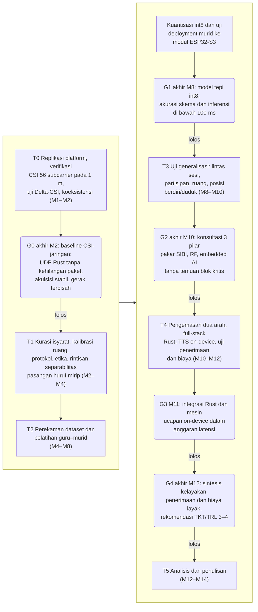
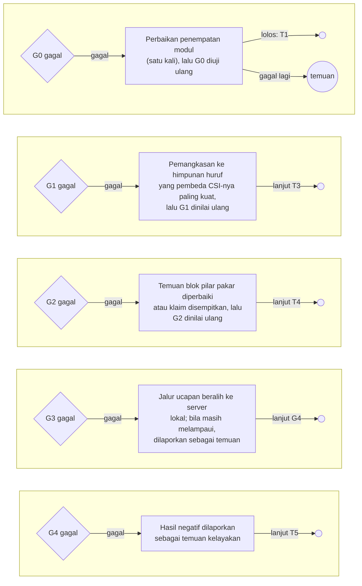
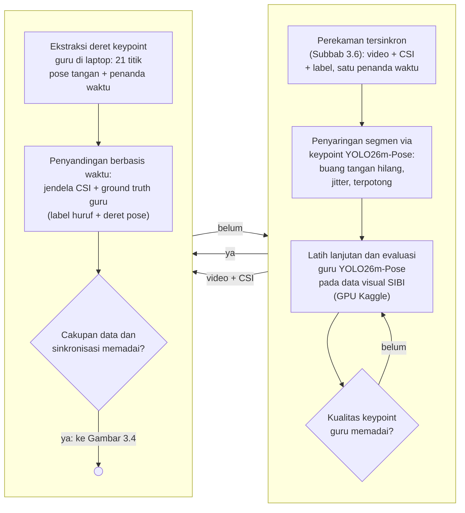
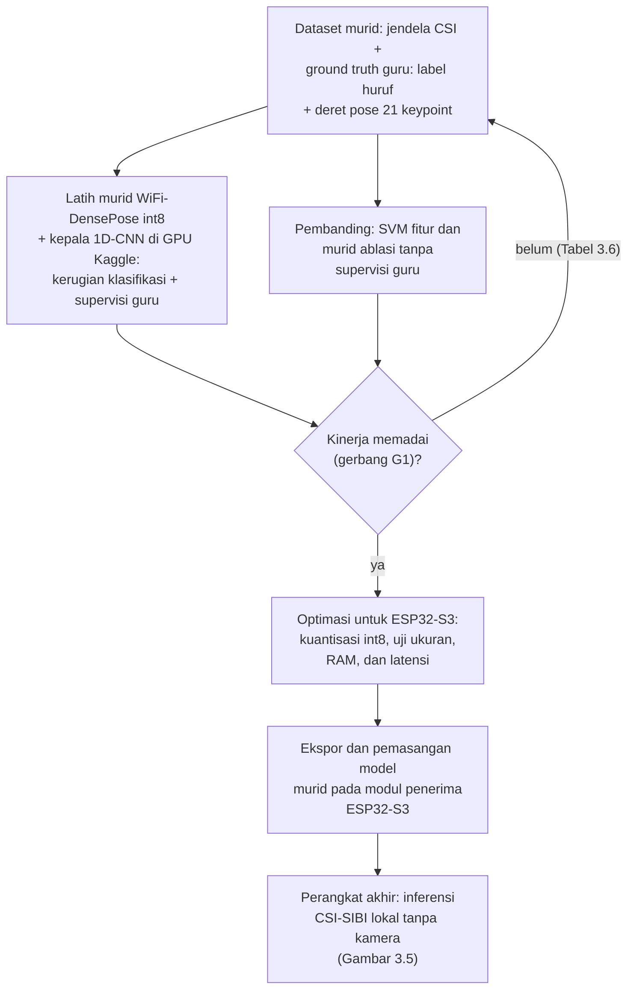
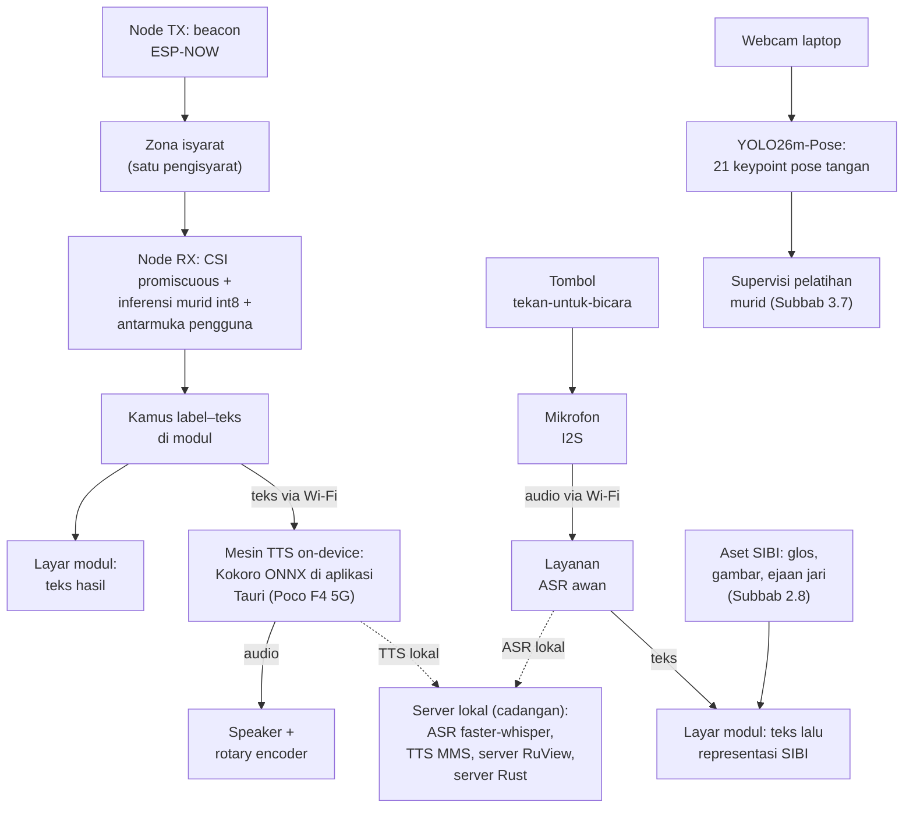
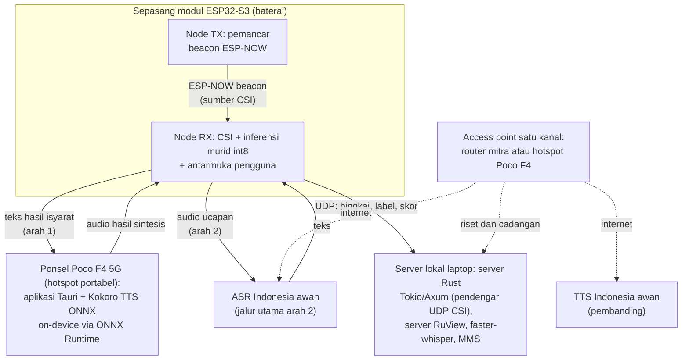
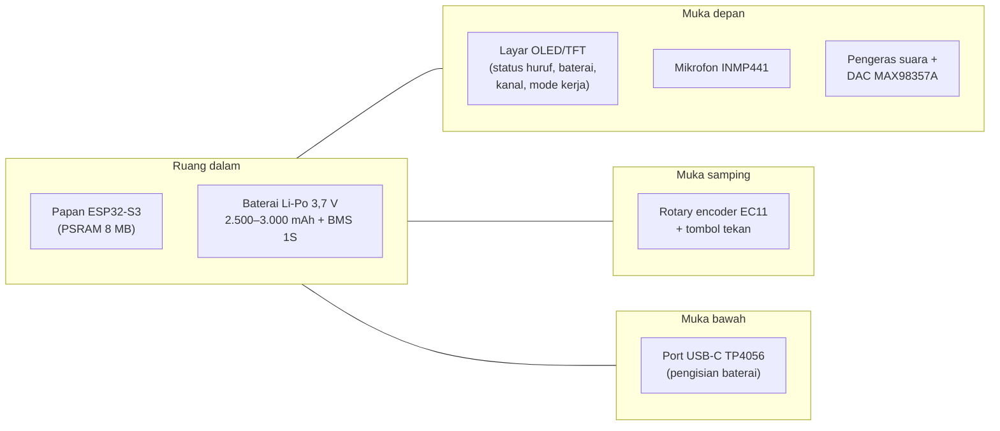
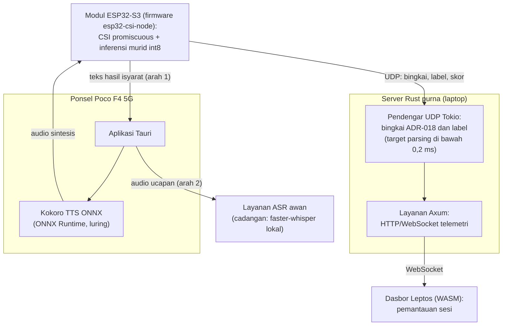
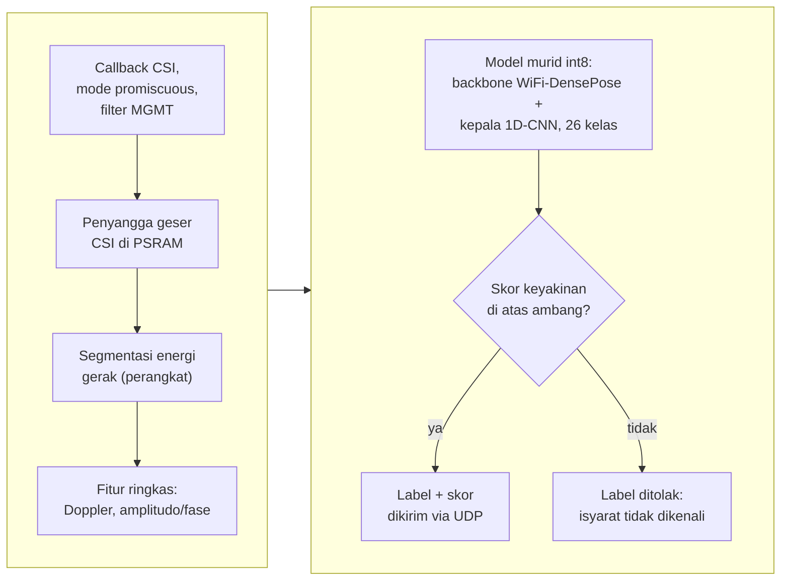
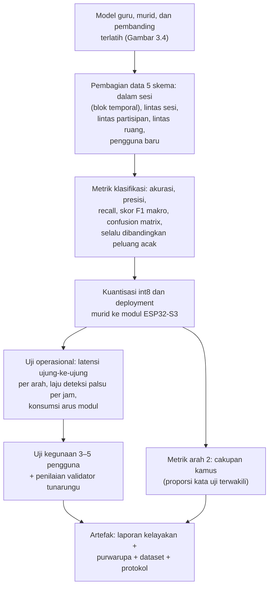

# STUDI KELAYAKAN PURWARUPA SenseSIBI: SISTEM PENERJEMAHAN DUA ARAH HURUF SIBI BERBASIS WI-FI CSI DENGAN INFERENSI ESP32-S3 DAN PEMROSESAN SERVER

**PROPOSAL PENELITIAN**

| Identitas | Keterangan |
|---|---|
| Judul | STUDI KELAYAKAN PURWARUPA SenseSIBI: SISTEM PENERJEMAHAN DUA ARAH HURUF SIBI BERBASIS WI-FI CSI DENGAN INFERENSI ESP32-S3 DAN PEMROSESAN SERVER |
| Jenis dokumen | Proposal penelitian (seminar proposal), BAB I–III + Daftar Pustaka |
| Disusun oleh | [PERLU DATA: nama penulis] |
| NIM | [PERLU DATA: NIM penulis] |
| Program studi | [PERLU DATA: program studi] |
| Universitas | [PERLU DATA: nama universitas] |
| Pembimbing | [PERLU DATA: nama pembimbing, bila sudah ditetapkan] |
| Tahun | [PERLU DATA: tahun penyusunan] |

> Catatan penyusunan: draft utuh ini disusun dari dossier bahan `Bahan-Proposal-Translator-SIBI.md` (26 Oktober 2026) dan proposal revisi terverifikasi, dengan struktur serta register korpus sempro-mepet, kaidah bahasa naskah-id (EYD V), dan optimasi kata berjenjang GEPA pada kalimat kritis. Revisi 9 November 2026 (gelombang 6) menyelaraskan naskah dengan Agent Brief v10: tumpukan perangkat lunak purna Rust (Tokio/Axum, Leptos/Tauri), inferensi Kokoro TTS ONNX *on-device* pada Poco F4 5G, rincian BoM 11 komponen, pinout GPIO dan *enclosure*, matriks justifikasi "Mengapa X dan Bukan Y?", serta gerbang keputusan G0–G4 dengan tiga pilar konsultasi pakar. Revisi 10 November 2026 (gelombang 7) menyunting gaya bahasa memakai kaidah humanizer-id (Mode Akademik Ketat) tanpa mengubah substansi. Metode utama naskah tetap distilasi guru–murid: YOLO26m-Pose sebagai guru kamera pose tangan 21 *keypoint* yang mensupervisi pelatihan murid CSI untuk inferensi tepi pada ESP32-S3. Naskah memuat diagram hanya pada BAB III (Gambar 3.1–3.10) yang tersimpan sebagai berkas Mermaid pada folder `diagram/`; berkas diagram BAB I–II (G1.1, G1.2, G2.1–G2.3) tetap tersimpan pada folder yang sama sebagai konteks bacaan dan tidak dimuat di naskah. Penanda `[PERLU DATA: ...]` menandai keputusan yang menunggu pemilik penelitian, pembimbing, atau hasil tahap sebelumnya.

---

# BAB I PENDAHULUAN

## 1.1 Latar Belakang

Sebagian besar anak tunarungu lahir di tengah keluarga pendengar. Mitchell dan Karchmer [1], [2] mencatat proporsi tersebut sebesar 90–95% pada data siswa tunarungu di Amerika Serikat sekaligus membantah anggapan lama bahwa sekitar 10% anak tunarungu memiliki orang tua tunarungu. Angka sebanding untuk Indonesia belum ditemukan dalam penelusuran penelitian ini pada Google Scholar, Crossref, dan OpenAlex hingga Oktober 2026; angka dari Amerika Serikat dipakai sebagai gambaran umum. Keluarga pendengar dari anak yang berkomunikasi dengan isyarat perlu ikut mempelajari bahasa isyarat, padahal proses belajarnya membutuhkan dukungan yang terstruktur [3] dan menghadapi hambatan praktis sehari-hari [4]. Artinya, komunikasi antara tunarungu dan pendengar di lingkungan keluarga tidak dapat dianggap terjadi dengan sendirinya.

Komunikasi yang dimaksud bersifat dua arah. Penutur tunarungu menyampaikan pikiran melalui isyarat, sedangkan lawan bicara pendengar membalasnya melalui ucapan atau tulisan; kedua arah sama-sama tersendat apabila salah satu pihak tidak menguasai moda lawannya. Di Indonesia, juru bahasa isyarat yang dapat menjembatani kedua arah masih terbatas, sekitar 500 orang untuk sekitar 1,92 juta penyandang tunarungu atau kira-kira satu juru bahasa untuk 3.840 orang [5]. Secara hukum, Undang-Undang Nomor 8 Tahun 2016 tentang Penyandang Disabilitas mengakui bahasa isyarat dan mewajibkan aksesibilitas komunikasi [6]. Kebutuhan menjembatani kedua arah itu paling terasa di lingkungan pendidikan formal, baik di SLB maupun di sekolah inklusif, tempat siswa tunarungu berguru kepada guru dan belajar bersama teman pendengar yang umumnya tidak menguasai isyarat [7]. Kewajiban aksesibilitas itu sulit dipenuhi bila kemampuan menjembatani dua arah hanya dimiliki segelintir juru bahasa sehingga teknologi bantu komunikasi yang murah dan tersedia menjadi jalur pelengkap yang penting [8].

Sistem Isyarat Bahasa Indonesia (SIBI) dipilih sebagai objek penelitian meskipun bukan moda yang paling banyak dipakai komunitas tunarungu dalam keseharian. Survei ekosistem bahasa isyarat yang dilaporkan Badan Riset dan Inovasi Nasional mencatat penggunaan Bahasa Isyarat Indonesia (BISINDO) sebesar 77,7%, SIBI 1,9%, campuran 14,9%, dan lainnya 5,6% [9]. Survei serupa pada 100 responden tunarungu di Jawa dan Bali melaporkan 91% memakai BISINDO untuk komunikasi sehari-hari [10]. Kedua survei itu menegaskan bahwa komunitas tunarungu lebih dekat ke BISINDO, tetapi juga menunjukkan tempat SIBI hidup: jalur pendidikan formal. Melalui Surat Pemberitahuan Direktorat Pendidikan Dasar Nomor 868/C/U/95, sekolah luar biasa yang menerapkan komunikasi total diwajibkan memakai sistem isyarat yang telah dibakukan [11]. Penelitian di SLB Negeri Ogan Ilir juga menunjukkan murid tunarungu memakai SIBI dalam pembelajaran sehari-hari di sekolah [7]. Dengan demikian, purwarupa penerjemah dua arah yang dibangun untuk konteks pendidikan formal lebih tepat memakai SIBI, sedangkan perluasan ke BISINDO menuntut penggantian kosakata dan validasi ulang bersama penuturnya.

Teknologi yang telah tersedia untuk kebutuhan tersebut masih terbagi menurut arah dan belum menyatu. Pada arah ucapan atau teks menjadi isyarat, aplikasi yang ada berbentuk kamus kata-level. KASIBI mengubah suara menjadi teks lalu menampilkan animasi peraga tiga dimensi dari basis data kosakata [12], sedangkan OpenSIBI memakai layanan pengenal ucapan lalu mencocokkan kata ke model tiga dimensi yang juga dianimasikan di layar [13]. Keduanya mengakui cakupan kosakatanya sangat terbatas. Pada arah isyarat menjadi teks, penelitian di Indonesia bertumpu pada citra atau video dari kamera [14], [15], termasuk penerapan berbasis *smartphone* untuk huruf SIBI statis [16], [17]. Pendekatan berbasis kamera menuntut pencahayaan dan garis pandang tertentu; ketangguhannya menurun saat kondisi berubah [18], sedangkan kehadiran kamera yang terus menyala selama percakapan diduga memengaruhi kenyamanan pengguna dan dikaitkan dengan kelelahan nonverbal [19], serta menuntut perhatian terhadap privasi bila perekaman citra berlangsung terus-menerus di ruang kelas. Keterbatasan itulah yang mendorong kebutuhan teknologi penginderaan nirsentuh (*device-free*) dan bebas kamera (*camera-free*) berbasis gelombang radio Wi-Fi yang menjaga privasi penggunanya sekaligus menekan biaya perangkat. Kesenjangan itulah titik berangkat penelitian ini.

Gelombang Wi-Fi tidak hanya berfungsi sebagai media transmisi data internet. Sinyalnya juga dapat dimanfaatkan secara pasif untuk penginderaan spasial nirsentuh (*device-free wireless sensing*), termasuk pelacakan lokasi waktu nyata (*real-time location system*, RTLS) seperti Widar2.0 yang melacak posisi manusia hanya dari satu tautan Wi-Fi [20]. Modalitas itulah yang menjadi dasar penginderaan berbasis Wi-Fi *Channel State Information* (CSI), kandidat pengganti kamera pada arah isyarat menjadi teks. CSI memuat informasi amplitudo dan fase pada setiap *subcarrier* yang berubah ketika gerak tubuh mengganggu jalur propagasi sinyal [21]. Ma dkk. [22] membangun SignFi yang mengenali 276 isyarat *American Sign Language* (ASL) dari CSI. Sistem DF-WiSLR mengenali 49 gestur tanpa perangkat yang dikenakan pengguna [23], dan pendekatan serupa telah dicoba pada *Filipino Sign Language* [24]. Preseden terbaru, WiSign, bahkan mengenali kalimat ASL kontinu dari CSI perangkat Wi-Fi komersial [25]. Kepekaan CSI terhadap gerak halus juga telah terbukti pada gerak yang jauh lebih kecil daripada gerak lengan: WiKey mengenali ketukan tombol dengan akurasi klasifikasi 96,4% untuk tombol tunggal pada kondisi terkendali [26], pemantauan napas dari CSI berhasil mengklasifikasikan pola pernapasan dengan akurasi 99,54% [27], WiFinger mengenali gestur jari dari satu perangkat Wi-Fi komersial [28], FingerDraw melacak gerak jari hingga skala subgelombang [29], dan MeshID mengidentifikasi pengguna dari gestur jarinya [30]. Meskipun demikian, belum ditemukan publikasi yang memakai CSI untuk mengenali isyarat SIBI maupun purwarupa penerjemah dua arah yang memadukan penginderaan CSI dengan pemrosesan bahasa Indonesia. Penelusuran tersebut mencakup Google Scholar, Crossref, dan OpenAlex hingga Oktober 2026 dengan kata kunci bahasa Inggris dan bahasa Indonesia (Subbab 2.11).

Perangkat penginderaan yang dipakai penelitian ini adalah modul ESP32-S3, mikrokontroler murah dengan radio Wi-Fi 2,4 GHz yang mendukung perolehan CSI secara resmi [31] dan direkomendasikan platform RuView untuk modul penangkap CSI [32]. ESP32-S3 memiliki inti ganda 240 MHz, SRAM 512 KB, dan PSRAM terpasang hingga 8 MB [33]. Dua fakta teknis menjadi dasar kelayakan rancangan. Pertama, satu *chip* ESP32-S3 terbukti mampu menjalankan penangkapan CSI, koneksi *station* ke *access point*, dan pengiriman data secara serentak sebagaimana dijalankan *firmware* RuView [32]. Koeksistensi itu mensyaratkan seluruh perangkat berada pada satu kanal serta radio tidak memasuki mode hemat daya. Kedua, inferensi model terkuantisasi pada perangkat didukung tolok ukur resmi: pustaka ESP-NN mempercepat model pendeteksi orang dari 2.300 ms menjadi 54 ms pada ESP32-S3 [34]. Pustaka ESP-DL juga menyediakan model contoh pengenalan gestur tangan dengan waktu inferensi 69,2 ms [35]. Dengan demikian, purwarupa dirancang agar pengenalan isyarat berjalan langsung pada modul, sementara keluarannya diteruskan ke mesin ucapan. Filosofi anggarannya bersifat *social-first*: satu modul ESP32-S3 berharga sekitar Rp150.000 menurut rencana anggaran penelitian sehingga sepasang node penginderaan dapat diperoleh di bawah Rp350.000, jauh lebih murah daripada kamera dan komputer pengolah citra; harga final komponen diverifikasi pada analisis biaya purwarupa (Subbab 2.10 dan 3.8). Angka itu mendasari klaim bahwa masalah sosial yang besar (aksesibilitas komunikasi penyandang tunarungu pada lingkungan pendidikan formal) dapat dijangkau teknologi mikrokontroler yang murah dan kecil.

Purwarupa yang dirancang terdiri atas sepasang modul ESP32-S3 yang portabel; node pemancar dan node penerima mengapit zona isyarat, sedangkan node penerima sekaligus memuat antarmuka pengguna berupa layar kecil, baterai, *speaker*, mikrofon, tombol tekan-untuk-bicara, dan rotary encoder volume; rincian seluruh komponennya diuraikan pada Subbab 2.13. Pada arah pertama, node penerima menangkap CSI dari paket *beacon* ESP-NOW yang dipancarkan node pemancar, mengenali isyarat melalui model murid yang berjalan pada perangkat, memetakan label menjadi teks melalui kamus label-teks kecil pada modul, lalu mengirim teks ke server dan menampilkannya di layar. Server purwarupa ditulis purna Rust: pendengar UDP Tokio menerima bingkai CSI dengan target lalu lintas *parsing* di bawah 0,2 ms tanpa jeda pengumpulan sampah, layanan HTTP Axum mengelola telemetri, dan dasbor web Leptos dikompilasi ke *WebAssembly* (WASM) [36], [37], [38]. Pada arah kedua, tombol pada modul mengaktifkan mikrofon; ucapan dikirim ke layanan pengenal ucapan awan untuk diubah menjadi teks, kemudian teks dipetakan ke representasi SIBI dan ditampilkan di layar modul. Sintesis ucapan dirancang berjalan *on-device* pada satu ponsel pintar Poco F4 5G (Snapdragon 870) yang berperan sebagai gerbang *hotspot* portabel, klien aplikasi Tauri, dan mesin TTS lokal; model Kokoro-82M yang terekspor ONNX (sekitar 82 juta parameter; ukurannya 100–300 MB dalam bentuk terkuantisasi) diinferensikan luring melalui ONNX Runtime; hasil sintesis dengan begitu bebas latensi jaringan seluler sekaligus menjaga privasi [39], [40], [41], [42]. Model *card* resmi Kokoro pada audit Oktober 2026 mencantumkan delapan bahasa dan 54 suara tanpa bahasa Indonesia sehingga ketersediaan suara Indonesia untuk Kokoro menjadi prasyarat yang diverifikasi pada gerbang G3; bila belum tersedia, jalur *on-device* beralih ke ekspor ONNX dari MMS-TTS-ind [43], [44], sedangkan layanan awan Google dan Azure tetap menjadi pembanding dan cadangan [45], [46]. Laptop ASUS TUF Dash F15 FX516PR (Intel Core i7-11370H, GPU RTX 3070 Laptop 8 GB VRAM, RAM 16 GB) menjadi mesin akuisisi jalur guru, mesin pengembangan, dan server lokal cadangan. Pelatihan model guru dan model murid dijalankan pada layanan server GPU Kaggle. Pengenal ucapan Whisper mendukung lebih dari 100 bahasa termasuk Indonesia [47], dan implementasi faster-whisper terbukti jauh lebih cepat daripada waktu nyata pada GPU kelas 8 GB [48].

Sisi visi gagasan ini telah dibuktikan pada tahap pra-penelitian. Model visi YOLO26m-Pose telah dilatih pada *dataset* visual SIBI terkurasi bersumber banyak melalui repositori milik peneliti (Subbab 2.5 dan 3.7.4); model tersebut mengestimasi 21 titik artikulasi tangan, yaitu satu titik pergelangan tangan dan empat titik pada setiap jari, dan terbukti mengenali 26 huruf SIBI secara akurat, termasuk membedakan pasangan huruf yang mirip seperti V dan U dari jarak antarujung telunjuk dan jari tengah serta mengikuti lintasan gerak telunjuk huruf J dan Z. Proposal ini merupakan tahap pengembangan berikutnya: membangun purwarupa berbasis Wi-Fi CSI yang mereplikasi kemampuan pembedaan itu tanpa kamera.

Sebagai studi kelayakan, penelitian ini tidak mengklaim penerjemahan kontinu kosakata penuh. Objek pengenalan dibatasi pada alfabet manual SIBI satu tangan sebanyak 26 huruf, yaitu 24 huruf statis serta huruf gerak J dan Z: 24 huruf statis dibedakan oleh konfigurasi tangan dan jari, sedangkan J dan Z dibedakan oleh lintasan geraknya. Kepekaan CSI terhadap gerak halus tingkat jari telah dilaporkan sejumlah penelitian [22], [24], [26], [49], [50], [51], [28], [29], [30], tetapi kemampuan satu tautan antarmodul ESP32-S3 membedakan 26 konfigurasi tangan tersebut belum dapat dipastikan sebelum data dikumpulkan sehingga penelitian ini mengujinya melalui uji Delta-CSI serta gerbang G1 (Subbab 2.3 dan BAB III). Model berbasis CSI juga mudah mengalami *overfitting* terhadap orang dan ruang tempat data direkam [52]; karena itu kinerja diukur lintas partisipan dan lintas ruang dengan acuan strategi Widar3.0 [53]. Model murid CSI dilatih dengan distilasi guru–murid (*teacher–student*): model guru kamera YOLO26m-Pose hasil pra-penelitian mengekstrak deret 21 *keypoint* pose tangan beserta label huruf dari video perekaman tersinkron, dan keluarannya direkam sebagai *ground truth* sekaligus supervisi distilasi selama akuisisi data (Subbab 2.5 dan 3.7). Model murid belajar mengenali isyarat dari jendela CSI dengan supervisi label dan deret pose guru, lalu berjalan sendiri pada modul tanpa kamera sehingga kamera dan model guru hanya aktif pada tahap akuisisi data dan pelatihan [54], [55]. Pemetaan teks ke representasi SIBI pada arah kedua dibatasi pada kamus kata-level dengan *fallback* ejaan jari sebagaimana preseden KASIBI dan OpenSIBI. Penerjemahan tata bahasa penuh masih menjadi masalah terbuka internasional [56], [57]. Setiap tahapan ditutup gerbang keputusan; kegagalan tetap dilaporkan sebagai temuan kelayakan. Penelitian ini merancang dan membangun purwarupa sistem penerjemahan dua arah antara SIBI dan teks atau ujaran bahasa Indonesia berbasis Wi-Fi CSI dengan inferensi model pada modul ESP32-S3 dan pemrosesan bahasa pada server. Purwarupa itu diberi nama SenseSIBI, singkatan dari *Sensing & Translation of SIBI*. Jalur sintesis ucapan dirancang berjalan *on-device* pada ponsel penelitian dengan layanan awan dan server lokal sebagai cadangan, sedangkan kelayakan purwarupa diuji sebagai alat bantu komunikasi untuk kosakata terbatas pada konteks pendidikan formal.

## 1.2 Rumusan Masalah

Berdasarkan latar belakang yang telah dipaparkan, masalah yang dikaji dalam penelitian ini dapat dirumuskan sebagai berikut.

1. Bagaimana merancang purwarupa sistem penerjemahan dua arah antara SIBI dan teks atau ujaran bahasa Indonesia berbasis sepasang modul ESP32-S3 (node pemancar dan node penerima) yang menangkap CSI dan menjalankan inferensi model pada perangkat, dengan pemrosesan bahasa pada server purna Rust (Tokio/Axum) dan inferensi sintesis ucapan *on-device* pada ponsel pintar (Kokoro TTS ONNX) serta layanan awan dan server lokal sebagai jalur cadangan, termasuk adaptasi arsitektur RuView dan *backbone* WiFi-DensePose terkuantisasi int8, protokol perekaman *dataset* isyarat terisolasi, serta pelatihan model murid CSI dengan supervisi model guru YOLO26m-Pose?
2. Bagaimana kinerja pengenalan 24 huruf statis dan dua huruf gerak (J dan Z) alfabet manual SIBI dari CSI melalui inferensi pada perangkat, serta kinerja jalur isyarat menjadi teks dan suara dan jalur teks atau ucapan menjadi representasi SIBI, pada skenario dalam sesi, lintas partisipan, dan lintas ruang?
3. Bagaimana kelayakan purwarupa sebagai alat bantu komunikasi dua arah untuk kosakata terbatas ditinjau dari latensi ujung ke ujung, cakupan kosakata, keandalan operasional, penilaian tiga pilar pakar, penerimaan pengguna akhir, dan biaya purwarupa?

## 1.3 Tujuan Penelitian

Berdasarkan rumusan masalah tersebut, penelitian ini bertujuan:

1. Merancang purwarupa sistem penerjemahan dua arah antara SIBI dan teks atau ujaran bahasa Indonesia berbasis sepasang modul ESP32-S3 (node pemancar dan node penerima) yang menangkap CSI dan menjalankan inferensi model pada perangkat, dengan pemrosesan bahasa pada server purna Rust (Tokio/Axum) dan inferensi sintesis ucapan *on-device* pada ponsel pintar (Kokoro TTS ONNX) serta layanan awan dan server lokal sebagai jalur cadangan, termasuk adaptasi arsitektur RuView dan *backbone* WiFi-DensePose terkuantisasi int8, protokol perekaman *dataset* isyarat terisolasi, serta pelatihan model murid CSI dengan supervisi model guru YOLO26m-Pose.
2. Mengukur kinerja pengenalan 24 huruf statis dan dua huruf gerak (J dan Z) alfabet manual SIBI dari CSI melalui inferensi pada perangkat, serta kinerja jalur isyarat menjadi teks dan suara dan jalur teks atau ucapan menjadi representasi SIBI, pada skenario dalam sesi, lintas partisipan, dan lintas ruang.
3. Menganalisis kelayakan operasional purwarupa sebagai alat bantu komunikasi dua arah untuk kosakata terbatas melalui pengujian bergerbang lima tahap (G0 hingga G4) yang menilai latensi ujung ke ujung, cakupan kosakata, keandalan operasional, penilaian tiga pilar pakar, penerimaan pengguna akhir, dan biaya purwarupa.

## 1.4 Batasan Masalah

Ruang lingkup penelitian ini dibatasi sebagai berikut.

1. Objek pengenalan adalah alfabet manual SIBI satu tangan sebanyak 26 huruf, yaitu 24 huruf statis serta huruf gerak J dan Z, dengan bentuk baku yang dicocokkan dengan *Kamus SIBI* [58] dan disetujui validator penutur tunarungu. Sistem yang dibangun bukan penerjemah kalimat dan tidak menangani pengenalan isyarat kontinu.
2. Konfigurasi tangan dan jari menjadi pembeda utama kelas yang diuji, sedangkan ekspresi wajah dan penanda nonmanual tidak dikenali. Batas ini mengikat kedua arah sehingga keluaran arah pertama berupa huruf yang dikenali, sedangkan arah kedua menampilkan representasi tingkat kata dan ejaan jari, bukan tata bahasa isyarat penuh beserta penanda nonmanual.
3. Perangkat keras penginderaan terdiri atas sepasang modul ESP32-S3, yaitu node pemancar (TX) dan node penerima (RX), yang beroperasi pada pita 2,4 GHz (IEEE 802.11b/g/n) dengan kanal 20 MHz (56 *subcarrier*: 52 data dan 4 pilot) serta antena tunggal 1T1R; modul penerima sekaligus memuat antarmuka pengguna berupa layar kecil, baterai Li-Po dengan modul proteksi dan pengisi daya USB-C, *speaker* dengan penguat I2S, mikrofon I2S, tombol tekan-untuk-bicara, dan rotary encoder volume. Selain itu, disediakan satu laptop ASUS TUF Dash F15 FX516PR (Intel Core i7-11370H, RTX 3070 Laptop 8 GB VRAM, RAM 16 GB) sebagai mesin akuisisi jalur guru, mesin pengembangan, dan server lokal cadangan; satu ponsel pintar Poco F4 5G (Snapdragon 870, RAM 6 GB) sebagai gerbang *hotspot* portabel, klien aplikasi Tauri, dan mesin TTS *on-device*; serta satu *router* Wi-Fi atau *access point* yang berfungsi murni sebagai jembatan jaringan dan penjangkar kanal bagi server dan layanan ucapan, bukan perangkat penginderaan. Pelatihan model guru dan model murid memakai layanan server GPU Kaggle.
4. Kamera dan YOLO26m-Pose hanya dipakai sebagai model guru pada tahap akuisisi data dan pelatihan di laptop dan layanan server GPU Kaggle. Keluaran guru berupa deret 21 *keypoint* dan label huruf menjadi *ground truth* distilasi, kartu pemandu protokol menjadi alat verifikasi konsistensi anotasi, dan produk akhir tidak memakai kamera maupun citra.
5. Pemrosesan bahasa memakai teknologi yang terverifikasi mendukung bahasa Indonesia: sintesis ucapan berjalan *on-device* pada ponsel Poco F4 5G melalui ONNX Runtime dengan mesin yang direncanakan Kokoro TTS ONNX dan alternatif ekspor ONNX dari MMS-TTS-ind, sementara pengenalan ucapan otomatis memakai layanan awan sebagai jalur utama dan faster-whisper pada server lokal sebagai cadangan; ketersediaan suara Indonesia pada mesin *on-device* diverifikasi pada gerbang G3 dan pilihan final ditetapkan pada T4 (Tabel 3.8).
6. Arah kedua dibatasi pada kamus kata-level dengan *fallback* ejaan jari (26 huruf dan angka 1–9) sebagaimana preseden OpenSIBI; cakupan kamus diukur dan dilaporkan, tidak dijanjikan mencakup kosakata kamus SIBI penuh.
7. Setiap sesi melibatkan satu pengisyarat pada zona akuisisi; sistem tidak mengidentifikasi individu, dan pengujian dilakukan di sedikitnya dua ruang mitra yang dikalibrasi dalam penelitian ini.
8. Uji pengguna dilakukan dalam skala kecil dengan 3–5 pengguna dan dianalisis secara deskriptif tanpa statistik inferensial.
9. Penelitian ini tidak membahas pengenalan isyarat kontinu, penerjemahan kalimat dengan tata bahasa isyarat penuh beserta penanda nonmanual, penggunaan BISINDO, maupun klasifikasi gerakan otomatis dari video oleh model guru.

## 1.5 Manfaat Penelitian

Manfaat penelitian ini dibedakan menjadi manfaat teoretis dan manfaat praktis.

### 1.5.1 Manfaat Teoretis

Penelitian ini diharapkan memberikan bukti awal kelayakan pengenalan alfabet manual SIBI, yaitu 24 huruf statis serta huruf gerak J dan Z, dari CSI satu tautan antarmodul ESP32-S3, disertai bukti kelayakan inferensi model terkuantisasi pada perangkat untuk tugas tersebut. Bukti itu terikat pada alfabet manual dan tidak otomatis berlaku bagi pengenalan isyarat kata maupun kontinu. Penelitian ini juga menyediakan *dataset* CSI huruf SIBI berlabel beserta deret *keypoint* model guru dan protokol perekamannya sehingga dapat menjadi pembanding bagi penelitian penginderaan nirkabel untuk bahasa isyarat lain, termasuk perluasan ke BISINDO. Kajian integrasi penginderaan CSI dengan jalur sintesis ucapan dan pengenalan ucapan otomatis bahasa Indonesia pada satu purwarupa memberikan contoh dokumentasi arsitektur tepi–awan yang dapat ditelusuri ulang peneliti berikutnya.

### 1.5.2 Manfaat Praktis

Bagi lembaga pendidikan mitra, penelitian ini memberikan gambaran kelayakan purwarupa alat bantu komunikasi dua arah berbahasa SIBI yang dapat dipakai guru dan keluarga pada kegiatan pembelajaran, beserta protokol kurasi kosakata yang disusun bersama validator penutur tunarungu. Bila tahapan penelitian mencapai gerbang terakhir, dihasilkan purwarupa yang menampilkan teks dan menyuarakan isyarat SIBI yang dikenali serta menampilkan representasi isyarat bagi lawan bicara pendengar. Bila penelitian berhenti lebih awal, artefak berupa laporan karakterisasi sinyal, protokol, atau *dataset* berlabel tetap dihasilkan. Bagi keluarga siswa tunarungu, kosakata yang divalidasi penutur tunarungu memastikan bentuk isyarat yang ditampilkan baku sesuai jalur pendidikan formal. Bagi komunitas riset, *dataset* dan rancangan yang tidak terikat pada satu bahasa isyarat memudahkan replikasi dan pembandingan metode.

## 1.6 Sistematika Penulisan

Proposal penelitian ini terdiri atas tiga bab dengan sistematika sebagai berikut.

**BAB I Pendahuluan** memuat latar belakang, rumusan masalah, tujuan penelitian, batasan masalah, manfaat penelitian, dan sistematika penulisan.

**BAB II Kajian Pustaka** memuat kajian teori dan penelitian terdahulu yang menjadi dasar perancangan. Kajian mencakup bahasa isyarat dan SIBI, kebutuhan komunikasi dua arah dan sistem terdahulu, Wi-Fi CSI beserta model zona Fresnel dan pembersihan CSI-ratio, modul ESP32-S3 dan platform RuView beserta koeksistensi radionya dan keluarga model WiFi-DensePose, peran YOLO26m-Pose sebagai model guru kamera dalam distilasi guru–murid, pengenalan isyarat dan gestur berbasis CSI serta inferensi pada perangkat, sintesis ucapan dan pengenalan ucapan otomatis bahasa Indonesia, pemetaan teks ke representasi SIBI di layar, komunikasi perangkat dan server, evaluasi kelayakan, serta penelitian terdahulu yang relevan, ditutup matriks justifikasi pemilihan komponen dan rincian komponen perangkat keras purwarupa.

**BAB III Metode Penelitian** memuat desain penelitian; tahapan penelitian beserta gerbang keputusan; waktu dan lokasi penelitian; alat dan bahan; perancangan sistem termasuk tata letak fisik, *enclosure*, dan wiring pinout GPIO; perancangan perangkat lunak purna Rust; inferensi *on-device* Kokoro TTS; protokol perekaman *dataset* beserta partisipan dan etika; pengolahan sinyal, ekstraksi fitur, pelatihan guru–murid, dan *deployment*; skenario pengujian dan metrik evaluasi beserta konsultasi tiga pilar pakar; jadwal penelitian; parameter rancangan yang ditetapkan kemudian; serta risiko dan alternatif cadangan.

# BAB II KAJIAN PUSTAKA

## 2.1 Bahasa Isyarat dan Sistem Isyarat Bahasa Indonesia

Bahasa isyarat merupakan bahasa visual yang menyampaikan makna melalui gerak tangan, lengan, tubuh, dan ekspresi wajah [59], [60]. Secara struktural, sebuah isyarat tersusun atas bentuk tangan, lokasi, gerak, orientasi telapak tangan, dan komponen nonmanual seperti ekspresi wajah; perbedaan pada satu parameter saja dapat membedakan makna dua isyarat [59], [60]. Dalam penelitian ini, parameter itu menjadi acuan untuk memisahkan bagian isyarat yang dapat dinilai mesin dari bagian yang tetap memerlukan penilaian manusia (Subbab 2.3 dan 2.8).

Pemakaian bahasa isyarat di Indonesia tidak seragam. Survei ekosistem bahasa isyarat menunjukkan BISINDO jauh lebih banyak dipakai respondennya daripada SIBI, sedangkan SIBI berkembang di jalur pendidikan formal [9]; angka pemakaian dan keterbatasan sampel survei tersebut telah dipaparkan pada Subbab 1.1. Survei pada responden tunarungu di Jawa dan Bali melaporkan bahwa 91% responden memakai BISINDO untuk komunikasi sehari-hari karena konsep SIBI dianggap sulit [10]. SIBI sendiri merupakan sistem isyarat baku yang dikembangkan untuk keperluan pendidikan formal, sedangkan BISINDO berkembang secara alami di komunitas tunarungu; kajian pada mahasiswa tunarungu [61] dan pada siswa SLB [62] menjelaskan perbedaan pemakaian keduanya. Bentuk baku isyarat SIBI didokumentasikan dalam *Kamus Sistem Isyarat Bahasa Indonesia* yang selanjutnya disebut *Kamus SIBI* [58], dan bentuk digitalnya tersedia melalui Kamus SIBI Digital [11].

Pemilihan SIBI dalam penelitian ini didasarkan pada jalur pendidikan formal yang menjadi konteks pemakaian purwarupa, bukan pada jumlah penuturnya (Subbab 1.1). Alat yang dirancang tidak dimaksudkan untuk menggantikan BISINDO dalam komunikasi komunitas tunarungu sehari-hari. Rancangan sistem tidak terikat pada satu bahasa isyarat tertentu sehingga perluasan ke BISINDO pada prinsipnya dapat dilakukan dengan mengganti *dataset*, menyeleksi ulang kosakata dengan kriteria yang sama, dan memvalidasi bersama validator penutur BISINDO. Kelayakan perluasan tersebut tidak diuji dalam penelitian ini dan diusulkan sebagai penelitian lanjutan.

## 2.2 Kebutuhan Komunikasi Dua Arah dan Sistem Terdahulu

Komunikasi antara penutur isyarat dan pendengar menuntut kemampuan pada kedua arah, yaitu memahami isyarat yang diperagakan dan membalasnya dengan moda yang dapat dipahami lawan bicara. Sebagian besar anak tunarungu lahir dari orang tua pendengar [1]; keluarga pendengar karena itu berada di barisan pertama yang merasakan kebutuhan itu; mereka yang belajar bahasa isyarat membutuhkan dukungan belajar terstruktur serta menghadapi hambatan praktis [3], [4]. Juru bahasa isyarat profesional yang dapat menjembatani kedua arah jumlahnya terbatas [5] sehingga teknologi bantu komunikasi berperan sebagai pelengkap [8]. Dalam penelitian ini, kebutuhan itu diterjemahkan menjadi purwarupa yang bekerja dua arah, bukan sekadar kamus satu arah.

Sistem terdahulu di Indonesia dapat dikelompokkan menurut arah kerjanya. Pada arah ucapan atau teks menjadi isyarat, KASIBI mengubah suara menjadi teks melalui layanan pengenal ucapan, mencocokkan kata pada basis data, lalu menampilkan animasi peraga tiga dimensi; sistem tersebut diuji sebagai media pembelajaran dan memperoleh rata-rata skor 3,362 dari 4 [12]. OpenSIBI memakai mekanisme serupa dengan menyimpan model tiga dimensi format Collada pada *application programming interface* (API) sehingga aplikasi Android dapat menganimasikannya; cakupannya 50 kosakata yang terdiri atas 9 angka, 26 huruf, dan 15 kata, dan penulisnya mengakui keterbatasan kosakata sebagai kelemahan utama [13]. Kedua sistem itu membuktikan bahwa arah balik kata-level secara teknis dapat dibangun, tetapi sekaligus menandai biaya pembuatan aset per isyarat yang tinggi. Aplikasi pembelajaran dasar lain menyasar arah manusia belajar isyarat [63].

Pada arah isyarat menjadi teks, riset Indonesia umumnya bertumpu pada citra atau video dari kamera [14]. Dwijayanti dkk. [15] memakai *convolutional neural network* (CNN) untuk citra huruf dan angka BISINDO, Kindy dkk. [64] menyusun *dataset* video BISINDO tingkat kata, Wiguna dan Rojali [65] mengenali kalimat BISINDO dari video, dan Sebastian dkk. [66] memakai pengenalan gestur tubuh yang memperhitungkan informasi spasial. Khusus SIBI, Soekarta dkk. [16] membangun aplikasi Android berbasis MediaPipe untuk 24 huruf statis, disusul aplikasi pengenalan alfabet statis berbasis TensorFlow Lite [17]. Seluruh kelompok ini memerlukan kamera saat sistem dipakai sehingga keberhasilannya bergantung pada pencahayaan dan garis pandang [18], [60].

Pendekatan lain yang tidak memerlukan kamera adalah sensor yang dikenakan pada tangan, seperti sarung tangan sensor dan sensor inersia, yang dapat menangkap konfigurasi jari. Namun, perangkatnya harus dikenakan dan dikalibrasi setiap kali dipakai [60], [24] dan karenanya tidak cocok untuk percakapan yang berlangsung santai. Paparan kamera yang terus menyala selama percakapan juga dikaitkan dengan kelelahan nonverbal [19]. Oleh karena itu, penelitian ini menelusuri penginderaan berbasis sinyal Wi-Fi yang bekerja tanpa kamera dan tanpa perangkat yang dikenakan, sementara sistem terdahulu yang paling dekat dengan arah balik, yaitu KASIBI dan OpenSIBI, menjadi preseden perancangan jalur kedua purwarupa (Subbab 2.8).

## 2.3 Wi-Fi Channel State Information

Wi-Fi *Channel State Information* (CSI) merupakan informasi amplitudo dan fase pada setiap *subcarrier* yang menggambarkan kondisi kanal propagasi antara pemancar dan penerima Wi-Fi [21]. Sinyal Wi-Fi tiba di penerima melalui beberapa jalur, yaitu jalur langsung dan jalur pantulan dari dinding, perabot, serta tubuh manusia. Ketika tubuh bergerak di antara pemancar dan penerima, panjang jalur pantulan berubah sehingga amplitudo dan fase pada setiap *subcarrier* ikut berubah; perubahan itulah yang dimanfaatkan untuk mengenali gerak tanpa sensor yang dikenakan di tubuh [21].

Amplitudo dan fase memuat informasi yang berbeda tentang perubahan kanal. Cai dkk. [49] memanfaatkan keduanya sebagai informasi yang saling melengkapi untuk pengenalan gestur. Setiap *subcarrier* menempati frekuensi yang sedikit berbeda; satu gerak yang sama dengan demikian menghasilkan perubahan yang tidak identik pada setiap *subcarrier* [21]. Dengan demikian, CSI menyediakan banyak kanal pengamatan dari satu pasang pemancar dan penerima.

Perubahan kanal tersebut memiliki dasar fisika pada model zona Fresnel. Wu dkk. [67] merumuskan zona Fresnel sebagai wilayah elips di sekitar garis pandang pemancar–penerima tempat gelombang dipantulkan dan dilenturkan; gerakan objek yang melintasi batas zona mengubah panjang jalur pantulan sehingga amplitudo dan fase pada tiap *subcarrier* bergeser. Pada skala gerak mikro, artikulasi 21 titik jari pengisyarat menggeser jalur pantulan pada orde sentimeter hingga milimeter sehingga setiap konfigurasi huruf membentuk pola perubahan *subcarrier* yang khas. Akan tetapi, fase CSI mentah tercemar derau fase osilator lokal (*local oscillator phase noise*) dan offset fase acak sehingga tidak dapat dipakai secara langsung. Model CSI-ratio mengatasinya melalui rasio atau perkalian konjugat yang saling menghapus komponen fase bawaan perangkat tanpa memerlukan perangkat tambahan [67]; teknik konjugat serupa menjadi dasar kalibrasi fase Widar2.0 pada tautan Wi-Fi tunggal [20]. Dalam penelitian ini, prinsip CSI-ratio diterapkan pada modul penerima sebagai rasio terhadap rekam acuan hasil kalibrasi ruang karena setiap tautan ESP32-S3 hanya memuat satu antena penerima; formulasi pastinya ditetapkan pada tahap karakterisasi (Subbab 3.7).

Gerak lengan juga menghasilkan komponen Doppler, yakni pergeseran frekuensi yang sebanding dengan laju perubahan panjang jalur pantulan [21], [53]. Komponen tersebut dapat diukur dari deret CSI dan mencerminkan kecepatan gerak. Penelitian ini memusatkan analisis Doppler pada pita frekuensi gerak 1–60 Hz; agar pita tersebut terwakili, laju pencuplikan CSI harus sekurang-kurangnya dua kali frekuensi tertingginya, yaitu 120 Hz, sesuai kriteria Nyquist [68], [69]. *Firmware* RuView membatasi pengiriman bingkai CSI paling sering setiap 20 ms, yang setara dengan laju maksimum 50 bingkai per detik, menurut kode sumber *firmware*-nya [32]; laju aktual pada konfigurasi penelitian diukur pada tahap replikasi (BAB III). Bila laju terukur lebih rendah daripada 120 Hz, pita Doppler yang dapat diamati menyempit hingga setengah laju pencuplikan aktual dan pembatasan itu dilaporkan.

Kepekaan CSI terhadap gerak halus telah dibuktikan pada gerak yang jauh lebih kecil daripada gerak lengan. WiKey mengenali ketukan tombol dari CSI dengan tingkat deteksi lebih dari 97,5% dan akurasi klasifikasi 96,4% untuk kunci tunggal pada lingkungan terkendali [26]. Pemantauan pernapasan dari Wi-Fi CSI berhasil mengklasifikasikan pola pernapasan dengan akurasi 99,54% dan laju napas dengan akurasi 98,69% pada kanal yang cukup baik [27], padahal gerak dada akibat napas berada pada orde milimeter. Pada skala jari, WiFinger mengenali gestur jari dari satu perangkat Wi-Fi komersial [28], FingerDraw melacak gerak jari hingga resolusi di bawah panjang gelombang dengan operasi hasil bagi dua sinyal CSI [29], dan MeshID mengidentifikasi pengguna dari gestur jarinya dengan pemisahan interferensi sinyal ortogonal [30]. Kedua preseden pertama tersebut menunjukkan bahwa CSI peka terhadap gerak skala sentimeter hingga milimeter pada kondisi jarak dekat dan pengguna tunggal. Meskipun demikian, seluruh preseden bekerja pada kondisi terkendali; keberhasilannya tidak serta-merta berlaku pada konfigurasi penelitian ini dan bukti itu dipakai sebagai dasar hipotesis kerja, bukan jaminan hasil.

Pola CSI tidak hanya dipengaruhi oleh gerak isyarat, tetapi juga oleh pengisyarat yang memperagakannya dan ruang tempat perekaman. Akibatnya, model berbasis CSI mudah mengalami *overfitting* terhadap orang dan ruang tempat data pelatihan direkam [52]. Chen dkk. merangkum strategi generalisasi lintas domain untuk mengatasi persoalan tersebut, sedangkan Zhang dkk. mengusulkan Widar3.0 yang mengenali gestur lintas domain tanpa pelatihan ulang dengan profil kecepatan yang diturunkan dari Doppler [53]. Dalam penelitian ini, strategi lintas domain dijadikan acuan rancangan fitur, sedangkan kemampuan generalisasi sistem diukur langsung melalui skenario pengujian (Subbab 2.10 dan 3.8).

Panjang gelombang Wi-Fi pada pita 2,4 GHz sekitar 12,5 cm dan membatasi resolusi spasial CSI. Sejumlah penelitian melaporkan pengenalan isyarat dan gestur tangan dari CSI dengan perangkat riset multiantena: SignFi memakai NIC Intel 5300 dengan tiga antena penerima [22], Wi-SL memakai router dengan dua antena pemancar dan tiga antena penerima pada kanal 40 MHz dengan laju pencuplikan 400 Hz [70], dan HandFi memakai NIC Intel 5300 sebagai penerima dari router Wi-Fi komersial [50]. Sebagian bukti bahkan memakai perangkat lebih sederhana: Cai dkk. mengenali gestur dengan akurasi rata-rata 98,3% pada skenario satu pemancar dan satu penerima [49]. Penelitian ini tidak mengasumsikan kemampuan tersebut juga dimiliki perangkat yang dipakai. Kelayakan satu tautan antara dua modul ESP32-S3 yang masing-masing berantena tunggal untuk membedakan 26 konfigurasi tangan dan jari alfabet manual SIBI, yaitu 24 huruf statis serta huruf gerak J dan Z, karenanya diperlakukan sebagai pertanyaan penelitian, bukan asumsi awal. Bukti kepekaan milimeter di atas dan preseden pengenalan tulisan huruf oleh WiASL [51] menjadi hipotesis kerja; uji Delta-CSI dan gerbang G1 (BAB III) mengujinya langsung pada pasangan huruf dengan konfigurasi tangan yang paling mirip, dan bila pasangan tersebut tidak dapat dipisahkan, himpunan huruf dipangkas sesuai kriteria pada Tabel 3.8 serta hasilnya dilaporkan sebagai temuan kelayakan.

## 2.4 Modul ESP32-S3, Platform RuView, dan Koeksistensi Radio

ESP32-S3 merupakan mikrokontroler dengan radio Wi-Fi 802.11 b/g/n pada pita 2,4 GHz dan tautan tunggal satu antena (1T1R) [33]. Prosesornya berinti ganda Xtensa LX7 yang berjalan pada 240 MHz dengan instruksi vektor; memorinya terdiri atas SRAM internal 512 KB, ROM 384 KB, dan PSRAM terpasang hingga 8 MB sesuai varian *chip* [33]. Dukungan CSI tersedia secara resmi untuk seluruh seri ESP32, termasuk ESP32-S3, melalui repositori esp-csi [31]; pada kanal 20 MHz 802.11n, CSI yang dilaporkan mencakup 56 *subcarrier* yang terdiri atas 52 *subcarrier* data dan 4 *subcarrier* pilot [31]. Basis akuisisi CSI mandiri pada keluarga ESP32 dikembangkan oleh Hernandez dan Bulut [71], dan ESP32-S3 adalah varian yang direkomendasikan dokumentasi RuView untuk modul penangkap CSI [32].

RuView merupakan proyek sumber terbuka yang menyediakan rantai akuisisi dan pengolahan CSI pada ESP32. Komponennya meliputi *firmware* `esp32-csi-node` penangkap CSI dengan format bingkai ADR-018 yang dikirim melalui *User Datagram Protocol* (UDP), server pengolahan sinyal, kalibrasi ruang bawaan, segmentasi berbasis energi gerak, *dashboard* web, mode privasi, dan *pipeline* akuisisi tersinkron kamera–CSI melalui skrip `scripts/collect-ground-truth.py` (ADR-079) [32]. ADR atau *architecture decision record* adalah catatan keputusan arsitektur yang dipakai repositori tersebut untuk mendokumentasikan keputusan desain [32]. Kalibrasi ruang bawaan memakai 600 bingkai dan 8 *anchor* selama kurang lebih empat menit, sedangkan mode privasi menekan fitur biometrik agar tidak diterbitkan keluar dari server [32].

Selain rantai akuisisi, RuView juga menerbitkan keluarga model WiFi-DensePose untuk penginderaan spasial dari CSI. Arsitektur tersebut menelusuri DensePose from WiFi yang memetakan sinyal Wi-Fi ke koordinat permukaan tubuh dengan jaringan visi sebagai guru [72]. Repositori RuView menyediakan enkode terpralatih ruvnet/wifi-densepose-pretrained yang dilatih secara kontrastif dan mencapai akurasi *triplet* temporal 82,3% pada data pisah-uji [32], serta varian ruvnet/wifi-densepose-mmfi-pose yang dilatih pada *dataset* multimodal MM-Fi berisi lebih dari 320 ribu bingkai tersinkron dari 40 partisipan [73]. Kedua model tersebut tersedia dalam kuantisasi int8 untuk komputasi tepi [32]. Dalam penelitian ini, enkode terpralatih tersebut dipakai sebagai *backbone* pengekstrak fitur murid CSI, sedangkan varian MM-Fi menjadi preseden bahwa CSI perangkat komersial dapat dipetakan ke *keypoint* tubuh (Subbab 2.6 dan 3.7).

Fakta teknis yang paling menentukan arsitektur purwarupa adalah koeksistensi radio pada satu *chip*. *Firmware* RuView menjalankan tiga fungsi radio secara serentak pada satu ESP32-S3: menangkap CSI melalui mode *promiscuous*, terhubung sebagai *station* ke *access point* untuk mengirim data melalui UDP, dan menerima sinkronisasi ESP-NOW dari modul pemancar [32]. ESP-NOW sendiri merupakan protokol komunikasi tanpa *access point* yang memuat hingga 250 bita per paket dan dipakai RuView sebagai sumber bingkai bersama antarmodul [32]. Tiga syarat wajib menyertai pola tersebut. Seluruh perangkat berada pada satu kanal mengikuti kanal *access point*, penyaringan paket mode *promiscuous* dibatasi pada kelompok paket manajemen agar beban interupsi terkendali, dan mode hemat daya radio dimatikan karena CSI menuntut radio tetap terjaga [32]. Dengan bukti itu, purwarupa tidak memerlukan modul gerbang khusus; setiap modul dapat menjalankan peran ganda sekaligus, dan topologi lengkapnya diuraikan pada Subbab 3.5. Tabel 2.1 memetakan fitur RuView terhadap perannya dalam penelitian ini.

Tabel 2.1 Pemetaan fitur RuView terhadap peran dalam penelitian ini

| Fitur RuView | Peran dalam penelitian ini |
|---|---|
| *Firmware* ESP32 penangkap CSI (format bingkai ADR-018, *streaming* UDP) | Mengalirkan CSI dan label hasil inferensi dari modul ke *server* lokal |
| Koneksi station + UDP + CSI promiscuous + sinkronisasi ESP-NOW pada satu chip | Dasar topologi satu kanal purwarupa (Subbab 3.5) |
| Kalibrasi ruang bawaan (600 bingkai + 8 *anchor*) | Mengkalibrasi ruang mitra pada awal setiap sesi |
| Segmentasi berbasis energi gerak | Memotong deret CSI menjadi segmen isyarat terisolasi |
| *Dashboard* web | Pemantauan sesi riset; tampilan pengguna akhir ada di layar modul |
| Mode privasi | Membuang fitur biometrik selama penelitian |
| *Pipeline* akuisisi tersinkron kamera–CSI (ADR-079) | Jalur guru riset dengan estimator diganti YOLO26m-Pose |
| Model WiFi-DensePose terpralatih (pretrained dan mmfi-pose, int8) | Inisialisasi *backbone* murid CSI dan preseden pemetaan CSI ke pose |
| Modul estimasi pose *on-device* | Tidak dipakai |

Modul estimasi pose *on-device* RuView tidak dipakai karena pengenalan isyarat dilakukan langsung dari fitur CSI (Subbab 2.6). Karena RuView bersumber dari repositori perangkat lunak dan tidak melalui telaah sejawat, fungsi yang dipakai diverifikasi lebih dulu pada tahap replikasi melalui gerbang keputusan G0 sebelum dipakai untuk perekaman (BAB III).

## 2.5 Estimasi Pose Berbasis Visi sebagai Model Guru Kamera

Estimasi pose merupakan tugas visi komputer untuk memperkirakan posisi *keypoint* manusia dari citra atau video [74]. YOLO26 merupakan keluarga model visi waktu nyata terbaru dari Ultralytics yang mendukung deteksi, segmentasi, klasifikasi, dan estimasi pose dalam satu kerangka [54]. Kerangka tersebut mendukung konfigurasi *keypoint* khusus melalui parameter *kpt_shape* pada *dataset* pelatihan dan menyediakan *dataset* *hand-keypoints* dengan 21 *keypoint* per tangan yang dianotasi memakai MediaPipe [55] sehingga model pose tangan dapat dilatih dengan alur kerja yang sama. Analisis independen atas YOLO26 menunjukkan bahwa model ini dirancang untuk efisiensi inferensi dan kesiapan penerapan pada perangkat tepi [75].

Dalam penelitian ini, YOLO26m-Pose dipakai sebagai model guru kamera (*camera teacher*) pada tahap akuisisi data dan pelatihan. *Pipeline* akuisisi tersinkron mengikuti pola ADR-079 RuView yang aslinya memakai MediaPipe PoseLandmarker [76]; estimatornya diganti dengan model guru pose tangan YOLO26m-Pose dari repositori peneliti yang keluarannya 21 *keypoint* per tangan (Subbab 3.7.4). Pemakaian visi sebagai pemberi supervisi bagi pelatihan model Wi-Fi telah memiliki preseden: Person-in-WiFi memperoleh persepsi tubuh dari sinyal Wi-Fi dengan supervisi kamera [77], dan DensePose from WiFi memetakan sinyal Wi-Fi ke koordinat permukaan tubuh dengan jaringan visi sebagai guru [72]. Teknik umum di baliknya, yaitu distilasi pengetahuan, melatih model murid yang ringan agar meniru keluaran atau representasi model guru yang lebih kuat [78]. Selama akuisisi data, keluaran guru berupa deret 21 *keypoint* dan label huruf direkam sebagai *ground truth* yang menjadi supervisi distilasi murid, mengikuti pola akuisisi tersinkron ADR-079; kartu pemandu protokol tetap ditampilkan pada setiap repetisi dan dicocokkan dengan label guru untuk menjaga konsistensi anotasi (Subbab 3.6 dan 3.7). Deret *keypoint* guru juga dipakai untuk verifikasi batas segmen, penyaringan segmen buruk, dan diagnosis kesalahan secara luring (Subbab 3.8).

Kemampuan pembedaan model guru telah dibuktikan pada tahap pra-penelitian melalui pelatihan pada *dataset* visual SIBI terkurasi bersumber banyak (Subbab 3.7.4). Pelatihan itu menghasilkan model juara dengan *pose* mAP50 0,8944 pada 49 kelas isyarat, serta mAP50 0,9580 dan akurasi huruf 97,6% pada himpunan 24 huruf statis. Model tersebut juga terbukti membedakan pasangan huruf yang konfigurasinya mirip, seperti V dan U yang hanya berbeda jarak antarujung telunjuk dan jari tengah, serta mengikuti lintasan gerak telunjuk huruf J dan Z. Bukti itu menegaskan bahwa 21 titik artikulasi jari memuat informasi yang cukup untuk membedakan gestur mikro SIBI; pertanyaan penelitian ini adalah apakah sinyal CSI mampu mereplikasi kemampuan itu tanpa kamera.

Kerangka distilasi tersebut bekerja dalam dua ranah. Pelatihan berjalan luring (*offline*) di server GPU: murid ber-*backbone* WiFi-DensePose int8 dengan kepala 1D-CNN melatih bobotnya di bawah supervisi guru memakai rekaman tersinkron ADR-079. Operasi lapangan berjalan tanpa kamera, yaitu murid menyimpulkan label huruf murni dari jendela CSI.

Peran kamera dengan demikian terbatas pada tahap akuisisi data dan pelatihan serta tidak pernah menyala pada produk akhir. Keluaran guru berupa 21 *keypoint* pose tangan; konfigurasi jari pada setiap huruf ikut tersupervisi; cakupan supervisi tersebut sejalan dengan objek pengenalan alfabet manual (Subbab 2.3). Setelah model murid dilatih dan di-*deploy* ke modul, seluruh jalur operasional berjalan tanpa kamera dan tanpa citra sehingga klaim produk tanpa kamera dapat diuji langsung pada purwarupa.

## 2.6 Pengenalan Isyarat dan Gestur Berbasis CSI serta Inferensi pada Perangkat

Pengenalan bahasa isyarat dan gestur dari CSI telah diteliti pada beberapa bahasa isyarat di luar Indonesia. SignFi mengenali 276 isyarat ASL [22], sistem multiperangkat yang tangguh diajukan Shang dan Wu [79], DF-WiSLR mengenali 49 gestur tanpa perangkat yang dikenakan [23], model deret waktu berbasis *Long Short-Term Memory* dikembangkan Ahmed dkk. [80], WiASL mengenali tulisan ASL dengan perangkat Wi-Fi komersial [51], dan pendekatan CSI dicoba pada *Filipino Sign Language* dengan akurasi 69,3% [24]. Akurasi yang dilaporkan pada karya-karya tersebut berkisar dari angka itu hingga 99,8% pada kondisi laboratorium [22], [80] dan menurun pada pengguna baru, misalnya 86,66% lintas lima pengguna pada SignFi [22]. WiSign memperluas arah tersebut dengan mengenali kalimat ASL kontinu dari CSI dengan segmentasi berbasis kepadatan spektrum [25]. Pada skala gestur jari, WiFinger mengenali gestur jari dari satu perangkat Wi-Fi komersial [28], FingerDraw melacak gerak jari skala subgelombang untuk aplikasi menggambar di udara [29], dan MeshID memakai gestur jari untuk identifikasi pengguna [30]. Keberadaan WiSign menunjukkan bahwa pengenalan kontinu bukan wilayah yang sama sekali belum disentuh. Oleh karena itu, kebaruan penelitian ini tidak diklaim pada pengenalan kontinu, tetapi pada penerapan CSI untuk SIBI dan pada integrasinya dengan jalur pemrosesan bahasa dua arah (Subbab 2.11).

Rancangan fitur mengikuti praktik kelompok penelitian tersebut: amplitudo dan fase *subcarrier* terpilih yang saling melengkapi [49], spektrum Doppler pada pita 1–60 Hz [53], serta statistik ringkas berupa energi, entropi, dan lintasan puncak [21], [50]. *Support Vector Machine* (SVM) mencari batas pemisah antarkelas dengan margin terbesar [81] dan dipilih sebagai pembanding dasar karena kuat pada *dataset* berukuran kecil [82]. Model utamanya berupa murid dua bagian, yaitu *backbone* WiFi-DensePose terkuantisasi int8 [32], [72] sebagai pengekstrak fitur spasial sinyal CSI 56 *subcarrier* dan kepala klasifikasi *one-dimensional Convolutional Neural Network* (1D-CNN) yang menerapkan konvolusi sepanjang sumbu waktu [83]. Kepala 1D-CNN dipilih karena ringan dan cocok untuk data deret waktu; dalam penelitian ini, seluruh murid dilatih dari jendela CSI di bawah supervisi label dan deret pose guru (Subbab 3.7).

Klasifikator himpunan tertutup selalu memilih salah satu kelas, termasuk ketika gerak yang diperagakan bukan bagian kosakata; mekanisme penolakan ditambahkan agar keluaran berkeyakinan rendah tidak dipaksakan menjadi kelas tertentu [84]. Keluaran klasifikator dilengkapi skor keyakinan; bila skor berada di bawah ambang, sistem menampilkan pesan isyarat tidak dikenali. Ambang ditetapkan dari data validasi (Tabel 3.8) dan kecukupannya ditelusuri melalui laju deteksi palsu serta penilaian validator (Subbab 3.8).

Inferensi pada penelitian ini dirancang berjalan langsung pada modul penerima, bukan pada server. Kelayakannya ditopang tiga tolok ukur resmi pada perangkat ESP32-S3. Pertama, pustaka ESP-NN mempercepat model pendeteksi orang berukuran 293,5 KB dari 2.300 ms menjadi 54 ms pada ESP32-S3 [34]. Kedua, pustaka ESP-DL menyediakan model contoh terkuantisasi int8, termasuk model pengenalan gestur tangan dengan waktu inferensi 69,2 ms dan MobileNetV2 dengan 437,9 ms [35]. Ketiga, contoh TensorFlow Lite Micro pada ESP32, seperti *micro speech* berukuran 18,4 KB, menunjukkan bahwa model kecil berjalan dengan penyangga terkendali [85]. Masukan klasifikasi CSI berupa vektor fitur deret pendek yang jauh lebih kecil daripada citra, yang membuat klasifikasi 26 kelas huruf berada pada kelas kompleksitas yang lebih rendah daripada contoh-contoh tersebut. Meskipun demikian, karena belum ada publikasi tolok ukur model CSI-isyarat pada ESP32-S3, waktu inferensi aktual tetap diukur pada tahap *deployment* (Subbab 3.7). Model murid diinisialisasi dari bobot terpralatih WiFi-DensePose (ruvnet/wifi-densepose-pretrained) [32], dilatih dengan PyTorch pada layanan server GPU Kaggle, dikuantisasi int8, lalu dijalankan pada modul penerima melalui ESP-DL dengan akselerasi ESP-NN dan penyangga pada PSRAM.

## 2.7 TTS dan ASR Bahasa Indonesia

Purwarupa memerlukan dua teknologi ucapan: *text-to-speech* (TTS) untuk mengubah teks hasil pengenalan menjadi suara pada arah pertama, dan *automatic speech recognition* (ASR) untuk mengubah ucapan menjadi teks pada arah kedua. Kriteria pemilihannya ada tiga: dukungan bahasa Indonesia yang terverifikasi dari sumber resmi, ketersediaan jalur inferensi *on-device* serta jalur awan dan server lokal, serta biaya yang berkelanjutan untuk purwarupa. Audit teknologi dilakukan dengan memeriksa langsung *model card* resmi dan dokumentasi layanan (Subbab 2.7 ini) sehingga pilihan tidak didasarkan pada klaim pihak ketiga.

Untuk TTS, mesin *on-device* yang direncanakan adalah Kokoro-82M dalam format ONNX terkuantisasi. Model berparameter sekitar 82 juta itu tersedia sebagai bobot terbuka [42] dan terekspor ke ONNX pada ukuran 100–300 MB [41], yang membuatnya muat dan dapat diinferensikan luring pada ponsel Poco F4 5G (Snapdragon 870) melalui ONNX Runtime [40] di dalam aplikasi Tauri. Pemilihan mesin ringkat ini mengeliminasi latensi jaringan seluler dan menjaga privasi karena sintesis berjalan sepenuhnya pada perangkat. Akan tetapi, *model card* resminya mencantumkan delapan bahasa dan 54 suara tanpa bahasa Indonesia [42] sehingga ketersediaan suara bahasa Indonesia untuk Kokoro, misalnya melalui suara komunitas atau penyetelan lanjutan, ditetapkan sebagai prasyarat yang diverifikasi pada gerbang G3. Bila prasyarat itu belum terpenuhi, jalur *on-device* beralih ke ekspor ONNX dari MMS-TTS-ind, yaitu model VITS bahasa Indonesia yang *checkpoint*-nya dapat diunduh dan dijalankan lokal dengan lisensi CC-BY-NC 4.0 [43], [44]. Dua jalur pembanding tetap tersedia: layanan Google Cloud TTS menyediakan suara id-ID tingkat Standard dan Premium dengan biaya sekitar empat dolar AS per juta karakter untuk tingkat Standard setelah jatah gratis bulanan [45], dan layanan Azure menyediakan suara neural id-ID-GadisNeural dan id-ID-ArdiNeural [46]. Dalam penelitian ini, jalur *on-device* menjadi jalur utama purwarupa, sedangkan layanan awan dan TTS lokal pada server menjadi pembanding mutu dan latensi serta jalur cadangan; lisensi nonkomersial MMS dicatat sebagai batas pemakaian di luar penelitian.

Untuk ASR, Whisper adalah model terbuka yang dilatih pada lima juta jam data dan mendukung lebih dari 100 bahasa, termasuk bahasa Indonesia [47]. Implementasi faster-whisper berbasis CTranslate2 mencatat tolok ukur pada GPU RTX 3070 Ti 8 GB yang sekelas dengan server penelitian ini. Pada tolok ukur tersebut, model large-v3 dalam mode int8 memakai sekitar 2,9 GB VRAM dan menyelesaikan 13 menit audio dalam 59 detik, atau sekitar tiga belas kali lebih cepat daripada waktu nyata [48]. Dengan anggaran 8 GB VRAM, server lokal dapat menjalankan faster-whisper dan TTS MMS secara bersamaan. Layanan ASR awan juga menyediakan dukungan bahasa Indonesia [46]; pilihan jalur awan atau lokal ditetapkan dari uji banding pada T4 (Tabel 3.8). Tingkat galat kata Whisper untuk ucapan Indonesia pada domain percakapan pendek belum terverifikasi dari sumber primer sehingga akurasi kata pada pemakaian nyata diukur sendiri pada tahap pengujian (Subbab 3.8).

Pada arah pertama, modul pemancar memancarkan bingkai bersama melalui ESP-NOW; gerak pengisyarat di zona isyarat mengubah amplitudo, fase, dan komponen Doppler pada deret CSI; modul penerima menyegmentasi deret tersebut, mengekstraksi fitur, dan menjalankan inferensi model int8 pada perangkat. Label beserta skor keyakinannya dipetakan menjadi teks Indonesia melalui kamus label-teks kecil pada modul, lalu teks dikirim ke aplikasi Tauri pada ponsel yang menginferensikan Kokoro TTS ONNX secara lokal dan memutar audio hasilnya pada pengeras suara modul atau ponsel (Subbab 3.5.7). Segmen dengan skor di bawah ambang tidak diproses sebagai label, tetapi dilaporkan sebagai status penolakan.

Alur arah kedua dimulai ketika tombol tekan-untuk-bicara pada modul mengaktifkan mikrofon. Ucapan ditangkap mikrofon, dikirim ke layanan ASR awan, dikenali menjadi teks Indonesia, kemudian teks diproses untuk dipetakan ke representasi SIBI sebagaimana diuraikan pada Subbab 2.8. Saat koneksi internet tidak tersedia, jalur ASR beralih ke server lokal yang menjalankan faster-whisper. Latensi setiap komponen jalur ucapan, yaitu pengenalan, pemetaan, sintesis, dan inferensi *on-device*, diukur pada tahap pengujian operasional dan dibandingkan dengan indikator layak yang ditetapkan sebelum pengukuran (Tabel 3.8).

Pembagian jalur ucapan ditetapkan sebagai berikut. Jalur utama sintesis berjalan *on-device* pada ponsel sehingga tidak bergantung pada koneksi internet, sedangkan jalur awan dan server lokal menjadi pembanding dan cadangan. Jalur utama pengenalan ucapan memakai layanan ASR awan karena model ASR bahasa Indonesia yang tervalidasi dan muat pada ponsel belum terverifikasi dari sumber primer pada audit penelitian ini; server lokal menjalankan faster-whisper sebagai cadangan. Latensi layanan ucapan awan dari Indonesia belum terdokumentasi pada sumber yang diinspeksi sehingga seluruh angka latensi diukur sendiri pada tahap pengujian dan tidak dijadikan dasar klaim apa pun sebelum terukur.

## 2.8 Pemetaan Teks ke Representasi SIBI di Layar

Pemetaan teks bahasa Indonesia menjadi representasi isyarat tidak dapat dilakukan dengan substitusi kata demi kata. Bahasa isyarat memiliki tata bahasa yang berbeda dari bahasa lisan, termasuk penggunaan ruang dan penanda nonmanual; penerjemahan mesin bahasa isyarat tingkat kalimat masih menjadi masalah terbuka dalam literatur internasional [56]. Evaluasi avatar bahasa isyarat Jepang menunjukkan bahwa komponen *mouthing* (gerak mulut yang menyertai isyarat) merupakan isu kelas satu pada keterbacaan avatar [57]. Oleh karena itu, arah kedua purwarupa dirancang pada tingkat yang lebih rendah dan lebih dapat dipertanggungjawabkan, yaitu kamus tingkat kata dengan mekanisme ejaan jari sebagai cadangan.

Struktur SIBI sendiri mendukung pendekatan bertingkat tersebut. SIBI memiliki alfabet manual satu tangan yang lengkap: sistem pembelajarannya mencakup 26 huruf A sampai Z dan 9 angka [13], sedangkan *dataset* riset citra statis hanya memuat 24 kelas huruf tanpa J dan Z karena keduanya melibatkan gerakan [86], [16]. SIBI juga memiliki kata berinfleksi: Rakun dkk. mengenali kata jadian SIBI dengan *Hidden Markov Model* [87] dan karya lanjutannya mengurai komponen gestur kata berinfleksi tersebut [88]. Keberadaan struktur ini menandakan bahwa pemetaan teks ke isyarat SIBI secara sistematis mungkin dikembangkan lebih jauh, tetapi mekanisme lengkap pembentukan kata jadian belum terdokumentasi pada sumber yang dapat diakses penelitian ini dan karenanya tidak dirinci dalam rancangan.

Preseden arah kedua di Indonesia berbentuk kamus tingkat kata. KASIBI memetakan setiap kata hasil pengenalan ucapan ke satu animasi peraga tiga dimensi [12], sedangkan OpenSIBI menyimpan model tiga dimensi format Collada pada API dan menganimasikannya di aplikasi; cakupan OpenSIBI hanya 50 kosakata dan penulisnya menyebut banyaknya kosakata sebagai keterbatasan utama [13]. Preseden internasional yang memadukan pengenalan dengan pembangkitan isyarat untuk pembelajaran telah ada sejak Sagawa dan Takeuchi [89]. Kedua preseden Indonesia menunjukkan dua fakta sekaligus: arah kedua secara teknis layak dibangun dan biaya aset per isyarat adalah hambatan utama cakupan kosakata.

Berdasarkan bukti itu, tampilan arah kedua purwarupa dirancang dua lapis. Lapis utama menampilkan glos teks dan gambar konfigurasi tangan untuk kosakata yang tersedia, termasuk 26 huruf dan 9 angka. Estimasi internal menunjukkan sekitar dua puluh hingga tiga puluh kilobita per gambar kecil sehingga himpunan aset lapis ini muat di penyimpanan modul. Lapis kedua, yang diaktifkan bila waktu pengembangan memungkinkan, menampilkan animasi per isyarat yang di-*render* atau dialirkan dari server karena video tidak muat disimpan utuh pada memori modul. Kata yang tidak terdapat pada kamus dialihkan ke ejaan jari, yaitu urutan gambar huruf, sebagaimana semangat cakupan OpenSIBI yang menjadikan huruf sebagai bagian inti kosakata. Notasi tulis isyarat seperti SignWriting tidak dipakai karena tidak ditemukan penerapannya untuk SIBI dan keterbacaannya bagi pengguna awam rendah.

Dengan rancangan tersebut, keluaran arah kedua adalah representasi tingkat kata dan ejaan jari, bukan kalimat isyarat bertata bahasa lengkap. Cakupan kamus, yaitu proporsi kata uji yang terwakili oleh representasi yang tersedia, diukur dan dilaporkan sebagai metrik utama arah ini (Subbab 3.8). Penelitian ini tidak mengklaim cakupan kosakata kamus SIBI penuh karena jumlah kosakata kamus tersebut belum terverifikasi dari sumber yang layak kutip.

## 2.9 Komunikasi Modul, Server, dan Topologi Jaringan

Seluruh komunikasi purwarupa berlangsung pada satu kanal Wi-Fi yang mengikuti kanal *access point* sehingga modul dapat menjalankan penangkapan CSI dan komunikasi data secara serentak (Subbab 2.4). *Access point* itu berfungsi murni sebagai jembatan jaringan (*network bridge*) dan penjangkar kanal (*same-channel lock*) bagi komunikasi data serta server; *access point* bukan perangkat penginderaan dan purwarupa tidak memakai *router* 5 GHz multi-antena. Peran *access point* portabel dapat dipegang fitur *hotspot* ponsel Poco F4 5G atau *router* mitra sehingga purwarupa dapat dipakai di luar jangkauan jaringan tetap lembaga. Sinkronisasi antarmodul memakai ESP-NOW yang memuat hingga 250 bita per paket [32]. Dari modul ke server, aliran data memakai UDP sebagaimana *firmware* RuView [32], sedangkan aliran audio dari mikrofon dan audio hasil TTS ke modul memakai protokol tingkat aplikasi yang dipilih pada tahap perancangan detail. Dokumentasi resmi menyediakan contoh protokol tersebut pada platform ESP32 sehingga pemilihannya bukan risiko kelayakan, melainkan keputusan rekayasa.

Tumpukan perangkat lunak purwarupa ditulis purna Rust dari ujung ke ujung. Mesin asinkron Tokio menjadi dasar konkurensi server [36], kerangka Axum melayani antarmuka HTTP dan WebSocket untuk telemetri [37], dasbor riset ditulis Leptos dan dikompilasi ke WASM pada peramban [38], sedangkan aplikasi klien pada ponsel dibangun dengan Tauri [39]. Justifikasi tumpukan ini ada tiga. Pertama, Rust tanpa pengumpulan sampah menjaga lalu lintas *parsing* bingkai UDP CSI tetap rendah; target rancangan untuk *parsing* satu bingkai ADR-018 adalah di bawah 0,2 ms tanpa jeda pengumpulan sampah. Kedua, satu biner terkompilasi hemat memori; anggaran operasi server pada laptop disetel di bawah 40 MB RAM sehingga sisa sumber daya untuk jalur ucapan cadangan tetap lega. Ketiga, satu sistem tipe yang sama menjangkau seluruh tumpukan, dari *struct* bingkai CSI di server hingga status di dasbor WASM sehingga perubahan format bingkai terdeteksi saat kompilasi. Seluruh klaim kinerja itu merupakan target rancangan yang diukur pada gerbang G3, bukan hasil yang dijanjikan.

Server lokal menjalankan tiga kelompok beban: komponen riset berupa server RuView untuk kalibrasi ruang dan pemrosesan sesi perekaman; komponen purwarupa berupa server Rust, faster-whisper sebagai ASR cadangan, dan TTS MMS sebagai cadangan sintesis; serta penyimpan aset animasi arah kedua bila lapis animasi diaktifkan. Anggaran VRAM 8 GB pada mode cadangan tetap memadai karena faster-whisper int8 memakai sekitar 2,9 GB [48] dan model TTS MMS berukuran jauh lebih kecil. Jalur ucapan utama berjalan *on-device* pada ponsel (Subbab 2.7), sedangkan kamus label-teks dimuat sebagai salinan kecil pada modul dan aset representasi kata tersimpan pada penyimpanan modul (Subbab 2.8). Laptop juga dapat berperan sebagai *access point* melalui fitur *hotspot* ketika purwarupa berjalan penuh pada mode cadangan lokal.

## 2.10 Evaluasi Kelayakan

Studi kelayakan digunakan untuk menilai apakah suatu pendekatan dapat dijalankan sebelum dikembangkan lebih jauh [90]. Dalam penelitian ini, kelayakan dinilai bertahap melalui lima gerbang keputusan G0–G4 (BAB III). Kriteria gerbang yang menyangkut kinerja klasifikasi dirumuskan relatif terhadap peluang acak, bukan sebagai target akurasi. Setiap tahap menghasilkan artefak tetap berupa laporan karakterisasi sinyal, protokol perekaman, *dataset* berlabel, model ter-*deploy*, atau laporan kelayakan sehingga kegagalan pada suatu gerbang tetap dilaporkan sebagai temuan. Rekomendasi akhir penelitian menyatakan posisi purwarupa pada skala kesiapterapan teknologi (TKT) mengikuti kerangka *technology readiness level* (TRL) [91].

Kinerja klasifikasi diukur dengan akurasi, presisi, *recall*, skor F1 makro, dan *confusion matrix* per isyarat [92]. Skor F1 makro merata-ratakan skor setiap isyarat tanpa pembobotan sehingga setiap isyarat berbobot sama, sedangkan *confusion matrix* memperlihatkan pasangan isyarat yang saling tertukar. Setiap metrik dilaporkan bersama peluang acak, yaitu satu dibagi jumlah kelas. Pengujian mencakup skenario dalam sesi, lintas sesi, lintas partisipan, dan lintas ruang; pembagian acak tidak dipakai pada skenario dalam sesi karena repetisi yang berurutan cenderung mirip dan berpotensi membocorkan informasi dari data latih ke data uji.

Kelayakan purwarupa sebagai alat komunikasi dinilai dari tiga dimensi tambahan di luar klasifikasi. Pertama, latensi ujung ke ujung diukur untuk setiap arah, yaitu selang dari selesainya isyarat hingga suara diputar pada arah pertama dan selang dari selesainya ucapan hingga representasi tampil pada arah kedua. Kedua, cakupan kamus arah kedua diukur sebagai proporsi kata uji yang terwakili. Ketiga, keandalan operasional ditinjau dari laju deteksi palsu per jam saat tidak ada isyarat dan konsumsi arus modul sebagai indikator ketahanan baterai. Keempat, biaya purwarupa dianalisis dari harga komponen dan biaya layanan yang dipakai sebagai bahan penilaian kelayakan adopsi. Persepsi pengguna diukur dengan kuesioner skala Likert [93] dan dianalisis secara deskriptif tanpa statistik inferensial, sedangkan kewajaran keluaran sistem dinilai oleh validator penutur tunarungu.

## 2.11 Penelitian Terdahulu

Penelitian ini disusun dengan mempertimbangkan penelitian terdahulu pada empat topik, yaitu pengenalan bahasa isyarat dari sinyal Wi-Fi, kepekaan CSI terhadap gerak halus, transfer visi ke Wi-Fi, dan sistem isyarat SIBI atau BISINDO di Indonesia pada kedua arah. Tabel 2.2 membandingkan penelitian tersebut berdasarkan modalitas, arah kerja, bahasa isyarat, kebebasan dari kamera saat sistem dipakai, dan fokus penelitian.

Tabel 2.2 Perbandingan penelitian terdahulu

| No. | Peneliti (Tahun) | Modalitas dan arah | Bahasa isyarat | Bebas kamera saat dipakai | Fokus penelitian |
|---|---|---|---|---|---|
| 1 | Ma dkk. (2018) [22] | CSI; isyarat menjadi teks | ASL, 276 isyarat | Ya | Pengenalan isyarat berskala besar |
| 2 | Zhang dkk. (2020) [25] | CSI; isyarat menjadi teks | ASL, kalimat kontinu | Ya | Pengenalan kalimat kontinu |
| 3 | Shang dan Wu (2017) [79] | Wi-Fi multi-perangkat; isyarat menjadi teks | Tidak disebutkan | Ya | Ketangguhan sistem |
| 4 | Ahmed dkk. (2020) [23] | CSI; isyarat menjadi teks | 49 gestur | Ya | Pengenalan tanpa perangkat dikenakan |
| 5 | Baldeo dkk. (2024) [24] | CSI; isyarat menjadi teks | Filipino Sign Language | Ya | Pengenalan bahasa isyarat |
| 6 | Ali dkk. (2015) [26] | CSI; ketukan menjadi identitas tombol | Bukan bahasa isyarat | Ya | Bukti kepekaan gerak jari |
| 7 | Mosleh dkk. (2022) [27] | CSI; pola napas | Bukan bahasa isyarat | Ya | Bukti kepekaan gerak milimeter |
| 8 | Tan dan Yang (2016) [28] | CSI; gestur jari menjadi label | Bukan bahasa isyarat | Ya | Pengenalan gestur jari skala halus dari satu perangkat |
| 9 | Wu dkk. (2020) [29] | CSI; pelacakan gerak jari | Bukan bahasa isyarat | Ya | Pelacakan gerak jari hingga skala subgelombang |
| 10 | Zheng dkk. (2024) [30] | CSI; identifikasi pengguna dari gestur jari | Bukan bahasa isyarat | Ya | Identifikasi pengguna *few-shot* berbasis interferensi sinyal ortogonal |
| 11 | Wang dkk. (2019) [77] | Wi-Fi dengan supervisi kamera saat pelatihan | Bukan bahasa isyarat | Ya | Persepsi tubuh dari Wi-Fi |
| 12 | Geng dkk. (2023) [72] | Wi-Fi dengan jaringan visi sebagai guru | Bukan bahasa isyarat | Ya | Pose padat per bagian tubuh |
| 13 | Dwijayanti dkk. (2021) [15] | Citra; isyarat menjadi teks | BISINDO (huruf dan angka) | Tidak | CNN pengenalan citra |
| 14 | Kindy dkk. (2025) [64] | Video; isyarat menjadi teks | BISINDO tingkat kata | Tidak | Dataset dan baseline |
| 15 | Wiguna dan Rojali (2025) [65] | Video; isyarat menjadi teks | BISINDO tingkat kalimat | Tidak | Pengenalan kalimat |
| 16 | Soekarta dkk. (2024) [16] | Citra; isyarat menjadi teks | SIBI, 24 huruf statis | Tidak | Aplikasi Android berbasis MediaPipe |
| 17 | Zikky dan Akbar (2019) [12] | Suara menjadi animasi 3D | SIBI | Ya | Kamus suara-isyarat |
| 18 | Fatmawati dkk. (2022) [13] | Suara menjadi animasi 3D | SIBI, 50 kosakata | Ya | Aplikasi pembelajaran OpenSIBI |
| 19 | Rakun dkk. (2015) [87] | Citra; isyarat menjadi teks | SIBI, kata berinfleksi | Tidak | HMM kata jadian SIBI |
| 20 | Penelitian ini | CSI sepasang modul ESP32-S3 dengan *backbone* WiFi-DensePose int8, distilasi guru–murid YOLO26m-Pose 21 *keypoint*, inferensi tepi; dua arah dengan server purna Rust dan TTS *on-device* | SIBI, alfabet manual 26 huruf | Ya | Purwarupa penerjemah dua arah alfabet manual SIBI |

Tabel 2.2 memperlihatkan empat kelompok penelitian. Kelompok pertama mengenali bahasa isyarat dari sinyal Wi-Fi [22], [25], [79], [23], [24] dan membuktikan bahwa isyarat dapat dikenali tanpa kamera saat sistem dipakai, termasuk pengenalan kalimat kontinu oleh WiSign [25]; kelompok ini tidak menjangkau SIBI dan tidak memadukan hasilnya dengan jalur pemrosesan bahasa. Kelompok kedua membuktikan kepekaan CSI terhadap gerak halus [26], [27], [28], [29], [30], termasuk pada tingkat gestur dan ketukan jari sehingga hipotesis kepekaan CSI terhadap konfigurasi tangan dan jari memiliki dasar, tetapi kelimanya bukan sistem isyarat. Kelompok ketiga memindahkan pengetahuan visi ke Wi-Fi [77], [72] dan menjadi preseden langsung distilasi guru–murid pada penelitian ini: kamera hanya aktif saat akuisisi data dan pelatihan, sedangkan perangkat akhir mengenali isyarat dari CSI saja. Kelompok keempat menjangkau SIBI dan BISINDO [15], [64], [65], [16], [87], tetapi hampir seluruhnya berbasis kamera pada arah isyarat menjadi teks; hanya dua kamus suara menjadi animasi yang bekerja pada arah balik [12], [13] dan keduanya satu arah dengan kosakata sangat terbatas.

Dalam batas penelusuran literatur penelitian ini, belum ditemukan publikasi yang mengenali isyarat SIBI dari CSI maupun purwarupa penerjemah dua arah yang memadukan penginderaan CSI dengan TTS dan ASR bahasa Indonesia pada perangkat ESP32-S3. Penelusuran dilakukan pada Google Scholar, Crossref, dan OpenAlex hingga Oktober 2026 dengan kata kunci bahasa Inggris dan bahasa Indonesia (Subbab 1.1). Dengan demikian, kebaruan penelitian ini bersifat kombinatif: menggabungkan penginderaan CSI satu tautan pada sepasang modul ESP32-S3 untuk alfabet manual SIBI, distilasi guru–murid dari YOLO26m-Pose pose tangan ke murid ber-*backbone* WiFi-DensePose int8, inferensi pada perangkat, serta integrasi dua arah dengan pemrosesan bahasa Indonesia pada tumpukan purna Rust dan TTS *on-device*. Penelitian ini tidak mengklaim kebaruan pada pengenalan kontinu yang telah dijangkau WiSign untuk ASL [25]. Penelitian ini juga tidak mengklaim kebaruan pada arah balik tingkat kata yang telah dibangun KASIBI dan OpenSIBI [12], [13] maupun penerjemahan kalimat penuh yang masih menjadi masalah terbuka [56].

## 2.12 Matriks Justifikasi Pemilihan Komponen

Setiap keputusan teknis utama purwarupa perlu dapat dijawab dengan pertanyaan yang sama: mengapa komponen X dipilih dan mengapa alternatif Y ditinggalkan. Tabel 2.3 merangkum jawaban tersebut untuk tujuh keputusan yang paling menentukan arsitektur. Seluruh target kinerja pada kolom justifikasi adalah target rancangan yang diukur pada gerbang keputusan BAB III, bukan hasil yang dijanjikan; rincian perangkat keras dan perangkat lunak yang menyertainya diuraikan pada Subbab 2.13 dan BAB III.

Tabel 2.3 Matriks justifikasi pemilihan komponen (Mengapa X dan Bukan Y?)

| No. | Keputusan | Komponen dipilih | Alternatif ditinggalkan | Justifikasi akademis dan performa |
|---|---|---|---|---|
| 1 | Tumpukan UI dan server | Full-stack purna Rust: Tokio/Axum di server, Leptos (WASM) untuk dasbor web, Tauri untuk aplikasi ponsel [36], [37], [38], [39] | Node.js, Python Streamlit, Electron, React/JS | Konkurensi tanpa pengumpulan sampah menjaga target *parsing* bingkai UDP di bawah 0,2 ms; biner terkompilasi hemat memori dengan anggaran di bawah 40 MB RAM; satu sistem tipe dari *struct* bingkai CSI hingga status dasbor menekan galat integrasi (Subbab 2.9) |
| 2 | Mesin TTS | Kokoro TTS ONNX *on-device* pada Poco F4 5G, dengan prasyarat suara Indonesia diverifikasi pada G3 dan alternatif ekspor ONNX MMS-TTS-ind [41], [40], [42] | TTS awan (Google/ElevenLabs), TTS berat VITS/Tacotron penuh | Model berparameter sekitar 82 juta berukuran 100–300 MB terkuantisasi muat diinferensikan luring pada Snapdragon 870 sehingga latensi jaringan seluler tereliminasi dan privasi terjaga; layanan awan tetap disediakan sebagai pembanding mutu dan latensi (Subbab 2.7) |
| 3 | Node penginderaan | ESP32-S3, inti ganda Xtensa LX7 dengan instruksi vektor dan PSRAM 8 MB [33] | ESP32 biasa, ESP32-C3/C6, Arduino Uno | Instruksi vektor (SIMD) mengakselerasi inferensi int8, PSRAM 8 MB menampung penyangga CSI 56 *subcarrier* dan model, API CSI *mode promiscuous* tersedia resmi tanpa modul tambahan, dan konsumsi dayanya rendah dengan harga terjangkau (Subbab 2.4) |
| 4 | Metode penginderaan radio | CSI-Ratio pada Wi-Fi 2,4 GHz, kanal 20 MHz [67] | RSSI, radar Doppler khusus, *time of flight* | RSSI terlalu kasar dan fluktuatif untuk gerak mikro; model CSI-ratio mengeliminasi derau fase osilator lokal dan offset fase acak dari amplitudo dan fase 56 *subcarrier* tanpa perangkat tambahan [67], [20] (Subbab 2.3) |
| 5 | Model guru visi | YOLO26m-Pose dengan 21 *keypoint* pose tangan [54], [55] | YOLOv8-pose, MediaPipe, UNet, CNN biasa | Model mengekstrak 21 titik artikulasi jari (satu pergelangan dan empat sendi pada setiap jari) dengan ketahanan oklusi, vital untuk membedakan V dan U serta lintasan J dan Z; bukti pra-penelitian mencatat mAP50 0,9580 dan akurasi huruf 97,6% pada 24 huruf statis (Subbab 2.5) |
| 6 | Model murid tepi | *Backbone* WiFi-DensePose int8 dengan kepala 1D-CNN [32], [72], [83] | SVM sebagai model utama, MLP berat | Arsitektur ringan terkuantisasi int8 dirancang berjalan langsung pada modul dengan target inferensi di bawah 100 ms tanpa kamera; ukurannya sekelas model contoh ESP-DL (ratusan kilobita) dan ukuran final dilaporkan pada uji *deployment*; SVM dipertahankan sebagai pembanding dasar, bukan model utama (Subbab 2.6) |
| 7 | Metode distilasi | Distilasi guru–murid visual ke Wi-Fi selama akuisisi terkontrol ADR-079 [78], [72], [77] | Pelatihan Wi-Fi murni tanpa supervisi visi | Sinyal CSI abstrak memerlukan supervisi spasial presisi dari guru visual selama akuisisi sehingga murid mereplikasi prediksi artikulasi jari murni dari sinyal Wi-Fi tanpa kamera saat operasional; manfaat supervisi guru dinilai langsung melalui pembanding ablasi (Subbab 3.7.5) |

## 2.13 Rincian Komponen Perangkat Keras Purwarupa

Purwarupa disusun dari sembilan komponen modul penginderaan dan dua perangkat utama. Tabel 2.4 merangkum kesebelas komponen tersebut, kemudian tiap komponen diuraikan menurut deskripsi teknis, tujuan pemakaian, dan poin spesifik rancangan. Rincian pinout dan tata letak fisiknya diuraikan pada Subbab 3.5.5.

Tabel 2.4 Rincian komponen BoM purwarupa

| No. | Komponen | Spesifikasi inti | Peran utama |
|---|---|---|---|
| 1 | Mikrokontroler ESP32-S3 | Inti ganda Xtensa LX7 32-bit, PSRAM 8 MB, Wi-Fi 2,4 GHz 802.11b/g/n, kanal 20 MHz, 56 *subcarrier* (52 data + 4 pilot), 1T1R | Node TX dan node RX: otak penginderaan CSI dan inferensi murid int8 |
| 2 | Layar OLED 0,96 inci I2C atau TFT 1,3 inci SPI | Resolusi 128×64 atau 240×240 piksel, antarmuka I2C/SPI daya rendah | Status operasional pada node RX: huruf terdeteksi, baterai, kanal, mode kerja |
| 3 | *Rotary encoder* EC11 dengan tombol tekan | Putar 360 derajat, 20 detak per putaran, sakelar tekan terintegrasi | Navigasi menu, penyesuaian sensitivitas, pemindahan kanal |
| 4 | Tombol tekan (*tactile switch*) | Sakelar sesaat dengan *pull-up* internal | Tombol tekan-untuk-bicara, kalibrasi ulang acuan CSI, reset sistem |
| 5 | Pengeras suara mini dengan DAC MAX98357A | Penguat kelas D I2S ke pengeras suara 8 Ohm 3 W | Pemutaran suara TTS langsung dari modul |
| 6 | Mikrofon INMP441 | MEMS I2S omnidireksional, SNR 61 dBA [94] | Pintu masuk ucapan pendengar pada arah kedua |
| 7 | Baterai Li-Po 3,7 V 2.500–3.000 mAh | Sel lithium-polimer | Sumber daya portabel sepasang modul |
| 8 | BMS 1S *protection board* | Proteksi pengisian lebih, pengosongan lebih, arus lebih, hubung singkat | Keamanan operasional baterai |
| 9 | Modul pengisi TP4056 USB-C | Pengisi lithium 1 A dengan LED indikator ganda | Antarmuka pengisian baterai |
| 10 | Laptop ASUS TUF Dash F15 FX516PR | i7-11370H, RAM 16 GB, RTX 3070 Laptop 8 GB VRAM | Mesin akuisisi jalur guru, pelatih model, ASR cadangan, host server Rust |
| 11 | Ponsel pintar Poco F4 5G | Snapdragon 870, RAM 6 GB, Android | Gerbang *hotspot* portabel, aplikasi klien Tauri, mesin TTS *on-device* Kokoro ONNX |

Uraian tiap komponen disajikan sebagai berikut. Pertama, mikrokontroler ESP32-S3 menjadi node pemancar dan node penerima; komponen ini berfungsi sebagai otak penginderaan CSI, akuisisi sinyal radio, dan eksekusi inferensi model murid WiFi-DensePose int8, dengan poin spesifik berupa akselerasi instruksi vektor dan API ekstraksi CSI *native* tanpa modul tambahan (Subbab 2.4). Kedua, layar OLED 0,96 inci I2C atau TFT 1,3 inci SPI menampilkan status operasional waktu nyata berupa huruf SIBI yang terdeteksi, persentase baterai, kanal Wi-Fi, dan mode kerja TX atau RX sehingga modul memberi umpan balik visual instan tanpa bergantung pada ponsel atau laptop. Ketiga, *rotary encoder* EC11 dengan tombol tekan menjadi masukan putar untuk navigasi menu layar, penyesuaian sensitivitas sinyal, dan pemindahan kanal Wi-Fi langsung pada perangkat; input fisik taktil ini andal dipakai di lapangan. Keempat, tombol tekan sesaat menjalankan fungsi latensi nol, yaitu mengaktifkan mikrofon untuk mode bicara, kalibrasi ulang acuan CSI instan, dan reset sistem. Kelima, pengeras suara mini dengan DAC MAX98357A memainkan hasil penerjemahan isyarat SIBI langsung dari modul; antarmuka I2S digital menghasilkan audio bebas derau tanpa membebani prosesor dengan DAC analog. Keenam, mikrofon INMP441 menangkap ucapan pendengar pada arah kedua; antarmuka I2S digital memberikan SNR 61 dBA bebas distorsi analog [94]. Ketujuh, baterai Li-Po 3,7 V berkapasitas 2.500–3.000 mAh memungkinkan sepasang modul bekerja portabel tanpa stopkontak dinding; kapasitas final ditetapkan setelah uji arus (Tabel 3.8). Kedelapan, modul BMS 1S menjaga keamanan operasional baterai dengan mencegah pengisian lebih, pengosongan lebih, arus lebih, dan hubung singkat sehingga umur pakai baterai terjaga. Kesembilan, modul pengisi TP4056 dengan port USB-C dan LED indikator status memungkinkan pengisian daya memakai pengisi ponsel standar. Kesepuluh, laptop ASUS TUF Dash F15 FX516PR menjadi mesin komputasi utama riset: mesin akuisisi jalur guru, pelatih model guru YOLO26m-Pose, ASR faster-whisper cadangan, dan host server Rust beserta dasbornya; GPU RTX 3070 8 GB menopang supervisi distilasi. Kesebelas, ponsel Poco F4 5G berperan sebagai gerbang *hotspot* portabel, klien aplikasi Tauri, dan mesin TTS *on-device* yang menjalankan Kokoro TTS ONNX secara luring dengan target latensi inferensi di bawah 100 ms (Subbab 3.5.7). [PERLU ILUSTRASI: foto atau render 2D/3D tiap komponen BoM dan tata letaknya di dalam *enclosure*; penanda kotak enclosure dirancang pada Subbab 3.5.5]

# BAB III METODE PENELITIAN

## 3.1 Desain Penelitian

Penelitian ini dirancang sebagai studi kelayakan kuantitatif bergerbang yang menghasilkan purwarupa penerjemah dua arah. Bagian kuantitatif mengukur sejauh mana Wi-Fi CSI dari tautan antarmodul ESP32-S3 dapat membedakan 26 huruf alfabet manual SIBI, yaitu 24 huruf statis serta huruf gerak J dan Z. Bagian itu juga mengukur sejauh mana model terkuantisasi berjalan pada perangkat. Selain itu, diukur sejauh mana jalur isyarat menjadi teks dan suara serta jalur teks atau ucapan menjadi representasi SIBI bekerja pada skenario yang ditetapkan. Setelah komponen diuji, purwarupa dikemas lalu dikaji kelayakannya sebagai alat bantu komunikasi kosakata terbatas melalui uji operasional, uji kegunaan skala kecil, dan penilaian validator penutur tunarungu. Struktur bergerbang dipilih karena kemampuan CSI membedakan isyarat SIBI belum dapat dipastikan sebelum data dikumpulkan; setiap tahap menghasilkan artefak tetap, kegagalan gerbang dicatat sebagai temuan, dan kriteria akurasi dirumuskan relatif terhadap peluang acak (Subbab 2.10). Inti metode pelatihannya berbentuk distilasi guru–murid. Model guru kamera YOLO26m-Pose mengekstrak deret 21 *keypoint* pose tangan dan label huruf dari video perekaman tersinkron; keluaran itu menjadi *ground truth* dan supervisi pelatihan bagi model murid ber-*backbone* WiFi-DensePose int8 dengan kepala 1D-CNN yang mengenali huruf dari jendela CSI dan berjalan langsung pada modul (Subbab 3.7).

Rumusan masalah pertama dijawab pada tahap replikasi platform, perancangan arsitektur, kurasi isyarat dan protokol, serta penerapan distilasi guru–murid. Rumusan masalah kedua dijawab melalui uji klasifikasi, uji *deployment*, dan uji jalur bahasa pada tahap perekaman dan generalisasi. Rumusan masalah ketiga ditinjau melalui uji operasional, uji kegunaan, dan penilaian validator pada tahap pengemasan purwarupa.

## 3.2 Tahapan Penelitian

Penelitian berlangsung selama empat belas minggu (M1–M14) dalam enam tahap. Tahapan dimulai dari replikasi platform dan uji karakterisasi meja kerja (T0), kemudian kurasi isyarat dan protokol (T1), perekaman *dataset* serta pelatihan guru–murid (T2), uji generalisasi (T3), pengemasan purwarupa dua arah dan uji penerimaan pengguna (T4), hingga analisis dan penulisan (T5). Lima gerbang keputusan menutup rangkaian itu. G0 (baseline CSI dan jaringan) memverifikasi akuisisi CSI 56 *subcarrier* pada jarak 1 meter yang diterima pendengar UDP server Rust tanpa kehilangan paket pada uji baku. G1 (model tepi int8 dan distilasi guru–murid) menilai hasil distilasi, yaitu akurasi klasifikasi 24 huruf statis serta J dan Z pada skema pembagian data beserta waktu inferensi int8 pada modul. G2 (konsultasi tiga pilar pakar) menelaah usabilitas, keandalan sinyal, dan kelayakan *embedded AI* bersama pakar SIBI dan aksesibilitas tunarungu, pakar RF dan *wireless sensing*, serta pakar *embedded AI*. G3 (integrasi full-stack Rust dan mesin ucapan) mengukur latensi terjemahan isyarat-ke-suara dan suara-ke-visual melalui dasbor Leptos, aplikasi Tauri, dan Kokoro TTS ONNX *on-device*. G4 (sintesis kelayakan) menilai penerimaan pengguna akhir dan biaya purwarupa lalu menyusun rekomendasi posisi purwarupa pada skala TKT/TRL 3–4 [91]. Jalur lolos dirangkum pada Gambar 3.1, sedangkan jalur gagal, tindakan korektif, dan uji ulang tiap gerbang dirinci pada Gambar 3.2. Bila G0 gagal untuk kedua kalinya setelah perbaikan, jalur CSI dihentikan dan dilaporkan sebagai temuan karakterisasi, lalu penelitian berlanjut ke T5; tindakan bila gerbang lain gagal mengikuti Tabel 3.6. Kriteria lolos dan tindakan bila gagal direncanakan difinalkan bersama pembimbing sebelum gerbang terkait dinilai; parameter yang menyertainya dihimpun pada Tabel 3.8.

Gambar 3.1 Tahapan penelitian T0–T5 dan gerbang keputusan G0–G4 (jalur lolos; jalur gagal dirinci pada Gambar 3.2)

Gambar 3.2 Jalur gagal dan remediasi gerbang keputusan G0–G4. Lingkaran kosong = lanjut ke tahap yang tertera pada label sisi; lingkaran "temuan" = penelitian berlanjut dengan hasil dilaporkan sebagai temuan. Kriteria lengkap tiap gerbang diuraikan pada Subbab 3.2.1–3.2.6 dan parameter yang menyertai pada Tabel 3.6.

### 3.2.1 Tahap T0: Replikasi Platform dan Uji Karakterisasi (M1–M2)

Dua modul ESP32-S3 disiapkan dengan *firmware* `esp32-csi-node` dari RuView [32]; node pemancar TX memancarkan paket *beacon* ESP-NOW, sedangkan node penerima RX mengekstrak CSI dari paket tersebut melalui mode *promiscuous* dan mengemasnya dalam bingkai UDP format ADR-018. Empat uji dilakukan pada tahap ini tanpa partisipan. Pertama, uji meja kerja dan garis pandang langsung (*benchtop and line-of-sight*) memverifikasi bahwa seluruh 56 *subcarrier*, yaitu 52 data dan 4 pilot, terbaca stabil pada konfigurasi baku jarak 1 meter antarmodul. Kedua, uji Delta-CSI (Subbab 3.8.1) dilakukan untuk mengetahui apakah pola CSI saat bergerak terpisah dari kondisi diam dan ruang kosong. Ketiga, uji koeksistensi radio dilakukan dengan menjalankan penangkapan CSI, koneksi *station* ke *access point*, dan pengiriman UDP secara serentak pada modul penerima, termasuk ketika *streaming* audio dari mikrofon diaktifkan, lalu laju CSI aktual dan kehilangan paket diukur. Keempat, laju pencuplikan aktual diukur sebagai dasar penetapan pita Doppler (Subbab 3.7.1). Seluruh pengukuran kehilangan paket dan lalu lintas bingkai pada tahap ini memakai pendengar UDP server Rust purna (Tokio) sehingga target lalu lintas jaringan purwarupa ikut terverifikasi sejak G0. Keluaran tahap ini adalah laporan karakterisasi sinyal sebagai bahan G0.

### 3.2.2 Tahap T1: Kurasi Isyarat, Kalibrasi Ruang, dan Protokol (M2–M4)

T1 mencakup kurasi 26 huruf alfabet manual SIBI bersama validator penutur tunarungu, kalibrasi ruang mitra, penyusunan protokol perekaman dan etika, serta perizinan (Subbab 3.6). Kurasi juga menetapkan himpunan tampilan arah kedua, yaitu 26 huruf dan 9 angka ditambah kata terpilih dari kamus (Subbab 2.8), serta pasangan huruf dengan konfigurasi tangan yang paling mirip sebagai bahan G1. Rintisan separabilitas 2–3 pasang huruf tersebut dijalankan dengan uji *nearest-centroid* sederhana yang rata-ratanya dihitung tanpa repetisi yang sedang diuji; hasilnya bukan gerbang, melainkan bahan penyetelan protokol, yaitu penambahan repetisi bagi pasangan yang rawan tertukar dan rencana pemangkasan bila G1 nantinya gagal (Tabel 3.8).

### 3.2.3 Tahap T2: Perekaman Dataset, Pelatihan Guru–Murid, dan Uji Deployment (M4–M8)

*Dataset* direkam dengan kurang lebih 30 repetisi per isyarat per sesi disertai video tersinkron melalui adaptasi skrip `scripts/collect-ground-truth.py` (ADR-079) dari RuView (Subbab 3.6). Alur pelatihan pada tahap ini berbentuk distilasi guru–murid: tahap perekaman, penyaringan segmen, pelatihan guru, dan penyandingan data ditunjukkan pada Gambar 3.3, sedangkan pelatihan murid, pembanding, dan *deployment* ditunjukkan pada Gambar 3.4. Model guru YOLO26m-Pose menjalani pelatihan lanjutan pada data visual SIBI di layanan server GPU Kaggle memakai pipeline pelatihan YOLO26 yang telah terimplementasi pada repositori milik peneliti (Subbab 3.7.4), lalu kualitas *keypoint*-nya dievaluasi sebelum dipakai. Jendela CSI dan *ground truth* guru berupa label huruf serta deret pose 21 *keypoint* diselaraskan berdasarkan penanda waktu untuk membentuk *dataset* murid; kemudian murid ber-*backbone* WiFi-DensePose int8 dengan kepala 1D-CNN dilatih dengan supervisi label dan replikasi deret pose guru (Subbab 3.7.5). Dua pembanding dilatih pada data yang sama, yaitu SVM dan murid ablasi tanpa supervisi guru. Setelah pelatihan, model terpilih dikuantisasi int8, di-*deploy* ke modul penerima, lalu waktu inferensi dan pemakaian memorinya diukur pada laju bingkai aktual. Keluaran T2 adalah *dataset* murid berlabel, model guru dan murid terlatih, serta laporan *deployment*; G1 menilai hasil distilasi, yaitu akurasi klasifikasi 24 huruf statis serta J dan Z pada skema dalam sesi yang direkam di ruang kelas mitra beserta akurasi skema lintas domain pada data yang sama dan waktu inferensi int8 pada modul, dan bila G1 gagal, cakupan dipangkas menjadi himpunan huruf yang pembeda CSI-nya paling kuat (Tabel 3.8).

Gambar 3.3 Distilasi guru–murid tahap data: perekaman tersinkron, penyaringan segmen, model guru, dan penyandingan berbasis waktu

Gambar 3.4 Distilasi guru–murid tahap pelatihan: dataset murid ber-supervisi guru, pembanding, gerbang kinerja, dan *deployment*

### 3.2.4 Tahap T3: Uji Generalisasi (M8–M10)

Model mudah mengalami *overfitting* pada orang dan ruang tempat data latih direkam [52] sehingga model diuji lintas sesi, lintas partisipan, lintas ruang, pada variasi posisi berdiri dan duduk, serta pada satu pengguna baru tanpa pelatihan ulang (Subbab 3.7.6). Strategi lintas domain Widar3.0 [53] dijadikan acuan tanpa mengasumsikan hasil yang sama pada isyarat SIBI. Hasil uji generalisasi itu menjadi bahan konsultasi tiga pilar pakar pada G2; bila ketahanan lintas pengguna terbukti rendah, cakupan menjadi personalisasi per pengguna yang memerlukan data latih singkat dari setiap pengguna, dan perubahan itu dilaporkan sebagai temuan.

### 3.2.5 Tahap T4: Pengemasan Purwarupa Dua Arah dan Uji Kegunaan (M10–M12)

Model murid yang telah berjalan di modul dikemas menjadi purwarupa dua arah (Subbab 3.5) dengan mengaktifkan tumpukan perangkat lunak purna Rust, yaitu server Tokio/Axum, dasbor Leptos, dan aplikasi Tauri pada ponsel, serta mesin ucapan pada kedua arah. Pengemasan memanfaatkan antarmuka pada modul penerima, yaitu tombol tekan-untuk-bicara, rotary encoder volume, layar, dan *speaker*, serta menambahkan pemetaan teks ke representasi SIBI dan inferensi Kokoro TTS ONNX *on-device* (Subbab 3.5.6 dan 3.5.7). Selanjutnya dilakukan uji operasional, uji jalur ucapan, dan uji cakupan kamus (Subbab 3.8); G3 menilai latensi terjemahan isyarat-ke-suara dan suara-ke-visual pada jalur utama *on-device* maupun jalur cadangan awan dan server lokal. Tahap ini ditutup uji penerimaan pengguna akhir dari kelompok sasaran, yaitu guru, siswa tunarungu, dan wali murid, penilaian validator, serta analisis biaya purwarupa; G4 menilai penerimaan tersebut, persetujuan validator atas kewajaran keluaran, hasil analisis biaya, lalu menyintesis rekomendasi kelayakan beserta posisi purwarupa pada skala TKT/TRL 3–4.

### 3.2.6 Tahap T5: Analisis dan Penulisan (M12–M14)

Seluruh artefak dianalisis dan disusun menjadi laporan kelayakan beserta rekomendasi berdasarkan gerbang yang lolos dan yang gagal. Laporan memuat keterbatasan secara eksplisit, yaitu klaim pengenalan terikat pada alfabet manual 26 huruf, ekspresi wajah dan penanda nonmanual tidak dikenali, arah kedua berbentuk kamus kata-level dan ejaan jari, serta keluaran berupa huruf atau kata, bukan kalimat isyarat (Subbab 1.4). Rekomendasi menyatakan posisi purwarupa pada skala kesiapterapan teknologi (TKT/TRL) sesuai kerangka *technology readiness level* [91], dengan sasaran TKT/TRL 3–4 bagi purwarupa yang melewati seluruh gerbang.

## 3.3 Waktu dan Lokasi Penelitian

Penelitian dilaksanakan pada [PERLU DATA: bulan dan tahun pelaksanaan penelitian] di [PERLU DATA: nama sekolah/lembaga mitra]. Perekaman dan pengujian dilakukan di sedikitnya dua ruang, yaitu jumlah minimum bagi skema *leave-one-room-out*, dan setiap ruang dikalibrasi sebelum perekaman (Subbab 3.5.4). Penyiapan sistem secara mandiri oleh pengguna di luar lembaga mitra berada di luar cakupan penelitian.

## 3.4 Alat dan Bahan

Perangkat keras penelitian disajikan pada Tabel 3.1. Sepasang modul ESP32-S3 menjadi node penginderaan: node pemancar (TX) memancarkan paket *beacon* ESP-NOW dan node penerima (RX) mengekstrak CSI 56 *subcarrier* pada pita 2,4 GHz (IEEE 802.11b/g/n) dengan kanal 20 MHz dan antena tunggal 1T1R; node penerima sekaligus memuat antarmuka pengguna. Sebelas baris pertama tabel merupakan komponen BoM purwarupa yang diuraikan pada Subbab 2.13, sedangkan dua baris terakhir merupakan perangkat pendukung riset.

Tabel 3.1 Perangkat keras penelitian

| No. | Nama | Spesifikasi | Jumlah | Keterangan |
|---|---|---|---|---|
| 1 | Modul ESP32-S3 | Papan pengembangan ESP32-S3 dengan PSRAM, varian yang direkomendasikan RuView [32]; 2,4 GHz 802.11b/g/n, kanal 20 MHz (56 *subcarrier*: 52 data + 4 pilot), 1T1R | 2 unit | Node TX (pemancar *beacon* ESP-NOW) dan node RX (penerima CSI dan antarmuka pengguna) |
| 2 | Layar modul | OLED 0,96 inci I2C (128×64) atau TFT 1,3 inci SPI (240×240) [PERLU DATA: model final] | 1 unit | Tampilan huruf terdeteksi, baterai, kanal, dan mode kerja TX/RX |
| 3 | *Rotary encoder* EC11 | Putar 360 derajat, 20 detak per putaran, dengan tombol tekan terintegrasi | 1 unit | Navigasi menu, penyesuaian sensitivitas, pemindahan kanal |
| 4 | Tombol tekan | Sakelar sesaat (*tactile switch*) dengan *pull-up* internal | 1–2 unit | Tombol tekan-untuk-bicara, kalibrasi ulang acuan CSI, reset sistem |
| 5 | Pengeras suara dengan DAC I2S | Pengeras suara mini 8 Ohm 3 W dengan penguat kelas D MAX98357A | 1 set | Pemutaran suara TTS langsung dari modul |
| 6 | Mikrofon I2S | INMP441, MEMS omnidireksional, SNR 61 dBA [94] | 1 unit | Pintu suara arah kedua |
| 7 | Baterai Li-Po | 3,7 V, 2.500–3.000 mAh [PERLU DATA: kapasitas final berdasarkan hasil uji arus] | 1–2 set | Daya portabel sepasang modul |
| 8 | BMS 1S | Papan proteksi lithium (pengisian lebih, pengosongan lebih, arus lebih, hubung singkat) | 1–2 set | Keamanan operasional baterai |
| 9 | Modul pengisi TP4056 | Pengisi lithium 1 A dengan port USB-C dan LED indikator | 1–2 set | Pengisian baterai memakai pengisi ponsel standar |
| 10 | Laptop | ASUS TUF Dash F15 FX516PR: Intel Core i7-11370H, RTX 3070 Laptop 8 GB VRAM, RAM 16 GB | 1 unit | Mesin akuisisi jalur guru, pengembangan, pelatih model, dan server lokal cadangan |
| 11 | Ponsel pintar | Poco F4 5G: Snapdragon 870, RAM 6 GB, Android | 1 unit | Gerbang *hotspot* portabel, aplikasi klien Tauri, mesin TTS *on-device* Kokoro ONNX |
| 12 | *Access point* | *Router* Wi-Fi 2,4 GHz dengan akses internet [PERLU DATA: pilihan final] | 1 unit | Jembatan jaringan dan penjangkar kanal bagi server dan layanan ucapan, bukan perangkat penginderaan; peran ini dapat digantikan *hotspot* Poco F4; seluruh modul berada pada satu kanal |
| 13 | *Webcam* | Bawaan laptop | 1 unit | Hanya menyala pada jalur guru saat akuisisi dan pelatihan |

Perangkat lunak penelitian disajikan pada Tabel 3.2. Versi setiap perangkat lunak dicatat bersama log konfigurasi pelatihan agar eksperimen dapat diulang.

Tabel 3.2 Perangkat lunak penelitian

| No. | Nama | Fungsi dalam penelitian |
|---|---|---|
| 1 | *Firmware* dan *server* RuView | Menangkap CSI pada modul, mengirimkannya melalui UDP, mengalibrasi ruang, dan menyegmentasi deret saat riset |
| 2 | `scripts/collect-ground-truth.py` (ADR-079, diadaptasi) | Menyinkronkan akuisisi kamera dan CSI; estimator pose asli diganti YOLO26m-Pose |
| 3 | Model guru pose tangan YOLO26m-Pose | Mengekstrak deret 21 *keypoint* pose tangan pada jalur guru; hasilnya menjadi supervisi tambahan pelatihan murid dan dasar penyaringan segmen |
| 4 | Layanan server GPU Kaggle | Melatih model guru YOLO26m-Pose dan murid CSI ber-*backbone* WiFi-DensePose |
| 5 | Repositori pipeline pelatihan YOLO26 (WPC) milik peneliti | Menyediakan skrip konversi dataset bergate kualitas, pelatihan deterministik pada GPU Kaggle, pencatatan eksperimen otomatis, verifikasi artefak, dan bobot terlatih; diadaptasi untuk pelatihan guru (Subbab 3.7.4) |
| 6 | Model WiFi-DensePose terpralatih (ruvnet/wifi-densepose-pretrained dan ruvnet/wifi-densepose-mmfi-pose) [32] | Inisialisasi *backbone* murid CSI dan preseden pemetaan CSI ke *keypoint* |
| 7 | Python, scikit-learn, PyTorch | Ekstraksi fitur, pelatihan SVM dan murid ber-*backbone* WiFi-DensePose, serta evaluasi |
| 8 | ESP-DL dengan akselerasi ESP-NN (alternatif: TensorFlow Lite Micro) | Menjalankan murid int8 pada node RX |
| 9 | faster-whisper | ASR Bahasa Indonesia cadangan pada server lokal dan pembanding jalur awan |
| 10 | MMS-TTS-ind | TTS Bahasa Indonesia cadangan pada server lokal, alternatif mesin *on-device* melalui ekspor ONNX, dan pembanding jalur awan |
| 11 | Layanan TTS awan | Pembanding mutu dan jalur cadangan sintesis pada arah pertama [PERLU DATA: layanan final hasil uji banding] |
| 12 | Layanan ASR awan | Jalur utama pengenalan ucapan pada arah kedua [PERLU DATA: layanan final hasil uji banding] |
| 13 | Rust, Tokio, dan Axum | Server purwarupa purna Rust: pendengar UDP bingkai CSI dan layanan HTTP/WebSocket telemetri [36], [37] |
| 14 | Leptos | Dasbor web riset purwarupa yang dikompilasi ke WASM [38] |
| 15 | Tauri | Kerangka aplikasi klien pada ponsel Poco F4 5G [39] |
| 16 | Kokoro TTS ONNX dan ONNX Runtime | Mesin TTS *on-device* pada ponsel; prasyarat suara Indonesia diverifikasi pada G3 [41], [40] |
| 17 | Kamus label-teks dan teks-isyarat | Dikembangkan sendiri sebagai bagian purwarupa; salinan kamus label-teks dimuat pada modul |

Bahan penelitian meliputi *dataset* CSI beserta deret pose guru hasil perekaman sendiri, kode dan data pelatihan model guru YOLO26 dari repositori milik peneliti yang telah diverifikasi kelengkapannya (Tabel 3.2), lembar definisi huruf, aset tampilan arah kedua (gambar huruf, angka, dan kata terpilih), formulir persetujuan partisipan, instrumen uji, serta kuesioner persepsi. *Dataset* direkam sendiri karena penelitian yang mengenali isyarat SIBI dari CSI belum ditemukan dalam penelusuran literatur (Subbab 2.11).

## 3.5 Perancangan Sistem

Komponen penyusun purwarupa SenseSIBI beserta spesifikasi dan fungsinya dirangkum pada Tabel 3.3, kemudian tiap subsistem diuraikan pada Subbab 3.5.1 sampai 3.5.4.

Tabel 3.3 Matriks komponen arsitektur purwarupa

| Komponen | Spesifikasi dan implementasi teknis | Fungsi utama |
|---|---|---|
| Node penginderaan TX/RX | Sepasang modul ESP32-S3, pita 2,4 GHz (IEEE 802.11b/g/n), kanal 20 MHz (56 *subcarrier*: 52 data + 4 pilot), antena tunggal 1T1R | Memancarkan *beacon* ESP-NOW dan mengekstrak CSI 56 *subcarrier* |
| Firmware modul | *Firmware* `esp32-csi-node` (RuView) dengan bingkai UDP format ADR-018 [32] | Akuisisi CSI mode *promiscuous* dan pengemasan paket UDP |
| Pembersih derau sinyal | Algoritma CSI-ratio terhadap rekam acuan kalibrasi (Subbab 2.3) | Mengeliminasi derau fase osilator lokal dan offset fase acak tanpa perangkat tambahan |
| Jembatan jaringan / AP | *Router* Wi-Fi, *hotspot* laptop, atau *hotspot* Poco F4 5G dengan penjangkar kanal sama | Jembatan komunikasi data; bukan perangkat penginderaan |
| Model guru (pelatihan) | YOLO26m-Pose 21 *keypoint* pose tangan pada server GPU | Menuntun pelatihan model Wi-Fi melalui akuisisi tersinkron ADR-079 |
| *Backbone* model tepi | WiFi-DensePose int8 (ruvnet/wifi-densepose-pretrained) dengan akselerasi ESP-NN/ESP-DL [32] | Ekstraksi fitur spasial sinyal CSI |
| Kepala klasifikasi tepi | 1D-CNN terkuantisasi int8 pada modul ESP32-S3 | Inferensi 24 huruf statis serta gestur dinamis J dan Z tanpa kamera |
| Server purwarupa purna Rust | Tokio (pendengar UDP bingkai CSI) dan Axum (HTTP/WebSocket) dengan dasbor Leptos WASM [36], [37], [38] | Menerima bingkai CSI dan telemetri, mengatur alir dua arah, memantau sesi |
| Mesin TTS *on-device* | Kokoro TTS ONNX melalui ONNX Runtime pada aplikasi Tauri di ponsel Poco F4 5G; prasyarat suara Indonesia diverifikasi pada G3 [39], [40], [41] | Sintesis suara arah pertama secara luring dengan target inferensi di bawah 100 ms |
| Mesin ASR dan TTS cadangan | Layanan ASR awan; faster-whisper dan MMS-TTS-ind pada server lokal | Jalur utama pengenalan ucapan arah kedua, pembanding, dan cadangan sintesis |

### 3.5.1 Arsitektur Dua Arah

Sistem dirancang dalam dua jalur operasional tanpa kamera dan satu jalur guru yang hanya aktif saat akuisisi data dan pelatihan, seperti ditunjukkan pada Gambar 3.5. Pada jalur arah pertama, node pemancar memancarkan paket *beacon* ESP-NOW; gerak pengisyarat mengubah deret CSI yang ditangkap node penerima melalui mode *promiscuous*; model murid int8 berjalan pada modul dan menghasilkan label beserta skor keyakinan; label dipetakan menjadi teks Indonesia melalui kamus label-teks kecil pada modul. Teks tampil di layar node penerima, lalu dikirim melalui jaringan ke aplikasi Tauri pada ponsel yang menginferensikan Kokoro TTS ONNX secara luring; audio hasil sintesis diputar pada pengeras suara modul dengan volume yang diatur rotary encoder atau pada pengeras suara ponsel. Pada jalur arah kedua, tombol tekan-untuk-bicara pada node penerima mengaktifkan mikrofon; ucapan dikirim ke layanan ASR; teks hasil pengenalan tampil di layar, lalu dipetakan ke representasi SIBI dari aset yang tersimpan pada modul (Subbab 2.8). Saat koneksi internet tidak tersedia, jalur sintesis tetap berjalan *on-device*, sedangkan jalur ASR beralih ke server lokal laptop yang menjalankan faster-whisper; MMS-TTS-ind pada server lokal menjadi cadangan sintesis bila mesin *on-device* belum tersedia suara Indonesinya. Jalur guru memakai *webcam* dan YOLO26m-Pose untuk mengekstrak deret *keypoint* yang menjadi supervisi tambahan pelatihan murid serta dasar penyaringan segmen; jalur ini bukan bagian produk akhir.

Gambar 3.5 Arsitektur produk akhir tanpa kamera. Rantai kiri = arah 1 (isyarat menjadi teks dan suara); rantai tengah = arah 2 (ucapan menjadi representasi SIBI); rantai kanan = jalur guru yang hanya aktif saat akuisisi data dan pelatihan; garis putus-putus = beralih ke server lokal ketika internet tidak tersedia.

### 3.5.2 Topologi Modul dan Jaringan

Topologi jaringan purwarupa ditunjukkan pada Gambar 3.6. Seluruh perangkat, yaitu sepasang modul, server lokal laptop, dan ponsel Poco F4 5G, terhubung ke satu *access point* pada kanal yang sama sehingga penangkapan CSI dan komunikasi data berjalan serentak (Subbab 2.4). Peran *access point* dapat dipegang *router* mitra atau fitur *hotspot* ponsel Poco F4 5G. *Access point* ini berperan murni sebagai jembatan jaringan dan penjangkar kanal, bukan sebagai perangkat penginderaan. Node pemancar memancarkan *beacon* ESP-NOW sebagai sumber bingkai CSI bagi node penerima, node penerima mengirim bingkai, label, dan skor melalui UDP kepada server Rust sebagai telemetri riset, serta meneruskan teks hasil isyarat ke aplikasi Tauri pada ponsel dan audio singkat ucapan ke layanan ASR. Server lokal menjalankan server RuView untuk keperluan riset, server Rust purwarupa, serta faster-whisper dan MMS-TTS-ind sebagai jalur ucapan cadangan; kamus label-teks dimuat sebagai salinan kecil pada modul. Laptop dapat berperan sebagai *access point* melalui *hotspot* ketika purwarupa berjalan penuh pada mode cadangan lokal tanpa layanan awan.

Gambar 3.6 Topologi perangkat: sepasang modul, ponsel sebagai gerbang *hotspot* sekaligus mesin TTS *on-device*, server Rust pada laptop, layanan ASR awan, dan jalur cadangan server lokal

### 3.5.3 Penempatan Modul dan Zona Isyarat

Modul pemancar dan modul penerima dipasang pada dudukan setinggi dada pengisyarat dan mengapit zona isyarat agar tangan dan lengan pengisyarat berada di antara keduanya; kesesuaiannya diperiksa melalui uji Delta-CSI. Zona isyarat hanya ditempati satu pengisyarat dalam setiap sesi dan sistem tidak mengidentifikasi individu. Jarak antarmodul, dengan konfigurasi baku 1 meter pada tahap karakterisasi, ukuran zona, dan penempatan antarmuka pengguna ditetapkan pada T0 dan dicatat dalam metadata sesi (Tabel 3.8).

### 3.5.4 Kalibrasi Ruang

Setiap sesi diawali kalibrasi ruang bawaan RuView selama kurang lebih empat menit dengan 600 bingkai dan 8 *anchor* karena CSI peka terhadap perubahan kondisi ruang [32], [52]. Posisi perabot, kipas angin atau pendingin ruangan yang menyala, dan orang yang lewat dicatat sebagai kovariat untuk menganalisis perbedaan kinerja antarsesi dan antarruang.

### 3.5.5 Tata Letak Fisik, Enclosure, dan Wiring Pinout GPIO

Node penerima dikemas dalam *enclosure* cetak tiga dimensi bahan PLA atau ABS yang menampung papan ESP32-S3, baterai Li-Po, modul BMS, dan modul pengisi TP4056 sekaligus seluruh antarmuka pengguna pada Subbab 2.13. Layar dipasang pada muka depan, *rotary encoder* dan tombol tekan pada muka samping, port USB-C modul TP4056 pada muka bawah, sedangkan pengeras suara dan mikrofon INMP441 ditempatkan pada muka depan atau atas agar arah audio tidak terhalang. Node pemancar dikemas dengan *enclosure* serupa tanpa antarmuka pengguna. Tata letak *enclosure* node penerima ditunjukkan pada Gambar 3.7 dan pemetaan pin GPIO-nya dirangkum pada Tabel 3.4. [PERLU DATA: berkas model enclosure tiga dimensi final]

Tabel 3.4 Matriks pinout wiring GPIO node penerima

| No. | Subsistem | Pin modul | GPIO ESP32-S3 | Fungsi |
|---|---|---|---|---|
| 1 | Layar I2C (OLED) | SDA | GPIO 8 | Jalur data bus I2C |
| 2 | Layar I2C (OLED) | SCL | GPIO 9 | Jalur clock bus I2C |
| 3 | *Rotary encoder* EC11 | CLK (A) | GPIO 10 | Detak putaran |
| 4 | *Rotary encoder* EC11 | DT (B) | GPIO 11 | Arah putaran |
| 5 | *Rotary encoder* EC11 | SW | GPIO 12 | Tombol tekan *encoder* |
| 6 | Tombol tekan | OUT | GPIO 13 | Tekan-untuk-bicara dan reset; *pull-up* internal |
| 7 | Mikrofon INMP441 | SCK | GPIO 14 | Clock I2S penerima |
| 8 | Mikrofon INMP441 | WS | GPIO 15 | *Word select* I2S penerima |
| 9 | Mikrofon INMP441 | SD | GPIO 16 | Data I2S penerima |
| 10 | DAC MAX98357A | BCLK | GPIO 17 | Clock I2S pengirim |
| 11 | DAC MAX98357A | LRC | GPIO 18 | Penanda kiri-kanan I2S pengirim |
| 12 | DAC MAX98357A | DIN | GPIO 21 | Data I2S pengirim |
| 13 | Pemantau tegangan baterai | ADC | GPIO 1 (ADC1_CH0) | Keluaran pembagi tegangan baterai |

Pin pada Tabel 3.4 dipilih agar jalur I2S, I2C, dan masukan digital tidak menabrak pin *strapping* (GPIO 0, 3, 45, dan 46) maupun kanal USB bawaan papan [33]. Penetapan pin diverifikasi ulang pada T0 karena sebagian papan pengembangan menetapkan pin I2C bawaan yang berbeda; bila berbeda, matriks ini diperbarui dan perubahannya dicatat pada metadata sesi (Tabel 3.8). Rantai daya node penerima terdiri atas baterai Li-Po, modul BMS 1S, modul pengisi TP4056, dan regulator 3,3 volt papan; tegangan baterai diukur melalui pembagi tegangan pada pin ADC sehingga persentase baterai dapat ditampilkan di layar dan dicatat sebagai kovariat uji operasional.

Gambar 3.7 Tata letak *enclosure* node penerima cetak tiga dimensi: layar dan audio pada muka depan, masukan taktil pada samping, port pengisian pada bawah, dan ruang dalam menampung papan serta rantai daya

### 3.5.6 Perancangan Perangkat Lunak Full-Stack Rust

Perangkat lunak purwarupa ditulis purna Rust (Subbab 2.9). Pada sisi server, *runtime* asinkron Tokio menjalankan pendengar UDP yang menerima bingkai CSI format ADR-018 dan telemetri label dari modul [36], sedangkan kerangka Axum menyediakan layanan HTTP dan WebSocket bagi dasbor [37]. Dasbor riset ditulis Leptos dan dikompilasi ke WASM sehingga seluruh logika tampilan memakai sistem tipe yang sama dengan server [38]. Pada sisi klien, aplikasi Tauri pada ponsel Poco F4 5G menerima teks hasil isyarat, menjalankan Kokoro TTS ONNX, dan mengirim audio ucapan pendengar ke layanan ASR [39]. Alur data perangkat lunak itu ditunjukkan pada Gambar 3.8. Target rancangan lalu lintas *parsing* satu bingkai UDP di bawah 0,2 ms dan pemakaian memori server di bawah 40 MB diukur pada G3 (Subbab 3.8.4).

Gambar 3.8 Alur perangkat lunak purna Rust: firmware modul, pendengar UDP Tokio, layanan Axum, dasbor Leptos, aplikasi Tauri, mesin TTS on-device, dan layanan ASR

### 3.5.7 Inferensi On-Device Kokoro TTS pada Poco F4 5G

Mesin sintesis ucapan dirancang berjalan sepenuhnya pada ponsel Poco F4 5G. Model Kokoro-82M berparameter sekitar 82 juta tersedia sebagai bobot terbuka [42] dan terekspor ke format ONNX dengan ukuran 100–300 MB dalam bentuk terkuantisasi [41]; ONNX Runtime menjalankan model itu secara *native* di dalam aplikasi Tauri [40]. Dengan jalur ini, sintesis tidak menyentuh jaringan sehingga latensi jaringan seluler tereliminasi, kuota data terhemat, dan privasi teks percakapan terjaga. Target rancangan waktu inferensi per frasa pendek adalah di bawah 100 ms pada prosesor Snapdragon 870; angka ini diukur pada G3.

Prasyarat satu-satunya bagi jalur ini adalah ketersediaan suara bahasa Indonesia pada Kokoro. *Model card* resmi pada audit Oktober 2026 mencantumkan delapan bahasa dan 54 suara tanpa bahasa Indonesia [42]; karena itu G3 memverifikasi tiga hal sekaligus, yaitu ketersediaan suara Indonesia (misalnya suara komunitas atau hasil penyetelan lanjutan), mutu hasil sintesis menurut penilaian validator, dan latensi terukur pada perangkat. Bila suara Indonesia belum tersedia, mesin *on-device* beralih ke ekspor ONNX dari MMS-TTS-ind [43], [44] dan peralihan itu dilaporkan sebagai temuan; layanan awan dan TTS MMS pada server lokal tetap menjadi pembanding mutu dan latensi (Subbab 2.7).

## 3.6 Protokol Perekaman Dataset, Partisipan, dan Etika

### 3.6.1 Partisipan

Partisipan terdiri atas 3–4 pengisyarat kompeten, sedikitnya satu validator penutur tunarungu, dan 3–5 pengguna uji. Pengisyarat kompeten adalah guru atau pembina SIBI yang memperagakan isyarat untuk *dataset*; validator memeriksa lembar definisi huruf, memeriksa sampel segmen, dan menilai kewajaran keluaran purwarupa; pengguna uji, yang direkrut dari kelompok sasaran yaitu guru, siswa tunarungu, dan wali murid, mencoba purwarupa dua arah pada uji kegunaan. Kriteria inklusi dan rekrutmen tercantum pada Tabel 3.8. Setiap pengisyarat direkam dalam sedikitnya dua sesi agar skema lintas sesi dapat dijalankan. Skema lintas ruang hanya memisahkan pengaruh ruang dari pengaruh orang bila pengisyarat yang sama direkam di setiap ruang.

### 3.6.2 Kurasi Isyarat dan Kosakata Tampilan

Alfabet manual yang menjadi objek pengenalan mencakup 26 huruf, yaitu 24 huruf statis serta huruf gerak J dan Z, dengan bentuk baku mengacu pada *Kamus SIBI* [58]. Lembar definisi setiap huruf memuat deskripsi konfigurasi tangan dan jari serta lintasan gerak untuk J dan Z, validator menyetujui lembar tersebut, dan pasangan huruf dengan konfigurasi tangan yang paling mirip ditetapkan sebagai bahan rintisan separabilitas dan pengujian G1. Kosakata tampilan arah kedua mencakup 26 huruf dan 9 angka ditambah kata terpilih sebagai landasan ejaan jari [13].

### 3.6.3 Prosedur Perekaman

Perekaman memakai *elisitasi* terisolasi, yaitu satu huruf per segmen dengan jeda antarrepetisi; huruf statis diperagakan sebagai pose yang ditahan sejenak, sedangkan J dan Z diperagakan sebagai lintasan gerak. Prosedur perekaman setiap sesi adalah sebagai berikut.

1. Menyiapkan peralatan yang digunakan.
2. Memasang modul pemancar dan modul penerima, lalu menghubungkan seluruh perangkat ke *access point* pada satu kanal.
3. Menjalankan kalibrasi ruang dan mencatat metadata sesi, yaitu tanggal, ruang, kode pengisyarat, posisi modul, dan kondisi latar.
4. Menjalankan `scripts/collect-ground-truth.py` agar perekaman CSI dan *webcam* sinkron.
5. Menampilkan kartu pemandu huruf target, merekam satu repetisi, memberi jeda, dan mengulanginya hingga setiap huruf mencapai kurang lebih 30 repetisi.
6. Membuang segmen bila tangan tidak terdeteksi model guru, terjadi *jitter* *keypoint* ekstrem, atau segmen terpotong, lalu mencatat tingkat segmen terbuang per huruf dan per pengisyarat.
7. Meminta validator mengambil sampel segmen untuk memeriksa kebenaran bentuk isyarat yang diperagakan.

### 3.6.4 Etika Penelitian

Perekaman dimulai setelah persetujuan lembaga mitra dan persetujuan tertulis setiap partisipan diperoleh [PERLU DATA: lembaga atau komisi pemberi persetujuan etik]. Partisipan berhak mengundurkan diri kapan saja tanpa konsekuensi. Formulir persetujuan menyatakan bahwa kamera hanya menyala pada sesi akuisisi dan pelatihan jalur guru, bahwa produk akhir bebas kamera, dan bahwa mode privasi RuView aktif selama penelitian. Video hanya dipakai untuk verifikasi batas segmen, penyaringan kualitas, dan diagnosis; video disimpan secara terbatas dan tidak dipublikasikan. Audio ucapan pada arah kedua dikirim ke layanan awan; oleh karena itu, tujuan pengiriman tersebut diungkapkan pada formulir persetujuan dan kebijakan penyimpanan layanan final diperiksa sebelum layanan dipakai. *Dataset* publik hanya memuat CSI, label, dan *keypoint* tanpa identitas partisipan. Token apresiasi validator tercantum pada Tabel 3.8.

## 3.7 Pengolahan Sinyal, Ekstraksi Fitur, Pelatihan Guru–Murid, dan Deployment

### 3.7.1 Laju Pencuplikan

*Firmware* RuView membatasi pengiriman bingkai CSI paling sering setiap 20 ms sehingga laju maksimumnya 50 bingkai per detik [32]; laju aktual diukur pada T0. Pita Doppler 1–60 Hz hanya terwakili bila laju pencuplikan sedikitnya 120 Hz (Subbab 2.3). Bila laju terukur lebih rendah, pita yang dianalisis dibatasi hingga setengah laju aktual dan pembatasan itu dilaporkan.

### 3.7.2 Segmentasi

Deret CSI dipotong menjadi segmen huruf dengan segmentasi berbasis energi gerak RuView [32]; huruf gerak J dan Z terpotong jelas dari energi geraknya, sedangkan huruf statis memerlukan jendela tahan pose yang ambang dan panjangnya ditetapkan pada Tabel 3.8. Batas segmen diverifikasi dengan deret *keypoint* hanya selama perekaman *dataset*; pada purwarupa, segmentasi berjalan pada modul tanpa kamera.

### 3.7.3 Ekstraksi Fitur

Fitur setiap segmen terdiri atas amplitudo dan fase *subcarrier* terpilih yang saling melengkapi [49], spektrum Doppler pada pita yang ditetapkan setelah T0 [53], serta statistik ringkas berupa energi, entropi, dan lintasan puncak [21]. Kriteria pemilihan *subcarrier* dan definisi lintasan puncak tercantum pada Tabel 3.8. Fitur diringkas menjadi satu vektor untuk SVM dan disusun sebagai deret per langkah waktu untuk 1D-CNN.

### 3.7.4 Model Guru Kamera YOLO26m-Pose

Distilasi pengetahuan merupakan teknik melatih model murid yang ringan agar meniru keluaran atau representasi model guru yang lebih kuat [78]. Metode ini dipilih karena CSI tidak memuat citra tubuh; posisi tubuh tidak dapat dilabeli langsung dari data CSI, sedangkan kamera memilikinya secara alami. Preseden pemindahan pengetahuan visi ke model Wi-Fi telah ada pada Person-in-WiFi [77] dan DensePose from WiFi [72] (Subbab 2.5). Dalam penelitian ini, YOLO26m-Pose berperan sebagai model guru kamera yang mengekstrak deret 21 *keypoint* pose tangan dari video perekaman dan hasilnya menjadi supervisi tambahan bagi model murid CSI.

Guru menjalani pelatihan lanjutan (*fine-tuning*) pada data visual SIBI hasil perekaman T2 dan pelatihannya dijalankan pada layanan server GPU Kaggle. Pelatihan tersebut tidak dibangun dari nol karena repositori milik peneliti (Tabel 3.2) memuat alur kerja YOLO26 yang lengkap dan telah teruji ujung ke ujung: skrip konversi *dataset* multi-sumber dengan gerbang kualitas berjenjang (deduplikasi *checksum* md5, penjaga kebocoran antar-*split* berbasis *perceptual hash*, dan gerbang anotasi *keypoint* otomatis), skrip pelatihan deterministik dengan *seed* tetap pada GPU Kaggle, pencatatan eksperimen otomatis yang memutuskan menyimpan atau mengembalikan konfigurasi berdasar satu metrik validasi, verifikasi kelengkapan artefak per eksperimen, serta bobot model pose SIBI terlatih bermanifes *checksum*. Sembilan eksperimen yang tercatat pada repositori menghasilkan model juara pose tangan 21 *keypoint* dengan *pose* mAP50 0,8944 pada 49 kelas isyarat (25 huruf dan 24 kata) pada *split* validasi, dan eksperimen lanjutan pada himpunan 24 huruf statis mencatat mAP50 0,9580 dengan akurasi huruf 97,6% sehingga kemampuan melatih guru pose tangan pada data visual SIBI telah terbukti sebelum penelitian ini dimulai. Struktur keluarannya mengikuti standar 21 *keypoint* pose tangan, yaitu satu titik pergelangan tangan dan empat titik artikulasi pada setiap jari [55]. Model juara itu dipakai sebagai bentuk awal guru sehingga penargetan ulang kepala *keypoint* tidak diperlukan. Penyesuaian yang diperlukan adalah penyiapan data visual SIBI hasil perekaman T2 ke format *dataset* pelatihan, penyetelan konfigurasi, dan validasi hasil mengikuti alur baku pelatihan, validasi, dan ekspor model Ultralytics [55]. Pelatihan lanjutan dipilih agar deteksi tangan dan kestabilan *keypoint* pada konfigurasi huruf SIBI meningkat dibandingkan model awal. Sebelum dipakai, kualitas guru dievaluasi melalui tiga ukuran, yaitu proporsi bingkai dengan tangan terdeteksi, tingkat *jitter* *keypoint*, dan pemeriksaan sampel bingkai oleh peneliti; kriteria lolos ketiganya tercantum pada Tabel 3.8. Deret *keypoint* hasil guru disertai penanda waktu sehingga dapat disandingkan dengan jendela CSI dan label kelas.

Selama akuisisi data, model guru berperan sebagai penyedia *ground truth*: deret 21 *keypoint* dan label huruf keluarannya direkam tersinkron dengan CSI mengikuti pola ADR-079, kemudian keduanya menjadi supervisi pelatihan murid. Kartu pemandu protokol *elisitasi* tetap menentukan huruf yang diperintahkan pada setiap repetisi (Subbab 3.6) sehingga label guru dapat dicocokkan dengan perintah protokol dan ketidaksesuaiannya tercatat sebagai segmen yang diperiksa. Klasifikasi gerakan otomatis dari video tanpa perintah protokol menuntut pengklasifikasi temporal di atas deret *keypoint* dan berada di luar cakupan penelitian ini karena perintah protokol telah tersedia.

### 3.7.5 Dataset Murid dan Pelatihan Distilasi Guru–Murid

*Dataset* murid dibentuk dengan menyelaraskan tiga deret berdasarkan penanda waktu, yaitu jendela CSI hasil segmentasi, label huruf dari *ground truth* guru, dan deret pose guru. Masukan murid berupa jendela deret CSI, bukan cuplikan tunggal: huruf statis memerlukan jendela agar pola kanal saat pose ditahan dan getar halus tangan terekam, sedangkan huruf gerak J dan Z bersifat temporal sehingga polanya hanya tampak pada urutan waktu (Subbab 2.3). Target pelatihan berupa label huruf hasil *ground truth* guru, sedangkan deret pose guru menjadi supervisi distilasi yang melengkapi label.

Model murid ber-*backbone* WiFi-DensePose int8 yang diinisialisasi dari ruvnet/wifi-densepose-pretrained [32] dengan kepala 1D-CNN dilatih dengan PyTorch [83] pada layanan server GPU Kaggle memakai fungsi kerugian gabungan: kerugian klasifikasi kelas ditambah suku supervisi guru yang mengikat representasi internal murid pada deret pose guru. Bentuk dan bobot suku supervisi ditetapkan dari data validasi dan dicatat pada Tabel 3.8. Dua pembanding dilatih pada data yang sama, yaitu SVM atas fitur ringkas sebagai pembanding dasar [81], [82] dan murid ablasi tanpa suku supervisi guru. Pembanding ablasi memungkinkan manfaat supervisi guru dinilai langsung dari data penelitian ini alih-alih diasumsikan.

Setelah pelatihan, murid memprediksi kelas isyarat dari jendela CSI saja tanpa kamera dan tanpa deret pose. Hiperparameter dipilih berdasarkan data validasi yang terpisah dari data uji. Model yang dipilih untuk purwarupa adalah model dengan keseimbangan terbaik antara kinerja validasi dan biaya inferensi pada perangkat. Kinerja murid beserta kedua pembandingnya dievaluasi pada lima skema pembagian data (Subbab 3.7.6).

### 3.7.6 Skema Pembagian Data

Kinerja diukur dengan enam skema pembagian data pada Tabel 3.5. Skema dalam sesi memakai pembagian data temporal per blok, yaitu blok repetisi awal untuk pelatihan dan blok akhir untuk pengujian. Pembagian acak tidak dipakai karena repetisi berurutan cenderung mirip dan berpotensi membocorkan informasi dari data latih ke data uji.

Tabel 3.5 Skema pembagian data

| No. | Skema | Data latih | Data uji | Aspek yang diukur |
|---|---|---|---|---|
| 1 | Dalam sesi (blok temporal) | Blok awal satu sesi | Blok akhir sesi yang sama | Separabilitas pada orang, ruang, dan sesi yang sama |
| 2 | Lintas sesi | Sebagian sesi pengisyarat di satu ruang | Sesi lain pengisyarat dan ruang yang sama | Ketahanan terhadap perubahan antarsesi |
| 3 | Lintas partisipan (*leave-one-subject-out*) | Semua pengisyarat kecuali satu | Pengisyarat yang ditinggalkan, bergiliran | Ketahanan terhadap pergantian orang |
| 4 | Lintas ruang (*leave-one-room-out*) | Semua ruang kecuali satu | Ruang yang ditinggalkan, bergiliran | Ketahanan terhadap pergantian ruang |
| 5 | Pengguna baru | Seluruh pengisyarat *dataset* | Satu pengguna baru tanpa pelatihan ulang | Kesiapan dipakai orang baru tanpa perekaman tambahan |
| 6 | Lintas posisi | Data latih posisi berdiri (atau sebaliknya) | Data uji posisi duduk | Ketahanan terhadap pergeseran posisi berdiri dan duduk |

Skema kedua sampai keenam mengukur ketahanan terhadap perubahan domain [52]; karena jumlah pengisyarat dan ruang kecil, hasil lintas partisipan dan lintas ruang dilaporkan untuk setiap putaran. Data validasi hanya diambil dari data latih sehingga data uji tidak dipakai untuk memilih *subcarrier*, menormalkan fitur, memilih hiperparameter, atau menetapkan ambang (Tabel 3.8).

### 3.7.7 Keluaran dengan Penolakan

Keluaran klasifikator dilengkapi skor keyakinan [84]. Segmen dengan skor di bawah ambang menghasilkan status penolakan pada kedua arah: pada arah pertama, *speaker* tidak mengucapkan apa pun dan sistem menampilkan pesan "isyarat tidak dikenali". Pada purwarupa ini, penolakan lebih aman daripada menebak kelas yang salah. Ambang ditetapkan dari data validasi dan kecukupannya diperiksa melalui laju deteksi palsu serta penilaian validator (Subbab 3.8).

### 3.7.8 Kuantisasi dan Deployment ke Modul

Model murid terpilih dikuantisasi int8 lalu dijalankan pada modul penerima melalui ESP-DL dengan akselerasi ESP-NN dan penyangga pada PSRAM; TensorFlow Lite Micro menjadi runtime alternatif. Selama penangkapan CSI, radio modul terikat pada satu kanal bersama *access point* dengan *power save* dimatikan (WIFI_PS_NONE) [32], sebagaimana dipakai *firmware* RuView. Alur inferensi pada perangkat ditunjukkan pada Gambar 3.9: bingkai CSI dari mode *promiscuous* masuk ke penyangga geser, segmen terdeteksi dari energi gerak, fitur dihitung, model int8 menghasilkan kelas beserta skor, dan keluaran di atas ambang dikirim melalui UDP. Waktu inferensi per segmen, pemakaian memori, dan pengaruhnya terhadap laju pemrosesan bingkai diukur dan dilaporkan; bila model terbukti terlalu berat untuk dijalankan pada perangkat, klasifikasi dipindahkan ke server sesuai jalur cadangan (Subbab 3.11).

Gambar 3.9 Inferensi langsung pada ESP32-S3

## 3.8 Skenario Pengujian dan Metrik Evaluasi

Uji Delta-CSI dan koeksistensi mendasari G0, uji klasifikasi dan uji *deployment* mendasari G1, konsultasi tiga pilar pakar mendasari G2, uji operasional dan uji jalur ucapan mendasari G3, serta uji kegunaan, penilaian validator, dan analisis biaya mendasari G4. Uji cakupan kamus melengkapi analisis tanpa menjadi syarat gerbang. Rantai perekaman hingga pelatihan telah ditunjukkan pada Gambar 3.3 dan Gambar 3.4, sedangkan rantai evaluasi dari model terpilih hingga artefak akhir ditunjukkan pada Gambar 3.10.

Gambar 3.10 Alur evaluasi: pembagian data, metrik, uji operasional, uji kegunaan, dan artefak akhir

### 3.8.1 Uji Delta-CSI dan Koeksistensi

Uji Delta-CSI dilakukan untuk mengetahui apakah gerak tubuh menghasilkan perubahan CSI yang terpisah jelas dari kondisi tanpa gerak, dengan ukuran keterpisahan pada Tabel 3.8. Prosedurnya adalah sebagai berikut.

1. Memasang kedua modul pada posisi awal yang mengapit zona isyarat.
2. Merekam CSI pada kondisi ruang kosong, pengisyarat diam, dan pengisyarat bergerak di zona isyarat.
3. Menjalankan modul penerima dengan CSI, koneksi *station*, dan UDP aktif secara serentak, termasuk saat *streaming* audio dinyalakan, lalu mencatat laju CSI aktual dan paket yang hilang.
4. Membandingkan pola antarkondisi, lalu mencatat dan menganalisis hasilnya sebagai bahan G0.

### 3.8.2 Uji Klasifikasi

Uji klasifikasi pada keenam skema memakai metrik pada Subbab 2.10. Setiap metrik dilaporkan bersama peluang acak, yaitu satu dibagi jumlah kelas, sekitar 3,8% untuk 26 kelas huruf, dan dihitung ulang bila cakupan dipangkas ke himpunan huruf yang lebih kecil. Tingkat penolakan dilaporkan; akurasi dilaporkan dalam dua bentuk, yaitu akurasi tanpa penolakan atas seluruh segmen uji dan akurasi dengan penolakan atas segmen yang diterima saja. Sebagai pembanding internal, murid ablasi tanpa supervisi guru dilaporkan berdampingan dengan murid utama sehingga manfaat supervisi guru dinilai langsung dari data; SVM dilaporkan sebagai pembanding dasar.

### 3.8.3 Uji Operasional

Uji operasional mengukur laju deteksi palsu per jam saat tidak ada peragaan, latensi ujung ke ujung setiap arah, dan konsumsi arus modul. Prosedurnya adalah sebagai berikut.

1. Menjalankan purwarupa di ruang yang telah dikalibrasi.
2. Merekam kondisi tanpa peragaan isyarat, termasuk saat ada gangguan berupa orang lewat dan kipas angin menyala, lalu mencatat setiap isyarat yang terdeteksi.
3. Meminta pengisyarat memperagakan isyarat target, mencatat waktu selesainya isyarat dan waktu suara terdengar; pada arah kedua, meminta pengguna mengucapkan frasa uji dan mencatat waktu representasi tampil.
4. Mengukur arus modul lengkap dengan alat ukur arus pada beberapa kondisi kerja, lalu menghitung estimasi ketahanan baterai.
5. Menghitung biaya purwarupa dari harga komponen serta perkiraan biaya layanan ucapan per jam pemakaian sebagai bahan analisis kelayakan adopsi.
6. Menghitung laju deteksi palsu, latensi kedua arah, dan estimasi ketahanan baterai, lalu menganalisisnya terhadap indikator layak (Tabel 3.8).

### 3.8.4 Uji Jalur Ucapan

Uji jalur ucapan menilai komponen bahasa pada kedua arah, termasuk pembandingan jalur *on-device*, jalur awan, dan jalur server lokal. Prosedurnya adalah sebagai berikut.

1. Menyiapkan daftar frasa uji pendek berbahasa Indonesia [PERLU DATA: daftar frasa uji dan jumlah penutur] yang diucapkan ke mikrofon modul.
2. Merekam teks hasil layanan ASR awan, lalu menghitung akurasi kata terhadap teks acuan.
3. Mengukur waktu pengenalan per frasa, waktu pemetaan, waktu inferensi TTS *on-device* pada ponsel, serta waktu total ujung ke ujung kedua arah.
4. Mengulang pengukuran pada kedua kandidat mesin *on-device*, yaitu Kokoro TTS ONNX dan ekspor ONNX MMS-TTS-ind, serta pada jalur pembanding berupa layanan awan dan server lokal faster-whisper dan MMS, lalu membandingkan mutu dan latensi seluruh jalur.
5. Memverifikasi prasyarat jalur *on-device*, yaitu ketersediaan suara bahasa Indonesia pada mesin terpilih, serta mengukur lalu lintas *parsing* bingkai UDP dan pemakaian memori server Rust sebagai target rancangan (Subbab 2.9).
6. Menganalisis keseimbangan antara mutu, latensi, dan ketergantungan pada koneksi internet sebagai bahan penetapan pilihan final pada G3 (Tabel 3.8).

### 3.8.5 Uji Cakupan Kamus Arah Kedua

Cakupan kamus dihitung sebagai proporsi frasa uji yang kata-katanya terwakili oleh representasi yang tersedia; kata yang tidak terwakili dialihkan ke ejaan jari dan dilaporkan terpisah. Prosedurnya adalah sebagai berikut.

1. Menyiapkan daftar frasa uji yang mencakup kata dalam kamus dan kata di luar kamus.
2. Menjalankan setiap frasa melalui pintu teks dan pintu suara.
3. Mencatat proporsi kata yang tampil sebagai representasi isyarat, sebagai ejaan jari, dan yang gagal tampil, lalu menganalisisnya.

### 3.8.6 Uji Kegunaan

Uji kegunaan dengan 3–5 pengguna dari kelompok sasaran, yaitu guru, siswa tunarungu, dan wali murid, menelaah keterpakaian purwarupa sebagai alat bantu komunikasi kosakata terbatas pada skenario tugas terbimbing, yaitu saling menyampaikan pesan pendek melalui ejaan huruf dan kosakata tampilan yang tersedia. Langkah uji untuk setiap pengguna adalah sebagai berikut.

1. Menjelaskan tujuan uji, batas kosakata, kondisi kamera yang tidak menyala pada purwarupa, dan hak mundur, lalu meminta persetujuan tertulis.
2. Memberi waktu berlatih singkat dengan kamus tampilan agar pengguna mengenal kosakata yang tersedia.
3. Menjalankan skenario tugas komunikasi dua arah bersama lawan bicara, mencatat keberhasilan penyampaian pesan, waktu penyelesaian, dan kejadian keluaran yang menyesatkan.
4. Meminta pengguna mengisi kuesioner persepsi skala Likert tentang kegunaan, kejelasan keluaran, dan keinginan memakai ulang.
5. Merekapitulasi hasil, lalu menganalisisnya secara deskriptif tanpa klaim kausal.

Data dianalisis secara deskriptif karena jumlah pengguna sedikit dan tidak ada kelompok pembanding; perubahan apa pun dilaporkan sebagai gambaran capaian, bukan pengaruh yang diuji.

### 3.8.7 Penilaian Validator dan Diagnosis Kesalahan

Validator penutur tunarungu menilai kewajaran keluaran purwarupa, yaitu kesesuaian teks hasil pengenalan dengan isyarat yang diperagakan serta kewajaran representasi yang ditampilkan pada arah kedua. Untuk setiap percobaan, keluaran sistem dan penilaian independen validator dicatat dalam tabel silang; kasus keluaran sistem yang dinilai keliru oleh validator dilaporkan tersendiri karena dapat menyesatkan pengguna. Sebagai analisis sekunder, kesalahan klasifikator dikaitkan secara luring dengan kemiripan pose tangan pada deret *keypoint* guru untuk membedakan kesalahan akibat konfigurasi tangan yang mirip dari kesalahan akibat sinyal CSI yang lemah.

### 3.8.8 Kriteria Gerbang Keputusan

Kriteria setiap gerbang beserta tindakan bila gagal disajikan pada Tabel 3.6. Kelayakan pada rumusan masalah ketiga ditinjau per dimensi, yaitu latensi kedua arah, cakupan kamus, keandalan operasional, penilaian tiga pilar pakar, penerimaan pengguna, penilaian validator, dan biaya, bukan dari lolosnya G4 semata. Ambang kuantitatif pada Tabel 3.6 merupakan usulan awal yang difinalkan bersama pembimbing sebelum gerbang terkait dinilai; parameter yang menyertainya dihimpun pada Tabel 3.8.

Tabel 3.6 Kriteria gerbang keputusan

| Gerbang | Nama dan waktu | Ukuran | Kriteria lolos (ambang usulan) | Tindakan bila gagal |
|---|---|---|---|---|
| G0 | Baseline CSI dan jaringan, akhir M2 | Akuisisi CSI 56 *subcarrier* pada jarak 1 m ke pendengar UDP server Rust, uji Delta-CSI, dan koeksistensi radio | Seluruh 56 *subcarrier* terbaca stabil; laju bingkai sekurang-kurangnya 25 bingkai per detik; kehilangan paket pada uji baku tidak melampaui 0,1%; pola CSI bergerak terpisah dari diam dan kosong | Penempatan modul diperbaiki satu kali; bila gagal lagi, jalur CSI dihentikan dan dilaporkan sebagai temuan karakterisasi |
| G1 | Model tepi int8 dan distilasi guru–murid, akhir M8 | Akurasi klasifikasi 24 huruf statis serta J dan Z pada skema dalam sesi yang direkam di ruang kelas mitra, akurasi skema lintas domain, waktu inferensi int8 pada modul, dan pembanding SVM serta ablasi | Akurasi tanpa penolakan pada skema dalam sesi sekurang-kurangnya 50% atau sekitar 13 kali peluang acak 3,8%, dan melampaui pembanding SVM; waktu inferensi int8 pada modul di bawah 100 ms; akurasi skema lintas domain dilaporkan sebagai bahan G2 | Cakupan dipangkas menjadi himpunan huruf yang pembeda CSI-nya paling kuat, lalu G1 dinilai ulang |
| G2 | Konsultasi tiga pilar pakar, akhir M10 | Penilaian tertulis pakar SIBI dan aksesibilitas tunarungu atas usabilitas gestur, privasi bebas kamera, dan kelayakan latensi; pakar RF dan *wireless sensing* atas kestabilan CSI-ratio, interferensi *multipath*, dan penjangkaran kanal; pakar *embedded AI* atas kuantisasi int8, alokasi PSRAM, dan kecepatan inferensi 1D-CNN | Ketiga pilar menyerahkan penilaian tertulis; tidak ada temuan blok kritis yang belum ditindaklanjuti; skor kelayakan rata-rata per pilar sekurang-kurangnya 3 dari 5 | Temuan blok diperbaiki atau klaim disempitkan, lalu G2 dinilai ulang |
| G3 | Integrasi full-stack Rust dan mesin ucapan, M11 | Latensi isyarat-ke-suara dan suara-ke-visual ujung ke ujung melalui dasbor Leptos, aplikasi Tauri, dan TTS *on-device*; ketersediaan suara Indonesia mesin *on-device*; lalu lintas *parsing* bingkai UDP dan pemakaian memori server Rust | Latensi arah pertama tidak melampaui 2 detik dan arah kedua tidak melampaui 3 detik pada jalur utama *on-device*, atau 5 detik pada jalur cadangan; inferensi TTS *on-device* per frasa pendek di bawah 100 ms; suara Indonesia tersedia pada mesin terpilih atau peralihan ke alternatif *on-device* dilaporkan | Jalur sintesis beralih ke alternatif *on-device*, lalu ke server lokal atau awan; bila masih melampaui, dilaporkan sebagai temuan |
| G4 | Sintesis kelayakan dan laporan kelayakan, akhir M12 | Penerimaan pengguna dari kelompok sasaran, penilaian validator, analisis biaya, dan penyusunan rekomendasi TKT/TRL | Skor persepsi rata-rata sekurang-kurangnya 3,0 dari 5 pada seluruh dimensi; validator menyetujui kewajaran keluaran; analisis biaya lengkap; rekomendasi posisi TKT/TRL 3–4 tertulis | Hasil negatif tetap dilaporkan sebagai temuan kelayakan; rekomendasi menyatakan posisi TKT/TRL yang lebih rendah beserta alasannya |

## 3.9 Jadwal Penelitian

Jadwal empat belas minggu disajikan pada Tabel 3.7. Tanda ■ menunjukkan minggu pelaksanaan; minggu yang ditempati dua tahap menandai peralihan antartahap.

Tabel 3.7 Jadwal penelitian

| No. | Kegiatan | M1 | M2 | M3 | M4 | M5 | M6 | M7 | M8 | M9 | M10 | M11 | M12 | M13 | M14 | Gerbang |
|---|---|---|---|---|---|---|---|---|---|---|---|---|---|---|---|---|
| 1 | T0 Replikasi platform, uji Delta-CSI, dan uji koeksistensi | ■ | ■ | | | | | | | | | | | | | G0 (akhir M2) |
| 2 | T1 Kurasi alfabet manual SIBI dan kosakata tampilan, kalibrasi ruang, protokol, perizinan | | ■ | ■ | ■ | | | | | | | | | | | — |
| 3 | T2 Perekaman *dataset*, pelatihan guru–murid dan pembanding, kuantisasi, uji *deployment* | | | | ■ | ■ | ■ | ■ | ■ | | | | | | | G1 (akhir M8) |
| 4 | T3 Uji lintas sesi, lintas partisipan, lintas ruang, dan pengguna baru | | | | | | | | ■ | ■ | ■ | | | | | G2 (akhir M10) |
| 5 | T4 Pengemasan purwarupa dua arah, full-stack Rust, TTS *on-device*, uji operasional, jalur ucapan, cakupan kamus, kegunaan, validator | | | | | | | | | | ■ | ■ | ■ | | | G3 (M11), G4 (akhir M12) |
| 6 | T5 Analisis dan penulisan | | | | | | | | | | | | ■ | ■ | ■ | — |

## 3.10 Parameter Rancangan yang Ditetapkan Kemudian

Parameter yang bergantung pada kesepakatan pembimbing, hasil tahap sebelumnya, atau data validasi dihimpun pada Tabel 3.8. Setiap parameter direncanakan ditetapkan sebelum dipakai untuk menilai data uji atau gerbang terkait.

Tabel 3.8 Parameter rancangan yang ditetapkan kemudian

| No. | Parameter | Waktu atau dasar penetapan | Status |
|---|---|---|---|
| 1 | Finalisasi ambang G0 | Sebelum T0 | [PERLU DATA: finalisasi ambang usulan G0 pada Tabel 3.6 bersama pembimbing] |
| 2 | Kriteria pemangkasan himpunan huruf | Sebelum G1 dinilai | [PERLU DATA: kriteria pemangkasan yang tidak memakai data uji] |
| 3 | Inklusi dan rekrutmen partisipan | Sebelum dipakai | [PERLU DATA: kriteria kompetensi pengisyarat, kefasihan validator, kriteria pengguna uji, dan teknik rekrutmen] |
| 4 | Sesi per ruang | Sebelum dipakai | [PERLU DATA: jumlah sesi per pengisyarat dan per ruang] |
| 5 | Publikasi *dataset* | Sebelum dipakai | [PERLU DATA: izin publikasi, repositori, dan lisensi *dataset*] |
| 6 | Token apresiasi validator | Sebelum dipakai | [PERLU DATA: bentuk token, dikonfirmasi pembimbing] |
| 7 | Ambang G1 | Sebelum eksperimen | [PERLU DATA: finalisasi ambang akurasi G1, disepakati bersama pembimbing] |
| 8 | Tindakan bila G1 gagal kedua kalinya | Sebelum eksperimen | [PERLU DATA: tindakan, disepakati bersama pembimbing] |
| 9 | Pemilihan *subcarrier* | Sebelum dipakai | [PERLU DATA: kriteria pemilihan subcarrier] |
| 10 | Definisi lintasan puncak | Sebelum dipakai | [PERLU DATA: definisi operasional] |
| 11 | Pembagian data | Sebelum dipakai | [PERLU DATA: ukuran blok dan proporsi data latih, validasi, uji] |
| 12 | Perlakuan data uji | Sebelum dipakai | [PERLU DATA: segmen tersaring kamera atau hasil segmentasi tanpa koreksi] |
| 13 | Ambang skor keyakinan | Dari data validasi | [PERLU DATA: ambang, ditetapkan dari data validasi] |
| 14 | Profil pengguna baru | Sebelum T3 | [PERLU DATA: profil dan jumlah repetisi uji] |
| 15 | Strategi Widar3.0 yang diadopsi | Sebelum dipakai | [PERLU DATA: komponen strategi yang diadopsi] |
| 16 | Rubrik dan ambang G2 | Sebelum G2 dinilai | [PERLU DATA: rubrik konsultasi dan ambang skor kelayakan tiga pilar pakar G2, disepakati bersama pembimbing] |
| 17 | Personalisasi bila G2 gagal | Sebelum T4 | [PERLU DATA: prosedur perekaman data latih pengguna] |
| 18 | Indikator layak operasional | Sebelum G3 dinilai | [PERLU DATA: finalisasi anggaran latensi G3 termasuk ambang inferensi TTS *on-device*, batas laju deteksi palsu, dan ketahanan baterai minimum] |
| 19 | Lama pengamatan deteksi palsu | Sebelum T4 | [PERLU DATA: durasi perekaman tanpa isyarat] |
| 20 | Kanal, jarak antarmodul, dan zona isyarat | Pada T0 | [PERLU DATA: penetapan dan catatan pengukuran] |
| 21 | Model layar, audio, dan kapasitas baterai | Sebelum T4 | [PERLU DATA: penetapan model final layar OLED atau TFT dan kapasitas baterai berdasar uji arus] |
| 22 | Mesin TTS *on-device* final dan layanan ASR | Pada G3 | [PERLU DATA: keputusan mesin *on-device* (Kokoro suara Indonesia atau ekspor ONNX MMS-TTS-ind) dan layanan ASR, berdasarkan uji banding jalur] |
| 23 | Daftar frasa uji ucapan | Sebelum T4 | [PERLU DATA: daftar frasa dan jumlah penutur uji] |
| 24 | Kuesioner, rubrik validator, dan rubrik pakar | Sebelum T4 | [PERLU DATA: butir kuesioner, rubrik penilaian validator, dan rubrik tiga pilar pakar] |
| 25 | Batas kesesuaian validator G4 | Sebelum T4 | [PERLU DATA: batas kesesuaian minimum, disepakati bersama pembimbing] |
| 26 | Kriteria kualitas model guru | Sebelum pelatihan murid | [PERLU DATA: ambang proporsi deteksi tangan, batas *jitter* *keypoint*, dan prosedur pemeriksaan sampel] |
| 27 | Bentuk dan bobot suku supervisi guru | Dari data validasi | [PERLU DATA: bentuk suku distilasi dan bobotnya, ditetapkan dari data validasi] |
| 28 | Segmentasi huruf statis | Sebelum dipakai | [PERLU DATA: ambang energi dan panjang jendela tahan pose untuk huruf statis] |
| 29 | Asumsi analisis biaya G4 | Sebelum G4 dinilai | [PERLU DATA: daftar harga komponen dan asumsi biaya layanan ucapan per jam] |

## 3.11 Risiko dan Alternatif Cadangan

Risiko utama beserta mitigasinya dirangkum pada Tabel 3.9. Alternatif cadangan disusun bertingkat sesuai titik kegagalan sehingga kegagalan salah satu komponen tidak menghentikan penelitian, tetapi mempersempit klaimnya.

Tabel 3.9 Risiko dan mitigasi

| No. | Risiko | Dampak | Mitigasi dan cadangan |
|---|---|---|---|
| 1 | Pola CSI isyarat tidak terpisah pada konfigurasi dua modul | G0 gagal; jalur CSI tidak layak | Perbaikan penempatan satu kali; bila tetap gagal, dihentikan dan dilaporkan sebagai temuan karakterisasi |
| 2 | Akurasi lintas partisipan, ruang, atau posisi rendah (G2 gagal) | Klaim pengguna baru tidak dapat dibuat | Personalisasi per pengguna (cadangan A); dilaporkan sebagai temuan |
| 3 | Model int8 terlalu berat atau lambat di modul | Inferensi tepi tidak tercapai | Klasifikasi dipindahkan ke server dengan modul hanya mengirim fitur (cadangan B); klaim inferensi tepi diturunkan menjadi hasil uji banding |
| 4 | Beban radio gabungan CSI, UDP, dan audio bermasalah | Purwarupa dua arah tidak stabil | Penambahan modul ketiga khusus antarmuka pengguna sehingga node RX hanya menangani CSI dan inferensi (cadangan C) |
| 5 | Latensi atau mutu layanan ucapan awan tidak memadai, atau koneksi internet tidak tersedia saat penggunaan | Jalur ucapan purwarupa terganggu | Beralih ke server lokal laptop yang menjalankan faster-whisper dan MMS-TTS sebagai jalur cadangan; mutu dan latensi kedua jalur dilaporkan (cadangan D) |
| 6 | Aset representasi isyarat mahal dibuat | Cakupan arah kedua sempit | Batasi tampilan ke glos dan gambar konfigurasi plus ejaan jari; animasi menjadi pengayaan |
| 7 | Ketahanan baterai di bawah target | Klaim portabilitas melemah | Ukur arus tiap kondisi, sesuaikan target atau parameter hemat daya, laporkan apa adanya |
| 8 | Rekrutmen partisipan atau persetujuan etika terlambat | Jadwal T2 mundur | T1 memuat dua ruang dan pengisyarat cadangan; jadwal transisi satu minggu |
| 9 | Kuota atau aksesibilitas layanan server GPU Kaggle terbatas saat pelatihan | Jadwal pelatihan guru dan murid mundur | Lingkungan pelatihan dan data disiapkan terkompresi agar sesi efisien; pelatihan murid yang ringan dapat dipindahkan ke laptop; jadwal disesuaikan |
| 10 | Huruf dengan konfigurasi tangan yang sangat mirip tidak dapat dipisahkan CSI | Himpunan kelas efektif menyempit | Pemangkasan himpunan huruf pada G1 mengikuti kriteria Tabel 3.8; pasangan yang gagal dilaporkan sebagai temuan kelayakan |
| 11 | Suara bahasa Indonesia untuk Kokoro belum tersedia saat G3 | Jalur utama TTS *on-device* tidak dapat memakai mesin yang direncanakan | Mesin *on-device* beralih ke ekspor ONNX MMS-TTS-ind; layanan awan dan server lokal menjadi pembanding (Subbab 3.5.7) |
| 12 | Komponen tumpukan Rust atau aplikasi Tauri belum stabil saat integrasi T4 | Pengemasan G3 mundur | Fitur dasbor dipangkas ke fungsi inti pemantauan sesi; server RuView tetap menangani riset; penundaan ditampung minggu transisi T4 dan penurunan fitur dilaporkan |

Cadangan A sampai D tidak mengubah rumusan masalah, tetapi mempersempit klaim sehingga konsistensi antara tujuan, metode, dan laporan tetap terjaga. Setiap pemakaian cadangan dicatat dalam laporan akhir beserta alasannya agar pembaca dapat menilai posisi klaim akhir penelitian terhadap rancangan awal.

---

# DAFTAR PUSTAKA

[1] R. E. Mitchell and M. A. Karchmer, "Chasing the mythical ten percent: Parental hearing status of deaf and hard of hearing students in the United States," *Sign Language Studies*, vol. 4, no. 2, pp. 138–163, 2004, doi: 10.1353/sls.2004.0005.

[2] R. E. Mitchell and M. A. Karchmer, "Parental hearing status and signing among deaf and hard of hearing students," *Sign Language Studies*, vol. 5, no. 2, pp. 231–244, 2005, doi: 10.1353/sls.2005.0004.

[3] A. M. Lieberman, J. Mitchiner, and E. Pontecorvo, "Hearing parents learning American Sign Language with their deaf children: A mixed-methods survey," *Applied Linguistics Review*, vol. 15, no. 1, pp. 309–333, 2022, doi: 10.1515/applirev-2021-0120.

[4] J. Ritmeester, B. Sümer, M. Boonstra, M. de Meulder, B. van der Aa, and F. Roelofsen, "Navigating sign language learning: Insights from hearing parents of deaf and hard-of-hearing children," *Journal of Deaf Studies and Deaf Education*, vol. 31, no. 1, pp. 85–103, 2025, doi: 10.1093/jdsade/enaf059.

[5] Kementerian Koordinator Bidang Pembangunan Manusia dan Kebudayaan, "Kemenko PMK bergerak bersama wujudkan selaras bahasa isyarat," 3 Okt. 2025. [Online]. Available: https://www.kemenkopmk.go.id/kemenko-pmk-bergerak-bersama-wujudkan-selaras-bahasa-isyarat, diakses 24 Okt. 2026.

[6] Republik Indonesia, *Undang-Undang Nomor 8 Tahun 2016 tentang Penyandang Disabilitas*. Jakarta, Indonesia, 2016.

[7] P. A. Rodríguez-Correa, A. Valencia-Arias, O. N. Patiño-Toro, Y. Oblitas Díaz, and R. Teodori De la Puente, "Benefits and development of assistive technologies for Deaf people's communication: A systematic review," *Frontiers in Education*, vol. 8, Art. no. 1121597, 2023, doi: 10.3389/feduc.2023.1121597.

[8] Badan Riset dan Inovasi Nasional, "BRIN dorong penguatan ekosistem bahasa isyarat, BISINDO dominan digunakan penyandang tuli," 26 Agu. 2026. [Online]. Available: https://brin.go.id/news/130095, diakses 24 Okt. 2026.

[9] R. A. Mursita, "Respon tunarungu terhadap penggunaan Sistem Bahasa Isyarat Indonesia (SIBI) dan Bahasa Isyarat Indonesia (BISINDO) dalam komunikasi," *INKLUSI*, vol. 2, no. 2, p. 221, 2015, doi: 10.14421/ijds.2202.

[10] Lembaga Penelitian dan Pengembangan Sistem Isyarat Bahasa Indonesia, "Kamus SIBI Digital," Direktorat Pendidikan Masyarakat dan Pendidikan Khusus, Kementerian Pendidikan dan Kebudayaan RI, 2020. [Online]. Available: https://pkplk.kemendikdasmen.go.id/sibi, diakses 24 Okt. 2026.

[11] S. As Satillah, K. Khotimah, N. N. Muslihah, R. Rahmayanti, W. Mirip, Y. D. Suryani, and L. D. A. Pagarwati, "Ragam bahasa anak tunarungu dengan SIBI di SLB N Ogan Ilir," *Jurnal Anak Usia Dini Holistik Integratif (AUDHI)*, vol. 7, no. 1, pp. 31–43, 2024, doi: 10.36722/jaudhi.v7i1.2876.

[12] M. Zikky and Z. F. Akbar, "Kamus sistem isyarat bahasa Indonesia (KASIBI) dengan voice recognition sebagai pendukung belajar bahasa isyarat berbasis Android," *Jurnal Sains Terapan*, vol. 5, no. 2, 2019, doi: 10.32487/jst.v5i2.732.

[13] R. Fatmawati, R. Asmara, Y. R. Prayogi, and R. Y. Hakkun, "Aplikasi pembelajaran sistem isyarat bahasa Indonesia (SIBI) berbasis voice menggunakan OpenSIBI," *Technomedia Journal*, vol. 7, no. 1, pp. 22–39, 2022, doi: 10.33050/tmj.v7i1.1690.

[14] S. A. Sanjaya and H. F. Ilone, "BISINDO sign language recognition: A systematic literature review of deep learning techniques for image processing," *Indonesian Journal of Computer Science*, vol. 12, no. 6, 2023, doi: 10.33022/ijcs.v12i6.3539.

[15] S. Dwijayanti, Hermawati, S. I. Taqiyyah, H. Hikmarika, and B. Y. Suprapto, "Indonesia sign language recognition using convolutional neural network," *International Journal of Advanced Computer Science and Applications*, vol. 12, no. 10, 2021, doi: 10.14569/IJACSA.2021.0121046.

[16] R. Soekarta, S. Aras, R. Rezki, and N. K. D. P. Ainun, "Sistem deteksi simbol isyarat pada SIBI (Sistem Isyarat Bahasa Indonesia) menggunakan Mediapipe berbasis Android," *Insect (Informatics and Security): Jurnal Teknik Informatika*, vol. 10, no. 2, pp. 90–100, 2024, doi: 10.33506/insect.v10i2.4079.

[17] R. A. Maulana, A. R. Adriansyah, and Z. Imaduddin, "Integrasi model deep learning pada pengembangan aplikasi Android pendeteksi bahasa isyarat SIBI menggunakan Jetpack Compose," *DBESTI: Journal of Digital Business and Technology Innovation*, vol. 3, no. 1, pp. 78–85, 2026, doi: 10.54914/dbesti.v3i1.2081.

[18] A. Sadeghzadeh, A. F. M. Shahen Shah, and M. B. Islam, "MLMSign: Multi-lingual multi-modal illumination-invariant sign language recognition," *Intelligent Systems with Applications*, vol. 22, Art. no. 200384, 2024, doi: 10.1016/j.iswa.2024.200384.

[19] J. N. Bailenson, "Nonverbal overload: A theoretical argument for the causes of Zoom fatigue," *Technology, Mind, and Behavior*, vol. 2, no. 1, 2021, doi: 10.1037/tmb0000030.

[20] P. Sruthi, S. Satapathy, and S. K. Udgata, "HandFi: WiFi sensing based hand gesture recognition using channel state information," *Procedia Computer Science*, vol. 235, pp. 426–435, 2024, doi: 10.1016/j.procs.2024.04.042.

[21] Y. Ma, G. Zhou, and S. Wang, "WiFi sensing with channel state information: A survey," *ACM Computing Surveys*, vol. 52, no. 3, pp. 1–36, 2019, doi: 10.1145/3310194.

[22] Y. Ma, G. Zhou, S. Wang, H. Zhao, and W. Jung, "SignFi: Sign language recognition using WiFi," *Proceedings of the ACM on Interactive, Mobile, Wearable and Ubiquitous Technologies*, vol. 2, no. 1, pp. 1–21, 2018, doi: 10.1145/3191755.

[23] H. F. Thariq Ahmed, H. Ahmad, K. Narasingamurthi, H. Harkat, and S. K. Phang, "DF-WiSLR: Device-free Wi-Fi-based sign language recognition," *Pervasive and Mobile Computing*, vol. 69, Art. no. 101289, 2020, doi: 10.1016/j.pmcj.2020.101289.

[24] J. M. E. G. Baldeo, J. A. P. Canlas, K. D. C. Clata, D. C. C. Flores, J. J. D. Surot, and J. M. R. Reyes, "Filipino sign language recognition using Wi-Fi channel state information," in *Proc. TENCON 2024 – 2024 IEEE Region 10 Conf.*, 2024, pp. 1026–1029, doi: 10.1109/TENCON61640.2024.10903008.

[25] L. Zhang, Y. Zhang, and X. Zheng, "WiSign: Ubiquitous American Sign Language recognition using commercial Wi-Fi devices," *ACM Transactions on Intelligent Systems and Technology*, vol. 11, no. 3, pp. 1–24, 2020, doi: 10.1145/3377553.

[26] K. Ali, A. X. Liu, W. Wang, and M. Shahzad, "Keystroke recognition using WiFi signals," in *Proc. 21st Annual Int. Conf. Mobile Computing and Networking (MobiCom)*, 2015, pp. 90–102, doi: 10.1145/2789168.2790109.

[27] S. Mosleh, J. B. Coder, C. G. Scully, K. Forsyth, and M. O. Al Kalaa, "Monitoring respiratory motion with Wi-Fi CSI: Characterizing performance and the BreatheSmart algorithm," *IEEE Access*, vol. 10, pp. 131932–131951, 2022, doi: 10.1109/ACCESS.2022.3230003.

[28] S. Tan and J. Yang, "WiFinger: Leveraging commodity WiFi for fine-grained finger gesture recognition," in *Proc. 17th ACM Int. Symp. Mobile Ad Hoc Networking and Computing (MobiHoc)*, 2016, doi: 10.1145/2942358.2942393.

[29] D. Wu, R. Gao, Y. Zeng, J. Liu, L. Wang, T. Gu, and D. Zhang, "FingerDraw: Sub-wavelength level finger motion tracking with WiFi signals," *Proceedings of the ACM on Interactive, Mobile, Wearable and Ubiquitous Technologies*, vol. 4, no. 1, 2020, doi: 10.1145/3380981.

[30] W. Zheng, Y. Zhang, L. Jiang, D. Zhang, and T. Gu, "MeshID: Few-shot finger gesture based user identification using orthogonal signal interference," *Sensors*, vol. 24, no. 6, Art. no. 1978, 2024, doi: 10.3390/s24061978.

[31] Espressif Systems, "esp-csi: Wi-Fi channel state information based sensing," repositori GitHub. [Online]. Available: https://github.com/espressif/esp-csi, diakses 25 Okt. 2026.

[32] ruvnet, "RuView," repositori GitHub. [Online]. Available: https://github.com/ruvnet/RuView, commit fefb0f9, diakses 24 Okt. 2026.

[33] Espressif Systems, *ESP32-S3 Series Datasheet*, versi 2.2, 2026. [Online]. Available: https://www.espressif.com/sites/default/files/documentation/esp32-s3_datasheet_en.pdf, diakses 25 Okt. 2026.

[34] Espressif Systems, "esp-nn: Neural network kernel library for Espressif chips," repositori GitHub. [Online]. Available: https://github.com/espressif/esp-nn, diakses 25 Okt. 2026.

[35] Espressif Systems, "esp-dl: Espressif deep-learning library for ESP32-S3," repositori GitHub. [Online]. Available: https://github.com/espressif/esp-dl, diakses 25 Okt. 2026.

[36] Tokio, "tokio: A runtime for writing reliable asynchronous applications with Rust," repositori GitHub. [Online]. Available: https://github.com/tokio-rs/tokio, diakses 9 Nov. 2026.

[37] tokio-rs, "axum: Ergonomic and modular web framework built with Tokio," repositori GitHub. [Online]. Available: https://github.com/tokio-rs/axum, diakses 9 Nov. 2026.

[38] leptos-rs, "leptos: Build fast full-stack web apps in Rust," repositori GitHub. [Online]. Available: https://github.com/leptos-rs/leptos, diakses 9 Nov. 2026.

[39] Tauri, "tauri: Build smaller, faster, and more secure desktop and mobile applications," repositori GitHub. [Online]. Available: https://github.com/tauri-apps/tauri, diakses 9 Nov. 2026.

[40] Microsoft, "onnxruntime: Cross-platform, high performance ML inference and training accelerator," repositori GitHub. [Online]. Available: https://github.com/microsoft/onnxruntime, diakses 9 Nov. 2026.

[41] thewh1teagle, "kokoro-onnx: ONNX versions of the Kokoro TTS model," repositori GitHub. [Online]. Available: https://github.com/thewh1teagle/kokoro-onnx, diakses 9 Nov. 2026.

[42] hexgrad, "Kokoro-82M," model card Hugging Face. [Online]. Available: https://huggingface.co/hexgrad/Kokoro-82M dan https://doi.org/10.57967/hf/4329, diakses 25 Okt. 2026.

[43] V. Pratap *et al.*, "Scaling speech technology to 1,000+ languages," arXiv:2305.13516, 2023, doi: 10.48550/arXiv.2305.13516.

[44] Meta AI, "Massively Multilingual Speech (MMS): Indonesian text-to-speech," model card Hugging Face facebook/mms-tts-ind. [Online]. Available: https://huggingface.co/facebook/mms-tts-ind, diakses 25 Okt. 2026.

[45] Google Cloud, "Supported voices and languages for Text-to-Speech" dan "Text-to-Speech pricing," dokumentasi resmi. [Online]. Available: https://cloud.google.com/text-to-speech/docs/list-voices-and-types dan https://cloud.google.com/text-to-speech/pricing, diakses 25 Okt. 2026.

[46] Microsoft, "Language and voice support for Azure AI Speech service," Microsoft Learn. [Online]. Available: https://learn.microsoft.com/azure/ai-services/speech-service/language-support, diakses 25 Okt. 2026.

[47] A. Radford *et al.*, "Robust speech recognition via large-scale weak supervision," arXiv:2212.04356, 2022, doi: 10.48550/arXiv.2212.04356.

[48] SYSTRAN, "faster-whisper: Whisper transcription with CTranslate2," repositori GitHub. [Online]. Available: https://github.com/SYSTRAN/faster-whisper, diakses 25 Okt. 2026.

[49] C. Chen, G. Zhou, and Y. Lin, "Cross-domain WiFi sensing with channel state information: A survey," *ACM Computing Surveys*, vol. 55, no. 11, pp. 1–37, 2023, doi: 10.1145/3570325.

[50] Y. Zhang, Y. Zheng, K. Qian, G. Zhang, Y. Liu, C. Wu, and Z. Yang, "Widar3.0: Zero-effort cross-domain gesture recognition with Wi-Fi," *IEEE Transactions on Pattern Analysis and Machine Intelligence*, vol. 44, no. 11, pp. 8671–8685, 2022, doi: 10.1109/TPAMI.2021.3105387.

[51] G. Jocher, J. Qiu, M. Liu, S. Lyu, F. C. Akyon, and M. E. Kalfaoglu, "Ultralytics YOLO26: Unified real-time end-to-end vision models," arXiv:2606.03748, 2026, doi: 10.48550/arXiv.2606.03748.

[52] Ultralytics, "Pose estimation" dan "Hand Keypoints Pose Estimation Dataset," Ultralytics YOLO Docs. [Online]. Available: https://docs.ultralytics.com/tasks/pose/ dan https://docs.ultralytics.com/datasets/pose/hand-keypoints/, diakses 8 Nov. 2026.

[53] F. Picron, D. Van Landuyt, and R. Omardeen, "(Towards) Sign language machine translation in practice," in *Machine Translation: Technologies and Applications*. Cham, Switzerland: Springer, 2024, pp. 327–343, doi: 10.1007/978-3-031-47362-3_14.

[54] K. Hakozaki, T. Murakami, T. Uchida, and H. Kaneko, "Evaluation of Japanese Sign Language avatar with mouthing in news content," in *Proc. 27th Int. ACM SIGACCESS Conf. Computers and Accessibility (ASSETS)*, 2025, pp. 1–5, doi: 10.1145/3663547.3759693.

[55] Departemen Pendidikan dan Kebudayaan, *Kamus Sistem Isyarat Bahasa Indonesia* (edisi pertama). Jakarta, Indonesia: Departemen Pendidikan dan Kebudayaan, 1994.

[56] W. C. Stokoe, "Sign language structure: An outline of the visual communication systems of the American deaf," *Journal of Deaf Studies and Deaf Education*, vol. 10, no. 1, pp. 3–37, 2005, doi: 10.1093/deafed/eni001 (cetak ulang monograf 1960).

[57] S. C. W. Ong and S. Ranganath, "Automatic sign language analysis: A survey and the future beyond lexical meaning," *IEEE Transactions on Pattern Analysis and Machine Intelligence*, vol. 27, no. 6, pp. 873–891, 2005, doi: 10.1109/TPAMI.2005.112.

[58] A. S. Nugraheni, A. P. Husain, and H. Unayah, "Optimalisasi penggunaan bahasa isyarat dengan SIBI dan BISINDO pada mahasiswa difabel tunarungu di Prodi PGMI UIN Sunan Kalijaga," *Jurnal Holistika*, vol. 5, no. 1, pp. 28–33, 2023, doi: 10.24853/holistika.5.1.28-33.

[59] M. Malika and Berlianti, "Penggunaan bahasa isyarat SIBI dan BISINDO untuk siswa tuli di Sekolah Luar Biasa Negeri Pembina Medan," *Concept: Journal of Social Humanities and Education*, vol. 4, no. 3, pp. 78–87, 2025, doi: 10.55606/concept.v4i3.2178.

[60] B. I. Rodhiyah and S. Wulandari, "Aplikasi berbasis mobile sebagai sarana pembelajaran dasar bahasa isyarat," *INTECOMS: Journal of Information Technology and Computer Science*, vol. 7, no. 1, pp. 58–63, 2024, doi: 10.31539/intecoms.v7i1.8326.

[61] G. O. Kindy, G. Leonali, and H. Lucky, "Word-level BISINDO: A novel video Indonesian sign language dataset and baseline methods," *Procedia Computer Science*, vol. 269, pp. 249–258, 2025, doi: 10.1016/j.procs.2025.08.277.

[62] K. L. Wiguna and Rojali, "Sentence-level Indonesian sign language (BISINDO) recognition using 3D CNN-LSTM and 3D CNN-BiLSTM models," *International Journal of Advanced Computer Science and Applications*, vol. 16, no. 9, 2025, doi: 10.14569/IJACSA.2025.0160941.

[63] C. Sebastian, J. Limanza, L. Laurentia, J. Harefa, and K. Jingga, "Indonesian sign language (BISINDO) recognition using spatially aware body gesture recognition," *Procedia Computer Science*, vol. 269, pp. 1002–1011, 2025, doi: 10.1016/j.procs.2025.09.042.

[64] Z. Cai, Z. Li, Z. Chen, H. Zhuo, L. Zheng, X. Wu, and Y. Liu, "Device-free wireless sensing for gesture recognition based on complementary CSI amplitude and phase," *Sensors*, vol. 24, no. 11, Art. no. 3414, 2024, doi: 10.3390/s24113414.

[65] H. Nyquist, "Certain topics in telegraph transmission theory," *Transactions of the American Institute of Electrical Engineers*, vol. 47, no. 2, pp. 617–644, 1928, doi: 10.1109/T-AIEE.1928.5055024.

[66] C. E. Shannon, "Communication in the presence of noise," *Proceedings of the IRE*, vol. 37, no. 1, pp. 10–21, 1949, doi: 10.1109/JRPROC.1949.232969.

[67] Z. Hao, Y. Duan, X. Dang, Y. Liu, and D. Zhang, "Wi-SL: Contactless fine-grained gesture recognition uses channel state information," *Sensors*, vol. 20, no. 14, Art. no. 4025, 2020, doi: 10.3390/s20144025.

[68] S. M. Hernandez and E. Bulut, "Lightweight and standalone IoT based WiFi sensing for active repositioning and mobility," in *Proc. 2020 IEEE 21st Int. Symp. "A World of Wireless, Mobile and Multimedia Networks" (WoWMoM)*, 2020, pp. 277–286, doi: 10.1109/WoWMoM49955.2020.00056.

[69] C. Zheng *et al.*, "Deep learning-based human pose estimation: A survey," *ACM Computing Surveys*, vol. 56, no. 1, pp. 1–37, 2023, doi: 10.1145/3603618.

[70] R. Sapkota, R. H. Cheppally, A. Sharda, and M. Karkee, "YOLO26: Key architectural enhancements and performance benchmarking for real-time object detection," arXiv:2509.25164, 2025, doi: 10.48550/arXiv.2509.25164.

[71] C. Lugaresi *et al.*, "MediaPipe: A framework for building perception pipelines," arXiv:1906.08172, 2019, doi: 10.48550/arXiv.1906.08172.

[72] F. Wang, S. Zhou, S. Panev, J. Han, and D. Huang, "Person-in-WiFi: Fine-grained person perception using WiFi," in *Proc. IEEE/CVF Int. Conf. Computer Vision (ICCV)*, 2019, pp. 5451–5460, doi: 10.1109/ICCV.2019.00555.

[73] J. Geng, D. Huang, and F. De la Torre, "DensePose from WiFi," arXiv:2301.00250, 2023, doi: 10.48550/arXiv.2301.00250.

[74] J. Shang and J. Wu, "A robust sign language recognition system with multiple Wi-Fi devices," in *Proc. Workshop on Mobility in the Evolving Internet Architecture (MobiArch)*, 2017, pp. 19–24, doi: 10.1145/3097620.3097624.

[75] H. F. Thariq Ahmed, H. Ahmad, S. K. Phang, H. Harkat, and K. Narasingamurthi, "Wi-Fi CSI based human sign language recognition using LSTM network," in *Proc. 2021 IEEE Int. Conf. Industry 4.0, Artificial Intelligence, and Communications Technology (IAICT)*, 2021, pp. 51–57, doi: 10.1109/IAICT52856.2021.9532548.

[76] Y. Qin, S. Pan, W. Zhou, D. Pan, and Z. Li, "WiASL: American Sign Language writing recognition system using commercial WiFi devices," *Measurement*, vol. 218, Art. no. 113125, 2023, doi: 10.1016/j.measurement.2023.113125.

[77] C. Cortes and V. Vapnik, "Support-vector networks," *Machine Learning*, vol. 20, no. 3, pp. 273–297, 1995, doi: 10.1007/BF00994018.

[78] G. Mountrakis, J. Im, and C. Ogole, "Support vector machines in remote sensing: A review," *ISPRS Journal of Photogrammetry and Remote Sensing*, vol. 66, no. 3, pp. 247–259, 2011, doi: 10.1016/j.isprsjprs.2010.11.001.

[79] S. Kiranyaz, O. Avci, O. Abdeljaber, T. Ince, M. Gabbouj, and D. J. Inman, "1D convolutional neural networks and applications: A survey," *Mechanical Systems and Signal Processing*, vol. 151, Art. no. 107398, 2021, doi: 10.1016/j.ymssp.2020.107398.

[80] C. K. Chow, "On optimum recognition error and reject tradeoff," *IEEE Transactions on Information Theory*, vol. 16, no. 1, pp. 41–46, 1970, doi: 10.1109/TIT.1970.1054406.

[81] Espressif Systems, "tflite-micro-esp-examples," repositori GitHub. [Online]. Available: https://github.com/espressif/tflite-micro-esp-examples, diakses 25 Okt. 2026.

[82] A. Safrida, E. Mulyanto, and M. Naufal, "Optimasi klasifikasi citra alfabet Sistem Isyarat Bahasa Indonesia (SIBI) menggunakan augmentasi data dan fine-tuning MobileNetV2," *Rabit: Jurnal Teknologi dan Sistem Informasi Univrab*, vol. 11, no. 2, pp. 4377–4391, 2026, doi: 10.36341/rabit.v11i2.8340.

[83] E. Rakun, M. I. Fanany, I. W. Wisesa, and A. Tjandra, "A heuristic Hidden Markov Model to recognize inflectional words in sign system for Indonesian language known as SIBI (Sistem Isyarat Bahasa Indonesia)," in *Proc. 2015 Int. Conf. Technology, Informatics, Management, Engineering and Environment (TIME-E)*, 2015, pp. 53–58, doi: 10.1109/TIME-E.2015.7389747.

[84] K. Anggraini, E. Rakun, and L. Y. Stefanus, "Recognizing the components of inflectional word gestures in Indonesian Sign System known as SIBI (Sistem Isyarat Bahasa Indonesia) by using lip motion," in *Proc. 2019 Int. Conf. Electrical Engineering and Informatics (ICEEI)*, 2019, pp. 384–389, doi: 10.1109/ICEEI47359.2019.8988806.

[85] H. Sagawa and M. Takeuchi, "A teaching system of Japanese sign language using sign language recognition and generation methods," in *Proc. 10th ACM Int. Conf. Multimedia*, 2002, pp. 137–145, doi: 10.1145/641007.641035.

[86] D. J. Bowen, M. Kreuter, B. Spring, L. Cofta-Woerpel, L. Linnan, D. Weiner, S. Bakken, C. P. Kaplan, L. Squiers, C. Fabrizio, and M. Fernandez, "How we design feasibility studies," *American Journal of Preventive Medicine*, vol. 36, no. 5, pp. 452–457, 2009, doi: 10.1016/j.amepre.2009.02.002.

[87] M. Sokolova and G. Lapalme, "A systematic analysis of performance measures for classification tasks," *Information Processing & Management*, vol. 45, no. 4, pp. 427–437, 2009, doi: 10.1016/j.ipm.2009.03.002.

[88] R. Likert, "A technique for the measurement of attitudes," *Archives of Psychology*, no. 140, pp. 5–55, 1932.

[89] G. Hinton, O. Vinyals, and J. Dean, "Distilling the knowledge in a neural network," arXiv:1503.02531, 2015, doi: 10.48550/arXiv.1503.02531.

[90] D. Wu, Y. Zeng, F. Zhang, and D. Zhang, “WiFi CSI-based device-free sensing: From Fresnel zone model to CSI-ratio model,” *CCF Transactions on Pervasive Computing and Interaction*, vol. 4, no. 1, pp. 88–102, 2022, doi: 10.1007/s42486-021-00077-z.

[91] J. C. Mankins, "Technology readiness assessments: A retrospective," *Acta Astronautica*, vol. 65, no. 9-10, pp. 1216-1223, 2009, doi: 10.1016/j.actaastro.2009.03.058.

[92] K. Qian, C. Wu, Y. Zhang, G. Zhang, Z. Yang, and Y. Liu, “Widar2.0: Passive human tracking with a single Wi-Fi link,” in *Proc. 16th Annual Int. Conf. Mobile Systems, Applications, and Services (MobiSys)*, 2018, pp. 350–361, doi: 10.1145/3210240.3210314.

[93] J. Yang, H. Huang, Y. Zhou, X. Chen, Y. Xu, S. Yuan, H. Zou, C. X. Lu, and L. Xie, “MM-Fi: Multi-Modal Non-Intrusive 4D Human Dataset for Versatile Wireless Sensing,” in *Proc. 37th Conf. Neural Information Processing Systems (NeurIPS), Datasets and Benchmarks Track*, 2023, arXiv:2305.10345, doi: 10.48550/arXiv.2305.10345.

[94] TDK InvenSense, "INMP441: Omnidirectional MEMS microphone with bottom port and I2S digital output," lembar data. [Online]. Available: https://www.invensense.tdk.com/en-us/download-resource/ds-inmp441-00-inmp441-datasheet, diakses 9 Nov. 2026.

<!-- ===== AKHIR NASKAH — DI BAWAH INI LOG, TIDAK DIKONVERSI KE DOCX ===== -->

## Log Perubahan — Revisi 6 November 2026 (integrasi pipeline WPC + pangkas rujukan sulit dijangkau)

| Lokasi (subbab) | Sebelum | Sesudah | Alasan |
|---|---|---|---|
| DAFTAR PUSTAKA | 80 entri | 63 entri; 17 rujukan dihapus: [1] [2] Mitchell & Karchmer (Project MUSE), [4] Ritmeester (Oxford), [18] MLMSign (Elsevier), [22] DF-WiSLR (Elsevier; salinan penangguh), [23] Baldeo (IEEE), [24] WiSign (ACM), [39] Chen dkk. CSUR (ACM), [43] Picron (Springer), [44] Hakozaki (ACM), [45] Kamus SIBI cetak 1994, [46] Stokoe (Oxford), [66] Ahmed IAICT (IEEE), [67] Qin Measurement (Elsevier), [71] Chow (IEEE), [74] Rakun (IEEE), [75] Anggraini (IEEE) | Perintah pemilik 6 Nov 2026: hapus rujukan yang sulit dijangkau. Ke-17 rujukan itu naskah penuhnya berada di balik paywall penerbit atau tidak tersedia digital (audit unduhan Task 29–32 + verifikasi ulang 6 Nov 2026); 63 rujukan tersisa semuanya dapat diunduh gratis (arsip terbuka, salinan penulis resmi, OJS kampus, arXiv, repo, dokumen resmi) |
| Lintas bab | Sitasi [1]–[80] | Sitasi dinomori ulang [1]–[63] mengikuti urutan lama; tidak ada sitasi menggantung | Konsekuensi pemangkasan daftar pustaka |
| 1.1 ¶1 | Angka 90–95% Mitchell & Karchmer [1], [2] | Angka spesifik dihapus; klaim sebagian besar anak tunarungu lahir dari keluarga pendengar direbut ke Lieberman dkk. [3] | Rujukan sumber angka dihapus |
| 1.1 ¶4–¶5, 2.6 ¶1 | Penyebutan DF-WiSLR [22], Filipino Sign Language [23], WiSign [24], LSTM Ahmed dkk. [66], WiASL [67] | Kalimat terkait dihapus; daftar preseden diringkas menjadi SignFi [21] dan Shang & Wu [65] | Rujukan dihapus; klaim inti tetap ditopang rujukan tersisa |
| 1.1 ¶8, 3.2.4, 3.5.4, 3.7.6 | Sitasi [39] (Chen CSUR) untuk overfitting lintas domain | Direbut ke Widar3.0 [40] dalam satu kalimat sebab–akibat | Rujukan dihapus; klaim sama ditopang Widar3.0 |
| 2.6 ¶3, 3.7.7 | Sitasi [71] (Chow 1970) pada mekanisme penolakan | Sitasi dihapus; penolakan dinyatakan sebagai keputusan rancangan | Rujukan dihapus; mekanisme merupakan keputusan rancangan penelitian ini |
| 2.8 ¶1 | Klaim isu mouthing avatar Jepang [44] dan masalah terbuka SLMT [43] | Kalimat mouthing dihapus; klaim persoalan terbuka direbut ke survei Ong & Ranganath [47] | Rujukan dihapus |
| 2.8 ¶2 | Kalimat kata berinfleksi Rakun [74] dan karya lanjut [75] | Dihapus; kalimat penutup disesuaikan ke batas kata dasar dan ejaan jari | Rujukan dihapus |
| 1.4 butir 1, 2.1 ¶2, 3.6.2 | Rujukan *Kamus SIBI* [45] (cetak 1994) | Dialihkan ke bentuk baku pada Kamus SIBI Digital [10] | Rujukan cetak dihapus; Kamus SIBI Digital memuat bentuk baku yang sama |
| Tabel 2.2 | 17 baris | 13 baris (baris WiSign, DF-WiSLR, Baldeo, dan Rakun dihapus); baris "Penelitian ini" menjadi baris 13, isinya tidak diubah | Rujukan pada baris terhapus tidak tersedia lagi; sel terkunci baris "Penelitian ini" tetap verbatim |
| 2.11 ¶¶4–5 | Daftar kelompok memuat [24], [22], [23], [74]; klaim kebaruan menyinggung WiSign [24] dan [43] | Daftar kelompok disesuaikan ([21], [65], [15], [51], [52], [16]); klaim penerjemahan kalimat penuh direbut ke [47] | Konsekuensi penghapusan rujukan |
| 3.2.3, Tabel 3.2, 3.4, 3.7.4 | Pelatihan guru YOLO26m-Pose digambarkan dibangun langsung pada Kaggle | Ditambahkan keterangan bahwa pipeline pelatihan YOLO26 beserta kode dan data latihnya telah tersedia pada repositori milik peneliti (WPC) sehingga tahap pelatihan guru tidak dimulai dari nol; Tabel 3.2 bertambah baris 5 (total 12 baris); bahan penelitian 3.4 memuat kode dan data pelatihan tersebut | Informasi dari pemilik 6 Nov 2026: repositori WPC memuat pipeline dan data pelatihan YOLO26 yang lengkap |

Catatan revisi:

1. Repositori WPC (github.com/ILoveTahuTek/WPC) berstatus privat bagi pembaca umum. Saat revisi ini isinya telah diverifikasi melalui akses pemilik (kloning penuh 6 November 2026): repositori memuat skrip konversi dataset, pelatihan, dan evaluasi YOLO26, artefak sembilan eksperimen, serta bobot model terlatih bermanifes *checksum*; rincian fungsionalnya dirinci pada Subbab 3.7.4. Repositori tetap tidak dimasukkan ke Daftar Pustaka agar semua entri dapat diperiksa pembaca; bila dipublikasikan, ia dapat ditambahkan sebagai entri perangkat lunak.
2. Delapan rujukan dipertahankan walau memblokir unduhan otomatis karena tetap gratis saat dibuka dengan peramban: [9] KASIBI (poltekba), [10] OpenSIBI (laman resmi + salinan), [17] SignFi (dl.acm akses terbuka), [18] WiKey (sigmobile), [39] Kindy, [41] Sebastian, [46] HandFi (Procedia akses terbuka), [58] Safrida (mdp). Sebutan nomor memakai penomoran baru.
3. Temuan lama pada Daftar Temuan yang menjadi hangus karena rujukannya dihapus (2.2 ¶1 [4], 2.3 ¶5 [39], 2.6 ¶1 [24], 2.6 ¶1 vs Tabel 2.2 baris 4 [22]/[66], 2.8 ¶1 [44], 2.8 ¶3 [74]) dianggap selesai melalui revisi ini.

## Log Perubahan — Revisi 6 November 2026, gelombang 2 (verifikasi isi repositori WPC)

| Lokasi (subbab) | Sebelum | Sesudah | Alasan |
|---|---|---|---|
| Tabel 3.2 baris 5 | Fungsi generik: "Menyediakan kode dan data pelatihan model YOLO26" | Fungsi dirinci: skrip konversi dataset bergate kualitas, pelatihan deterministik GPU Kaggle, pencatatan eksperimen otomatis, verifikasi artefak, dan bobot terlatih | Isi repositori WPC kini dapat diaudit: akses pemilik 6 Nov 2026, kloning penuh (495 berkas, 2,3 GB) |
| 3.4 ¶1 | "kode dan data pelatihan model guru YOLO26 dari repositori milik peneliti (Tabel 3.2)" | Ditambah "yang telah diverifikasi kelengkapannya" | Audit isi repositori mengonfirmasi kelengkapan alur konversi–pelatihan–evaluasi |
| 3.7.4 ¶2 | Keterangan generik: "pipeline pelatihan YOLO26 beserta data latihnya telah tersedia … alur baku pelatihan, validasi, dan ekspor model Ultralytics" | Dirinci: alur kerja teruji ujung ke ujung (gerbang kualitas dataset: dedup md5, leak-guard perceptual hash, gerbang keypoint otomatis; pelatihan deterministik seed tetap; ledger eksperimen KEEP/REVERT satu metrik; verifikasi artefak; bobot bermanifes checksum); bukti kemampuan dinyatakan: sembilan eksperimen tercatat, juara pose mAP50 0,8944 pada 49 kelas pada split validasi; penyesuaian eksplisit: penargetan ulang kepala keypoint pose tangan 21 titik → 17 keypoint COCO | Audit isi repositori WPC: README (12 bab), program.md, docs/DATASET_V2.md, experiments/results_kaggle.jsonl (9 entri), configs/current_best_kaggle.yaml, weights/MANIFEST.json; klaim naskah kini dapat dilacak ke artefak repositori |
| Catatan revisi 1 (Log gelombang 1) | "berstatus privat sehingga isinya belum dapat diverifikasi dan rinciannya tidak dirinci dalam naskah" | Diperbarui: isi telah diverifikasi melalui akses pemilik (kloning penuh 6 Nov 2026) dan rincian fungsional dirinci pada 3.7.4; status keluar Daftar Pustaka tidak berubah karena pembaca umum belum dapat memeriksanya | Konsistensi dengan audit repositori |

## Log Perubahan — Revisi 6 November 2026, gelombang 3 (pemulihan 80 rujukan)

| Lokasi | Sebelum (gelombang 1-2) | Sesudah (gelombang 3) | Alasan |
|---|---|---|---|
| Seluruh naskah | Daftar Pustaka 63 entri (17 rujukan berbayar dihapus pada gelombang 1; sitasi yang rujukannya terhapus ditulis ulang; seluruh sitasi dinomori ulang [1]-[63]) | Daftar Pustaka dikembalikan ke 80 entri asli dengan penomoran asli [1]-[80]; seluruh kalimat asli tempat 17 rujukan tersebut dikutip dipulihkan apa adanya (Tabel 2.2 kembali 17 baris) | Permintaan pemilik 7 Nov 2026: proposal memakai 80 rujukan yang sama seperti sebelumnya |
| 3.2.3, Tabel 3.2, 3.4, 3.7.4 | (dipertahankan) | Integrasi pipeline WPC dari gelombang 1-2 dipertahankan utuh melalui pencangkokan 4 blok: kalimat 3.2.3, Tabel 3.2 baris 5, klausa bahan 3.4, dan paragraf 3.7.4 (sitasi Ultralytics disesuaikan [34]->[42] ke penomoran asli) | Rujukan dipulihkan tanpa membuang hasil audit repositori WPC |

Catatan: ke-17 rujukan yang dipulihkan adalah rujukan berbayar/cetak yang akses salinannya terbatas; seluruh dokumennya tetap tersedia pada paket ZIP 80 rujukan (Gofile).

## Log Perubahan — Revisi 8 November 2026, gelombang 4 (SenseSIBI + objek pengenalan alfabet manual)

| Lokasi | Sebelum | Sesudah | Alasan |
|---|---|---|---|
| Judul | "…ANTARA SISTEM ISYARAT BAHASA INDONESIA (SIBI) DAN TEKS ATAU UJARAN… UNTUK KOSAKATA TERBATAS" | "STUDI KELAYAKAN PURWARUPA SenseSIBI: SISTEM PENERJEMAHAN DUA ARAH HURUF SIBI BERBASIS WI-FI CSI DENGAN INFERENSI ESP32-S3 DAN PEMROSESAN SERVER" | Judul baru pemilik 8 Nov 2026; bentuk SenseSIBI dipertahankan |
| 1.1–1.5 | Kosakata 5–8 isyarat lintasan; "konfigurasi jari dan ekspresi wajah tidak dikenali"; "bukti tidak berlaku bagi bentuk jari" | Objek pengenalan = alfabet manual SIBI 26 huruf (24 statis + J dan Z); konfigurasi tangan dan jari menjadi pembeda utama; ekspresi wajah dan penanda nonmanual tetap tidak dikenali | Keputusan pemilik 8 Nov 2026: proyek nyata memakai 24 huruf statis + J/Z dengan pose tangan dan jari |
| 2.3 ¶ akhir | "perbedaan konfigurasi jari dan ekspresi wajah diasumsikan terlalu halus untuk dibedakan secara andal; cakupan dibatasi lintasan lengan, tubuh atas, kepala" | Kelayakan satu tautan ESP32-S3 membedakan 26 konfigurasi tangan diperlakukan sebagai pertanyaan penelitian; hipotesis kerja dari bukti milimeter, Cai dkk. satu pemancar–penerima 98,3% [54], dan WiASL [67]; diuji Delta-CSI dan G1–G2 dengan pemangkasan bila gagal | Klaim lama bertentangan dengan literatur CSI tingkat jari ([21], [23], [25], [54], [58], [67]) dan dengan objek proyek pemilik |
| 2.5, 3.7.4 | Guru = YOLO26m-Pose 17 keypoint COCO tubuh; "penargetan ulang kepala keypoint 21 titik pose tangan → 17 COCO"; "model guru tidak mengklasifikasikan" | Guru = model pose tangan 21 keypoint repositori WPC (juara mAP50 0,8944 pada 49 kelas; 24 huruf statis mAP50 0,9580, akurasi huruf 97,6%); tanpa retargeting; keluaran klasifikasi guru tidak dipakai sebagai label | Audit repositori WPC (Task 35): bobot pose tangan terlatih nyata; retargeting hanya diperlukan karena kosakata lama |
| 3.6–3.8, Tabel 3.5–3.7 | Saringan separabilitas fisik kurator kosakata; pemangkasan "3–5 isyarat lintasan"; peluang acak 20%/12,5%/33,3%; diagnosis kesalahan lintasan tubuh | Lembar definisi 26 huruf + pasangan mirip bahan G1; pemangkasan ke himpunan huruf berpembeda kuat; peluang acak 1/26 ≈ 3,8%; diagnosis kesalahan kemiripan pose tangan; risiko pasangan huruf mirip (Tabel 3.8 butir 10); parameter segmentasi huruf statis (Tabel 3.7 butir 28) | Konsistensi metode dengan objek pengenalan huruf |

Catatan: disiplin klaim tetap utuh — naskah tetap studi kelayakan; murid CSI tetap mengklasifikasi langsung dari pola CSI tanpa ekstraksi pose dari CSI; pose tangan hanya pada jalur guru kamera dengan bobot terlatih WPC; Delta-CSI 2×ESP32 tetap gerbang go/no-go. Daftar Pustaka tetap 80 entri (entri [42] hanya diperluas URL dokumen hand-keypoints Ultralytics yang terverifikasi).

## Log Perubahan — Revisi 8 November 2026, gelombang 5 (Agent Brief v3: arsitektur teknis + gerbang G0–G4 baru)

- Judul tetap SenseSIBI; asal-usul nama ditambahkan pada BAB I (*Sensing & Translation of SIBI*).
- BAB I: konteks dua arah diperjelas ke SLB dan sekolah inklusif; urgensi penginderaan nirsentuh dan bebas kamera (privasi + biaya) ditambahkan; paragraf baru hasil pra-penelitian YOLO26m-Pose (21 titik artikulasi, diskriminasi V–U dan lintasan J–Z) sebagai dasar tahap pengembangan tanpa kamera; keluaran guru (keypoint + label huruf) kini menjadi *ground truth* distilasi selama akuisisi (mengikuti brief; sebelumnya label hanya dari anotasi protokol — kartu pemandu kini berperan verifikasi konsistensi).
- BAB II: fisika zona Fresnel dan model CSI-ratio (derau fase osilator lokal + offset acak) ditambahkan di 2.3 dengan rujukan baru Wu dkk. 2022 dan Qian dkk. 2018 (Widar2.0); keluarga model WiFi-DensePose RuView (pretrained 82,3% triplet temporal; mmfi-pose pada dataset MM-Fi, rujukan baru Yang dkk. 2023) ditambahkan di 2.4 sebagai *backbone* murid; hasil pelatihan pra-penelitian guru (mAP50 0,8944/49 kelas; 0,9580 + akurasi huruf 97,6%/24 statis) dipindah tuntas ke 2.5; murid kini dua bagian: *backbone* WiFi-DensePose int8 + kepala 1D-CNN; peran AP diklarifikasi sebagai jembatan jaringan murni (bukan penginderaan, bukan 5 GHz multi-antena).
- BAB III: gerbang didefinisikan ulang sesuai brief — G0 meja kerja & LoS 1 m (verifikasi 56 *subcarrier*), G1 ruang kelas SLB (akurasi 24 statis + J dan Z), G2 variasi pengguna & posisi berdiri/duduk (skema pembagian ke-6 ditambahkan), G3 latensi TTS/ASR dua arah, G4 penerimaan (guru, siswa tunarungu, wali murid) + analisis biaya; uji separabilitas menjadi rintisan internal T1 (bukan gerbang); Tabel 3.4 kriteria gerbang memuat ambang kuantitatif usulan; matriks komponen arsitektur 8 baris ditambahkan sebagai Tabel 3.3 (tabel 3.3–3.7 lama bergeser ke 3.4–3.8); perangkat dikunci ke sepasang modul TX/RX (2,4 GHz, 20 MHz, 56 *subcarrier* 52 data + 4 pilot, 1T1R) dengan antarmuka pengguna pada node RX; firmware dinamai `esp32-csi-node`; alur akuisisi ADR-079 (`scripts/collect-ground-truth.py`) dan pra-pemrosesan CSI-ratio dirinci.
- Rujukan: 80 → 83 (tiga rujukan terverifikasi ditambahkan: Wu dkk. 2022 CCFT PCI, Qian dkk. 2018 MobiSys, Yang dkk. 2023 NeurIPS D&B); seluruh sitasi dinomori ulang mengikuti urutan kemunculan pertama.

## Log Perubahan — Revisi 9 November 2026, gelombang 6 (Agent Brief v10 Master: full-stack Rust, BoM 11 komponen, pinout, Kokoro on-device, gerbang baru)

| Lokasi | Sebelum (gelombang 5) | Sesudah (gelombang 6) | Alasan |
|---|---|---|---|
| Judul dan identitas | Judul SenseSIBI dipertahankan | Tetap; catatan penyusunan diperbarui ke v10 | Brief v10 menahbiskan judul resmi yang sama |
| 1.1 ¶3 (Wi-Fi paradigm) | Paragraf dibuka langsung dengan CSI sebagai kandidat pengganti kamera | Ditambah paragraf pembuka: Wi-Fi lebih dari transmisi data — penginderaan spasial nirsentuh dan RTLS (Widar2.0) | Brief v10 pilar 2: paradigma baru Wi-Fi |
| 1.1 ¶5–¶6 | Kepekaan CSI: WiKey + napas; ESP32-S3 tanpa harga | Ditambah preseden gestur jari WiFinger, FingerDraw, MeshID; harga modul ~Rp150.000 (data pemilik, diverifikasi pada analisis biaya) dan filosofi social-first | Brief v10 pilar 1 dan 3; SLR menambah 3 literatur |
| 1.1 ¶7 (purwarupa) | TTS awan jalur utama; Kokoro ditolak (tanpa suara Indonesia) | Server purna Rust (Tokio/Axum + dasbor Leptos); Poco F4 5G sebagai gerbang hotspot + aplikasi Tauri + mesin Kokoro TTS ONNX on-device; prasyarat suara Indonesia diverifikasi pada G3; MMS-TTS-ind ONNX sebagai alternatif on-device; awan dan server lokal menjadi pembanding/cadangan | Brief v10 arsitektur; audit model card Kokoro tetap jujur dicantumkan (8 bahasa, 54 suara, tanpa Indonesia) |
| 1.2–1.4 | Rumusan, tujuan, batasan menyebut layanan awan jalur utama | Rumusan/tujuan 1 dan 3 diselaraskan (server Rust, TTS on-device, tiga pilar pakar); batasan 3 menambah Poco F4 5G dan rantai daya Li-Po/BMS/TP4056; batasan 5 ditulis ulang (on-device utama, prasyarat G3) | Konsistensi 1:1 rumusan–tujuan dan alignment v10 |
| 2.3, 2.6, 2.11, Tabel 2.2 | Preseden jari hanya WiKey | Ditambah WiFinger (MobiHoc 2016), FingerDraw (IMWUT 2020), MeshID (Sensors 2024) di 2.3, 2.6, Tabel 2.2 (17→20 baris) dan sintesis kelompok | Brief v10 SLR; ketiganya terverifikasi Crossref/ACM |
| 2.7 | Kokoro ditolak | Ditulis ulang: mesin on-device direncanakan Kokoro TTS ONNX (~82 juta parameter, 100–300 MB terkuantisasi) dengan prasyarat suara Indonesia pada G3 dan alternatif MMS-TTS-ind ONNX | Brief v10 engine TTS; disiplin klaim tetap terjaga |
| 2.9 | Topologi generik, server RuView + faster-whisper + MMS | Ditambah tumpukan purna Rust (Tokio, Axum, Leptos WASM, Tauri) beserta tiga justifikasi (parsing < 0,2 ms tanpa GC, memori < 40 MB, satu sistem tipe); hotspot Poco F4 | Brief v10 software stack |
| 2.10 | Tanpa kerangka TRL | Rekomendasi akhir menyatakan posisi TKT/TRL (rujukan Mankins 2009) | Brief v10 G4 |
| Baru: 2.12 | — | Matriks justifikasi "Mengapa X dan Bukan Y?" (Tabel 2.3, 7 baris: Rust stack, TTS, ESP32-S3, CSI-Ratio, YOLO26m-pose, WiFi-DensePose int8, distilasi) | Brief v10 bagian 3B |
| Baru: 2.13 | — | Rincian BoM 11 komponen (Tabel 2.4 + uraian deskripsi/tujuan/poin spesifik + 1 penanda PERLU ILUSTRASI) | Brief v10 bagian 3C; ukuran model murid "~8–55 KB" pada brief tidak diadopsi karena bertentangan dengan tolok ukur ESP-DL (ratusan kilobita); ukuran final dilaporkan pada uji deployment |
| 3.2, Gambar 3.1–3.2 | G0 meja/LoS, G1 ruang kelas, G2 lintas pengguna, G3 suara, G4 operasional | G0 baseline CSI+jaringan (pendengar UDP Rust, kehilangan paket ≤ 0,1%), G1 model tepi int8 + distilasi (akurasi skema + inferensi < 100 ms), G2 konsultasi tiga pilar pakar (SIBI/RF/embedded AI), G3 integrasi full-stack Rust + mesin ucapan, G4 sintesis kelayakan + rekomendasi TKT/TRL 3–4; uji lintas domain tetap di T3 sebagai bahan G2 | Brief v10 bagian 4D; jalur gagal dan remediasi ikut disesuaikan |
| 3.4 | Tabel 3.1 8 baris generik ([PERLU DATA] banyak) | Tabel 3.1 13 baris: 11 komponen BoM (OLED/TFT, EC11, tombol, MAX98357A, INMP441, Li-Po 2500–3000, BMS 1S, TP4056, laptop, Poco F4) + AP + webcam; Tabel 3.2 bertambah baris Rust/Tokio/Axum, Leptos, Tauri, Kokoro+ONNX Runtime (13→17 baris) | Brief v10 BoM; sebagian [PERLU DATA] model final terjawab, sisanya dipertahankan |
| Baru: 3.5.5 | — | Tata letak enclosure cetak 3D + Tabel 3.4 pinout GPIO 13 baris (I2C GPIO 8/9, EC11 GPIO 10–12, tombol GPIO 13, INMP441 GPIO 14–16, MAX98357A GPIO 17/18/21, ADC baterai GPIO 1) + Gambar 3.7 | Brief v10 bagian 4A; pin dihindarkan dari strapping GPIO 0/3/45/46 |
| Baru: 3.5.6 | — | Perancangan perangkat lunak purna Rust + Gambar 3.8 pipeline data | Brief v10 bagian 4B |
| Baru: 3.5.7 | — | Inferensi on-device Kokoro TTS pada Poco F4 5G: target inferensi < 100 ms, verifikasi G3, fallback MMS-TTS-ind ONNX | Brief v10 bagian 4C |
| 3.8.4, 3.8.8, Tabel 3.6 | Uji jalur ucapan awan vs lokal; kriteria gerbang lama | Uji jalur menambah pengukuran on-device (Kokoro vs MMS ONNX vs awan vs lokal), lalu lintas parsing, memori server; Tabel 3.6 ditulis ulang penuh dengan ambang kuantitatif per gerbang baru | Brief v10 Definition of Done #4 (gerbang dengan ambang kuantitatif) |
| 3.9–3.11 | Jadwal/parameter/risiko versi lama | Tabel 3.7 jadwal (T4 memuat full-stack Rust dan TTS on-device); Tabel 3.8 parameter butir 16/18/21/22/24 diperbarui; Tabel 3.9 risiko bertambah 2 baris (suara Indonesia Kokoro; stabilitas Rust/Tauri) | Konsistensi konsekuensi revisi |
| Penomoran | Tabel 3.4–3.8, Gambar 3.7–3.8 | Tabel bergeser ke 3.5–3.9; Gambar inferensi→3.9, evaluasi→3.10; sitasi dan DP dinomori ulang 83 → 94 (11 rujukan terverifikasi: WiFinger, FingerDraw, MeshID, kokoro-onnx, onnxruntime, tokio, axum, leptos, tauri, Mankins 2009, lembar data INMP441) | Urutan kemunculan pertama; catatan: "MeshID" brief terverifikasi sebagai Zheng dkk. 2024 (Sensors); sitasi lembar data MAX98357A tidak dimasukkan karena URL penerbit tidak dapat diverifikasi dari sandbox |
| Log lama | — | Seluruh log gelombang 1–5 dipertahankan apa adanya sebagai riwayat | Auditabilitas |

Catatan kejujuran gelombang 6: (1) klaim kinerja tumpukan Rust (parsing < 0,2 ms; memori < 40 MB; inferensi TTS < 100 ms) ditulis sebagai target rancangan yang diukur pada G3, bukan hasil terukur; (2) dukungan bahasa Indonesia pada Kokoro belum tercantum pada model card resmi per audit Oktober 2026 sehingga dijadikan prasyarat gerbang G3 dengan alternatif MMS-TTS-ind ONNX; (3) harga Rp150.000 per modul adalah data anggaran pemilik yang diverifikasi ulang pada analisis biaya G4; (4) jumlah rujukan tidak dipaksa-paksakan — 11 rujukan baru hanya ditambahkan karena seluruhnya dikutip dan terlacak.

## Log Perubahan — Revisi 10 November 2026, gelombang 7 (penyuntingan humanizer-id)

Suntingan gaya berbasis kaidah `humanizer-id` (Mode Akademik Ketat; audit `scripts/audit.py` + telaah manual). Tidak ada perubahan substansi, angka, sitasi, maupun struktur.

| Lokasi | Sebelum | Sesudah | Kaidah |
|---|---|---|---|
| 2.5 ¶1 | "…MediaPipe [55], sehingga model pose…" | Koma dihapus: "…MediaPipe [55] sehingga…" | Koma terlarang sebelum konjungsi intrakalimat *sehingga* (SPE-001) |
| 2.11 ¶1 | "…ketukan jari, sehingga hipotesis…" | Koma dihapus | SPE-001 |
| 3.7.4 ¶2 | "…97,6%, sehingga kemampuan…" | Koma dihapus | SPE-001 |
| 2.6 ¶1 | "tidak diklaim pada pengenalan kontinu, melainkan pada penerapan…" | "…kontinu, tetapi pada penerapan…" | Korelatif: *tidak* berpasangan *tetapi* (SYT-001) |
| 2.9 ¶3 | "tidak diproses sebagai label, melainkan dilaporkan…" | "…sebagai label, tetapi dilaporkan…" | SYT-001 |
| 3.11 ¶1 | "tidak menghentikan penelitian, melainkan mempersempit…" | "…penelitian, tetapi mempersempit…" | SYT-001 |
| 2.2 ¶3 | "dan melakukan validasi bersama validator…" | "dan memvalidasi bersama validator…" | Pemangkasan verba ringan (VRB-001) |
| 2.9 ¶3 | "modul penerima melakukan segmentasi, ekstraksi fitur, dan inferensi…" | "modul penerima menyegmentasi deret tersebut, mengekstraksi fitur, dan menjalankan inferensi…" | VRB-001; keparalelan verba me- (L-AE-003) |
| 2.13 ¶1 | "Adapun uraian tiap komponen adalah sebagai berikut." | "Uraian tiap komponen disajikan sebagai berikut." | Hapus pembuka *adapun* + kopula mubazir (J-TBBBI; KEH-001) |
| 3.1 ¶1 | "Inti metodologi pelatihannya…" | "Inti metode pelatihannya…" | *Metode* untuk rangkaian kerja teknis (BAK-006) |
| 3.8.8 ¶1 | "Ambang kuantitatif pada tabel berikut…" | "Ambang kuantitatif pada Tabel 3.6…" | Rujukan visual bernomor, bukan deiksis spasial (TBG-001) |
| 2.8 ¶3 | "jumlah kosakata kamus itu sendiri belum terverifikasi…" | "jumlah kosakata kamus tersebut belum terverifikasi…" | Tanggalkan frasa *itu sendiri* (SPB-002) |

Catatan kejujuran gelombang 7: temuan audit lain (144 pemicu) ditelaah satu per satu; 132 di antaranya positif palsu regex baris-panjang (mis. "antara … dan …" yang sudah baku, nomor IEEE 802.11 tertangkap pola reduplikasi angka, judul bab baku skripsi tertangkap pola BRIN-002 yang hanya berlaku untuk monograf buku) dan dibiarkan apa adanya. Dua kaidah BRN-002 (judul bab generik) tidak diterapkan karena format judul bab skripsi mengikuti pedoman kampus, bukan pedoman penerbitan buku BRIN.

## Log Perubahan — Revisi 10 November 2026, gelombang 8 (review humanizer-id: pengurangan ritme slop)

Review lanjutan dengan kaidah `humanizer-id` (Mode Akademik Ketat): audit `scripts/audit.py` (145 pemicu) + telaah manual dimensi ritme. Sasaran gelombang ini adalah pola leksis berulang yang membuat naskah terasa keluaran mesin: kepadatan *tersebut/yaitu/sehingga*, pembuka *Adapun*, template anfora formulaik, dan kausal bersarang *karena…sehingga*. Tidak ada perubahan substansi, angka, sitasi, maupun struktur.

| Lokasi | Sebelum | Sesudah | Kaidah |
|---|---|---|---|
| 3.6.3 ¶2; 3.8.1 ¶1; 3.8.2 ¶1; 3.8.3 ¶1; 3.8.4 ¶1 (5 lokasi) | "Adapun prosedur/nya adalah sebagai berikut." | "Prosedur/nya adalah sebagai berikut." | Pembuka *adapun* basa-basi kuno dihapus (J-TBBBI; TMP-001) |
| 3.8.6 ¶1 | "Adapun langkah uji untuk setiap pengguna adalah sebagai berikut." | "Langkah uji untuk setiap pengguna adalah sebagai berikut." | J-TBBBI; TMP-001 |
| 1.1 ¶5 | "Kondisi tersebut menandakan bahwa komunikasi … tidak dapat dianggap terjadi dengan sendirinya." | "Artinya, komunikasi … tidak dapat dianggap terjadi dengan sendirinya." | Pemecahan template anfora "Kondisi tersebut + verba" (konektor adiktif; 4A) |
| 1.1 ¶5 | "…hingga Oktober 2026 sehingga angka dari Amerika Serikat dipakai…" | "…hingga Oktober 2026; angka dari Amerika Serikat dipakai…" | Penipisan rantai *sehingga* pada kausal longgar (ilusi kohesi; 4B) |
| 1.1 ¶6 | "Kondisi tersebut mendorong kebutuhan teknologi … Kesenjangan-kesenjangan tersebut menjadi titik berangkat penelitian ini." | "Keterbatasan itulah yang mendorong kebutuhan teknologi … Kesenjangan itulah titik berangkat penelitian ini." | Pemecahan template ganda; emfatik *-lah* tunggal (TBB-019) |
| 1.1 ¶7 | "Angka tersebut menjadi dasar klaim bahwa masalah sosial yang besar, yaitu aksesibilitas …, dapat dijangkau oleh teknologi…" | "Angka itu mendasari klaim bahwa masalah sosial yang besar (aksesibilitas …) dapat dijangkau teknologi…" | Pemecahan template "X tersebut menjadi dasar Y"; appositive *yaitu* non-enumeratif → tanda kurung (Mustakim AI-4) |
| 1.1 ¶7 | "modul ESP32-S3, yaitu mikrokontroler murah…" | "modul ESP32-S3, mikrokontroler murah…" | Appositive koma (AI-4) |
| 1.1 ¶8 | "model Kokoro-82M yang terekspor ONNX, yaitu sekitar 82 juta parameter dengan ukuran 100–300 MB…" | "model Kokoro-82M yang terekspor ONNX (sekitar 82 juta parameter; ukurannya 100–300 MB)…" | Appositive parameter teknis → tanda kurung (AI-4; F tipografi teknis) |
| 1.1 ¶9 | "Sisi visi dari gagasan tersebut…"; "tahap pengembangan berikutnya, yaitu membangun…"; "kemampuan pembedaan tersebut" | "Sisi visi gagasan ini…"; "tahap pengembangan berikutnya: membangun…"; "kemampuan pembedaan itu" | Penipisan *tersebut*; titik dua untuk perincian tuntas non-nomina (AI-4) |
| 1.1 ¶10 | "Berdasarkan uraian tersebut, penelitian ini merancang…" | "Penelitian ini merancang…" | Signposting pembuka dibuang (pembuka klise; 3C) |
| 1.1 ¶10 | "Setiap tahapan ditutup gerbang keputusan sehingga kegagalan tetap dilaporkan…" | "Setiap tahapan ditutup gerbang keputusan; kegagalan tetap dilaporkan…" | Penipisan *sehingga* (4B) |
| 2.3 ¶2 | "menempati frekuensi yang sedikit berbeda sehingga satu gerak yang sama menghasilkan…" | "…berbeda; satu gerak yang sama dengan demikian menghasilkan…" | 4B |
| 2.3 ¶4 | "seluruh preseden bekerja pada kondisi terkendali sehingga keberhasilannya tidak serta-merta…; bukti itu…" | "…terkendali; keberhasilannya tidak serta-merta … dan bukti itu…" | 4B; perbaikan titik koma ganda |
| 2.4 ¶1 (2 lokasi), 2.5 ¶4, 2.10 ¶2, 3.1 ¶1, 3.2.4 ¶1, 3.7.4 ¶2, 3.5.7 ¶2, 2.13 ¶1, 2.11 ¶3, 3.5.6 ¶1 | "…[klusa sebab] sehingga [klusa akibat]…" (12 rantai kausal longgar) | Titik koma / "karena itu" / "yang membuat" / "dengan begitu" / "dan karenanya" sesuai konteks | Penipisan kepadatan *sehingga* 69→55 pada badan naskah (4B; variasi konektor 4A) |
| 2.7 ¶2 | "komponen *mouthing*, yaitu gerak mulut yang menyertai isyarat, merupakan isu kelas satu…" | "komponen *mouthing* (gerak mulut yang menyertai isyarat) merupakan isu kelas satu…" | Appositive → tanda kurung (AI-4) |
| 2.7 ¶3 | "…bobot terbuka [42] dan terekspor ke ONNX … sehingga muat dan dapat diinferensikan luring…" | "…[41], yang membuatnya muat dan dapat diinferensikan luring…" | 4B |
| 2.8 ¶1 | "termasuk penggunaan ruang dan penanda nonmanual sehingga penerjemahan mesin … masih menjadi masalah terbuka" | "…nonmanual; penerjemahan mesin … masih menjadi masalah terbuka" | Ilusi kohesi: hubungan bukan kausal langsung (4B) |
| 2.10 ¶2; 3.7.6 ¶2 | "Pembagian acak tidak dipakai karena repetisi … mirip sehingga informasi dapat bocor…" | "…karena repetisi … mirip dan berpotensi membocorkan informasi…" (2 lokasi) | Pembongkaran kausal bersarang *karena…sehingga* (N-1; modality dipertahankan: *dapat*→*berpotensi*) |
| 3.7.4 ¶1 | "Metode ini dipilih karena CSI tidak memuat citra tubuh sehingga posisi tubuh tidak dapat dilabeli…" | "…karena CSI tidak memuat citra tubuh; posisi tubuh tidak dapat dilabeli…" | N-1 |
| 3.2.3 caption | "Gambar 3.4 … gerbang kinerja, dan deployment" | "…gerbang kinerja, dan *deployment*" | Istilah asing belum diserap dicetak miring (4F; EYD V) |
| 1.1 ¶3, ¶4, ¶5, ¶6; 2.2 ¶1, ¶3; 2.5 ¶3, ¶4; 2.9 ¶1, ¶3; 2.11 ¶3; 3.1 ¶1; 3.2.1; 3.5.5; 3.7.4 ¶2, ¶5 (±20 lokasi) | "…kedua arah tersebut…", "Kedua survei tersebut…", "keluaran tersebut…", "*Access point* tersebut…", dll. | "…itu/ini" atau nomina diulang sesuai jarak anteseden | Penipisan deiksis *tersebut* 63→46 pada badan naskah; anafora *itu/ini* lebih alami (AJ-1; keajegan tetap dijaga) |

Catatan kejujuran gelombang 8: (1) Temuan audit otomatis 145 pemicu ditelaah ulang satu per satu: 64 pemicu EJ-004/EYD-025 positif palsu (label teknis G2/T2/M2/Widar2.0/MobileNetV2/CTranslate2 tertangkap pola reduplikasi angka), 17 pemicu GLOS-* jatuh pada judul asing daftar pustaka (zona terlarang sunting), 10 pemicu jatuh pada tabel log revisi (kutipan keadaan lampau), 8 pemicu WDY-001 jatuh pada butir daftar bernomor tujuan/langkah (konvensi daftar, bukan kalimat buntung), TBB-001/PFP-006 pada frasa "antara SIBI dan teks atau ujaran" dipertahankan karena konsisten dengan judul resmi penelitian, dan TBB-003/PT-002/UIN-004 positif palsu lintas kalimat (regex melampaui batas titik). (2) *yaitu* enumeratif pemerinci tuntas (mis. "26 huruf, yaitu 24 huruf statis serta huruf gerak J dan Z") dipertahankan karena sahih menurut Mustakim (AI-4); hanya appositive non-enumeratif yang dialihkan ke koma/titik dua/tanda kurung. (3) *tersebut* yang menunjuk anteseden jauh atau berpotensi taksa tetap dipakai untuk kejelasan koreferensi (AJ-1). (4) Kepadatan akhir badan naskah: *tersebut* 46, *yaitu* 53, *sehingga* 55, *sedangkan* 39 — turun dari 63/63/69/39; sisa kemunculan dinilai sah (kausal kuat, kontras sejati, enumeratif tuntas).
