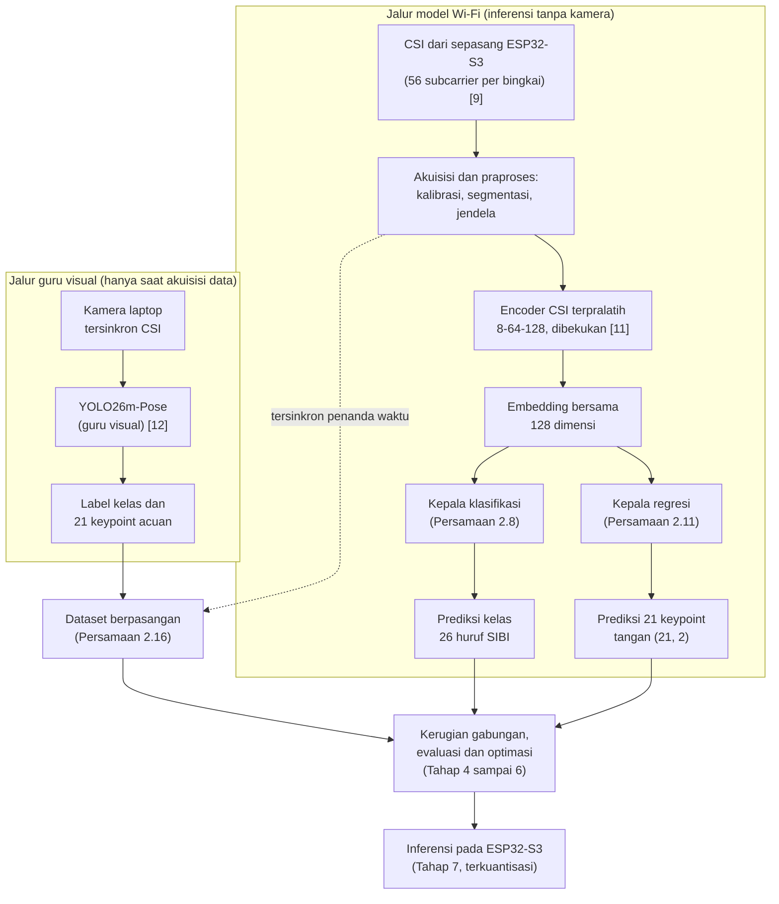
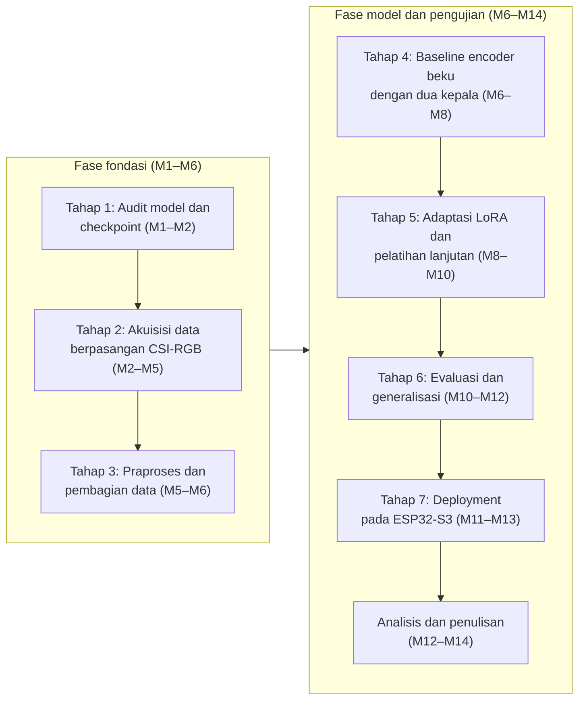
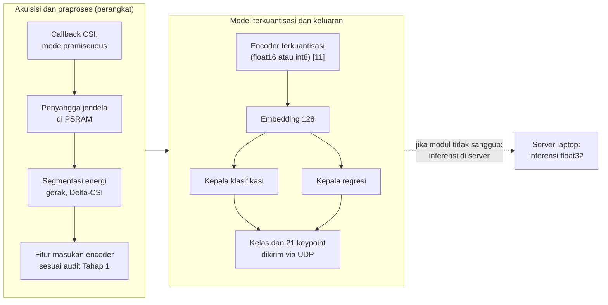

# PENGEMBANGAN HEAD KLASIFIKASI DAN REGRESI PADA ENCODER WI-FI CSI PRETRAINED UNTUK PENGENALAN ISYARAT SIBI

**PROPOSAL PENELITIAN**

| Identitas | Keterangan |
|---|---|
| Judul | PENGEMBANGAN HEAD KLASIFIKASI DAN REGRESI PADA ENCODER WI-FI CSI PRETRAINED UNTUK PENGENALAN ISYARAT SIBI |
| Jenis dokumen | Proposal penelitian (seminar proposal), BAB I sampai III + Daftar Pustaka; arah penelitian dirumuskan ulang dari purwarupa penerjemah dua arah menjadi pengembangan dua kepala tugas di atas encoder Wi-Fi CSI terpralatih, ±30 halaman |
| Disusun oleh | [PERLU DATA: nama penulis] |
| NIM | [PERLU DATA: NIM penulis] |
| Program studi | [PERLU DATA: program studi] |
| Universitas | [PERLU DATA: nama universitas] |
| Pembimbing | [PERLU DATA: nama pembimbing, jika sudah ditentukan] |
| Tahun | [PERLU DATA: tahun penyusunan] |

> Catatan penyusunan: versi ini merumuskan ulang arah penelitian menjadi pengembangan dua kepala tugas (*head*) di atas *encoder* Wi-Fi CSI terpralatih. Kepala klasifikasi mengenali 26 huruf alfabet manual SIBI, sedangkan kepala regresi memprediksi 21 koordinat *keypoint* tangan dari *embedding* yang sama; guru visual YOLO26m-Pose hanya bekerja pada tahap akuisisi data sebagai pemberi label, bukan bagian produk akhir. Dua puluh lima persamaan bernomor disusun beserta definisi lambang dan contoh perhitungan, mulai dari koefisien kanal, zona Fresnel, Doppler, kaidah Nyquist, dan CSI-ratio, sampai pemetaan encoder, LoRA, kedua kepala tugas, kerugian gabungan, dataset berpasangan, Delta-CSI, metrik klasifikasi dan regresi, kuantisasi affine, serta anggaran latensi. Sembilan tabel dan lima gambar menyertainya; arsitektur model dua kepala menjadi gambar inti baru pada Gambar 2.2, sedangkan diagram tahapan dan inferensi tepi digambar ulang mengikuti tujuh tahap metodologi yang baru. Daftar pustaka tetap 22 entri: tujuh rujukan baru yang terverifikasi masuk (kartu model encoder, kartu model pose MM-Fi, dataset MM-Fi, MediaPipe Hands, LoRA, Smooth L1, multitask learning) menggantikan tujuh rujukan yang keluar bersama arah penelitian lamanya (SVM, Chow, Kokoro, MMS-TTS, Whisper, TRL, Likert). Konteks Jawa Timur tanpa mitra lembaga dipertahankan; penanda [PERLU DATA] kini ditemani penanda baru [PERLU VALIDASI] untuk hal yang baru dapat ditetapkan setelah audit model atau audit data; istilah asing tetap ditulis asing (*checkpoint*, *embedding*, *deployment*).

---
# BAB I PENDAHULUAN

## 1.1 Latar Belakang

Anak tunarungu hampir selalu lahir dari orang tua yang bisa mendengar. Sejak hari-hari pertama, komunikasi di rumah berjalan dengan dua bahasa yang tidak saling mengerti: orang tua berbicara dengan suara, anak menjawab dengan isyarat. Orang tua lalu harus mempelajari bahasa isyarat dari nol, padahal waktu dan kesempatan berlatih serba terbatas. Angkanya memang timpang. Di Indonesia ada sekitar 1,92 juta penyandang tunarungu, sementara juru bahasa isyarat hanya sekitar 500 orang [1], sehingga satu juru bahasa harus melayani hampir 4.000 orang. Untuk kebutuhan harian seperti menceritakan sakit atau bertanya kepada penjual di pasar, menunggu juru bahasa jelas bukan jalan keluar. Undang-Undang Nomor 8 Tahun 2016 sudah menjamin hak setiap penyandang disabilitas untuk berkomunikasi [2], tetapi tanpa alat bantu yang benar-benar terjangkau, jaminan itu berjalan lambat.

Kesenjangan seperti itu paling terasa di ruang kelas. Guru menjelaskan dengan suara; siswa tunarungu menangkap sebagian, menebak sisanya, lalu mudah kehilangan alur pelajaran. SIBI menjadi bahasa pengantar pada pendidikan formal; bentuk isyaratnya dibakukan pemerintah dalam *Kamus Sistem Isyarat Bahasa Indonesia* [3]. Survei terhadap 100 responden tunarungu di Jawa dan Bali melaporkan 91% memakai BISINDO sehari-hari, sementara SIBI menempel pada konteks sekolah [4]; keduanya memang hidup di ranah yang berbeda dan tidak saling menggantikan. Karena penelitian ini menyasar alat bantu pembelajaran di sekolah, SIBI yang dipilih. Seluruh pelaksanaannya direncanakan di Jawa Timur tanpa mengikat kerja sama dengan lembaga tertentu.

Arah komunikasi yang paling dibutuhkan di kelas justru yang paling tertinggal: isyarat siswa yang dibaca mesin. Riset pengenalan isyarat di Indonesia masih bertumpu pada jalur kamera, misalnya pengenalan huruf BISINDO dari citra dengan CNN [5]. Kendala kamera itu ada dua dan keduanya praktis. Kamera menuntut pencahayaan serta posisi yang tepat, dan begitu cahaya sedikit berubah, akurasi ikut jatuh; kamera yang terus menyala juga membuat penggunanya merasa diawasi, tidak nyaman dipakai sepanjang hari di kelas.

Untuk menghindari dua kendala itu, sinyal Wi-Fi membuka jalan lain tanpa kamera. Sinyal ini membawa informasi kanal bernama *Channel State Information* (CSI) [6]. Begitu tangan bergerak di antara pemancar dan penerima, jalur pantulan sinyal bergeser dan CSI berubah mengikuti pola gerakannya; perubahan itulah yang dibaca untuk mengenali gerak tanpa sensor yang dikenakan di tubuh. SignFi, contoh terkemukanya, mengenali 276 isyarat *American Sign Language* (ASL) dari CSI [7], dan CSI bahkan peka terhadap gerak halus sampai ke gerakan jari [6]. Penelusuran pada Google Scholar, Crossref, dan OpenAlex hingga Oktober 2026 belum menemukan satu pun penerapan CSI untuk isyarat SIBI.

Perangkat yang dibutuhkan pun sederhana dan murah. Modul ESP32-S3, mikrokontroler seharga sekitar Rp150.000, sudah memiliki radio Wi-Fi 2,4 GHz dengan dukungan CSI resmi [8], [9]. Dua modul cukup untuk satu pasang: yang satu memancarkan sinyal, yang lain menangkapnya, dan zona isyarat berada di antara keduanya. *Firmware* penangkap CSI yang teruji untuk modul ini tersedia pada platform terbuka RuView [10]. Biaya sepasang node lengkap diperkirakan di bawah Rp350.000, jauh lebih ringan daripada kamera ditambah komputer pengolah citra. Murah bukan sekadar soal angka; harga yang terjangkau mengundang sekolah berani memasang alat ini di lebih dari satu ruang.

Mesin pengenalnya pun tidak perlu dibangun dari nol, dan di sinilah peluangnya. Keluarga model WiFi-DensePose pada RuView menyediakan *encoder* CSI terpralatih [11], yaitu jaringan kecil dua lapis yang dipetakan dari fitur CSI ke *embedding* 128 dimensi dan dilatih secara kontrastif sehingga jendela waktu yang berdekatan menempel di ruang *embedding*. Pada saat yang sama, model penglihatan YOLO26m-Pose milik peneliti sudah teruji membaca 24 huruf statis SIBI dari citra dengan akurasi 97,6% beserta 21 titik *keypoint* tangannya [12]. Dua bahan itu belum pernah dipertemukan untuk SIBI. Dataset CSI yang berpasangan dengan label isyarat SIBI memang belum ada; dataset citra milik peneliti berisi 49 kelas isyarat tanpa satu pun rekaman CSI. Kepala tugas klasifikasi dan regresi *keypoint* juga belum pernah dipasangkan pada *encoder* tersebut untuk isyarat tangan, dan kelayakan model hasilnya di ESP32-S3 belum pernah diukur.

Penelitian ini mengisi kekosongan itu dengan satu rancangan yang lugas: satu *encoder* terpralatih dibekukan, dua kepala tugas dipasang di atas *embedding* bersamanya. Kepala pertama mengklasifikasikan 26 huruf alfabet manual SIBI, yaitu 24 huruf statis ditambah dua huruf gerak J dan Z, sedangkan kepala kedua meregresikan 21 koordinat *keypoint* tangan dari jalur yang sama. Keduanya dilatih serentak pada data berpasangan antara jendela CSI dan label guru visual, lalu model yang terpilih diuji kelayakannya di modul. Sebagai proposal, dokumen ini berisi rencana, bukan laporan hasil; setiap rumusan masalah dibarengi metode dan metriknya pada Tabel 3.4, dan klaim kelayakan hanya dinyatakan setelah pengukuran pada perangkat fisik selesai.

## 1.2 Identifikasi Masalah

Berdasarkan latar belakang tersebut, masalah penelitian diidentifikasi sebagai berikut.

1. Pengenalan isyarat SIBI di Indonesia masih bertumpu pada kamera [5], padahal kamera menuntut pencahayaan dan garis pandang yang baik serta membuat penggunanya merasa diawasi.
2. Penginderaan CSI telah terbukti untuk bahasa isyarat lain [7], tetapi penerapannya untuk alfabet manual SIBI belum ditemukan pada penelusuran hingga Oktober 2026.
3. Dataset berpasangan antara CSI dan label isyarat SIBI belum tersedia; dataset citra WPC milik peneliti berisi 49 kelas isyarat lengkap dengan 21 *keypoint*, tetapi tidak memuat rekaman CSI yang tersinkron.
4. *Encoder* CSI terpralatih sudah tersedia pada RuView [11], tetapi belum pernah diuji untuk isyarat tangan; angka 82,3% pada kartu modelnya adalah akurasi triplet-temporal, bukan akurasi SIBI.
5. Formulasi dua kepala tugas yang berbagi *embedding* encoder tersebut, untuk klasifikasi huruf SIBI dan regresi 21 *keypoint*, belum dirumuskan dan dievaluasi.
6. Generalisasi lintas orang dan lintas ruang pada penginderaan CSI dikenal sulit [13], sehingga skema evaluasinya harus memuat kedua dimensi itu secara eksplisit.
7. Kelayakan inferensi pada ESP32-S3 ditinjau dari akurasi, latensi, ukuran model, dan memori belum pernah diukur untuk tugas ini.

## 1.3 Rumusan Masalah

Dari identifikasi tersebut, masalah penelitian ini dirumuskan sebagai berikut.

1. Bagaimana merumuskan secara matematis dan merancang dua kepala tugas, yaitu kepala klasifikasi isyarat dan kepala regresi 21 *keypoint* tangan, yang berbagi *embedding* dari *encoder* CSI terpralatih RuView?
2. Bagaimana membangun dataset berpasangan antara jendela CSI dan label kelas beserta 21 *keypoint* yang diekstraksi guru visual YOLO26m-Pose secara tersinkron, kemudian melatih kedua kepala di atasnya dengan *encoder* yang dibekukan?
3. Seberapa baik model mengklasifikasikan isyarat SIBI dan memprediksi 21 koordinat *keypoint* tangan dari CSI saja, termasuk pada subjek, sesi, ruang, dan perangkat yang tidak terlihat saat pelatihan?
4. Seberapa layak model hasil optimasi dijalankan pada ESP32-S3 ditinjau dari akurasi, latensi, ukuran model, dan memori?

## 1.4 Tujuan Penelitian

Tujuan penelitian ini adalah sebagai berikut.

1. Merumuskan secara matematis dan merancang dua kepala tugas klasifikasi isyarat dan regresi 21 *keypoint* tangan yang berbagi *embedding* dari *encoder* CSI terpralatih RuView.
2. Membangun dataset berpasangan antara jendela CSI dan label kelas beserta 21 *keypoint* yang diekstraksi guru visual YOLO26m-Pose secara tersinkron, kemudian melatih kedua kepala di atasnya dengan *encoder* yang dibekukan.
3. Mengukur seberapa baik model mengklasifikasikan isyarat SIBI dan memprediksi 21 koordinat *keypoint* tangan dari CSI saja, termasuk pada subjek, sesi, ruang, dan perangkat yang tidak terlihat saat pelatihan.
4. Menganalisis kelayakan model hasil optimasi dijalankan pada ESP32-S3 ditinjau dari akurasi, latensi, ukuran model, dan memori.

## 1.5 Batasan Masalah

Agar fokus, ruang lingkup penelitian ini dibatasi sebagai berikut.

1. Objek pengenalan ialah alfabet manual SIBI satu tangan sebanyak 26 huruf, yaitu 24 huruf statis ditambah dua huruf gerak J dan Z, sesuai audit label pada dataset WPC peneliti dan *Kamus SIBI* [3]; sistem ini bukan penerjemah kalimat.
2. Pembeda utamanya adalah bentuk tangan dan jari beserta lintasan gerak J dan Z; ekspresi wajah serta penanda nonmanual tidak dikenali.
3. Penginderaan memakai sepasang modul ESP32-S3 pada 2,4 GHz kanal 20 MHz dengan 56 *subcarrier* [9]; kamera hanya menyala saat akuisisi data sebagai jalur guru visual, bukan saat inferensi.
4. *Encoder* yang dipakai ialah *checkpoint* `ruvnet/wifi-densepose-pretrained` dengan *embedding* 128 dimensi dan 9.280 parameter [11]; dimensi masukannya diverifikasi ulang pada Tahap 1 sebelum dipakai [PERLU VALIDASI: dimensi masukan dan laju fitur aktual].
5. *Encoder* dibekukan pada baseline; LoRA dan pelatihan lanjutan diuji sebagai adaptasi jika kompatibel dengan *checkpoint* dan alur ekspornya [PERLU VALIDASI: kompatibilitas LoRA].
6. Model pose MM-Fi yang memprediksi 17 *keypoint* tubuh dan guru visual YOLO26m-Pose [12] bukan bagian model akhir; keduanya masing-masing menjadi pembanding temuan dan pemberi label.
7. Kepala regresi memprediksi 21 *keypoint* tangan dengan format `kpt_shape` [21, 3] sesuai dataset WPC; sistem koordinat targetnya ditetapkan dan dibakukan pada Tahap 3 agar dapat direproduksi [PERLU VALIDASI: sistem koordinat target].
8. Pelatihan berjalan di komputer dengan Python dan PyTorch karena keduanya kompatibel dengan *checkpoint* dan mendukung autograd; dataset citra WPC yang tidak berpasangan dengan CSI tidak dipakai melatih kepala CSI.
9. Deployment ditujukan pada ESP32-S3 dengan kuantisasi float16, int8, atau int4 sesuai dukungan operator; keberhasilannya hanya dinyatakan setelah pengukuran pada perangkat fisik.
10. Isyarat kontinu, BISINDO, dan penerjemahan kalimat penuh berada di luar pembahasan, dan tidak ada hasil eksperimen yang diklaim sebelum eksperimennya dijalankan.

## 1.6 Manfaat Penelitian

Manfaat penelitian ini terbagi atas manfaat teoretis dan manfaat praktis.

### 1.6.1 Manfaat Teoretis

Secara teoretis, penelitian ini menghasilkan bukti empiris pertama tentang satu pertanyaan yang spesifik: apakah *embedding* hasil pretraining kontrastif pada CSI sanggup membedakan 26 bentuk huruf manual SIBI setelah hanya kepala tugasnya yang dilatih. Bukti itu terikat pada alfabet manual dan belum tentu berlaku untuk isyarat kata maupun isyarat kontinu. Penelitian ini juga menghasilkan formulasi multitugas lintas modalitas yang mengawasi klasifikasi isyarat dengan regresi bentuk jari pada satu *embedding* bersama, serta dataset CSI berpasangan beserta protokol perekamannya sehingga peneliti berikutnya dapat memperluasnya ke BISINDO maupun bahasa isyarat lain.

### 1.6.2 Manfaat Praktis

Bagi sekolah yang kelak memakainya, penelitian ini menyiapkan fondasi alat bantu pembaca isyarat tanpa kamera dengan biaya perangkat di bawah Rp350.000 per pasang node. Bagi peneliti lain, alur audit *checkpoint*, adaptasi encoder, dan pengukuran tepi yang ditulis pada BAB III dapat diulang untuk *encoder* atau bahasa isyarat lain. Jika penelitian berhenti di tahap mana pun, dataset berpasangan, lembar audit, dan laporan kegagalan tetap menjadi warisan yang terdokumentasi.

## 1.7 Sistematika Penulisan

Secara ringkas, proposal ini disusun atas tiga bab. **BAB I Pendahuluan** memuat latar belakang, identifikasi masalah, rumusan masalah, tujuan, batasan, manfaat, dan sistematika penulisan. **BAB II Kajian Pustaka dan Landasan Teori** menghimpun teori CSI, encoder terpralatih dan dua model pembandingnya, transfer learning, formulasi kedua kepala tugas, pembelajaran multitugas, guru visual YOLO26m-Pose, inferensi tepi, penelitian terdahulu, serta kerangka pemikiran. Adapun **BAB III Metode Penelitian** memuat desain, hipotesis, tujuh tahap metodologi dari audit model sampai deployment, waktu dan lokasi, alat dan bahan, asumsi terbuka, jadwal, parameter yang ditetapkan kemudian, serta risiko dan cadangannya.
# BAB II KAJIAN PUSTAKA DAN LANDASAN TEORI

## 2.1 Bahasa Isyarat SIBI dan Audit Kelas Penelitian

Bahasa isyarat menyampaikan makna lewat gerak tangan, lengan, tubuh, dan ekspresi wajah. Satu isyarat tersusun atas bentuk tangan, lokasi, gerak, serta orientasi telapak; cukup satu jari berubah bentuk, maknanya bisa ikut berubah. SIBI ialah sistem isyarat baku pendidikan formal yang didokumentasikan kamus pemerintah [3], sedangkan BISINDO tumbuh alami di komunitas tunarungu. Survei terhadap 100 responden tunarungu di Jawa dan Bali menemukan 91% memakai BISINDO sehari-hari, sementara SIBI menempel pada konteks sekolah [4]. Penelitian ini tetap memilih SIBI karena sasarannya alat bantu pembelajaran di sekolah, bukan karena jumlah penuturnya lebih besar.

Kelas yang diteliti ditetapkan lewat audit label pada dataset visual WPC milik peneliti, bukan lewat asumsi. Alfabet manual SIBI memuat 26 huruf: 24 huruf statis yang diperagakan sebagai bentuk tangan yang ditahan, ditambah huruf J dan Z yang diperagakan sebagai lintasan gerak [3]. Audit pada dataset WPC menegaskan hal yang sama: huruf C tergolong statis di dalam kelompok 24 huruf, sedangkan J dan Z satu-satunya huruf yang menuntut lintasan. Dataset itu juga menyimpan anotasi *keypoint* dengan `kpt_shape` [21, 3], yang berarti tiap tangan diberi 21 titik dengan tiga nilai, yaitu koordinat x, koordinat y, dan tanda visibilitas. Keputusan kelas penelitian karenanya konsisten di seluruh naskah: 24 huruf statis ditambah J dan Z dinamis, tanpa pencampuran dengan 24 kelas kata yang ikut tersimpan pada dataset.

## 2.2 Wi-Fi Channel State Information

*Channel State Information* (CSI) memuat informasi amplitudo dan fase pada setiap *subcarrier* sinyal Wi-Fi, yang bersama-sama menggambarkan kondisi jalur propagasi [6]. Tubuh yang bergerak di antara pemancar dan penerima mengubah panjang jalur pantulan; amplitudo dan fase tiap *subcarrier* pun ikut bergeser. Geseran inilah yang dipakai untuk mengenali gerak tanpa sensor yang dikenakan. Karena tiap *subcarrier* menempati frekuensi berbeda, satu pasang perangkat sekaligus menyediakan banyak kanal pengamatan [6].

Bentuk formalnya sederhana: pada kanal 20 MHz, tiap *subcarrier* ke-n membawa koefisien kanal kompleks

```rumus
h~n~(t) = |h~n~(t)| · exp( j · φ~n~(t) ) (2.1)
```

dengan n = 1, ..., 56, |h~n~(t)| amplitudo, φ~n~(t) fase, dan j satuan imajiner [6], [9]. Amplitudo dan fase inilah bahan mentah seluruh perhitungan pada bab-bab berikutnya.

Pemodelan CSI berpijak pada zona Fresnel [14]. Radius zona Fresnel ke-n pada suatu titik dihitung dari jarak titik itu ke pemancar d~1~ dan ke penerima d~2~ [14]:

```rumus
r~n~ = √( n · λ · d~1~ · d~2~ / ( d~1~ + d~2~ ) ) (2.2)
```

dengan λ panjang gelombang pembawa; pada 2,4 GHz, λ = c/f ≈ 12,5 cm. Angkanya bisa langsung dihitung untuk tautan baku penelitian ini. Pada jarak antarmodul 1 meter dengan tangan di titik tengah, radius zona pertama r~1~ = √(0,125 × 0,5 × 0,5) ≈ 0,18 meter, sehingga ruang gerak jari seluruhnya berada di zona yang paling peka terhadap perubahan jalur. Penempatan itu dirangkum pada Gambar 2.1. Artikulasi jari menggeser jalur pantulan pada orde sentimeter sampai milimeter, dan tiap bentuk huruf meninggalkan pola perubahan *subcarrier* yang khas.

```gambar
Sumber skrip: scripts/sensesibi-v10/gambar_g16_fresnel.py (matplotlib mplot3d) -> assets-v16/gambar-2.1.png
```

Gambar 2.1 Zona Fresnel pertama pada tautan baku 1 meter; tangan pengisyarat berada di dalam zona (ilustrasi skematis tiga dimensi, tidak berskala) [6], [14]

Gerak tubuh juga melahirkan pergeseran Doppler yang besarnya mengikuti kecepatan gerak v [6], [13]:

```rumus
f~D~ = ( v / λ ) · ( cos α + cos β ) (2.3)
```

dengan α dan β sudut antara arah gerak dan garis pandang ke pemancar serta ke penerima; nilai mutlaknya paling besar 2v/λ. Pita Doppler gerak isyarat yang relevan kira-kira 1 sampai 60 Hz [6], sedangkan kaidah Nyquist menuntut laju pencuplikan

```rumus
f~s~ ≥ 2 · f~maks~ (2.4)
```

Akibatnya bisa dihitung sejak awal. Pada laju *firmware* RuView 50 bingkai per detik [10], pita teramati hanya sampai 25 Hz, sehingga gerak tangan yang masih teramati tanpa pelipatan kira-kira v = 25 × 0,125/2 ≈ 1,6 meter per detik. Gerak jari yang lebih cepat berisiko terlipat, dan jika laju terukur lebih rendah lagi, pita yang dianalisis ikut menyempit; hal itu dilaporkan apa adanya.

Satu masalah masih tersisa: fase mentah tercemar derau osilator lokal. Teknik CSI-ratio membersihkannya lewat rasio atau perkalian konjugat tanpa perangkat tambahan [14], dan prinsip itu diadaptasi penelitian ini menjadi rasio terhadap rekam acuan kalibrasi ruang (Subbab 3.8):

```rumus
ρ~n~(t) = h~n~(t) / h~n~( t~0~ ) (2.5)
```

dengan t~0~ waktu kalibrasi ruang, yaitu 600 bingkai bawaan RuView [10]. Rasio ini membuang tanggapan statis ruang sehingga yang tersisa adalah perubahan akibat gerak; sisa derau fase yang berjalan lambat diukur pada Tahap 2 lalu dilaporkan.

Dari ketukan tombol sampai gerakan jari, bukti kepekaan CSI terhadap gerak halus cukup banyak [6]; akan tetapi, bukti-bukti itu lahir dari kondisi terkendali sehingga bagi penelitian ini statusnya sebatas hipotesis kerja. Model CSI juga mudah *overfitting* terhadap orang dan ruang, dan Widar3.0 menjawab masalah itu dengan profil kecepatan Doppler untuk pengenalan lintas domain [13]. Kelayakan satu tautan dua modul berantena tunggal untuk membedakan 26 bentuk tangan SIBI karenanya diperlakukan sebagai pertanyaan penelitian, bukan asumsi; skema uji lintas orang dan lintas ruang pada Tabel 3.3 yang mengujinya, dan pasangan huruf yang terbukti tidak terpisahkan dilaporkan apa adanya.

## 2.3 Encoder CSI Terpralatih RuView dan Dua Model yang Tidak Boleh Tercampur

Encoder terpralatih yang menjadi tulang punggung penelitian ini berasal dari ekosistem RuView [10]. Kartu modelnya [11] mendokumentasikan jaringan dua lapis *fully connected* dengan BatchNorm dan GELU yang memetakan 8 fitur CSI menjadi *embedding* 128 dimensi ternormalisasi L2, seluruhnya hanya 9.280 parameter. Pemetaannya ditulis

```rumus
z~i~ = f~θ0~( X~i~ ), z~i~ ∈ R^d^, d = 128 (2.6)
```

dengan X~i~ jendela masukan ke-i, f~θ0~ pemetaan *encoder* bertetapan θ~0~, dan z~i~ vektor *embedding* keluaran. Pretrainingnya kontrastif dengan triplet loss dan InfoNCE pada temperatur 0,1; pasangan positif diambil dari jendela dalam jarak 2 detik, pasangan negatif dari jarak lebih dari 30 detik, selama 60 epoch dengan AdamW dan perlindungan EWC terhadap lupa bencana [11]. Pada baseline penelitian ini, θ~0~ dibekukan sehingga hanya tetapan kedua kepala tugas yang diperbarui.

Satu angka pada kartu model itu perlu dibaca hati-hati. Akurasi triplet-temporal *held-out* sebesar 82,3% tercatat pada 20% akhir rekaman menurut waktu, dengan pembanding 66,4% untuk fitur mentah tanpa *encoder* dan 69,6% untuk *encoder* berinisialisasi acak [11]. Angka itu menghitung peluang bahwa jarak anchor ke positif temporal lebih pendek daripada jaraknya ke negatif temporal, sehingga yang diukurnya ialah kualitas geometri *embedding* pada tugas jarak, bukan akurasi klasifikasi SIBI dan bukan galat *keypoint*. Dua hal terakhir justru yang hendak diukur penelitian ini, dan kartu model tidak memuat keduanya.

Dua model lain pada ekosistem yang sama sering tertukar dengan *encoder* ini, sehingga keduanya dipisahkan sejak awal. Model `wifi-densepose-mmfi-pose` [15] adalah *checkpoint* pose terpisah dengan masukan amplitudo CSI berukuran [3, 114, 10], yaitu 3 pasang antena kali 114 *subcarrier* kali 10 bingkai pada 100 Hz, yang diproses *encoder* Transformer 4 lapis 8 kepala menjadi keluaran [17, 2]: 17 *keypoint* tubuh COCO dalam rentang [0, 1], dengan sekitar 2,3 juta parameter. Model itu dilatih pada dataset MM-Fi [16] yang memuat 40 subjek, 27 kategori aksi, dan lebih dari 320 ribu bingkai tersinkron dari lima modalitas; kinerjanya PCK@20 ternormalisasi badan sebesar 82,69% untuk model tunggal dan 83,59% untuk ansambel, turun menjadi sekitar 64% lintas subjek *zero-shot* dan 17,5% lintas lingkungan, lalu naik ke rentang 72% sampai 78% setelah kalibrasi 50 sampai 1.000 bingkai per orang [15]. Lisensi CC BY-NC 4.0 melekat pada model itu karena mengikuti lisensi datanya. Model ketiga, YOLO26m-Pose [12], ialah model penglihatan pada citra yang berperan sebagai guru visual dan dibahas pada Subbab 2.8. Tabel 2.1 merangkum pembedaan ketiganya.

Tabel 2.1 Pembedaan tiga model yang tidak boleh tercampur dalam penelitian ini

| Aspek | Encoder CSI terpralatih [11] | Model pose MM-Fi [15] | Guru visual YOLO26m-Pose [12] |
|---|---|---|---|
| Berkas | `ruvnet/wifi-densepose-pretrained` | `ruvnet/wifi-densepose-mmfi-pose` | Repositori WPC peneliti (eksperimen `exp11_huruf24`) |
| Masukan | 8 fitur CSI per stempel waktu | Amplitudo CSI [3, 114, 10] @ 100 Hz | Citra RGB kamera |
| Keluaran | *Embedding* 128 dimensi ternormalisasi L2 | 17 *keypoint* tubuh COCO dalam [0, 1] | Kelas isyarat dan 21 *keypoint* tangan |
| Parameter | 9.280 | ±2,3 juta (varian utama) | [PERLU DATA: jumlah parameter model juara WPC] |
| Peran | Tulang punggung representasi, dibekukan pada baseline | Pembanding temuan lintas domain, bukan komponen model | Pemberi label kelas dan *keypoint* saat akuisisi |
| Status bukti | Kartu model; akurasi triplet-temporal 82,3% | Kartu model; PCK@20 82,69%; lisensi CC BY-NC 4.0 | Data pra-penelitian peneliti; mAP50 0,9580 pada 24 huruf statis |

Status dua dokumen rancangan pada repositori RuView juga dinyatakan terbuka. ADR-146 mengusulkan *encoder* RF bersama dengan tujuh kepala tugas dan ketidakpastian per kepala, sedangkan ADR-150 mengusulkan *foundation encoder* yang tahan pergantian orang dan ruang; keduanya berstatus Proposed, artinya rancangan yang belum diimplementasikan [10]. Penelitian ini karenanya bersandar hanya pada *checkpoint* yang benar-benar tersedia; angka estimasi dari ADR dikutip dengan label estimasi rancangan setiap kali muncul.

## 2.4 Transfer Learning pada Encoder Beku: LoRA dan Pelatihan Lanjutan

Baseline penelitian ini membekukan *encoder* dan melatih hanya kedua kepala tugasnya. Alasannya metodologis: dengan *encoder* beku, kualitas *embedding* terpralatih untuk isyarat SIBI terbaca langsung dari kinerja kepala, sehingga sumbangan pretraining terpisah dari sumbangan penyetelan. Karena *encoder* hanya 9.280 parameter, biaya melatih ulang seluruhnya pun rendah, sehingga tiga skema adaptasi tetap terjangkau dan dibandingkan secara adil pada data yang sama: *encoder* beku, *encoder* dengan adapter LoRA, dan pelatihan lanjutan.

LoRA menambah pembaruan berperingkat rendah pada tetapan asli tanpa menyimpan gradien untuk seluruh matriks [17]:

```rumus
W~akhir~ = W~0~ + B · A (2.7)
```

dengan W~0~ matriks tetapan asli yang dibekukan, B berukuran d~keluar~ × r dan A berukuran r × d~masuk~, serta r peringkat adapter yang dipilih jauh lebih kecil daripada ukuran matriks; hanya B dan A yang dilatih. Adapter bekerja di dalam lapisan yang sudah ada sebagai jalur adaptasi yang hemat parameter; perannya berbeda dari kepala tugas maupun dari pelatihan lanjutan. Ketersediaannya pada *checkpoint* ini bahkan sudah terdokumentasi: kartu model menyertakan adapter ruangan `node-1.json` dan `node-2.json` masing-masing sekitar 21 KB [11]. ADR-150 menaksir adapter sekitar 11 KB mampu menyamai kinerja lintas subjek dengan 100 sampai 200 data berlabel per ruang [10]; angka itu berstatus estimasi rancangan, bukan hasil penelitian ini.

Pelatihan lanjutan menjadi pembanding ketiga. Pelatihan sebagian membuka lapis terakhir saja, sedangkan pelatihan penuh membuka seluruh tetapan; keduanya dijaga dengan EWC sebagaimana pretraining *encoder* melakukannya [11], dan keduanya dilaporkan berdampingan dengan hasil *encoder* beku. Kompatibilitas adapter LoRA dengan alur ekspor ke ESP32-S3 belum terverifikasi, sehingga statusnya ditandai [PERLU VALIDASI: kompatibilitas LoRA dengan alur ekspor] dan diperiksa pada Tahap 1.

## 2.5 Kepala Klasifikasi dan Kerugian Silang-Entropi

Kepala klasifikasi mengubah *embedding* menjadi skor tiap kelas huruf. Untuk K kelas dengan K = 26, skor logit dihitung dari

```rumus
a~i~ = W~c~ · z~i~ + b~c~ (2.8)
```

dengan W~c~ matriks berukuran K × 128 dan b~c~ vektor bias; skor lalu diubah menjadi probabilitas lewat *softmax*

```rumus
q~ik~ = exp( a~ik~ ) / Σ~k~ exp( a~ik~ ) (2.9)
```

sehingga seluruh probabilitas berjumlah satu, dan kelas prediksi ialah kelas dengan probabilitas terbesar (argmax). Sebagai lantai pembanding, tebakan acak seragam pada K kelas bernilai 1/K ≈ 3,8%, dan angka itu dihitung ulang jika himpunan huruf dipangkas.

Kerugian pelatihannya silang-entropi kategorikal. Dengan label *one-hot* y~ik~ yang bernilai satu pada kelas benar dan nol pada kelas lain, kerugian atas N sampel dalam *batch* berbunyi

```rumus
L~cls~ = − ( 1 / N ) · Σ~i~ Σ~k~ y~ik~ · log q~ik~ (2.10)
```

yang menghukum prediksi yang percaya diri pada kelas salah. Jika data latih terbukti timpang antarhuruf, bobot kelas dipasang berbanding terbalik dengan frekuensi kelasnya; bobot itu dihitung hanya dari data latih dan keputusannya dicatat pada Tabel 3.6.

## 2.6 Kepala Regresi 21 Keypoint dan Kerugian Smooth L1 Bermask

Target regresi mengikuti skema 21 *landmark* tangan MediaPipe Hands [18], skema yang sama dipakai *pseudo-labeling* pada dataset WPC. Sesuai `kpt_shape` [21, 3], tiap sampel target memuat 21 titik dengan koordinat x, y, dan tanda visibilitas; rancangan awal kepala memprediksi koordinat x dan y saja, sehingga keluarannya berbentuk

```rumus
Q~i~ = reshape( W~r~ · z~i~ + b~r~, 21, 2 ) (2.11)
```

dengan W~r~ matriks berukuran 42 × 128 yang dipetakan ulang menjadi 21 pasang koordinat, Q~i~ prediksi *keypoint*, dan P~i~ koordinat acuan dari guru visual.

Sistem koordinat target harus ditetapkan sebelum pelatihan, dan di sinilah letak kehati-hatianya. Koordinat piksel kamera tidak otomatis dapat diprediksi dari CSI tanpa definisi koordinat, transformasi, atau kalibrasi yang dapat direproduksi; oleh karena itu sistem koordinat target, dengan kandidat kuat berupa koordinat ternormalisasi [0, 1] terhadap kotak deteksi guru, dibakukan pada Tahap 3 lalu dipakai konsisten oleh guru dan murid [PERLU VALIDASI: sistem koordinat dan normalisasi target regresi]. Tanpa pembakuan itu, angka galat regresi tidak bermakna.

Kerugian regresinya Smooth L1 yang dibobot mask visibilitas [19]. Fungsi Smooth L1 berperilaku kuadratik dekat nol dan linear untuk galat besar,

```rumus
SmoothL1~δ~( x ) = 0,5 · x^2^ / δ untuk |x| ≤ δ, dan |x| − 0,5 · δ untuk |x| > δ (2.12)
```

dengan δ ambang peralihan, sehingga pencilan anotasi tidak mendominasi gradien. Kerugian bermask dihitung hanya pada titik yang terlihat:

```rumus
L~reg~ = ( Σ~i~ Σ~j~ m~ij~ · SmoothL1~δ~( Q~ij~ − P~ij~ ) ) / ( Σ~i~ Σ~j~ m~ij~ + ε ) (2.13)
```

dengan m~ij~ mask visibilitas dari guru yang bernilai satu jika titik j terlihat dan nol jika terhalang, serta ε penahan pembagi nol. Jika prediksi visibilitas juga diinginkan, kepala tambahan dengan kerugian entropi silang biner disiapkan sebagai perluasan; keputusan memakainya dicatat pada Tabel 3.6.

## 2.7 Pembelajaran Multitugas dan Optimasi Kerugian Gabungan

Pembelajaran multitugas melatih beberapa tugas berbarengan di atas representasi yang dibagi, dan representasi yang baik untuk satu tugas kerap menolong tugas lain yang berkaitan [20]. Kedua tugas penelitian ini memang dua pandangan atas isyarat yang sama: kepala klasifikasi membacanya sebagai kelas diskret, sedangkan kepala regresi membacanya sebagai bentuk jari kontinu. Hipotesis kerjanya, supervisi *keypoint* ikut merapikan batas antarhuruf yang bentuknya mirip.

Kerugian gabungan menjumlah keduanya dengan bobot:

```rumus
L~total~ = λ~cls~ · L~cls~ + λ~reg~ · L~reg~ (2.14)
```

Penetapan bobotnya tidak asal pilih. Silang-entropi bergerak pada orde logaritma jumlah kelas, sedangkan Smooth L1 bergerak pada satuan koordinat, sehingga keduanya disamakan skalanya lebih dulu, misalnya dengan membagi tiap kerugian oleh nilai rata-ratanya pada epoch pertama, baru bobot λ ditala dari data validasi (Tabel 3.6). Konflik gradien antartugas dipantau lewat besar gradien tiap kepala; jika keduanya menarik representasi ke arah berlawanan, penyeimbangan gradien atau pelatihan bergantian dipertimbangkan, dan perlakuannya dilaporkan.

Pada baseline, pembaruan tetapan hanya menyentuh kepala:

```rumus
θ~c~, θ~r~ ← Optimizer( ∇ L~total~ ), θ~0~ tetap (2.15)
```

dengan θ~c~ dan θ~r~ tetapan kedua kepala serta θ~0~ tetapan *encoder* yang dibekukan. Untuk menguji manfaat penggabungan, kepala tunggal yang dilatih sendiri-sendiri disiapkan sebagai pembanding pada split yang sama. Arah ini sejajar dengan usulan ADR-146 tentang *encoder* bersama dengan banyak kepala tugas [10], hanya saja penelitian ini mengujinya pada *checkpoint* yang benar-benar tersedia dan untuk dua tugas, bukan mengambil status usulannya sebagai bukti.

## 2.8 Guru Visual YOLO26m-Pose dan Dataset WPC

Guru visual bekerja hanya pada tahap akuisisi data. Kamera laptop dan node penerima CSI merekam serentak dengan penanda waktu yang sama; pada tiap frame, YOLO26m-Pose [12] menghasilkan kelas isyarat beserta 21 *keypoint* tangan dan visibilitasnya. Label kelas tidak diambil dari deteksi bebas, melainkan dicocokkan dengan kartu pemandu protokol perekaman, sehingga derau label terkendali. Pola guru-murid lintas modalitas ini mengikuti keluarga model WiFi-DensePose yang memakai jaringan visi sebagai guru [10] dan berakar pada gagasan distilasi pengetahuan [21]; guru di sini memberi label keras berupa kelas dan koordinat, bukan *soft target*.

Kemampuan guru sudah teruji pada tahap pra-penelitian di repositori WPC milik peneliti. Dataset versi 2 memuat 49 kelas isyarat, terdiri atas 25 kelas huruf dan 24 kelas kata, dengan total 7.210 gambar yang terbagi menjadi 6.231 latih, 650 validasi, dan 329 uji; *keypoint*-nya dihasilkan lewat *pseudo-labeling* MediaPipe HandLandmarker [18], lalu YOLO26m-Pose dilatih mempelajari deteksi dan *keypoint* tersebut. Eksperimen `exp11_huruf24` pada 24 huruf statis mencatat *pose* mAP50 0,9580 dengan akurasi huruf 97,6%, sedangkan model 49 kelas mencatat mAP50 0,8944. Perlu ditegaskan: seluruh angka itu adalah hasil model visual pada data visual, bukan hasil model Wi-Fi; pertanyaan apakah CSI sanggup mengikuti guru itulah yang dijawab penelitian ini.

Batas guru juga jelas. Dataset WPC tidak memuat rekaman CSI, sehingga tidak cukup untuk melatih kepala CSI secara langsung; pasangan data baru antara jendela CSI dan keluaran guru harus direkam sendiri pada Tahap 2. Ekspektasi generalisasinya pun dijaga memakai temuan model pose MM-Fi [15]: kinerja lintas subjek *zero-shot* hanya sekitar 64% dan lintas lingkungan 17,5%, naik ke 72% sampai 78% setelah kalibrasi 50 sampai 1.000 bingkai per orang. Angka itu dipakai sebagai acuan ekspektasi sekaligus alasan skema kalibrasi per orang dan per ruang disiapkan sebagai jalur cadangan pada Tabel 3.7.

## 2.9 Inferensi Tepi pada ESP32-S3

ESP32-S3 ialah mikrokontroler Wi-Fi 802.11 b/g/n 2,4 GHz berantena tunggal dengan inti ganda 240 MHz, SRAM 512 KB, dan PSRAM sampai 8 MB [8]. Dukungan CSI tersedia resmi lewat repositori esp-csi; pada kanal 20 MHz, CSI memuat 56 *subcarrier* [9]. *Firmware* RuView [10] mampu menangkap CSI sambil memelihara koneksi *station* UDP dan sinkronisasi ESP-NOW secara serentak pada satu *chip*, dengan dua syarat yang sama: seluruh perangkat berada pada satu kanal dan mode hemat daya dimatikan.

Ukuran model membuat target ini masuk akal sejak awal, dan angkanya bisa dihitung. Kartu model mencatat *encoder* sebesar 48 KB untuk berkas penuh dan menyusut menjadi 16 KB, 8 KB, sampai 4 KB pada kuantisasi 8-bit, 4-bit, dan 2-bit [11]. Kedua kepala tugas, menurut turunan perhitungan rancangan pada d = 128, hanya menambah 128 × 26 + 26 = 3.354 parameter untuk klasifikasi dan 128 × 42 + 42 = 5.418 parameter untuk regresi, sehingga seluruh model sekitar 18 ribu parameter atau sekitar 72 KB dalam float32, jauh di bawah PSRAM 8 MB; angka final diverifikasi ulang setelah audit Tahap 1.

ESP-DL menyediakan jalur menjalankan model kuantisasi int8 pada keluarga ESP32 dengan akselerasi ESP-NN [22], dengan TensorFlow Lite Micro sebagai alternatif. Berapa lama inferensi satu jendela berjalan pada modul, berapa RAM puncak yang dipakai, dan seberapa stabil lajunya, semuanya belum ada yang mengukur untuk tugas ini; karenanya seluruh angka itu diukur sendiri pada Tahap 7, dan anggaran latensinya ditetapkan hanya setelah eksperimen pendahuluan selesai, bukan dijanjikan pada proposal ini.

## 2.10 Penelitian Terdahulu

Penelitian terdahulu yang paling relevan dibandingkan pada Tabel 2.2.

Tabel 2.2 Perbandingan penelitian terdahulu

| No. | Peneliti (Tahun) | Modalitas dan keluaran | Bahasa isyarat | Bebas kamera | Fokus |
|---|---|---|---|---|---|
| 1 | Ma dkk. (2018) [7] | CSI; isyarat menjadi teks | ASL, 276 isyarat | Ya | Pengenalan berskala besar |
| 2 | Zhang dkk. (2022) [13] | CSI; gestur lintas domain | Gestur umum | Ya | Generalisasi lintas orang dan ruang |
| 3 | Dwijayanti dkk. (2021) [5] | Citra; isyarat menjadi teks | BISINDO | Tidak | CNN pengenalan citra |
| 4 | Penelitian ini | CSI sepasang ESP32-S3; dua kepala tugas di atas encoder terpralatih; guru visual YOLO26m-Pose | SIBI, 26 huruf | Ya | Klasifikasi huruf dan regresi 21 *keypoint*; deployment terukur |

Dua kelompok terbaca dari tabel itu. Pengenalan isyarat dari Wi-Fi [7], [13] berjalan tanpa kamera tetapi belum menjangkau SIBI, sedangkan riset Indonesia berbasis kamera [5] membuktikan tingginya minat namun tetap terikat pencahayaan dan garis pandang. Dalam batas penelusuran, publikasi yang memasangkan kepala klasifikasi dan regresi *keypoint* pada *encoder* CSI terpralatih untuk SIBI belum ditemukan. Kebaruan penelitian ini karenanya bersifat kombinatif: *encoder* CSI terpralatih yang dibekukan, dua kepala tugas dengan kerugian gabungan, dataset berpasangan CSI dan label guru visual, serta pengukuran kelayakan di ESP32-S3. Di luar empat hal itu, kebaruan tidak diklaim untuk isyarat kontinu maupun penerjemahan kalimat.

## 2.11 Kerangka Pemikiran dan Arsitektur Model

Kerangka pemikiran penelitian ini mengalir dari data sampai perangkat, seperti dirangkum Gambar 2.2. Sinyal CSI dari sepasang ESP32-S3 melewati akuisisi dan praproses, lalu *encoder* terpralatih menghasilkan *embedding* 128 dimensi yang sama untuk kedua tugas. Kepala klasifikasi membaca *embedding* itu menjadi kelas huruf, kepala regresi membacanya menjadi 21 koordinat *keypoint*; keduanya dilatih serentak dengan kerugian gabungan, dievaluasi, dioptimasi, dan model terpilihnya diekspor ke ESP32-S3. Kamera hanya hadir di jalur guru pada tahap akuisisi data dan tidak pernah menyala pada inferensi.



Gambar 2.2 Arsitektur model: satu encoder CSI terpralatih yang dibekukan, dua kepala tugas yang berbagi embedding 128 dimensi, jalur guru visual yang hanya aktif saat akuisisi data, dan jalur deployment ke ESP32-S3

Dataset yang menopang kerangka ini dirumuskan sebagai pasangan lima unsur:

```rumus
D~pas~ = { ( X~i~, y~i~, P~i~, m~i~, s~i~ ) }, i = 1, ..., N (2.16)
```

dengan X~i~ jendela CSI, y~i~ label kelas isyarat, P~i~ koordinat 21 *keypoint* acuan, m~i~ mask visibilitasnya, dan s~i~ metadata subjek, sesi, ruang, serta perangkat; keseluruhan pasangan direkam sendiri pada Tahap 2 karena tidak ada sumber lain yang menyediakannya. Dengan rumusan itu, teori CSI dan zona Fresnel (Subbab 2.2) menyediakan sinyal, teori kontrastif (Subbab 2.3) menyediakan representasi, transfer learning (Subbab 2.4) menyediakan skema adaptasi, kedua formulasi kepala (Subbab 2.5 dan 2.6) menyediakan keluaran tugas, dan pembelajaran multitugas (Subbab 2.7) mengikat semuanya dalam satu kerugian sebelum hasilnya diukur di tepi (Subbab 2.9).
# BAB III METODE PENELITIAN

## 3.1 Desain Penelitian

Penelitian ini berbentuk eksperimen kuantitatif bertahap dengan tujuh tahap yang berurutan dari audit model sampai *deployment*. Unit analisisnya ialah jendela CSI yang berpasangan dengan label kelas dan 21 *keypoint*; variabel terikatnya mencakup metrik klasifikasi, metrik regresi, dan metrik tepi, sedangkan variabel bebas utamanya ialah skema adaptasi *encoder* (beku, LoRA, pelatihan lanjutan) serta skema pembagian data pada Tabel 3.3. Kendali eksperimennya dinyatakan di depan: seed tetap, pembagian data sama untuk setiap pembanding, dan data validasi hanya boleh berasal dari data latih.

Empat rumusan masalah dijawab oleh tahapan yang berbeda dan diukur dengan metrik yang berbeda, sehingga pemetaannya dirangkum pada Tabel 3.4 agar setiap pertanyaan punya jalur jawaban yang dapat diperiksa. Sebagai proposal, seluruh isi bab ini adalah rencana kerja; tidak ada satu pun angka kinerja yang diklaim sebagai hasil, dan bagian yang belum pasti ditandai [PERLU VALIDASI] sampai audit atau eksperimen pendahuluan menetapkannya.

## 3.2 Hipotesis Penelitian

Hipotesis penelitian ini dirumuskan agar dapat diuji dan difalsifikasi sebagai berikut.

1. *Encoder* terpralatih yang dibekukan, setelah diberi dua kepala tugas dan dilatih pada data berpasangan, dapat mempelajari pemetaan dari jendela CSI ke kelas isyarat SIBI sekaligus ke 21 koordinat *keypoint* tangan.
2. Pelatihan multitugas menghasilkan kompromi yang baik antara klasifikasi dan regresi, diuji dengan membandingkan kepala gabungan melawan kepala tunggal pada pembagian data yang sama.
3. Model hasil optimasi berpotensi dijalankan pada ESP32-S3 dalam batas latensi dan memori yang ditetapkan dari spesifikasi perangkat serta eksperimen pendahuluan; keberhasilannya dinyatakan hanya jika pengukuran pada perangkat fisik mengonfirmasinya.

Angka target sengaja tidak ditetapkan pada proposal ini karena belum ada literatur, spesifikasi terukur, maupun studi percontohan untuk tugas ini; target kuantitatif dirumuskan setelah eksperimen pendahuluan selesai, dan target selalu dibedakan dari hasil.

## 3.3 Tahapan Penelitian

Tujuh tahap penelitian dirangkum pada Gambar 3.1. Dua fase membaginya: fase fondasi membangun kepastian tentang model dan data, sedangkan fase model dan pengujian melatih, membandingkan, mengukur, lalu menurunkan model ke perangkat.



Gambar 3.1 Tujuh tahap penelitian dalam dua fase; jadwal per minggu pada Tabel 3.5 dan keputusan cadangan pada Tabel 3.7

Tahap 1 mengaudit *checkpoint* dan bentuk masukannya sehingga seluruh perhitungan sesudahnya berpijak pada fakta model, bukan pada asumsi dokumentasi. Tahap 2 merekam dataset berpasangan antara CSI dan video yang tersinkron, lalu Tahap 3 membangun jendela, normalisasi, dan pembagian data yang bebas kebocoran. Tahap 4 melatih baseline dengan *encoder* beku, Tahap 5 membandingkan skema adaptasi, Tahap 6 mengukur kinerja klasifikasi, regresi, dan generalisasi, dan Tahap 7 menguji *deployment* pada ESP32-S3 fisik. Analisis dan penulisan menutup rangkaian pada M12 sampai M14.

## 3.4 Waktu dan Lokasi Penelitian

Pelaksanaan penelitian jatuh pada [PERLU DATA: bulan dan tahun pelaksanaan penelitian] di Jawa Timur. Penelitian ini tidak bersandar pada mitra lembaga; partisipan direkrut langsung oleh peneliti, sedangkan perekaman dan pengujian berlangsung di sedikitnya dua ruang berbeda, misalnya ruang kelas dan ruang kerja, sebagai jumlah minimum skema *leave-one-room-out*. Tiap ruang dikalibrasi lebih dulu sebelum perekaman (Subbab 3.7).

## 3.5 Alat dan Bahan

Tabel 3.1 dan Tabel 3.2 menyajikan perangkat keras dan perangkat lunak penelitian. Node penginderaan dipegang sepasang modul ESP32-S3: TX memancarkan *beacon* ESP-NOW, sedangkan RX mengekstraksi CSI 56 *subcarrier* dan menjalankan inferensi. Versi perangkat lunak dicatat bersama log pelatihan supaya eksperimen dapat diulang. Bahan penelitiannya meliputi *checkpoint* encoder terpralatih, dataset berpasangan yang direkam sendiri, dataset citra WPC beserta model guru YOLO26m-Pose dari repositori peneliti, lembar definisi huruf, dan formulir persetujuan.

Tabel 3.1 Perangkat keras penelitian

| No. | Nama | Spesifikasi | Jumlah | Keterangan |
|---|---|---|---|---|
| 1 | Modul ESP32-S3 | PSRAM 8 MB; 2,4 GHz 802.11b/g/n, kanal 20 MHz (56 *subcarrier*), 1T1R [8] | 2 unit | Node TX (pemancar *beacon*) dan node RX (penangkap CSI dan inferensi) |
| 2 | *Access point* | *Router* Wi-Fi 2,4 GHz atau *hotspot* ponsel [PERLU DATA: pilihan final] | 1 unit | Penjangkar satu kanal seluruh perangkat, bukan penginderaan |
| 3 | Laptop | ASUS TUF Dash F15 FX516PR: i7-11370H, RTX 3070 8 GB, RAM 16 GB | 1 unit | Akuisisi berpasangan, pelatihan, evaluasi, ekspor |
| 4 | *Webcam* | Bawaan laptop, tersinkron dengan CSI lewat penanda waktu | 1 unit | Jalur guru visual, hanya saat akuisisi |
| 5 | Ponsel pintar | Poco F4 5G (alternatif *hotspot*) | 1 unit | Cadangan penjangkar kanal |

Tabel 3.2 Perangkat lunak penelitian

| No. | Nama | Fungsi dalam penelitian |
|---|---|---|
| 1 | *Firmware* dan *server* RuView [10] | Menangkap CSI, mengirim UDP, kalibrasi ruang, segmentasi energi |
| 2 | *Checkpoint* `ruvnet/wifi-densepose-pretrained` [11] | Tulang punggung representasi; diaudit pada Tahap 1 |
| 3 | Repositori WPC peneliti: `scripts/train_sibi_v2.py`, `scripts/inference_sibi.py`, eksperimen `exp11_huruf24` | Alur kerja YOLO26m-Pose, konversi dataset, pelatihan deterministik, pencatatan eksperimen |
| 4 | YOLO26m-Pose (Ultralytics) [12] | Guru visual: label kelas dan 21 *keypoint* dari frame kamera |
| 5 | MediaPipe HandLandmarker [18] | Rujukan skema 21 *keypoint* dan pembandih kualitas label |
| 6 | Python, PyTorch, scikit-learn | Pelatihan kepala, LoRA, pelatihan lanjutan, evaluasi |
| 7 | Layanan GPU Kaggle | Pelatihan lanjutan jika GPU lokal tidak cukup |
| 8 | ESP-DL dengan akselerasi ESP-NN (alternatif: TensorFlow Lite Micro) [22] | Menjalankan model terkuantisasi pada node RX |

Pemilihan bahasa mengikuti kebutuhan alat, bukan preferensi. Pelatihan berjalan di komputer dengan Python dan PyTorch karena keduanya kompatibel dengan *checkpoint* dan mendukung autograd serta pengoptimal; jalur pelatihan model visual pada WPC pun sudah memakai Python dan Ultralytics [12]. Rust dipakai hanya jika *runtime* inferensi pada ESP32-S3 menuntutnya dan operator tensornya tersedia, mengikuti arsitektur *runtime* RuView yang berbahasa Rust [10]; keputusannya diambil setelah uji ekspor pada Tahap 7, dan pelatihan tidak pernah dipindahkan ke modul.

Foto pada Gambar 3.2 memudahkan mengenali bentuk perangkat pada Tabel 3.1; *webcam* memakai bawaan laptop sehingga tidak difoto terpisah. Foto produk hanya menjadi pengenal bentuk, bukan acuan merek maupun spesifikasi, dan rujukan spesifikasinya tetap Tabel 3.1 [PERLU ILUSTRASI: foto dokumentasi sendiri setelah seluruh perangkat dibeli].

```gambar
Sumber skrip: scripts/sensesibi-v10/gambar_g16_alatbahan.py (grid foto hasil pencarian gambar daring) -> assets-v16/gambar-3.2.png
```

Gambar 3.2 Perangkat keras penelitian; huruf pada tiap foto mengikuti baris Tabel 3.1 (foto produk sebagai pengenal bentuk, bukan acuan merek)

## 3.6 Tahap 1: Audit Model dan Checkpoint

Tahap ini mengubah klaim dokumentasi menjadi fakta terverifikasi sebelum satu pun data direkam. Prosedurnya sebagai berikut.

1. Mengunduh *checkpoint* `ruvnet/wifi-densepose-pretrained` beserta berkas konfigurasi, adapter ruangan `node-1.json` dan `node-2.json`, serta *head* deteksi kehadiran, lalu mencatat versi dan sidik jari berkasnya [11].
2. Memuat *encoder* dan memverifikasi jumlah 9.280 parameter, keluaran 128 dimensi, dan normalisasi L2 pada masukan uji.
3. Mengaudit bentuk masukan: kartu model mencatat 8 fitur pada laju 1 Hz [11]; audit memeriksa definisi kedelapan fitur itu pada *firmware* RuView, laju tertinggi yang dapat dicapai, dan apakah muatan informasinya cukup untuk gestur huruf [PERLU VALIDASI: dimensi masukan dan laju fitur aktual].
4. Mengaudit dukungan ekspor: jalur dari berkas model ke representasi yang dapat dikuantisasi dan dijalankan pada ESP32-S3, termasuk operator BatchNorm dan GELU [PERLU VALIDASI: dukungan operator runtime tepi].
5. Menguji kompatibilitas LoRA: memasang adapter ruangan, memeriksa bahwa pembaruan berperingkat rendah dapat dilatih dan diekspor [PERLU VALIDASI: kompatibilitas LoRA dengan alur ekspor].
6. Mencatat model pose MM-Fi [15] dan guru visual YOLO26m-Pose [12] sebagai referensi terpisah yang tidak dimuat ke alur pelatihan murid.
7. Menuliskan lembar audit sebagai artefak tetap; jika bentuk masukan terverifikasi berbeda dari dokumentasi, rancangan jendela dan naskah diperbarui sebelum Tahap 2 dimulai.

## 3.7 Tahap 2: Akuisisi Data Berpasangan CSI dan RGB

Partisipan terdiri atas 3 sampai 4 pengisyarat kompeten dan sedikitnya satu validator penutur tunarungu; setiap pengisyarat direkam dalam sedikitnya dua sesi agar skema lintas sesi dapat dijalankan. Kurasi isyarat mengacu pada *Kamus SIBI* [3]: 24 huruf statis diperagakan sebagai pose yang ditahan sejenak, sedangkan J dan Z sebagai lintasan gerak. Perekaman memakai elisitasi terisolasi, satu huruf per segmen dengan jeda antarrepetisi, sekitar 30 repetisi per huruf per sesi. Prosedur perekaman setiap sesi adalah sebagai berikut.

1. Menyiapkan sepasang modul, kamera laptop, dan *access point* pada satu kanal yang sama.
2. Menjalankan kalibrasi ruang 600 bingkai bawaan RuView [10] sambil mencatat metadata sesi: tanggal, ruang, kode pengisyarat, posisi modul, jarak, orientasi, dan kondisi latar.
3. Menjalankan perekaman serentak CSI dan video dengan penanda waktu bersama, mengadaptasi `scripts/collect-ground-truth.py`.
4. Memunculkan kartu pemandu huruf target, merekam satu repetisi, memberi jeda, lalu mengulanginya sampai setiap huruf mencapai sekitar 30 repetisi.
5. Mengekstraksi label kelas beserta 21 *keypoint* dan visibilitasnya dari frame yang sepadan memakai YOLO26m-Pose [12]; label kelas dicocokkan dengan kartu pemandu, bukan diambil dari deteksi bebas.
6. Membuang segmen yang tangannya tidak terdeteksi, *keypoint*-nya *jitter* ekstrem, atau penanda waktunya meleset, lalu mencatat tingkat segmen terbuang.
7. Meminta validator mengambil sampel segmen untuk memeriksa kebenaran bentuk isyarat.

Baru setelah persetujuan etik dari [PERLU DATA: lembaga atau komisi pemberi persetujuan etik] serta persetujuan tertulis setiap partisipan diperoleh, perekaman dimulai; partisipan berhak mengundurkan diri kapan saja. Formulir persetujuan menerangkan bahwa kamera hanya menyala pada sesi akuisisi, produk akhir bebas kamera, dan mode privasi RuView aktif. Video semata-mata dipakai untuk verifikasi batas segmen, penyaringan kualitas, dan diagnosis; penyimpanannya terbatas dan tidak dipublikasikan. Dataset yang dipublikasikan hanya memuat CSI, label, *keypoint*, dan metadata tanpa identitas.

## 3.8 Tahap 3: Praproses dan Pembagian Data

Deret CSI dipotong menjadi segmen huruf dengan segmentasi energi gerak memakai Delta-CSI, yaitu rata-rata perubahan amplitudo antarbingkai pada seluruh 56 *subcarrier*:

```rumus
d( t ) = ( 1 / 56 ) · Σ~n~ | h~n~(t) − h~n~( t − 1 ) | (3.1)
```

Segmen dianggap memuat gerak jika d(t) melampaui ambang τ selama jendela minimum; nilai τ dan panjang jendelanya ditetapkan dari data validasi. Jendela masukan *encoder* beserta tumpang tindihnya ditetapkan setelah audit Tahap 1 [PERLU VALIDASI: panjang jendela dan tumpang tindih]. Normalisasi memakai rasio kalibrasi ruang pada Persamaan 2.5, dan seluruh statistik normalisasi dihitung hanya dari data latih. Sistem koordinat target regresi dibakukan pada tahap ini mengikuti keputusan Subbab 2.6, termasuk mask visibilitas m~i~ dari guru, dan dipakai konsisten oleh seluruh evaluasi.

Pembagian data dirancang bebas kebocoran temporal dan personal. Pembagian acak di dalam satu sesi tidak dipakai sebab repetisi berurutan dapat membocorkan informasi latih ke uji; blok temporal dipakai untuk skema dalam sesi, sedangkan subjek, sesi, ruang, dan perangkat dijaga utuh di satu sisi pada skema lintas domain. Tabel 3.3 merangkum ketujuh skema ujinya.

Tabel 3.3 Skema pembagian data uji

| No. | Skema | Data latih | Data uji | Aspek yang diukur |
|---|---|---|---|---|
| 1 | Dalam sesi (blok temporal) | Blok awal sesi | Blok akhir sesi yang sama | Separabilitas dasar |
| 2 | Lintas sesi | Sebagian sesi pengisyarat | Sesi lain, orang dan ruang sama | Ketahanan antarsesi |
| 3 | Lintas partisipan (*leave-one-subject-out*) | Semua pengisyarat kecuali satu | Pengisyarat yang ditinggalkan, bergiliran | Ketahanan pergantian orang |
| 4 | Lintas ruang (*leave-one-room-out*) | Semua ruang kecuali satu | Ruang yang ditinggalkan, bergiliran | Ketahanan pergantian ruang |
| 5 | Pengguna baru | Seluruh pengisyarat | Satu pengguna baru tanpa pelatihan ulang | Kesiapan orang baru |
| 6 | Lintas posisi | Posisi berdiri (atau sebaliknya) | Posisi duduk | Ketahanan pergeseran posisi |
| 7 | Lintas perangkat | Seluruh modul RX terpakai | Modul RX pengganti | Ketahanan pergantian perangkat |

Data validasi hanya berasal dari data latih, sehingga data uji tidak pernah dipakai untuk memilih *subcarrier*, menormalkan fitur, menetapkan ambang, maupun memilih bobot kerugian.

## 3.9 Tahap 4: Baseline Encoder Beku dengan Dua Kepala

Baseline dibangun dengan urutan yang eksplisit agar setiap keputusannya dapat direkonstruksi. *Encoder* dimuat dari *checkpoint*, lalu geometri *embedding*-nya diverifikasi lewat uji triplet kecil pada data sendiri: jika akurasi triplet pada data baru jauh di bawah 82,3% yang tercatat pada kartu model [11], temuan itu dilaporkan sebagai konteks, bukan disembunyikan. Setelah verifikasi, θ~0~ dibekukan, kedua kepala dipasang sesuai Persamaan 2.8 dan 2.11, lalu keduanya dilatih serentak dengan kerugian gabungan Persamaan 2.14. Pelatihan memakai seed tetap, *early stopping* pada data validasi, dan pencatatan kurva kerugian per kepala; pembanding kepala tunggal dilatih pada data dan seed yang sama untuk menguji hipotesis kedua. Seluruh hasil baseline, termasuk yang buruk, menjadi dasar keputusan Tahap 5.

## 3.10 Tahap 5: Adaptasi Encoder dengan LoRA dan Pelatihan Lanjutan

Tahap ini membandingkan tiga skema adaptasi pada data, seed, dan pembagian yang sama. Skema pertama ialah *encoder* beku dari Tahap 4 sebagai pembanding; skema kedua menambah adapter LoRA sesuai Persamaan 2.7 dengan peringkat r dipilih dari kandidat kecil; skema ketiga melakukan pelatihan lanjutan, baik sebagian pada lapis terakhir maupun seluruhnya, dengan EWC menjaga tetapan pretraining [11]. Pemilihan model dilakukan hanya dari data validasi, dan seluruh hasil ketiganya dilaporkan berdampingan, bukan hanya yang terbaik. Jika audit Tahap 1 menemukan LoRA tidak kompatibel dengan alur ekspor, perbandingannya menyusut menjadi dua skema dan perubahan itu dicatat sebagai temuan.

## 3.11 Tahap 6: Evaluasi dan Pemetaan Rumusan ke Metrik

Evaluasi klasifikasi menghitung akurasi, presisi, *recall*, F1 makro, *confusion matrix*, dan *recall* per kelas, selalu dibandingkan terhadap peluang acak 1/K. Untuk kelas huruf k, presisi dan *recall* dihitung dari jumlah benar positif TP~k~, salah positif FP~k~, serta salah negatif FN~k~ pada *confusion matrix*:

```rumus
P~k~ = TP~k~ / ( TP~k~ + FP~k~ ) (3.2)
```

```rumus
R~k~ = TP~k~ / ( TP~k~ + FN~k~ ) (3.3)
```

```rumus
F1~k~ = 2 · P~k~ · R~k~ / ( P~k~ + R~k~ ) (3.4)
```

```rumus
F1~makro~ = ( 1 / K ) · Σ~k~ F1~k~ (3.5)
```

Evaluasi regresi menghitung galat per *keypoint* dan dua ringkasan baku. MPJPE ialah rata-rata jarak Euclid antara prediksi dan acuan pada titik yang terlihat:

```rumus
MPJPE = ( Σ~i~ Σ~j~ m~ij~ · || Q~ij~ − P~ij~ || ) / Σ~i~ Σ~j~ m~ij~ (3.6)
```

NME dilaporkan sebagai alternatif yang ternormalisasi skala acuan. PCK menghitung proporsi *keypoint* yang galatnya masuk ambang relatif:

```rumus
PCK@α = ( Σ~i~ Σ~j~ m~ij~ · 1( || Q~ij~ − P~ij~ || ≤ α · d~ref~ ) ) / Σ~i~ Σ~j~ m~ij~ (3.7)
```

dengan 1(·) bernilai satu jika kondisinya terpenuhi dan nol jika tidak, α ambang relatif, dan d~ref~ skala acuan. Model pose MM-Fi memakai PCK@20% ternormalisasi badan [15]; untuk tangan, skala acuan d~ref~ dan ambang α ditetapkan pada Tahap 3 mengikuti sistem koordinat yang dibakukan (Tabel 3.6). Generalisasi diuji pada ketujuh skema Tabel 3.3; jika kinerja lintas orang atau lintas ruang rendah, kalibrasi *few-shot* per orang atau per ruang dijalankan sebagai jalur tambahan dan hasilnya dilaporkan terpisah dari *zero-shot*. Tabel 3.4 memetakan keempat rumusan masalah ke tahap dan metriknya.

Tabel 3.4 Pemetaan rumusan masalah ke tahap dan metrik

| Rumusan | Tahap | Metode utama | Metrik |
|---|---|---|---|
| Pertama | Tahap 1 dan 4 | Audit *checkpoint*, verifikasi *embedding*, baseline *encoder* beku dengan dua kepala | Konvergensi pelatihan; F1 makro dan MPJPE pada validasi |
| Kedua | Tahap 2 dan 3 | Perekaman berpasangan tersinkron, praproses, pembagian bebas kebocoran | Cacah data layak per kelas; tingkat segmen terbuang |
| Ketiga | Tahap 6 | Ketujuh skema pembagian data | Akurasi; presisi, *recall*, F1 makro; *confusion matrix*; *recall* per kelas; MPJPE; NME; PCK@α; galat per *keypoint* |
| Keempat | Tahap 7 | Ekspor, kuantisasi, uji perangkat fisik | Ukuran berkas; RAM puncak; waktu inferensi; *throughput*; stabilitas; konsumsi daya |

## 3.12 Tahap 7: Deployment pada ESP32-S3

Model terpilih digabung menjadi satu *graph* inferensi yang memuat *encoder* dan kedua kepala, lalu dikuantisasi. Skema kuantisasi affine 8-bit memetakan nilai x ke bilangan bulat q lewat skala s dan titik nol z~0~ [22]:

```rumus
q = round( x / s ) + z~0~, dengan s = ( x~maks~ − x~min~ ) / 255 (3.8)
```

dengan s dan z~0~ dihitung dari data kalibrasi. Varian float16, int8, dan int4 dievaluasi masing-masing sesuai dukungan operator pada *runtime*; dampak tiap varian terhadap akurasi, MPJPE, dan PCK dilaporkan berdampingan. Pengukuran pada perangkat fisik mencakup ukuran berkas, RAM puncak, waktu inferensi per jendela, *throughput* berkelanjutan, stabilitas, dan konsumsi daya. Anggaran latensinya dihitung dari tahap-tahapnya:

```rumus
t~total~ = t~praproses~ + t~encoder~ + t~kepala~ + t~keluaran~ (3.9)
```

Alur inferensi pada modul dirangkum Gambar 3.3. Deployment dinyatakan layak hanya jika pengukuran memenuhi anggaran yang ditetapkan dari spesifikasi perangkat dan eksperimen pendahuluan; jika modul terbukti tidak sanggup, inferensi dipindah ke server sebagai jalur cadangan dan perpindahan itu dilaporkan sebagai temuan, bukan kegagalan yang disembunyikan.



Gambar 3.3 Inferensi pada ESP32-S3 dengan jalur cadangan server; seluruh waktunya diukur pada Tahap 7, bukan dijanjikan

## 3.13 Asumsi Terbuka dan Eksperimen Pendahuluan

Beberapa asumsi belum pasti dan dinyatakan terbuka sebelum eksperimennya dijalankan. Pertama, kedelapan fitur masukan *encoder* diasumsikan masih membawa informasi yang membedakan bentuk jari, padahal kartu model mencatatnya pada laju 1 Hz untuk kehadiran, gerak, dan napas [11]; muatannya untuk gestur huruf belum diketahui siapa pun. Kedua, sinkronisasi penanda waktu kamera dan CSI diasumsikan cukup rapat untuk memasangkan jendela dengan label. Ketiga, laju perekaman CSI firmware diasumsikan mencukupi pita Doppler gerak jari. Keempat, LoRA diasumsikan kompatibel dengan alur ekspor kuantisasi. Kelima, jumlah data dari 3 sampai 4 pengisyarat diasumsikan cukup untuk melatih kepala tugas.

Eksperimen pendahuluan menguji kelimanya sebelum komitmen penuh. Uji keterpisahan fitur pada pasangan huruf paling mirip dijalankan lebih dulu pada data kecil; uji laju fitur firmware mengukur pita yang benar-benar teramati; uji ekspor dan kuantisasi memakai model dummy di ESP32-S3; dan uji kecil LoRA memeriksa adaptasi dan ekspornya. Seluruh hasil pendahuluan dilaporkan terpisah dari hasil utama, dan tidak satu pun dipakai menetapkan ambang penilaian data uji.

## 3.14 Jadwal Penelitian

Tabel 3.5 memuat jadwal empat belas minggu; tanda ■ menandai minggu pelaksanaan.

Tabel 3.5 Jadwal penelitian

| No. | Kegiatan | M1 | M2 | M3 | M4 | M5 | M6 | M7 | M8 | M9 | M10 | M11 | M12 | M13 | M14 |
|---|---|---|---|---|---|---|---|---|---|---|---|---|---|---|---|
| 1 | Tahap 1: Audit model dan checkpoint | ■ | ■ | | | | | | | | | | | | |
| 2 | Tahap 2: Akuisisi data berpasangan CSI dan RGB | | ■ | ■ | ■ | ■ | | | | | | | | | |
| 3 | Tahap 3: Praproses dan pembagian data | | | | | ■ | ■ | | | | | | | | |
| 4 | Tahap 4: Baseline encoder beku dengan dua kepala | | | | | | ■ | ■ | ■ | | | | | | |
| 5 | Tahap 5: Adaptasi LoRA dan pelatihan lanjutan | | | | | | | | ■ | ■ | ■ | | | | |
| 6 | Tahap 6: Evaluasi dan generalisasi | | | | | | | | | | ■ | ■ | ■ | | |
| 7 | Tahap 7: Deployment pada ESP32-S3 | | | | | | | | | | | ■ | ■ | ■ | |
| 8 | Analisis dan penulisan | | | | | | | | | | | | ■ | ■ | ■ |

## 3.15 Parameter Rancangan yang Ditetapkan Kemudian

Sebagian parameter bergantung pada hasil audit, data validasi, atau kesepakatan pembimbing; parameter semacam itu dihimpun pada Tabel 3.6 dan ditetapkan lebih dulu sebelum dipakai menilai data uji.

Tabel 3.6 Parameter rancangan yang ditetapkan kemudian

| No. | Parameter | Waktu atau dasar penetapan | Status |
|---|---|---|---|
| 1 | Dimensi masukan, laju fitur, panjang jendela, dan tumpang tindih | Hasil audit Tahap 1 dan uji pendahuluan | [PERLU VALIDASI: bentuk masukan aktual checkpoint] |
| 2 | Sistem koordinat target regresi, skala acuan d~ref~, dan ambang α | Tahap 3, mengikuti pembakuan koordinat | [PERLU VALIDASI: sistem koordinat dan ambang PCK] |
| 3 | Bobot λ~cls~, λ~reg~, dan normalisasi skala kerugian | Dari data validasi | [PERLU DATA: nilai bobot dan skema normalisasi] |
| 4 | Peringkat LoRA r dan lapis yang disadap | Tahap 5, dari kandidat kecil | [PERLU VALIDASI: kompatibilitas dan pilihan r] |
| 5 | Ambang segmentasi τ, jendela minimum, dan tahan pose statis | Dari data validasi | [PERLU DATA: nilai ambang dan panjang jendela] |
| 6 | Bobot kelas untuk ketimpangan antarhuruf | Dari data latih | [PERLU DATA: skema bobot kelas] |
| 7 | Skema kuantisasi final (float16, int8, atau int4) | Tahap 7, sesuai dukungan operator | [PERLU VALIDASI: dukungan operator runtime] |
| 8 | Anggaran latensi, RAM, dan daya pada modul | Setelah eksperimen pendahuluan | [PERLU DATA: anggaran angka dari pengukuran] |
| 9 | Kepala visibilitas tambahan: dipakai atau tidak | Tahap 4, dari data validasi | [PERLU DATA: keputusan kepala visibilitas] |
| 10 | Inklusi partisipan, sesi per ruang, dan token apresiasi | Sebelum perekrutan | [PERLU DATA: kriteria inklusi dan token] |
| 11 | Persetujuan etik, lisensi, dan repositori publikasi dataset | Sebelum perekaman | [PERLU DATA: lembaga etik dan lisensi dataset] |
| 12 | Pasangan huruf paling mirip sebagai fokus analisis | Tahap 2, bersama validator | [PERLU DATA: daftar pasangan huruf mirip] |

## 3.16 Risiko dan Alternatif Cadangan

Tabel 3.7 merangkum risiko utama beserta mitigasinya. Cadangan disusun bertingkat mengikuti titik kegagalan, sehingga kegagalan komponen tidak menghentikan penelitian melainkan hanya mempersempit klaimnya; setiap pemakaian cadangan tercatat dalam laporan akhir.

Tabel 3.7 Risiko dan mitigasi

| No. | Risiko | Dampak | Mitigasi dan cadangan |
|---|---|---|---|
| 1 | Kedelapan fitur masukan terlalu kasar untuk membedakan huruf | Baseline gagal memisahkan kelas | Uji keterpisahan pendahuluan; naik ke LoRA dan pelatihan lanjutan; jika tetap gagal, dilaporkan sebagai temuan batas representasi |
| 2 | Encoder beku tidak memisahkan kelas | Kepala tidak dapat belajar | Tahap 5 menjadi jalur utama; hasilnya dibandingkan apa adanya |
| 3 | Konflik gradien antartugas | Salah satu tugas terhambat | Penyeimbangan gradien atau pelatihan bergantian; kepala tunggal sebagai pembanding |
| 4 | Generalisasi lintas orang atau ruang rendah | Klaim pengguna baru melemah | Kalibrasi *few-shot* per orang atau per ruang; klaim disesuaikan mengikuti temuan model MM-Fi [15] |
| 5 | Sinkronisasi kamera dan CSI meleset | Pasangan label salah | Perbaikan protokol penanda waktu; segmen meleset dibuang dan tingkatnya dicatat |
| 6 | LoRA tidak kompatibel dengan alur ekspor | Perbandingan adaptasi menyusut | Perbandingan dua skema (beku dan pelatihan lanjutan); dicatat sebagai temuan |
| 7 | Kuantisasi menurunkan kinerja tajam | Model tepi tidak layak | Bandingkan float16, int8, dan int4; pilih kompromi terbaik dan laporkan seluruhnya |
| 8 | Modul tidak sanggup menjalankan model | Inferensi tepi gagal | Inferensi di server sebagai cadangan; dilaporkan sebagai temuan, bukan disembunyikan |
| 9 | Rekrutmen, etika, atau kuota GPU terlambat | Jadwal mundur | Partisipan cadangan; pelatihan terkompresi; minggu transisi |
| 10 | Pasangan huruf sangat mirip tak terpisahkan | Himpunan kelas menyempit | Pangkas himpunan kelas mengikuti data validasi; laporkan pasangan yang gagal |
# DAFTAR PUSTAKA

[1] Kementerian Koordinator Bidang Pembangunan Manusia dan Kebudayaan, "Kemenko PMK bergerak bersama wujudkan selaras bahasa isyarat," 3 Okt. 2025. [Online]. Available: https://www.kemenkopmk.go.id/kemenko-pmk-bergerak-bersama-wujudkan-selaras-bahasa-isyarat, diakses 24 Okt. 2026.

[2] Republik Indonesia, *Undang-Undang Nomor 8 Tahun 2016 tentang Penyandang Disabilitas*. Jakarta, Indonesia, 2016.

[3] Departemen Pendidikan dan Kebudayaan, *Kamus Sistem Isyarat Bahasa Indonesia* (edisi pertama). Jakarta, Indonesia: Departemen Pendidikan dan Kebudayaan, 1994.

[4] R. A. Mursita, "Respon tunarungu terhadap penggunaan Sistem Bahasa Isyarat Indonesia (SIBI) dan Bahasa Isyarat Indonesia (BISINDO) dalam komunikasi," *INKLUSI*, vol. 2, no. 2, p. 221, 2015, doi: 10.14421/ijds.2202.

[5] S. Dwijayanti, Hermawati, S. I. Taqiyyah, H. Hikmarika, and B. Y. Suprapto, "Indonesia sign language recognition using convolutional neural network," *International Journal of Advanced Computer Science and Applications*, vol. 12, no. 10, 2021, doi: 10.14569/IJACSA.2021.0121046.

[6] Y. Ma, G. Zhou, and S. Wang, "WiFi sensing with channel state information: A survey," *ACM Computing Surveys*, vol. 52, no. 3, pp. 1–36, 2019, doi: 10.1145/3310194.

[7] Y. Ma, G. Zhou, S. Wang, H. Zhao, and W. Jung, "SignFi: Sign language recognition using WiFi," *Proceedings of the ACM on Interactive, Mobile, Wearable and Ubiquitous Technologies*, vol. 2, no. 1, pp. 1–21, 2018, doi: 10.1145/3191755.

[8] Espressif Systems, *ESP32-S3 Series Datasheet*, versi 2.2, 2026. [Online]. Available: https://www.espressif.com/sites/default/files/documentation/esp32-s3_datasheet_en.pdf, diakses 25 Okt. 2026.

[9] Espressif Systems, "esp-csi: Wi-Fi channel state information based sensing," repositori GitHub. [Online]. Available: https://github.com/espressif/esp-csi, diakses 25 Okt. 2026.

[10] ruvnet, "RuView," repositori GitHub. [Online]. Available: https://github.com/ruvnet/RuView, diakses 13 Nov. 2026.

[11] ruvnet, "wifi-densepose-pretrained," model card Hugging Face. [Online]. Available: https://huggingface.co/ruvnet/wifi-densepose-pretrained, diakses 13 Nov. 2026.

[12] Ultralytics, "Pose estimation" dan "Hand keypoints pose estimation dataset," Ultralytics YOLO Docs. [Online]. Available: https://docs.ultralytics.com/tasks/pose/ dan https://docs.ultralytics.com/datasets/pose/hand-keypoints/, diakses 8 Nov. 2026.

[13] Y. Zhang, Y. Zheng, K. Qian, G. Zhang, Y. Liu, C. Wu, and Z. Yang, "Widar3.0: Zero-effort cross-domain gesture recognition with Wi-Fi," *IEEE Transactions on Pattern Analysis and Machine Intelligence*, vol. 44, no. 11, pp. 8671–8685, 2022, doi: 10.1109/TPAMI.2021.3105387.

[14] D. Wu, Y. Zeng, F. Zhang, and D. Zhang, "WiFi CSI-based device-free sensing: From Fresnel zone model to CSI-ratio model," *CCF Transactions on Pervasive Computing and Interaction*, vol. 4, no. 1, pp. 88–102, 2022, doi: 10.1007/s42486-021-00077-z.

[15] ruvnet, "wifi-densepose-mmfi-pose," model card Hugging Face. [Online]. Available: https://huggingface.co/ruvnet/wifi-densepose-mmfi-pose, diakses 13 Nov. 2026.

[16] J. Yang, H. Huang, Y. Zhou, X. Chen, Y. Xu, S. Yuan, H. Zou, C. X. Lu, and L. Xie, "MM-Fi: Multi-modal non-intrusive 4D human dataset for versatile wireless sensing," in *Proc. NeurIPS Datasets and Benchmarks Track*, 2023. [Online]. Available: https://arxiv.org/abs/2305.10345, doi: 10.48550/arXiv.2305.10345.

[17] E. J. Hu, Y. Shen, P. Wallis, Z. Allen-Zhu, Y. Li, S. Wang, L. Wang, and W. Chen, "LoRA: Low-rank adaptation of large language models," in *Proc. 10th International Conference on Learning Representations (ICLR)*, 2022.

[18] F. Zhang, V. Bazarevsky, A. Vakunov, A. Tkachenka, G. Sung, C.-L. Chang, and M. Grundmann, "MediaPipe Hands: On-device real-time hand tracking," arXiv:2006.10214, 2020, doi: 10.48550/arXiv.2006.10214.

[19] R. Girshick, "Fast R-CNN," in *Proceedings of the IEEE International Conference on Computer Vision (ICCV)*, 2015, pp. 1440–1448.

[20] R. Caruana, "Multitask learning," *Machine Learning*, vol. 28, no. 1, pp. 41–75, 1997, doi: 10.1023/A:1007379606734.

[21] G. Hinton, O. Vinyals, and J. Dean, "Distilling the knowledge in a neural network," arXiv:1503.02531, 2015, doi: 10.48550/arXiv.1503.02531.

[22] Espressif Systems, "esp-dl: Espressif deep-learning library for ESP32-S3," repositori GitHub. [Online]. Available: https://github.com/espressif/esp-dl, diakses 25 Okt. 2026.
<!-- ===== AKHIR NASKAH (jangan hapus penanda ini) ===

## Log Perubahan — Revisi 13 November 2026, gelombang 16 (rumusan ulang arah: dua kepala tugas pada encoder CSI terpralatih)

Permintaan: merumuskan ulang proposal menjadi pengembangan head klasifikasi dan regresi pada encoder Wi-Fi CSI terpralatih untuk pengenalan isyarat SIBI, dengan guru visual YOLO26m-Pose sebagai sumber label, dasar matematis yang eksplisit, metodologi tujuh tahap, dan disiplin klaim yang memisahkan encoder CSI dari model pose MM-Fi dan YOLO visual. Kaidah humanizer-indonesia (adhiprib v1.7, register akademik) dan pedoman scientific-agent-skills (scientific-writing, citation-management, markdown-mermaid-writing) tetap dipakai.

- Judul dan fokus penelitian berubah: dari studi kelayakan purwarupa penerjemah dua arah menjadi pengembangan dua kepala tugas di atas encoder CSI terpralatih `ruvnet/wifi-densepose-pretrained` (embedding 128 dimensi, 9.280 parameter). Arah kedua lama (TTS, ASR, kamus teks-isyarat, avatar), tumpukan Rust penuh, pembanding SVM, gerbang G0-G4, TKT/TRL, dan uji kegunaan Likert dikeluarkan bersama rujukannya (Kokoro, MMS-TTS, Whisper, SVM, Chow, Mankins, Likert); pelatihan kini di komputer dengan Python dan PyTorch, Rust hanya kandidat runtime inferensi.
- Rumusan masalah dan tujuan menjadi 4:4 (perancangan formulasi dua kepala; pembangunan dataset berpasangan dan pelatihan dengan encoder beku; kinerja klasifikasi dan regresi termasuk subjek, sesi, ruang, dan perangkat yang tak terlihat; kelayakan ESP32-S3 dari akurasi, latensi, ukuran model, dan memori). Setiap rumusan dipetakan ke tahap dan metrik pada Tabel 3.4.
- Subbab baru: 1.2 Identifikasi Masalah (7 butir), 3.2 Hipotesis (3 hipotesis tanpa angka target), 3.13 Asumsi Terbuka dan Eksperimen Pendahuluan (5 asumsi + 4 uji pendahuluan, termasuk uji muatan informasi 8 fitur masukan yang kartu modelnya mencatat laju 1 Hz).
- Landasan matematis ditulis eksplisit dengan 25 persamaan bernomor: (2.1)-(2.5) dibawa dari gelombang 15 (koefisien kanal, zona Fresnel dengan contoh r1 ≈ 0,18 m, Doppler, Nyquist dengan contoh 1,6 m/s, CSI-ratio); (2.6) pemetaan encoder z_i = f_theta0(X_i) dengan d = 128; (2.7) LoRA W = W0 + B·A; (2.8)-(2.10) kepala klasifikasi (logit, softmax, silang-entropi); (2.11)-(2.13) kepala regresi (reshape 21×2, Smooth L1, kerugian bermask m_ij); (2.14)-(2.15) kerugian gabungan terbobot dan aturan pembaruan dengan theta0 beku; (2.16) dataset berpasangan lima unsur; (3.1) Delta-CSI; (3.2)-(3.5) presisi, recall, F1 kelas dan makro; (3.6)-(3.7) MPJPE dan PCK@alpha; (3.8) kuantisasi affine; (3.9) anggaran latensi.
- Disiplin klaim dipasang sesuai audit sumber 13 November 2026: akurasi 82,3% dijelaskan sebagai akurasi triplet-temporal held-out (pembanding 66,4% fitur mentah dan 69,6% encoder acak), bukan akurasi SIBI; model pose MM-Fi dipisahkan sebagai checkpoint 17 keypoint tubuh COCO (PCK@20 82,69%; lintas subjek ±64%; lintas lingkungan 17,5%; CC BY-NC 4.0); ADR-146 dan ADR-150 dilabeli berstatus Proposed; hasil mAP YOLO26m-Pose (0,8944 pada 49 kelas; 0,9580 dan 97,6% pada 24 huruf statis) ditegaskan sebagai hasil model visual pada data visual; dataset WPC ditegaskan tanpa pasangan CSI sehingga dataset baru direkam sendiri; LoRA dicatat tersedia untuk adaptasi ruangan pada checkpoint (node-1/node-2 ±21 KB) tetapi kompatibilitas ekspornya ditandai [PERLU VALIDASI]. Matriks klaim lengkap: Audit-Klaim-v16.md.
- Metodologi menjadi tujuh tahap: audit model dan checkpoint; akuisisi data berpasangan CSI-RGB (protokol 7 langkah + etika + metadata); praproses dan pembagian bebas kebocoran (7 skema pada Tabel 3.3, kini termasuk lintas perangkat); baseline encoder beku dengan dua kepala (verifikasi embedding lewat uji triplet + pembanding kepala tunggal); adaptasi LoRA dan pelatihan lanjutan; evaluasi dan pemetaan rumusan-metrik; deployment ESP32-S3 (ekspor satu graph, kuantisasi float16/int8/int4, pengukuran ukuran berkas, RAM puncak, latensi, throughput, stabilitas, daya; tanpa klaim berhasil sebelum terukur).
- Gambar menjadi 5: Gambar 2.1 zona Fresnel tiga dimensi (dipertahankan), Gambar 2.2 arsitektur model dua kepala (baru, inti proposal), Gambar 3.1 tujuh tahap (digambar ulang), Gambar 3.2 foto perangkat (diringkas 9 menjadi 4 perangkat), Gambar 3.3 inferensi tepi dengan jalur cadangan server (digambar ulang). Ilustrasi enclosure, pinout, skema node tiga dimensi, dan foto alat lama dikeluarkan karena perangkat antarmuka (layar, speaker, mikrofon, baterai) bukan lagi objek penelitian. Ketiga diagram mermaid memakai accTitle/accDescr, subgraf berlabel, dan label simpul yang tertelusur ke teks.
- Daftar pustaka tetap 22 entri: masuk kartu model encoder [11], kartu model pose MM-Fi [15], dataset MM-Fi [16], MediaPipe Hands [18], LoRA [17], Fast R-CNN untuk Smooth L1 [19], dan multitask learning Caruana [20] (seluruh rujukan baru diverifikasi lewat pembukaan sumber 13 November 2026); keluar SVM, Chow, Kokoro, MMS-TTS, Whisper, Mankins, dan Likert. Sitasi dinomori ulang menurut kemunculan pertama; RuView [10] kini dicatat tanpa nomor commit karena commit fefb0f9 sudah tidak diverifikasi ulang pada gelombang ini.
- Penanda [PERLU DATA] jumlahnya 21 sampul+isi ditambah penanda baru [PERLU VALIDASI] 11 untuk hal yang baru dapat ditetapkan setelah audit Tahap 1 atau pembakuan Tahap 3 (dimensi masukan dan laju fitur, dukungan ekspor, kompatibilitas LoRA, sistem koordinat, panjang jendela, ambang PCK); penanda baru ini ikut tersorot pada DOCX setelah regex penanda parser diperluas.
- Yang tidak berubah: konteks Jawa Timur tanpa mitra lembaga, register mahasiswa D4/S1, alfabet 26 huruf (24 statis + J dan Z dinamis) sesuai audit label WPC, struktur BAB I-III + Daftar Pustaka, protokol perekaman 7 langkah dari gelombang sebelumnya, dan seluruh angka pra-penelitian yang dipertahankan tetap bersumber sama.
- Pemetaan nomor ke kunci: [1]kemenkopmk, [2]uu-disabilitas, [3]kamus-cetak, [4]mursita, [5]dwijayanti, [6]ma-csur, [7]signfi, [8]esp32s3, [9]esp-csi, [10]ruview, [11]encoder-card, [12]ultralytics, [13]widar3, [14]csi-ratio, [15]mmfi-card, [16]mmfi-paper, [17]lora, [18]mediapipe, [19]girshick, [20]caruana, [21]hinton, [22]esp-dl

## Log Perubahan — Revisi 11 November 2026, gelombang 12 (parafrase anti-ai-writer)

Permintaan: memparafrasekan ketiga dokumen (md, docx, pdf) memakai skill anti-ai-writer (mchardyan/anti-ai-writer v2) di atas naskah v11, tanpa mengubah isi. Pekerjaan tetap menjaga kaidah naskah-id (EYD V), register mahasiswa D4/S1, dan seluruh keputusan gelombang 11 (konteks Jawa Timur, prioritas sumber Indonesia, DP 46 entri, istilah asing tidak dipaksakan diterjemahkan):

- Kosakata dan frasa terlarang daftar hitam anti-ai-writer dibersihkan dari prosa: menegaskan (2), mencakup (4), menampilkan (8) diganti padanan konkret yang bervariasi (memunculkan, muncul, memperlihatkan, memuat, meliputi, menunjukkan).
- Ritme kalimat dirombak: 10 deretan tiga kalimat berpanjang seragam pada v11 (toleransi dua kata) dipecah menjadi nol melalui penggabungan, pemenggalan, dan pemanjangan kalimat terpilih; panjang kalimat kini menyebar dari 3 sampai 53 kata (13% kalimat pendek 10 kata ke bawah, 23% kalimat panjang 28 kata ke atas).
- Pola khas AI lain yang dihapus: enumerasi retoris "Pertama, ... Kedua, ..." pada latar belakang (diganti prosa mengalir), pembuka klise, dan ketergantungan pada transisi; beberapa paragraf kini ditutup tiba-tiba dan satu pertanyaan retoris dipertahankan sebagai penutup latar belakang.
- Yang tidak berubah: 46 kunci sitasi beserta urutan kemunculan dan penomoran, seluruh angka pra-penelitian (token angka pada prosa identik dengan v11), 25 penanda [PERLU DATA]/[PERLU ILUSTRASI], 12 tabel, 3 gambar beserta blok mermaid-nya, 39 heading, struktur gerbang G0-G4, jadwal M1-M14, dan keenam prosedur.
- Rumusan masalah dan tujuan diparafrase tercermin tetap 3:3; batasan tetap sembilan butir.

## Log Perubahan — Revisi 12 November 2026, gelombang 13 (humanizer-indonesia + tanpa mitra)

Permintaan: menyunting naskah v12 memakai skill humanizer-indonesia (adhiprib v1.7, register akademik) sekaligus menghapus seluruh klaim kemitraan karena penelitian dijalankan tanpa mitra lembaga. Pengukuran memakai scripts/metrik.py bawaan skill (preset akademik); kalibrasi suara penulis tidak dilakukan karena tidak ada contoh tulisan pemilik, sehingga dipakai suara netral register akademik.

- Klaim kemitraan dihapus dari lima titik (1.1, batasan butir 7, manfaat praktis, 3.3, 3.6): 3.3 kini menyatakan partisipan direkrut langsung oleh peneliti dan pengujian berlangsung di dua ruang berbeda tanpa mengikat lembaga; placeholder nama SLB mitra dihapus dari naskah.
- Sembilan metrik berambang kini lulus semua (sebelumnya tiga PERIKSA): rerata panjang kalimat 20,5 menjadi 19,1 kata; kalimat 28 kata ke atas 20,6% menjadi 13,9%; em dash/en dash di prosa 8 menjadi 0.
- Pola khas keluaran model yang dibersihkan: konstruksi verba ringan diganti verba kerja; penyangkalan antisipatif dinyatakan positif; 18 kemunculan konjungsi "bila" menjadi "jika" (kaidah register akademik skill); rentang alfanumerik di prosa (G0–G4, M1–M14, T0–T2, T3–T5) menjadi bentuk "sampai".
- Ritme dirombak tanpa mengubah isi: 24 kalimat panjang dipecah menjadi kalimat pendek-sedang (jumlah kalimat prosa 272 menjadi 295, kata hanya bertambah 51); kalimat pendek lepas diberi partikel (pun, sendiri, memang, tersebut) atau penghubung sesuai temuan skill bahwa kalimat pendek berpartikel terbaca manusiawi.
- Yang dikecualikan dari suntingan ritme menurut katalog skill: butir prosedur dan daftar batasan yang memang paralel, daftar teknis yang seluruh butirnya membawa isi, pasif bagian metode, dan metafora baku literatur teknik.
- Yang tidak berubah: 46 kunci sitasi beserta urutan kemunculan dan penomoran, seluruh angka pra-penelitian, 12 tabel, 3 gambar beserta blok mermaid, struktur heading, struktur gerbang G0-G4, jadwal M1-M14, keenam prosedur, dan konteks Jawa Timur.
- Diagnostik tanpa ambang yang dilaporkan apa adanya: kepadatan kata pemadat 43,1 menjadi 44,9 per 1.000 kata (di bawah pita korpus penulis skill 73-139; naskah memang dipadatkan demi batas halaman dan tidak diisi kata kosong demi angka).

## Log Perubahan — Revisi 12 November 2026, gelombang 14 (daftar pustaka 22 entri, sekitar 30 halaman, diagram direvisi)

Permintaan: memangkas daftar pustaka menjadi sekitar 20-an entri, memadatkan keseluruhan proposal menjadi sekitar 30 halaman, dan merevisi diagram dengan pedoman scientific-agent-skills (K-Dense: scientific-schematics, markdown-mermaid-writing, scientific-writing) di atas kaidah humanizer-indonesia (adhiprib v1.7, register akademik).

- Daftar pustaka dipangkas dari 46 menjadi 22 entri dan sitasi dinomori ulang 1 sampai 22 menurut urutan kemunculan.
- Klaim yang kehilangan rujukan diperlunak, bukan dibiarkan tanpa sumber.
- Naskah dipadatkan menjadi sekitar 30 halaman.
- Tiga diagram direvisi mengikuti pedoman scientific-agent-skills: anotasi aksesibilitas accTitle/accDescr ditambahkan, subgraf tanpa judul diberi judul bermakna, setiap label simpul ditelusur ulang ke teks.
- Yang tidak berubah: struktur BAB I sampai III, tabel, gambar beserta semantik alurnya, jadwal, prosedur pengujian, batasan, rumusan dan tujuan, serta penanda [PERLU DATA]/[PERLU ILUSTRASI].

## Log Perubahan — Revisi 12 November 2026, gelombang 15 (rumusan teknologi, persamaan bernomor, ilustrasi tiga dimensi)

Permintaan: rumusan masalah mencantumkan teknologi inti (WiFi-DensePose, YOLO26m-Pose, dan lain-lain), menambah model perhitungan berupa rumus matematika, serta menambah gambar tiga dimensi dan gambar alat-bahan; kaidah humanizer-indonesia dan pedoman scientific-agent-skills tetap dipakai.

- Rumusan masalah dan tujuan kini mencantumkan teknologi intinya dengan cermin 3:3.
- Delapan belas persamaan bernomor ditambahkan beserta definisi lambang dan contoh perhitungan.
- Tiga ilustrasi baru ditambahkan (zona Fresnel tiga dimensi, foto perangkat, skema node penerima) sehingga gambar menjadi enam.
- Pipeline DOCX ditambah dukungan blok rumus serta token subskrip dan superskrip; daftar pustaka tetap 22 entri.
- Yang tidak berubah: struktur BAB I-III, tabel, gerbang, jadwal, prosedur, batasan, konteks Jawa Timur tanpa mitra, dan seluruh angka pra-penelitian.
