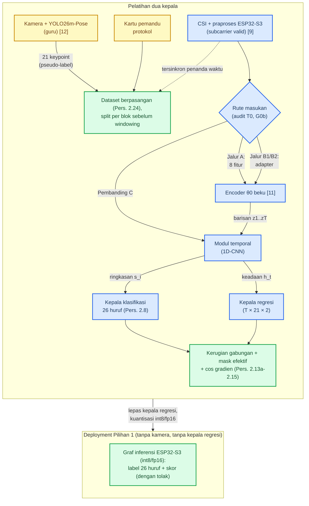
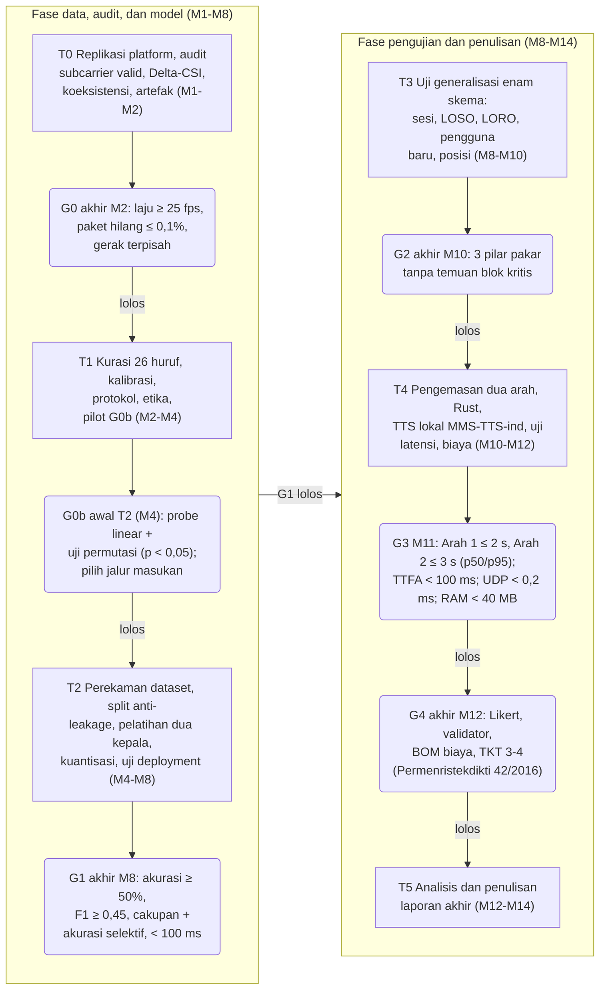
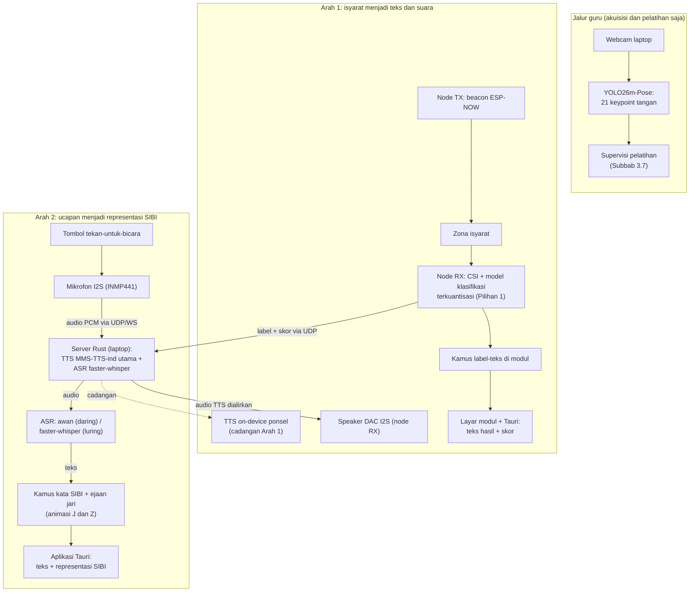
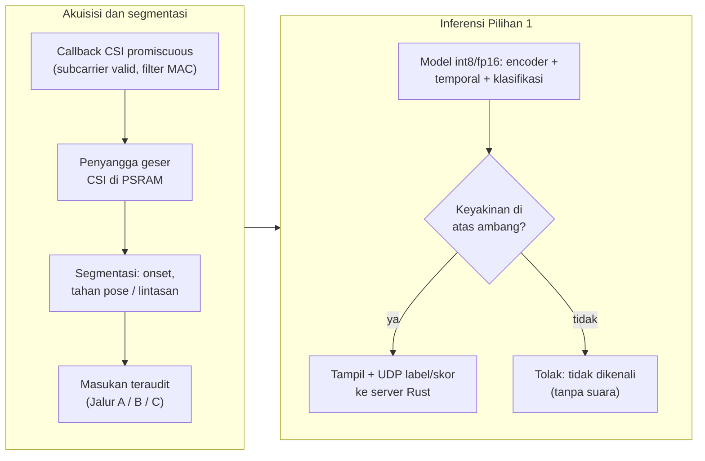

# STUDI KELAYAKAN PURWARUPA SenseSIBI: SISTEM PENERJEMAHAN DUA ARAH HURUF SIBI BERBASIS WI-FI CSI DENGAN INFERENSI ESP32-S3 DAN PEMROSESAN SERVER

**PROPOSAL PENELITIAN**

| Identitas | Keterangan |
|---|---|
| Judul | STUDI KELAYAKAN PURWARUPA SenseSIBI: SISTEM PENERJEMAHAN DUA ARAH HURUF SIBI BERBASIS WI-FI CSI DENGAN INFERENSI ESP32-S3 DAN PEMROSESAN SERVER |
| Jenis dokumen | Proposal penelitian (seminar proposal), BAB I sampai III + Daftar Pustaka; revisi verifikasi sumber primer atas v17: audit artefak *encoder* (NUL-padding, keluarga csi-embed-v2, lupa EWC 32,97%, batasan SISO), himpunan *subcarrier* valid (LLTF/HT-LTF, `first_word_invalid`), formalisasi Jalur A/B1/B2 dan Pembanding C, mask efektif serta uji permutasi G0b, TTS MMS-TTS-ind sebagai kandidat utama operasional, latensi terpisah per arah, tata kelola data etik; 31 rujukan |
| Disusun oleh | [PERLU DATA: nama penulis] |
| NIM | [PERLU DATA: NIM penulis] |
| Program studi | [PERLU DATA: program studi] |
| Universitas | [PERLU DATA: nama universitas] |
| Pembimbing | [PERLU DATA: nama pembimbing, jika sudah ditentukan] |
| Tahun | [PERLU DATA: tahun penyusunan] |

> Catatan penyusunan: versi ini menyunting naskah v17 sebagai revisi terarah atas paket perbaikan yang seluruh klaim eksternalnya telah diverifikasi langsung ke sumber primer pada 14 November 2026; tidak ada bab yang ditulis ulang dan ruang lingkup sistem tidak berubah. Temuan verifikasi dimasukkan sebagai bukti: audit artefak *encoder* (NUL-padding `model.safetensors`, keluarga `csi-embed-v2` dengan *standardizer* FP16, tingkat lupa EWC 32,97%, peringatan SISO), struktur *subcarrier* ESP32-S3 (52 LLTF atau 56 HT-LTF serta penanganan `first_word_invalid`), ketiadaan suara Indonesia pada Kokoro-82M v1.0 (sehingga MMS-TTS-ind menjadi kandidat utama operasional TTS), dan konteks tolok ukur ESP-DL 69,2 ms. Perbaikan metodologis meliputi: formalisasi Jalur A, Jalur B1/B2, dan Pembanding C; mask efektif gabungan (Persamaan 2.13a); uji permutasi G0b; koreksi tafsir *overlap* jendela 75% dan rentang T = 16; pemisahan latensi Arah 1 dan Arah 2 (Persamaan 3.3a dan 3.3b); segmentasi tiga fase (onset, tahan pose, lintasan dinamis); penghapusan rumus 1 − WER; pelaporan cakupan diterima dan akurasi selektif; penguatan etika (retensi video, persetujuan wali dan *assent*); serta rujukan TKT nasional Permenristekdikti No. 42/2016. Tiga rujukan baru ditambahkan, yaitu DF-WiSLR, Wi-SignFi, dan Permenristekdikti Nomor 42 Tahun 2016; nomor sitasi lama 1 sampai 28 dipertahankan tanpa penomoran ulang. Sembilan keputusan terbuka tetap dicatat pada Tabel 3.7 dan tidak diputuskan sepihak; rincian perubahan per subbab ada pada Log Perubahan gelombang 18 di ujung naskah.

---
# BAB I PENDAHULUAN

## 1.1 Latar Belakang

Sebagian besar anak tunarungu tumbuh dalam lingkungan keluarga penutur dengar yang belum menguasai bahasa isyarat sejak awal. Sejak hari-hari pertama, komunikasi di rumah kerap berjalan dengan dua bahasa yang belum saling menjembatani: orang tua berbicara dengan suara, sedangkan anak berkomunikasi dengan isyarat, sementara waktu dan kesempatan belajar bahasa isyarat bagi orang tua serba terbatas. Ketimpangan akses layanan juru bahasa juga masih lebar. Di Indonesia terdapat sekitar 1,92 juta penyandang tunarungu, sedangkan jumlah juru bahasa isyarat diperkirakan baru sekitar 500 orang [1], sehingga rasio ketersediaannya sangat terbatas. Untuk kebutuhan harian seperti menceritakan keluhan sakit atau berinteraksi di ruang publik, ketergantungan penuh pada juru bahasa manusia tidak realistis. Undang-Undang Nomor 8 Tahun 2016 telah menjamin hak akses komunikasi bagi penyandang disabilitas [2], namun perwujudannya membutuhkan alat bantu yang terjangkau secara biaya dan praktis dipakai sehari-hari.

Kesenjangan seperti itu paling terasa di ruang kelas. Guru menjelaskan dengan suara; siswa tunarungu menangkap sebagian, menebak sisanya, lalu mudah kehilangan alur pelajaran. SIBI menjadi bahasa pengantar pada pendidikan formal; bentuk isyaratnya dibakukan pemerintah dalam *Kamus Sistem Isyarat Bahasa Indonesia* [3]. Survei terhadap 100 responden tunarungu di Jawa dan Bali melaporkan 91% memakai BISINDO sehari-hari, sementara SIBI menempel pada konteks sekolah [4]; keduanya memang hidup di ranah yang berbeda dan tidak saling menggantikan. Karena penelitian ini menyasar alat bantu pembelajaran di sekolah, SIBI yang dipilih. Seluruh pelaksanaannya direncanakan di Jawa Timur tanpa mengikat kerja sama dengan lembaga tertentu.

Upaya membangun alat bantu komunikasi dua arah sebenarnya sudah ada, tetapi jalurnya baru setengah jalan. Sistem yang mengubah ucapan atau teks menjadi animasi isyarat hanya melayani satu arah: orang pendengar berbicara, sistem mengisyaratkan. Arah sebaliknya, isyarat siswa yang dibaca mesin, belum tersedia sebagai alat yang siap dipakai; riset di Indonesia masih berkutat di jalur kamera, misalnya pengenalan huruf BISINDO dari citra dengan CNN [5]. Kendala kamera itu ada dua dan keduanya praktis. Kamera menuntut pencahayaan serta posisi yang tepat, dan begitu cahaya sedikit berubah, akurasi ikut jatuh; kamera yang terus menyala juga membuat penggunanya merasa diawasi, tidak nyaman dipakai sepanjang hari di kelas.

Untuk menghindari dua kendala itu, sinyal Wi-Fi membuka jalan lain tanpa kamera melalui *Channel State Information* (CSI) [6]. Begitu tangan bergerak di antara pemancar dan penerima, jalur pantulan sinyal bergeser dan CSI berubah mengikuti pola gerakannya; perubahan itulah yang dibaca untuk mengenali gerak tanpa sensor yang dikenakan di tubuh. SignFi menunjukkan potensi CSI untuk mengenali 276 isyarat *American Sign Language* (ASL) [7], diikuti kajian pengenalan gestur statis dan dinamis pada DF-WiSLR [29] serta pendekatan multitugas pada Wi-SignFi [30], disertai berbagai studi kepekaan CSI hingga gerak jari [6]. Berdasarkan penelusuran sistematis pada Google Scholar, Crossref, dan OpenAlex hingga Oktober 2026 memakai kombinasi kata kunci bahasa Inggris dan Indonesia (*"Wi-Fi CSI"*, *"sign language"*, *"SIBI"*, *"Sistem Isyarat Bahasa Indonesia"*), belum ditemukan publikasi yang menerapkan Wi-Fi CSI secara khusus untuk pengenalan alfabet SIBI maupun purwarupa komunikasi dua arah berbasis ESP32-S3. Ketiadaan temuan ini dicatat sebagai hasil penelusuran basis data tersebut, bukan klaim kemutlakan di luar cakupan indeks.

Dari sisi perangkat keras, modul ESP32-S3 yang memiliki radio Wi-Fi 2,4 GHz dengan dukungan API CSI resmi [8], [9] berharga sekitar Rp150.000 per modul penginderaan dasar, atau sekitar Rp300.000 untuk sepasang modul TX-RX sebelum penambahan layar, sensor audio, pengisi daya, baterai, dan *enclosure*; *firmware* penangkap CSI yang teruji tersedia pada platform terbuka RuView [10]. Rincian biaya purwarupa lengkap disusun melalui daftar komponen (*bill of materials*, BOM) aktual dan dievaluasi pada gerbang G4, alih-alih diasumsikan murah di muka. Dengan arsitektur yang terukur, sekolah berpeluang menguji kelayakan pemasangan alat bantu tanpa infrastruktur kamera yang mahal.

Jawabannya, penelitian ini merancang purwarupa bernama **SenseSIBI** (*Sensing & Translation of SIBI*). Arah pertamanya berjalan dari siswa: ia mengisyaratkan huruf, modul RX menangkap pola CSI, model klasifikasi tepi yang berjalan di modul mengenali label huruf, lalu label dikirim ke server lokal untuk pemetaan teks Indonesia, tampilan layar, dan sintesis suara yang diputar pada *speaker* modul RX. Arah kedua berjalan dari guru: ia menekan tombol tekan-untuk-bicara (*push-to-talk*, PTT) lalu berbicara; ucapannya ditranskripsikan oleh mesin pengenalan ucapan (*automatic speech recognition*, ASR), lalu dipetakan ke aset kamus kata SIBI beserta *fallback* ejaan jari pada layar aplikasi. Model pengenal isyaratnya tidak dilatih dari nol: *encoder* CSI terpralatih RuView [11] menjadi tulang punggungnya, tetapannya dibekukan, sedangkan adapter masukan (jika dipakai), modul temporal, dan dua kepala tugas dilatih di atasnya, yaitu kepala klasifikasi 26 kelas huruf dan kepala regresi 21 titik jari tangan. Model penglihatan YOLO26m-Pose yang terlatih pada data citra SIBI milik peneliti menjadi guru pemberi label itu [12]; kamera hanya menyala saat data direkam, dan setelah pelatihan selesai seluruh sistem bekerja tanpa kamera.

Sebagai studi kelayakan, penelitian ini sengaja membatasi klaimnya. Objek pengenalan dibatasi pada alfabet manual SIBI satu tangan sebanyak 26 huruf, yaitu 24 huruf statis ditambah dua huruf gerak J dan Z, bukan penerjemahan kalimat penuh. Kemampuan membedakan huruf diuji lebih dahulu sebelum klaim yang lebih jauh dibuat; tiap tahap ditutup gerbang keputusan, dan kegagalan tetap dilaporkan sebagai temuan. Dalam batas itulah penelitian ini mencoba menjawab pertanyaan yang sederhana sekaligus jujur: apakah sepasang modul Wi-Fi murah sungguh bisa menjadi jembatan komunikasi dua arah antara siswa tunarungu dan gurunya di kelas?

## 1.2 Rumusan Masalah

Dari latar belakang yang telah dipaparkan, masalah yang dikaji dalam penelitian ini dirumuskan sebagai berikut.

1. Bagaimana merancang purwarupa penerjemah dua arah antara huruf SIBI dan teks beserta suara bahasa Indonesia dengan sepasang modul ESP32-S3 tanpa kamera, yang pada jalur isyarat menjadi teks memakai *encoder* CSI terpralatih RuView yang dibekukan dengan dua kepala tugas, yaitu kepala klasifikasi 26 huruf dan kepala regresi 21 *keypoint* tangan dengan label kelas dari protokol perekaman serta supervisi *keypoint* dari guru visual YOLO26m-Pose, menjalankan inferensi terkuantisasi langsung di modul, serta menghadirkan mesin ucapan dan pengenalan ucapan bahasa Indonesia?
2. Seberapa baik alfabet manual SIBI dikenali dari sinyal CSI oleh model *encoder* terpralatih berkepala dua, termasuk sumbangan kepala regresi yang diukur lewat ablasi, serta bagaimana kinerja kedua jalur penerjemahan pada skenario dalam sesi, lintas partisipan, dan lintas ruang?
3. Seberapa layak purwarupa menjadi alat bantu komunikasi jika ditinjau dari latensi inferensi terkuantisasi dan ujung ke ujung, cakupan kosakata, keandalan operasional, penerimaan pengguna, serta biaya perangkat dan layanan?

## 1.3 Tujuan Penelitian

Tujuan penelitian ini adalah sebagai berikut.

1. Merancang purwarupa penerjemah dua arah antara huruf SIBI dan teks beserta suara bahasa Indonesia dengan sepasang modul ESP32-S3 tanpa kamera, yang pada jalur isyarat menjadi teks memakai *encoder* CSI terpralatih RuView yang dibekukan dengan dua kepala tugas, yaitu kepala klasifikasi 26 huruf dan kepala regresi 21 *keypoint* tangan dengan label kelas dari protokol perekaman serta supervisi *keypoint* dari guru visual YOLO26m-Pose, menjalankan inferensi terkuantisasi langsung di modul, serta menghadirkan mesin ucapan dan pengenalan ucapan bahasa Indonesia.
2. Mengukur seberapa baik alfabet manual SIBI dikenali dari sinyal CSI oleh model *encoder* terpralatih berkepala dua, termasuk sumbangan kepala regresi yang diukur lewat ablasi, serta kinerja kedua jalur penerjemahan pada skenario dalam sesi, lintas partisipan, dan lintas ruang.
3. Menganalisis kelayakan purwarupa sebagai alat bantu komunikasi ditinjau dari latensi inferensi terkuantisasi dan ujung ke ujung, cakupan kosakata, keandalan operasional, penerimaan pengguna, serta biaya perangkat dan layanan.

## 1.4 Batasan Masalah

Agar fokus, ruang lingkup penelitian ini dibatasi sebagai berikut.

1. Objek pengenalan ialah alfabet manual SIBI satu tangan 26 huruf (24 statis serta huruf gerak J dan Z). Bentuk bakunya dicocokkan dengan *Kamus SIBI* [3] dan disetujui validator penutur tunarungu; sistem ini bukan penerjemah kalimat.
2. Pembeda utamanya adalah bentuk tangan dan jari beserta lintasan gerak J dan Z; ekspresi wajah serta penanda nonmanual tidak dikenali.
3. Penginderaan memakai sepasang modul ESP32-S3 (satu pemancar, satu penerima; 2,4 GHz, kanal 20 MHz) dengan layar, baterai, *speaker*, dan mikrofon pada node penerima; kamera hanya menyala saat perekaman data pelatihan.
4. YOLO26m-Pose berperan sebagai guru visual hanya pada saat akuisisi dan pelatihan; produk akhirnya bebas kamera dan bebas citra.
5. *Encoder* murid memakai *checkpoint* terpralatih `ruvnet/wifi-densepose-pretrained` dengan *embedding* 128 dimensi dan 9.280 parameter [11]; *encoder* dibekukan pada baseline, sedangkan LoRA dan pelatihan lanjutan diperlakukan sebagai eksperimen pembanding; masukan *checkpoint* berupa delapan fitur turunan per jendela satu detik disesuaikan lewat jalur fitur turunan atau adapter masukan yang dipilih pada gerbang G0b [PERLU VALIDASI: parameter normalisasi masukan dan keputusan jalur G0b].
6. Sintesis ucapan utama operasional memakai MMS-TTS-ind di server lokal dan audio diputar pada *speaker* node penerima, dengan mesin *on-device* pada ponsel sebagai cadangan dan Kokoro sebagai pembanding; pengenalan ucapan memakai layanan awan dengan faster-whisper lokal sebagai cadangan; pilihan final mesin dan layanan tetap ditetapkan pada gerbang G3.
7. Arah kedua terbatas pada kamus tingkat kata dengan *fallback* ejaan jari; cakupan kamusnya diukur lalu dilaporkan.
8. Satu sesi hanya melibatkan satu pengisyarat dan sistem tidak mengidentifikasi individu; pengujian berlangsung di sedikitnya dua ruang berbeda di Jawa Timur yang sudah dikalibrasi.
9. Uji pengguna berskala kecil (3–5 pengguna) dan dianalisis secara deskriptif, tanpa statistik inferensial.
10. Isyarat kontinu, tata bahasa isyarat penuh, BISINDO, serta klasifikasi gerakan otomatis dari video berada di luar pembahasan.
11. Seluruh hasil dilaporkan sebagai bukti awal pada populasi terbatas, yaitu 3–4 pengisyarat, sedikitnya dua ruang, dan satu konfigurasi perangkat; skema *leave-one-subject-out*, pengguna baru, dan *leave-one-room-out* dibaca sebagai indikasi ketahanan awal, bukan bukti generalisasi populasi; klaim lintas populasi tidak dibuat.

## 1.5 Manfaat Penelitian

Manfaat penelitian ini terbagi atas manfaat teoretis dan manfaat praktis.

### 1.5.1 Manfaat Teoretis

Secara teoretis, penelitian ini menyumbang bukti awal tentang satu pertanyaan yang tajam: apakah *embedding* hasil *pretraining* kontrastif pada CSI masih informatif untuk gestur jari apabila tetapan *encoder* dibekukan dan hanya adapter masukan (jika dipakai), modul temporal, serta kedua kepala tugasnya yang dilatih. Bukti itu terikat pada alfabet manual dan belum tentu berlaku untuk isyarat kata maupun isyarat kontinu. Penelitian ini juga menghasilkan formulasi multitugas lintas modalitas yang mengawasi klasifikasi isyarat dengan regresi bentuk jari pada satu *embedding* bersama, serta *dataset* CSI berlabel beserta protokol perekamannya. Peneliti berikutnya bisa memakainya untuk bahasa isyarat lain, termasuk perluasan ke BISINDO.

### 1.5.2 Manfaat Praktis

Bagi sekolah yang kelak memakainya, penelitian ini memberi gambaran nyata tentang kelayakan alat bantu komunikasi dua arah berbahasa SIBI, lengkap dengan biaya perangkatnya. Purwarupa yang memunculkan teks, menyuarakan isyarat, dan memperagakan bentuk isyarat bagi lawan bicara akan lahir jika seluruh tahap berhasil. Jika berhenti lebih awal, laporan karakterisasi, protokol, dan *dataset* berlabel tetap menjadi warisan penelitian. Bagi keluarga siswa, kosakata yang tervalidasi memastikan isyarat yang muncul di layar benar bentuknya. Bagi komunitas riset, rancangan yang tidak terikat pada satu bahasa isyarat memudahkan replikasi di tempat lain.

## 1.6 Sistematika Penulisan

Secara ringkas, proposal ini disusun atas tiga bab. **BAB I Pendahuluan** memuat latar belakang, rumusan masalah, tujuan, batasan, manfaat, dan sistematika penulisan. **BAB II Kajian Pustaka** menghimpun teori dan penelitian terdahulu yang menjadi dasar perancangan, termasuk *encoder* CSI terpralatih, kedua kepala tugas, dan supervisi guru visual. **BAB III Metode Penelitian** memuat desain, tahapan, waktu dan lokasi, alat dan bahan, perancangan sistem, protokol perekaman, pengolahan sinyal dan pelatihan dua kepala, skenario pengujian, jadwal, parameter yang ditetapkan kemudian, serta risiko dan cadangannya.
# BAB II KAJIAN PUSTAKA

## 2.1 Bahasa Isyarat, SIBI, dan Kebutuhan Komunikasi Dua Arah

Bahasa isyarat menyampaikan makna lewat gerak tangan, lengan, tubuh, dan ekspresi wajah. Satu isyarat tersusun atas bentuk tangan, lokasi, gerak, serta orientasi telapak; cukup satu jari berubah bentuk, maknanya bisa ikut berubah. Susunan inilah yang menjadi acuan penelitian dalam memisahkan bagian isyarat yang bisa dinilai mesin dari bagian yang tetap memerlukan penilaian manusia [3]. SIBI ialah sistem isyarat baku pendidikan formal yang didokumentasikan kamus pemerintah [3], sedangkan BISINDO tumbuh alami di komunitas tunarungu. Survei terhadap 100 responden tunarungu di Jawa dan Bali menemukan 91% memakai BISINDO, sementara SIBI menempel pada konteks sekolah [4]. Penelitian ini tetap memilih SIBI karena sasarannya alat bantu pembelajaran di sekolah, bukan karena jumlah penuturnya lebih besar. Audit label pada dataset visual peneliti menegaskan pembagian kelas yang dipakai seluruh naskah: huruf C termasuk kelompok 24 huruf statis, sedangkan J dan Z satu-satunya huruf yang menuntut lintasan gerak.

Bicara antara pengguna isyarat dan orang pendengar menuntut dua arah. Keluarga dan guru berada di barisan paling depan untuk merasakan kesenjangan ini, sementara jumlah juru bahasa masih jauh dari cukup [1]; alat bantu yang dibangun karena itu harus melayani kedua arah; kamus satu arah tidak menyelesaikan masalahnya. Sistem satu arah yang mengubah ucapan menjadi animasi isyarat sudah lebih dulu hadir di Indonesia, tetapi untuk arah isyarat menjadi teks riset dalam negeri bertumpu pada kamera, misalnya CNN untuk huruf BISINDO [5]. Masalahnya, kamera menuntut pencahayaan dan garis pandang yang baik, dan kamera yang terus menyala membuat pengguna merasa diawasi. Dua kendala inilah yang mendorong pencarian jalur penginderaan tanpa kamera dan tanpa perangkat yang dikenakan.

## 2.2 Wi-Fi Channel State Information

*Channel State Information* (CSI) memuat informasi amplitudo dan fase pada setiap *subcarrier* sinyal Wi-Fi, yang bersama-sama menggambarkan kondisi jalur propagasi [6]. Tubuh yang bergerak di antara pemancar dan penerima mengubah panjang jalur pantulan; amplitudo dan fase tiap *subcarrier* pun ikut bergeser. Geseran inilah yang dipakai untuk mengenali gerak tanpa sensor yang dikenakan. Karena tiap *subcarrier* menempati frekuensi berbeda, satu pasang perangkat sekaligus menyediakan banyak kanal pengamatan [6].

Bentuk formalnya pada kanal 20 MHz 802.11n menyatakan bahwa tiap *subcarrier* valid n anggota N~valid~ membawa koefisien kanal kompleks

```rumus
h~n~(t) = |h~n~(t)| · exp( j · φ~n~(t) ) (2.1)
```

dengan |h~n~(t)| amplitudo, φ~n~(t) fase, dan j satuan imajiner [6], [9]. Pada implementasi ESP32-S3 dalam ESP-IDF, struktur `wifi_csi_info_t` menyimpan tiap koefisien sebagai dua *byte* bertanda (imajiner lalu riil) menurut urutan *Long Training Field* (LTF): LLTF, HT-LTF, dan STBC-HT-LTF bergantung jenis paket [9]. Untuk kanal 20 MHz tanpa STBC, LLTF memuat 52 *subcarrier* efektif setelah mengecualikan *null/guard* dan empat *pilot*, sedangkan HT-LTF memuat 56 *subcarrier*; apabila tanda perangkat keras `first_word_invalid` bernilai benar, empat *byte* pertama (dua *subcarrier* awal) tidak valid dan wajib dibuang [9]. Himpunan indeks valid N~valid~, jenis paket, LTF yang dipilih, dan filter alamat MAC dibakukan serta diaudit pada tahap T0 sebelum perhitungan fitur dilakukan. Amplitudo dan fase inilah bahan mentah seluruh perhitungan pada bab-bab berikutnya.

Pemodelan CSI sendiri berpijak pada zona Fresnel [13]. Radius zona Fresnel ke-n pada suatu titik dihitung dari jarak titik itu ke pemancar d~1~ dan ke penerima d~2~ [13]:

```rumus
r~n~ = √( n · λ · d~1~ · d~2~ / ( d~1~ + d~2~ ) ) (2.2)
```

dengan λ panjang gelombang pembawa; pada 2,4 GHz, λ = c/f ≈ 12,5 cm. Angkanya bisa langsung dihitung untuk tautan baku penelitian ini. Pada jarak antarmodul 1 meter dengan tangan di titik tengah, radius zona pertama r~1~ = √(0,125 × 0,5 × 0,5) ≈ 0,18 meter. Ruang gerak jadi seluruhnya berada di zona yang paling peka terhadap perubahan jalur. Penempatan itu dirangkum pada Gambar 2.1. Artikulasi jari menggeser jalur pantulan pada orde sentimeter sampai milimeter, dan tiap bentuk huruf meninggalkan pola perubahan *subcarrier* yang khas.

```gambar
Sumber skrip: scripts/sensesibi-v10/gambar_g15_fresnel.py (matplotlib mplot3d) -> assets-v16/gambar-2.1.png
```

Gambar 2.1 Zona Fresnel pertama pada tautan baku 1 meter; tangan pengisyarat berada di dalam zona (ilustrasi skematis tiga dimensi, tidak berskala) [6], [13]

Gerak tubuh juga melahirkan pergeseran Doppler yang besarnya mengikuti kecepatan gerak v [6], [14]:

```rumus
f~D~ = ( v / λ ) · ( cos α + cos β ) (2.3)
```

dengan α dan β sudut antara arah gerak dan garis pandang ke pemancar serta ke penerima; nilai mutlaknya paling besar 2v/λ. Pita Doppler gerak isyarat yang relevan kira-kira 1–60 Hz [6], sedangkan kaidah Nyquist menuntut laju pencuplikan

```rumus
f~s~ ≥ 2 · f~maks~ (2.4)
```

Akibatnya bisa dihitung sejak awal. Pada laju *firmware* RuView 50 bingkai per detik [10], pita teramati hanya sampai 25 Hz, sehingga gerak tangan yang masih teramati tanpa pelipatan kira-kira v = 25 × 0,125/2 ≈ 1,6 meter per detik. Gerak jari yang lebih cepat berisiko terlipat, dan jika laju terukur lebih rendah lagi, pita yang dianalisis ikut menyempit; hal itu dilaporkan apa adanya.

Satu masalah masih tersisa: fase mentah tercemar derau osilator lokal. Teknik CSI-ratio membersihkannya lewat rasio atau perkalian konjugat tanpa perangkat tambahan [13]. Prinsip itu diadaptasi penelitian ini menjadi rasio terhadap rekam acuan kalibrasi ruang (Subbab 3.7):

```rumus
ρ~n~(t) = h~n~(t) / h~n~( t~0~ ) (2.5)
```

dengan t~0~ waktu kalibrasi ruang, yaitu 600 bingkai acuan bawaan RuView [10]. Berbeda dari teknik *CSI-ratio* antar-antena atau perkalian konjugat pada literatur [13] yang menekan *carrier frequency offset* (CFO) dan *sampling frequency offset* (SFO) secara langsung antarsaluran, Persamaan (2.5) berfungsi sebagai normalisasi relatif terhadap *baseline* statis ruang pada konfigurasi antena tunggal. Pembagian ini membuang tanggapan pantulan statis ruangan, tetapi tidak otomatis menghilangkan *phase drift* lambat yang berubah seiring waktu; oleh karena itu, kestabilan fase sisa serta perbandingan varian amplitudo-saja tetap diukur pada tahap T0 dan dilaporkan apa adanya.

Dari ketukan tombol sampai gerakan jari, bukti kepekaan CSI terhadap gerak halus cukup banyak [6]; akan tetapi, bukti-bukti itu lahir dari kondisi terkendali sehingga bagi penelitian ini statusnya sebatas hipotesis kerja. Model CSI juga mudah *overfitting* terhadap orang dan ruang. Widar3.0 menjawab masalah itu dengan profil kecepatan Doppler untuk pengenalan lintas domain [14]. Kelayakan satu tautan dua modul berantena tunggal untuk membedakan 26 bentuk tangan SIBI karenanya diperlakukan sebagai pertanyaan penelitian, bukan asumsi; uji Delta-CSI dan gerbang G1 yang mengujinya. Jika beberapa huruf terbukti tidak terpisahkan, himpunan huruf dipangkas (Tabel 3.7).

## 2.3 Modul ESP32-S3, Platform RuView, dan Koeksistensi Radio

ESP32-S3 ialah mikrokontroler Wi-Fi 802.11 b/g/n 2,4 GHz berantena tunggal dengan inti ganda 240 MHz, SRAM 512 KB, dan PSRAM hingga 8 MB [8]. Dukungan CSI tersedia resmi lewat repositori esp-csi; pada kanal 20 MHz, bingkai CSI memuat 56 *subcarrier* pada HT-LTF dan 52 *subcarrier* efektif pada LLTF setelah penyaringan (Subbab 2.2) [9]. RuView merekomendasikan ESP32-S3 sebagai modul penangkap CSI sekaligus menyediakan rantai akuisisi lengkap [10] yang dipetakan pada Tabel 2.1. Repositori yang sama menerbitkan *checkpoint encoder* CSI terpralatih yang menjadi tulang punggung murid penelitian ini. Pembedaannya dari dua model lain pada ekosistem itu diuraikan pada Subbab 2.4.

Tabel 2.1 Pemetaan fitur RuView terhadap peran dalam penelitian ini

| Fitur RuView | Peran dalam penelitian ini |
|---|---|
| *Firmware* penangkap CSI (UDP) | Mengalirkan CSI dan label ke server |
| Station + UDP + CSI *promiscuous* + ESP-NOW pada satu *chip* | Dasar topologi satu kanal (Subbab 3.5) |
| Kalibrasi ruang 600 bingkai + 8 *anchor* | Kalibrasi tiap sesi; pemotongan segmen isyarat |
| Mode privasi | Membuang fitur biometrik selama penelitian |
| Akuisisi tersinkron kamera-CSI | Jalur guru; estimator memakai YOLO26m-Pose |
| *Checkpoint encoder* CSI terpralatih (*embedding* 128 dimensi) [11] | *Encoder* murid yang dibekukan pada baseline (Subbab 2.4) |

Fakta paling menentukan justru koeksistensi radio pada satu *chip*. *Firmware* RuView mampu menangkap CSI sambil memelihara koneksi *station* UDP serta sinkronisasi ESP-NOW secara serentak. Dua syaratnya: seluruh perangkat berada pada satu kanal dan mode hemat daya dimatikan [10]. Purwarupa karenanya tidak memerlukan modul gerbang khusus, tetapi ada satu catatan penting: RuView belum melalui telaah sejawat, jadi fungsinya diverifikasi sendiri pada gerbang G0.

## 2.4 Encoder CSI Terpralatih RuView dan Pembedaan Tiga Model

*Encoder* terpralatih yang menjadi tulang punggung jalur isyarat menjadi teks terdokumentasi lengkap pada kartu modelnya [11]. Arsitekturnya dua lapis *fully connected* dengan BatchNorm dan GELU yang memetakan fitur CSI menjadi *embedding* 128 dimensi ternormalisasi L2. Seluruhnya hanya 9.280 parameter. Pemetaannya ditulis

```rumus
z~i~ = f~θ0~( X~i~ ), z~i~ ∈ R^d^, d = 128 (2.6)
```

dengan X~i~ masukan ke-i, f~θ0~ pemetaan *encoder* bertetapan θ~0~, dan z~i~ vektor *embedding* keluaran. Pretrainingnya kontrastif dengan triplet loss dan InfoNCE pada temperatur 0,1. Pasangan positif diambil dari jendela dalam jarak 2 detik, pasangan negatif dari jarak lebih dari 30 detik, selama 60 epoch dengan AdamW dan perlindungan EWC terhadap lupa bencana [11]. Pada baseline penelitian ini, θ~0~ dibekukan; tetapan yang diperbarui mencakup adapter masukan (jika dipakai), modul temporal, dan kedua kepala tugas sebagaimana dirumuskan pada Persamaan (2.15). Kontrak masukan *checkpoint* diikat secara eksplisit: *encoder* menerima satu vektor delapan fitur turunan per jendela satu detik (bentuk *batch* (B, 8)), bukan deret *subcarrier*, dan menghasilkan satu *embedding* 128 dimensi ternormalisasi L2 per jendela. Deret waktu karenanya hidup pada tingkat barisan jendela, bukan di dalam *encoder*. Parameter normalisasi masukan belum dipublikasikan kartu modelnya sehingga dicari pada artefak *checkpoint* saat audit T0 [PERLU VALIDASI: parameter normalisasi masukan pada artefak *checkpoint*].

Audit dokumentasi repositori RuView dan Hugging Face per 14 November 2026 menemukan dua hal teknis yang wajib diverifikasi pada tahap T0. Pertama, kartu model memuat dua keluarga berkas, yaitu `model.safetensors`/`model.rvf.jsonl` dan keluarga `csi-embed-v2` (`csi-embed-v2.safetensors`, `csi-embed-v2-int4.bin`, serta `csi-embed-v2.py` yang menyertakan *standardizer* FP16), sedangkan berkas `model.safetensors` tercatat memiliki *NUL-padding* pada *header* sehingga ditolak oleh `safetensors.torch.load_file` [10], [11]. Kedua, catatan teknis RuView secara eksplisit memperingatkan bahwa aliran CSI antena tunggal (SISO) 56 *subcarrier* pada ESP32 tidak menyimpan informasi spasial sehalus NIC multi-antena, dan percobaan awal estimasi sendi distal pada satu perangkat mendekati acak; angka triplet-temporal 82,3% juga hanya diukur pada satu ruangan, satu rekaman, dan dua node [10], [11]. Karena itu, audit T0 mencakup pemilihan keluarga berkas yang dimuat, verifikasi *standardizer*, serta pembatasan klaim ke kondisi terukur tersebut.

Satu angka pada kartu model itu perlu dibaca hati-hati. Akurasi triplet-temporal *held-out* sebesar 82,3% tercatat pada 20% akhir rekaman menurut waktu, dengan pembanding 66,4% untuk fitur mentah tanpa *encoder* dan 69,6% untuk *encoder* berinisialisasi acak [11]. Angka itu menghitung peluang bahwa jarak anchor ke positif temporal lebih pendek daripada jaraknya ke negatif temporal. Yang diukurnya ialah kualitas geometri *embedding* pada tugas jarak, bukan akurasi klasifikasi SIBI dan bukan pula galat *keypoint*. Dua hal terakhir justru yang hendak diukur penelitian ini, dan kartu model tidak memuat keduanya.

Ketidaksesuaian bentuk masukan menjadi risiko ilmiah utama penelitian ini. Kartu model mencatat masukan delapan fitur turunan CSI pada laju 1 Hz, yaitu kehadiran, gerak, napas, detak jantung, varians fase, jumlah orang, deteksi jatuh, dan RSSI [11], sedangkan jalur akuisisi ESP32-S3 menghasilkan N~valid~ *subcarrier* (52 pada LLTF atau 56 pada HT-LTF) pada laju target hingga 50 bingkai per detik [9], [10]. Karena delapan fitur lingkungan tersebut tidak dirancang untuk menangkap artikulasi jari, merangkum CSI menjadi delapan angka berisiko membuang informasi spasial tangan. Untuk membedakan efek representasi masukan dari efek *encoder*, penelitian ini memformalkan tiga rute evaluasi yang berbeda tujuannya. Jalur A (rekonstruksi delapan fitur bawaan) menghitung ulang secara deterministik delapan fitur RuView dari jendela CSI beserta *standardizer* resminya untuk menguji langsung daya pisah *checkpoint* θ~0~ tanpa pembelajaran ulang masukan. Jalur B (adapter konvolusi satu dimensi) memetakan jendela CSI mentah ke vektor delapan dimensi melalui dua objektif yang dipisahkan tegas: Jalur B1 (adapter rekonstruksi fitur) dilatih meminimalkan galat rekonstruksi terhadap delapan fitur Jalur A, sedangkan Jalur B2 (adapter terpandu tugas) dilatih langsung oleh kerugian tugas SIBI (Persamaan 2.14). Jika Jalur B2 berhasil sementara Jalur A gagal, kontribusi pemisahan kelas berasal dari adapter terlatih dan tidak boleh diklaim semata sebagai bukti kualitas representasi *pretraining* RuView. Pembanding C (*baseline* CSI temporal lebih kaya) ialah model temporal ringan yang membaca langsung spektrum amplitudo dan fase N~valid~ *subcarrier* tanpa penyempitan delapan fitur; pembanding ini menjaga agar keterbatasan informasi delapan fitur tidak keliru ditafsirkan sebagai ketidakmampuan CSI secara umum, sekaligus menegaskan bahwa kegagalan delapan fitur tidak dipulihkan sekadar dengan membuka bobot *encoder* lewat LoRA. Ketiga rute dinyatakan terbuka dengan penanda [PERLU VALIDASI] sampai audit T0 dan gerbang G0b selesai, dan penelitian ini tidak mengklaim kompatibilitas sebelum terverifikasi.

Delapan fitur itu perlu dibaca dengan jujur sebagai kontrak lingkungan, bukan kontrak artikulasi. Napas, detak jantung, jumlah orang, dan deteksi jatuh hampir tidak berubah selama artikulasi jari; informasi gerak tangan terkonsentrasi pada fitur gerak dan varians fase; pretraining dilakukan pada data ruangan delapan jam dengan supervisi sensor PIR dan BME280 [11], bukan pada gerak tangan. Kelayakan representasi ini bagi huruf SIBI karena itu diperlakukan sebagai hipotesis yang diuji pada gerbang G0b (Subbab 3.7), bukan sebagai sifat yang menyertai *checkpoint*.

Dua model lain pada ekosistem yang sama sering tertukar dengan *encoder* ini, sehingga keduanya dipisahkan sejak awal. Model `wifi-densepose-mmfi-pose` [15] adalah *checkpoint* pose terpisah. Masukannya amplitudo CSI berukuran [3, 114, 10] pada 100 Hz, yang diproses *encoder* Transformer 4 lapis 8 kepala menjadi keluaran [17, 2], yaitu 17 *keypoint* tubuh COCO dalam rentang [0, 1], dengan sekitar 2,3 juta parameter. Model itu dilatih pada dataset MM-Fi [16] yang memuat 40 subjek, 27 kategori aksi, dan lebih dari 320 ribu bingkai tersinkron dari lima modalitas. Kinerjanya PCK@20 ternormalisasi badan sebesar 82,69% untuk model tunggal dan 83,59% untuk ansambel. Angka itu turun menjadi sekitar 64% lintas subjek *zero-shot* dan 17,5% lintas lingkungan, lalu naik ke rentang 72% sampai 78% setelah kalibrasi 50 sampai 1.000 bingkai per orang [15]. Lisensi CC BY-NC 4.0 melekat padanya karena mengikuti lisensi datanya. Model ketiga, YOLO26m-Pose [12], ialah model penglihatan pada citra yang berperan sebagai guru visual dan dibahas pada Subbab 2.9. Tabel 2.2 merangkum pembedaan ketiganya.

Tabel 2.2 Pembedaan tiga model ekosistem yang tidak boleh tercampur dalam penelitian ini

| Aspek | Encoder CSI terpralatih [11] | Model pose MM-Fi [15] | Guru visual YOLO26m-Pose [12] |
|---|---|---|---|
| Berkas | `ruvnet/wifi-densepose-pretrained` | `ruvnet/wifi-densepose-mmfi-pose` | Repositori WPC peneliti (eksperimen `exp11_huruf24`) |
| Masukan | 8 fitur turunan CSI per jendela 1 detik (laju 1 Hz; *batch* (B, 8)); bukan deret *subcarrier* | Amplitudo CSI [3, 114, 10] @ 100 Hz | Citra RGB kamera |
| Keluaran | *Embedding* 128 dimensi ternormalisasi L2 | 17 *keypoint* tubuh COCO dalam [0, 1] | Kelas isyarat dan 21 *keypoint* tangan |
| Parameter | 9.280 | ±2,3 juta (varian utama) | [PERLU DATA: jumlah parameter model juara WPC] |
| Peran | Representasi murid, dibekukan pada baseline | Pembanding temuan lintas domain, bukan komponen model | Pemberi label kelas dan *keypoint* saat akuisisi |
| Status bukti | Kartu model; akurasi triplet-temporal 82,3% | Kartu model; PCK@20 82,69%; lisensi CC BY-NC 4.0 | Data pra-penelitian peneliti; mAP50 0,9580 pada 24 huruf statis |

Status tiga dokumen rancangan pada repositori RuView juga dinyatakan terbuka. ADR-024 mengusulkan model penyematan kontrastif AETHER; ADR-146 mengusulkan *encoder* RF bersama dengan tujuh kepala tugas dan ketidakpastian per kepala; ADR-150 mengusulkan *foundation encoder* yang tahan pergantian orang dan ruang. Ketiganya berstatus Proposed, artinya rancangan yang belum diimplementasikan [10]. Penelitian ini bersandar hanya pada *checkpoint* yang benar-benar tersedia; angka estimasi dari ADR dikutip dengan label estimasi rancangan setiap kali muncul.

## 2.5 Transfer Learning pada Encoder Beku: LoRA dan Pelatihan Lanjutan

Baseline penelitian ini membekukan tetapan *encoder* (θ~encoder~ = θ~0~) dan melatih bersama adapter masukan (jika Jalur B dipilih), modul temporal, serta kedua kepala tugas sebagaimana dirumuskan pada Persamaan (2.15). Alasannya metodologis: dengan menjaga θ~0~ tetap beku di atas Jalur A dan membandingkannya terhadap Pembanding C, sumbangan representasi *pretraining* RuView terhadap tugas alfabet SIBI dapat diisolasi secara jujur, terpisah dari sumbangan penyetelan. Karena *encoder* hanya 9.280 parameter, biaya membandingkan skema adaptasi lain pun rendah, dan perbandingannya dijalankan pada data serta seed yang sama.

LoRA menambah pembaruan berperingkat rendah pada tetapan asli tanpa menyimpan gradien untuk seluruh matriks [17]:

```rumus
W~akhir~ = W~0~ + B · A (2.7)
```

dengan W~0~ matriks tetapan asli yang dibekukan, B berukuran d~keluar~ × r dan A berukuran r × d~masuk~, serta r peringkat adapter yang dipilih jauh lebih kecil daripada ukuran matriks; hanya B dan A yang dilatih. Adapter bekerja di dalam lapisan yang sudah ada sebagai jalur adaptasi yang hemat parameter. Perannya berbeda dari kepala tugas maupun dari pelatihan lanjutan, dan ia bukan prasyarat penelitian ini. Ketersediaannya bahkan terdokumentasi untuk kasus ruangan: kartu model menyertakan adapter `node-1.json` dan `node-2.json` masing-masing sekitar 21 KB [11]. ADR-150 menaksir adapter sekitar 11 KB mampu menyamai kinerja lintas subjek dengan 100 sampai 200 data berlabel per ruang [10]; angka itu berstatus estimasi rancangan, bukan hasil terukur. Kompatibilitas LoRA dengan alur ekspor ke ESP32-S3 belum terverifikasi, sehingga statusnya ditandai [PERLU VALIDASI: kompatibilitas LoRA dengan alur ekspor] dan diperiksa pada T0.

Pembanding ketiga ialah pelatihan lanjutan (*fine-tuning* sebagian pada lapis terakhir maupun penuh seluruh lapis *encoder*) yang dipantau terhadap risiko lupa bencana menggunakan *Elastic Weight Consolidation* (EWC) sebagaimana pretraining *encoder* melakukannya [11]. Kartu model melaporkan bahwa perlindungan EWC bawaannya (*Fisher strength* 2.000) masih menyisakan tingkat lupa sebesar 32,97% pada empat tugas *pretraining* [11]; EWC karena itu diperlakukan sebagai mitigasi parsial, bukan jaminan bebas lupa. Selain itu, membuka bobot *encoder* melalui LoRA maupun pelatihan lanjutan tidak dapat memulihkan detail artikulasi jari apabila informasi tersebut sudah hilang saat CSI diringkas menjadi delapan fitur masukan; skema LoRA dan pelatihan lanjutan karena itu wajib dibandingkan langsung terhadap Pembanding C pada data dan *seed* yang sama. Seluruh skema (beku, beku plus LoRA, pelatihan lanjutan, dan Pembanding C) dilaporkan berdampingan sebagai eksperimen pembanding pada Subbab 3.7, bukan keputusan yang dikunci di muka.

## 2.6 Kepala Klasifikasi dan Kerugian Silang-Entropi

Kepala klasifikasi mengubah *embedding* menjadi skor tiap kelas huruf. Untuk K kelas dengan K = 26, skor logit dihitung dari

```rumus
a~i~ = W~c~ · s~i~ + b~c~ (2.8)
```

dengan s~i~ vektor ringkasan beratensi dari modul temporal berdimensi d~h~ (Subbab 2.8; pada uji *probe* dan ablasi tanpa proyeksi temporal, s~i~ = z~i~ dan d~h~ = 128), W~c~ matriks berukuran K × d~h~, dan b~c~ vektor bias. Skor lalu diubah menjadi probabilitas lewat *softmax*

```rumus
q~ik~ = exp( a~ik~ ) / Σ~k~ exp( a~ik~ ) (2.9)
```

sehingga seluruh probabilitas berjumlah satu, dan kelas prediksi ialah kelas dengan probabilitas terbesar. Sebagai lantai pembanding, tebakan acak seragam pada K kelas bernilai 1/K ≈ 3,8%, dan angka itu dihitung ulang jika himpunan huruf dipangkas. Kerugian pelatihannya silang-entropi kategorikal; dengan label *one-hot* y~ik~ yang bernilai satu pada kelas benar dan nol pada kelas lain, kerugian atas N sampel dalam *batch* berbunyi

```rumus
L~cls~ = − ( 1 / N ) · Σ~i~ Σ~k~ y~ik~ · log q~ik~ (2.10)
```

yang menghukum prediksi yang percaya diri pada kelas salah. Jika data latih terbukti timpang antarhuruf, bobot kelas dipasang berbanding terbalik dengan frekuensi kelasnya; bobot itu dihitung hanya dari data latih dan keputusannya dicatat pada Tabel 3.7.

Klasifikator himpunan tertutup selalu memilih satu kelas, sehingga keluarannya dilengkapi skor keyakinan dan mekanisme penolakan [18]: keyakinan yang rendah memunculkan pesan isyarat tidak dikenali alih-alih menebak salah. Menolak lebih aman daripada menebak kelas yang salah. Ambangnya ditetapkan dari data validasi (Subbab 3.7). Karena klasifikator dengan ambang penolakan dapat mencapai ketepatan tinggi dengan menolak sebagian besar masukan, evaluasi mewajibkan pelaporan berpasangan atas cakupan diterima (*accepted coverage*), akurasi selektif (*selective accuracy*) pada segmen yang diterima, akurasi keseluruhan tanpa penolakan, serta laju terima dan tolak palsu (*false accept/reject rate*) sebagaimana dirinci pada Subbab 3.8.2.

## 2.7 Kepala Regresi 21 Keypoint dan Kerugian Smooth L1 Bermask

Target regresi mengikuti skema 21 *landmark* tangan MediaPipe Hands [19], skema yang sama dipakai *pseudo-labeling* pada dataset visual peneliti. Sesuai `kpt_shape` [21, 3], tiap sampel target memuat 21 titik dengan tiga nilai: koordinat x, koordinat y, dan tanda visibilitas. Komponen ketiga itu ialah penanda visibilitas atau keyakinan deteksi sesuai konvensi dataset dan Ultralytics; koordinat target karenanya dipakai berpasangan (x, y) saja, sedangkan visibilitas diperlakukan sebagai mask. Varian peringkas tunggal kepala, yang menjadi pembanding ablasi untuk huruf statis, memprediksi koordinat x dan y seluruh jendela dari satu vektor ringkasan,

```rumus
Q~i~ = reshape( W~r~ · z~i~ + b~r~, T, 21, 2 ) (2.11)
```

dengan W~r~ matriks berukuran 42T × 128 untuk jendela ber-T langkah, Q~i~ prediksi *keypoint*, dan P~i~ koordinat acuan dari guru visual. Varian utama kepala membaca tiap keadaan tersembunyi modul temporal secara langsung sehingga keluarannya tetap per langkah (Subbab 2.8); bentuk keluaran per langkah dipilih karena J dan Z dibedakan oleh lintasan gerak, bukan oleh satu pose. Jika eksperimen menunjukkan regresi cukup dipakai sebagai supervisi tambahan pada satu pose, dimensi T dilepas dan keterbatasannya untuk J dan Z dijelaskan di laporan. Keputusan ini dicatat pada Tabel 3.7.

Sistem koordinat target harus dibakukan sebelum pelatihan, dan di sinilah letak kehati-hatiannya. Koordinat piksel mentah tidak otomatis dapat diprediksi dari CSI karena bergantung pada posisi kamera, jarak, dan pembingkaian. Dua kandidat sistem koordinat ternormalisasi ditetapkan untuk dikunci pada T0: (a) koordinat (x, y) relatif terhadap kotak pembatas deteksi tangan pada rentang [0, 1], atau (b) koordinat berpusat pada titik pergelangan tangan (*wrist-relative*, *landmark* 0) yang diskalakan oleh panjang telapak acuan, yaitu jarak *landmark* 0 ke pangkal jari tengah (*landmark* 9), dengan konsistensi orientasi tangan kanan atau kiri (*handedness*) sesuai standar kamus SIBI. Perlu ditegaskan bahwa keluaran XY merupakan proyeksi bidang dua dimensi kamera dan tidak secara eksplisit memuat kedalaman telapak; kepala regresi karena itu berperan sebagai supervisi geometri bentuk tangan pada bidang pengamatan, bukan rekonstruksi kinematika tiga dimensi penuh. Pilihan finalnya dipakai konsisten oleh guru dan murid [PERLU VALIDASI: sistem koordinat, normalisasi target regresi, dan konvensi *handedness*]. Kerugian regresinya Smooth L1 yang dibobot mask visibilitas [20]. Fungsi Smooth L1 berperilaku kuadratik dekat nol dan linear untuk galat besar,

```rumus
SmoothL1~δ~( x ) = 0,5 · x^2^ / δ untuk |x| ≤ δ, dan |x| − 0,5 · δ untuk |x| > δ (2.12)
```

dengan δ ambang peralihan, sehingga pencilan anotasi tidak mendominasi gradien. Untuk mencegah *padding* urutan temporal pada segmen pendek ikut terhitung ke dalam kerugian maupun evaluasi, mask visibilitas digabungkan dengan mask valid temporal menjadi mask efektif:

```rumus
m∗~itj~ = m~it~^valid^ · m~itj~^vis^ , m~it~^valid^ ∈ { 0, 1 } (2.13a)
```

sehingga kerugian regresi bermask dihitung pada kedua komponen koordinat c anggota {x, y}:

```rumus
L~reg~ = ( Σ~i,t,j~ m∗~itj~ · ( SmoothL1~δ~( Q~itj,x~ − P~itj,x~ ) + SmoothL1~δ~( Q~itj,y~ − P~itj,y~ ) ) ) / ( 2 · Σ~i,t,j~ m∗~itj~ + ε ) (2.13)
```

dengan m~itj~^vis^ mask visibilitas dari guru yang bernilai satu jika titik j pada langkah t terlihat dan nol jika terhalang, m~it~^valid^ penanda langkah valid (bukan *padding*), serta ε penahan pembagi nol; mask berlaku per *keypoint*, bukan per koordinat. Jika prediksi visibilitas juga diinginkan, kepala tambahan dengan kerugian silang-entropi biner disiapkan sebagai perluasan; keputusan memakainya dicatat pada Tabel 3.7.

## 2.8 Pembelajaran Multitugas, Modul Temporal, dan Kerugian Gabungan

Pembelajaran multitugas melatih beberapa tugas berbarengan di atas representasi yang dibagi, dan representasi yang baik untuk satu tugas kerap menolong tugas lain yang berkaitan [21]. Kedua tugas penelitian ini memang dua pandangan atas isyarat yang sama: kepala klasifikasi membacanya sebagai kelas diskret, sedangkan kepala regresi membacanya sebagai bentuk jari kontinu. Hipotesis kerjanya, supervisi *keypoint* ikut merapikan batas antarhuruf yang bentuknya mirip. Kerugian gabungan menjumlah keduanya dengan bobot:

```rumus
L~total~ = λ~cls~ · L~cls~ + λ~reg~ · L~reg~ (2.14)
```

Penetapan bobotnya tidak asal pilih. Silang-entropi bergerak pada orde logaritma jumlah kelas, sedangkan Smooth L1 bergerak pada satuan koordinat. Keduanya karena itu disamakan skalanya lebih dulu, misalnya dengan membagi tiap kerugian oleh nilai rata-ratanya pada epoch pertama; bobot λ baru ditala dari data validasi (Tabel 3.7). Konflik gradien antartugas dipantau tidak hanya dari besar (*norm*) gradien tiap kepala, melainkan juga dari keselarasan arahnya pada parameter bersama θ~shared~ = { φ~adapter~, θ~temporal~ } melalui kemiripan kosinus:

```rumus
cos( g~c~, g~r~ ) = ( g~c~^T^ · g~r~ ) / ( || g~c~ || · || g~r~ || + ε ) (2.14a)
```

dengan g~c~ = ∇~θshared~ L~cls~ dan g~r~ = ∇~θshared~ L~reg~ berturut-turut gradien kerugian klasifikasi dan regresi terhadap parameter bersama. Nilai negatif yang konsisten (cos( g~c~, g~r~ ) < 0) menandakan tarikan arah gradien yang bertentangan dan menjadi dasar penyeimbangan gradien atau pelatihan bergantian; perlakuannya dilaporkan. Pada baseline, pembaruan tetapan menyentuh seluruh tetapan di luar *encoder*:

```rumus
Θ~train~ = { φ~adapter~, θ~temporal~, θ~c~, θ~r~ }, θ~encoder~ = θ~0~ (2.15)
```

dengan φ~adapter~ tetapan adapter masukan yang hanya hadir jika jalur adapter terpilih pada gerbang G0b, θ~temporal~ tetapan modul temporal, serta θ~c~ dan θ~r~ tetapan kedua kepala; pembaruannya mengikuti Θ~train~ ← Optimizer( ∇ L~total~ ). *Encoder* tetap dibekukan pada θ~0~ sepanjang baseline; skema pembukaan tetapan (LoRA dan pelatihan lanjutan) tetap diperlakukan sebagai pembanding pada Subbab 3.7.

Satu komponen dari rancangan lama tetap dipertahankan dan dievaluasi ulang perannya: 1D-CNN. Pada rancangan lama ia menjadi kepala tunggal di atas *backbone*. Pada rancangan ini ia kandidat modul temporal yang memelihara urutan waktu. Modul temporal bukan kepala tugas dan tidak dirancang sebagai peringkas tunggal: ia memproses barisan *embedding* per langkah dan mengeluarkan keadaan tersembunyi per langkah, h~1~ sampai h~T~. Kepala klasifikasi membaca ringkasan beratensi (*attention*) atas barisan itu menjadi satu vektor, sedangkan kepala regresi membaca tiap keadaan secara langsung, Q~t~ = reshape( W~r~ · h~t~ + b~r~, 21, 2 ) dengan W~r~ berukuran 42 × 128 sehingga keluaran regresi per segmen berbentuk T × 21 × 2 tanpa kehilangan urutan waktu. Varian peringkas tunggal (Persamaan 2.11) dipertahankan sebagai pembanding ablasi untuk huruf statis, dengan keterbatasannya bagi J dan Z dijelaskan pada laporan. Konsekuensinya, kandidat agregasi statistik rata-rata dan maksimum hanya berlaku untuk jalur klasifikasi; pelatihan multitugas dengan regresi temporal menuntut modul yang memelihara urutan. Parameter modul temporal ikut dilatih bersama kepala pada Persamaan (2.15). Keputusan mempertahankannya atau menggantinya diambil dari hasil ablasi pada data yang sama (Subbab 3.7), bukan dari preferensi implementasi. Untuk menguji manfaat penggabungan itu, kepala tunggal yang dilatih sendiri-sendiri juga disiapkan sebagai pembanding pada split yang sama.

## 2.9 Guru Visual YOLO26m-Pose dan Supervisi Lintas Modalitas

Guru visual bekerja hanya pada tahap akuisisi data. Kamera laptop dan node penerima CSI merekam serentak dengan penanda waktu yang sama; pada tiap bingkai, YOLO26m-Pose [12] menghasilkan kelas isyarat beserta 21 *keypoint* tangan dan visibilitasnya. Label kelas dicocokkan dengan kartu pemandu protokol perekaman sehingga derau label terkendali. Kemampuan guru sudah teruji pada tahap pra-penelitian di repositori WPC milik peneliti. Dataset versi 2 memuat 49 kelas isyarat dengan total 7.210 gambar yang terbagi menjadi 6.231 latih, 650 validasi, dan 329 uji; *keypoint*-nya dihasilkan lewat *pseudo-labeling* MediaPipe HandLandmarker [19]. Eksperimen `exp11_huruf24` pada 24 huruf statis mencatat *pose* mAP50 0,9580 dengan akurasi huruf 97,6%; angka itu berlaku untuk 24 huruf statis pada data visual dan tidak dikutip sebagai kemampuan guru mengenali J dan Z, yang supervisinya diambil dari lintasan *keypoint* dan label protokol. Dari angka itu terbaca bahwa 21 titik artikulasi jari memuat informasi cukup untuk gestur mikro SIBI. Perlu ditegaskan dua hal: seluruh angka itu adalah hasil model visual pada data visual, bukan hasil model Wi-Fi. Selain itu, dataset itu tidak memuat satu pun rekaman CSI, sehingga pasangan data baru harus direkam sendiri pada T2.

Peran guru dipisahkan menurut jenis target. Untuk 24 huruf statis, label kelas pelatihan diambil dari protokol perekaman (kartu pemandu), sedangkan guru menyumbang deret 21 *keypoint* beserta visibilitasnya. Untuk J dan Z, label kelas juga berasal dari protokol; guru tidak diposisikan sebagai pengklasifikasi kedua huruf gerak itu kecuali model guru terbukti memuat kelasnya [PERLU VALIDASI: kelas J dan Z pada model juara WPC]. Dengan pemisahan ini, hasil `exp11_huruf24` pada 24 huruf statis tidak diperluas menjadi klaim pengenalan 26 huruf oleh guru.

Istilah untuk pola pengawasan ini dipilih dengan hati-hati. Karena murid hanya menerima label keras berupa kelas dan koordinat dari guru, istilah yang presisi ialah supervisi lintas modalitas berpandu guru atau *pseudo-label supervision*. Distilasi pengetahuan klasik yang memindahkan probabilitas lunak antarmodel tidak menggambarkan bentuk transfer ini [22]. Konsep guru-murid tetap dipertahankan secara luas: YOLO26m-Pose adalah guru visual saat akuisisi dan pelatihan, sedangkan model CSI adalah murid yang dipakai tanpa kamera pada inferensi akhir. Konsekuensi status pseudo-label juga dijalani jujur: keluaran guru yang belum diperiksa manusia bukan *ground truth* sempurna. Protokol perekaman karena itu menyertakan verifikasi sampel oleh validator, penyaringan bingkai gagal deteksi, dan pencatatan *jitter keypoint* (Subbab 3.6). Ekspektasi generalisasinya dijaga memakai temuan model pose MM-Fi [15]. Kinerja lintas subjek *zero-shot* hanya sekitar 64% dan lintas lingkungan 17,5%, naik ke 72% sampai 78% setelah kalibrasi 50 sampai 1.000 bingkai per orang. Angka itu dipakai sebagai acuan ekspektasi sekaligus alasan skema kalibrasi per orang dan per ruang disiapkan sebagai jalur cadangan (Tabel 3.8).

## 2.10 Pengenalan Isyarat Berbasis CSI dan Inferensi pada Perangkat

Riset pengenalan bahasa isyarat dari CSI sudah berjalan di beberapa negara. SignFi mengenali 276 isyarat ASL dengan akurasi hingga 99,8% di laboratorium, walau turun menjadi 86,66% ketika diuji pada lima pengguna baru [7]; namun, jalur ini belum menyentuh SIBI. Kebaruan penelitian ini ada pada penerapan CSI untuk alfabet SIBI, formulasi dua kepala tugas di atas *encoder* terpralatih, serta penyatuan dua arah bersama pemrosesan bahasa Indonesia (Subbab 2.15). Model utamanya kini tiga bagian: *encoder* terpralatih yang dibekukan (Subbab 2.4), modul temporal untuk deret waktu (Subbab 2.8), dan dua kepala tugas. Pembandingnya sesama model CSI, yaitu varian kepala tunggal tanpa kepala regresi yang dilatih pada data dan seed sama (ablasi, Subbab 3.7). Inferensi dirancang berjalan langsung di modul. ESP-DL menunjukkan kelayakan eksekusi jaringan terkuantisasi int8 pada ESP32-S3 lewat tolok ukur pengenalan gestur tangan berbasis citra RGB 128×128 (`MobileNetV2-0.5`, waktu inferensi model 69,2 ms dan total 73,9 ms pada 240 MHz dengan PSRAM) [23]; angka tersebut adalah referensi kemampuan *runtime* int8 citra pada perangkat keras ESP32-S3, bukan waktu inferensi model CSI; latensi model murid CSI-SIBI karenanya diukur langsung pada T2 dan gerbang G1. TensorFlow Lite Micro menjadi alternatifnya. Tolok ukur CSI-isyarat pada ESP32-S3 sendiri belum ada, jadi waktu inferensi aktual diukur sendiri (Subbab 3.7).

## 2.11 TTS dan ASR Bahasa Indonesia

Purwarupa membutuhkan mesin sintesis ucapan (*text-to-speech*, TTS) dan pengenalan ucapan (*automatic speech recognition*, ASR). Tiga kriteria menyeleksi keduanya: dukungan bahasa Indonesia terverifikasi, jalur *on-device* dan lokal tersedia, serta biaya berkelanjutan yang masuk akal bagi sekolah. Mesin TTS yang direncanakan menyeleksi tiga hal: dukungan bahasa Indonesia terverifikasi, jalur lokal dan *on-device* tersedia, serta biaya berkelanjutan yang masuk akal. Pemeriksaan dokumentasi resmi `hexgrad/Kokoro-82M` (`VOICES.md`, diakses 14 November 2026) mengonfirmasi bahwa rilis v1.0 mencakup delapan bahasa dengan sembilan varian lokal (Inggris AS, Inggris Britania, Jepang, Mandarin, Spanyol, Prancis, Hindi, Italia, dan Portugis Brasil) tanpa dukungan bahasa Indonesia, serta mencatat penurunan mutu pada ujaran sangat pendek di bawah 10 sampai 20 token [24]. Oleh sebab itu, `facebook/mms-tts-ind` (arsitektur VITS sekitar 36,3 juta parameter dari Meta) ditetapkan sebagai kandidat utama operasional TTS bahasa Indonesia pada server lokal (dikonversi ke ONNX jika uji latensi dan fidelitas memadai), sedangkan Kokoro-82M ONNX tetap diuji sebagai pembanding apabila paket suara atau G2P bahasa Indonesia terverifikasi tersedia sebelum G3 [24], [25]. Layanan TTS dan ASR awan hadir sebagai pembanding latensi dan mutu, dan pilihan finalnya ditetapkan setelah uji banding (Tabel 3.7).

Pada sisi ASR, Whisper dilatih dengan lima juta jam audio dan mendukung lebih dari 100 bahasa, termasuk Indonesia [26]. Ketika internet terputus, server lokal mengambil alih dengan implementasi faster-whisper sebagai cadangan. Galat kata Whisper untuk percakapan bahasa Indonesia belum terverifikasi dari sumber primer, jadi akurasinya diukur sendiri pada skenario pengujian (Subbab 3.8).

## 2.12 Pemetaan Teks ke Representasi SIBI di Layar

Terjemahan teks menjadi isyarat tidak mungkin dilakukan kata demi kata karena bahasa isyarat memiliki tata bahasa sendiri. Arah kedua karenanya dirancang pada tingkat kamus kata dengan ejaan jari sebagai cadangan. Struktur SIBI mendukung rancangan ini sebab alfabet manualnya lengkap: 26 huruf dan 9 angka [3].

Tampilan pada arah kedua disusun atas dua lapis. Lapis utama memunculkan glos dan gambar bentuk tangan untuk kata yang tersedia di kamus; ukuran gambarnya sekitar dua puluh sampai tiga puluh kilobita sehingga muat di penyimpanan modul. Lapis kedua berupa animasi yang dialirkan dari server, jika waktu pengembangan memungkinkan. Kata di luar kamus dialihkan ke ejaan jari. Pada *fallback* ejaan jari itu, 24 huruf statis ditampilkan sebagai gambar pose tangan statis, sedangkan huruf dinamis J dan Z wajib ditampilkan sebagai animasi atau urutan bingkai lintasan agar arah geraknya tidak hilang. Sebagai metrik utama arah ini, cakupan kamus, yaitu proporsi kata uji yang terwakili, diukur dan dilaporkan (Subbab 3.8).

## 2.13 Komunikasi Modul, Server, dan Topologi Jaringan

Seluruh perangkat, dari kedua modul penginderaan sampai ponsel, berbagi satu kanal Wi-Fi yang sama sehingga penangkapan CSI berjalan serentak dengan komunikasi data [10]. Peran jembatan jaringan sekaligus penjangkar kanal dipegang *access point*, yang bentuknya bisa *router* sekolah maupun *hotspot* ponsel. Sinkronisasi antarmodul memakai ESP-NOW, sedangkan aliran data ke server memakai UDP [10].

Lapisan server orkestrasi, penelan bingkai UDP, dasbor, dan klien ditulis dalam Rust: konkurensi ditangani Tokio, Axum menyediakan HTTP dan WebSocket, Leptos membangun dasbor yang dikompilasi ke WASM, dan Tauri menjadi aplikasi klien ponsel, sedangkan mesin inferensi ucapan (`faster-whisper` dan ONNX Runtime untuk TTS) dijalankan pada server lokal melalui *runtime* atau antarmuka pustaka ML yang kompatibel dan diorkestrasi oleh server Rust tersebut. Alasannya praktis. Tanpa pengumpul sampah, pemrosesan bingkai UDP tetap cepat; binernya hemat memori; dan satu sistem tipe mendeteksi perubahan format bingkai saat kompilasi. Target *parsing* di bawah 0,2 ms dan memori server di bawah 40 MB adalah target rancangan yang baru diukur pada gerbang G3, bukan hasil yang dijanjikan. Server lokal pada laptop menjalankan server RuView, server Rust, faster-whisper, serta TTS Kokoro/MMS sebagai jalur utama luring sehingga pemrosesan teks dan suara tetap berjalan tanpa internet; server Rust bukan sekadar perantara, melainkan titik orkestrasi kedua arah penerjemahan. Perlu dicatat pemisahan bahasanya: pelatihan model berjalan di komputer dengan Python dan PyTorch (Subbab 3.7), sedangkan Rust dipakai untuk *runtime* server dan klien; keduanya tidak saling menggantikan.

## 2.14 Evaluasi Kelayakan

Penilaian kelayakan berjalan bertahap lewat lima gerbang G0 sampai G4 (BAB III), dan tiap tahap menghasilkan artefak tetap sehingga kegagalan pun tetap terdokumentasi. Rekomendasi akhirnya menyatakan posisi purwarupa pada skala Tingkat Kesiapterapan Teknologi (TKT) nasional yang merujuk pada Permenristekdikti Nomor 42 Tahun 2016 [31], yaitu TKT 3 untuk pembuktian konsep secara analitis dan eksperimental serta TKT 4 untuk validasi komponen atau subsistem dalam lingkungan laboratorium, bersama kerangka *technology readiness level* [27]. Kinerja klasifikasi diukur dengan akurasi, presisi, *recall*, skor F1 makro, serta *confusion matrix* per isyarat, selalu dibandingkan terhadap peluang acak. Untuk kelas huruf k, presisi dan *recall* dihitung dari jumlah benar positif TP~k~, salah positif FP~k~, serta salah negatif FN~k~ pada *confusion matrix*:

```rumus
P~k~ = TP~k~ / ( TP~k~ + FP~k~ ) (2.16)
```

```rumus
R~k~ = TP~k~ / ( TP~k~ + FN~k~ ) (2.17)
```

```rumus
F1~k~ = 2 · P~k~ · R~k~ / ( P~k~ + R~k~ ) (2.18)
```

```rumus
F1~makro~ = ( 1 / K ) · Σ~k~ F1~k~ (2.19)
```

```rumus
p~acak~ = 1 / K (2.20)
```

Untuk K = 26 huruf, p~acak~ ≈ 3,8%, dan angka ini dihitung ulang jika himpunan huruf dipangkas (Subbab 3.8.2). Kinerja kepala regresi diukur dengan MPJPE, yaitu rata-rata jarak Euclid antara prediksi dan acuan pada titik yang terlihat,

```rumus
MPJPE = ( Σ~i,t,j~ m∗~itj~ · || Q~itj~ − P~itj~ || ) / ( Σ~i,t,j~ m∗~itj~ + ε ) (2.21)
```

serta PCK, yaitu proporsi *keypoint* yang galatnya masuk ambang relatif,

```rumus
PCK@α = ( Σ~i,t,j~ m∗~itj~ · 1( || Q~itj~ − P~itj~ || ≤ α · d~ref~ ) ) / ( Σ~i,t,j~ m∗~itj~ + ε ) (2.22)
```

dengan m∗~itj~ mask efektif gabungan Persamaan (2.13a) sehingga langkah *padding* tidak terhitung, 1(·) bernilai satu jika kondisinya terpenuhi, α ambang relatif, dan d~ref~ skala acuan yang mengikuti sistem koordinat yang dibakukan (Subbab 2.7); NME dilaporkan sebagai alternatif yang ternormalisasi. Galat per *keypoint* juga diringkas untuk mengenali titik jari mana yang paling sulit diprediksi dari CSI. Pada baseline Pilihan 1, MPJPE dan PCK@α berstatus metrik pemantauan yang dilaporkan, bukan syarat gerbang; jika Pilihan 2 yang terpilih, ambang kelayakan regresi ditetapkan lebih dulu pada Tabel 3.7 sebelum G1 dinilai. Pada jalur ucapan, kesalahan pengenalan kata diukur dengan laju galat kata (*word error rate*, WER), yaitu jumlah substitusi S, penghapusan D, dan penyisipan I terhadap N kata acuan:

```rumus
WER = ( S + D + I ) / N (2.23)
```

Karena jumlah penyisipan (I) dapat melebihi jumlah kata acuan (N), nilai WER tidak dibatasi di bawah satu dan tidak boleh diubah menjadi rumus 1 − WER seolah-olah selalu merupakan akurasi dalam rentang [0, 1]. Pada penelitian ini, kinerja ASR dilaporkan langsung melalui WER beserta rincian jumlah substitusi (S), penghapusan (D), penyisipan (I), dan jumlah kata acuan (N); jika akurasi tingkat kalimat dibutuhkan, *exact-match rate* dihitung dan dilaporkan secara terpisah. Pembagian acak di dalam satu sesi tidak dipakai sebab repetisi berurutan bisa membocorkan informasi latih ke uji. Empat dimensi tambahan menilai kelayakan alat komunikasinya: latensi ujung ke ujung, cakupan kamus, keandalan operasional, dan biaya. Persepsi pengguna diukur dengan kuesioner skala Likert [28] lalu dianalisis secara deskriptif, sedangkan kewajaran keluaran dinilai validator penutur tunarungu.

## 2.15 Penelitian Terdahulu

Penelitian terdahulu yang paling relevan dibandingkan pada Tabel 2.3, mencakup pengenalan isyarat dan gestur dari sinyal Wi-Fi serta pengenalan isyarat berbasis kamera di Indonesia.

Tabel 2.3 Perbandingan penelitian terdahulu

| No. | Peneliti (Tahun) | Modalitas dan arah | Bahasa isyarat | Bebas kamera | Fokus |
|---|---|---|---|---|---|
| 1 | Ma dkk. (2018) [7] | CSI; isyarat menjadi teks | ASL, 276 isyarat | Ya | Pengenalan berskala besar (SignFi) |
| 2 | Ahmed dkk. (2020) [29] | CSI; gestur statis dan dinamis menjadi kelas | ISL, 49 gestur (30 statis, 19 dinamis) | Ya | Pemisahan gestur statis-dinamis pada lingkungan rumah dan kantor (DF-WiSLR) |
| 3 | Zhang dkk. (2022) [14] | CSI; gestur lintas domain | Gestur umum | Ya | Generalisasi lintas orang dan ruang (Widar3.0) |
| 4 | Gao dkk. (2023) [30] | CSI; pengenalan multitugas (isyarat, pengguna, lingkungan) | ASL (dataset SignFi) | Ya | Kerangka multitugas CNN+KNN; mencatat keterbatasan CNN atas dinamika temporal (Wi-SignFi) |
| 5 | Dwijayanti dkk. (2021) [5] | Citra; isyarat menjadi teks | BISINDO | Tidak | CNN pengenalan citra |
| 6 | **Penelitian ini** | CSI sepasang ESP32-S3; kandidat *encoder* terpralatih + modul temporal + dua kepala (supervisi 21 *keypoint* guru visual); inferensi tepi + TTS/ASR | SIBI, alfabet 26 huruf (24 statis + J, Z) | Ya (produk akhir) | Studi kelayakan purwarupa penerjemah dua arah Indonesia |

Lima penelitian pembanding pada Tabel 2.3 menempatkan batas kebaruan penelitian ini secara presisi. Pengenalan bahasa isyarat berbasis Wi-Fi CSI telah lebih dulu dibuktikan pada SignFi [7]; cakupan kelas statis dan dinamis telah dikaji pada DF-WiSLR [29] untuk 49 isyarat ISL (30 statis dan 19 dinamis); generalisasi lintas domain dirumuskan pada Widar3.0 [14]; dan pendekatan *multitask learning* berbasis CSI telah diterapkan pada Wi-SignFi [30] untuk memprediksi kelas gestur, identitas pengguna, dan lingkungan secara bersamaan. Wi-SignFi secara eksplisit juga melaporkan bahwa CNN ringan belum cukup kuat memodelkan dinamika temporal kompleks dan menyarankan penguatan arsitektur sekuensial [30], yang sejalan dengan dimasukkannya modul temporal khusus untuk huruf dinamis J dan Z dalam penelitian ini. Sementara itu, riset pengenalan isyarat di Indonesia seperti Dwijayanti dkk. [5] masih bertumpu pada citra kamera untuk BISINDO.

Dengan demikian, penelitian ini tidak mengklaim kebaruan global atas konsep pengenalan isyarat berbasis CSI, pengenalan kelas statis-dinamis via Wi-Fi, maupun *multitask learning* secara umum. Kebaruan yang diuji bersifat terarah dan kombinatif pada empat titik: (1) studi kelayakan pengenalan 26 kelas alfabet manual SIBI menggunakan satu tautan CSI berbiaya rendah pada sepasang ESP32-S3; (2) pengujian empiris kemampuan transfer *encoder* CSI terpralatih RuView (`wifi-densepose-pretrained`) yang semula dilatih pada fitur lingkungan terhadap artikulasi jari SIBI; (3) formulasi supervisi bantu lintas modalitas berupa regresi 21 *hand keypoints* dari guru visual untuk menopang klasifikasi diskret (diuji lewat ablasi); serta (4) integrasi purwarupa komunikasi dua arah berbasis orkestrasi Rust dengan pemrosesan ucapan bahasa Indonesia (ASR dan TTS) serta kamus SIBI tingkat kata ditambah *fallback* ejaan jari. Di luar itu, kebaruan tidak diklaim untuk pengenalan kontinu maupun penerjemahan kalimat penuh.

## 2.16 Matriks Justifikasi Pemilihan Komponen

Tabel 2.4 merangkum jawaban atas pertanyaan "mengapa X dan bukan Y" untuk delapan keputusan arsitektur. Seluruh target kinerja di dalamnya adalah target rancangan yang baru diukur pada gerbang BAB III, bukan hasil yang dijanjikan.

Tabel 2.4 Matriks justifikasi pemilihan komponen (Mengapa X dan Bukan Y?)

| No. | Keputusan | Komponen dipilih | Alternatif ditinggalkan | Justifikasi |
|---|---|---|---|---|
| 1 | Tumpukan UI dan server | Seluruhnya Rust: Tokio/Axum, Leptos (WASM), Tauri | Node.js, Streamlit, Electron, React/JS | *Parsing* UDP di bawah 0,2 ms; memori di bawah 40 MB; satu sistem tipe (Subbab 2.13) |
| 2 | Mesin TTS | MMS-TTS-ind ONNX luring (kandidat utama operasional); Kokoro ONNX pembanding jika suara Indonesia tersedia [24], [25] | TTS awan, VITS/Tacotron penuh | Verifikasi primer 14 Nov 2026: Kokoro v1.0 tanpa suara Indonesia; MMS-TTS-ind VITS 36,3 juta parameter luring di server lokal, ponsel cadangan (Subbab 2.11) |
| 3 | Node penginderaan | ESP32-S3 [8] | ESP32 biasa, C3/C6, Arduino Uno | Instruksi vektor int8; PSRAM penyangga CSI dan model; API CSI resmi (Subbab 2.3) |
| 4 | Penginderaan radio | CSI 2,4 GHz kanal 20 MHz dengan normalisasi *baseline* ruang (Persamaan 2.5) [9], [13] | RSSI, radar khusus, *time of flight* | RSSI terlalu kasar; normalisasi *baseline* ruang membuang tanggapan statis tanpa perangkat tambahan; sisa *phase drift* diaudit T0 (Subbab 2.2) |
| 5 | Model guru visi | YOLO26m-Pose 21 *keypoint* [12] | YOLOv8-pose, MediaPipe langsung, UNet | 21 titik artikulasi vital untuk membedakan huruf mirip dan lintasan J/Z; mAP50 0,9580 dan akurasi 97,6% pada 24 huruf statis (Subbab 2.9) |
| 6 | Model murid tepi | *Encoder* CSI terpralatih dibekukan + modul temporal + dua kepala [11] | SVM, MLP berat, pelatihan dari nol | *Checkpoint* 9.280 parameter teruji kontrastif; beku memisahkan sumbangan pretraining; target inferensi terkuantisasi di bawah 100 ms (Subbab 2.4 dan 2.8) |
| 7 | Dua kepala tugas | Klasifikasi 26 huruf + regresi 21 *keypoint* dengan kerugian gabungan [21] | Kepala klasifikasi saja | Supervisi *keypoint* berpotensi merapikan batas kelas yang mirip; manfaatnya diuji lewat ablasi (Subbab 3.7) |
| 8 | Metode supervisi | Supervisi lintas modalitas berpandu guru; label keras kelas dan *keypoint* [22] | Pelatihan CSI murni; distilasi *soft target* | CSI abstrak memerlukan supervisi spasial guru; bentuk transfer yang dipakai memang label keras, bukan probabilitas lunak (Subbab 2.9) |

## 2.17 Kerangka Pemikiran dan Arsitektur Model

Kerangka pemikiran penelitian ini mengalir dari data sampai perangkat, seperti dirangkum Gambar 2.2. Pada fase akuisisi dan pelatihan, sinyal CSI dari sepasang ESP32-S3 melewati praproses (pemeriksaan `first_word_invalid`, normalisasi *baseline* ruang, segmentasi *onset* dan tahan pose) lalu masuk rute masukan hasil audit T0 dan G0b, yaitu Jalur A (rekonstruksi delapan fitur), Jalur B1/B2 (adapter konvolusi satu dimensi), atau Pembanding C. *Encoder* yang dibekukan menghasilkan barisan *embedding* 128 dimensi; modul temporal memproses barisan itu menjadi keadaan tersembunyi per langkah, lalu kepala klasifikasi membaca ringkasannya menjadi kelas huruf dan kepala regresi membaca tiap langkah menjadi 21 koordinat *keypoint*. Keduanya dilatih serentak dengan kerugian gabungan di bawah supervisi guru visual yang hanya aktif saat akuisisi data. Pada graf *deployment* produk akhir (Pilihan 1), kepala regresi dilepas dan model terkuantisasi dijalankan di modul, sementara arah kedua sistem tetap berjalan lewat ASR, kamus, dan TTS sebagaimana dirancang (Subbab 3.5).



Gambar 2.2 Graf pelatihan dua kepala (akuisisi tersinkron, tiga rute masukan hasil audit, modul temporal, kerugian gabungan) dan graf deployment produk akhir Pilihan 1 tanpa kamera dan tanpa kepala regresi; simpul kuning = jalur guru visual, biru = jalur model Wi-Fi, hijau = pelatihan dan deployment

Dataset yang menopang kerangka ini dirumuskan sebagai pasangan berunsur:

```rumus
D~pas~ = { ( X~i~, y~i~, P~i~, m~i~, s~i~, q~i~ ) }, i = 1, ..., N (2.24)
```

dengan X~i~ jendela CSI, y~i~ label kelas isyarat, P~i~ koordinat 21 *keypoint* acuan, m~i~ mask visibilitasnya, s~i~ metadata subjek, sesi, ruang, serta perangkat, dan q~i~ skor kualitas anotasi guru; keseluruhan pasangan direkam sendiri pada T2 karena tidak ada sumber lain yang menyediakannya. Dengan rumusan itu, teori CSI dan zona Fresnel (Subbab 2.2) menyediakan sinyal, *encoder* terpralatih (Subbab 2.4) menyediakan representasi, dan transfer learning (Subbab 2.5) menyediakan skema adaptasi. Kedua formulasi kepala (Subbab 2.6 dan 2.7) menyediakan keluaran tugas, pembelajaran multitugas (Subbab 2.8) mengikat semuanya dalam satu kerugian, dan guru visual (Subbab 2.9) menyediakan labelnya sebelum hasilnya diukur di tepi (Subbab 2.10).
# BAB III METODE PENELITIAN

## 3.1 Desain Penelitian

Penelitian ini berbentuk studi kelayakan kuantitatif bergerbang. Sisi kuantitatifnya mengukur tiga hal: kemampuan CSI dari satu tautan antarmodul ESP32-S3 membedakan 26 huruf alfabet manual SIBI, kemampuan model terkuantisasi berjalan di modul, dan kinerja kedua jalur penerjemahan. Komponen yang lulus uji dikemas menjadi purwarupa, lalu dinilai lewat uji operasional, uji kegunaan skala kecil, dan penilaian validator penutur tunarungu. Mengapa bergerbang? Belum ada yang membuktikan CSI mampu membedakan isyarat SIBI, dan kemampuan semacam itu tidak boleh diperlakukan sebagai asumsi; setiap tahap menghasilkan artefak tetap, kegagalan gerbang dicatat sebagai temuan, dan kriteria akurasi dirumuskan relatif terhadap peluang acak (Subbab 2.14). Inti pelatihannya adalah supervisi lintas modalitas berpandu guru (Subbab 3.7): label kelas dari protokol perekaman serta deret 21 *keypoint* dari guru kamera YOLO26m-Pose mengawasi pelatihan adapter masukan (jika digunakan), modul temporal, dan kedua kepala tugas di atas *encoder* CSI terpralatih yang dibekukan pada baseline. Model terpilihnya lalu dijalankan langsung di modul. Rumusan pertama dijawab pada replikasi platform hingga perancangan model, kedua pada uji klasifikasi, regresi, dan *deployment*, ketiga pada uji operasional, kegunaan, dan penilaian validator.

## 3.2 Tahapan Penelitian

Empat belas minggu (M1 sampai M14) dibagi ke dalam enam tahap: replikasi platform dan karakterisasi (T0), kurasi isyarat dan protokol (T1), perekaman *dataset* serta pelatihan dua kepala (T2), uji generalisasi (T3), pengemasan purwarupa dan uji penerimaan (T4), serta analisis dan penulisan (T5). Lima gerbang keputusan menutup rangkaian itu, ditambah sub-gerbang G0b yang mengaudit kompatibilitas representasi *encoder* atas data pilot sebelum pelatihan penuh; kriteria dan tindakan jika gagal dirinci pada Tabel 3.5; penerimaan pengguna dan biaya dinilai G4, yang kemudian menyusun rekomendasi posisi TKT/TRL 3–4 [27]. Alur lolosnya dirangkum pada Gambar 3.1. Jika G0 gagal dua kali, jalur CSI dihentikan dan dilaporkan sebagai temuan; kriteria seluruh gerbang difinalkan bersama pembimbing sebelum dinilai (Tabel 3.7).



Gambar 3.1 Tahapan penelitian T0–T5, gerbang keputusan G0–G4, dan sub-gerbang G0b (jalur lolos; kuantisasi dan uji deployment berada pada T2; tindakan jika gagal merujuk Tabel 3.5)

Tahap T0 sampai T2 lebih dulu membangun dasar data. T0 menyiapkan dua modul dengan *firmware* `esp32-csi-node` RuView [10], lalu menjalankan empat uji tanpa partisipan. Uji itu mencakup verifikasi himpunan *subcarrier* valid N~valid~ (pemeriksaan LLTF atau HT-LTF, *pilot*, dan `first_word_invalid`) stabil pada jarak baku 1 meter, audit sisa *phase drift* Persamaan (2.5), uji pilot keterpisahan awal beberapa pose tangan statis di samping pemisahan gerak dan diam, uji Delta-CSI (Subbab 3.8.1), koeksistensi radio dengan *streaming* audio aktif, dan pengukuran laju pencuplikan. T0 juga mengaudit *checkpoint encoder* [11]: bentuk masukan, parameter normalisasi masukan, jumlah parameter, normalisasi L2, dukungan ekspor, dan kompatibilitas LoRA (Subbab 3.7). T1 meliputi kurasi 26 huruf bersama validator, kalibrasi ruang, protokol dan etika, serta perizinan (Subbab 3.6); pasangan huruf paling mirip juga ditetapkan di sini sebagai bahan gerbang G1.

Pada T2, *dataset* kurang lebih 30 repetisi per isyarat per sesi direkam disertai video yang tersinkron (Subbab 3.6). Alur pelatihannya berbentuk supervisi berpandu guru: segmen disaring lewat *keypoint* guru, jendela CSI disandingkan dengan label guru berdasarkan penanda waktu, lalu kedua kepala dilatih di atas *encoder* yang dibekukan dengan kerugian gabungan. Model terpilih selanjutnya dikuantisasi dan diuji di modul (Subbab 3.7). T2 melahirkan *dataset* berlabel, model terlatih, dan laporan *deployment*. G1 menilai hasilnya; jika gagal, cakupan dipangkas menjadi himpunan huruf dengan pembeda CSI terkuat (Tabel 3.7).

Tahap T3 sampai T5 berisi pengujian dan pelaporan. Generalisasi lintas sesi, partisipan, ruang, serta posisi berdiri-duduk diuji pada T3, termasuk pada satu pengguna baru tanpa pelatihan ulang (Subbab 3.7) dengan acuan Widar3.0 [14]. Jika ketahanan lintas pengguna rendah, cakupan berubah menjadi personalisasi per pengguna dan dilaporkan sebagai temuan. T4 mengemas model menjadi purwarupa dua arah (Subbab 3.5), menjalankan uji operasional dan jalur ucapan (Subbab 3.8) yang dinilai G3. Rangkaian itu ditutup uji penerimaan, penilaian validator, dan analisis biaya yang dinilai G4. Pada T5, seluruh artefak dianalisis dan laporan kelayakan disusun lengkap dengan rekomendasi TKT/TRL 3–4 [27] beserta keterbatasan eksplisitnya (Subbab 1.4).

## 3.3 Waktu dan Lokasi Penelitian

Pelaksanaan penelitian jatuh pada [PERLU DATA: bulan dan tahun pelaksanaan penelitian] di Jawa Timur. Penelitian ini tidak bersandar pada mitra lembaga; partisipan direkrut langsung oleh peneliti, sedangkan perekaman dan pengujian berlangsung di sedikitnya dua ruang berbeda, misalnya ruang kelas dan ruang kerja, sebagai jumlah minimum skema *leave-one-room-out*. Tiap ruang dikalibrasi lebih dulu sebelum perekaman (Subbab 3.5).

## 3.4 Alat dan Bahan

Tabel 3.1 dan Tabel 3.2 menyajikan perangkat keras dan perangkat lunak penelitian. Node penginderaan dipegang sepasang modul ESP32-S3: TX memancarkan *beacon* ESP-NOW, sedangkan RX mengekstrak CSI 56 *subcarrier* pada 2,4 GHz kanal 20 MHz sekaligus memuat antarmuka. Supaya eksperimen bisa diulang, versi perangkat lunak dicatat bersama log pelatihan. Bahan penelitiannya meliputi *checkpoint encoder* terpralatih [11], *dataset* CSI berpasangan yang direkam sendiri, dataset citra WPC beserta model guru YOLO26m-Pose dari repositori peneliti, lembar definisi huruf, aset tampilan arah kedua, formulir persetujuan, instrumen uji, dan kuesioner persepsi. Perekaman dilakukan sendiri karena pengenalan isyarat SIBI dari CSI memang belum ditemukan dalam penelusuran (Subbab 2.15).

Tabel 3.1 Perangkat keras penelitian

| No. | Nama | Spesifikasi | Jumlah | Keterangan |
|---|---|---|---|---|
| 1 | Modul ESP32-S3 | PSRAM 8 MB; 2,4 GHz 802.11b/g/n, kanal 20 MHz (56 *subcarrier*), 1T1R; varian yang direkomendasikan RuView [10] | 2 unit | Node TX (pemancar *beacon*) dan node RX (penerima CSI dan antarmuka) |
| 2 | Layar modul | OLED 0,96 inci I2C (128×64) atau TFT 1,3 inci SPI (240×240) [PERLU DATA: model final] | 1 unit | Tampilan huruf, baterai, kanal, mode kerja |
| 3 | *Rotary encoder* EC11 dan tombol tekan | Putar 360 derajat, 20 detak per putaran, tombol terintegrasi; sakelar sesaat *pull-up* internal | 1–2 unit | Navigasi menu, sensitivitas, tekan-untuk-bicara, reset |
| 4 | Pengeras suara dengan DAC I2S | Mini 8 Ohm 3 W, penguat kelas D MAX98357A | 1 set | Pemutaran suara TTS hasil sintesis server yang dialirkan ke modul (keputusan D3 pada Tabel 3.7); *speaker* ponsel sebagai cadangan |
| 5 | Mikrofon I2S | INMP441, MEMS omnidireksional, SNR 61 dBA | 1 unit | Pintu suara arah kedua |
| 6 | Baterai Li-Po, BMS 1S, pengisi TP4056 | Li-Po 3,7 V 2.500–3.000 mAh [PERLU DATA: kapasitas final berdasarkan uji arus]; proteksi; pengisi 1 A USB-C | 1–2 set | Daya portabel, proteksi, dan pengisian |
| 7 | Laptop | ASUS TUF Dash F15 FX516PR: i7-11370H, RTX 3070 Laptop 8 GB VRAM, RAM 16 GB | 1 unit | Server Rust (penelan CSI, orkestrasi, ASR lokal cadangan, TTS lokal utama, dasbor); akuisisi jalur guru; pelatihan dua kepala; evaluasi |
| 8 | Ponsel pintar | Poco F4 5G: Snapdragon 870, RAM 6 GB, Android | 1 unit | Klien Tauri (tampilan teks dan representasi SIBI), mesin TTS *on-device* sebagai cadangan, *hotspot* cadangan |
| 9 | *Access point* | *Router* Wi-Fi 2,4 GHz dengan internet [PERLU DATA: pilihan final] | 1 unit | Jembatan jaringan dan penjangkar kanal, bukan penginderaan |
| 10 | *Webcam* | Bawaan laptop | 1 unit | Hanya untuk jalur guru |

Foto pada Gambar 3.2 memudahkan mengenali bentuk sembilan perangkat pada Tabel 3.1; webcam memakai bawaan laptop sehingga tidak difoto terpisah. Foto produk hanya menjadi pengenal bentuk, bukan acuan merek maupun spesifikasi, dan rujukan spesifikasinya tetap Tabel 3.1 [PERLU ILUSTRASI: foto dokumentasi sendiri setelah seluruh perangkat dibeli].

```gambar
Sumber skrip: scripts/sensesibi-v10/gambar_g15_alatbahan.py (grid foto hasil pencarian gambar daring) -> assets-v16/gambar-3.2.png
```

Gambar 3.2 Perangkat keras penelitian; huruf pada tiap foto mengikuti baris Tabel 3.1 (foto produk sebagai ilustrasi pengenal bentuk sementara sebelum perangkat dirakit, bukan acuan merek)

Tabel 3.2 Perangkat lunak penelitian

| No. | Nama | Fungsi dalam penelitian |
|---|---|---|
| 1 | *Firmware* dan *server* RuView [10] | Menangkap CSI, mengirim UDP, kalibrasi ruang, segmentasi |
| 2 | *Checkpoint* encoder CSI terpralatih `ruvnet/wifi-densepose-pretrained` beserta adapter LoRA ruangannya [11] | *Encoder* murid yang dibekukan pada baseline; kandidat adaptasi LoRA |
| 3 | `scripts/collect-ground-truth.py` (diadaptasi) | Sinkron kamera-CSI; estimator memakai YOLO26m-Pose |
| 4 | Model guru YOLO26m-Pose dan repositori alur kerja YOLO26 peneliti [12] | Ekstraksi *keypoint*; konversi *dataset*, pelatihan deterministik, pencatatan eksperimen (Subbab 3.7) |
| 5 | Layanan GPU Kaggle | Pelatihan lanjutan guru dan pembanding adaptasi *encoder* jika GPU lokal tidak cukup |
| 6 | Python dan PyTorch | Pelatihan dua kepala, LoRA, pelatihan lanjutan, evaluasi; kompatibel dengan *checkpoint* dan mendukung autograd |
| 7 | ESP-DL dengan akselerasi ESP-NN (alternatif: TensorFlow Lite Micro) [23] | Menjalankan model terkuantisasi pada node RX |
| 8 | faster-whisper, MMS-TTS-ind ONNX (kandidat utama), Kokoro ONNX (pembanding) [26], [25], [24]; layanan ucapan awan [PERLU DATA: layanan final hasil uji banding] | ASR cadangan lokal (faster-whisper); TTS utama operasional di server lokal (MMS-TTS-ind); TTS pembanding (Kokoro); ASR utama saat daring |
| 9 | Rust, Tokio, Axum, Leptos, Tauri | Server seluruhnya Rust, dasbor WASM, aplikasi klien ponsel |
| 10 | ONNX Runtime dan Kokoro TTS ONNX [24] | *Runtime* evaluasi TTS di server lokal dan ponsel (Tauri); Kokoro diuji sebagai pembanding jika suara Indonesia tersedia sebelum G3 |
| 11 | Kamus label-teks dan teks-isyarat | Dikembangkan sendiri; kamus label-teks dimuat pada modul |

## 3.5 Perancangan Sistem

Gambar 3.3 memperlihatkan keseluruhan sistem: dua jalur operasional tanpa kamera ditambah satu jalur guru yang hanya aktif saat akuisisi dan pelatihan. Pada arah pertama, *beacon* ESP-NOW node pemancar melintasi zona isyarat, gerak pengisyarat mengubah deret CSI yang ditangkap node penerima, dan model berkepala klasifikasi yang terkuantisasi dijalankan langsung di modul menghasilkan label beserta skor keyakinan. Label dikirim melalui UDP ke server Rust sebagai telemetri, dipetakan menjadi teks Indonesia, lalu teks itu tampil di layar modul dan aplikasi Tauri sekaligus disintesis mesin TTS di server lokal; audio hasil sintesis dialirkan kembali ke modul dan diputar pada *speaker* DAC I2S. Jika aliran audio ke modul tidak stabil atau server tidak tersedia, sintesis beralih ke mesin *on-device* pada ponsel dan pemutaran memakai *speaker* ponsel; peralihan itu dicatat. Dengan keputusan *deployment* Pilihan 1 (Tabel 3.7), kepala regresi berperan sebagai supervisi tambahan saat pelatihan dan dilepas pada *deployment* sehingga keluaran perangkat ialah label huruf beserta skor keyakinan.

Pada arah kedua, tombol tekan-untuk-bicara mengaktifkan mikrofon I2S pada node penerima; audio ditangkap di modul lalu dialirkan ke server Rust, yang meneruskannya ke layanan ASR awan saat daring atau memprosesnya sendiri dengan faster-whisper. Teks hasil pengenalan dipetakan ke representasi SIBI dari aset modul dan tampil pada aplikasi Tauri, dengan indikator opsional di layar modul. Saat internet terputus, kedua arah tetap berjalan karena ASR dan TTS beralih ke server lokal; kebutuhan pemrosesan audio di node penerima sebatas penangkapan dan pengaliran, bukan pengenalan. Jalur guru, yang memakai *webcam* dan YOLO26m-Pose untuk mengekstrak deret *keypoint* sebagai supervisi pelatihan, bukan bagian produk akhir.



Gambar 3.3 Arsitektur produk akhir tanpa kamera. Subgraf Arah 1 = isyarat menjadi teks dan suara, dengan cadangan TTS *on-device* ponsel untuk Arah 1; subgraf Arah 2 = ucapan menjadi representasi SIBI; subgraf jalur guru hanya aktif saat akuisisi dan pelatihan; garis putus-putus = jalur cadangan.

Topologi jaringannya menyatukan seluruh perangkat pada satu *access point* dan satu kanal, sehingga penangkapan CSI berjalan serentak dengan komunikasi data (Subbab 2.3). Node pemancar memancarkan *beacon* sebagai sumber bingkai CSI, sedangkan node penerima mengirim bingkai, label, dan skor melalui UDP kepada server Rust sebagai telemetri riset. Server lokal menjalankan server RuView, server Rust, faster-whisper sebagai ASR cadangan, serta TTS MMS-TTS-ind sebagai jalur utama sintesis luring. Untuk menjamin aliran audio dua arah tidak melumpuhkan penangkapan CSI 50 bingkai per detik pada kanal Wi-Fi yang sama, spesifikasi protokol audio ditetapkan secara eksplisit sebelum G3. Jalur mikrofon Arah 2 (INMP441 I2S) menggunakan cuplikan PCM 16-bit mono 16 kHz yang dikirim dalam paket berukuran tetap melalui UDP berpenyangga atau aliran TCP/WebSocket saat tombol PTT ditekan, disertai nomor urut untuk mendeteksi paket hilang beserta batas waktu dan pengulangan pada server Rust. Jalur *speaker* Arah 1 (MAX98357A I2S) menerima aliran audio PCM 16-bit mono (atau berkas klip ter-*cache* untuk 26 huruf tunggal) ke penyangga cincin (*ring buffer*) di PSRAM modul RX guna mencegah *underrun* akibat jitter Wi-Fi. Dampak lalu lintas audio terhadap kestabilan laju CSI dan *packet loss* diukur langsung pada T0 dan G3; apabila koeksistensi pada satu modul RX menimbulkan degradasi CSI melampaui ambang G0, jalur cadangan C (memisahkan antarmuka audio ke modul ketiga atau pemutaran di ponsel) diaktifkan dan dilaporkan.

Kedua modul dipasang setinggi dada dan saling mengapit zona isyarat; uji Delta-CSI memeriksa kesesuaiannya. Zona hanya ditempati satu pengisyarat per sesi, sistem tidak mengidentifikasi individu, dan jarak antarmodul (baku 1 meter) ditetapkan pada T0 lalu dicatat dalam metadata sesi (Tabel 3.7). Karena CSI peka terhadap perubahan ruang [10], [14], setiap sesi diawali kalibrasi ruang bawaan RuView selama kurang lebih empat menit dengan 600 bingkai dan 8 *anchor*. Posisi perabot, pendingin ruangan, serta orang yang lewat dicatat sebagai kovariat analisis.

*Enclosure* cetak tiga dimensi bahan PLA atau ABS menampung papan, baterai, BMS, TP4056, serta seluruh antarmuka node penerima. Layar, pengeras suara, dan mikrofon berada pada muka depan atau atas, *rotary encoder* dan tombol pada samping, port USB-C pada bawah. Node pemancar dikemas serupa tanpa antarmuka. Pemetaan pin GPIO pada Tabel 3.3 dipilih agar tidak menabrak pin *strapping* (GPIO 0, 3, 45, 46) maupun kanal USB bawaan papan [8], dan diverifikasi ulang pada T0. Rantai dayanya tersusun atas baterai, BMS 1S, TP4056, dan regulator 3,3 volt papan; tegangan baterai diukur lewat pembagi tegangan sehingga persentase baterai bisa tampil di layar. Pada rantai daya itu, regulator 3,3 V dipastikan memiliki kapasitas arus kontinu memadai (target 500 sampai 800 mA guna menampung lonjakan arus Wi-Fi TX dan penguat kelas D MAX98357A saat *speaker* 8 Ω 3 W aktif), serta modul TP4056 diuji untuk memastikan tidak terjadi gangguan pengisian akibat beban puncak sistem (*load-sharing* atau larangan operasi aktif saat pengisian jika modul tanpa *power-path*). Estimasi ketahanan baterai (Persamaan 3.4) didasarkan pada pengukuran arus aktual I~rata~ dalam kondisi diam, inferensi aktif, *streaming* audio, dan pemutaran *speaker*. [PERLU DATA: berkas model enclosure final] [PERLU ILUSTRASI: foto atau render enclosure dan tata letak komponennya]

Skema tiga dimensi pada Gambar 3.4 merangkum penempatan seluruh komponen node penerima di dalam enclosure; pemetaan pinnya mengikuti Tabel 3.3 dan dimensinya difinalkan setelah uji T0.

```gambar
Sumber skrip: scripts/sensesibi-v10/gambar_g15_rxnode.py (matplotlib mplot3d) -> assets-v16/gambar-3.4.png
```

Gambar 3.4 Skema penempatan komponen node penerima di dalam enclosure (ilustrasi tiga dimensi, tidak berskala)

Tabel 3.3 Matriks pinout wiring GPIO node penerima

| No. | Subsistem | Pin modul | GPIO ESP32-S3 | Fungsi |
|---|---|---|---|---|
| 1 | Layar I2C (OLED) | SDA / SCL | GPIO 8 / GPIO 9 | Jalur data dan *clock* bus I2C |
| 2 | *Rotary encoder* EC11 | CLK (A) / DT (B) / SW | GPIO 10 / GPIO 11 / GPIO 12 | Detak, arah putaran, tombol |
| 3 | Tombol tekan | OUT | GPIO 13 | Tekan-untuk-bicara dan reset; *pull-up* internal |
| 4 | Mikrofon INMP441 | SCK / WS / SD | GPIO 14 / GPIO 15 / GPIO 16 | *Clock*, *word select*, data I2S penerima |
| 5 | DAC MAX98357A | BCLK / LRC / DIN | GPIO 17 / GPIO 18 / GPIO 21 | *Clock*, penanda kiri-kanan, data I2S pengirim |
| 6 | Pemantau tegangan baterai | ADC | GPIO 1 (ADC1_CH0) | Keluaran pembagi tegangan baterai |

Seluruh perangkat lunak server dan klien ditulis dalam Rust (Subbab 2.13): pendengar UDP bingkai CSI berjalan di atas Tokio, sementara Axum menyediakan HTTP dan WebSocket bagi dasbor Leptos WASM. Aplikasi Tauri pada ponsel menerima teks hasil isyarat sekaligus menjadi klien antarmuka dua arah. Target *parsing* bingkai di bawah 0,2 ms serta memori server di bawah 40 MB baru diukur pada G3 (Subbab 3.8.3). Mesin sintesis utama di server lokal memakai `facebook/mms-tts-ind` (dikonversi ke ONNX untuk evaluasi luring; sekitar 36,3 juta parameter) karena verifikasi resmi `hexgrad/Kokoro-82M` (`VOICES.md`, 14 November 2026) memastikan tidak tersedianya suara bahasa Indonesia pada rilis v1.0 [24], [25]; Kokoro-82M ONNX tetap disiapkan sebagai pembanding apabila rilis atau adapter bahasa Indonesia terverifikasi sebelum G3. Untuk menjaga konsistensi pengukuran, target waktu menuju audio pertama (*time-to-first-audio*, TTFA) di bawah 100 ms pada frasa uji hingga lima kata didefinisikan terpisah dari durasi sintesis total dan diukur pada kondisi terdokumentasi: perangkat keras laptop uji (CPU i7-11370H dan GPU RTX 3070), *execution provider* ONNX Runtime (CPU atau CUDA), presisi model (FP32, FP16, atau INT8), serta ukuran *chunk* penyangga audio pertama, dengan pelaporan persentil p50 dan p95. Untuk keluaran huruf tunggal pada Arah 1, klip audio 26 huruf di-*pre-cache* agar pemutaran tetap instan.

## 3.6 Protokol Perekaman Dataset, Partisipan, dan Etika

Partisipan terdiri atas 3–4 pengisyarat kompeten, sedikitnya satu validator penutur tunarungu, serta 3–5 pengguna uji dari kelompok sasaran, yaitu guru, siswa tunarungu, dan wali murid. Agar skema lintas sesi bisa dijalankan, setiap pengisyarat direkam dalam sedikitnya dua sesi. Kurasi isyarat mengacu pada *Kamus SIBI* [3]: lembar definisi memuat konfigurasi tangan-jari serta lintasan J dan Z, lalu validator menyetujuinya. Pasangan huruf paling mirip ditetapkan sebagai bahan G1, sedangkan kosakata tampilan arah kedua meliputi 26 huruf dan 9 angka [3] serta kata terpilih. Perekaman memakai *elisitasi* terisolasi, satu huruf per segmen dengan jeda antarrepetisi: huruf statis diperagakan sebagai pose yang ditahan sejenak, J dan Z sebagai lintasan gerak. Prosedur perekaman setiap sesi adalah sebagai berikut.

1. Menyiapkan seluruh peralatan yang dipakai.
2. Memasang kedua modul, pemancar dan penerima, lalu menghubungkan seluruh perangkat ke *access point* pada satu kanal.
3. Menjalankan kalibrasi ruang seraya mencatat metadata sesi: tanggal, ruang, kode pengisyarat, posisi modul, dan kondisi latar.
4. Menjalankan `scripts/collect-ground-truth.py` menggunakan sumber penanda waktu monotonik tunggal pada laptop sebagai acuan penyelarasan *timestamp* bingkai kamera (target sekitar 30 fps) dan bingkai CSI (sekitar 50 fps). Kualitas sinkronisasi diverifikasi melalui uji ketukan tangan di awal dan akhir setiap sesi dengan batas galat selisih waktu maksimum [PERLU DATA: toleransi sinkronisasi akhir, misalnya 20 ms atau satu bingkai CSI]. Bingkai kamera yang hilang (*frame drop*) dicatat; jika jeda melebihi toleransi, segmen ditandai tidak valid untuk target regresi tanpa interpolasi paksa gerakan yang hilang.
5. Memunculkan kartu pemandu huruf target dengan urutan huruf yang diacak di dalam setiap blok guna mencegah efek urutan (*order effect*) dan akumulasi kelelahan pada kelas huruf tertentu, merekam satu repetisi, memberi jeda antarrepetisi, hingga tiap huruf mencapai sekitar 30 repetisi per sesi.
6. Membuang segmen yang gagal deteksi tangan oleh model guru, mengalami *jitter* *keypoint* melampaui ambang, atau terpotong, serta melakukan audit kualitas *keypoint* khusus lintasan dinamis J dan Z (melaporkan *detection rate*, laju *frame drop*, dan konsistensi kelancaran lintasan selama gerak cepat, karena kinerja `exp11_huruf24` pada 24 huruf statis tidak otomatis menjamin keandalan *keypoint* pada gerakan J/Z); tingkat segmen terbuang dan skor kualitas anotasi tiap segmen dicatat.
7. Meminta validator penutur tunarungu memeriksa sampel acak terstratifikasi sebesar [PERLU DATA: proporsi sampel, misalnya sekurang-kurangnya 10% segmen per kelas atau minimal 3 repetisi per huruf per pengisyarat] dan menjalankan uji reliabilitas kesepakatan jika penilai lebih dari satu orang; label keluaran guru berstatus *pseudo-label* sampai audit validator selesai. Rujukan teknis model guru merujuk dokumentasi Ultralytics [12] serta artefak repositori WPC peneliti [PERLU DATA: tag rilis/commit dan hash *checkpoint* exp11_huruf24].

Beban perekaman dihitung agar protokolnya realistis dan etis. Dengan 26 huruf dan kurang lebih 30 repetisi, satu sesi memuat sekitar 780 repetisi; pada asumsi lima detik per repetisi, perekaman murninya sekitar 65 menit, dan dengan jeda blok, kalibrasi, serta persiapan, satu sesi memakan waktu sekitar 97 menit. Setiap sesi dibagi blok sekitar sepuluh menit dengan jeda wajib sekurang-kurangnya tiga menit di antaranya; paling banyak dua sesi per hari untuk satu pengisyarat; pengisyarat boleh menghentikan repetisi kapan saja tanpa konsekuensi. Tingkat kelelahan diamati dari penurunan mutu segmen pada blok akhir dan dilaporkan bersama tingkat segmen terbuang.

Baru setelah persetujuan etik dari [PERLU DATA: lembaga atau komisi pemberi persetujuan etik] serta persetujuan tertulis (*informed consent*) yang disajikan dalam format bahasa Indonesia yang jelas dan aksesibel bagi partisipan Tuli (didampingi juru bahasa isyarat atau panduan visual jika diperlukan) diperoleh, perekaman dimulai; partisipan berhak mengundurkan diri kapan saja. Apabila uji kegunaan (T4) melibatkan siswa di bawah usia 18 tahun, penelitian wajib memperoleh persetujuan tertulis orang tua atau wali sekaligus persetujuan sukarela anak (*child assent*); jika tidak, partisipan dibatasi pada kelompok dewasa (sedikitnya 18 tahun). Formulir persetujuan menerangkan batas ruang lingkup kamera (hanya saat akuisisi pelatihan), mode privasi RuView aktif, serta pengiriman audio Arah 2 ke layanan awan saat mode daring. Video mentah hanya disimpan pada media terenkripsi dengan akses terbatas peneliti untuk keperluan verifikasi batas segmen, penyaringan kualitas, dan peninjauan validator, lalu dihapus secara permanen dalam batas waktu [PERLU DATA: misalnya maksimal 30 hari] setelah seluruh validasi anotasi selesai. *Dataset* yang dibagikan tidak mencantumkan nama atau identitas langsung, namun penelitian mengakui bahwa pola kinematika tangan, audio, atau metadata sesi tetap berpotensi memiliki risiko identifikasi ulang sehingga tidak diklaim sepenuhnya anonim tanpa batas, dan tata kelolanya tunduk pada perjanjian akses terbatas.

## 3.7 Pengolahan Sinyal, Pelatihan Dua Kepala, dan Deployment

Bingkai CSI dibatasi *firmware* RuView paling sering setiap 20 ms atau 50 bingkai per detik [10]; laju aktualnya diukur pada T0, dan jika terukur lebih rendah, pita Doppler yang dianalisis dipangkas hingga setengah laju aktual. Deret CSI dipotong menjadi segmen huruf dengan segmentasi energi gerak memakai Delta-CSI, yaitu rata-rata besar perubahan koefisien kanal kompleks antarbingkai pada seluruh 56 *subcarrier*:

```rumus
d( t ) = ( 1 / |N~valid~| ) · Σ~n~ | h~n~(t) − h~n~( t − 1 ) | , n ∈ N~valid~ (3.1)
```

Segmentasi tidak mengandalkan ambang energi gerak τ semata karena huruf statis memperagakan pose yang ditahan diam, saat nilai energi gerak d(t) justru turun mendekati kondisi tenang. Alur segmentasi memisahkan tiga fase: (1) deteksi awal gerak (*onset*) saat d(t) melampaui ambang τ~onset~; (2) untuk 24 huruf statis, pencuplikan jendela tahan pose (*pose-hold window*) berdurasi L~hold~ sesudah *onset* mereda atau stabil, yang ambang dan durasinya ditala dari data validasi (bukan data uji); serta (3) untuk huruf dinamis J dan Z, penangkapan jendela lintasan penuh selama energi gerak melampaui ambang τ~dinamis~ hingga kembali tenang. Fitur tiap segmen, yaitu amplitudo dan fase *subcarrier* terpilih serta spektrum Doppler [6], [14], diringkas menjadi masukan *encoder*. Sebagai pembanding sensitivitas pada uji Delta-CSI (Subbab 3.8.1), varian berbasis amplitudo saja juga dihitung dan dilaporkan berdampingan:

```rumus
d~|H|~( t ) = ( 1 / |N~valid~| ) · Σ~n~ | |h~n~(t)| − |h~n~( t − 1 )| | , n ∈ N~valid~
```

Langkah berikutnya menutup temuan audit Subbab 2.4: bentuk masukan *checkpoint* harus disesuaikan sebelum dipakai. Kartu model mencatat masukan delapan fitur turunan pada laju 1 Hz [11], sedangkan jalur akuisisi menghasilkan 56 *subcarrier* pada 50 bingkai per detik [9], [10]. Empat rute evaluasi karenanya disiapkan sesuai Subbab 2.4: Jalur A (menghitung ulang delapan fitur turunan bawaan RuView beserta *standardizer*-nya), Jalur B1 (adapter rekonstruksi fitur), Jalur B2 (adapter terpandu tugas), serta Pembanding C (*baseline* CSI temporal lebih kaya tanpa penyempitan delapan fitur) [PERLU VALIDASI: bentuk masukan *checkpoint* dan rancangan adapter]. Setelah bentuk masukan pasti, alur fitur dibakukan pada tiga tingkat: bingkai CSI (56 *subcarrier*, hingga 50 bingkai per detik), jendela fitur sepanjang W = 1 detik yang diringkas menjadi satu vektor delapan fitur, dan langkah *embedding*, yaitu satu keluaran *encoder* per jendela. Jalur pertama menghitung ulang delapan fitur turunan bawaan RuView dari bingkai CSI; jalur kedua melatih adapter masukan kecil berbasis konvolusi satu dimensi yang memetakan jendela CSI mentah ke vektor masukan *encoder* sehingga informasi *subcarrier* tidak diringkas lebih dulu oleh rumus tetap. Pada kedua jalur, *encoder* diterapkan per jendela, bukan per bingkai, sesuai kontrak laju 1 Hz kartu model [11].

Pada rute *encoder* RuView (Jalur A dan Jalur B), setiap vektor masukan merangkum jendela sepanjang W = 1 detik dengan pergeseran (*hop*) H = 0,25 detik (usulan; dikalibrasi pada T2), menghasilkan tumpang tindih (*overlap*) sebesar 75%. Laju empat langkah per detik (1/H = 4 Hz) merupakan laju lompatan jendela yang saling tumpang tindih, bukan empat pengamatan temporal independen, karena setiap *embedding* tetap mengagregasi konteks satu detik. Untuk J dan Z, kelas tidak dibaca dari satu jendela: barisan langkah diproses modul temporal secara berurutan dan klasifikasinya diambil dari ringkasan barisan tersebut; lintasan gerak J dan Z karena itu tetap tersedia tanpa melanggar kontrak masukan *encoder*. Karena agregasi W = 1 detik berisiko mengaburkan lintasan cepat J dan Z, eksperimen wajib membandingkan konfigurasi (W = 1,0 s, H = 0,25 s) terhadap jendela lebih pendek (W = 0,5 s dengan H = 0,10 sampai 0,25 s) dan terhadap Pembanding C (*baseline* CSI temporal langsung pada W = 0,2 s atau laju bingkai asli tanpa penyempitan delapan fitur). Kandidat modul temporal ialah 1D-CNN ringan dari rancangan lama yang memelihara urutan waktu per langkah; agregasi statistik hanya menjadi kandidat bagi jalur klasifikasi, dan pilihan di antara keduanya diambil dari hasil ablasi pada data yang sama (Subbab 2.8).

Kompatibilitas representasi diuji pada gerbang G0b sebagai eksperimen sungguh-sungguh, bukan asumsi. Gerbang G0b dinilai setelah G0 atas data pilot satu pengisyarat satu sesi (sekitar 97 menit) yang direkam lebih dulu atau diambil dari sesi pertama T2. Alat ujinya *probe* linear, yaitu pengklasifikasi linear sederhana di atas *embedding* beku; cara ini baku untuk membaca seberapa informatif sebuah representasi tanpa melatih model penuh. Rangkaiannya: *probe* 24 huruf statis pada skema blok temporal, *probe* sekuensial atas gabungan langkah tiap segmen, *probe* biner J terhadap Z, serta perbandingan langsung terhadap Pembanding C (fitur CSI mentah atau lebih kaya). Untuk memvalidasi signifikansi statistik secara benar, dilakukan uji permutasi (*permutation test*): label kelas diacak pada level blok atau repetisi independen (bukan per *window* tumpang tindih) sebanyak M = 1.000 iterasi untuk membentuk distribusi *null* acak; pengujian dinyatakan signifikan apabila skor F1 makro *probe* berlabel asli melampaui persentil ke-95 distribusi *null* (p~perm~ < 0,05), sementara skor pada label teracak tetap berada di sekitar peluang acak. Ambang usulannya: F1 makro *probe* sekurang-kurangnya 0,30 dan sekurang-kurangnya tiga kali peluang acak; *probe* J–Z sekurang-kurangnya 70%; seluruhnya difinalkan bersama pembimbing sebelum gerbang dinilai. Jalur A dipakai jika lulus; jika gagal, diuji Jalur B1 (rekonstruksi) dan Jalur B2 (adapter terpandu tugas); jika seluruh jalur masukan delapan fitur tetap gagal, skema adaptasi LoRA dan pelatihan lanjutan (Subbab 2.5) diuji secara berdampingan dengan Pembanding C (CSI lebih kaya tanpa penyempitan delapan fitur), karena adaptasi bobot *encoder* tidak dapat memulihkan informasi jari yang hilang sebelum masuk *encoder*; seluruh hasilnya dilaporkan sebagai temuan.

*Dataset* murid terbentuk dengan menyelaraskan tiga deret menurut penanda waktu: jendela CSI hasil segmentasi, label huruf dari kartu pemandu protokol, dan deret *keypoint* guru. Guru memakai model juara pra-penelitian dari repositori peneliti [12]. Label kelas tiap segmen diambil dari kartu pemandu protokol; keluaran kelas guru hanya dipakai sebagai salinan pembanding untuk penyaringan kualitas, bukan sebagai label kebenaran. Ketidakcocokan antara label protokol dan kelas guru dicatat sebagai temuan kualitas anotasi dan dilaporkan bersama tingkat segmen terbuang. Jika rekaman baru memperlihatkan pergeseran domain yang menurunkan kualitas deteksi, guru menjalani pelatihan lanjutan di layanan GPU Kaggle dengan alur kerja yang sudah teruji itu sebelum labelnya dipakai. Seluruh pasangan direkam dalam struktur *dataset* berpasangan Subbab 2.17, lengkap dengan mask visibilitas, metadata sesi, dan skor kualitas anotasi.

Deret *keypoint* guru dipasangkan ke titik pusat waktu tiap jendela CSI dengan laju yang sama dengan keluaran modul temporal. Untuk mengevaluasi galat lintasan J dan Z secara jujur, metrik MPJPE dan PCK@α dilaporkan secara utama pada resolusi langkah model (dengan mask efektif m∗~itj~ sesuai Persamaan 2.13a agar langkah *padding* tidak terhitung). Apabila dilakukan interpolasi ke laju kamera untuk perbandingan visual bingkai demi bingkai dengan acuan guru, ditegaskan bahwa interpolasi tidak menciptakan informasi temporal baru yang tidak diamati dan hasilnya hanya berstatus pelaporan sekunder; metode interpolasinya dinyatakan pada laporan. Panjang T ditetapkan 16 langkah per segmen (usulan; difinalkan dari distribusi durasi segmen pada data pilot T2 tanpa memakai data uji); pada lompatan H = 0,25 detik, selisih pusat jendela pertama ke langkah ke-16 adalah (16 − 1) × 0,25 = 3,75 detik, sedangkan rentang sinyal mentah yang tercakup dari awal jendela pertama hingga akhir jendela ke-16 mencapai 4,75 detik untuk segmen valid penuh. Segmen lebih pendek diberi *padding* nol dengan mask valid, dan kerugian regresi dinormalisasi oleh jumlah langkah valid; mask visibilitas Persamaan 2.13 diperluas satu dimensi waktu. Resampling ke panjang tetap tidak dipakai untuk pelatihan J dan Z karena menyeragamkan durasi dan menghapus petunjuk kecepatan yang justru membedakan kedua huruf itu.

Enam skema pada Tabel 3.4 mengukur kinerja; untuk skema dalam sesi, pembagiannya temporal per blok dan tidak acak. Untuk mencegah kebocoran data (*data leakage*) akibat tumpang tindih jendela sebesar 75%, seluruh pembagian data latih, validasi, dan uji pada keenam skema wajib dilakukan pada level rekaman mentah, sesi, atau blok/grup repetisi sebelum pembentukan jendela bergulir (*sliding windows*), disertai celah pemisah (*purge gap*) sekurang-kurangnya sepanjang W (satu detik) pada perbatasan blok agar tidak ada jendela yang memotong batas set latih dan uji. Data validasi hanya berasal dari data latih, sehingga data uji tidak pernah dipakai untuk memilih *subcarrier*, menormalkan fitur, menetapkan ambang, ataupun menala bobot kerugian (Tabel 3.7).

Tabel 3.4 Skema pembagian data

| No. | Skema | Data latih | Data uji | Aspek yang diukur |
|---|---|---|---|---|
| 1 | Dalam sesi (blok temporal) | Blok awal satu sesi | Blok akhir sesi yang sama | Separabilitas orang, ruang, sesi sama |
| 2 | Lintas sesi | Sebagian sesi pengisyarat di satu ruang | Sesi lain, ruang sama | Ketahanan antarsesi |
| 3 | Lintas partisipan (*leave-one-subject-out*) | Semua pengisyarat kecuali satu | Pengisyarat yang ditinggalkan, bergiliran | Ketahanan pergantian orang |
| 4 | Lintas ruang (*leave-one-room-out*) | Semua ruang kecuali satu | Ruang yang ditinggalkan, bergiliran | Ketahanan pergantian ruang |
| 5 | Pengguna baru | Seluruh pengisyarat | Satu pengguna baru tanpa pelatihan ulang | Kesiapan orang baru |
| 6 | Lintas posisi | Posisi berdiri (atau sebaliknya) | Posisi duduk | Ketahanan pergeseran posisi |

Pelatihan berjalan di komputer dengan Python dan PyTorch karena keduanya kompatibel dengan *checkpoint* dan mendukung autograd serta pengoptimal; layanan GPU Kaggle dipakai jika kapasitas GPU lokal tidak cukup. Baseline dilatih dengan urutan yang eksplisit. *Encoder* dimuat lalu dibekukan, dan geometri *embedding*-nya diverifikasi lewat uji triplet kecil pada data sendiri. Setelah itu, kedua kepala beserta modul temporal dilatih serentak dengan kerugian gabungan Persamaan (2.14) dan (2.15), memakai *seed* tetap dan *early stopping* pada data validasi. Ablasi dijalankan sebagai rangkaian pembanding pada data dan seed yang sama: kepala klasifikasi saja tanpa kepala regresi, multitugas penuh, dan variasi bobot λ~reg~; manfaat supervisi *keypoint* dibaca dari selisih ketiganya, termasuk jika manfaatnya nihil. Sebagai pembanding lanjutan jika waktu dan data mencukupi, adaptasi LoRA (Persamaan 2.7) [17] dan pelatihan lanjutan sebagian atau seluruhnya dijalankan pada pembagian yang sama. Seluruh hasilnya dilaporkan berdampingan, bukan hanya yang terbaik.

Keluaran klasifikator dilengkapi skor keyakinan dan mekanisme penolakan [18]. Segmen di bawah ambang berujung status penolakan pada kedua arah: *speaker* tidak mengucapkan apa pun dan layar memunculkan pesan isyarat tidak dikenali. Menolak lebih aman daripada menebak kelas yang salah; ambangnya ditetapkan dari data validasi, dan kecukupannya diperiksa lewat laju deteksi palsu serta penilaian validator (Subbab 3.8).

Setelah terpilih, model *deployment* disusun menurut Pilihan 1: *encoder*, adapter (jika dipakai), modul temporal, dan kepala klasifikasi digabung menjadi satu *graph* inferensi lalu dikuantisasi; kepala regresi dilepas setelah pelatihan karena perannya supervisi tambahan. Kepala regresi ikut dijalankan pada *deployment* (Pilihan 2) hanya jika keputusan pada Tabel 3.7 menyatakannya, dengan tambahan biaya memori, komputasi, dan kuantisasi yang diukur serta dilaporkan. Skema kuantisasinya affine 8-bit [23]: nilai x dipetakan ke bilangan bulat q lewat skala s dan titik nol z~0~

```rumus
q = round( x / s ) + z~0~, dengan s = ( x~maks~ − x~min~ ) / 255 (3.2)
```

dengan parameter s dan z~0~ dihitung dari data kalibrasi; varian float16, int8, dan int4 dievaluasi masing-masing sesuai dukungan operator pada *runtime*. Jalur ekspornya dinyatakan realistis dan bertahap. Format bobot *checkpoint* diperiksa lebih dulu, lalu operator BatchNorm dan GELU diverifikasi pada *runtime* kandidat di ESP32-S3, baik lewat ESP-DL dengan akselerasi ESP-NN maupun TensorFlow Lite Micro [23]. Klaim dukungan operator tidak dibuat sebelum terverifikasi [PERLU VALIDASI: dukungan operator runtime tepi]. Radio tetap terikat satu kanal bersama *access point* dengan *power save* dimatikan [10]. Alur inferensi pada perangkat tampak pada Gambar 3.5. Bingkai *promiscuous* masuk ke penyangga geser, segmen terdeteksi dari energi gerak, dan masukan *encoder* disiapkan sesuai hasil audit. Model terkuantisasi menghasilkan kelas dan skor, lalu keluaran di atas ambang dikirim melalui UDP. Waktu inferensi per segmen, pemakaian memori, serta pengaruhnya pada laju pemrosesan diukur lalu dilaporkan; jika model terbukti terlalu berat, klasifikasi pindah ke server menurut jalur cadangan (Subbab 3.11).



Gambar 3.5 Alur inferensi langsung pada ESP32-S3 menurut rancangan *deployment* Pilihan 1 tanpa kepala regresi, dengan segmentasi tiga fase dan mekanisme tolak; seluruh latensi dan memori diukur langsung pada perangkat, bukan dijanjikan

## 3.8 Skenario Pengujian dan Metrik Evaluasi

G0 berdiri di atas uji Delta-CSI dan koeksistensi, G1 di atas uji model pada Subbab 3.8.2, G2 di atas konsultasi tiga pilar, G3 di atas uji operasional dan jalur ucapan, serta G4 di atas uji kegunaan, penilaian validator, dan analisis biaya. Satu uji lagi, cakupan kamus, melengkapi analisis tanpa menjadi syarat gerbang. Seluruh hasil klasifikasi, regresi, dan operasional dilaporkan sebagai bukti awal pada populasi terbatas 3–4 pengisyarat, sedikitnya dua ruang, dan satu konfigurasi perangkat; skema *leave-one-subject-out*, pengguna baru, dan *leave-one-room-out* dibaca sebagai indikasi ketahanan awal, bukan bukti generalisasi populasi (Subbab 1.4).

### 3.8.1 Uji Delta-CSI dan Koeksistensi

Satu pertanyaan dijawab uji Delta-CSI: apakah gerak tubuh menghasilkan perubahan CSI yang terpisah jelas dari kondisi tanpa gerak (ukuran keterpisahannya pada Tabel 3.7). Prosedurnya sebagai berikut.

1. Memasang kedua modul pada posisi awal sehingga mengapit zona isyarat.
2. Merekam CSI dalam tiga kondisi: ruang kosong, pengisyarat diam, dan pengisyarat bergerak.
3. Menjalankan modul penerima dengan CSI, koneksi *station*, dan UDP secara serentak, termasuk saat *streaming* audio, serta mencatat laju CSI aktual dan paket yang hilang.
4. Membandingkan pola antarkondisi, lalu mencatat dan menganalisis hasilnya sebagai bahan G0.

### 3.8.2 Uji Klasifikasi, Regresi, dan Ablasi

Keenam skema Tabel 3.4 diuji dengan metrik Subbab 2.14, selalu dibandingkan terhadap peluang acak sekitar 3,8% untuk 26 kelas; angka acak itu dihitung ulang jika cakupan dipangkas. Akurasi dilaporkan dalam dua versi, yaitu tanpa penolakan pada seluruh segmen uji dan dengan penolakan pada segmen yang diterima. *Recall* tiap kelas dilaporkan, dengan *recall* J dan Z terpisah beserta *confusion* terhadap huruf paling mirip. Kinerja kepala regresi dilaporkan dengan MPJPE, NME, PCK@α, dan galat per *keypoint* (Subbab 2.14), dan galat itu dirinci untuk pasangan huruf paling mirip serta lintasan J dan Z. Pembanding ablasi dilaporkan berdampingan: kepala klasifikasi saja, multitugas penuh, dan variasi bobot λ~reg~; manfaat supervisi *keypoint* dinyatakan dari selisihnya, termasuk jika manfaatnya nihil. Evaluasi klasifikasi juga memisahkan dua taraf penilaian: (a) kelayakan ilmiah awal (*scientific feasibility*), yakni bukti adanya daya pisah sinyal CSI jauh di atas peluang acak maupun pembanding tunggal, dan (b) kegunaan operasional (*operational usability*) untuk komunikasi nyata di kelas. Untuk mekanisme penolakan [18], setiap eksperimen wajib melaporkan bersama-sama akurasi keseluruhan tanpa penolakan, cakupan diterima (*accepted coverage*), akurasi selektif (*selective accuracy*) pada segmen yang lolos ambang keyakinan, laju terima palsu (*false accept*), laju tolak palsu (*false reject*), serta waktu inferensi persentil p50 dan p95.

### 3.8.3 Uji Operasional

Tiga hal diukur pada uji operasional: deteksi palsu per jam tanpa peragaan, latensi ujung ke ujung tiap arah, dan konsumsi arus modul. Prosedurnya sebagai berikut.

1. Menjalankan purwarupa di ruang yang sudah terkalibrasi.
2. Merekam kondisi tanpa peragaan, termasuk ketika orang lewat dan kipas menyala, lalu mencatat isyarat yang terdeteksi.
3. Meminta pengisyarat memperagakan isyarat target, lalu mencatat waktu selesainya isyarat dan terdengarnya suara; pada arah kedua, mengucapkan frasa uji dan mencatat waktu representasi tampil.
4. Mengukur arus modul pada beberapa kondisi kerja, kemudian menghitung estimasi ketahanan baterai.
5. Menghitung biaya purwarupa dari harga komponen serta perkiraan biaya layanan ucapan per jam pemakaian.
6. Menganalisis deteksi palsu, latensi pada kedua arah, dan ketahanan baterai terhadap indikator layak yang ditetapkan kemudian (Tabel 3.7).

Tiga perhitungan penunjang dirumuskan lebih dulu agar hasilnya bisa diperiksa ulang. Latensi ujung ke ujung dirumuskan terpisah untuk masing-masing arah karena perbedaan komponennya, dan keduanya diukur pada mode daring serta luring dengan pelaporan persentil p50 dan p95:

```rumus
T~1~ = t~CSI-buf~ + t~seg~ + t~inf-tepi~ + t~tel~ + t~peta~ + t~TTS~ + t~audio-dl~ + t~putar~ (3.3a)
T~2~ = t~rekam~ + t~audio-ul~ + t~ASR~ + t~kamus~ + t~tampil~ (3.3b)
```

dengan T~1~ mencakup latensi pasca-akhir segmen isyarat hingga awal pemutaran suara (termasuk varian klip ter-*cache* 26 huruf maupun sintesis langsung) dan T~2~ mencakup akhir ujaran PTT hingga tampilnya representasi SIBI di aplikasi Tauri; anggaran per tahap dan ambang totalnya diuji pada G3 (Tabel 3.5). Biaya purwarupa dihitung dari tabel BOM riil seluruh komponen dengan memisahkan harga pasangan modul ESP32-S3 inti dari total komponen antarmuka lengkap (Persamaan 3.5). Ketahanan baterai diestimasi dari kapasitas baterai C~baterai~ dan arus rata-rata terukur I~rata~:

```rumus
T~baterai~ ≈ 0,8 · C~baterai~ / I~rata~ (3.4)
```

Faktor 0,8 menampung efisiensi konverter dan penuaan baterai. Sebagai ilustrasi angka, baterai 2.500 mAh pada arus rata-rata 250 mA bertahan kira-kira delapan jam; angka arus sebenarnya diukur pada langkah keempat, bukan diasumsikan. Biaya total purwarupa menjumlahkan harga seluruh komponen b~j~ dan biaya layanan ucapan per jam:

```rumus
B~total~ = Σ~j~ b~j~ + b~layanan~ · t~pakai~ (3.5)
```

dengan t~pakai~ jam pemakaian layanan selama uji.

### 3.8.4 Uji Jalur Ucapan dan Cakupan Kamus

Komponen bahasa pada kedua arah dinilai lewat uji jalur ucapan, yang membandingkan jalur *on-device*, awan, dan server lokal disertai cakupan kamus arah kedua. Prosedurnya sebagai berikut.

1. Menyiapkan daftar frasa uji pendek berbahasa Indonesia [PERLU DATA: daftar frasa uji dan jumlah penutur] yang memuat kata di dalam dan di luar kamus.
2. Merekam teks keluaran layanan ASR awan (daring) dan `faster-whisper` (luring) pada frasa uji bahasa Indonesia, lalu melaporkan WER beserta rincian (S, D, I, N) (Persamaan 2.23) dan *exact-match rate* tanpa memakai rumus 1 − WER.
3. Mengukur waktu pengenalan, pemetaan, waktu menuju audio pertama (TTFA) sintesis TTS, serta total ujung ke ujung pada kedua arah.
4. Mengulang pengukuran pada kandidat mesin (MMS-TTS-ind ONNX sebagai kandidat utama dan Kokoro ONNX sebagai pembanding) di server lokal maupun *on-device* ponsel serta jalur pembanding awan, lalu menimbang mutu dan latensinya.
5. Memverifikasi prasyarat suara Indonesia sambil mengukur *parsing* UDP dan memori server Rust (Subbab 2.13).
6. Mencatat proporsi kata uji yang tampil sebagai representasi isyarat, ejaan jari, dan gagal tampil, kemudian menganalisis mutu, latensi, serta ketergantungan internet sebagai bahan keputusan G3 (Tabel 3.7).

### 3.8.5 Uji Kegunaan dan Penilaian Validator

Uji kegunaan diposisikan sebagai uji kelayakan skala kecil: hasilnya dianalisis secara deskriptif untuk menemukan hambatan pemakaian dan mengarahkan perbaikan purwarupa, bukan sebagai bukti efektivitas pada populasi pengguna; rumusan ini selaras dengan Batasan no. 9. Keterpakaian purwarupa ditelaah lewat uji kegunaan bersama 3–5 pengguna kelompok sasaran pada skenario tugas terbimbing, yaitu saling menyampaikan pesan pendek melalui ejaan huruf dan kosakata tampilan. Tiap pengguna menjalani langkah berikut.

1. Menjelaskan tujuan uji, batas kosakata, kenyataan bahwa kamera tidak menyala, dan hak mundur, lalu meminta persetujuan tertulis.
2. Memberi waktu berlatih singkat bersama kamus tampilan.
3. Menjalankan tugas komunikasi dua arah sambil mencatat keberhasilan, waktu penyelesaian, dan keluaran yang menyesatkan.
4. Meminta pengguna mengisi kuesioner skala Likert [28] mengenai kegunaan, kejelasan, dan keinginan memakai ulang.
5. Merekapitulasi hasil, lalu menganalisisnya secara deskriptif tanpa klaim kausal.

Kewajaran keluaran kedua arah dinilai validator penutur tunarungu; keluaran sistem dan penilaian independennya dicatat dalam tabel silang, sedangkan kasus yang dinilai keliru dilaporkan tersendiri. Sebagai analisis sekunder, kesalahan klasifikator dikaitkan luring dengan kemiripan pose pada deret *keypoint* guru agar kesalahan konfigurasi mirip dapat dibedakan dari kesalahan sinyal lemah.

### 3.8.6 Kriteria Gerbang Keputusan

Tabel 3.5 menyajikan kriteria tiap gerbang beserta tindakan jika gagal. Kelayakan pada rumusan ketiga ditinjau per dimensi, bukan semata dari lolosnya G4, dan ambang kuantitatifnya difinalkan bersama pembimbing sebelum gerbang dinilai.

Tabel 3.5 Kriteria gerbang keputusan

| Gerbang | Nama dan waktu | Kriteria lolos (ambang usulan) | Tindakan jika gagal |
|---|---|---|---|
| G0 | Baseline CSI dan jaringan, akhir M2 | Akuisisi *subcarrier* valid N~valid~ (LLTF/HT-LTF, *pilot*, `first_word_invalid` diaudit) pada jarak 1 m ke UDP Rust terbaca stabil; laju sekurang-kurangnya 25 bingkai per detik; paket hilang tidak melampaui 0,1%; pola bergerak terpisah dari diam; keterpisahan awal beberapa pose tangan statis teramati; audit sisa *phase drift* Persamaan (2.5) dan audit artefak *encoder* (pemilihan berkas v1/v2, *standardizer*) selesai | Perbaikan penempatan satu kali; gagal lagi berarti jalur CSI dihentikan dan dilaporkan |
| G0b | Audit kompatibilitas representasi *encoder*, setelah G0 atas data pilot (awal T2) | *Probe* linear 24 huruf statis dan *probe* sekuensial di atas *embedding* beku: F1 makro sekurang-kurangnya 0,30 dan sekurang-kurangnya tiga kali peluang acak; *probe* biner J–Z sekurang-kurangnya 70% [usulan]; skor label asli melampaui persentil ke-95 distribusi *null* uji permutasi blok/repetisi (p~perm~ < 0,05); perbandingan langsung terhadap Pembanding C tercatat; keputusan jalur masukan tercatat | Jalur A gagal maka Jalur B1/B2 diuji; seluruh jalur delapan fitur gagal maka LoRA/pelatihan lanjutan dijalankan berdampingan dengan Pembanding C (CSI lebih kaya tanpa *bottleneck* 8 fitur) dan hasilnya dilaporkan sebagai temuan |
| G1 | Model tepi terkuantisasi dan dua kepala, akhir M8 | Akurasi dalam sesi sekurang-kurangnya 50% (sekitar 13 kali acak 3,8%) sebagai ambang kelayakan ilmiah awal, bukan klaim siap pakai operasional; F1 makro sekurang-kurangnya 0,45 [usulan]; tidak ada kelas dengan *recall* nol pada himpunan huruf terpilih; melampaui pembanding ablasi kepala tunggal dengan manfaat multitugas dilaporkan; cakupan diterima dan akurasi selektif dilaporkan berpasangan; *recall* J dan Z dilaporkan terpisah beserta *confusion* terhadap huruf paling mirip; MPJPE pada resolusi langkah model dilaporkan sebagai pemantauan; inferensi terkuantisasi di bawah 100 ms; pemangkasan himpunan huruf dilarang memakai informasi data uji; seluruh ambang difinalkan bersama pembimbing sebelum G1 dinilai | Pangkas himpunan huruf pembeda terkuat berbasis data validasi, lalu nilai ulang |
| G2 | Tiga pilar pakar, akhir M10 | Penilaian tertulis pakar SIBI-aksesibilitas, RF-*wireless sensing*, dan *embedded AI* masuk semua; tanpa temuan blok kritis; skor rata-rata per pilar sekurang-kurangnya 3 dari 5 | Perbaiki temuan blok atau sempitkan klaim, lalu nilai ulang |
| G3 | Integrasi Rust dan mesin ucapan, M11 | Latensi Persamaan (3.3a) Arah 1 tidak melampaui 2 detik dan Persamaan (3.3b) Arah 2 tidak melampaui 3 detik pada jalur utama server lokal (5 detik untuk jalur cadangan *on-device*), diukur daring dan luring dengan pelaporan p50 dan p95; TTFA di bawah 100 ms pada frasa uji paling banyak lima kata pada kondisi terdokumentasi; *parsing* UDP di bawah 0,2 ms; memori server di bawah 40 MB; konfigurasi TTS Indonesia default MMS-TTS-ind ONNX (dengan *pre-cache* 26 huruf tunggal) kecuali Kokoro mendukung bahasa Indonesia sebelum G3 | Beralih ke mesin alternatif, lalu jalur *on-device* ponsel atau awan; melampaui berarti temuan |
| G4 | Sintesis kelayakan, akhir M12 | Skor persepsi rata-rata sekurang-kurangnya 3,0 dari 5 (dianalisis deskriptif: median, rentang, per partisipan); validator menyetujui kewajaran; BOM biaya lengkap; rekomendasi TKT 3–4 tertulis mengacu pada Permenristekdikti Nomor 42 Tahun 2016 [31] beserta indikator capaian Perdirjen Penguatan Risbang 603/E1.2/2016 | Hasil negatif tetap dilaporkan; rekomendasi menyatakan posisi lebih rendah beserta alasan |

## 3.9 Jadwal Penelitian

Tabel 3.6 memuat jadwal empat belas minggu; tanda ■ menandai minggu pelaksanaan.

Tabel 3.6 Jadwal penelitian

| No. | Kegiatan | M1 | M2 | M3 | M4 | M5 | M6 | M7 | M8 | M9 | M10 | M11 | M12 | M13 | M14 | Gerbang |
|---|---|---|---|---|---|---|---|---|---|---|---|---|---|---|---|---|---|
| 1 | T0 Replikasi platform, audit *checkpoint*, uji Delta-CSI, dan koeksistensi | ■ | ■ | | | | | | | | | | | | | G0 (akhir M2) |
| 2 | T1 Kurasi alfabet SIBI dan kosakata, kalibrasi ruang, protokol, perizinan, perekaman pilot G0b | | ■ | ■ | ■ | | | | | | | | | | | G0b (awal T2 / M4) |
| 3 | T2 Perekaman *dataset*, pelatihan dua kepala, kuantisasi, uji *deployment* | | | | ■ | ■ | ■ | ■ | ■ | | | | | | | G1 (akhir M8) |
| 4 | T3 Uji lintas sesi, partisipan, ruang, dan pengguna baru | | | | | | | | ■ | ■ | ■ | | | | | G2 (akhir M10) |
| 5 | T4 Pengemasan dua arah, Rust, TTS server lokal, uji operasional, jalur ucapan, kamus, kegunaan, validator | | | | | | | | | | ■ | ■ | ■ | | | G3 (M11), G4 (akhir M12) |
| 6 | T5 Analisis dan penulisan | | | | | | | | | | | | ■ | ■ | ■ | — |

## 3.10 Parameter Rancangan yang Ditetapkan Kemudian

Sebagian parameter bergantung pada kesepakatan pembimbing, hasil tahap sebelumnya, atau data validasi. Parameter semacam itu dihimpun pada Tabel 3.7 dan ditetapkan lebih dulu sebelum dipakai menilai data uji maupun gerbang terkait. Untuk memperjelas batas keputusan, Tabel 3.7 terbagi dua kelompok: baris 1, 13, 14, 16, 17, 19, dan 20 merupakan keputusan desain dan administratif inti yang memerlukan konfirmasi pembimbing, sedangkan baris 2 sampai 12, 15, dan 18 merupakan parameter teknis dan *hyperparameter* yang penetapannya berbasis hasil audit atau data validasi.

Tabel 3.7 Parameter rancangan yang ditetapkan kemudian

| No. | Parameter | Waktu atau dasar penetapan | Status |
|---|---|---|---|
| 1 | Finalisasi ambang seluruh gerbang G0–G4 | Sebelum gerbang dinilai | [PERLU DATA: finalisasi ambang usulan Tabel 3.5 bersama pembimbing] |
| 2 | Ambang G1, tindakan gagal kedua, dan kriteria pemangkasan himpunan huruf | Sebelum eksperimen | [PERLU DATA: ambang, tindakan, dan kriteria pemangkasan tanpa data uji] |
| 3 | Kriteria kualitas model guru | Sebelum pelatihan murid | [PERLU DATA: ambang deteksi tangan, batas jitter, prosedur sampel] |
| 4 | Pemilihan *subcarrier*, lintasan puncak, dan segmentasi huruf statis | Sebelum dipakai | [PERLU DATA: kriteria, definisi operasional, ambang dan jendela tahan pose] |
| 5 | Pembagian data dan strategi Widar3.0 | Sebelum dipakai | [PERLU DATA: blok, proporsi latih-validasi-uji, komponen strategi, repetisi uji] |
| 6 | Pilihan jalur masukan *encoder* (fitur turunan atau adapter), parameter normalisasi masukan, dan panjang barisan T | Hasil audit T0 dan gerbang G0b | [PERLU VALIDASI: parameter normalisasi masukan checkpoint; keputusan jalur G0b; finalisasi T dari data pilot] |
| 7 | Sistem koordinat target regresi, konvensi *handedness*, skala acuan d~ref~, dan ambang α | Sebelum pelatihan | [PERLU VALIDASI: sistem koordinat, *handedness*, dan ambang PCK] |
| 8 | Status modul temporal final (1D-CNN atau agregasi statistik) | Dari hasil ablasi | [PERLU DATA: keputusan modul temporal beserta bukti ablasi] |
| 9 | Bobot λ~cls~, λ~reg~, normalisasi skala kerugian, dan ambang keyakinan | Dari data validasi | [PERLU DATA: nilai bobot, skema normalisasi, dan ambang] |
| 10 | Peringkat LoRA r dan lapis yang disadap | Sebelum adaptasi dijalankan | [PERLU VALIDASI: kompatibilitas LoRA dengan alur ekspor dan pilihan r] |
| 11 | Perlakuan data uji | Sebelum dipakai | [PERLU DATA: segmen tersaring kamera atau segmentasi tanpa koreksi] |
| 12 | Inklusi partisipan, sesi per ruang, dan token apresiasi | Sebelum dipakai | [PERLU DATA: kriteria kompetensi, kefasihan validator, pengguna uji, token] |
| 13 | Publikasi *dataset* dan persetujuan etik | Sebelum dipakai | [PERLU DATA: izin, repositori, lisensi, lembaga persetujuan etik] |
| 14 | Rubrik tiga pilar pakar dan personalisasi jika G2 gagal | Sebelum G2 dinilai | [PERLU DATA: rubrik, ambang skor, prosedur data latih pengguna] |
| 15 | Indikator layak operasional dan durasi pengamatan deteksi palsu | Sebelum G3 dinilai | [PERLU DATA: anggaran latensi, batas deteksi palsu, baterai minimum, durasi] |
| 16 | Kanal, jarak antarmodul, zona, model layar, audio, dan kapasitas baterai | Pada T0 atau sebelum T4 | [PERLU DATA: penetapan, model layar final, kapasitas dari uji arus] |
| 17 | Prioritas mesin TTS operasional (verifikasi primer: Kokoro v1.0 tanpa suara Indonesia; kandidat utama MMS-TTS-ind ONNX dengan *pre-cache* 26 huruf), lokasi sintesis D3, layanan ASR, dan frasa uji | Pada G3 | [PERLU KONFIRMASI: pergeseran default ke MMS-TTS-ind menunggu persetujuan; keputusan final mesin, lokasi, layanan, dan daftar frasa dari uji banding G3] |
| 18 | Kuesioner, rubrik validator dan pakar, serta asumsi biaya G4 | Sebelum T4 | [PERLU DATA: butir kuesioner, rubrik, batas kesesuaian, harga dan asumsi] |
| 19 | Model *deployment* (Pilihan 1: klasifikator saja, kepala regresi dilepas setelah pelatihan; Pilihan 2: dua kepala aktif) | Tujuan eksperimen dan hasil ablasi manfaat regresi | [PERLU KONFIRMASI: teks Subbab 3.5 dan 3.7 mengarah ke Pilihan 1 (klasifikator saja); penguncian final menunggu konfirmasi pembimbing dan hasil ablasi] |
| 20 | Akhiran judul (PEMROSESAN SERVER atau CLOUD PROCESSING) | Kesesuaian dengan arsitektur aktual yang berpusat di server | [PERLU DATA: keputusan akhiran judul bersama pembimbing] |

## 3.11 Risiko dan Alternatif Cadangan

Tabel 3.8 merangkum risiko utama beserta mitigasinya. Cadangan disusun bertingkat mengikuti titik kegagalan, sehingga kegagalan komponen hanya mempersempit klaim tanpa menghentikan penelitian; setiap pemakaian cadangan tercatat dalam laporan akhir.

Tabel 3.8 Risiko dan mitigasi

| No. | Risiko | Dampak | Mitigasi dan cadangan |
|---|---|---|---|
| 1 | Pola CSI isyarat tidak terpisah pada konfigurasi dua modul | G0 gagal; jalur CSI tidak layak | Perbaikan penempatan satu kali; gagal lagi berarti dihentikan dan dilaporkan |
| 2 | Bentuk masukan *checkpoint* tidak sesuai jendela CSI (delapan fitur turunan lawan 56 *subcarrier*) | *Encoder* tidak bisa dipakai langsung | Hitung fitur turunan bawaan RuView atau latih adapter masukan; hasil audit T0 dilaporkan |
| 3 | *Embedding* *encoder* beku tidak memisahkan kelas huruf | Kepala tidak dapat belajar | Uji Jalur B2 (adapter terpandu tugas), LoRA/pelatihan lanjutan, dan Pembanding C (*baseline* CSI temporal lebih kaya tanpa *bottleneck* 8 fitur) secara berdampingan untuk membedakan kegagalan representasi masukan dari kegagalan bobot *encoder*; hasilnya dilaporkan apa adanya |
| 4 | Konflik gradien antartugas multitugas | Salah satu tugas terhambat | Penyeimbangan gradien atau pelatihan bergantian; kepala tunggal pembanding |
| 5 | Akurasi lintas partisipan, ruang, atau posisi rendah (G2 gagal) | Klaim pengguna baru tak dapat dibuat | Personalisasi per pengguna (cadangan A); dilaporkan |
| 6 | Model terkuantisasi terlalu berat atau lambat di modul | Inferensi tepi tidak tercapai | Klasifikasi dipindah ke server, modul kirim fitur (cadangan B) |
| 7 | Beban radio gabungan CSI, UDP, dan audio bermasalah | Purwarupa tidak stabil | Modul ketiga khusus antarmuka (cadangan C) |
| 8 | Layanan ucapan tidak memadai; Kokoro-82M v1.0 terkonfirmasi tanpa suara Indonesia [24] | Jalur ucapan terganggu | MMS-TTS-ind ONNX + *pre-cache* audio 26 huruf tunggal sebagai konfigurasi utama, lalu cadangan server lokal, ponsel, atau awan (cadangan D) |
| 9 | Aset representasi isyarat mahal | Cakupan arah kedua sempit | Batasi ke glos dan gambar plus ejaan jari |
| 10 | Ketahanan baterai di bawah target | Klaim portabilitas melemah | Ukur arus, sesuaikan target, laporkan apa adanya |
| 11 | Rekrutmen, etika, atau kuota GPU terlambat | Jadwal mundur | Dua ruang dan pengisyarat cadangan; pelatihan terkompresi; minggu transisi |
| 12 | Huruf sangat mirip tak terpisahkan CSI | Himpunan kelas menyempit | Pangkas himpunan pada G1 sesuai Tabel 3.7; laporkan pasangan gagal |
# DAFTAR PUSTAKA

[1] Kementerian Koordinator Bidang Pembangunan Manusia dan Kebudayaan, "Kemenko PMK bergerak bersama wujudkan selaras bahasa isyarat," 3 Okt. 2025. [Online]. Available: https://www.kemenkopmk.go.id/kemenko-pmk-bergerak-bersama-wujudkan-selaras-bahasa-isyarat, diakses 24 Okt. 2026.

[2] Republik Indonesia, *Undang-Undang Nomor 8 Tahun 2016 tentang Penyandang Disabilitas*. Jakarta, Indonesia, 2016.

[3] Departemen Pendidikan dan Kebudayaan, *Kamus Sistem Isyarat Bahasa Indonesia* (edisi pertama). Jakarta, Indonesia: Departemen Pendidikan dan Kebudayaan, 1994.

[4] R. A. Mursita, "Respon tunarungu terhadap penggunaan Sistem Bahasa Isyarat Indonesia (SIBI) dan Bahasa Isyarat Indonesia (BISINDO) dalam komunikasi," *INKLUSI*, vol. 2, no. 2, p. 221, 2015, doi: 10.14421/ijds.2202.

[5] S. Dwijayanti, Hermawati, S. I. Taqiyyah, H. Hikmarika, and B. Y. Suprapto, "Indonesia sign language recognition using convolutional neural network," *International Journal of Advanced Computer Science and Applications*, vol. 12, no. 10, 2021, doi: 10.14569/IJACSA.2021.0121046.

[6] Y. Ma, G. Zhou, and S. Wang, "WiFi sensing with channel state information: A survey," *ACM Computing Surveys*, vol. 52, no. 3, pp. 1–36, 2019, doi: 10.1145/3310194.

[7] Y. Ma, G. Zhou, S. Wang, H. Zhao, and W. Jung, "SignFi: Sign language recognition using WiFi," *Proceedings of the ACM on Interactive, Mobile, Wearable and Ubiquitous Technologies*, vol. 2, no. 1, pp. 1–21, 2018, doi: 10.1145/3191755.

[8] Espressif Systems, *ESP32-S3 Series Datasheet*, versi 2.2, 2026. [Online]. Available: https://www.espressif.com/sites/default/files/documentation/esp32-s3_datasheet_en.pdf, diakses 25 Okt. 2026.

[9] Espressif Systems, "esp-csi: Wi-Fi channel state information based sensing," repositori GitHub. [Online]. Available: https://github.com/espressif/esp-csi, diakses 25 Okt. 2026.

[10] ruvnet, "RuView," repositori GitHub. [Online]. Available: https://github.com/ruvnet/RuView, diakses 14 Nov. 2026.

[11] ruvnet, "wifi-densepose-pretrained," model card Hugging Face. [Online]. Available: https://huggingface.co/ruvnet/wifi-densepose-pretrained, diakses 14 Nov. 2026.

[12] Ultralytics, "Pose estimation" dan "Hand keypoints pose estimation dataset," Ultralytics YOLO Docs. [Online]. Available: https://docs.ultralytics.com/tasks/pose/ dan https://docs.ultralytics.com/datasets/pose/hand-keypoints/, diakses 14 Nov. 2026. Artefak model juara eksperimen `exp11_huruf24` berasal dari repositori WPC peneliti [PERLU DATA: tag rilis/commit dan hash *checkpoint* exp11_huruf24] agar angka pra-penelitian 97,6% dan mAP50 0,9580 dapat diaudit terpisah dari dokumentasi umum Ultralytics.

[13] D. Wu, Y. Zeng, F. Zhang, and D. Zhang, "WiFi CSI-based device-free sensing: From Fresnel zone model to CSI-ratio model," *CCF Transactions on Pervasive Computing and Interaction*, vol. 4, no. 1, pp. 88–102, 2022, doi: 10.1007/s42486-021-00077-z.

[14] Y. Zhang, Y. Zheng, K. Qian, G. Zhang, Y. Liu, C. Wu, and Z. Yang, "Widar3.0: Zero-effort cross-domain gesture recognition with Wi-Fi," *IEEE Transactions on Pattern Analysis and Machine Intelligence*, vol. 44, no. 11, pp. 8671–8685, 2022, doi: 10.1109/TPAMI.2021.3105387.

[15] ruvnet, "wifi-densepose-mmfi-pose," model card Hugging Face. [Online]. Available: https://huggingface.co/ruvnet/wifi-densepose-mmfi-pose, diakses 13 Nov. 2026.

[16] J. Yang, H. Huang, Y. Zhou, X. Chen, Y. Xu, S. Yuan, H. Zou, C. X. Lu, and L. Xie, "MM-Fi: Multi-modal non-intrusive 4D human dataset for versatile wireless sensing," in *Proc. NeurIPS Datasets and Benchmarks Track*, 2023. [Online]. Available: https://arxiv.org/abs/2305.10345, doi: 10.48550/arXiv.2305.10345.

[17] E. J. Hu, Y. Shen, P. Wallis, Z. Allen-Zhu, Y. Li, S. Wang, L. Wang, and W. Chen, "LoRA: Low-rank adaptation of large language models," in *Proc. 10th International Conference on Learning Representations (ICLR)*, 2022.

[18] C. K. Chow, "On optimum recognition error and reject tradeoff," *IEEE Transactions on Information Theory*, vol. 16, no. 1, pp. 41–46, 1970, doi: 10.1109/TIT.1970.1054406.

[19] F. Zhang, V. Bazarevsky, A. Vakunov, A. Tkachenka, G. Sung, C.-L. Chang, and M. Grundmann, "MediaPipe Hands: On-device real-time hand tracking," arXiv:2006.10214, 2020, doi: 10.48550/arXiv.2006.10214.

[20] R. Girshick, "Fast R-CNN," in *Proceedings of the IEEE International Conference on Computer Vision (ICCV)*, 2015, pp. 1440–1448.

[21] R. Caruana, "Multitask learning," *Machine Learning*, vol. 28, no. 1, pp. 41–75, 1997, doi: 10.1023/A:1007379606734.

[22] G. Hinton, O. Vinyals, and J. Dean, "Distilling the knowledge in a neural network," arXiv:1503.02531, 2015, doi: 10.48550/arXiv.1503.02531.

[23] Espressif Systems, "esp-dl: Espressif deep-learning library for ESP32-S3," repositori GitHub. [Online]. Available: https://github.com/espressif/esp-dl, diakses 14 Nov. 2026.

[24] hexgrad, "Kokoro-82M," model card Hugging Face. [Online]. Available: https://huggingface.co/hexgrad/Kokoro-82M dan https://doi.org/10.57967/hf/4329, beserta berkas VOICES.md v1.0, diakses 14 Nov. 2026.

[25] Meta AI, "Massively Multilingual Speech (MMS): Indonesian text-to-speech," model card Hugging Face facebook/mms-tts-ind. [Online]. Available: https://huggingface.co/facebook/mms-tts-ind, diakses 25 Okt. 2026.

[26] A. Radford *et al.*, "Robust speech recognition via large-scale weak supervision," arXiv:2212.04356, 2022, doi: 10.48550/arXiv.2212.04356.

[27] J. C. Mankins, "Technology readiness assessments: A retrospective," *Acta Astronautica*, vol. 65, no. 9-10, pp. 1216–1223, 2009, doi: 10.1016/j.actaastro.2009.03.058.

[28] R. Likert, "A technique for the measurement of attitudes," *Archives of Psychology*, no. 140, pp. 5–55, 1932.

[29] H. F. T. Ahmed, H. Ahmad, K. Narasingamurthi, H. Harkat, and S. K. Phang, "DF-WiSLR: Device-Free Wi-Fi-based Sign Language Recognition," *Pervasive and Mobile Computing*, vol. 69, art. 101289, Nov. 2020, doi: 10.1016/j.pmcj.2020.101289.

[30] Z.-J. Gao, C.-C. Lee, L.-H. Zheng, R.-G. Zhang, and X. Xu, "A Multitask Sign Language Recognition System Using Commodity Wi-Fi," *Mobile Information Systems*, vol. 2023, art. 7959916, pp. 1–11, Feb. 2023, doi: 10.1155/2023/7959916.

[31] Kementerian Riset, Teknologi, dan Pendidikan Tinggi Republik Indonesia, *Peraturan Menteri Riset, Teknologi, dan Pendidikan Tinggi Nomor 42 Tahun 2016 tentang Pengukuran dan Penetapan Tingkat Kesiapterapan Teknologi* (BN 2016 No. 1010) beserta Peraturan Dirjen Penguatan Riset dan Pengembangan Nomor 603/E1.2/2016 tentang Pedoman Indikator Capaian Tingkat Kesiapterapan Teknologi. Jakarta, Indonesia, 2016. [Online]. Available: https://peraturan.bpk.go.id/Details/140468/permenristekdikti-no-42-tahun-2016, diakses 14 Nov. 2026.
<!-- ===== AKHIR NASKAH (jangan hapus penanda ini) ===

## Log Perubahan — Revisi 14 November 2026, gelombang 18 (revisi verifikasi sumber primer v17 ke v18: 30 isu, temuan audit, tabel, persamaan, diagram)

Permintaan: menerapkan paket perbaikan v17 ke v18 (issue ledger ISS-01 sampai ISS-30) yang seluruh klaim eksternalnya telah diverifikasi langsung ke sumber primer pada 14 November 2026; kaidah bahasa mengikuti skill sempro-mepet; nomor sitasi [1] sampai [28] dipertahankan dengan tiga rujukan baru [29] DF-WiSLR, [30] Wi-SignFi, [31] Permenristekdikti 42/2016; sembilan keputusan terbuka tidak diputuskan sepihak.

- Temuan primer masuk naskah: 2.4 paragraf audit artefak (dua keluarga berkas model.safetensors dan csi-embed-v2 dengan standardizer FP16; NUL-padding header; peringatan SISO; lupa EWC 32,97% pada 2.5); 2.2 struktur wifi_csi_info_t (LLTF 52 vs HT-LTF 56, first_word_invalid, pilot/null/guard); 2.11 dan 3.5 Kokoro-82M v1.0 tanpa suara Indonesia (VOICES.md 14 Nov 2026) sehingga MMS-TTS-ind menjadi kandidat utama operasional dengan pre-cache 26 huruf; 2.10 konteks tolok ukur ESP-DL 69,2 ms (MobileNetV2-0.5 RGB 128x128, bukan model CSI).
- Persamaan: (2.13a) mask efektif gabungan dan (2.13) dijumlahkan per koordinat; (2.14a) kemiripan kosinis konflik gradien; (2.15) menggantikan 2.15′; (2.21)-(2.22) memakai m∗ dengan penahan pembagi; (2.23) tanpa rumus 1 − WER; (2.1) dan (3.1) memakai N_valid; (3.3) dipecah (3.3a) Arah 1 dan (3.3b) Arah 2 dengan pelaporan p50/p95; total 33 persamaan bernomor.
- Metodologi: Jalur A/B1/B2 dan Pembanding C diformalkan pada 2.4 dan 3.7; segmentasi tiga fase (onset, tahan pose, lintasan dinamis); koreksi tafsir overlap 75% dan rentang T = 16 (3,75 s pusat ke pusat; 4,75 s sinyal mentah) beserta eksperimen wajib jendela lebih pendek; G0b uji permutasi blok/repetisi M = 1.000; MPJPE/PCK utama pada resolusi langkah model; anti-kebocoran wajib split sebelum windowing dengan purge gap ≥ W; 1.5.1, 2.5, 3.1 selaras dengan (2.15).
- Sistem: 3.5 spesifikasi protokol audio (PCM 16-bit mono 16 kHz, UDP/TCP-WS, ring buffer PSRAM) dan rantai daya (regulator 500-800 mA, TP4056 load-sharing); 2.13 lapisan Rust vs runtime ML; 2.12 ejaan jari J/Z wajib animasi; 1.1 klaim biaya dipisah (Rp300.000 pasangan inti vs BOM lengkap di G4); 2.15 Tabel 2.3 enam baris dengan kebaruan kombinatif dipersempit.
- Etika dan prosedur: 3.6 butir 4-7 (sinkronisasi dengan PERLU DATA toleransi, pengacakan urutan kartu per blok, audit keypoint khusus J/Z, validator terstratifikasi) dan paragraf etika (persetujuan aksesibel, wali + child assent, retensi video dengan tanggal hapus, risiko re-identifikasi diakui).
- Tabel: 2.3 (6 baris), 2.4 (baris 2 TTS dan 4 radio), 3.2 (baris 8 dan 10), 3.5 (G0, G0b permutasi + Pembanding C, G1 feasibility vs usability + cakupan/selektif, G3 persamaan per arah + MMS-TTS-ind default, G4 Permenristekdikti), 3.6 (baris 2 pilot G0b, gerbang G0b awal T2/M4), 3.7 (baris 7 handedness; baris 17 dan 19 berstatus PERLU KONFIRMASI), 3.8 (baris 3 dan 8); 3.10 pengelompokan keputusan inti vs parameter teknis.
- Diagram: Gambar 2.2 tiga subgraf (akuisisi, pelatihan tiga rute, deployment Pilihan 1); Gambar 3.1 kuantisasi dipindah ke fase T2 (M4-M8) dan keterangan menyebut G0b; Gambar 3.3 cadangan TTS on-device dipindah ke subgraf Arah 1; Gambar 3.5 alur inferensi diubah ke Pilihan 1 (tanpa kepala regresi, dengan mekanisme tolak); Gambar 2.1 dan 3.4 digambar ulang dengan kotak latar putih pada anotasi agar label tidak bertumpuk; keterangan Gambar 3.2 diperjelas ilustrasi sementara.
- Ekspor: sel tabel kini mendukung subskrip/superskrip (d_ref, lambda_cls, lambda_reg tidak lagi tampil mentah); keterangan gambar dirender melalui parser inline; lebar kolom tabel dijamin cukup untuk kata terpanjang (Jumlah, Gerbang, Parameter tidak terpecah); penanda [PERLU KONFIRMASI] ikut tersorot.
- Daftar pustaka: 28 menjadi 31 entri ([29] Ahmed dkk. 2020 DF-WiSLR; [30] Gao dkk. 2023 Wi-SignFi; [31] Permenristekdikti 42/2016 + Perdirjen 603/E1.2/2016); tanggal akses [10], [11], [12], [23], [24] diperbarui ke 14 Nov 2026; [12] ditambah penanda artefak WPC.
- Keputusan terbuka (Tabel 3.7): akhiran judul (#20), deployment Pilihan 1 vs 2 (#19), prioritas TTS (#17), lingkup BOM, komisi etik dan subjek anak, ambang final gerbang dan aturan pemangkasan, variasi (W, H) dan status wajib Pembanding C, perangkat keras final dan enclosure, identitas administratif; semuanya menunggu konfirmasi pembimbing.

## Log Perubahan — Revisi 14 November 2026, gelombang 17 (revisi terarah v16 ke v17: kontrak input, supervisi, persamaan, deployment, audio, parameter)

Permintaan: evaluasi kritis pemilik atas v16 (kesesuaian visi 8,5 dari 10; kesiapan metodologi 6 dari 10, penilaian kualitatif) dengan lima kelompok masalah dan delapan temuan tambahan; revisi bersifat aditif dan terarah mengikuti enam langkah, tanpa menulis ulang bab; dokumen kerja: Dokumen-Revisi-Terarah-SenseSIBI-v16-ke-v17.pdf; kaidah bahasa mengikuti skill sempro-mepet (register baku naskah akademik).

- D1 (judul): akhiran judul diputuskan "PEMROSESAN SERVER" dan disatukan ke H1, tabel identitas, dan sampul (sampul memang sudah memakai frasa itu; H1 dan tabel identitas yang diselaraskan; rekomendasi dokumen revisi: arsitektur v16 berpusat di server); keputusan dicatat pada Tabel 3.7 no. 20.
- Langkah 1 (kontrak input): 2.4 kalimat terakhir paragraf pertama diganti blok A-1 (himpunan tetapan terlatih utuh + kontrak masukan (B, 8) per jendela 1 detik + penanda normalisasi masukan); paragraf baru A-2 (delapan fitur sebagai kontrak lingkungan, bukan kontrak artikulasi; hipotesis diuji G0b); Tabel 2.2 sel masukan diperbarui; 3.7 paragraf "encoder diterapkan pada tiap bingkai" diganti A-3 (tiga tingkat: bingkai CSI, jendela fitur 1 detik, langkah embedding; encoder per jendela, bukan per bingkai) + A-4 (jendela bergulir H = 0,25 detik; J/Z dibaca dari barisan langkah); 3.2 daftar audit T0 ditambah parameter normalisasi masukan; Batasan no. 5 diselaraskan (jalur dipilih pada G0b).
- Langkah 2 (supervisi): 2.9 paragraf baru B-1 (label kelas dari protokol perekaman; guru menyumbang deret keypoint; penanda kelas J/Z pada model juara WPC) + kalimat B-2 (angka mAP50 0,9580 dan akurasi 97,6% terbatas 24 huruf statis pada data visual); 3.7 B-3 (keluaran kelas guru hanya pembanding penyaringan kualitas); rumusan no. 1 dan tujuan no. 1 diselaraskan (label kelas dari protokol); Tabel 2.4 baris 5 dibatasi 24 huruf statis; 3.1 kalimat inti pelatihan diselaraskan.
- Langkah 3 (persamaan/temporal): Persamaan 2.15 diganti 2.15′ (Θtrain = {φadapter, θtemporal, θc, θr}, θencoder = θ0) dengan klausa kehadiran φadapter hanya jika jalur adapter terpilih; paragraf modul temporal 2.8 diganti C-2 (keadaan tersembunyi per langkah h1–hT; kepala klasifikasi lewat ringkasan beratensi; kepala regresi per langkah Qt = reshape(Wr·ht + br, 21, 2) dengan Wr 42 × 128; varian peringkas tunggal Persamaan 2.11 menjadi ablasi; agregasi statistik hanya jalur klasifikasi); rujukan Persamaan 2.11 pada 2.7 disesuaikan (varian ablasi vs varian utama per langkah); C-3 (T = 16 langkah, padding nol + mask valid, resampling ditolak untuk J/Z) dan C-4 (resampel keypoint ke pusat jendela; interpolasi balik ke laju kamera untuk pelaporan) masuk 3.7; 2.17 kerangka dan Gambar 2.2 (EMT per langkah jendela; HRG per langkah) diselaraskan.
- Langkah 4 (deployment): 3.7 kalimat deployment diganti D-1 (Pilihan 1: graph = encoder + adapter + modul temporal + kepala klasifikasi; kepala regresi dilepas setelah pelatihan; Pilihan 2 terbuka via Tabel 3.7); Gambar 3.5 (simpul model dan keluaran hanya label + skor) serta keterangannya disesuaikan D-2; kalimat "keluaran tambahan" 3.5 diganti pernyataan Pilihan 1; klausul MPJPE/PCK sebagai metrik pemantauan ditambah di 2.14; baris Tabel 3.7 no. 19 (model deployment) baru.
- Langkah 5 (audio): dua paragraf alur arah 3.5 diganti E-1 (label via UDP ke server Rust sebagai telemetri; TTS Kokoro di server lokal; audio dialirkan ke speaker node RX; arah 2 audio via server ke ASR awan/faster-whisper; saat luring kedua arah tetap jalan); Gambar 3.3 dirakit ulang (server Rust menjadi simpul orkestrasi utama; TTS ponsel menjadi cadangan); Tabel 3.1 baris 4, 7, 8 diperbarui E-2; Batasan no. 6, 2.11, 2.13, paragraf topologi dan paragraf Rust/TTS 3.5, Tabel 2.4 baris 2, Tabel 3.2 baris 8 dan 10, Gambar 3.1 (T2B, T4, G3), Tabel 3.6 baris 5 diselaraskan dengan keputusan D3; Tabel 3.7 no. 17 memuat D3.
- Langkah 6 (parameter/temuan): definisi Delta-CSI diperbaiki ke koefisien kanal kompleks dengan varian amplitudo sebagai pembanding (F-1); beban perekaman (780 repetisi per sesi, 65 menit perekaman murni, sekitar 97 menit per sesi, blok sepuluh menit dengan jeda tiga menit, paling banyak dua sesi per hari) masuk 3.6 (F-3); kriteria G1 diperkuat (F1 makro 0,45, tanpa kelas recall nol, recall J/Z terpisah) pada Tabel 3.5 dan 3.8.2 (F-4); target TTS didefinisikan sebagai waktu menuju audio pertama (TTFA) pada 3.5, baris G3 Tabel 3.5, dan 3.8.4 (F-5); batas klaim populasi masuk Batasan no. 11 dan 3.8 (F-2); framing uji kegunaan skala kecil masuk 3.8.5 (F-6); sub-gerbang G0b (probe linear dengan dua kontrol, ambang F1 makro 0,30 dan tiga kali acak, probe J-Z 70%, dinilai atas data pilot sekitar 97 menit) baru pada 3.7, Tabel 3.5, Gambar 3.1, dan 3.2 (A-5).
- Verifikasi: sitasi tetap [1] sampai [28] monoton urut kemunculan; penanda PERLU VALIDASI bertambah dua (kelas J/Z model juara WPC; parameter normalisasi masukan); delapan pagar klaim v16 (encoder beku baseline, guru hanya akuisisi, 1D-CNN via ablasi, MM-Fi pembanding, ADR Proposed, tanpa klaim hasil, keputusan terbuka diputuskan data, ruang lingkup tetap) dipertahankan; seluruh angka baru (780, 65, 97, 16, 0,25, 0,30, 0,45, 70%) diperiksa aritmetikanya; "bila" tidak dipakai di badan naskah; tanpa em dash prosa baru.

## Log Perubahan — Revisi 13 November 2026, gelombang 16 (revisi additif: dua kepala tugas pada encoder CSI terpralatih)

Permintaan: memperkuat proposal dengan pengembangan head klasifikasi dan regresi pada encoder Wi-Fi CSI terpralatih untuk jalur isyarat menjadi teks, tanpa mengubah ruang lingkup sistem SenseSIBI dua arah; judul dokumen acuan pemilik memakai frasa "CLOUD PROCESSING". Kaidah humanizer-indonesia (adhiprib v1.7, register akademik) dan pedoman scientific-agent-skills (scientific-writing, citation-management, markdown-mermaid-writing) tetap dipakai. Seluruh audit sumber di bawah dilakukan dengan membuka langsung kartu model Hugging Face, model card repositori, dan ADR pada 13 November 2026; matriks klaim lengkap pada Audit-Klaim-v16.md.

Changelog per subbab:

- Sampul: judul diganti mengikuti dokumen acuan pemilik (frasa "PEMROSESAN SERVER" menjadi "CLOUD PROCESSING"); kolom jenis dokumen dan catatan penyusunan ditulis ulang.
- 1.1 Latar belakang: paragraf keenam (model) ditulis ulang; kalimat arah 1 dan arah 2 serta paragraf studi kelayakan dipertahankan.
- 1.2 dan 1.3: butir 1 dan 2 diperbarui (encoder terpralatih beku, dua kepala tugas, supervisi lintas modalitas, ablasi); butir 3 (kelayakan) tetap; cermin rumusan-tujuan tetap 3:3.
- 1.4 Batasan: ditambah butir 5 tentang checkpoint encoder (bentuk masukan diaudit, LoRA berstatus pembanding); butir lama menjadi 1-4 dan 6-10.
- 1.5.1 Manfaat teoretis: ditambah pertanyaan embedding kontrastif untuk gestur jari dan formulasi multitugas lintas modalitas.
- 1.6 Sistematika: disesuaikan dengan subbab baru.
- 2.1: ditambah satu kalimat audit kelas (C statis; J dan Z dinamis) sebagai pemastian konsistensi seluruh naskah.
- 2.2 sampai 2.3: teks v15 dipertahankan; Tabel 2.1 baris "Model WiFi-DensePose terpralatih int8" diganti "Checkpoint encoder CSI terpralatih (embedding 128 dimensi)".
- 2.4 (baru) Encoder CSI terpralatih dan pembedaan tiga model: kartu model encoder (dua lapis FC BatchNorm+GELU, 9.280 parameter, embedding 128 ternormalisasi L2, triplet+InfoNCE temperatur 0,1, positif 2 detik, negatif 30 detik, 60 epoch AdamW, EWC); penegasan 82,3% sebagai akurasi triplet-temporal held-out (pembanding 66,4% fitur mentah dan 69,6% encoder acak), bukan akurasi SIBI; temuan ketidaksesuaian bentuk masukan (delapan fitur turunan pada 1 Hz lawan 56 subcarrier pada 50 bingkai per detik) beserta dua jalur penyelesaian; pembedaan model pose MM-Fi 17 keypoint tubuh (masukan [3, 114, 10] @ 100 Hz, PCK@20 82,69%/83,59%, lintas subjek ±64%, lintas lingkungan 17,5%, lisensi CC BY-NC 4.0) dan YOLO26m-Pose guru visual; status ADR-024, ADR-146, ADR-150 dinyatakan Proposed; Tabel 2.2 pembedaan tiga model; persamaan (2.6).
- 2.5 (baru) Transfer learning: alasan encoder beku; LoRA W = W0 + BA (persamaan 2.7) sebagai opsi adaptasi bukan prasyarat; adapter ruangan node-1/node-2 ±21 KB terdokumentasi; estimasi ADR-150 dilabeli estimasi rancangan; kompatibilitas ekspor ditandai [PERLU VALIDASI].
- 2.6 (baru) Kepala klasifikasi: logits, softmax, silang-entropi 26 kelas (persamaan 2.8-2.10); bobot kelas dari data latih; penolakan dengan skor keyakinan [18].
- 2.7 (baru) Kepala regresi: skema 21 landmark MediaPipe; komponen ketiga kpt_shape [21, 3] ditegaskan sebagai visibilitas, bukan koordinat kedalaman; keluaran (T, 21, 2) karena lintasan J dan Z (persamaan 2.11); pembakuan sistem koordinat [PERLU VALIDASI]; Smooth L1 bermask per keypoint (persamaan 2.12-2.13) [20].
- 2.8 (baru) Multitugas, modul temporal, kerugian gabungan: hipotesis supervisi keypoint merapikan batas kelas; persamaan 2.14-2.15 dengan θ0 beku; normalisasi skala kerugian dan pemantauan konflik gradien; 1D-CNN dari rancangan lama dievaluasi ulang sebagai kandidat modul temporal (peringkas barisan embedding), bukan kepala tugas.
- 2.9 Guru visual YOLO26m-Pose: istilah "distilasi pengetahuan" dikoreksi menjadi supervisi lintas modalitas berpandu guru / pseudo-label [22]; angka WPC (49 kelas, 7.210 gambar, 6.231/650/329, mAP50 0,8944 dan 0,9580, akurasi 97,6%) ditegaskan sebagai hasil visual pada data visual dan dataset tanpa CSI; ekspektasi generalisasi dari temuan MM-Fi.
- 2.10: kalimat SVM diganti pembanding ablasi kepala tunggal; ESP-DL [23] tetap.
- 2.11 sampai 2.13 (dulu 2.6 sampai 2.8): teks v15 dipertahankan; ditambah satu kalimat pemisahan bahasa pelatihan (Python/PyTorch) dan bahasa runtime (Rust).
- 2.14 Evaluasi (dulu 2.9): ditambah metrik regresi MPJPE, NME, PCK@α, dan galat per keypoint (persamaan 2.21-2.22) serta definisi d_ref yang mengikuti pembakuan koordinat; persamaan presisi-recall-F1-WER dipertahankan dengan nomor baru.
- 2.15 Penelitian terdahulu (dulu 2.10): baris "Penelitian ini" diperbarui (encoder terpralatih berkepala dua, supervisi guru visual).
- 2.16 Matriks justifikasi (dulu 2.11): baris model murid diperbarui; ditambah baris 7 (dua kepala lawan satu kepala) dan baris 8 (supervisi lintas modalitas lawan distilasi soft target); SVM keluar dari matriks.
- 2.17 (baru) Kerangka pemikiran: Gambar 2.2 arsitektur model dua kepala (encoder beku, adapter masukan bila perlu, modul temporal, dua kepala, jalur guru visual, deployment); dataset berpasangan D_pas diperluas dengan skor kualitas anotasi q_i (persamaan 2.24).
- 3.1 dan 3.2: kalimat model diperbarui (supervisi lintas modalitas; dua kepala); T0 menambah audit checkpoint; T2 menambah pelatihan dua kepala; Gambar 3.1 digambar ulang (label T0, T2, G1).
- 3.3 dan 3.4: Tabel 3.1 perangkat keras dipertahankan sepuluh baris; Tabel 3.2 diperbarui (checkpoint encoder masuk baris 2; scikit-learn keluar; Kaggle hanya pelatihan lanjutan guru dan pembanding adaptasi; sebelas baris).
- 3.5: Gambar 3.3 node RX diganti labelnya (encoder terpralatih berkepala dua terkuantisasi); teks topologi, kalibrasi, enclosure, Tabel 3.3 pinout, dan Gambar 3.4 dipertahankan.
- 3.6: langkah 4 menambah verifikasi sinkronisasi lewat uji kejadian [PERLU DATA: toleransi sinkronisasi]; langkah 6 menambah skor kualitas anotasi; langkah 7 menegaskan status pseudo-label.
- 3.7 (ditulis ulang): audit bentuk masukan dan adapter; encoder per bingkai plus modul temporal; dataset murid tiga deret selaras waktu; pelatihan Python/PyTorch di komputer (laptop atau Kaggle) dengan seed tetap dan early stopping; rangkaian ablasi (kepala klasifikasi saja, multitugas, variasi bobot λ); LoRA dan pelatihan lanjutan sebagai pembanding opsional; Tabel 3.4 skema pembagian dipertahankan enam baris; ekspor satu graph lalu kuantisasi affine (persamaan 3.2) dengan verifikasi operator runtime [PERLU VALIDASI]; Gambar 3.5 digambar ulang.
- 3.8: 3.8.2 menjadi "Uji Klasifikasi, Regresi, dan Ablasi" (menambah MPJPE, NME, PCK, galat per keypoint, pasangan mirip dan lintasan J/Z, ablasi berdampingan); 3.8.3 persamaan dinomori ulang (3.3 latensi, 3.4 baterai, 3.5 biaya); gerbang G1 pada Tabel 3.5 menambah pembanding ablasi dan laporan MPJPE; subbab lain dipertahankan.
- 3.9: jadwal M1-M14 dipertahankan; label baris 1 dan 3 diperbarui.
- 3.10: Tabel 3.7 dari 14 menjadi 18 baris (bentuk masukan dan adapter; koordinat, bentuk keluaran, dan ambang PCK; status modul temporal; peringkat LoRA; bobot λ dan skala kerugian).
- 3.11: Tabel 3.8 dari 9 menjadi 12 baris (risiko ketidaksesuaian bentuk masukan; embedding beku tidak memisahkan; konflik gradien).
- Daftar pustaka: 22 menjadi 28 entri. Masuk tujuh rujukan primer baru yang diverifikasi dengan membuka sumbernya pada 13 November 2026: kartu model encoder [11], kartu model pose MM-Fi [15], dataset MM-Fi [16], LoRA [17], MediaPipe Hands [19], Fast R-CNN untuk Smooth L1 [20], dan multitask learning [21]. Keluar satu rujukan bersama pembanding lamanya: SVM (Cortes dan Vapnik), karena pembanding klasifikasi kini berupa ablasi kepala tunggal pada model yang sama. Sitasi dinomori ulang menurut kemunculan pertama dan diverifikasi monoton 1-28; tanggal akses RuView dan kedua kartu model diperbarui ke 13 Nov 2026.
- Persamaan: 18 menjadi 29 bernomor (2.1-2.24 dan 3.1-3.5); seluruh persamaan lama dipertahankan isinya dengan nomor baru.
- Gambar: 6 menjadi 7. Gambar 2.1 zona Fresnel dan Gambar 3.2 foto perangkat serta Gambar 3.4 skema node dipertahankan dari gelombang 15; Gambar 2.2 arsitektur model dua kepala baru; Gambar 3.1, 3.3, dan 3.5 digambar ulang dengan label model baru, lengkap accTitle/accDescr dan subgraf berlabel.
- Penanda: [PERLU DATA] 23 sampul-isi, [PERLU VALIDASI] 9 (bentuk masukan dan adapter; koordinat dan ambang PCK; kompatibilitas LoRA; dukungan operator runtime; sistem koordinat; bentuk keluaran regresi), [PERLU ILUSTRASI] 1; penanda VALIDASI baru ditambahkan pada regex parser DOCX agar ikut tersorot.
- Yang tidak berubah: seluruh komponen sistem dua arah (TTS on-device Kokoro dengan prasyarat G3, ASR awan dengan cadangan faster-whisper, kamus representasi SIBI dengan fallback ejaan jari, server Rust, topologi satu kanal, enclosure dan pinout), gerbang G0-G4, jadwal M1-M14, uji kegunaan dan validator, analisis biaya, konteks Jawa Timur tanpa mitra lembaga, register mahasiswa D4/S1, dan seluruh angka pra-penelitian yang dipertahankan tetap bersumber sama.
- Pemetaan nomor ke kunci: [1]kemenkopmk, [2]uu-disabilitas, [3]kamus-cetak, [4]mursita, [5]dwijayanti, [6]ma-csur, [7]signfi, [8]esp32s3, [9]esp-csi, [10]ruview, [11]encoder-card, [12]ultralytics, [13]csi-ratio, [14]widar3, [15]mmfi-card, [16]mmfi-paper, [17]lora, [18]chow, [19]mediapipe, [20]girshick, [21]caruana, [22]hinton, [23]esp-dl, [24]kokoro-card, [25]mms-card, [26]whisper, [27]trl, [28]likert

## Log Perubahan — Revisi 11 November 2026, gelombang 12 (parafrase anti-ai-writer)

Permintaan: memparafrasekan ketiga dokumen (md, docx, pdf) memakai skill anti-ai-writer (mchardyan/anti-ai-writer v2) di atas naskah v11, tanpa mengubah isi. Pekerjaan tetap menjaga kaidah naskah-id (EYD V), register mahasiswa D4/S1, dan seluruh keputusan gelombang 11 (konteks Jawa Timur, prioritas sumber Indonesia, DP 46 entri, istilah asing tidak dipaksakan diterjemahkan):

- Kosakata dan frasa terlarang daftar hitam anti-ai-writer dibersihkan dari prosa: menegaskan (2), mencakup (4), menampilkan (8) diganti padanan konkret yang bervariasi (memunculkan, muncul, memperlihatkan, memuat, meliputi, menunjukkan).
- Ritme kalimat dirombak: 10 deretan tiga kalimat berpanjang seragam pada v11 (toleransi dua kata) dipecah menjadi nol melalui penggabungan, pemenggalan, dan pemanjangan kalimat terpilih; panjang kalimat kini menyebar dari 3 sampai 53 kata (13% kalimat pendek 10 kata ke bawah, 23% kalimat panjang 28 kata ke atas).
- Pola khas AI lain yang dihapus: enumerasi retoris "Pertama, ... Kedua, ..." pada latar belakang (diganti prosa mengalir), pembuka klise, dan ketergantungan pada transisi; beberapa paragraf kini ditutup tiba-tiba dan satu pertanyaan retoris dipertahankan sebagai penutup latar belakang.
- Yang tidak berubah: 46 kunci sitasi beserta urutan kemunculan dan penomoran, seluruh angka pra-penelitian (token angka pada prosa identik dengan v11), 25 penanda [PERLU DATA]/[PERLU ILUSTRASI], 12 tabel, 3 gambar beserta blok mermaid-nya, 39 heading, struktur gerbang G0-G4, jadwal M1-M14, dan keenam prosedur.
- Rumusan masalah dan tujuan diparafrase tercermin tetap 3:3; batasan tetap sembilan butir.

## Log Perubahan — Revisi 12 November 2026, gelombang 13 (humanizer-indonesia + tanpa mitra)

Permintaan: menyunting naskah v12 memakai skill humanizer-indonesia (adhiprib v1.7, register akademik) sekaligus menghapus seluruh klaim kemitraan karena penelitian dijalankan tanpa mitra lembaga. Pengukuran memakai scripts/metrik.py bawaan skill (preset akademik); kalibrasi suara penulis tidak dilakukan karena tidak ada contoh tulisan pemilik, sehingga dipakai suara netral register akademik.

- Klaim kemitraan dihapus dari lima titik (1.1, batasan butir 7, manfaat praktis, 3.3, 3.6): 3.3 kini menyatakan partisipan direkrut langsung oleh peneliti dan pengujian berlangsung di dua ruang berbeda tanpa mengikat lembaga; placeholder nama SLB mitra dihapus dari naskah.
- Sembilan metrik berambang kini lulus semua (sebelumnya tiga PERIKSA): rerata panjang kalimat 20,5 menjadi 19,1 kata; kalimat 28 kata ke atas 20,6% menjadi 13,9%; em dash/en dash di prosa 8 menjadi 0.
- Pola khas keluaran model yang dibersihkan: konstruksi verba ringan diganti verba kerja; penyangkalan antisipatif dinyatakan positif; 18 kemunculan konjungsi "bila" menjadi "jika" (kaidah register akademik skill); rentang alfanumerik di prosa menjadi bentuk "sampai".
- Ritme dirombak tanpa mengubah isi: 24 kalimat panjang dipecah; kalimat pendek lepas diberi partikel atau penghubung sesuai temuan skill bahwa kalimat pendek berpartikel terbaca manusiawi.
- Yang dikecualikan dari suntingan ritme menurut katalog skill: butir prosedur dan daftar batasan yang memang paralel, daftar teknis yang seluruh butirnya membawa isi, pasif bagian metode, dan metafora baku literatur teknik.
- Yang tidak berubah: 46 kunci sitasi beserta urutan kemunculan dan penomoran, seluruh angka pra-penelitian, 12 tabel, 3 gambar beserta blok mermaid, struktur heading, struktur gerbang G0-G4, jadwal M1-M14, keenam prosedur, dan konteks Jawa Timur.

## Log Perubahan — Revisi 12 November 2026, gelombang 14 (daftar pustaka 22 entri, sekitar 30 halaman, diagram direvisi)

Permintaan: memangkas daftar pustaka menjadi sekitar 20-an entri, memadatkan keseluruhan proposal menjadi sekitar 30 halaman, dan merevisi diagram dengan pedoman scientific-agent-skills di atas kaidah humanizer-indonesia.

- Daftar pustaka dipangkas dari 46 menjadi 22 entri dan sitasi dinomori ulang 1 sampai 22 menurut urutan kemunculan.
- Klaim yang kehilangan rujukan diperlunak, bukan dibiarkan tanpa sumber.
- Naskah dipadatkan menjadi sekitar 30 halaman.
- Tiga diagram direvisi mengikuti pedoman scientific-agent-skills: anotasi aksesibilitas accTitle/accDescr ditambahkan, subgraf tanpa judul diberi judul bermakna, setiap label simpul ditelusur ulang ke teks.
- Yang tidak berubah: struktur BAB I sampai III, tabel, gambar beserta semantik alurnya, jadwal, prosedur pengujian, batasan, rumusan dan tujuan, serta penanda [PERLU DATA]/[PERLU ILUSTRASI].

## Log Perubahan — Revisi 12 November 2026, gelombang 15 (rumusan teknologi, persamaan bernomor, ilustrasi tiga dimensi)

Permintaan: rumusan masalah mencantumkan teknologi inti (WiFi-DensePose, YOLO26m-Pose, dan lain-lain), menambah model perhitungan berupa rumus matematika, serta menambah gambar tiga dimensi dan gambar alat-bahan; kaidah humanizer-indonesia dan pedoman scientific-agent-skills tetap dipakai.

- Rumusan masalah dan tujuan kini mencantumkan teknologi intinya dengan cermin 3:3.
- Delapan belas persamaan bernomor ditambahkan beserta definisi lambang dan contoh perhitungan.
- Tiga ilustrasi baru ditambahkan (zona Fresnel tiga dimensi, foto perangkat, skema node penerima) sehingga gambar menjadi enam.
- Pipeline DOCX ditambah dukungan blok rumus serta token subskrip dan superskrip; daftar pustaka tetap 22 entri.
- Yang tidak berubah: struktur BAB I-III, tabel, gerbang, jadwal, prosedur, batasan, konteks Jawa Timur tanpa mitra, dan seluruh angka pra-penelitian.
