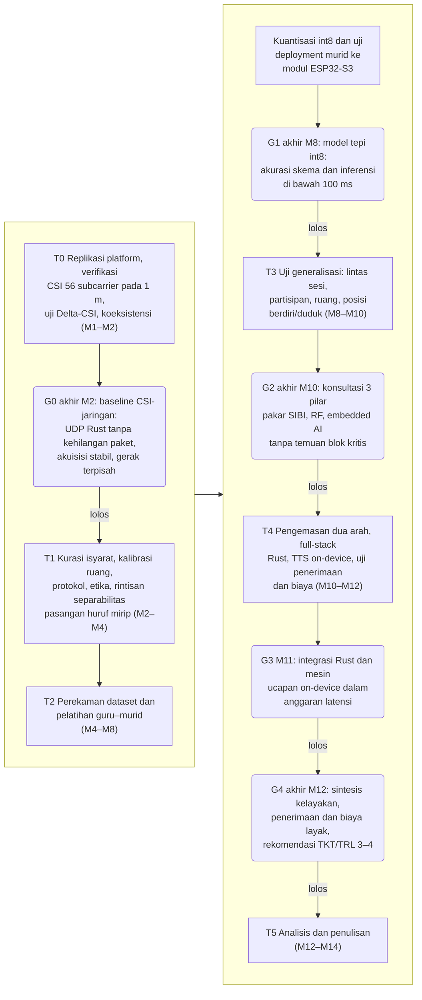
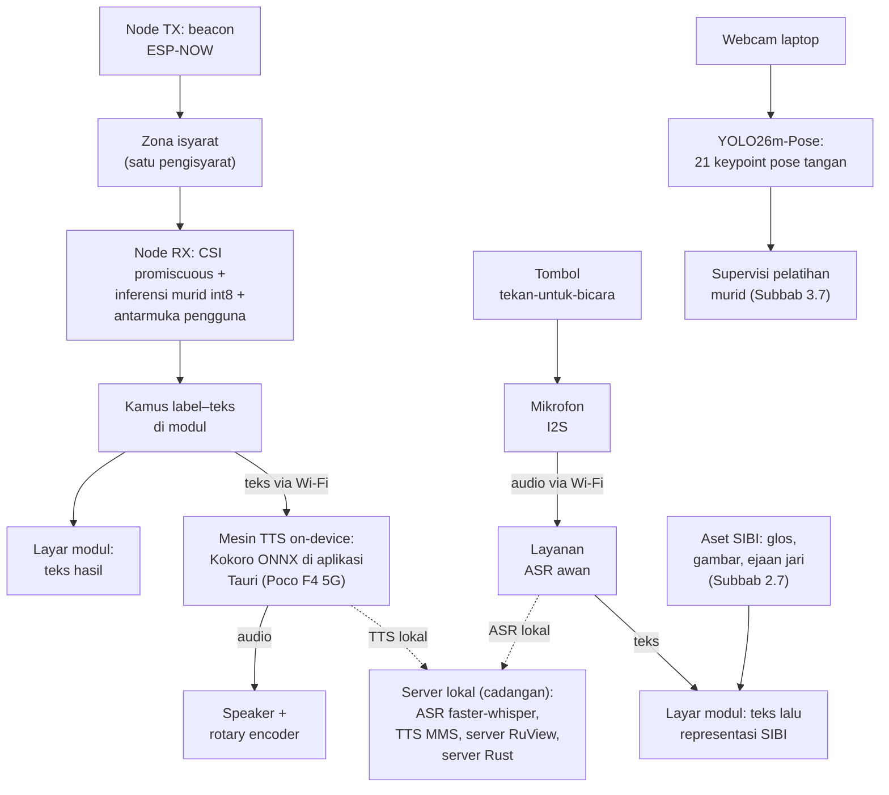
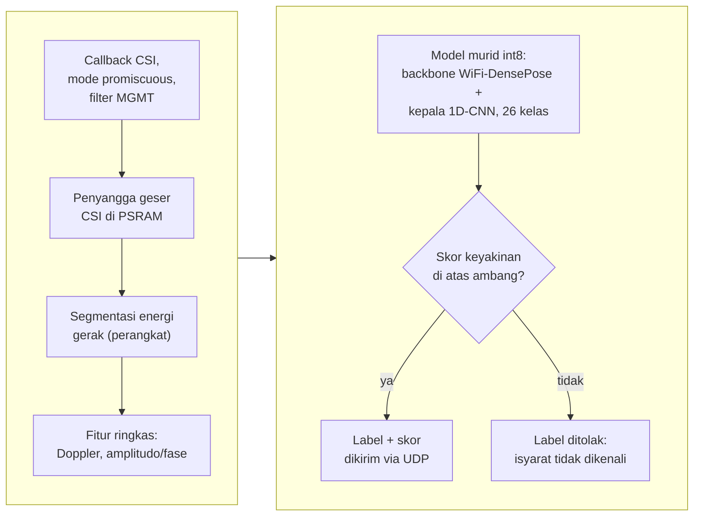

# BAB III METODE PENELITIAN

## 3.1 Desain Penelitian

Penelitian ini berbentuk studi kelayakan kuantitatif bergerbang. Sisi kuantitatifnya mengukur tiga hal: kemampuan CSI dari satu tautan antarmodul ESP32-S3 membedakan 26 huruf alfabet manual SIBI, kemampuan model terkuantisasi berjalan di modul, dan kinerja kedua jalur penerjemahan. Komponen yang lulus uji dikemas menjadi purwarupa, lalu dinilai lewat uji operasional, uji kegunaan skala kecil, dan penilaian validator penutur tunarungu. Mengapa bergerbang? Alasannya jujur: belum ada yang membuktikan CSI mampu membedakan isyarat SIBI. Kemampuan itu tidak boleh diperlakukan sebagai asumsi; setiap tahap menghasilkan artefak tetap, kegagalan gerbang dicatat sebagai temuan, dan kriteria akurasi dirumuskan relatif terhadap peluang acak (Subbab 2.9). Inti pelatihannya adalah distilasi guru–murid: keluaran guru kamera YOLO26m-Pose, berupa deret 21 *keypoint* dan label, menjadi *ground truth* yang mengawasi pelatihan murid ber-*backbone* WiFi-DensePose int8 berkepala 1D-CNN yang berjalan langsung di modul (Subbab 3.7). Rumusan masalah pertama dijawab pada tahap replikasi platform hingga distilasi, kedua pada uji klasifikasi dan *deployment*, dan ketiga pada uji operasional, kegunaan, serta penilaian validator.

## 3.2 Tahapan Penelitian

Empat belas minggu (M1–M14) dibagi ke dalam enam tahap: replikasi platform dan karakterisasi (T0), kurasi isyarat dan protokol (T1), perekaman *dataset* serta pelatihan guru–murid (T2), uji generalisasi (T3), pengemasan purwarupa dan uji penerimaan (T4), serta analisis dan penulisan (T5). Lima gerbang keputusan menutup rangkaian itu dengan kriteria, ukuran, dan tindakan bila gagal yang dirinci pada Tabel 3.5. Penerimaan pengguna dan biaya dinilai G4, yang kemudian menyusun rekomendasi posisi TKT/TRL 3–4 [trl]. Jalur lolosnya dirangkum pada Gambar 3.1. Bila G0 gagal dua kali, jalur CSI dihentikan dan dilaporkan sebagai temuan, sedangkan kriteria seluruh gerbang difinalkan bersama pembimbing sebelum dinilai lalu dihimpun pada Tabel 3.7.

Gambar 3.1 Tahapan penelitian T0–T5 dan gerbang keputusan G0–G4 (jalur lolos; tindakan bila gagal pada Tabel 3.5)

Tahap T0–T2 membangun dasar data. T0 menyiapkan dua modul dengan *firmware* `esp32-csi-node` RuView [ruview] lalu menjalankan empat uji tanpa partisipan: verifikasi 56 *subcarrier* yang terbaca stabil pada jarak baku 1 meter, uji Delta-CSI (Subbab 3.8.1) untuk memisahkan pola CSI saat bergerak dari saat diam, uji koeksistensi radio dengan *streaming* audio aktif, dan pengukuran laju pencuplikan. T1 meliputi kurasi 26 huruf bersama validator, kalibrasi ruang, protokol dan etika, serta perizinan (Subbab 3.6); pasangan huruf paling mirip juga ditetapkan di sini sebagai bahan gerbang G1.

Pada T2, *dataset* kurang lebih 30 repetisi per isyarat per sesi direkam disertai video yang tersinkron (Subbab 3.6). Alur pelatihannya berbentuk distilasi: segmen disaring lewat *keypoint* guru, guru menjalani pelatihan lanjutan pada data visual SIBI di GPU Kaggle, jendela CSI disandingkan dengan *ground truth* guru berdasarkan penanda waktu, murid dilatih dengan supervisi label dan deret pose guru, lalu model terpilih dikuantisasi int8 dan di-*deploy* (Subbab 3.7). T2 melahirkan *dataset* berlabel, model terlatih, dan laporan *deployment*. G1 menilai hasilnya; bila gagal, cakupan dipangkas menjadi himpunan huruf dengan pembeda CSI terkuat (Tabel 3.7).

Tahap T3–T5 berisi pengujian dan pelaporan. Generalisasi lintas sesi, partisipan, ruang, serta posisi berdiri-duduk diuji pada T3, termasuk pada satu pengguna baru tanpa pelatihan ulang (Subbab 3.7) dengan acuan Widar3.0 [widar3]; bila ketahanan lintas pengguna rendah, cakupan berubah menjadi personalisasi per pengguna dan dilaporkan sebagai temuan. T4 mengemas model menjadi purwarupa dua arah (Subbab 3.5), menjalankan uji operasional dan jalur ucapan (Subbab 3.8) yang dinilai G3, lalu ditutup uji penerimaan, penilaian validator, dan analisis biaya yang dinilai G4. Pada T5, seluruh artefak dianalisis dan laporan kelayakan disusun lengkap dengan rekomendasi TKT/TRL 3–4 [trl] beserta keterbatasan eksplisitnya (Subbab 1.4).

## 3.3 Waktu dan Lokasi Penelitian

Pelaksanaan penelitian jatuh pada [PERLU DATA: bulan dan tahun pelaksanaan penelitian] di Jawa Timur, bekerja sama dengan [PERLU DATA: nama SLB atau lembaga mitra di Jawa Timur]. Perekaman dan pengujian berlangsung di sedikitnya dua ruang sebagai jumlah minimum skema *leave-one-room-out*, dan tiap ruang dikalibrasi lebih dulu sebelum perekaman (Subbab 3.5).

## 3.4 Alat dan Bahan

Tabel 3.1 dan Tabel 3.2 menyajikan perangkat keras dan perangkat lunak penelitian. Node penginderaan dipegang sepasang modul ESP32-S3: TX memancarkan *beacon* ESP-NOW, sedangkan RX mengekstrak CSI 56 *subcarrier* pada 2,4 GHz kanal 20 MHz sekaligus memuat antarmuka. Supaya eksperimen bisa diulang, versi perangkat lunak dicatat bersama log pelatihan. Bahan penelitiannya meliputi *dataset* CSI beserta deret pose guru hasil perekaman sendiri, kode dan data pelatihan model guru dari repositori peneliti, lembar definisi huruf, aset tampilan arah kedua, formulir persetujuan, instrumen uji, dan kuesioner persepsi. Perekaman dilakukan sendiri karena pengenalan isyarat SIBI dari CSI memang belum ditemukan dalam penelusuran (Subbab 2.10).

Tabel 3.1 Perangkat keras penelitian

| No. | Nama | Spesifikasi | Jumlah | Keterangan |
|---|---|---|---|---|
| 1 | Modul ESP32-S3 | PSRAM 8 MB; 2,4 GHz 802.11b/g/n, kanal 20 MHz (56 *subcarrier*), 1T1R; varian yang direkomendasikan RuView [ruview] | 2 unit | Node TX (pemancar *beacon*) dan node RX (penerima CSI dan antarmuka) |
| 2 | Layar modul | OLED 0,96 inci I2C (128×64) atau TFT 1,3 inci SPI (240×240) [PERLU DATA: model final] | 1 unit | Tampilan huruf, baterai, kanal, mode kerja |
| 3 | *Rotary encoder* EC11 dan tombol tekan | Putar 360 derajat, 20 detak per putaran, tombol terintegrasi; sakelar sesaat *pull-up* internal | 1–2 unit | Navigasi menu, sensitivitas, tekan-untuk-bicara, reset |
| 4 | Pengeras suara dengan DAC I2S | Mini 8 Ohm 3 W, penguat kelas D MAX98357A | 1 set | Pemutaran suara TTS dari modul |
| 5 | Mikrofon I2S | INMP441, MEMS omnidireksional, SNR 61 dBA | 1 unit | Pintu suara arah kedua |
| 6 | Baterai Li-Po, BMS 1S, pengisi TP4056 | Li-Po 3,7 V 2.500–3.000 mAh [PERLU DATA: kapasitas final berdasarkan uji arus]; proteksi; pengisi 1 A USB-C | 1–2 set | Daya portabel, proteksi, dan pengisian |
| 7 | Laptop | ASUS TUF Dash F15 FX516PR: i7-11370H, RTX 3070 Laptop 8 GB VRAM, RAM 16 GB | 1 unit | Akuisisi jalur guru, pengembangan, pelatihan, server cadangan |
| 8 | Ponsel pintar | Poco F4 5G: Snapdragon 870, RAM 6 GB, Android | 1 unit | *Hotspot* portabel, klien Tauri, mesin TTS *on-device* |
| 9 | *Access point* | *Router* Wi-Fi 2,4 GHz dengan internet [PERLU DATA: pilihan final] | 1 unit | Jembatan jaringan dan penjangkar kanal, bukan penginderaan |
| 10 | *Webcam* | Bawaan laptop | 1 unit | Hanya untuk jalur guru |

Tabel 3.2 Perangkat lunak penelitian

| No. | Nama | Fungsi dalam penelitian |
|---|---|---|
| 1 | *Firmware* dan *server* RuView [ruview] | Menangkap CSI, mengirim UDP, kalibrasi ruang, segmentasi |
| 2 | `scripts/collect-ground-truth.py` (diadaptasi) | Sinkron kamera–CSI; estimator diganti YOLO26m-Pose |
| 3 | Model guru YOLO26m-Pose dan repositori alur kerja YOLO26 peneliti [ultralytics] | Ekstraksi *keypoint*; konversi *dataset*, pelatihan deterministik, pencatatan eksperimen (Subbab 3.7) |
| 4 | Layanan GPU Kaggle dan model WiFi-DensePose terpralatih [ruview] | Pelatihan guru dan murid; inisialisasi *backbone* murid |
| 5 | Python, scikit-learn, PyTorch | Ekstraksi fitur, pelatihan SVM dan murid, evaluasi |
| 6 | ESP-DL dengan akselerasi ESP-NN (alternatif: TensorFlow Lite Micro) [esp-dl], [esp-nn], [tflite-micro] | Menjalankan murid int8 pada node RX |
| 7 | faster-whisper dan MMS-TTS-ind [faster-whisper], [mms-card]; layanan ucapan awan [PERLU DATA: layanan final hasil uji banding] | ASR dan TTS cadangan lokal; jalur utama pengenalan ucapan |
| 8 | Rust, Tokio, Axum, Leptos, Tauri [tokio], [axum], [leptos], [tauri] | Server purna Rust, dasbor WASM, aplikasi klien ponsel |
| 9 | Kokoro TTS ONNX dan ONNX Runtime [kokoro-onnx], [onnxruntime] | Mesin TTS *on-device*; prasyarat suara Indonesia pada G3 |
| 10 | Kamus label-teks dan teks-isyarat | Dikembangkan sendiri; kamus label-teks dimuat pada modul |

## 3.5 Perancangan Sistem

Gambar 3.2 memperlihatkan keseluruhan sistem: dua jalur operasional tanpa kamera ditambah satu jalur guru yang hanya aktif saat akuisisi dan pelatihan. Arah pertama bermula dari *beacon* ESP-NOW node pemancar yang melewati zona isyarat; gerak pengisyarat mengubah deret CSI yang ditangkap node penerima, model murid int8 menghasilkan label beserta skor keyakinan, label dipetakan menjadi teks Indonesia, teks muncul di layar, lalu dikirim ke aplikasi Tauri pada ponsel untuk dibunyikan lewat Kokoro TTS ONNX secara luring. Arah kedua dimulai ketika tombol tekan-untuk-bicara mengaktifkan mikrofon: ucapan dikenali layanan ASR, teks muncul di layar, lalu dipetakan ke representasi SIBI dari aset modul (Subbab 2.7). Saat internet terputus, sintesis tetap berjalan *on-device* dan ASR beralih ke server lokal faster-whisper. Jalur guru, yang memakai *webcam* dan YOLO26m-Pose untuk mengekstrak deret *keypoint* sebagai supervisi pelatihan, bukan bagian produk akhir.

Gambar 3.2 Arsitektur produk akhir tanpa kamera. Rantai kiri = arah 1 (isyarat menjadi teks dan suara); rantai tengah = arah 2 (ucapan menjadi representasi SIBI); rantai kanan = jalur guru yang hanya aktif saat akuisisi dan pelatihan; garis putus-putus = beralih ke server lokal ketika internet tidak tersedia.

Topologi jaringannya menyatukan seluruh perangkat pada satu *access point* dan satu kanal, sehingga penangkapan CSI berjalan serentak dengan komunikasi data (Subbab 2.3). Node pemancar memancarkan *beacon* sebagai sumber bingkai CSI, node penerima mengirim bingkai, label, dan skor melalui UDP kepada server Rust sebagai telemetri riset, dan server lokal menjalankan server RuView, server Rust, faster-whisper, serta MMS-TTS-ind sebagai jalur cadangan.

Kedua modul dipasang setinggi dada dan saling mengapit zona isyarat; uji Delta-CSI memeriksa kesesuaiannya. Zona hanya ditempati satu pengisyarat per sesi, sistem tidak mengidentifikasi individu, dan jarak antarmodul (baku 1 meter) ditetapkan pada T0 lalu dicatat dalam metadata sesi (Tabel 3.7). Karena CSI peka terhadap perubahan ruang [ruview], [widar3], setiap sesi diawali kalibrasi ruang bawaan RuView selama kurang lebih empat menit dengan 600 bingkai dan 8 *anchor*; posisi perabot, pendingin ruangan, serta orang yang lewat dicatat sebagai kovariat analisis.

*Enclosure* cetak tiga dimensi bahan PLA atau ABS menampung papan, baterai, BMS, TP4056, dan seluruh antarmuka node penerima: layar, pengeras suara, dan mikrofon pada muka depan atau atas, *rotary encoder* serta tombol pada samping, dan port USB-C pada bawah; node pemancar dikemas serupa tanpa antarmuka. Pemetaan pin GPIO pada Tabel 3.3 dipilih agar tidak menabrak pin *strapping* (GPIO 0, 3, 45, 46) maupun kanal USB bawaan papan [esp32s3], dan penetapannya diverifikasi ulang pada T0. Rantai dayanya tersusun atas baterai, BMS 1S, TP4056, serta regulator 3,3 volt papan; tegangan baterai diukur melalui pembagi tegangan sehingga persentase baterai bisa tampil di layar. [PERLU DATA: berkas model enclosure final] [PERLU ILUSTRASI: foto atau render enclosure dan tata letak komponennya]

Tabel 3.3 Matriks pinout wiring GPIO node penerima

| No. | Subsistem | Pin modul | GPIO ESP32-S3 | Fungsi |
|---|---|---|---|---|
| 1 | Layar I2C (OLED) | SDA / SCL | GPIO 8 / GPIO 9 | Jalur data dan *clock* bus I2C |
| 2 | *Rotary encoder* EC11 | CLK (A) / DT (B) / SW | GPIO 10 / GPIO 11 / GPIO 12 | Detak, arah putaran, tombol |
| 3 | Tombol tekan | OUT | GPIO 13 | Tekan-untuk-bicara dan reset; *pull-up* internal |
| 4 | Mikrofon INMP441 | SCK / WS / SD | GPIO 14 / GPIO 15 / GPIO 16 | *Clock*, *word select*, data I2S penerima |
| 5 | DAC MAX98357A | BCLK / LRC / DIN | GPIO 17 / GPIO 18 / GPIO 21 | *Clock*, penanda kiri-kanan, data I2S pengirim |
| 6 | Pemantau tegangan baterai | ADC | GPIO 1 (ADC1_CH0) | Keluaran pembagi tegangan baterai |

Seluruh perangkat lunak ditulis purna Rust (Subbab 2.8): Tokio menjalankan pendengar UDP bingkai CSI [tokio], Axum menyediakan HTTP dan WebSocket bagi dasbor Leptos WASM [axum], [leptos], dan aplikasi Tauri pada ponsel menerima teks hasil isyarat sekaligus menjalankan Kokoro TTS ONNX [tauri], [kokoro-onnx]. Target *parsing* bingkai di bawah 0,2 ms serta memori server di bawah 40 MB baru diukur pada G3 (Subbab 3.8.3). Mesin sintesisnya berjalan sepenuhnya di ponsel: Kokoro-82M ONNX diinferensikan luring lewat ONNX Runtime di dalam Tauri [kokoro-card], [onnxruntime] dengan target inferensi frasa pendek di bawah 100 ms pada Snapdragon 870. Prasyaratnya hanya satu, yaitu tersedia suara bahasa Indonesia pada Kokoro; bila belum, mesin *on-device* beralih ke MMS-TTS-ind [mms-card] dan peralihan itu dilaporkan.

## 3.6 Protokol Perekaman Dataset, Partisipan, dan Etika

Partisipan terdiri atas 3–4 pengisyarat kompeten, sedikitnya satu validator penutur tunarungu, serta 3–5 pengguna uji dari kelompok sasaran (guru, siswa tunarungu, wali murid). Agar skema lintas sesi bisa dijalankan, setiap pengisyarat direkam dalam sedikitnya dua sesi. Kurasi isyarat mengacu pada *Kamus SIBI* [kamus-cetak]: lembar definisi memuat konfigurasi tangan-jari serta lintasan J dan Z, validator menyetujuinya, dan pasangan huruf paling mirip ditetapkan sebagai bahan G1, sedangkan kosakata tampilan arah kedua meliputi 26 huruf, 9 angka, serta kata terpilih [opensibi]. Perekaman memakai *elisitasi* terisolasi, satu huruf per segmen dengan jeda antarrepetisi: huruf statis diperagakan sebagai pose yang ditahan sejenak, sedangkan J dan Z diperagakan sebagai lintasan gerak. Prosedur perekaman setiap sesi adalah sebagai berikut.

1. Menyiapkan seluruh peralatan yang dipakai.
2. Memasang kedua modul, pemancar dan penerima, lalu menghubungkan seluruh perangkat ke *access point* pada satu kanal.
3. Menjalankan kalibrasi ruang seraya mencatat metadata sesi: tanggal, ruang, kode pengisyarat, posisi modul, dan kondisi latar.
4. Menjalankan `scripts/collect-ground-truth.py` supaya perekaman CSI dan *webcam* berjalan sinkron.
5. Memunculkan kartu pemandu huruf target, merekam satu repetisi, memberi jeda, lalu mengulanginya sampai setiap huruf mencapai kurang lebih 30 repetisi.
6. Membuang segmen yang tangan tidak terdeteksi model guru, yang mengalami *jitter* *keypoint* ekstrem, atau yang terpotong, lalu mencatat tingkat segmen terbuang.
7. Meminta validator mengambil sampel segmen untuk memeriksa kebenaran bentuk isyarat.

Baru setelah persetujuan lembaga mitra dan persetujuan tertulis setiap partisipan diperoleh [PERLU DATA: lembaga atau komisi pemberi persetujuan etik], perekaman dimulai; partisipan berhak mengundurkan diri kapan saja. Formulir persetujuan menerangkan bahwa kamera hanya menyala pada sesi akuisisi jalur guru, produk akhir bebas kamera, dan mode privasi RuView aktif. Video semata-mata dipakai untuk verifikasi batas segmen, penyaringan kualitas, dan diagnosis; penyimpanannya terbatas dan tidak dipublikasikan. Karena audio arah kedua dikirim ke layanan awan, tujuannya diungkapkan pada formulir dan kebijakan penyimpanan layanan diperiksa sebelum dipakai. *Dataset* yang dipublikasikan hanya memuat CSI, label, dan *keypoint*, tanpa identitas.

## 3.7 Pengolahan Sinyal, Ekstraksi Fitur, Pelatihan Guru–Murid, dan Deployment

Bingkai CSI dibatasi *firmware* RuView paling sering setiap 20 ms atau 50 bingkai per detik [ruview]; laju aktualnya diukur pada T0, dan bila terukur lebih rendah, pita Doppler yang dianalisis dipangkas hingga setengah laju aktual. Deret CSI dipotong menjadi segmen huruf dengan segmentasi energi gerak RuView [ruview]: J dan Z terpotong jelas dari energinya, sedangkan huruf statis memakai jendela tahan pose yang ambang sekaligus panjangnya ditetapkan pada Tabel 3.7. Fitur tiap segmen terdiri atas amplitudo dan fase *subcarrier* terpilih serta spektrum Doppler [ma-csur], [widar3], lalu diringkas menjadi vektor untuk SVM dan deret waktu untuk 1D-CNN.

Pada data visual SIBI hasil T2, model guru YOLO26m-Pose menjalani pelatihan lanjutan di layanan server GPU Kaggle. Pelatihan tidak dibangun dari nol karena repositori peneliti (Tabel 3.2) memuat alur kerja YOLO26 lengkap yang sudah teruji [ultralytics]. Sembilan eksperimen tercatat melahirkan model juara *pose* mAP50 0,8944 pada 49 kelas (25 huruf dan 24 kata); eksperimen lanjutan pada 24 huruf statis mencapai mAP50 0,9580 dengan akurasi huruf 97,6%. Kualitas guru dievaluasi sebelum dipakai, dari proporsi bingkai tangan terdeteksi, *jitter* *keypoint*, dan pemeriksaan sampel (Tabel 3.7). Selama akuisisi, kartu pemandu protokol menentukan huruf per repetisi, sehingga label guru bisa dicocokkan dengan perintah protokol.

*Dataset* murid terbentuk dengan menyelaraskan tiga deret menurut penanda waktu: jendela CSI hasil segmentasi, label huruf guru, dan deret pose guru. Murid ber-*backbone* WiFi-DensePose int8, yang diinisialisasi dari model terpralatih RuView [ruview], [densepose-wifi] dan berkepala 1D-CNN, dilatih pada GPU Kaggle dengan kerugian gabungan, yaitu kerugian klasifikasi ditambah suku supervisi guru; suku inilah yang mengikat representasi murid pada deret pose guru [hinton]. Dua pembanding dilatih pada data yang sama, yakni SVM atas fitur ringkas [svm] dan murid ablasi tanpa suku supervisi guru, sehingga manfaat supervisi bisa dinilai langsung dari data. Setelah pelatihan selesai, murid memprediksi kelas dari jendela CSI saja, tanpa kamera.

Enam skema pada Tabel 3.4 mengukur kinerja; untuk skema dalam sesi, pembagiannya temporal per blok dan tidak acak. Data validasi hanya berasal dari data latih, sehingga data uji tidak pernah dipakai untuk memilih *subcarrier*, menormalkan fitur, ataupun menetapkan ambang (Tabel 3.7).

Tabel 3.4 Skema pembagian data

| No. | Skema | Data latih | Data uji | Aspek yang diukur |
|---|---|---|---|---|
| 1 | Dalam sesi (blok temporal) | Blok awal satu sesi | Blok akhir sesi yang sama | Separabilitas orang, ruang, sesi sama |
| 2 | Lintas sesi | Sebagian sesi pengisyarat di satu ruang | Sesi lain, ruang sama | Ketahanan antarsesi |
| 3 | Lintas partisipan (*leave-one-subject-out*) | Semua pengisyarat kecuali satu | Pengisyarat yang ditinggalkan, bergiliran | Ketahanan pergantian orang |
| 4 | Lintas ruang (*leave-one-room-out*) | Semua ruang kecuali satu | Ruang yang ditinggalkan, bergiliran | Ketahanan pergantian ruang |
| 5 | Pengguna baru | Seluruh pengisyarat | Satu pengguna baru tanpa pelatihan ulang | Kesiapan orang baru |
| 6 | Lintas posisi | Posisi berdiri (atau sebaliknya) | Posisi duduk | Ketahanan pergeseran posisi |

Keluaran klasifikator dilengkapi skor keyakinan dan mekanisme penolakan [chow]. Segmen di bawah ambang berujung status penolakan pada kedua arah: *speaker* tidak mengucapkan apa pun dan layar memunculkan pesan isyarat tidak dikenali. Menolak lebih aman daripada menebak kelas yang salah; ambangnya ditetapkan dari data validasi, dan kecukupannya diperiksa lewat laju deteksi palsu serta penilaian validator (Subbab 3.8).

Setelah terpilih, model dikuantisasi int8 lalu dijalankan pada modul penerima melalui ESP-DL dengan akselerasi ESP-NN dan penyangga PSRAM [esp-dl], [esp-nn]; TensorFlow Lite Micro menjadi alternatifnya [tflite-micro], dan radio tetap terikat satu kanal bersama *access point* dengan *power save* dimatikan [ruview]. Alur inferensi pada perangkat tampak pada Gambar 3.3: bingkai *promiscuous* masuk ke penyangga geser, segmen terdeteksi dari energi gerak, fitur dihitung, model int8 menghasilkan kelas dan skor, dan keluaran di atas ambang dikirim melalui UDP. Waktu inferensi per segmen, pemakaian memori, serta pengaruhnya pada laju pemrosesan diukur lalu dilaporkan; bila model terbukti terlalu berat, klasifikasi pindah ke server menurut jalur cadangan (Subbab 3.11).

Gambar 3.3 Inferensi langsung pada ESP32-S3

## 3.8 Skenario Pengujian dan Metrik Evaluasi

G0 berdiri di atas uji Delta-CSI dan koeksistensi, G1 di atas uji klasifikasi dan *deployment*, G2 di atas konsultasi tiga pilar, G3 di atas uji operasional dan jalur ucapan, serta G4 di atas uji kegunaan, penilaian validator, dan analisis biaya. Satu uji lagi, cakupan kamus, melengkapi analisis tanpa menjadi syarat gerbang.

### 3.8.1 Uji Delta-CSI dan Koeksistensi

Satu pertanyaan dijawab uji Delta-CSI: apakah gerak tubuh menghasilkan perubahan CSI yang terpisah jelas dari kondisi tanpa gerak (ukuran keterpisahannya pada Tabel 3.7). Prosedurnya sebagai berikut.

1. Memasang kedua modul pada posisi awal sehingga mengapit zona isyarat.
2. Merekam CSI dalam tiga kondisi: ruang kosong, pengisyarat diam, dan pengisyarat bergerak.
3. Menjalankan modul penerima dengan CSI, koneksi *station*, dan UDP secara serentak, termasuk saat *streaming* audio, serta mencatat laju CSI aktual dan paket yang hilang.
4. Membandingkan pola antarkondisi, lalu mencatat dan menganalisis hasilnya sebagai bahan G0.

### 3.8.2 Uji Klasifikasi

Keenam skema diuji dengan metrik Subbab 2.9, selalu dibandingkan terhadap peluang acak sekitar 3,8% untuk 26 kelas; angka acak itu dihitung ulang bila cakupan dipangkas. Akurasi dilaporkan dalam dua versi: tanpa penolakan (seluruh segmen uji) dan dengan penolakan (segmen yang diterima). Murid ablasi dilaporkan berdampingan dengan murid utama dan SVM.

### 3.8.3 Uji Operasional

Tiga hal diukur pada uji operasional: deteksi palsu per jam tanpa peragaan, latensi ujung ke ujung tiap arah, dan konsumsi arus modul. Prosedurnya sebagai berikut.

1. Menjalankan purwarupa di ruang yang sudah terkalibrasi.
2. Merekam kondisi tanpa peragaan, termasuk ketika orang lewat dan kipas menyala, lalu mencatat isyarat yang terdeteksi.
3. Meminta pengisyarat memperagakan isyarat target, lalu mencatat waktu selesainya isyarat dan terdengarnya suara; pada arah kedua, mengucapkan frasa uji dan mencatat waktu representasi tampil.
4. Mengukur arus modul pada beberapa kondisi kerja, kemudian menghitung estimasi ketahanan baterai.
5. Menghitung biaya purwarupa dari harga komponen serta perkiraan biaya layanan ucapan per jam pemakaian.
6. Menganalisis deteksi palsu, latensi pada kedua arah, dan ketahanan baterai terhadap indikator layak yang ditetapkan kemudian (Tabel 3.7).

### 3.8.4 Uji Jalur Ucapan dan Cakupan Kamus

Komponen bahasa pada kedua arah dinilai lewat uji jalur ucapan, yang membandingkan jalur *on-device*, awan, dan server lokal disertai cakupan kamus arah kedua. Prosedurnya sebagai berikut.

1. Menyiapkan daftar frasa uji pendek berbahasa Indonesia [PERLU DATA: daftar frasa uji dan jumlah penutur] yang memuat kata di dalam dan di luar kamus.
2. Merekam teks keluaran layanan ASR awan, lalu menghitung akurasi katanya terhadap teks acuan.
3. Mengukur waktu pengenalan, pemetaan, inferensi TTS *on-device*, serta total ujung ke ujung pada kedua arah.
4. Mengulang pengukuran pada kedua kandidat mesin *on-device* (Kokoro ONNX dan MMS-TTS-ind) serta jalur pembanding awan dan server lokal, lalu menimbang mutu dan latensinya.
5. Memverifikasi prasyarat suara Indonesia sambil mengukur *parsing* UDP dan memori server Rust (Subbab 2.8).
6. Mencatat proporsi kata uji yang tampil sebagai representasi isyarat, ejaan jari, dan gagal tampil, kemudian menganalisis mutu, latensi, serta ketergantungan internet sebagai bahan keputusan G3 (Tabel 3.7).

### 3.8.5 Uji Kegunaan dan Penilaian Validator

Keterpakaian purwarupa ditelaah lewat uji kegunaan bersama 3–5 pengguna kelompok sasaran pada skenario tugas terbimbing, yaitu saling menyampaikan pesan pendek melalui ejaan huruf dan kosakata tampilan. Tiap pengguna menjalani langkah berikut.

1. Menjelaskan tujuan uji, batas kosakata, kenyataan bahwa kamera tidak menyala, dan hak mundur, lalu meminta persetujuan tertulis.
2. Memberi waktu berlatih singkat bersama kamus tampilan.
3. Menjalankan tugas komunikasi dua arah sambil mencatat keberhasilan, waktu penyelesaian, dan keluaran yang menyesatkan.
4. Meminta pengguna mengisi kuesioner skala Likert [likert] mengenai kegunaan, kejelasan, dan keinginan memakai ulang.
5. Merekapitulasi hasil, lalu menganalisisnya secara deskriptif tanpa klaim kausal.

Kewajaran keluaran kedua arah dinilai validator penutur tunarungu; keluaran sistem dan penilaian independennya dicatat dalam tabel silang, sedangkan kasus yang dinilai keliru dilaporkan tersendiri. Sebagai analisis sekunder, kesalahan klasifikator dikaitkan luring dengan kemiripan pose pada deret *keypoint* guru agar kesalahan konfigurasi mirip dapat dibedakan dari kesalahan sinyal lemah.

### 3.8.6 Kriteria Gerbang Keputusan

Tabel 3.5 menyajikan kriteria tiap gerbang beserta tindakan bila gagal. Kelayakan pada rumusan ketiga ditinjau per dimensi, bukan semata dari lolosnya G4, dan ambang kuantitatifnya difinalkan bersama pembimbing sebelum gerbang dinilai.

Tabel 3.5 Kriteria gerbang keputusan

| Gerbang | Nama dan waktu | Kriteria lolos (ambang usulan) | Tindakan bila gagal |
|---|---|---|---|
| G0 | Baseline CSI dan jaringan, akhir M2 | Akuisisi 56 *subcarrier* 1 m ke UDP Rust terbaca stabil; laju sekurang-kurangnya 25 bingkai per detik; paket hilang tidak melampaui 0,1%; pola bergerak terpisah dari diam | Perbaikan penempatan satu kali; gagal lagi berarti jalur CSI dihentikan dan dilaporkan |
| G1 | Model tepi int8 dan distilasi, akhir M8 | Akurasi dalam sesi sekurang-kurangnya 50% (sekitar 13 kali acak 3,8%) dan melampaui SVM; inferensi int8 di bawah 100 ms; pembanding ablasi dilaporkan | Pangkas himpunan huruf pembeda terkuat, lalu nilai ulang |
| G2 | Tiga pilar pakar, akhir M10 | Penilaian tertulis pakar SIBI-aksesibilitas, RF-*wireless sensing*, dan *embedded AI* masuk semua; tanpa temuan blok kritis; skor rata-rata per pilar sekurang-kurangnya 3 dari 5 | Perbaiki temuan blok atau sempitkan klaim, lalu nilai ulang |
| G3 | Integrasi Rust dan mesin ucapan, M11 | Latensi arah 1 tidak melampaui 2 detik dan arah 2 tidak melampaui 3 detik pada jalur *on-device* (5 detik cadangan); TTS di bawah 100 ms; *parsing* UDP di bawah 0,2 ms; memori server di bawah 40 MB; suara Indonesia tersedia atau peralihan dilaporkan | Beralih ke mesin *on-device* alternatif, lalu server lokal atau awan; melampaui berarti temuan |
| G4 | Sintesis kelayakan, akhir M12 | Skor persepsi rata-rata sekurang-kurangnya 3,0 dari 5; validator menyetujui kewajaran; biaya lengkap; rekomendasi TKT/TRL 3–4 tertulis | Hasil negatif tetap dilaporkan; rekomendasi menyatakan posisi lebih rendah beserta alasan |

## 3.9 Jadwal Penelitian

Tabel 3.6 memuat jadwal empat belas minggu; tanda ■ menandai minggu pelaksanaan.

Tabel 3.6 Jadwal penelitian

| No. | Kegiatan | M1 | M2 | M3 | M4 | M5 | M6 | M7 | M8 | M9 | M10 | M11 | M12 | M13 | M14 | Gerbang |
|---|---|---|---|---|---|---|---|---|---|---|---|---|---|---|---|---|---|
| 1 | T0 Replikasi platform, uji Delta-CSI, dan koeksistensi | ■ | ■ | | | | | | | | | | | | | G0 (akhir M2) |
| 2 | T1 Kurasi alfabet SIBI dan kosakata, kalibrasi ruang, protokol, perizinan | | ■ | ■ | ■ | | | | | | | | | | | — |
| 3 | T2 Perekaman *dataset*, pelatihan guru–murid, kuantisasi, uji *deployment* | | | | ■ | ■ | ■ | ■ | ■ | | | | | | | G1 (akhir M8) |
| 4 | T3 Uji lintas sesi, partisipan, ruang, dan pengguna baru | | | | | | | | ■ | ■ | ■ | | | | | G2 (akhir M10) |
| 5 | T4 Pengemasan dua arah, Rust, TTS *on-device*, uji operasional, jalur ucapan, kamus, kegunaan, validator | | | | | | | | | | ■ | ■ | ■ | | | G3 (M11), G4 (akhir M12) |
| 6 | T5 Analisis dan penulisan | | | | | | | | | | | | ■ | ■ | ■ | — |

## 3.10 Parameter Rancangan yang Ditetapkan Kemudian

Sebagian parameter bergantung pada kesepakatan pembimbing, hasil tahap sebelumnya, atau data validasi; parameter semacam itu dihimpun pada Tabel 3.7 dan ditetapkan lebih dulu sebelum dipakai menilai data uji maupun gerbang terkait.

Tabel 3.7 Parameter rancangan yang ditetapkan kemudian

| No. | Parameter | Waktu atau dasar penetapan | Status |
|---|---|---|---|
| 1 | Finalisasi ambang seluruh gerbang G0–G4 | Sebelum gerbang dinilai | [PERLU DATA: finalisasi ambang usulan Tabel 3.5 bersama pembimbing] |
| 2 | Ambang G1, tindakan gagal kedua, dan kriteria pemangkasan himpunan huruf | Sebelum eksperimen | [PERLU DATA: ambang, tindakan, dan kriteria pemangkasan tanpa data uji] |
| 3 | Kriteria kualitas model guru | Sebelum pelatihan murid | [PERLU DATA: ambang deteksi tangan, batas jitter, prosedur sampel] |
| 4 | Pemilihan *subcarrier*, lintasan puncak, dan segmentasi huruf statis | Sebelum dipakai | [PERLU DATA: kriteria, definisi operasional, ambang dan jendela tahan pose] |
| 5 | Pembagian data dan strategi Widar3.0 | Sebelum dipakai | [PERLU DATA: blok, proporsi latih-validasi-uji, komponen strategi, repetisi uji] |
| 6 | Suku supervisi guru dan ambang keyakinan | Dari data validasi | [PERLU DATA: bentuk suku distilasi, bobot, dan ambang] |
| 7 | Perlakuan data uji | Sebelum dipakai | [PERLU DATA: segmen tersaring kamera atau segmentasi tanpa koreksi] |
| 8 | Inklusi partisipan, sesi per ruang, dan token apresiasi | Sebelum dipakai | [PERLU DATA: kriteria kompetensi, kefasihan validator, pengguna uji, token] |
| 9 | Publikasi *dataset* dan persetujuan etik | Sebelum dipakai | [PERLU DATA: izin, repositori, lisensi, lembaga persetujuan etik] |
| 10 | Rubrik tiga pilar pakar dan personalisasi bila G2 gagal | Sebelum G2 dinilai | [PERLU DATA: rubrik, ambang skor, prosedur data latih pengguna] |
| 11 | Indikator layak operasional dan durasi pengamatan deteksi palsu | Sebelum G3 dinilai | [PERLU DATA: anggaran latensi, batas deteksi palsu, baterai minimum, durasi] |
| 12 | Kanal, jarak antarmodul, zona, model layar, audio, dan kapasitas baterai | Pada T0 atau sebelum T4 | [PERLU DATA: penetapan, model layar final, kapasitas dari uji arus] |
| 13 | Mesin TTS *on-device* final, layanan ASR, dan frasa uji | Pada G3 | [PERLU DATA: keputusan mesin, layanan, dan daftar frasa dari uji banding] |
| 14 | Kuesioner, rubrik validator dan pakar, serta asumsi biaya G4 | Sebelum T4 | [PERLU DATA: butir kuesioner, rubrik, batas kesesuaian, harga dan asumsi] |

## 3.11 Risiko dan Alternatif Cadangan

Tabel 3.8 merangkum risiko utama beserta mitigasinya. Cadangan disusun bertingkat mengikuti titik kegagalan, sehingga kegagalan komponen tidak menghentikan penelitian melainkan hanya mempersempit klaimnya; setiap pemakaian cadangan tercatat dalam laporan akhir.

Tabel 3.8 Risiko dan mitigasi

| No. | Risiko | Dampak | Mitigasi dan cadangan |
|---|---|---|---|
| 1 | Pola CSI isyarat tidak terpisah pada konfigurasi dua modul | G0 gagal; jalur CSI tidak layak | Perbaikan penempatan satu kali; gagal lagi berarti dihentikan dan dilaporkan |
| 2 | Akurasi lintas partisipan, ruang, atau posisi rendah (G2 gagal) | Klaim pengguna baru tak dapat dibuat | Personalisasi per pengguna (cadangan A); dilaporkan |
| 3 | Model int8 terlalu berat atau lambat di modul | Inferensi tepi tidak tercapai | Klasifikasi dipindah ke server, modul kirim fitur (cadangan B) |
| 4 | Beban radio gabungan CSI, UDP, dan audio bermasalah | Purwarupa tidak stabil | Modul ketiga khusus antarmuka (cadangan C) |
| 5 | Layanan ucapan tidak memadai, termasuk suara Kokoro belum tersedia | Jalur ucapan terganggu | Beralih ke MMS-TTS-ind ONNX, lalu server lokal atau awan (cadangan D) |
| 6 | Aset representasi isyarat mahal | Cakupan arah kedua sempit | Batasi ke glos dan gambar plus ejaan jari |
| 7 | Ketahanan baterai di bawah target | Klaim portabilitas melemah | Ukur arus, sesuaikan target, laporkan apa adanya |
| 8 | Rekrutmen, etika, atau kuota GPU terlambat | Jadwal mundur | Dua ruang dan pengisyarat cadangan; pelatihan terkompresi; minggu transisi |
| 9 | Huruf sangat mirip tak terpisahkan CSI | Himpunan kelas menyempit | Pangkas himpunan pada G1 sesuai Tabel 3.7; laporkan pasangan gagal |
