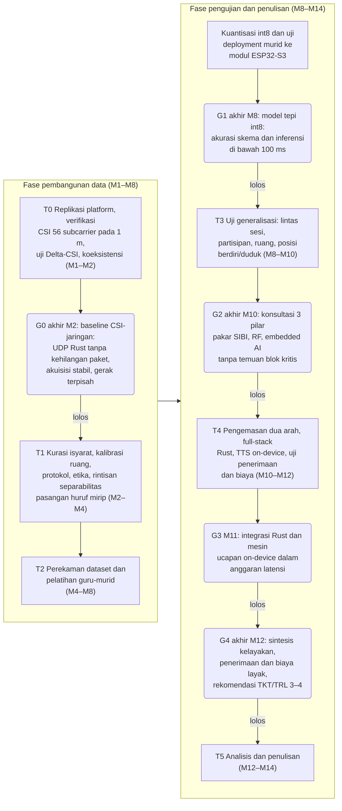
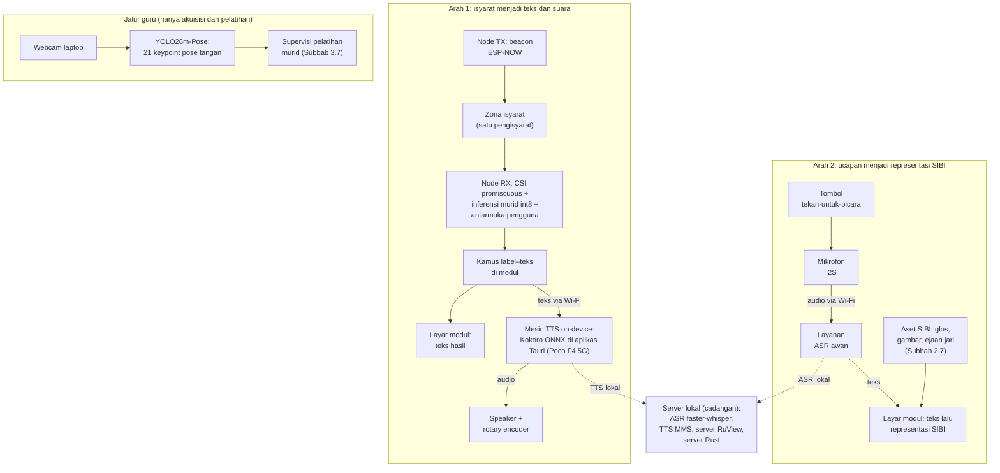
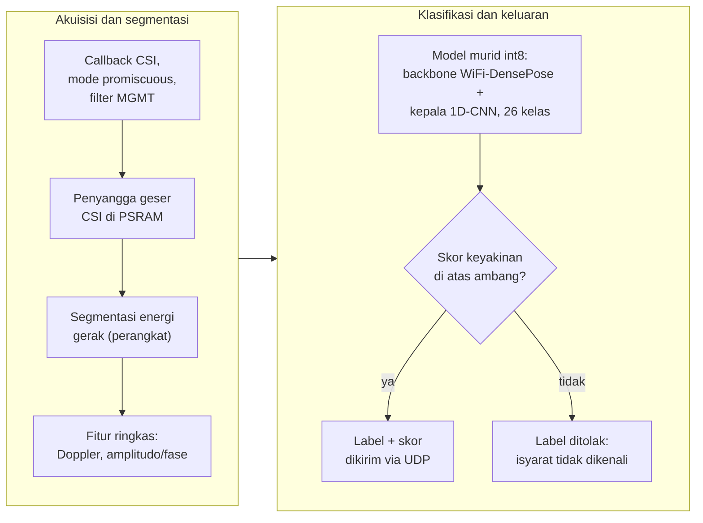

# STUDI KELAYAKAN PURWARUPA SenseSIBI: SISTEM PENERJEMAHAN DUA ARAH HURUF SIBI BERBASIS WI-FI CSI DENGAN INFERENSI ESP32-S3 DAN PEMROSESAN SERVER

**PROPOSAL PENELITIAN**

| Identitas | Keterangan |
|---|---|
| Judul | STUDI KELAYAKAN PURWARUPA SenseSIBI: SISTEM PENERJEMAHAN DUA ARAH HURUF SIBI BERBASIS WI-FI CSI DENGAN INFERENSI ESP32-S3 DAN PEMROSESAN SERVER |
| Jenis dokumen | Proposal penelitian (seminar proposal), BAB I–III + Daftar Pustaka — versi ringkas dengan persamaan bernomor dan ilustrasi tiga dimensi, ±35 halaman |
| Disusun oleh | [PERLU DATA: nama penulis] |
| NIM | [PERLU DATA: NIM penulis] |
| Program studi | [PERLU DATA: program studi] |
| Universitas | [PERLU DATA: nama universitas] |
| Pembimbing | [PERLU DATA: nama pembimbing, jika sudah ditentukan] |
| Tahun | [PERLU DATA: tahun penyusunan] |

> Catatan penyusunan: versi ini menyunting naskah v14 memakai kaidah humanizer-indonesia (adhiprib, v1.7, register akademik) di atas EYD V dan register mahasiswa D4/S1. Rumusan masalah dan tujuan kini mencantumkan teknologi intinya (CSI, ESP32-S3, YOLO26m-Pose, WiFi-DensePose, distilasi pengetahuan, inferensi int8, mesin ucapan dan pengenalan ucapan). Delapan belas persamaan bernomor ditambahkan beserta definisi lambang dan contoh perhitungan (model CSI, zona Fresnel, Doppler dan kaidah Nyquist, CSI-ratio, presisi-*recall*-F1, peluang acak, WER, statistik Delta-CSI, kerugian distilasi, kuantisasi affine, anggaran latensi, ketahanan baterai, dan biaya total). Tiga ilustrasi baru ditambahkan (zona Fresnel tiga dimensi, foto perangkat keras, dan skema tiga dimensi node penerima) sehingga gambar menjadi enam dan dinomori ulang menurut kemunculan. Daftar pustaka tetap 22 entri, konteks Jawa Timur tanpa mitra lembaga dipertahankan, dan penanda `[PERLU DATA: ...]` dijaga; istilah asing tetap ditulis asing (*on-device*, *fallback*).

---

# BAB I PENDAHULUAN

## 1.1 Latar Belakang

Anak tunarungu hampir selalu lahir dari orang tua yang bisa mendengar. Sejak hari-hari pertama, komunikasi di rumah berjalan dengan dua bahasa yang tidak saling mengerti: orang tua berbicara dengan suara, anak menjawab dengan isyarat. Orang tua lalu harus mempelajari bahasa isyarat dari nol, padahal waktu dan kesempatan berlatih serba terbatas. Angkanya memang timpang. Di Indonesia ada sekitar 1,92 juta penyandang tunarungu, sementara juru bahasa isyarat hanya sekitar 500 orang [1], sehingga satu juru bahasa harus melayani hampir 4.000 orang. Untuk kebutuhan harian seperti menceritakan sakit atau bertanya kepada penjual di pasar, menunggu juru bahasa jelas bukan jalan keluar. Undang-Undang Nomor 8 Tahun 2016 sudah menjamin hak setiap penyandang disabilitas untuk berkomunikasi [2], tetapi tanpa alat bantu yang benar-benar terjangkau, jaminan itu berjalan lambat.

Kesenjangan seperti itu paling terasa di ruang kelas. Guru menjelaskan dengan suara; siswa tunarungu menangkap sebagian, menebak sisanya, lalu mudah kehilangan alur pelajaran. SIBI menjadi bahasa pengantar pada pendidikan formal; bentuk isyaratnya dibakukan pemerintah dalam *Kamus Sistem Isyarat Bahasa Indonesia* [3]. Survei terhadap 100 responden tunarungu di Jawa dan Bali melaporkan 91% memakai BISINDO sehari-hari, sementara SIBI menempel pada konteks sekolah [4]; keduanya memang hidup di ranah yang berbeda dan tidak saling menggantikan. Karena penelitian ini menyasar alat bantu pembelajaran di sekolah, SIBI yang dipilih. Seluruh pelaksanaannya direncanakan di Jawa Timur tanpa mengikat kerja sama dengan lembaga tertentu.

Upaya membangun alat bantu komunikasi dua arah sebenarnya sudah ada, tetapi jalurnya baru setengah jalan. Sistem yang mengubah ucapan atau teks menjadi animasi isyarat hanya melayani satu arah, yaitu orang pendengar berbicara dan sistem mengisyaratkan. Arah sebaliknya, isyarat siswa yang dibaca mesin, belum tersedia sebagai alat yang siap dipakai; riset di Indonesia masih berkutat di jalur kamera, misalnya pengenalan huruf BISINDO dari citra dengan CNN [5]. Kendala kamera itu ada dua dan keduanya praktis. Kamera menuntut pencahayaan serta posisi yang tepat, dan begitu cahaya sedikit berubah, akurasi ikut jatuh; kamera yang terus menyala juga membuat penggunanya merasa diawasi, tidak nyaman dipakai sepanjang hari di kelas.

Untuk menghindari dua kendala itu, sinyal Wi-Fi membuka jalan lain tanpa kamera. Sinyal ini membawa informasi kanal bernama *Channel State Information* (CSI) [6]. Begitu tangan bergerak di antara pemancar dan penerima, jalur pantulan sinyal bergeser dan CSI berubah mengikuti pola gerakannya; perubahan itulah yang dibaca untuk mengenali gerak tanpa sensor yang dikenakan di tubuh. SignFi, contoh terkemukanya, mengenali 276 isyarat *American Sign Language* (ASL) dari CSI [7], dan CSI bahkan peka terhadap gerak halus sampai ke gerakan jari [6]. Penelusuran pada Google Scholar, Crossref, dan OpenAlex hingga Oktober 2026 belum menemukan satu pun penerapan CSI untuk isyarat SIBI.

Perangkat yang dibutuhkan pun sederhana dan murah. Modul ESP32-S3, mikrokontroler seharga sekitar Rp150.000, sudah memiliki radio Wi-Fi 2,4 GHz dengan dukungan CSI resmi [8], [9]. Dua modul cukup untuk satu pasang: yang satu memancarkan sinyal, yang lain menangkapnya, dan zona isyarat berada di antara keduanya. *Firmware* penangkap CSI yang teruji untuk modul ini tersedia pada platform terbuka RuView [10]. Biaya sepasang node lengkap diperkirakan di bawah Rp350.000, jauh lebih ringan daripada kamera ditambah komputer pengolah citra. Murah bukan sekadar soal angka; harga yang terjangkau mengundang sekolah berani memasang alat ini di lebih dari satu ruang.

Jawabannya, penelitian ini merancang purwarupa bernama SenseSIBI, singkatan dari *Sensing & Translation of SIBI*. Arah pertamanya berjalan dari siswa: ia mengisyaratkan huruf, modul menangkap pola CSI, model yang berjalan langsung di modul mengenalinya, teks muncul di layar, lalu dibunyikan sebagai suara. Arah kedua berjalan dari guru: ia menekan tombol lalu berbicara; ucapannya dikenali menjadi teks, lalu bentuk isyaratnya ikut tampil di layar. Model Wi-Fi-nya sendiri tidak dilatih dari nol. Model penglihatan YOLO26m-Pose yang sudah terlatih pada data citra SIBI berperan sebagai "guru", sedangkan model Wi-Fi menjadi "murid" yang belajar menirunya lewat distilasi pengetahuan [11]. Kamera hanya dipakai guru saat data direkam; setelah murid lulus, seluruh sistem bekerja tanpa kamera.

Sebagai studi kelayakan, penelitian ini sengaja membatasi klaimnya. Objek pengenalan dibatasi pada alfabet manual SIBI satu tangan sebanyak 26 huruf, yaitu 24 huruf statis ditambah dua huruf gerak J dan Z, bukan penerjemahan kalimat penuh. Kemampuan membedakan huruf diuji lebih dahulu sebelum klaim yang lebih jauh dibuat; tiap tahap ditutup gerbang keputusan, dan kegagalan tetap dilaporkan sebagai temuan. Dalam batas itulah penelitian ini mencoba menjawab pertanyaan yang sederhana sekaligus jujur: apakah sepasang modul Wi-Fi murah sungguh bisa menjadi jembatan komunikasi dua arah antara siswa tunarungu dan gurunya di kelas?

## 1.2 Rumusan Masalah

Dari latar belakang yang telah dipaparkan, masalah yang dikaji dalam penelitian ini dirumuskan sebagai berikut.

1. Bagaimana merancang purwarupa penerjemah dua arah antara huruf SIBI dan teks beserta suara bahasa Indonesia dengan sepasang modul ESP32-S3 tanpa kamera, yang memakai distilasi pengetahuan dari model guru YOLO26m-Pose ke model murid ber-*backbone* WiFi-DensePose, menjalankan inferensi int8 langsung di modul, serta menghadirkan mesin ucapan dan pengenalan ucapan bahasa Indonesia?
2. Seberapa baik alfabet manual SIBI dikenali dari sinyal CSI oleh model murid hasil distilasi guru YOLO26m-Pose berkepala 1D-CNN dibandingkan pembanding SVM, serta bagaimana kinerja kedua jalur penerjemahan pada skenario dalam sesi, lintas partisipan, dan lintas ruang?
3. Seberapa layak purwarupa menjadi alat bantu komunikasi jika ditinjau dari latensi inferensi int8 dan ujung ke ujung, cakupan kosakata, keandalan operasional, penerimaan pengguna, serta biaya perangkat dan layanan?

## 1.3 Tujuan Penelitian

Tujuan penelitian ini adalah sebagai berikut.

1. Merancang purwarupa penerjemah dua arah antara huruf SIBI dan teks beserta suara bahasa Indonesia dengan sepasang modul ESP32-S3 tanpa kamera, yang memakai distilasi pengetahuan dari model guru YOLO26m-Pose ke model murid ber-*backbone* WiFi-DensePose, menjalankan inferensi int8 langsung di modul, serta menghadirkan mesin ucapan dan pengenalan ucapan bahasa Indonesia.
2. Mengukur seberapa baik alfabet manual SIBI dikenali dari sinyal CSI oleh model murid hasil distilasi guru YOLO26m-Pose berkepala 1D-CNN dibandingkan pembanding SVM, serta kinerja kedua jalur penerjemahan pada skenario dalam sesi, lintas partisipan, dan lintas ruang.
3. Menganalisis kelayakan purwarupa sebagai alat bantu komunikasi ditinjau dari latensi inferensi int8 dan ujung ke ujung, cakupan kosakata, keandalan operasional, penerimaan pengguna, serta biaya perangkat dan layanan.

## 1.4 Batasan Masalah

Agar fokus, ruang lingkup penelitian ini dibatasi sebagai berikut.

1. Objek pengenalan ialah alfabet manual SIBI satu tangan 26 huruf (24 statis serta huruf gerak J dan Z); bentuk bakunya dicocokkan dengan *Kamus SIBI* [3] dan disetujui validator penutur tunarungu; sistem ini bukan penerjemah kalimat.
2. Pembeda utamanya adalah bentuk tangan dan jari; ekspresi wajah serta penanda nonmanual tidak dikenali.
3. Penginderaan memakai sepasang modul ESP32-S3 (satu pemancar, satu penerima; 2,4 GHz, kanal 20 MHz) dengan layar, baterai, *speaker*, dan mikrofon pada node penerima; kamera hanya menyala saat perekaman data pelatihan.
4. YOLO26m-Pose berperan sebagai guru hanya pada saat akuisisi dan pelatihan; produk akhirnya bebas kamera dan bebas citra.
5. Sintesis ucapan berjalan *on-device* di ponsel, sedangkan pengenalan ucapan memakai layanan awan dengan mesin lokal sebagai cadangan; pilihan finalnya ditetapkan pada gerbang G3.
6. Arah kedua terbatas pada kamus tingkat kata dengan *fallback* ejaan jari; cakupan kamusnya diukur lalu dilaporkan.
7. Satu sesi hanya melibatkan satu pengisyarat dan sistem tidak mengidentifikasi individu; pengujian berlangsung di sedikitnya dua ruang berbeda di Jawa Timur yang sudah dikalibrasi.
8. Uji pengguna berskala kecil (3–5 pengguna) dan dianalisis secara deskriptif, tanpa statistik inferensial.
9. Isyarat kontinu, tata bahasa isyarat penuh, BISINDO, serta klasifikasi gerakan otomatis dari video berada di luar pembahasan.

## 1.5 Manfaat Penelitian

Manfaat penelitian ini terbagi atas manfaat teoretis dan manfaat praktis.

### 1.5.1 Manfaat Teoretis

Secara teoretis, penelitian ini menyumbang bukti awal: apakah CSI dari satu tautan antarmodul ESP32-S3 sanggup membedakan alfabet manual SIBI. Bukti semacam itu terikat pada alfabet manual dan belum tentu berlaku untuk isyarat kata maupun isyarat kontinu. Penelitian ini juga meninggalkan *dataset* CSI berlabel beserta protokol perekamannya, sehingga peneliti berikutnya bisa memakainya untuk bahasa isyarat lain, termasuk perluasan ke BISINDO.

### 1.5.2 Manfaat Praktis

Bagi sekolah yang kelak memakainya, penelitian ini memberi gambaran nyata tentang kelayakan alat bantu komunikasi dua arah berbahasa SIBI, lengkap dengan biaya perangkatnya. Purwarupa yang memunculkan teks, menyuarakan isyarat, dan memperagakan bentuk isyarat bagi lawan bicara akan lahir jika seluruh tahap berhasil; jika berhenti lebih awal, laporan karakterisasi, protokol, dan *dataset* berlabel tetap menjadi warisan penelitian. Bagi keluarga siswa, kosakata yang tervalidasi memastikan isyarat yang muncul di layar benar bentuknya. Bagi komunitas riset, rancangan yang tidak terikat pada satu bahasa isyarat memudahkan replikasi di tempat lain.

## 1.6 Sistematika Penulisan

Secara ringkas, proposal ini disusun atas tiga bab. **BAB I Pendahuluan** memuat latar belakang, rumusan masalah, tujuan, batasan, manfaat, dan sistematika penulisan. **BAB II Kajian Pustaka** menghimpun teori dan penelitian terdahulu yang menjadi dasar perancangan. Adapun **BAB III Metode Penelitian** memuat desain, tahapan, waktu dan lokasi, alat dan bahan, perancangan sistem, protokol perekaman, pengolahan sinyal dan pelatihan, skenario pengujian, jadwal, parameter yang ditetapkan kemudian, serta risiko dan cadangannya.

# BAB II KAJIAN PUSTAKA

## 2.1 Bahasa Isyarat, SIBI, dan Kebutuhan Komunikasi Dua Arah

Bahasa isyarat menyampaikan makna lewat gerak tangan, lengan, tubuh, dan ekspresi wajah. Satu isyarat tersusun atas bentuk tangan, lokasi, gerak, serta orientasi telapak; cukup satu jari berubah bentuk, maknanya bisa ikut berubah. Susunan inilah yang menjadi acuan penelitian dalam memisahkan bagian isyarat yang bisa dinilai mesin dari bagian yang tetap memerlukan penilaian manusia [3]. SIBI ialah sistem isyarat baku pendidikan formal yang didokumentasikan kamus pemerintah [3], sedangkan BISINDO tumbuh alami di komunitas tunarungu. Survei terhadap 100 responden tunarungu di Jawa dan Bali menemukan 91% memakai BISINDO, sementara SIBI menempel pada konteks sekolah [4]. Penelitian ini tetap memilih SIBI karena sasarannya alat bantu pembelajaran di sekolah, bukan karena jumlah penuturnya lebih besar.

Bicara antara pengguna isyarat dan orang pendengar menuntut dua arah. Keluarga dan guru berada di barisan paling depan untuk merasakan kesenjangan ini, sementara jumlah juru bahasa masih jauh dari cukup [1]; alat bantu yang dibangun karena itu harus dua arah, bukan sekadar kamus satu arah. Sistem satu arah yang mengubah ucapan menjadi animasi isyarat sudah lebih dulu hadir di Indonesia, tetapi untuk arah isyarat menjadi teks riset dalam negeri bertumpu pada kamera, misalnya CNN untuk huruf BISINDO [5]. Masalahnya, kamera menuntut pencahayaan dan garis pandang yang baik, dan kamera yang terus menyala membuat pengguna merasa diawasi. Dua kendala inilah yang mendorong pencarian jalur penginderaan tanpa kamera dan tanpa perangkat yang dikenakan.

## 2.2 Wi-Fi Channel State Information

*Channel State Information* (CSI) memuat informasi amplitudo dan fase pada setiap *subcarrier* sinyal Wi-Fi, yang bersama-sama menggambarkan kondisi jalur propagasi [6]. Tubuh yang bergerak di antara pemancar dan penerima mengubah panjang jalur pantulan; amplitudo dan fase tiap *subcarrier* pun ikut bergeser. Geseran inilah yang dipakai untuk mengenali gerak tanpa sensor yang dikenakan. Karena tiap *subcarrier* menempati frekuensi berbeda, satu pasang perangkat sekaligus menyediakan banyak kanal pengamatan [6].

Bentuk formalnya sederhana: pada kanal 20 MHz, tiap *subcarrier* ke-n membawa koefisien kanal kompleks

```rumus
h~n~(t) = |h~n~(t)| · exp( j · φ~n~(t) ) (2.1)
```

dengan n = 1, ..., 56, |h~n~(t)| amplitudo, φ~n~(t) fase, dan j satuan imajiner [6], [9]. Amplitudo dan fase inilah bahan mentah seluruh perhitungan pada bab-bab berikutnya.

Pemodelan CSI sendiri berpijak pada zona Fresnel [12]. Radius zona Fresnel ke-n pada suatu titik dihitung dari jarak titik itu ke pemancar d~1~ dan ke penerima d~2~ [12]:

```rumus
r~n~ = √( n · λ · d~1~ · d~2~ / ( d~1~ + d~2~ ) ) (2.2)
```

dengan λ panjang gelombang pembawa dan c laju cahaya; pada 2,4 GHz, λ = c/f ≈ 12,5 cm. Angkanya bisa langsung dihitung untuk tautan baku penelitian ini. Pada jarak antarmodul 1 meter dengan tangan di titik tengah, radius zona pertama r~1~ = √(0,125 × 0,5 × 0,5) ≈ 0,18 meter, sehingga ruang gerak jari seluruhnya berada di zona yang paling peka terhadap perubahan jalur. Penempatan itu dirangkum pada Gambar 2.1. Artikulasi jari menggeser jalur pantulan pada orde sentimeter sampai milimeter, dan tiap bentuk huruf meninggalkan pola perubahan *subcarrier* yang khas.

```gambar
Sumber skrip: scripts/sensesibi-v10/gambar_g15_fresnel.py (matplotlib mplot3d) -> assets-v15/gambar-2.1.png
```

Gambar 2.1 Zona Fresnel pertama pada tautan baku 1 meter; tangan pengisyarat berada di dalam zona (ilustrasi skematis tiga dimensi, tidak berskala) [6], [12]

Gerak tubuh juga melahirkan pergeseran Doppler yang besarnya mengikuti kecepatan gerak v [6], [13]:

```rumus
f~D~ = ( v / λ ) · ( cos α + cos β ) (2.3)
```

dengan α dan β sudut antara arah gerak dan garis pandang ke pemancar serta ke penerima; nilai mutlaknya paling besar 2v/λ. Pita Doppler gerak isyarat yang relevan kira-kira 1–60 Hz [6], sedangkan kaidah Nyquist menuntut laju pencuplikan

```rumus
f~s~ ≥ 2 · f~maks~ (2.4)
```

Konsekuensinya bisa dihitung sejak awal. Pada laju *firmware* RuView 50 bingkai per detik [10], pita teramati hanya sampai 25 Hz, sehingga gerak tangan yang masih teramati tanpa pelipatan kira-kira v = 25 × 0,125/2 ≈ 1,6 meter per detik. Gerak jari yang lebih cepat berisiko terlipat, dan jika laju terukur lebih rendah lagi, pita yang dianalisis ikut menyempit; hal itu dilaporkan apa adanya.

Satu masalah masih tersisa: fase mentah tercemar derau osilator lokal. Teknik CSI-ratio membersihkannya lewat rasio atau perkalian konjugat tanpa perangkat tambahan [12], dan prinsip itu diadaptasi penelitian ini menjadi rasio terhadap rekam acuan kalibrasi ruang (Subbab 3.7):

```rumus
ρ~n~(t) = h~n~(t) / h~n~( t~0~ ) (2.5)
```

dengan t~0~ waktu kalibrasi ruang (600 bingkai bawaan RuView [10]). Rasio ini membuang tanggapan statis ruang sehingga yang tersisa adalah perubahan akibat gerak; sisa derau fase yang berjalan lambat diukur pada T0 lalu dilaporkan.

Dari ketukan tombol sampai gerakan jari, bukti kepekaan CSI terhadap gerak halus cukup banyak [6]; akan tetapi, bukti-bukti itu lahir dari kondisi terkendali sehingga bagi penelitian ini statusnya sebatas hipotesis kerja. Model CSI juga mudah *overfitting* terhadap orang dan ruang, dan Widar3.0 menjawab masalah itu dengan profil kecepatan Doppler untuk pengenalan lintas domain [13]. Resolusi spasial ikut terbatasi panjang gelombang 2,4 GHz yang hanya sekitar 12,5 cm, sementara sebagian besar preseden memakai perangkat berantena banyak. Kelayakan satu tautan dua modul berantena tunggal untuk membedakan 26 bentuk tangan SIBI karenanya diperlakukan sebagai pertanyaan penelitian, bukan asumsi; uji Delta-CSI dan gerbang G1 yang mengujinya. Jika beberapa huruf terbukti tidak terpisahkan, himpunan huruf dipangkas (Tabel 3.7).

## 2.3 Modul ESP32-S3, Platform RuView, dan Koeksistensi Radio

ESP32-S3 ialah mikrokontroler Wi-Fi 802.11 b/g/n 2,4 GHz berantena tunggal dengan inti ganda 240 MHz, SRAM 512 KB, dan PSRAM hingga 8 MB [8]. Dukungan CSI tersedia resmi lewat repositori esp-csi; pada kanal 20 MHz, CSI memuat 56 *subcarrier* [9]. RuView merekomendasikan ESP32-S3 sebagai modul penangkap CSI sekaligus menyediakan rantai akuisisi lengkap [10] yang dipetakan pada Tabel 2.1. Repositori yang sama menerbitkan keluarga model WiFi-DensePose yang memetakan sinyal Wi-Fi ke permukaan tubuh dengan jaringan visi sebagai guru; model terpralatihnya berkuantisasi int8 dan dipakai sebagai *backbone* murid (Subbab 3.7).

Fakta paling menentukan justru koeksistensi radio pada satu *chip*. *Firmware* RuView mampu menangkap CSI sambil memelihara koneksi *station* UDP serta sinkronisasi ESP-NOW secara serentak. Dua syaratnya: seluruh perangkat berada pada satu kanal dan mode hemat daya dimatikan [10]. Purwarupa karenanya tidak memerlukan modul gerbang khusus, tetapi ada satu catatan penting: RuView belum melalui telaah sejawat, jadi fungsinya diverifikasi sendiri pada gerbang G0.

Tabel 2.1 Pemetaan fitur RuView terhadap peran dalam penelitian ini

| Fitur RuView | Peran dalam penelitian ini |
|---|---|
| *Firmware* penangkap CSI (UDP) | Mengalirkan CSI dan label ke server |
| Station + UDP + CSI *promiscuous* + ESP-NOW pada satu *chip* | Dasar topologi satu kanal (Subbab 3.5) |
| Kalibrasi ruang 600 bingkai + 8 *anchor* | Kalibrasi tiap sesi; pemotongan segmen isyarat |
| Mode privasi | Membuang fitur biometrik selama penelitian |
| Akuisisi tersinkron kamera-CSI | Jalur guru; estimator diganti YOLO26m-Pose |
| Model WiFi-DensePose terpralatih int8 | Inisialisasi *backbone* murid |

## 2.4 Estimasi Pose Berbasis Visi sebagai Model Guru Kamera

Estimasi pose memperkirakan posisi titik tubuh manusia dari citra; YOLO26 dari Ultralytics menyediakannya lengkap dengan *dataset* *hand-keypoints* beranotasi 21 titik per tangan [14]. Pada penelitian ini, YOLO26m-Pose mengambil peran guru: membaca isyarat lewat kamera saat data direkam, lalu mengeluarkan deret 21 titik beserta label huruf yang menjadi acuan pelatihan model Wi-Fi. Pola guru-murid semacam ini mengikuti keluarga model WiFi-DensePose pada RuView [10].

Kemampuan guru tersebut sudah teruji pada tahap pra-penelitian. Model juara mencatat *pose* mAP50 0,8944 pada 49 kelas isyarat, serta mAP50 0,9580 dan akurasi huruf 97,6% pada 24 huruf statis. Pembedaan pasangan V dan U serta lintasan J dan Z ikut teruji di dalamnya. Dari angka itu terbaca bahwa 21 titik artikulasi jari memuat informasi cukup untuk gestur mikro SIBI. Pertanyaan penelitian ini tinggal satu: apakah CSI sanggup mereplikasinya tanpa kamera? Setelah murid ter-*deploy*, seluruh jalur operasional berjalan tanpa kamera dan tanpa citra (Subbab 3.7).

## 2.5 Pengenalan Isyarat dan Gestur Berbasis CSI serta Inferensi pada Perangkat

Riset pengenalan bahasa isyarat dari CSI sudah berjalan di beberapa negara. SignFi mengenali 276 isyarat ASL dengan akurasi hingga 99,8% di laboratorium, walau turun menjadi 86,66% ketika diuji pada lima pengguna baru [7]; namun, jalur ini belum menyentuh SIBI. Kebaruan penelitian ini ada pada penerapan CSI untuk alfabet SIBI serta penyatuan dua arah bersama pemrosesan bahasa Indonesia (Subbab 2.10).

Rancangan fiturnya mengikuti praktik yang terbukti: amplitudo dan fase *subcarrier* terpilih serta spektrum Doppler [6], [13]. SVM dijadikan pembanding dasar karena kuat pada *dataset* kecil [15], sedangkan model utamanya murid dua bagian: *backbone* WiFi-DensePose int8 [10] dengan kepala 1D-CNN ringan untuk deret waktu. Klasifikator himpunan tertutup selalu memilih satu kelas, sehingga keluarannya perlu dilengkapi skor keyakinan dan mekanisme penolakan [16]; keyakinan yang rendah memunculkan pesan "isyarat tidak dikenali" alih-alih menebak salah. Inferensi sendiri dirancang berjalan langsung di modul. ESP-DL membuktikan hal itu mungkin dengan contoh pengenalan gestur tangan int8 69,2 ms pada keluarga ESP32 [17]; TensorFlow Lite Micro menjadi alternatifnya. Tolok ukur CSI-isyarat pada ESP32-S3 sendiri belum ada, jadi waktu inferensi aktual diukur sendiri (Subbab 3.7).

## 2.6 TTS dan ASR Bahasa Indonesia

Purwarupa membutuhkan mesin sintesis ucapan (*text-to-speech*, TTS) dan pengenalan ucapan (*automatic speech recognition*, ASR). Tiga kriteria menyeleksi keduanya: dukungan bahasa Indonesia terverifikasi, jalur *on-device* dan lokal tersedia, serta biaya berkelanjutan yang masuk akal bagi sekolah. Mesin TTS *on-device* yang direncanakan ialah Kokoro-82M ONNX bersama sekitar 82 juta parameter [18], berjalan luring di ponsel melalui ONNX Runtime. *Model card* resminya mencantumkan delapan bahasa tanpa bahasa Indonesia, sehingga ketersediaan suara Indonesia perlu diverifikasi pada gerbang G3; jika memang belum tersedia, jalur beralih ke MMS-TTS-ind, model TTS Indonesia dari Meta [19]. Layanan TTS dan ASR awan hadir sebagai pembanding latensi dan mutu, dan pilihan finalnya ditetapkan setelah uji banding (Tabel 3.7).

Pada sisi ASR, Whisper dilatih dengan lima juta jam audio dan mendukung lebih dari 100 bahasa, termasuk Indonesia [20]. Ketika internet terputus, server lokal mengambil alih dengan implementasi faster-whisper sebagai cadangan. Galat kata Whisper untuk percakapan bahasa Indonesia belum terverifikasi dari sumber primer, jadi akurasinya diukur sendiri pada skenario pengujian (Subbab 3.8).

## 2.7 Pemetaan Teks ke Representasi SIBI di Layar

Terjemahan teks menjadi isyarat tidak mungkin dilakukan kata demi kata karena bahasa isyarat memiliki tata bahasa sendiri. Arah kedua karenanya dirancang pada tingkat kamus kata dengan ejaan jari sebagai cadangan. Struktur SIBI mendukung rancangan ini sebab alfabet manualnya lengkap: 26 huruf dan 9 angka [3].

Tampilan pada arah kedua disusun atas dua lapis. Lapis utama memunculkan glos dan gambar bentuk tangan untuk kata yang tersedia di kamus; ukuran gambarnya sekitar dua puluh sampai tiga puluh kilobita sehingga muat di penyimpanan modul. Lapis kedua berupa animasi yang dialirkan dari server, jika waktu pengembangan memungkinkan. Kata di luar kamus dialihkan ke ejaan jari. Sebagai metrik utama arah ini, cakupan kamus, yaitu proporsi kata uji yang terwakili, diukur dan dilaporkan (Subbab 3.8).

## 2.8 Komunikasi Modul, Server, dan Topologi Jaringan

Seluruh perangkat, dari kedua modul penginderaan sampai ponsel, berbagi satu kanal Wi-Fi yang sama sehingga penangkapan CSI berjalan serentak dengan komunikasi data [10]. Peran jembatan jaringan sekaligus penjangkar kanal dipegang *access point*, yang bentuknya bisa *router* sekolah maupun *hotspot* ponsel. Sinkronisasi antarmodul memakai ESP-NOW, sedangkan aliran data ke server memakai UDP [10].

Perangkat lunak server ditulis seluruhnya dalam Rust: konkurensi ditangani Tokio, Axum menyediakan HTTP dan WebSocket, Leptos membangun dasbor yang dikompilasi ke WASM, dan Tauri menjadi aplikasi klien ponsel. Alasannya praktis. Tanpa pengumpul sampah, pemrosesan bingkai UDP tetap cepat; binernya hemat memori; dan satu sistem tipe mendeteksi perubahan format bingkai saat kompilasi. Target *parsing* di bawah 0,2 ms dan memori server di bawah 40 MB adalah target rancangan yang baru diukur pada gerbang G3, bukan hasil yang dijanjikan. Server lokal pada laptop menjalankan server RuView, server Rust, faster-whisper, dan TTS MMS sebagai jalur cadangan tanpa internet.

## 2.9 Evaluasi Kelayakan

Penilaian kelayakan berjalan bertahap lewat lima gerbang G0 sampai G4 (BAB III), dan tiap tahap menghasilkan artefak tetap sehingga kegagalan pun tetap terdokumentasi. Rekomendasi akhirnya menyatakan posisi purwarupa pada skala kesiapterapan teknologi (TKT) yang mengikuti kerangka *technology readiness level* [21]. Kinerja klasifikasi diukur dengan akurasi, presisi, *recall*, skor F1 makro, serta *confusion matrix* per isyarat, selalu dibandingkan terhadap peluang acak. Untuk kelas huruf k, presisi dan *recall* dihitung dari jumlah benar positif TP~k~, salah positif FP~k~, serta salah negatif FN~k~ pada *confusion matrix*:

```rumus
P~k~ = TP~k~ / ( TP~k~ + FP~k~ ) (2.6)
```

```rumus
R~k~ = TP~k~ / ( TP~k~ + FN~k~ ) (2.7)
```

```rumus
F1~k~ = 2 · P~k~ · R~k~ / ( P~k~ + R~k~ ) (2.8)
```

Skor F1 makro ialah rata-rata F1~k~ seluruh K kelas, sedangkan peluang acak pembandingnya

```rumus
F1~makro~ = ( 1 / K ) · Σ~k~ F1~k~ (2.9)
```

```rumus
p~acak~ = 1 / K (2.10)
```

Untuk K = 26 huruf, p~acak~ ≈ 3,8%, dan angka ini dihitung ulang jika himpunan huruf dipangkas (Subbab 3.8.2). Pada jalur ucapan, kesalahan pengenalan kata diukur dengan laju galat kata (*word error rate*, WER), yaitu jumlah substitusi S, penghapusan D, dan penyisipan I terhadap N kata acuan:

```rumus
WER = ( S + D + I ) / N (2.11)
```

dan akurasi kata dilaporkan sebagai 1 − WER. Pembagian acak di dalam satu sesi tidak dipakai sebab repetisi berurutan bisa membocorkan informasi latih ke uji. Empat dimensi tambahan menilai kelayakan alat komunikasinya: latensi ujung ke ujung, cakupan kamus, keandalan operasional, dan biaya. Persepsi pengguna diukur dengan kuesioner skala Likert [22] lalu dianalisis secara deskriptif, sedangkan kewajaran keluaran dinilai validator penutur tunarungu.

## 2.10 Penelitian Terdahulu

Penelitian terdahulu yang paling relevan dibandingkan pada Tabel 2.2, mencakup pengenalan isyarat dan gestur dari sinyal Wi-Fi serta pengenalan isyarat berbasis kamera di Indonesia.

Tabel 2.2 Perbandingan penelitian terdahulu

| No. | Peneliti (Tahun) | Modalitas dan arah | Bahasa isyarat | Bebas kamera | Fokus |
|---|---|---|---|---|---|
| 1 | Ma dkk. (2018) [7] | CSI; isyarat menjadi teks | ASL, 276 isyarat | Ya | Pengenalan berskala besar |
| 2 | Zhang dkk. (2022) [13] | CSI; gestur lintas domain | Gestur umum | Ya | Generalisasi lintas orang dan ruang |
| 3 | Dwijayanti dkk. (2021) [5] | Citra; isyarat menjadi teks | BISINDO | Tidak | CNN pengenalan citra |
| 4 | Penelitian ini | CSI sepasang ESP32-S3, inferensi tepi, dua arah, TTS *on-device* | SIBI, alfabet 26 huruf | Ya | Purwarupa penerjemah dua arah |

Dua kelompok penelitian bisa dibaca dari Tabel 2.2. Pengenalan isyarat dan gestur dari Wi-Fi [7], [13] berjalan tanpa kamera tetapi belum menjangkau SIBI, sedangkan riset Indonesia berbasis kamera [5] membuktikan tingginya minat namun tetap terikat pencahayaan dan garis pandang. Dalam batas penelusuran, publikasi pengenalan isyarat SIBI dari CSI maupun purwarupa dua arah yang memadukannya dengan TTS dan ASR bahasa Indonesia pada ESP32-S3 belum ditemukan. Kebaruan penelitian ini karenanya bersifat kombinatif: CSI satu tautan pada sepasang ESP32-S3 untuk alfabet SIBI, distilasi guru-murid, inferensi tepi, dan integrasi dua arah dengan pemrosesan bahasa Indonesia. Di luar itu, kebaruan tidak diklaim untuk pengenalan kontinu maupun penerjemahan kalimat penuh.

## 2.11 Matriks Justifikasi Pemilihan Komponen

Tabel 2.3 merangkum jawaban atas pertanyaan "mengapa X dan bukan Y" untuk tujuh keputusan arsitektur. Seluruh target kinerja di dalamnya adalah target rancangan yang baru diukur pada gerbang BAB III, bukan hasil yang dijanjikan.

Tabel 2.3 Matriks justifikasi pemilihan komponen (Mengapa X dan Bukan Y?)

| No. | Keputusan | Komponen dipilih | Alternatif ditinggalkan | Justifikasi |
|---|---|---|---|---|
| 1 | Tumpukan UI dan server | Seluruhnya Rust: Tokio/Axum, Leptos (WASM), Tauri | Node.js, Streamlit, Electron, React/JS | *Parsing* UDP di bawah 0,2 ms; memori di bawah 40 MB; satu sistem tipe (Subbab 2.8) |
| 2 | Mesin TTS | Kokoro TTS ONNX *on-device*; prasyarat suara Indonesia pada G3; alternatif MMS-TTS-ind [18], [19] | TTS awan, VITS/Tacotron penuh | Model 82 juta parameter diinferensikan luring pada ponsel (Subbab 2.6) |
| 3 | Node penginderaan | ESP32-S3 [8] | ESP32 biasa, C3/C6, Arduino Uno | Instruksi vektor int8; PSRAM penyangga CSI dan model; API CSI resmi (Subbab 2.3) |
| 4 | Penginderaan radio | CSI-Ratio 2,4 GHz kanal 20 MHz [12] | RSSI, radar khusus, *time of flight* | RSSI terlalu kasar; CSI-ratio membersihkan derau fase tanpa perangkat tambahan (Subbab 2.2) |
| 5 | Model guru visi | YOLO26m-Pose 21 *keypoint* [14] | YOLOv8-pose, MediaPipe, UNet | 21 titik artikulasi vital untuk membedakan V/U dan lintasan J/Z; akurasi 97,6% pada pra-penelitian (Subbab 2.4) |
| 6 | Model murid tepi | WiFi-DensePose int8 + 1D-CNN [10] | SVM utama, MLP berat | Int8 berjalan pada modul, target di bawah 100 ms; SVM pembanding (Subbab 2.5) |
| 7 | Metode distilasi | Distilasi visual-ke-Wi-Fi [11] | Pelatihan Wi-Fi murni | CSI abstrak memerlukan supervisi spasial guru; manfaatnya diuji lewat ablasi (Subbab 3.7) |

# BAB III METODE PENELITIAN

## 3.1 Desain Penelitian

Penelitian ini berbentuk studi kelayakan kuantitatif bergerbang. Sisi kuantitatifnya mengukur tiga hal: kemampuan CSI dari satu tautan antarmodul ESP32-S3 membedakan 26 huruf alfabet manual SIBI, kemampuan model terkuantisasi berjalan di modul, dan kinerja kedua jalur penerjemahan. Komponen yang lulus uji dikemas menjadi purwarupa, lalu dinilai lewat uji operasional, uji kegunaan skala kecil, dan penilaian validator penutur tunarungu. Mengapa bergerbang? Belum ada yang membuktikan CSI mampu membedakan isyarat SIBI, dan kemampuan semacam itu tidak boleh diperlakukan sebagai asumsi; setiap tahap menghasilkan artefak tetap, kegagalan gerbang dicatat sebagai temuan, dan kriteria akurasi dirumuskan relatif terhadap peluang acak (Subbab 2.9). Inti pelatihannya adalah distilasi guru-murid (Subbab 3.7): keluaran guru kamera YOLO26m-Pose, deret 21 *keypoint* beserta label, mengawasi pelatihan murid ber-*backbone* WiFi-DensePose int8 berkepala 1D-CNN yang berjalan langsung di modul. Rumusan pertama dijawab pada replikasi platform hingga distilasi, kedua pada uji klasifikasi dan *deployment*, ketiga pada uji operasional, kegunaan, dan penilaian validator.

## 3.2 Tahapan Penelitian

Empat belas minggu (M1 sampai M14) dibagi ke dalam enam tahap: replikasi platform dan karakterisasi (T0), kurasi isyarat dan protokol (T1), perekaman *dataset* serta pelatihan guru-murid (T2), uji generalisasi (T3), pengemasan purwarupa dan uji penerimaan (T4), serta analisis dan penulisan (T5). Lima gerbang keputusan menutup rangkaian itu dengan kriteria dan tindakan jika gagal yang dirinci pada Tabel 3.5; penerimaan pengguna dan biaya dinilai G4, yang kemudian menyusun rekomendasi posisi TKT/TRL 3–4 [21]. Alur lolosnya dirangkum pada Gambar 3.1. Jika G0 gagal dua kali, jalur CSI dihentikan dan dilaporkan sebagai temuan; kriteria seluruh gerbang difinalkan bersama pembimbing sebelum dinilai (Tabel 3.7).



Gambar 3.1 Tahapan penelitian T0–T5 dan gerbang keputusan G0–G4 (jalur lolos; tindakan jika gagal pada Tabel 3.5)

Tahap T0 sampai T2 lebih dulu membangun dasar data. T0 menyiapkan dua modul dengan *firmware* `esp32-csi-node` RuView [10], lalu menjalankan empat uji tanpa partisipan. Uji pertama memverifikasi 56 *subcarrier* yang terbaca stabil pada jarak baku 1 meter; uji kedua adalah Delta-CSI (Subbab 3.8.1) untuk memisahkan pola CSI saat bergerak dari saat diam. Dua uji sisanya menguji koeksistensi radio dengan *streaming* audio aktif serta mengukur laju pencuplikan. T1 meliputi kurasi 26 huruf bersama validator, kalibrasi ruang, protokol dan etika, serta perizinan (Subbab 3.6); pasangan huruf paling mirip juga ditetapkan di sini sebagai bahan gerbang G1.

Pada T2, *dataset* kurang lebih 30 repetisi per isyarat per sesi direkam disertai video yang tersinkron (Subbab 3.6). Alur pelatihannya berbentuk distilasi: segmen disaring lewat *keypoint* guru, guru menjalani pelatihan lanjutan pada data visual SIBI di GPU Kaggle, jendela CSI disandingkan dengan *ground truth* guru berdasarkan penanda waktu, murid dilatih dengan supervisi label dan deret pose guru, lalu model terpilih dikuantisasi int8 dan di-*deploy* (Subbab 3.7). T2 melahirkan *dataset* berlabel, model terlatih, dan laporan *deployment*. G1 menilai hasilnya; jika gagal, cakupan dipangkas menjadi himpunan huruf dengan pembeda CSI terkuat (Tabel 3.7).

Tahap T3 sampai T5 berisi pengujian dan pelaporan. Generalisasi lintas sesi, partisipan, ruang, serta posisi berdiri-duduk diuji pada T3, termasuk pada satu pengguna baru tanpa pelatihan ulang (Subbab 3.7) dengan acuan Widar3.0 [13]. Jika ketahanan lintas pengguna rendah, cakupan berubah menjadi personalisasi per pengguna dan dilaporkan sebagai temuan. T4 mengemas model menjadi purwarupa dua arah (Subbab 3.5), menjalankan uji operasional dan jalur ucapan (Subbab 3.8) yang dinilai G3. Rangkaian itu ditutup uji penerimaan, penilaian validator, dan analisis biaya yang dinilai G4. Pada T5, seluruh artefak dianalisis dan laporan kelayakan disusun lengkap dengan rekomendasi TKT/TRL 3–4 [21] beserta keterbatasan eksplisitnya (Subbab 1.4).

## 3.3 Waktu dan Lokasi Penelitian

Pelaksanaan penelitian jatuh pada [PERLU DATA: bulan dan tahun pelaksanaan penelitian] di Jawa Timur. Penelitian ini tidak bersandar pada mitra lembaga; partisipan direkrut langsung oleh peneliti, sedangkan perekaman dan pengujian berlangsung di sedikitnya dua ruang berbeda, misalnya ruang kelas dan ruang kerja, sebagai jumlah minimum skema *leave-one-room-out*. Tiap ruang dikalibrasi lebih dulu sebelum perekaman (Subbab 3.5).

## 3.4 Alat dan Bahan

Tabel 3.1 dan Tabel 3.2 menyajikan perangkat keras dan perangkat lunak penelitian. Node penginderaan dipegang sepasang modul ESP32-S3: TX memancarkan *beacon* ESP-NOW, sedangkan RX mengekstrak CSI 56 *subcarrier* pada 2,4 GHz kanal 20 MHz sekaligus memuat antarmuka. Supaya eksperimen bisa diulang, versi perangkat lunak dicatat bersama log pelatihan. Bahan penelitiannya meliputi *dataset* CSI beserta deret pose guru hasil perekaman sendiri, kode dan data pelatihan model guru dari repositori peneliti, lembar definisi huruf, aset tampilan arah kedua, formulir persetujuan, instrumen uji, dan kuesioner persepsi. Perekaman dilakukan sendiri karena pengenalan isyarat SIBI dari CSI memang belum ditemukan dalam penelusuran (Subbab 2.10).

Tabel 3.1 Perangkat keras penelitian

| No. | Nama | Spesifikasi | Jumlah | Keterangan |
|---|---|---|---|---|
| 1 | Modul ESP32-S3 | PSRAM 8 MB; 2,4 GHz 802.11b/g/n, kanal 20 MHz (56 *subcarrier*), 1T1R; varian yang direkomendasikan RuView [10] | 2 unit | Node TX (pemancar *beacon*) dan node RX (penerima CSI dan antarmuka) |
| 2 | Layar modul | OLED 0,96 inci I2C (128×64) atau TFT 1,3 inci SPI (240×240) [PERLU DATA: model final] | 1 unit | Tampilan huruf, baterai, kanal, mode kerja |
| 3 | *Rotary encoder* EC11 dan tombol tekan | Putar 360 derajat, 20 detak per putaran, tombol terintegrasi; sakelar sesaat *pull-up* internal | 1–2 unit | Navigasi menu, sensitivitas, tekan-untuk-bicara, reset |
| 4 | Pengeras suara dengan DAC I2S | Mini 8 Ohm 3 W, penguat kelas D MAX98357A | 1 set | Pemutaran suara TTS dari modul |
| 5 | Mikrofon I2S | INMP441, MEMS omnidireksional, SNR 61 dBA | 1 unit | Pintu suara arah kedua |
| 6 | Baterai Li-Po, BMS 1S, pengisi TP4056 | Li-Po 3,7 V 2.500–3.000 mAh [PERLU DATA: kapasitas final berdasarkan uji arus]; proteksi; pengisi 1 A USB-C | 1–2 set | Daya portabel, proteksi, dan pengisian |
| 7 | Laptop | ASUS TUF Dash F15 FX516PR: i7-11370H, RTX 3070 Laptop 8 GB VRAM, RAM 16 GB | 1 unit | Akuisisi jalur guru, pengembangan, pelatihan, server cadangan |
| 8 | Ponsel pintar | Poco F4 5G: Snapdragon 870, RAM 6 GB, Android | 1 unit | *Hotspot* portabel, klien Tauri, mesin TTS *on-device* |
| 9 | *Access point* | *Router* Wi-Fi 2,4 GHz dengan internet [PERLU DATA: pilihan final] | 1 unit | Jembatan jaringan dan penjangkar kanal, bukan penginderaan |
| 10 | *Webcam* | Bawaan laptop | 1 unit | Hanya untuk jalur guru |

Foto pada Gambar 3.2 memudahkan mengenali bentuk sembilan perangkat pada Tabel 3.1; webcam memakai bawaan laptop sehingga tidak difoto terpisah. Foto produk hanya menjadi pengenal bentuk, bukan acuan merek maupun spesifikasi, dan rujukan spesifikasinya tetap Tabel 3.1 [PERLU ILUSTRASI: foto dokumentasi sendiri setelah seluruh perangkat dibeli].

```gambar
Sumber skrip: scripts/sensesibi-v10/gambar_g15_alatbahan.py (grid foto hasil pencarian gambar daring) -> assets-v15/gambar-3.2.png
```

Gambar 3.2 Perangkat keras penelitian; huruf pada tiap foto mengikuti baris Tabel 3.1 (foto produk sebagai pengenal bentuk, bukan acuan merek)

Tabel 3.2 Perangkat lunak penelitian

| No. | Nama | Fungsi dalam penelitian |
|---|---|---|
| 1 | *Firmware* dan *server* RuView [10] | Menangkap CSI, mengirim UDP, kalibrasi ruang, segmentasi |
| 2 | `scripts/collect-ground-truth.py` (diadaptasi) | Sinkron kamera-CSI; estimator diganti YOLO26m-Pose |
| 3 | Model guru YOLO26m-Pose dan repositori alur kerja YOLO26 peneliti [14] | Ekstraksi *keypoint*; konversi *dataset*, pelatihan deterministik, pencatatan eksperimen (Subbab 3.7) |
| 4 | Layanan GPU Kaggle dan model WiFi-DensePose terpralatih [10] | Pelatihan guru dan murid; inisialisasi *backbone* murid |
| 5 | Python, scikit-learn, PyTorch | Ekstraksi fitur, pelatihan SVM dan murid, evaluasi |
| 6 | ESP-DL dengan akselerasi ESP-NN (alternatif: TensorFlow Lite Micro) [17] | Menjalankan murid int8 pada node RX |
| 7 | faster-whisper dan MMS-TTS-ind [20], [19]; layanan ucapan awan [PERLU DATA: layanan final hasil uji banding] | ASR dan TTS cadangan lokal; jalur utama pengenalan ucapan |
| 8 | Rust, Tokio, Axum, Leptos, Tauri | Server seluruhnya Rust, dasbor WASM, aplikasi klien ponsel |
| 9 | Kokoro TTS ONNX dan ONNX Runtime [18] | Mesin TTS *on-device*; prasyarat suara Indonesia pada G3 |
| 10 | Kamus label-teks dan teks-isyarat | Dikembangkan sendiri; kamus label-teks dimuat pada modul |

## 3.5 Perancangan Sistem

Gambar 3.3 memperlihatkan keseluruhan sistem: dua jalur operasional tanpa kamera ditambah satu jalur guru yang hanya aktif saat akuisisi dan pelatihan. Pada arah pertama, *beacon* ESP-NOW node pemancar melintasi zona isyarat, gerak pengisyarat mengubah deret CSI yang ditangkap node penerima, model murid int8 menghasilkan label beserta skor keyakinan, lalu label dipetakan menjadi teks Indonesia di layar dan dibunyikan lewat Kokoro TTS ONNX di aplikasi Tauri secara luring. Pada arah kedua, tombol tekan-untuk-bicara mengaktifkan mikrofon, ucapan dikenali layanan ASR, dan teks dipetakan ke representasi SIBI dari aset modul (Subbab 2.7). Saat internet terputus, sintesis tetap berjalan *on-device* dan ASR beralih ke server lokal faster-whisper. Jalur guru, yang memakai *webcam* dan YOLO26m-Pose untuk mengekstrak deret *keypoint* sebagai supervisi pelatihan, bukan bagian produk akhir.



Gambar 3.3 Arsitektur produk akhir tanpa kamera. Subgraf arah 1 = isyarat menjadi teks dan suara; subgraf arah 2 = ucapan menjadi representasi SIBI; subgraf jalur guru hanya aktif saat akuisisi dan pelatihan; garis putus-putus = beralih ke server lokal ketika internet tidak tersedia.

Topologi jaringannya menyatukan seluruh perangkat pada satu *access point* dan satu kanal, sehingga penangkapan CSI berjalan serentak dengan komunikasi data (Subbab 2.3). Node pemancar memancarkan *beacon* sebagai sumber bingkai CSI, node penerima mengirim bingkai, label, dan skor melalui UDP kepada server Rust sebagai telemetri riset, dan server lokal menjalankan server RuView, server Rust, faster-whisper, serta MMS-TTS-ind sebagai jalur cadangan.

Kedua modul dipasang setinggi dada dan saling mengapit zona isyarat; uji Delta-CSI memeriksa kesesuaiannya. Zona hanya ditempati satu pengisyarat per sesi, sistem tidak mengidentifikasi individu, dan jarak antarmodul (baku 1 meter) ditetapkan pada T0 lalu dicatat dalam metadata sesi (Tabel 3.7). Karena CSI peka terhadap perubahan ruang [10], [13], setiap sesi diawali kalibrasi ruang bawaan RuView selama kurang lebih empat menit dengan 600 bingkai dan 8 *anchor*. Posisi perabot, pendingin ruangan, serta orang yang lewat dicatat sebagai kovariat analisis.

*Enclosure* cetak tiga dimensi bahan PLA atau ABS menampung papan, baterai, BMS, TP4056, serta seluruh antarmuka node penerima: layar, pengeras suara, dan mikrofon pada muka depan atau atas, *rotary encoder* dan tombol pada samping, port USB-C pada bawah. Node pemancar dikemas serupa tanpa antarmuka. Pemetaan pin GPIO pada Tabel 3.3 dipilih agar tidak menabrak pin *strapping* (GPIO 0, 3, 45, 46) maupun kanal USB bawaan papan [8], dan diverifikasi ulang pada T0. Rantai dayanya tersusun atas baterai, BMS 1S, TP4056, dan regulator 3,3 volt papan; tegangan baterai diukur lewat pembagi tegangan sehingga persentase baterai bisa tampil di layar. [PERLU DATA: berkas model enclosure final] [PERLU ILUSTRASI: foto atau render enclosure dan tata letak komponennya]

Skema tiga dimensi pada Gambar 3.4 merangkum penempatan seluruh komponen node penerima di dalam enclosure; pemetaan pinnya mengikuti Tabel 3.3 dan dimensinya difinalkan setelah uji T0.

```gambar
Sumber skrip: scripts/sensesibi-v10/gambar_g15_rxnode.py (matplotlib mplot3d) -> assets-v15/gambar-3.4.png
```

Gambar 3.4 Skema penempatan komponen node penerima di dalam enclosure (ilustrasi tiga dimensi, tidak berskala)

Tabel 3.3 Matriks pinout wiring GPIO node penerima

| No. | Subsistem | Pin modul | GPIO ESP32-S3 | Fungsi |
|---|---|---|---|---|
| 1 | Layar I2C (OLED) | SDA / SCL | GPIO 8 / GPIO 9 | Jalur data dan *clock* bus I2C |
| 2 | *Rotary encoder* EC11 | CLK (A) / DT (B) / SW | GPIO 10 / GPIO 11 / GPIO 12 | Detak, arah putaran, tombol |
| 3 | Tombol tekan | OUT | GPIO 13 | Tekan-untuk-bicara dan reset; *pull-up* internal |
| 4 | Mikrofon INMP441 | SCK / WS / SD | GPIO 14 / GPIO 15 / GPIO 16 | *Clock*, *word select*, data I2S penerima |
| 5 | DAC MAX98357A | BCLK / LRC / DIN | GPIO 17 / GPIO 18 / GPIO 21 | *Clock*, penanda kiri-kanan, data I2S pengirim |
| 6 | Pemantau tegangan baterai | ADC | GPIO 1 (ADC1_CH0) | Keluaran pembagi tegangan baterai |

Seluruh perangkat lunak ditulis dalam Rust (Subbab 2.8): pendengar UDP bingkai CSI berjalan di atas Tokio, sementara Axum menyediakan HTTP dan WebSocket bagi dasbor Leptos WASM. Aplikasi Tauri pada ponsel menerima teks hasil isyarat sekaligus menjalankan Kokoro TTS ONNX [18]. Target *parsing* bingkai di bawah 0,2 ms serta memori server di bawah 40 MB baru diukur pada G3 (Subbab 3.8.3). Mesin sintesisnya berjalan sepenuhnya di ponsel: Kokoro-82M ONNX diinferensikan luring lewat ONNX Runtime di dalam Tauri [18] dengan target inferensi frasa pendek di bawah 100 ms pada Snapdragon 870. Prasyaratnya hanya satu, yaitu tersedia suara bahasa Indonesia pada Kokoro; jika belum, mesin *on-device* beralih ke MMS-TTS-ind [19] dan peralihan itu dilaporkan.

## 3.6 Protokol Perekaman Dataset, Partisipan, dan Etika

Partisipan terdiri atas 3–4 pengisyarat kompeten, sedikitnya satu validator penutur tunarungu, serta 3–5 pengguna uji dari kelompok sasaran (guru, siswa tunarungu, wali murid). Agar skema lintas sesi bisa dijalankan, setiap pengisyarat direkam dalam sedikitnya dua sesi. Kurasi isyarat mengacu pada *Kamus SIBI* [3]: lembar definisi memuat konfigurasi tangan-jari serta lintasan J dan Z, lalu validator menyetujuinya. Pasangan huruf paling mirip ditetapkan sebagai bahan G1, sedangkan kosakata tampilan arah kedua meliputi 26 huruf dan 9 angka [3] serta kata terpilih. Perekaman memakai *elisitasi* terisolasi, satu huruf per segmen dengan jeda antarrepetisi: huruf statis diperagakan sebagai pose yang ditahan sejenak, J dan Z sebagai lintasan gerak. Prosedur perekaman setiap sesi adalah sebagai berikut.

1. Menyiapkan seluruh peralatan yang dipakai.
2. Memasang kedua modul, pemancar dan penerima, lalu menghubungkan seluruh perangkat ke *access point* pada satu kanal.
3. Menjalankan kalibrasi ruang seraya mencatat metadata sesi: tanggal, ruang, kode pengisyarat, posisi modul, dan kondisi latar.
4. Menjalankan `scripts/collect-ground-truth.py` supaya perekaman CSI dan *webcam* berjalan sinkron.
5. Memunculkan kartu pemandu huruf target, merekam satu repetisi, memberi jeda, lalu mengulanginya sampai setiap huruf mencapai kurang lebih 30 repetisi.
6. Membuang segmen yang tangan tidak terdeteksi model guru, yang mengalami *jitter* *keypoint* ekstrem, atau yang terpotong, lalu mencatat tingkat segmen terbuang.
7. Meminta validator mengambil sampel segmen untuk memeriksa kebenaran bentuk isyarat.

Baru setelah persetujuan etik dari [PERLU DATA: lembaga atau komisi pemberi persetujuan etik] serta persetujuan tertulis setiap partisipan diperoleh, perekaman dimulai; partisipan berhak mengundurkan diri kapan saja. Formulir persetujuan menerangkan bahwa kamera hanya menyala pada sesi akuisisi jalur guru, produk akhir bebas kamera, dan mode privasi RuView aktif. Video semata-mata dipakai untuk verifikasi batas segmen, penyaringan kualitas, dan diagnosis; penyimpanannya terbatas dan tidak dipublikasikan. Karena audio arah kedua dikirim ke layanan awan, tujuannya diungkapkan pada formulir dan kebijakan penyimpanan layanan diperiksa sebelum dipakai. *Dataset* yang dipublikasikan hanya memuat CSI, label, dan *keypoint*, tanpa identitas.

## 3.7 Pengolahan Sinyal, Ekstraksi Fitur, Pelatihan Guru-Murid, dan Deployment

Bingkai CSI dibatasi *firmware* RuView paling sering setiap 20 ms atau 50 bingkai per detik [10]; laju aktualnya diukur pada T0, dan jika terukur lebih rendah, pita Doppler yang dianalisis dipangkas hingga setengah laju aktual. Deret CSI dipotong menjadi segmen huruf dengan segmentasi energi gerak RuView: J dan Z terpotong jelas dari energinya, sedangkan huruf statis memakai jendela tahan pose yang ambang dan panjangnya ditetapkan pada Tabel 3.7. Fitur tiap segmen, amplitudo dan fase *subcarrier* terpilih serta spektrum Doppler [6], [13], diringkas menjadi vektor untuk SVM dan deret waktu untuk 1D-CNN.

Bentuk statistik segmentasinya sederhana. Segmentasi energi gerak memakai Delta-CSI, yaitu rata-rata perubahan amplitudo antarbingkai pada seluruh 56 *subcarrier*:

```rumus
d( t ) = ( 1 / 56 ) · Σ~n~ | h~n~(t) − h~n~( t − 1 ) | (3.1)
```

Segmen dianggap memuat gerak jika d(t) melampaui ambang τ selama sekurang-kurangnya panjang jendela minimum; nilai τ dan panjang jendelanya ditetapkan dari data validasi, bukan dari data uji (Tabel 3.7).

Pada data visual SIBI hasil T2, model guru YOLO26m-Pose menjalani pelatihan lanjutan di layanan server GPU Kaggle. Pelatihan tidak dibangun dari nol karena repositori peneliti (Tabel 3.2) memuat alur kerja YOLO26 lengkap yang sudah teruji [14]. Sembilan eksperimen tercatat melahirkan model juara *pose* mAP50 0,8944 pada 49 kelas (25 huruf dan 24 kata); eksperimen lanjutan pada 24 huruf statis mencapai mAP50 0,9580 dengan akurasi huruf 97,6%. Kualitas guru dievaluasi sebelum dipakai, dari proporsi bingkai tangan terdeteksi, *jitter* *keypoint*, dan pemeriksaan sampel (Tabel 3.7). Selama akuisisi, kartu pemandu protokol menentukan huruf per repetisi, sehingga label guru bisa dicocokkan dengan perintah protokol.

*Dataset* murid terbentuk dengan menyelaraskan tiga deret menurut penanda waktu: jendela CSI hasil segmentasi, label huruf guru, dan deret pose guru. Murid ber-*backbone* WiFi-DensePose int8, yang diinisialisasi dari model terpralatih RuView [10] dan berkepala 1D-CNN, dilatih pada GPU Kaggle dengan kerugian gabungan, yaitu kerugian klasifikasi ditambah suku supervisi guru; suku inilah yang mengikat representasi murid pada deret pose guru [11]. Dua pembanding dilatih pada data yang sama, yakni SVM atas fitur ringkas [15] dan murid ablasi tanpa suku supervisi guru, sehingga manfaat supervisi bisa dinilai langsung dari data. Setelah pelatihan selesai, murid memprediksi kelas dari jendela CSI saja, tanpa kamera.

Kerugian gabungan itu dituliskan eksplisit. Total kerugian murid ialah kerugian klasifikasi ditambah suku supervisi guru terbobot w:

```rumus
L = L~label~ + w · L~guru~ (3.2)
```

dengan L~label~ kerugian silang-entropi terhadap label huruf, sedangkan L~guru~ mengikat representasi murid m~t~ pada deret pose guru g~t~ sepanjang N~seg~ bingkai segmen:

```rumus
L~guru~ = ( 1 / N~seg~ ) · Σ~t~ || m~t~ − g~t~ ||^2^ (3.3)
```

Penjumlahan suku supervisi pada kerugian latih mengikuti prinsip distilasi pengetahuan [11]; nilai w dan bentuk pasti sukunya difinalkan dari data validasi (Tabel 3.7).

Enam skema pada Tabel 3.4 mengukur kinerja; untuk skema dalam sesi, pembagiannya temporal per blok dan tidak acak. Data validasi hanya berasal dari data latih, sehingga data uji tidak pernah dipakai untuk memilih *subcarrier*, menormalkan fitur, ataupun menetapkan ambang (Tabel 3.7).

Tabel 3.4 Skema pembagian data

| No. | Skema | Data latih | Data uji | Aspek yang diukur |
|---|---|---|---|---|
| 1 | Dalam sesi (blok temporal) | Blok awal satu sesi | Blok akhir sesi yang sama | Separabilitas orang, ruang, sesi sama |
| 2 | Lintas sesi | Sebagian sesi pengisyarat di satu ruang | Sesi lain, ruang sama | Ketahanan antarsesi |
| 3 | Lintas partisipan (*leave-one-subject-out*) | Semua pengisyarat kecuali satu | Pengisyarat yang ditinggalkan, bergiliran | Ketahanan pergantian orang |
| 4 | Lintas ruang (*leave-one-room-out*) | Semua ruang kecuali satu | Ruang yang ditinggalkan, bergiliran | Ketahanan pergantian ruang |
| 5 | Pengguna baru | Seluruh pengisyarat | Satu pengguna baru tanpa pelatihan ulang | Kesiapan orang baru |
| 6 | Lintas posisi | Posisi berdiri (atau sebaliknya) | Posisi duduk | Ketahanan pergeseran posisi |

Keluaran klasifikator dilengkapi skor keyakinan dan mekanisme penolakan [16]. Segmen di bawah ambang berujung status penolakan pada kedua arah: *speaker* tidak mengucapkan apa pun dan layar memunculkan pesan isyarat tidak dikenali. Menolak lebih aman daripada menebak kelas yang salah; ambangnya ditetapkan dari data validasi, dan kecukupannya diperiksa lewat laju deteksi palsu serta penilaian validator (Subbab 3.8).

Setelah terpilih, model dikuantisasi int8 lalu dijalankan pada modul penerima melalui ESP-DL dengan akselerasi ESP-NN dan penyangga PSRAM [17]. Skema kuantisasinya affine 8-bit (w8a8) [17]: nilai x dipetakan ke bilangan bulat q lewat skala s dan titik nol z~0~

```rumus
q = round( x / s ) + z~0~, dengan s = ( x~maks~ − x~min~ ) / 255 (3.4)
```

dengan parameter s dan z~0~ dihitung dari data kalibrasi. TensorFlow Lite Micro menjadi alternatifnya, dan radio tetap terikat satu kanal bersama *access point* dengan *power save* dimatikan [10]. Alur inferensi pada perangkat tampak pada Gambar 3.5: bingkai *promiscuous* masuk ke penyangga geser, segmen terdeteksi dari energi gerak, fitur dihitung, model int8 menghasilkan kelas dan skor, dan keluaran di atas ambang dikirim melalui UDP. Waktu inferensi per segmen, pemakaian memori, serta pengaruhnya pada laju pemrosesan diukur lalu dilaporkan; jika model terbukti terlalu berat, klasifikasi pindah ke server menurut jalur cadangan (Subbab 3.11).



Gambar 3.5 Inferensi langsung pada ESP32-S3

## 3.8 Skenario Pengujian dan Metrik Evaluasi

G0 berdiri di atas uji Delta-CSI dan koeksistensi, G1 di atas uji klasifikasi dan *deployment*, G2 di atas konsultasi tiga pilar, G3 di atas uji operasional dan jalur ucapan, serta G4 di atas uji kegunaan, penilaian validator, dan analisis biaya. Satu uji lagi, cakupan kamus, melengkapi analisis tanpa menjadi syarat gerbang.

### 3.8.1 Uji Delta-CSI dan Koeksistensi

Satu pertanyaan dijawab uji Delta-CSI: apakah gerak tubuh menghasilkan perubahan CSI yang terpisah jelas dari kondisi tanpa gerak (ukuran keterpisahannya pada Tabel 3.7). Prosedurnya sebagai berikut.

1. Memasang kedua modul pada posisi awal sehingga mengapit zona isyarat.
2. Merekam CSI dalam tiga kondisi: ruang kosong, pengisyarat diam, dan pengisyarat bergerak.
3. Menjalankan modul penerima dengan CSI, koneksi *station*, dan UDP secara serentak, termasuk saat *streaming* audio, serta mencatat laju CSI aktual dan paket yang hilang.
4. Membandingkan pola antarkondisi, lalu mencatat dan menganalisis hasilnya sebagai bahan G0.

### 3.8.2 Uji Klasifikasi

Keenam skema diuji dengan metrik Subbab 2.9, selalu dibandingkan terhadap peluang acak sekitar 3,8% untuk 26 kelas; angka acak itu dihitung ulang jika cakupan dipangkas. Akurasi dilaporkan dalam dua versi: tanpa penolakan (seluruh segmen uji) dan dengan penolakan (segmen yang diterima). Murid ablasi dilaporkan berdampingan dengan murid utama dan SVM.

### 3.8.3 Uji Operasional

Tiga hal diukur pada uji operasional: deteksi palsu per jam tanpa peragaan, latensi ujung ke ujung tiap arah, dan konsumsi arus modul. Prosedurnya sebagai berikut.

1. Menjalankan purwarupa di ruang yang sudah terkalibrasi.
2. Merekam kondisi tanpa peragaan, termasuk ketika orang lewat dan kipas menyala, lalu mencatat isyarat yang terdeteksi.
3. Meminta pengisyarat memperagakan isyarat target, lalu mencatat waktu selesainya isyarat dan terdengarnya suara; pada arah kedua, mengucapkan frasa uji dan mencatat waktu representasi tampil.
4. Mengukur arus modul pada beberapa kondisi kerja, kemudian menghitung estimasi ketahanan baterai.
5. Menghitung biaya purwarupa dari harga komponen serta perkiraan biaya layanan ucapan per jam pemakaian.
6. Menganalisis deteksi palsu, latensi pada kedua arah, dan ketahanan baterai terhadap indikator layak yang ditetapkan kemudian (Tabel 3.7).

Tiga perhitungan penunjang dirumuskan lebih dulu agar hasilnya bisa diperiksa ulang. Latensi ujung ke ujung adalah penjumlahan waktu tiap tahap:

```rumus
t~total~ = t~segmentasi~ + t~inferensi~ + t~pemetaan~ + t~keluaran~ (3.5)
```

dengan t~keluaran~ mencakup sintesis ucapan pada arah pertama dan tampilnya representasi isyarat pada arah kedua; anggaran per tahap dan ambang totalnya diuji pada G3 (Tabel 3.5). Ketahanan baterai diestimasi dari kapasitas baterai C~baterai~ dan arus rata-rata terukur I~rata~:

```rumus
T~baterai~ ≈ 0,8 · C~baterai~ / I~rata~ (3.6)
```

Faktor 0,8 menampung efisiensi konverter dan penuaan baterai. Sebagai ilustrasi angka, baterai 2.500 mAh pada arus rata-rata 250 mA bertahan kira-kira delapan jam; angka arus sebenarnya diukur pada langkah keempat, bukan diasumsikan. Biaya total purwarupa menjumlahkan harga seluruh komponen b~j~ dan biaya layanan ucapan per jam:

```rumus
B~total~ = Σ~j~ b~j~ + b~layanan~ · t~pakai~ (3.7)
```

dengan t~pakai~ jam pemakaian layanan selama uji.

### 3.8.4 Uji Jalur Ucapan dan Cakupan Kamus

Komponen bahasa pada kedua arah dinilai lewat uji jalur ucapan, yang membandingkan jalur *on-device*, awan, dan server lokal disertai cakupan kamus arah kedua. Prosedurnya sebagai berikut.

1. Menyiapkan daftar frasa uji pendek berbahasa Indonesia [PERLU DATA: daftar frasa uji dan jumlah penutur] yang memuat kata di dalam dan di luar kamus.
2. Merekam teks keluaran layanan ASR awan, lalu menghitung akurasi katanya terhadap teks acuan.
3. Mengukur waktu pengenalan, pemetaan, inferensi TTS *on-device*, serta total ujung ke ujung pada kedua arah.
4. Mengulang pengukuran pada kedua kandidat mesin *on-device* (Kokoro ONNX dan MMS-TTS-ind) serta jalur pembanding awan dan server lokal, lalu menimbang mutu dan latensinya.
5. Memverifikasi prasyarat suara Indonesia sambil mengukur *parsing* UDP dan memori server Rust (Subbab 2.8).
6. Mencatat proporsi kata uji yang tampil sebagai representasi isyarat, ejaan jari, dan gagal tampil, kemudian menganalisis mutu, latensi, serta ketergantungan internet sebagai bahan keputusan G3 (Tabel 3.7).

### 3.8.5 Uji Kegunaan dan Penilaian Validator

Keterpakaian purwarupa ditelaah lewat uji kegunaan bersama 3–5 pengguna kelompok sasaran pada skenario tugas terbimbing, yaitu saling menyampaikan pesan pendek melalui ejaan huruf dan kosakata tampilan. Tiap pengguna menjalani langkah berikut.

1. Menjelaskan tujuan uji, batas kosakata, kenyataan bahwa kamera tidak menyala, dan hak mundur, lalu meminta persetujuan tertulis.
2. Memberi waktu berlatih singkat bersama kamus tampilan.
3. Menjalankan tugas komunikasi dua arah sambil mencatat keberhasilan, waktu penyelesaian, dan keluaran yang menyesatkan.
4. Meminta pengguna mengisi kuesioner skala Likert [22] mengenai kegunaan, kejelasan, dan keinginan memakai ulang.
5. Merekapitulasi hasil, lalu menganalisisnya secara deskriptif tanpa klaim kausal.

Kewajaran keluaran kedua arah dinilai validator penutur tunarungu; keluaran sistem dan penilaian independennya dicatat dalam tabel silang, sedangkan kasus yang dinilai keliru dilaporkan tersendiri. Sebagai analisis sekunder, kesalahan klasifikator dikaitkan luring dengan kemiripan pose pada deret *keypoint* guru agar kesalahan konfigurasi mirip dapat dibedakan dari kesalahan sinyal lemah.

### 3.8.6 Kriteria Gerbang Keputusan

Tabel 3.5 menyajikan kriteria tiap gerbang beserta tindakan jika gagal. Kelayakan pada rumusan ketiga ditinjau per dimensi, bukan semata dari lolosnya G4, dan ambang kuantitatifnya difinalkan bersama pembimbing sebelum gerbang dinilai.

Tabel 3.5 Kriteria gerbang keputusan

| Gerbang | Nama dan waktu | Kriteria lolos (ambang usulan) | Tindakan jika gagal |
|---|---|---|---|
| G0 | Baseline CSI dan jaringan, akhir M2 | Akuisisi 56 *subcarrier* 1 m ke UDP Rust terbaca stabil; laju sekurang-kurangnya 25 bingkai per detik; paket hilang tidak melampaui 0,1%; pola bergerak terpisah dari diam | Perbaikan penempatan satu kali; gagal lagi berarti jalur CSI dihentikan dan dilaporkan |
| G1 | Model tepi int8 dan distilasi, akhir M8 | Akurasi dalam sesi sekurang-kurangnya 50% (sekitar 13 kali acak 3,8%) dan melampaui SVM; inferensi int8 di bawah 100 ms; pembanding ablasi dilaporkan | Pangkas himpunan huruf pembeda terkuat, lalu nilai ulang |
| G2 | Tiga pilar pakar, akhir M10 | Penilaian tertulis pakar SIBI-aksesibilitas, RF-*wireless sensing*, dan *embedded AI* masuk semua; tanpa temuan blok kritis; skor rata-rata per pilar sekurang-kurangnya 3 dari 5 | Perbaiki temuan blok atau sempitkan klaim, lalu nilai ulang |
| G3 | Integrasi Rust dan mesin ucapan, M11 | Latensi arah 1 tidak melampaui 2 detik dan arah 2 tidak melampaui 3 detik pada jalur *on-device* (5 detik cadangan); TTS di bawah 100 ms; *parsing* UDP di bawah 0,2 ms; memori server di bawah 40 MB; suara Indonesia tersedia atau peralihan dilaporkan | Beralih ke mesin *on-device* alternatif, lalu server lokal atau awan; melampaui berarti temuan |
| G4 | Sintesis kelayakan, akhir M12 | Skor persepsi rata-rata sekurang-kurangnya 3,0 dari 5; validator menyetujui kewajaran; biaya lengkap; rekomendasi TKT/TRL 3–4 tertulis | Hasil negatif tetap dilaporkan; rekomendasi menyatakan posisi lebih rendah beserta alasan |

## 3.9 Jadwal Penelitian

Tabel 3.6 memuat jadwal empat belas minggu; tanda ■ menandai minggu pelaksanaan.

Tabel 3.6 Jadwal penelitian

| No. | Kegiatan | M1 | M2 | M3 | M4 | M5 | M6 | M7 | M8 | M9 | M10 | M11 | M12 | M13 | M14 | Gerbang |
|---|---|---|---|---|---|---|---|---|---|---|---|---|---|---|---|---|---|
| 1 | T0 Replikasi platform, uji Delta-CSI, dan koeksistensi | ■ | ■ | | | | | | | | | | | | | G0 (akhir M2) |
| 2 | T1 Kurasi alfabet SIBI dan kosakata, kalibrasi ruang, protokol, perizinan | | ■ | ■ | ■ | | | | | | | | | | | — |
| 3 | T2 Perekaman *dataset*, pelatihan guru-murid, kuantisasi, uji *deployment* | | | | ■ | ■ | ■ | ■ | ■ | | | | | | | G1 (akhir M8) |
| 4 | T3 Uji lintas sesi, partisipan, ruang, dan pengguna baru | | | | | | | | ■ | ■ | ■ | | | | | G2 (akhir M10) |
| 5 | T4 Pengemasan dua arah, Rust, TTS *on-device*, uji operasional, jalur ucapan, kamus, kegunaan, validator | | | | | | | | | | ■ | ■ | ■ | | | G3 (M11), G4 (akhir M12) |
| 6 | T5 Analisis dan penulisan | | | | | | | | | | | | ■ | ■ | ■ | — |

## 3.10 Parameter Rancangan yang Ditetapkan Kemudian

Sebagian parameter bergantung pada kesepakatan pembimbing, hasil tahap sebelumnya, atau data validasi; parameter semacam itu dihimpun pada Tabel 3.7 dan ditetapkan lebih dulu sebelum dipakai menilai data uji maupun gerbang terkait.

Tabel 3.7 Parameter rancangan yang ditetapkan kemudian

| No. | Parameter | Waktu atau dasar penetapan | Status |
|---|---|---|---|
| 1 | Finalisasi ambang seluruh gerbang G0–G4 | Sebelum gerbang dinilai | [PERLU DATA: finalisasi ambang usulan Tabel 3.5 bersama pembimbing] |
| 2 | Ambang G1, tindakan gagal kedua, dan kriteria pemangkasan himpunan huruf | Sebelum eksperimen | [PERLU DATA: ambang, tindakan, dan kriteria pemangkasan tanpa data uji] |
| 3 | Kriteria kualitas model guru | Sebelum pelatihan murid | [PERLU DATA: ambang deteksi tangan, batas jitter, prosedur sampel] |
| 4 | Pemilihan *subcarrier*, lintasan puncak, dan segmentasi huruf statis | Sebelum dipakai | [PERLU DATA: kriteria, definisi operasional, ambang dan jendela tahan pose] |
| 5 | Pembagian data dan strategi Widar3.0 | Sebelum dipakai | [PERLU DATA: blok, proporsi latih-validasi-uji, komponen strategi, repetisi uji] |
| 6 | Suku supervisi guru dan ambang keyakinan | Dari data validasi | [PERLU DATA: bentuk suku distilasi, bobot, dan ambang] |
| 7 | Perlakuan data uji | Sebelum dipakai | [PERLU DATA: segmen tersaring kamera atau segmentasi tanpa koreksi] |
| 8 | Inklusi partisipan, sesi per ruang, dan token apresiasi | Sebelum dipakai | [PERLU DATA: kriteria kompetensi, kefasihan validator, pengguna uji, token] |
| 9 | Publikasi *dataset* dan persetujuan etik | Sebelum dipakai | [PERLU DATA: izin, repositori, lisensi, lembaga persetujuan etik] |
| 10 | Rubrik tiga pilar pakar dan personalisasi jika G2 gagal | Sebelum G2 dinilai | [PERLU DATA: rubrik, ambang skor, prosedur data latih pengguna] |
| 11 | Indikator layak operasional dan durasi pengamatan deteksi palsu | Sebelum G3 dinilai | [PERLU DATA: anggaran latensi, batas deteksi palsu, baterai minimum, durasi] |
| 12 | Kanal, jarak antarmodul, zona, model layar, audio, dan kapasitas baterai | Pada T0 atau sebelum T4 | [PERLU DATA: penetapan, model layar final, kapasitas dari uji arus] |
| 13 | Mesin TTS *on-device* final, layanan ASR, dan frasa uji | Pada G3 | [PERLU DATA: keputusan mesin, layanan, dan daftar frasa dari uji banding] |
| 14 | Kuesioner, rubrik validator dan pakar, serta asumsi biaya G4 | Sebelum T4 | [PERLU DATA: butir kuesioner, rubrik, batas kesesuaian, harga dan asumsi] |

## 3.11 Risiko dan Alternatif Cadangan

Tabel 3.8 merangkum risiko utama beserta mitigasinya. Cadangan disusun bertingkat mengikuti titik kegagalan, sehingga kegagalan komponen tidak menghentikan penelitian melainkan hanya mempersempit klaimnya; setiap pemakaian cadangan tercatat dalam laporan akhir.

Tabel 3.8 Risiko dan mitigasi

| No. | Risiko | Dampak | Mitigasi dan cadangan |
|---|---|---|---|
| 1 | Pola CSI isyarat tidak terpisah pada konfigurasi dua modul | G0 gagal; jalur CSI tidak layak | Perbaikan penempatan satu kali; gagal lagi berarti dihentikan dan dilaporkan |
| 2 | Akurasi lintas partisipan, ruang, atau posisi rendah (G2 gagal) | Klaim pengguna baru tak dapat dibuat | Personalisasi per pengguna (cadangan A); dilaporkan |
| 3 | Model int8 terlalu berat atau lambat di modul | Inferensi tepi tidak tercapai | Klasifikasi dipindah ke server, modul kirim fitur (cadangan B) |
| 4 | Beban radio gabungan CSI, UDP, dan audio bermasalah | Purwarupa tidak stabil | Modul ketiga khusus antarmuka (cadangan C) |
| 5 | Layanan ucapan tidak memadai, termasuk suara Kokoro belum tersedia | Jalur ucapan terganggu | Beralih ke MMS-TTS-ind ONNX, lalu server lokal atau awan (cadangan D) |
| 6 | Aset representasi isyarat mahal | Cakupan arah kedua sempit | Batasi ke glos dan gambar plus ejaan jari |
| 7 | Ketahanan baterai di bawah target | Klaim portabilitas melemah | Ukur arus, sesuaikan target, laporkan apa adanya |
| 8 | Rekrutmen, etika, atau kuota GPU terlambat | Jadwal mundur | Dua ruang dan pengisyarat cadangan; pelatihan terkompresi; minggu transisi |
| 9 | Huruf sangat mirip tak terpisahkan CSI | Himpunan kelas menyempit | Pangkas himpunan pada G1 sesuai Tabel 3.7; laporkan pasangan gagal |

# DAFTAR PUSTAKA


[1] Kementerian Koordinator Bidang Pembangunan Manusia dan Kebudayaan, "Kemenko PMK bergerak bersama wujudkan selaras bahasa isyarat," 3 Okt. 2025. [Online]. Available: https://www.kemenkopmk.go.id/kemenko-pmk-bergerak-bersama-wujudkan-selaras-bahasa-isyarat, diakses 24 Okt. 2026.

[2] Republik Indonesia, *Undang-Undang Nomor 8 Tahun 2016 tentang Penyandang Disabilitas*. Jakarta, Indonesia, 2016.

[3] Departemen Pendidikan dan Kebudayaan, *Kamus Sistem Isyarat Bahasa Indonesia* (edisi pertama). Jakarta, Indonesia: Departemen Pendidikan dan Kebudayaan, 1994.

[4] R. A. Mursita, "Respon tunarungu terhadap penggunaan Sistem Bahasa Isyarat Indonesia (SIBI) dan Bahasa Isyarat Indonesia (BISINDO) dalam komunikasi," *INKLUSI*, vol. 2, no. 2, p. 221, 2015, doi: 10.14421/ijds.2202.

[5] S. Dwijayanti, Hermawati, S. I. Taqiyyah, H. Hikmarika, and B. Y. Suprapto, "Indonesia sign language recognition using convolutional neural network," *International Journal of Advanced Computer Science and Applications*, vol. 12, no. 10, 2021, doi: 10.14569/IJACSA.2021.0121046.

[6] Y. Ma, G. Zhou, and S. Wang, "WiFi sensing with channel state information: A survey," *ACM Computing Surveys*, vol. 52, no. 3, pp. 1–36, 2019, doi: 10.1145/3310194.

[7] Y. Ma, G. Zhou, S. Wang, H. Zhao, and W. Jung, "SignFi: Sign language recognition using WiFi," *Proceedings of the ACM on Interactive, Mobile, Wearable and Ubiquitous Technologies*, vol. 2, no. 1, pp. 1–21, 2018, doi: 10.1145/3191755.

[8] Espressif Systems, *ESP32-S3 Series Datasheet*, versi 2.2, 2026. [Online]. Available: https://www.espressif.com/sites/default/files/documentation/esp32-s3_datasheet_en.pdf, diakses 25 Okt. 2026.

[9] Espressif Systems, "esp-csi: Wi-Fi channel state information based sensing," repositori GitHub. [Online]. Available: https://github.com/espressif/esp-csi, diakses 25 Okt. 2026.

[10] ruvnet, "RuView," repositori GitHub. [Online]. Available: https://github.com/ruvnet/RuView, commit fefb0f9, diakses 24 Okt. 2026.

[11] G. Hinton, O. Vinyals, and J. Dean, "Distilling the knowledge in a neural network," arXiv:1503.02531, 2015, doi: 10.48550/arXiv.1503.02531.

[12] D. Wu, Y. Zeng, F. Zhang, and D. Zhang, “WiFi CSI-based device-free sensing: From Fresnel zone model to CSI-ratio model,” *CCF Transactions on Pervasive Computing and Interaction*, vol. 4, no. 1, pp. 88–102, 2022, doi: 10.1007/s42486-021-00077-z.

[13] Y. Zhang, Y. Zheng, K. Qian, G. Zhang, Y. Liu, C. Wu, and Z. Yang, "Widar3.0: Zero-effort cross-domain gesture recognition with Wi-Fi," *IEEE Transactions on Pattern Analysis and Machine Intelligence*, vol. 44, no. 11, pp. 8671–8685, 2022, doi: 10.1109/TPAMI.2021.3105387.

[14] Ultralytics, "Pose estimation" dan "Hand Keypoints Pose Estimation Dataset," Ultralytics YOLO Docs. [Online]. Available: https://docs.ultralytics.com/tasks/pose/ dan https://docs.ultralytics.com/datasets/pose/hand-keypoints/, diakses 8 Nov. 2026.

[15] C. Cortes and V. Vapnik, "Support-vector networks," *Machine Learning*, vol. 20, no. 3, pp. 273–297, 1995, doi: 10.1007/BF00994018.

[16] C. K. Chow, "On optimum recognition error and reject tradeoff," *IEEE Transactions on Information Theory*, vol. 16, no. 1, pp. 41–46, 1970, doi: 10.1109/TIT.1970.1054406.

[17] Espressif Systems, "esp-dl: Espressif deep-learning library for ESP32-S3," repositori GitHub. [Online]. Available: https://github.com/espressif/esp-dl, diakses 25 Okt. 2026.

[18] hexgrad, "Kokoro-82M," model card Hugging Face. [Online]. Available: https://huggingface.co/hexgrad/Kokoro-82M dan https://doi.org/10.57967/hf/4329, diakses 25 Okt. 2026.

[19] Meta AI, "Massively Multilingual Speech (MMS): Indonesian text-to-speech," model card Hugging Face facebook/mms-tts-ind. [Online]. Available: https://huggingface.co/facebook/mms-tts-ind, diakses 25 Okt. 2026.

[20] A. Radford *et al.*, "Robust speech recognition via large-scale weak supervision," arXiv:2212.04356, 2022, doi: 10.48550/arXiv.2212.04356.

[21] J. C. Mankins, "Technology readiness assessments: A retrospective," *Acta Astronautica*, vol. 65, no. 9-10, pp. 1216-1223, 2009, doi: 10.1016/j.actaastro.2009.03.058.

[22] R. Likert, "A technique for the measurement of attitudes," *Archives of Psychology*, no. 140, pp. 5–55, 1932.
