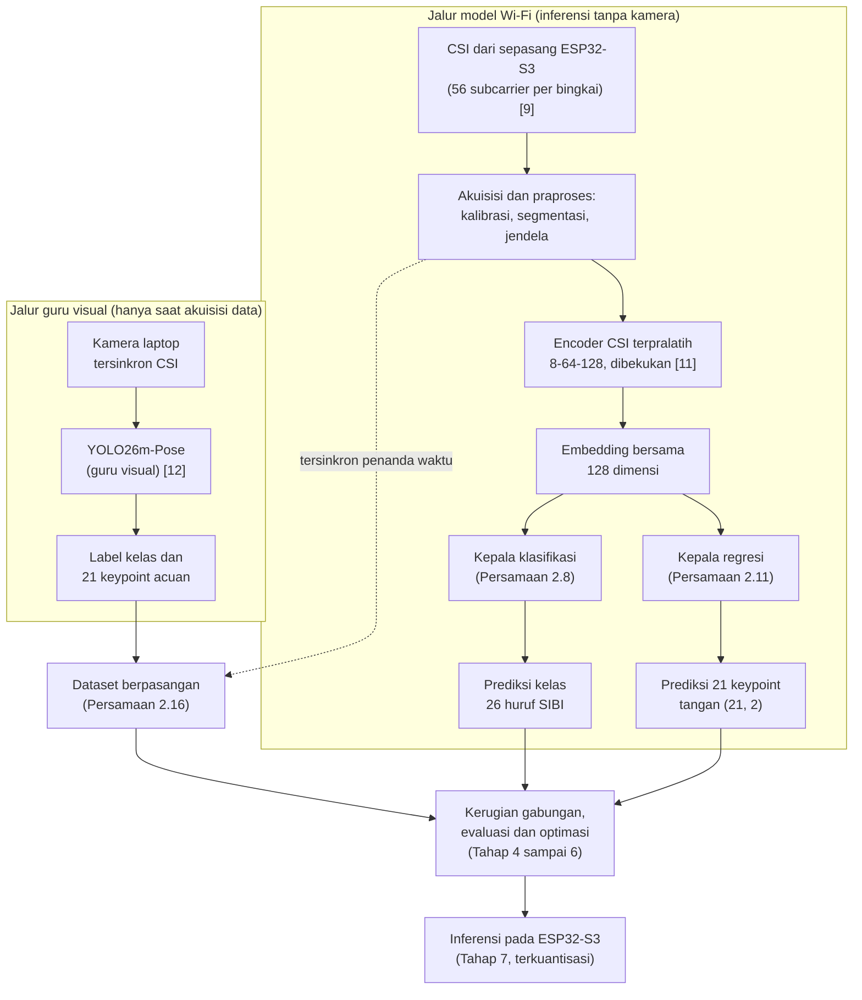

# BAB II KAJIAN PUSTAKA DAN LANDASAN TEORI

## 2.1 Bahasa Isyarat SIBI dan Audit Kelas Penelitian

Bahasa isyarat menyampaikan makna lewat gerak tangan, lengan, tubuh, dan ekspresi wajah. Satu isyarat tersusun atas bentuk tangan, lokasi, gerak, serta orientasi telapak; cukup satu jari berubah bentuk, maknanya bisa ikut berubah. SIBI ialah sistem isyarat baku pendidikan formal yang didokumentasikan kamus pemerintah [3], sedangkan BISINDO tumbuh alami di komunitas tunarungu. Survei terhadap 100 responden tunarungu di Jawa dan Bali menemukan 91% memakai BISINDO sehari-hari, sementara SIBI menempel pada konteks sekolah [4]. Penelitian ini tetap memilih SIBI karena sasarannya alat bantu pembelajaran di sekolah, bukan karena jumlah penuturnya lebih besar.

Kelas yang diteliti ditetapkan lewat audit label pada dataset visual WPC milik peneliti, bukan lewat asumsi. Alfabet manual SIBI memuat 26 huruf: 24 huruf statis yang diperagakan sebagai bentuk tangan yang ditahan, ditambah huruf J dan Z yang diperagakan sebagai lintasan gerak [3]. Audit pada dataset WPC menegaskan hal yang sama: huruf C tergolong statis di dalam kelompok 24 huruf, sedangkan J dan Z satu-satunya huruf yang menuntut lintasan. Dataset itu juga menyimpan anotasi *keypoint* dengan `kpt_shape` [21, 3], yang berarti tiap tangan diberi 21 titik dengan tiga nilai, yaitu koordinat x, koordinat y, dan tanda visibilitas. Keputusan kelas penelitian karenanya konsisten di seluruh naskah: 24 huruf statis ditambah J dan Z dinamis, tanpa pencampuran dengan 24 kelas kata yang ikut tersimpan pada dataset.

## 2.2 Wi-Fi Channel State Information

*Channel State Information* (CSI) memuat informasi amplitudo dan fase pada setiap *subcarrier* sinyal Wi-Fi, yang bersama-sama menggambarkan kondisi jalur propagasi [6]. Tubuh yang bergerak di antara pemancar dan penerima mengubah panjang jalur pantulan; amplitudo dan fase tiap *subcarrier* pun ikut bergeser. Geseran inilah yang dipakai untuk mengenali gerak tanpa sensor yang dikenakan. Karena tiap *subcarrier* menempati frekuensi berbeda, satu pasang perangkat sekaligus menyediakan banyak kanal pengamatan [6].

Bentuk formalnya sederhana: pada kanal 20 MHz, tiap *subcarrier* ke-n membawa koefisien kanal kompleks

```rumus
h~n~(t) = |h~n~(t)| · exp( j · φ~n~(t) ) (2.1)
```

dengan n = 1, ..., 56, |h~n~(t)| amplitudo, φ~n~(t) fase, dan j satuan imajiner [6], [9]. Amplitudo dan fase inilah bahan mentah seluruh perhitungan pada bab-bab berikutnya.

Pemodelan CSI berpijak pada zona Fresnel [14]. Radius zona Fresnel ke-n pada suatu titik dihitung dari jarak titik itu ke pemancar d~1~ dan ke penerima d~2~ [14]:

```rumus
r~n~ = √( n · λ · d~1~ · d~2~ / ( d~1~ + d~2~ ) ) (2.2)
```

dengan λ panjang gelombang pembawa; pada 2,4 GHz, λ = c/f ≈ 12,5 cm. Angkanya bisa langsung dihitung untuk tautan baku penelitian ini. Pada jarak antarmodul 1 meter dengan tangan di titik tengah, radius zona pertama r~1~ = √(0,125 × 0,5 × 0,5) ≈ 0,18 meter, sehingga ruang gerak jari seluruhnya berada di zona yang paling peka terhadap perubahan jalur. Penempatan itu dirangkum pada Gambar 2.1. Artikulasi jari menggeser jalur pantulan pada orde sentimeter sampai milimeter, dan tiap bentuk huruf meninggalkan pola perubahan *subcarrier* yang khas.

```gambar
Sumber skrip: scripts/sensesibi-v10/gambar_g16_fresnel.py (matplotlib mplot3d) -> assets-v16/gambar-2.1.png
```

Gambar 2.1 Zona Fresnel pertama pada tautan baku 1 meter; tangan pengisyarat berada di dalam zona (ilustrasi skematis tiga dimensi, tidak berskala) [6], [14]

Gerak tubuh juga melahirkan pergeseran Doppler yang besarnya mengikuti kecepatan gerak v [6], [13]:

```rumus
f~D~ = ( v / λ ) · ( cos α + cos β ) (2.3)
```

dengan α dan β sudut antara arah gerak dan garis pandang ke pemancar serta ke penerima; nilai mutlaknya paling besar 2v/λ. Pita Doppler gerak isyarat yang relevan kira-kira 1 sampai 60 Hz [6], sedangkan kaidah Nyquist menuntut laju pencuplikan

```rumus
f~s~ ≥ 2 · f~maks~ (2.4)
```

Konsekuensinya bisa dihitung sejak awal. Pada laju *firmware* RuView 50 bingkai per detik [10], pita teramati hanya sampai 25 Hz, sehingga gerak tangan yang masih teramati tanpa pelipatan kira-kira v = 25 × 0,125/2 ≈ 1,6 meter per detik. Gerak jari yang lebih cepat berisiko terlipat, dan jika laju terukur lebih rendah lagi, pita yang dianalisis ikut menyempit; hal itu dilaporkan apa adanya.

Satu masalah masih tersisa: fase mentah tercemar derau osilator lokal. Teknik CSI-ratio membersihkannya lewat rasio atau perkalian konjugat tanpa perangkat tambahan [14], dan prinsip itu diadaptasi penelitian ini menjadi rasio terhadap rekam acuan kalibrasi ruang (Subbab 3.8):

```rumus
ρ~n~(t) = h~n~(t) / h~n~( t~0~ ) (2.5)
```

dengan t~0~ waktu kalibrasi ruang, yaitu 600 bingkai bawaan RuView [10]. Rasio ini membuang tanggapan statis ruang sehingga yang tersisa adalah perubahan akibat gerak; sisa derau fase yang berjalan lambat diukur pada Tahap 2 lalu dilaporkan.

Dari ketukan tombol sampai gerakan jari, bukti kepekaan CSI terhadap gerak halus cukup banyak [6]; akan tetapi, bukti-bukti itu lahir dari kondisi terkendali sehingga bagi penelitian ini statusnya sebatas hipotesis kerja. Model CSI juga mudah *overfitting* terhadap orang dan ruang, dan Widar3.0 menjawab masalah itu dengan profil kecepatan Doppler untuk pengenalan lintas domain [13]. Kelayakan satu tautan dua modul berantena tunggal untuk membedakan 26 bentuk tangan SIBI karenanya diperlakukan sebagai pertanyaan penelitian, bukan asumsi; skema uji lintas orang dan lintas ruang pada Tabel 3.3 yang mengujinya, dan pasangan huruf yang terbukti tidak terpisahkan dilaporkan apa adanya.

## 2.3 Encoder CSI Terpralatih RuView dan Dua Model yang Tidak Boleh Tercampur

Encoder terpralatih yang menjadi tulang punggung penelitian ini berasal dari ekosistem RuView [10]. Kartu modelnya [11] mendokumentasikan jaringan dua lapis *fully connected* dengan BatchNorm dan GELU yang memetakan 8 fitur CSI menjadi *embedding* 128 dimensi ternormalisasi L2, seluruhnya hanya 9.280 parameter. Pemetaannya ditulis

```rumus
z~i~ = f~θ0~( X~i~ ), z~i~ ∈ R^d^, d = 128 (2.6)
```

dengan X~i~ jendela masukan ke-i, f~θ0~ pemetaan *encoder* bertetapan θ~0~, dan z~i~ vektor *embedding* keluaran. Pretrainingnya kontrastif dengan triplet loss dan InfoNCE pada temperatur 0,1; pasangan positif diambil dari jendela dalam jarak 2 detik, pasangan negatif dari jarak lebih dari 30 detik, selama 60 epoch dengan AdamW dan perlindungan EWC terhadap lupa bencana [11]. Pada baseline penelitian ini, θ~0~ dibekukan sehingga hanya tetapan kedua kepala tugas yang diperbarui.

Satu angka pada kartu model itu perlu dibaca hati-hati. Akurasi triplet-temporal *held-out* sebesar 82,3% tercatat pada 20% akhir rekaman menurut waktu, dengan pembanding 66,4% untuk fitur mentah tanpa *encoder* dan 69,6% untuk *encoder* berinisialisasi acak [11]. Angka itu menghitung peluang bahwa jarak anchor ke positif temporal lebih pendek daripada jaraknya ke negatif temporal, sehingga yang diukurnya ialah kualitas geometri *embedding* pada tugas jarak, bukan akurasi klasifikasi SIBI dan bukan galat *keypoint*. Dua hal terakhir justru yang hendak diukur penelitian ini, dan kartu model tidak memuat keduanya.

Dua model lain pada ekosistem yang sama sering tertukar dengan *encoder* ini, sehingga keduanya dipisahkan sejak awal. Model `wifi-densepose-mmfi-pose` [15] adalah *checkpoint* pose terpisah dengan masukan amplitudo CSI berukuran [3, 114, 10], yaitu 3 pasang antena kali 114 *subcarrier* kali 10 bingkai pada 100 Hz, yang diproses *encoder* Transformer 4 lapis 8 kepala menjadi keluaran [17, 2]: 17 *keypoint* tubuh COCO dalam rentang [0, 1], dengan sekitar 2,3 juta parameter. Model itu dilatih pada dataset MM-Fi [16] yang memuat 40 subjek, 27 kategori aksi, dan lebih dari 320 ribu bingkai tersinkron dari lima modalitas; kinerjanya PCK@20 ternormalisasi badan sebesar 82,69% untuk model tunggal dan 83,59% untuk ansambel, turun menjadi sekitar 64% lintas subjek *zero-shot* dan 17,5% lintas lingkungan, lalu naik ke rentang 72% sampai 78% setelah kalibrasi 50 sampai 1.000 bingkai per orang [15]. Lisensi CC BY-NC 4.0 melekat pada model itu karena mengikuti lisensi datanya. Adapun YOLO26m-Pose [12] adalah model penglihatan pada citra yang berperan sebagai guru visual dan dibahas pada Subbab 2.8. Tabel 2.1 merangkum pembedaan ketiganya.

Tabel 2.1 Pembedaan tiga model yang tidak boleh tercampur dalam penelitian ini

| Aspek | Encoder CSI terpralatih [11] | Model pose MM-Fi [15] | Guru visual YOLO26m-Pose [12] |
|---|---|---|---|
| Berkas | `ruvnet/wifi-densepose-pretrained` | `ruvnet/wifi-densepose-mmfi-pose` | Repositori WPC peneliti (eksperimen `exp11_huruf24`) |
| Masukan | 8 fitur CSI per stempel waktu | Amplitudo CSI [3, 114, 10] @ 100 Hz | Citra RGB kamera |
| Keluaran | *Embedding* 128 dimensi ternormalisasi L2 | 17 *keypoint* tubuh COCO dalam [0, 1] | Kelas isyarat dan 21 *keypoint* tangan |
| Parameter | 9.280 | ±2,3 juta (varian utama) | [PERLU DATA: jumlah parameter model juara WPC] |
| Peran | Tulang punggung representasi, dibekukan pada baseline | Pembanding temuan lintas domain, bukan komponen model | Pemberi label kelas dan *keypoint* saat akuisisi |
| Status bukti | Kartu model; akurasi triplet-temporal 82,3% | Kartu model; PCK@20 82,69%; lisensi CC BY-NC 4.0 | Data pra-penelitian peneliti; mAP50 0,9580 pada 24 huruf statis |

Status dua dokumen rancangan pada repositori RuView juga dinyatakan terbuka. ADR-146 mengusulkan *encoder* RF bersama dengan tujuh kepala tugas dan ketidakpastian per kepala, sedangkan ADR-150 mengusulkan *foundation encoder* yang tahan pergantian orang dan ruang; keduanya berstatus Proposed, artinya rancangan yang belum diimplementasikan [10]. Penelitian ini karenanya tidak bersandar pada keduanya, melainkan pada *checkpoint* yang benar-benar tersedia; angka estimasi dari ADR dikutip dengan label estimasi rancangan setiap kali muncul.

## 2.4 Transfer Learning pada Encoder Beku: LoRA dan Pelatihan Lanjutan

Baseline penelitian ini membekukan *encoder* dan melatih hanya kedua kepala tugasnya. Alasannya metodologis: dengan *encoder* beku, kualitas *embedding* terpralatih untuk isyarat SIBI terbaca langsung dari kinerja kepala, sehingga sumbangan pretraining terpisah dari sumbangan penyetelan. Karena *encoder* hanya 9.280 parameter, biaya melatih ulang seluruhnya pun rendah, sehingga tiga skema adaptasi tetap terjangkau dan dibandingkan secara adil pada data yang sama: *encoder* beku, *encoder* dengan adapter LoRA, dan pelatihan lanjutan.

LoRA menambah pembaruan berperingkat rendah pada tetapan asli tanpa menyimpan gradien untuk seluruh matriks [17]:

```rumus
W~akhir~ = W~0~ + B · A (2.7)
```

dengan W~0~ matriks tetapan asli yang dibekukan, B berukuran d~keluar~ × r dan A berukuran r × d~masuk~, serta r peringkat adapter yang dipilih jauh lebih kecil daripada ukuran matriks; hanya B dan A yang dilatih. Adapter bukan kepala tugas dan bukan pula pengganti pelatihan lanjutan, melainkan jalur adaptasi yang hemat parameter di dalam lapisan yang sudah ada. Ketersediaannya pada *checkpoint* ini bahkan sudah terdokumentasi: kartu model menyertakan adapter ruangan `node-1.json` dan `node-2.json` masing-masing sekitar 21 KB [11]. ADR-150 menaksir adapter sekitar 11 KB mampu menyamai kinerja lintas subjek dengan 100 sampai 200 data berlabel per ruang [10]; angka itu berstatus estimasi rancangan, bukan hasil penelitian ini.

Pelatihan lanjutan menjadi pembanding ketiga. Pelatihan sebagian membuka lapis terakhir saja, sedangkan pelatihan penuh membuka seluruh tetapan; keduanya dijaga dengan EWC sebagaimana pretraining *encoder* melakukannya [11], dan keduanya dilaporkan berdampingan dengan hasil *encoder* beku. Kompatibilitas adapter LoRA dengan alur ekspor ke ESP32-S3 belum terverifikasi, sehingga statusnya ditandai [PERLU VALIDASI: kompatibilitas LoRA dengan alur ekspor] dan diperiksa pada Tahap 1.

## 2.5 Kepala Klasifikasi dan Kerugian Silang-Entropi

Kepala klasifikasi mengubah *embedding* menjadi skor tiap kelas huruf. Untuk K kelas dengan K = 26, skor logit dihitung dari

```rumus
a~i~ = W~c~ · z~i~ + b~c~ (2.8)
```

dengan W~c~ matriks berukuran K × 128 dan b~c~ vektor bias; skor lalu diubah menjadi probabilitas lewat *softmax*

```rumus
q~ik~ = exp( a~ik~ ) / Σ~k~ exp( a~ik~ ) (2.9)
```

sehingga seluruh probabilitas berjumlah satu, dan kelas prediksi ialah kelas dengan probabilitas terbesar (argmax). Sebagai lantai pembanding, tebakan acak seragam pada K kelas bernilai 1/K ≈ 3,8%, dan angka itu dihitung ulang jika himpunan huruf dipangkas.

Kerugian pelatihannya silang-entropi kategorikal. Dengan label *one-hot* y~ik~ yang bernilai satu pada kelas benar dan nol pada kelas lain, kerugian atas N sampel dalam *batch* berbunyi

```rumus
L~cls~ = − ( 1 / N ) · Σ~i~ Σ~k~ y~ik~ · log q~ik~ (2.10)
```

yang menghukum prediksi yang percaya diri pada kelas salah. Jika data latih terbukti timpang antarhuruf, bobot kelas dipasang berbanding terbalik dengan frekuensi kelasnya; bobot itu dihitung hanya dari data latih dan keputusannya dicatat pada Tabel 3.6.

## 2.6 Kepala Regresi 21 Keypoint dan Kerugian Smooth L1 Bermask

Target regresi mengikuti skema 21 *landmark* tangan MediaPipe Hands [18], skema yang sama dipakai *pseudo-labeling* pada dataset WPC. Sesuai `kpt_shape` [21, 3], tiap sampel target memuat 21 titik dengan koordinat x, y, dan tanda visibilitas; rancangan awal kepala memprediksi koordinat x dan y saja, sehingga keluarannya berbentuk

```rumus
Q~i~ = reshape( W~r~ · z~i~ + b~r~, 21, 2 ) (2.11)
```

dengan W~r~ matriks berukuran 42 × 128 yang dipetakan ulang menjadi 21 pasang koordinat, Q~i~ prediksi *keypoint*, dan P~i~ koordinat acuan dari guru visual.

Sistem koordinat target harus ditetapkan sebelum pelatihan, dan di sinilah letak kehati-hatianya. Koordinat piksel kamera tidak otomatis dapat diprediksi dari CSI tanpa definisi koordinat, transformasi, atau kalibrasi yang dapat direproduksi; oleh karena itu sistem koordinat target, dengan kandidat kuat berupa koordinat ternormalisasi [0, 1] terhadap kotak deteksi guru, dibakukan pada Tahap 3 lalu dipakai konsisten oleh guru dan murid [PERLU VALIDASI: sistem koordinat dan normalisasi target regresi]. Tanpa pembakuan itu, angka galat regresi tidak bermakna.

Kerugian regresinya Smooth L1 yang dibobot mask visibilitas [19]. Fungsi Smooth L1 berperilaku kuadratik dekat nol dan linear untuk galat besar,

```rumus
SmoothL1~δ~( x ) = 0,5 · x^2^ / δ untuk |x| ≤ δ, dan |x| − 0,5 · δ untuk |x| > δ (2.12)
```

dengan δ ambang peralihan, sehingga pencilan anotasi tidak mendominasi gradien. Kerugian bermask dihitung hanya pada titik yang terlihat:

```rumus
L~reg~ = ( Σ~i~ Σ~j~ m~ij~ · SmoothL1~δ~( Q~ij~ − P~ij~ ) ) / ( Σ~i~ Σ~j~ m~ij~ + ε ) (2.13)
```

dengan m~ij~ mask visibilitas dari guru yang bernilai satu jika titik j terlihat dan nol jika terhalang, serta ε penahan pembagi nol. Jika prediksi visibilitas juga diinginkan, kepala tambahan dengan kerugian entropi silang biner disiapkan sebagai perluasan; keputusan memakainya dicatat pada Tabel 3.6.

## 2.7 Pembelajaran Multitugas dan Optimasi Kerugian Gabungan

Pembelajaran multitugas melatih beberapa tugas berbarengan di atas representasi yang dibagi, dan representasi yang baik untuk satu tugas kerap menolong tugas lain yang berkaitan [20]. Kedua tugas penelitian ini memang dua pandangan atas isyarat yang sama: kepala klasifikasi membacanya sebagai kelas diskret, sedangkan kepala regresi membacanya sebagai bentuk jari kontinu. Hipotesis kerjanya, supervisi *keypoint* ikut merapikan batas antarhuruf yang bentuknya mirip.

Kerugian gabungan menjumlah keduanya dengan bobot:

```rumus
L~total~ = λ~cls~ · L~cls~ + λ~reg~ · L~reg~ (2.14)
```

Penetapan bobotnya tidak asal pilih. Silang-entropi bergerak pada orde logaritma jumlah kelas, sedangkan Smooth L1 bergerak pada satuan koordinat, sehingga keduanya disamakan skalanya lebih dulu, misalnya dengan membagi tiap kerugian oleh nilai rata-ratanya pada epoch pertama, baru bobot λ ditala dari data validasi (Tabel 3.6). Konflik gradien antartugas dipantau lewat besar gradien tiap kepala; jika keduanya menarik representasi ke arah berlawanan, penyeimbangan gradien atau pelatihan bergantian dipertimbangkan, dan perlakuannya dilaporkan.

Pada baseline, pembaruan tetapan hanya menyentuh kepala:

```rumus
θ~c~, θ~r~ ← Optimizer( ∇ L~total~ ), θ~0~ tetap (2.15)
```

dengan θ~c~ dan θ~r~ tetapan kedua kepala serta θ~0~ tetapan *encoder* yang dibekukan. Untuk menguji manfaat penggabungan, kepala tunggal yang dilatih sendiri-sendiri disiapkan sebagai pembanding pada split yang sama. Arah ini sejajar dengan usulan ADR-146 tentang *encoder* bersama dengan banyak kepala tugas [10], hanya saja penelitian ini mengujinya pada *checkpoint* yang benar-benar tersedia dan untuk dua tugas, bukan mengambil status usulannya sebagai bukti.

## 2.8 Guru Visual YOLO26m-Pose dan Dataset WPC

Guru visual bekerja hanya pada tahap akuisisi data. Kamera laptop dan node penerima CSI merekam serentak dengan penanda waktu yang sama; pada tiap frame, YOLO26m-Pose [12] menghasilkan kelas isyarat beserta 21 *keypoint* tangan dan visibilitasnya. Label kelas tidak diambil dari deteksi bebas, melainkan dicocokkan dengan kartu pemandu protokol perekaman, sehingga derau label terkendali. Pola guru-murid lintas modalitas ini mengikuti keluarga model WiFi-DensePose yang memakai jaringan visi sebagai guru [10] dan berakar pada gagasan distilasi pengetahuan [21]; guru di sini memberi label keras berupa kelas dan koordinat, bukan *soft target*.

Kemampuan guru sudah teruji pada tahap pra-penelitian di repositori WPC milik peneliti. Dataset versi 2 memuat 49 kelas isyarat, terdiri atas 25 kelas huruf dan 24 kelas kata, dengan total 7.210 gambar yang terbagi menjadi 6.231 latih, 650 validasi, dan 329 uji; *keypoint*-nya dihasilkan lewat *pseudo-labeling* MediaPipe HandLandmarker [18], lalu YOLO26m-Pose dilatih mempelajari deteksi dan *keypoint* tersebut. Eksperimen `exp11_huruf24` pada 24 huruf statis mencatat *pose* mAP50 0,9580 dengan akurasi huruf 97,6%, sedangkan model 49 kelas mencatat mAP50 0,8944. Perlu ditegaskan: seluruh angka itu adalah hasil model visual pada data visual, bukan hasil model Wi-Fi; pertanyaan apakah CSI sanggup mengikuti guru itulah yang dijawab penelitian ini.

Batas guru juga jelas. Dataset WPC tidak memuat rekaman CSI, sehingga tidak cukup untuk melatih kepala CSI secara langsung; pasangan data baru antara jendela CSI dan keluaran guru harus direkam sendiri pada Tahap 2. Ekspektasi generalisasinya pun dijaga memakai temuan model pose MM-Fi [15]: kinerja lintas subjek *zero-shot* hanya sekitar 64% dan lintas lingkungan 17,5%, naik ke 72% sampai 78% setelah kalibrasi 50 sampai 1.000 bingkai per orang. Angka itu dipakai sebagai acuan ekspektasi sekaligus alasan skema kalibrasi per orang dan per ruang disiapkan sebagai jalur cadangan pada Tabel 3.7.

## 2.9 Inferensi Tepi pada ESP32-S3

ESP32-S3 ialah mikrokontroler Wi-Fi 802.11 b/g/n 2,4 GHz berantena tunggal dengan inti ganda 240 MHz, SRAM 512 KB, dan PSRAM sampai 8 MB [8]. Dukungan CSI tersedia resmi lewat repositori esp-csi; pada kanal 20 MHz, CSI memuat 56 *subcarrier* [9]. *Firmware* RuView [10] mampu menangkap CSI sambil memelihara koneksi *station* UDP dan sinkronisasi ESP-NOW secara serentak pada satu *chip*, dengan dua syarat yang sama: seluruh perangkat berada pada satu kanal dan mode hemat daya dimatikan.

Ukuran model membuat target ini masuk akal sejak awal, dan angkanya bisa dihitung. Kartu model mencatat *encoder* sebesar 48 KB untuk berkas penuh dan menyusut menjadi 16 KB, 8 KB, sampai 4 KB pada kuantisasi 8-bit, 4-bit, dan 2-bit [11]. Kedua kepala tugas, menurut turunan perhitungan rancangan pada d = 128, hanya menambah 128 × 26 + 26 = 3.354 parameter untuk klasifikasi dan 128 × 42 + 42 = 5.418 parameter untuk regresi, sehingga seluruh model sekitar 18 ribu parameter atau sekitar 72 KB dalam float32, jauh di bawah PSRAM 8 MB; angka final diverifikasi ulang setelah audit Tahap 1.

ESP-DL menyediakan jalur menjalankan model kuantisasi int8 pada keluarga ESP32 dengan akselerasi ESP-NN [22], dengan TensorFlow Lite Micro sebagai alternatif. Berapa lama inferensi satu jendela berjalan pada modul, berapa RAM puncak yang dipakai, dan seberapa stabil lajunya, semuanya belum ada yang mengukur untuk tugas ini; karenanya seluruh angka itu diukur sendiri pada Tahap 7, dan anggaran latensinya ditetapkan hanya setelah eksperimen pendahuluan selesai, bukan dijanjikan pada proposal ini.

## 2.10 Penelitian Terdahulu

Penelitian terdahulu yang paling relevan dibandingkan pada Tabel 2.2.

Tabel 2.2 Perbandingan penelitian terdahulu

| No. | Peneliti (Tahun) | Modalitas dan keluaran | Bahasa isyarat | Bebas kamera | Fokus |
|---|---|---|---|---|---|
| 1 | Ma dkk. (2018) [7] | CSI; isyarat menjadi teks | ASL, 276 isyarat | Ya | Pengenalan berskala besar |
| 2 | Zhang dkk. (2022) [13] | CSI; gestur lintas domain | Gestur umum | Ya | Generalisasi lintas orang dan ruang |
| 3 | Dwijayanti dkk. (2021) [5] | Citra; isyarat menjadi teks | BISINDO | Tidak | CNN pengenalan citra |
| 4 | Penelitian ini | CSI sepasang ESP32-S3; dua kepala tugas di atas encoder terpralatih; guru visual YOLO26m-Pose | SIBI, 26 huruf | Ya | Klasifikasi huruf dan regresi 21 *keypoint*; deployment terukur |

Dua kelompok terbaca dari tabel itu. Pengenalan isyarat dari Wi-Fi [7], [13] berjalan tanpa kamera tetapi belum menjangkau SIBI, sedangkan riset Indonesia berbasis kamera [5] membuktikan tingginya minat namun tetap terikat pencahayaan dan garis pandang. Dalam batas penelusuran, publikasi yang memasangkan kepala klasifikasi dan regresi *keypoint* pada *encoder* CSI terpralatih untuk SIBI belum ditemukan. Kebaruan penelitian ini karenanya bersifat kombinatif: *encoder* CSI terpralatih yang dibekukan, dua kepala tugas dengan kerugian gabungan, dataset berpasangan CSI dan label guru visual, serta pengukuran kelayakan di ESP32-S3. Di luar empat hal itu, kebaruan tidak diklaim untuk isyarat kontinu maupun penerjemahan kalimat.

## 2.11 Kerangka Pemikiran dan Arsitektur Model

Kerangka pemikiran penelitian ini mengalir dari data sampai perangkat, seperti dirangkum Gambar 2.2. Sinyal CSI dari sepasang ESP32-S3 melewati akuisisi dan praproses, lalu *encoder* terpralatih menghasilkan *embedding* 128 dimensi yang sama untuk kedua tugas. Kepala klasifikasi membaca *embedding* itu menjadi kelas huruf, kepala regresi membacanya menjadi 21 koordinat *keypoint*; keduanya dilatih serentak dengan kerugian gabungan, dievaluasi, dioptimasi, dan model terpilihnya diekspor ke ESP32-S3. Kamera hanya hadir di jalur guru pada tahap akuisisi data dan tidak pernah menyala pada inferensi.



Gambar 2.2 Arsitektur model: satu encoder CSI terpralatih yang dibekukan, dua kepala tugas yang berbagi embedding 128 dimensi, jalur guru visual yang hanya aktif saat akuisisi data, dan jalur deployment ke ESP32-S3

Dataset yang menopang kerangka ini dirumuskan sebagai pasangan lima unsur:

```rumus
D~pas~ = { ( X~i~, y~i~, P~i~, m~i~, s~i~ ) }, i = 1, ..., N (2.16)
```

dengan X~i~ jendela CSI, y~i~ label kelas isyarat, P~i~ koordinat 21 *keypoint* acuan, m~i~ mask visibilitasnya, dan s~i~ metadata subjek, sesi, ruang, serta perangkat; keseluruhan pasangan direkam sendiri pada Tahap 2 karena tidak ada sumber lain yang menyediakannya. Dengan rumusan itu, teori CSI dan zona Fresnel (Subbab 2.2) menyediakan sinyal, teori kontrastif (Subbab 2.3) menyediakan representasi, transfer learning (Subbab 2.4) menyediakan skema adaptasi, kedua formulasi kepala (Subbab 2.5 dan 2.6) menyediakan keluaran tugas, dan pembelajaran multitugas (Subbab 2.7) mengikat semuanya dalam satu kerugian sebelum hasilnya diukur di tepi (Subbab 2.9).
