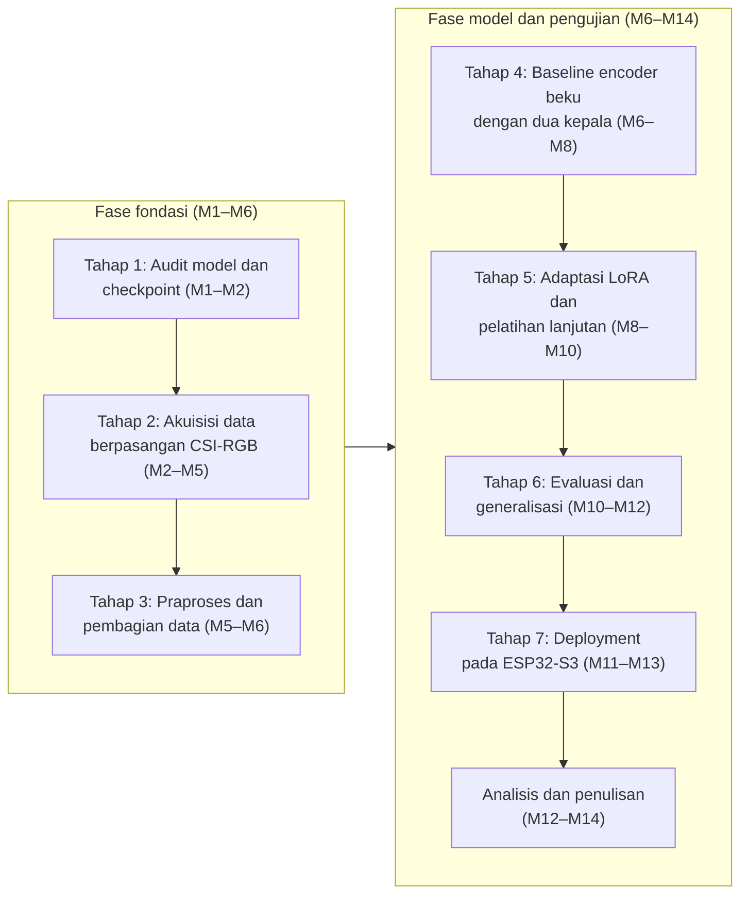
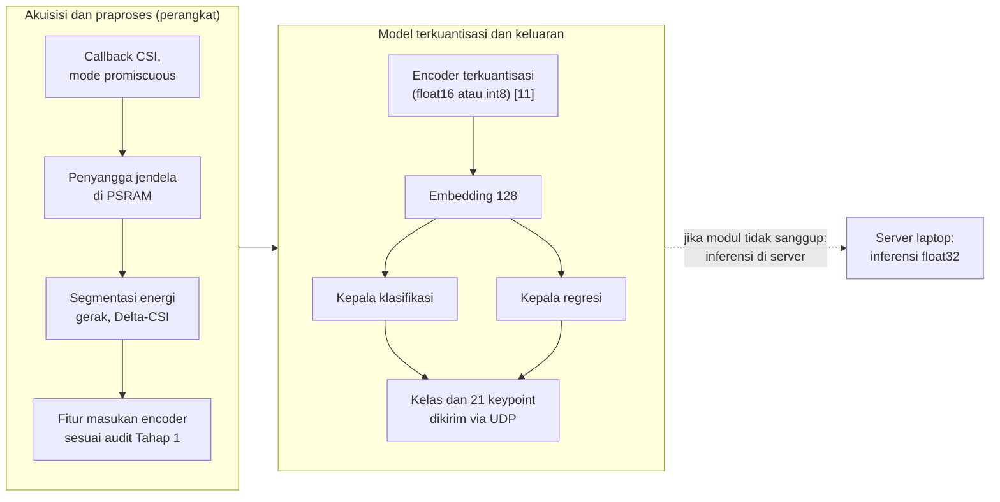

# BAB III METODE PENELITIAN

## 3.1 Desain Penelitian

Penelitian ini berbentuk eksperimen kuantitatif bertahap dengan tujuh tahap yang berurutan dari audit model sampai *deployment*. Unit analisisnya ialah jendela CSI yang berpasangan dengan label kelas dan 21 *keypoint*; variabel terikatnya mencakup metrik klasifikasi, metrik regresi, dan metrik tepi, sedangkan variabel bebas utamanya ialah skema adaptasi *encoder* (beku, LoRA, pelatihan lanjutan) serta skema pembagian data pada Tabel 3.3. Kendali eksperimennya dinyatakan di depan: seed tetap, pembagian data sama untuk setiap pembanding, dan data validasi hanya boleh berasal dari data latih.

Empat rumusan masalah dijawab oleh tahapan yang berbeda dan diukur dengan metrik yang berbeda, sehingga pemetaannya dirangkum pada Tabel 3.4 agar setiap pertanyaan punya jalur jawaban yang dapat diperiksa. Sebagai proposal, seluruh isi bab ini adalah rencana kerja; tidak ada satu pun angka kinerja yang diklaim sebagai hasil, dan bagian yang belum pasti ditandai [PERLU VALIDASI] sampai audit atau eksperimen pendahuluan menetapkannya.

## 3.2 Hipotesis Penelitian

Hipotesis penelitian ini dirumuskan agar dapat diuji dan difalsifikasi sebagai berikut.

1. *Encoder* terpralatih yang dibekukan, setelah diberi dua kepala tugas dan dilatih pada data berpasangan, dapat mempelajari pemetaan dari jendela CSI ke kelas isyarat SIBI sekaligus ke 21 koordinat *keypoint* tangan.
2. Pelatihan multitugas menghasilkan kompromi yang baik antara klasifikasi dan regresi, diuji dengan membandingkan kepala gabungan melawan kepala tunggal pada pembagian data yang sama.
3. Model hasil optimasi berpotensi dijalankan pada ESP32-S3 dalam batas latensi dan memori yang ditetapkan dari spesifikasi perangkat serta eksperimen pendahuluan; keberhasilannya dinyatakan hanya jika pengukuran pada perangkat fisik mengonfirmasinya.

Angka target sengaja tidak ditetapkan pada proposal ini karena belum ada literatur, spesifikasi terukur, maupun studi percontohan untuk tugas ini; target kuantitatif dirumuskan setelah eksperimen pendahuluan selesai, dan target selalu dibedakan dari hasil.

## 3.3 Tahapan Penelitian

Tujuh tahap penelitian dirangkum pada Gambar 3.1. Dua fase membaginya: fase fondasi membangun kepastian tentang model dan data, sedangkan fase model dan pengujian melatih, membandingkan, mengukur, lalu menurunkan model ke perangkat.



Gambar 3.1 Tujuh tahap penelitian dalam dua fase; jadwal per minggu pada Tabel 3.5 dan keputusan cadangan pada Tabel 3.7

Tahap 1 mengaudit *checkpoint* dan bentuk masukannya sehingga seluruh perhitungan sesudahnya berpijak pada fakta model, bukan pada asumsi dokumentasi. Tahap 2 merekam dataset berpasangan antara CSI dan video yang tersinkron, lalu Tahap 3 membangun jendela, normalisasi, dan pembagian data yang bebas kebocoran. Tahap 4 melatih baseline dengan *encoder* beku, Tahap 5 membandingkan skema adaptasi, Tahap 6 mengukur kinerja klasifikasi, regresi, dan generalisasi, dan Tahap 7 menguji *deployment* pada ESP32-S3 fisik. Analisis dan penulisan menutup rangkaian pada M12 sampai M14.

## 3.4 Waktu dan Lokasi Penelitian

Pelaksanaan penelitian jatuh pada [PERLU DATA: bulan dan tahun pelaksanaan penelitian] di Jawa Timur. Penelitian ini tidak bersandar pada mitra lembaga; partisipan direkrut langsung oleh peneliti, sedangkan perekaman dan pengujian berlangsung di sedikitnya dua ruang berbeda, misalnya ruang kelas dan ruang kerja, sebagai jumlah minimum skema *leave-one-room-out*. Tiap ruang dikalibrasi lebih dulu sebelum perekaman (Subbab 3.7).

## 3.5 Alat dan Bahan

Tabel 3.1 dan Tabel 3.2 menyajikan perangkat keras dan perangkat lunak penelitian. Node penginderaan dipegang sepasang modul ESP32-S3: TX memancarkan *beacon* ESP-NOW, sedangkan RX mengekstraksi CSI 56 *subcarrier* dan menjalankan inferensi. Versi perangkat lunak dicatat bersama log pelatihan supaya eksperimen dapat diulang. Bahan penelitiannya meliputi *checkpoint* encoder terpralatih, dataset berpasangan yang direkam sendiri, dataset citra WPC beserta model guru YOLO26m-Pose dari repositori peneliti, lembar definisi huruf, dan formulir persetujuan.

Tabel 3.1 Perangkat keras penelitian

| No. | Nama | Spesifikasi | Jumlah | Keterangan |
|---|---|---|---|---|
| 1 | Modul ESP32-S3 | PSRAM 8 MB; 2,4 GHz 802.11b/g/n, kanal 20 MHz (56 *subcarrier*), 1T1R [8] | 2 unit | Node TX (pemancar *beacon*) dan node RX (penangkap CSI dan inferensi) |
| 2 | *Access point* | *Router* Wi-Fi 2,4 GHz atau *hotspot* ponsel [PERLU DATA: pilihan final] | 1 unit | Penjangkar satu kanal seluruh perangkat, bukan penginderaan |
| 3 | Laptop | ASUS TUF Dash F15 FX516PR: i7-11370H, RTX 3070 8 GB, RAM 16 GB | 1 unit | Akuisisi berpasangan, pelatihan, evaluasi, ekspor |
| 4 | *Webcam* | Bawaan laptop, tersinkron dengan CSI lewat penanda waktu | 1 unit | Jalur guru visual, hanya saat akuisisi |
| 5 | Ponsel pintar | Poco F4 5G (alternatif *hotspot*) | 1 unit | Cadangan penjangkar kanal |

Tabel 3.2 Perangkat lunak penelitian

| No. | Nama | Fungsi dalam penelitian |
|---|---|---|
| 1 | *Firmware* dan *server* RuView [10] | Menangkap CSI, mengirim UDP, kalibrasi ruang, segmentasi energi |
| 2 | *Checkpoint* `ruvnet/wifi-densepose-pretrained` [11] | Tulang punggung representasi; diaudit pada Tahap 1 |
| 3 | Repositori WPC peneliti: `scripts/train_sibi_v2.py`, `scripts/inference_sibi.py`, eksperimen `exp11_huruf24` | Alur kerja YOLO26m-Pose, konversi dataset, pelatihan deterministik, pencatatan eksperimen |
| 4 | YOLO26m-Pose (Ultralytics) [12] | Guru visual: label kelas dan 21 *keypoint* dari frame kamera |
| 5 | MediaPipe HandLandmarker [18] | Rujukan skema 21 *keypoint* dan pembandih kualitas label |
| 6 | Python, PyTorch, scikit-learn | Pelatihan kepala, LoRA, pelatihan lanjutan, evaluasi |
| 7 | Layanan GPU Kaggle | Pelatihan lanjutan jika GPU lokal tidak cukup |
| 8 | ESP-DL dengan akselerasi ESP-NN (alternatif: TensorFlow Lite Micro) [22] | Menjalankan model terkuantisasi pada node RX |

Pemilihan bahasa mengikuti kebutuhan alat, bukan preferensi. Pelatihan berjalan di komputer dengan Python dan PyTorch karena keduanya kompatibel dengan *checkpoint* dan mendukung autograd serta pengoptimal; jalur pelatihan model visual pada WPC pun sudah memakai Python dan Ultralytics [12]. Rust dipakai hanya jika *runtime* inferensi pada ESP32-S3 menuntutnya dan operator tensornya tersedia, mengikuti arsitektur *runtime* RuView yang berbahasa Rust [10]; keputusannya diambil setelah uji ekspor pada Tahap 7, dan pelatihan tidak pernah dipindahkan ke modul.

Foto pada Gambar 3.2 memudahkan mengenali bentuk perangkat pada Tabel 3.1; *webcam* memakai bawaan laptop sehingga tidak difoto terpisah. Foto produk hanya menjadi pengenal bentuk, bukan acuan merek maupun spesifikasi, dan rujukan spesifikasinya tetap Tabel 3.1 [PERLU ILUSTRASI: foto dokumentasi sendiri setelah seluruh perangkat dibeli].

```gambar
Sumber skrip: scripts/sensesibi-v10/gambar_g16_alatbahan.py (grid foto hasil pencarian gambar daring) -> assets-v16/gambar-3.2.png
```

Gambar 3.2 Perangkat keras penelitian; huruf pada tiap foto mengikuti baris Tabel 3.1 (foto produk sebagai pengenal bentuk, bukan acuan merek)

## 3.6 Tahap 1: Audit Model dan Checkpoint

Tahap ini mengubah klaim dokumentasi menjadi fakta terverifikasi sebelum satu pun data direkam. Prosedurnya sebagai berikut.

1. Mengunduh *checkpoint* `ruvnet/wifi-densepose-pretrained` beserta berkas konfigurasi, adapter ruangan `node-1.json` dan `node-2.json`, serta *head* deteksi kehadiran, lalu mencatat versi dan sidik jari berkasnya [11].
2. Memuat *encoder* dan memverifikasi jumlah 9.280 parameter, keluaran 128 dimensi, dan normalisasi L2 pada masukan uji.
3. Mengaudit bentuk masukan: kartu model mencatat 8 fitur pada laju 1 Hz [11]; audit memeriksa definisi kedelapan fitur itu pada *firmware* RuView, laju tertinggi yang dapat dicapai, dan apakah muatan informasinya cukup untuk gestur huruf [PERLU VALIDASI: dimensi masukan dan laju fitur aktual].
4. Mengaudit dukungan ekspor: jalur dari berkas model ke representasi yang dapat dikuantisasi dan dijalankan pada ESP32-S3, termasuk operator BatchNorm dan GELU [PERLU VALIDASI: dukungan operator runtime tepi].
5. Menguji kompatibilitas LoRA: memasang adapter ruangan, memeriksa bahwa pembaruan berperingkat rendah dapat dilatih dan diekspor [PERLU VALIDASI: kompatibilitas LoRA dengan alur ekspor].
6. Mencatat model pose MM-Fi [15] dan guru visual YOLO26m-Pose [12] sebagai referensi terpisah yang tidak dimuat ke alur pelatihan murid.
7. Menuliskan lembar audit sebagai artefak tetap; jika bentuk masukan terverifikasi berbeda dari dokumentasi, rancangan jendela dan naskah diperbarui sebelum Tahap 2 dimulai.

## 3.7 Tahap 2: Akuisisi Data Berpasangan CSI dan RGB

Partisipan terdiri atas 3 sampai 4 pengisyarat kompeten dan sedikitnya satu validator penutur tunarungu; setiap pengisyarat direkam dalam sedikitnya dua sesi agar skema lintas sesi dapat dijalankan. Kurasi isyarat mengacu pada *Kamus SIBI* [3]: 24 huruf statis diperagakan sebagai pose yang ditahan sejenak, sedangkan J dan Z sebagai lintasan gerak. Perekaman memakai elisitasi terisolasi, satu huruf per segmen dengan jeda antarrepetisi, sekitar 30 repetisi per huruf per sesi. Prosedur perekaman setiap sesi adalah sebagai berikut.

1. Menyiapkan sepasang modul, kamera laptop, dan *access point* pada satu kanal yang sama.
2. Menjalankan kalibrasi ruang 600 bingkai bawaan RuView [10] sambil mencatat metadata sesi: tanggal, ruang, kode pengisyarat, posisi modul, jarak, orientasi, dan kondisi latar.
3. Menjalankan perekaman serentak CSI dan video dengan penanda waktu bersama, mengadaptasi `scripts/collect-ground-truth.py`.
4. Memunculkan kartu pemandu huruf target, merekam satu repetisi, memberi jeda, lalu mengulanginya sampai setiap huruf mencapai sekitar 30 repetisi.
5. Mengekstraksi label kelas beserta 21 *keypoint* dan visibilitasnya dari frame yang sepadan memakai YOLO26m-Pose [12]; label kelas dicocokkan dengan kartu pemandu, bukan diambil dari deteksi bebas.
6. Membuang segmen yang tangannya tidak terdeteksi, *keypoint*-nya *jitter* ekstrem, atau penanda waktunya meleset, lalu mencatat tingkat segmen terbuang.
7. Meminta validator mengambil sampel segmen untuk memeriksa kebenaran bentuk isyarat.

Baru setelah persetujuan etik dari [PERLU DATA: lembaga atau komisi pemberi persetujuan etik] serta persetujuan tertulis setiap partisipan diperoleh, perekaman dimulai; partisipan berhak mengundurkan diri kapan saja. Formulir persetujuan menerangkan bahwa kamera hanya menyala pada sesi akuisisi, produk akhir bebas kamera, dan mode privasi RuView aktif. Video semata-mata dipakai untuk verifikasi batas segmen, penyaringan kualitas, dan diagnosis; penyimpanannya terbatas dan tidak dipublikasikan. Dataset yang dipublikasikan hanya memuat CSI, label, *keypoint*, dan metadata tanpa identitas.

## 3.8 Tahap 3: Praproses dan Pembagian Data

Deret CSI dipotong menjadi segmen huruf dengan segmentasi energi gerak memakai Delta-CSI, yaitu rata-rata perubahan amplitudo antarbingkai pada seluruh 56 *subcarrier*:

```rumus
d( t ) = ( 1 / 56 ) · Σ~n~ | h~n~(t) − h~n~( t − 1 ) | (3.1)
```

Segmen dianggap memuat gerak jika d(t) melampaui ambang τ selama jendela minimum; nilai τ dan panjang jendelanya ditetapkan dari data validasi. Jendela masukan *encoder* beserta tumpang tindihnya ditetapkan setelah audit Tahap 1 [PERLU VALIDASI: panjang jendela dan tumpang tindih]. Normalisasi memakai rasio kalibrasi ruang pada Persamaan 2.5, dan seluruh statistik normalisasi dihitung hanya dari data latih. Sistem koordinat target regresi dibakukan pada tahap ini mengikuti keputusan Subbab 2.6, termasuk mask visibilitas m~i~ dari guru, dan dipakai konsisten oleh seluruh evaluasi.

Pembagian data dirancang bebas kebocoran temporal dan personal. Pembagian acak di dalam satu sesi tidak dipakai sebab repetisi berurutan dapat membocorkan informasi latih ke uji; blok temporal dipakai untuk skema dalam sesi, sedangkan subjek, sesi, ruang, dan perangkat dijaga utuh di satu sisi pada skema lintas domain. Tabel 3.3 merangkum ketujuh skema ujinya.

Tabel 3.3 Skema pembagian data uji

| No. | Skema | Data latih | Data uji | Aspek yang diukur |
|---|---|---|---|---|
| 1 | Dalam sesi (blok temporal) | Blok awal sesi | Blok akhir sesi yang sama | Separabilitas dasar |
| 2 | Lintas sesi | Sebagian sesi pengisyarat | Sesi lain, orang dan ruang sama | Ketahanan antarsesi |
| 3 | Lintas partisipan (*leave-one-subject-out*) | Semua pengisyarat kecuali satu | Pengisyarat yang ditinggalkan, bergiliran | Ketahanan pergantian orang |
| 4 | Lintas ruang (*leave-one-room-out*) | Semua ruang kecuali satu | Ruang yang ditinggalkan, bergiliran | Ketahanan pergantian ruang |
| 5 | Pengguna baru | Seluruh pengisyarat | Satu pengguna baru tanpa pelatihan ulang | Kesiapan orang baru |
| 6 | Lintas posisi | Posisi berdiri (atau sebaliknya) | Posisi duduk | Ketahanan pergeseran posisi |
| 7 | Lintas perangkat | Seluruh modul RX terpakai | Modul RX pengganti | Ketahanan pergantian perangkat |

Data validasi hanya berasal dari data latih, sehingga data uji tidak pernah dipakai untuk memilih *subcarrier*, menormalkan fitur, menetapkan ambang, maupun memilih bobot kerugian.

## 3.9 Tahap 4: Baseline Encoder Beku dengan Dua Kepala

Baseline dibangun dengan urutan yang eksplisit agar setiap keputusannya dapat direkonstruksi. *Encoder* dimuat dari *checkpoint*, lalu geometri *embedding*-nya diverifikasi lewat uji triplet kecil pada data sendiri: jika akurasi triplet pada data baru jauh di bawah 82,3% yang tercatat pada kartu model [11], temuan itu dilaporkan sebagai konteks, bukan disembunyikan. Setelah verifikasi, θ~0~ dibekukan, kedua kepala dipasang sesuai Persamaan 2.8 dan 2.11, lalu keduanya dilatih serentak dengan kerugian gabungan Persamaan 2.14. Pelatihan memakai seed tetap, *early stopping* pada data validasi, dan pencatatan kurva kerugian per kepala; pembanding kepala tunggal dilatih pada data dan seed yang sama untuk menguji hipotesis kedua. Seluruh hasil baseline, termasuk yang buruk, menjadi dasar keputusan Tahap 5.

## 3.10 Tahap 5: Adaptasi Encoder dengan LoRA dan Pelatihan Lanjutan

Tahap ini membandingkan tiga skema adaptasi pada data, seed, dan pembagian yang sama. Skema pertama ialah *encoder* beku dari Tahap 4 sebagai pembanding; skema kedua menambah adapter LoRA sesuai Persamaan 2.7 dengan peringkat r dipilih dari kandidat kecil; skema ketiga melakukan pelatihan lanjutan, baik sebagian pada lapis terakhir maupun seluruhnya, dengan EWC menjaga tetapan pretraining [11]. Pemilihan model dilakukan hanya dari data validasi, dan seluruh hasil ketiganya dilaporkan berdampingan, bukan hanya yang terbaik. Jika audit Tahap 1 menemukan LoRA tidak kompatibel dengan alur ekspor, perbandingannya menyusut menjadi dua skema dan perubahan itu dicatat sebagai temuan.

## 3.11 Tahap 6: Evaluasi dan Pemetaan Rumusan ke Metrik

Evaluasi klasifikasi menghitung akurasi, presisi, *recall*, F1 makro, *confusion matrix*, dan *recall* per kelas, selalu dibandingkan terhadap peluang acak 1/K. Untuk kelas huruf k, presisi dan *recall* dihitung dari jumlah benar positif TP~k~, salah positif FP~k~, serta salah negatif FN~k~ pada *confusion matrix*:

```rumus
P~k~ = TP~k~ / ( TP~k~ + FP~k~ ) (3.2)
```

```rumus
R~k~ = TP~k~ / ( TP~k~ + FN~k~ ) (3.3)
```

```rumus
F1~k~ = 2 · P~k~ · R~k~ / ( P~k~ + R~k~ ) (3.4)
```

```rumus
F1~makro~ = ( 1 / K ) · Σ~k~ F1~k~ (3.5)
```

Evaluasi regresi menghitung galat per *keypoint* dan dua ringkasan baku. MPJPE ialah rata-rata jarak Euclid antara prediksi dan acuan pada titik yang terlihat:

```rumus
MPJPE = ( Σ~i~ Σ~j~ m~ij~ · || Q~ij~ − P~ij~ || ) / Σ~i~ Σ~j~ m~ij~ (3.6)
```

NME dilaporkan sebagai alternatif yang ternormalisasi skala acuan. PCK menghitung proporsi *keypoint* yang galatnya masuk ambang relatif:

```rumus
PCK@α = ( Σ~i~ Σ~j~ m~ij~ · 1( || Q~ij~ − P~ij~ || ≤ α · d~ref~ ) ) / Σ~i~ Σ~j~ m~ij~ (3.7)
```

dengan 1(·) bernilai satu jika kondisinya terpenuhi dan nol jika tidak, α ambang relatif, dan d~ref~ skala acuan. Model pose MM-Fi memakai PCK@20% ternormalisasi badan [15]; untuk tangan, skala acuan d~ref~ dan ambang α ditetapkan pada Tahap 3 mengikuti sistem koordinat yang dibakukan (Tabel 3.6). Generalisasi diuji pada ketujuh skema Tabel 3.3; jika kinerja lintas orang atau lintas ruang rendah, kalibrasi *few-shot* per orang atau per ruang dijalankan sebagai jalur tambahan dan hasilnya dilaporkan terpisah dari *zero-shot*. Tabel 3.4 memetakan keempat rumusan masalah ke tahap dan metriknya.

Tabel 3.4 Pemetaan rumusan masalah ke tahap dan metrik

| Rumusan | Tahap | Metode utama | Metrik |
|---|---|---|---|
| Pertama | Tahap 1 dan 4 | Audit *checkpoint*, verifikasi *embedding*, baseline *encoder* beku dengan dua kepala | Konvergensi pelatihan; F1 makro dan MPJPE pada validasi |
| Kedua | Tahap 2 dan 3 | Perekaman berpasangan tersinkron, praproses, pembagian bebas kebocoran | Cacah data layak per kelas; tingkat segmen terbuang |
| Ketiga | Tahap 6 | Ketujuh skema pembagian data | Akurasi; presisi, *recall*, F1 makro; *confusion matrix*; *recall* per kelas; MPJPE; NME; PCK@α; galat per *keypoint* |
| Keempat | Tahap 7 | Ekspor, kuantisasi, uji perangkat fisik | Ukuran berkas; RAM puncak; waktu inferensi; *throughput*; stabilitas; konsumsi daya |

## 3.12 Tahap 7: Deployment pada ESP32-S3

Model terpilih digabung menjadi satu *graph* inferensi yang memuat *encoder* dan kedua kepala, lalu dikuantisasi. Skema kuantisasi affine 8-bit memetakan nilai x ke bilangan bulat q lewat skala s dan titik nol z~0~ [22]:

```rumus
q = round( x / s ) + z~0~, dengan s = ( x~maks~ − x~min~ ) / 255 (3.8)
```

dengan s dan z~0~ dihitung dari data kalibrasi. Varian float16, int8, dan int4 dievaluasi masing-masing sesuai dukungan operator pada *runtime*; dampak tiap varian terhadap akurasi, MPJPE, dan PCK dilaporkan berdampingan. Pengukuran pada perangkat fisik mencakup ukuran berkas, RAM puncak, waktu inferensi per jendela, *throughput* berkelanjutan, stabilitas, dan konsumsi daya. Anggaran latensinya dihitung dari tahap-tahapnya:

```rumus
t~total~ = t~praproses~ + t~encoder~ + t~kepala~ + t~keluaran~ (3.9)
```

Alur inferensi pada modul dirangkum Gambar 3.3. Deployment dinyatakan layak hanya jika pengukuran memenuhi anggaran yang ditetapkan dari spesifikasi perangkat dan eksperimen pendahuluan; jika modul terbukti tidak sanggup, inferensi dipindah ke server sebagai jalur cadangan dan perpindahan itu dilaporkan sebagai temuan, bukan kegagalan yang disembunyikan.



Gambar 3.3 Inferensi pada ESP32-S3 dengan jalur cadangan server; seluruh waktunya diukur pada Tahap 7, bukan dijanjikan

## 3.13 Asumsi Terbuka dan Eksperimen Pendahuluan

Beberapa asumsi belum pasti dan dinyatakan terbuka sebelum eksperimennya dijalankan. Pertama, kedelapan fitur masukan *encoder* diasumsikan masih membawa informasi yang membedakan bentuk jari, padahal kartu model mencatatnya pada laju 1 Hz untuk kehadiran, gerak, dan napas [11]; muatannya untuk gestur huruf belum diketahui siapa pun. Kedua, sinkronisasi penanda waktu kamera dan CSI diasumsikan cukup rapat untuk memasangkan jendela dengan label. Ketiga, laju perekaman CSI firmware diasumsikan mencukupi pita Doppler gerak jari. Keempat, LoRA diasumsikan kompatibel dengan alur ekspor kuantisasi. Kelima, jumlah data dari 3 sampai 4 pengisyarat diasumsikan cukup untuk melatih kepala tugas.

Eksperimen pendahuluan menguji kelimanya sebelum komitmen penuh. Uji keterpisahan fitur pada pasangan huruf paling mirip dijalankan lebih dulu pada data kecil; uji laju fitur firmware mengukur pita yang benar-benar teramati; uji ekspor dan kuantisasi memakai model dummy di ESP32-S3; dan uji kecil LoRA memeriksa adaptasi dan ekspornya. Seluruh hasil pendahuluan dilaporkan terpisah dari hasil utama, dan tidak satu pun dipakai menetapkan ambang penilaian data uji.

## 3.14 Jadwal Penelitian

Tabel 3.5 memuat jadwal empat belas minggu; tanda ■ menandai minggu pelaksanaan.

Tabel 3.5 Jadwal penelitian

| No. | Kegiatan | M1 | M2 | M3 | M4 | M5 | M6 | M7 | M8 | M9 | M10 | M11 | M12 | M13 | M14 |
|---|---|---|---|---|---|---|---|---|---|---|---|---|---|---|---|
| 1 | Tahap 1: Audit model dan checkpoint | ■ | ■ | | | | | | | | | | | | |
| 2 | Tahap 2: Akuisisi data berpasangan CSI dan RGB | | ■ | ■ | ■ | ■ | | | | | | | | | |
| 3 | Tahap 3: Praproses dan pembagian data | | | | | ■ | ■ | | | | | | | | |
| 4 | Tahap 4: Baseline encoder beku dengan dua kepala | | | | | | ■ | ■ | ■ | | | | | | |
| 5 | Tahap 5: Adaptasi LoRA dan pelatihan lanjutan | | | | | | | | ■ | ■ | ■ | | | | |
| 6 | Tahap 6: Evaluasi dan generalisasi | | | | | | | | | | ■ | ■ | ■ | | |
| 7 | Tahap 7: Deployment pada ESP32-S3 | | | | | | | | | | | ■ | ■ | ■ | |
| 8 | Analisis dan penulisan | | | | | | | | | | | | ■ | ■ | ■ |

## 3.15 Parameter Rancangan yang Ditetapkan Kemudian

Sebagian parameter bergantung pada hasil audit, data validasi, atau kesepakatan pembimbing; parameter semacam itu dihimpun pada Tabel 3.6 dan ditetapkan lebih dulu sebelum dipakai menilai data uji.

Tabel 3.6 Parameter rancangan yang ditetapkan kemudian

| No. | Parameter | Waktu atau dasar penetapan | Status |
|---|---|---|---|
| 1 | Dimensi masukan, laju fitur, panjang jendela, dan tumpang tindih | Hasil audit Tahap 1 dan uji pendahuluan | [PERLU VALIDASI: bentuk masukan aktual checkpoint] |
| 2 | Sistem koordinat target regresi, skala acuan d~ref~, dan ambang α | Tahap 3, mengikuti pembakuan koordinat | [PERLU VALIDASI: sistem koordinat dan ambang PCK] |
| 3 | Bobot λ~cls~, λ~reg~, dan normalisasi skala kerugian | Dari data validasi | [PERLU DATA: nilai bobot dan skema normalisasi] |
| 4 | Peringkat LoRA r dan lapis yang disadap | Tahap 5, dari kandidat kecil | [PERLU VALIDASI: kompatibilitas dan pilihan r] |
| 5 | Ambang segmentasi τ, jendela minimum, dan tahan pose statis | Dari data validasi | [PERLU DATA: nilai ambang dan panjang jendela] |
| 6 | Bobot kelas untuk ketimpangan antarhuruf | Dari data latih | [PERLU DATA: skema bobot kelas] |
| 7 | Skema kuantisasi final (float16, int8, atau int4) | Tahap 7, sesuai dukungan operator | [PERLU VALIDASI: dukungan operator runtime] |
| 8 | Anggaran latensi, RAM, dan daya pada modul | Setelah eksperimen pendahuluan | [PERLU DATA: anggaran angka dari pengukuran] |
| 9 | Kepala visibilitas tambahan: dipakai atau tidak | Tahap 4, dari data validasi | [PERLU DATA: keputusan kepala visibilitas] |
| 10 | Inklusi partisipan, sesi per ruang, dan token apresiasi | Sebelum perekrutan | [PERLU DATA: kriteria inklusi dan token] |
| 11 | Persetujuan etik, lisensi, dan repositori publikasi dataset | Sebelum perekaman | [PERLU DATA: lembaga etik dan lisensi dataset] |
| 12 | Pasangan huruf paling mirip sebagai fokus analisis | Tahap 2, bersama validator | [PERLU DATA: daftar pasangan huruf mirip] |

## 3.16 Risiko dan Alternatif Cadangan

Tabel 3.7 merangkum risiko utama beserta mitigasinya. Cadangan disusun bertingkat mengikuti titik kegagalan, sehingga kegagalan komponen tidak menghentikan penelitian melainkan hanya mempersempit klaimnya; setiap pemakaian cadangan tercatat dalam laporan akhir.

Tabel 3.7 Risiko dan mitigasi

| No. | Risiko | Dampak | Mitigasi dan cadangan |
|---|---|---|---|
| 1 | Kedelapan fitur masukan terlalu kasar untuk membedakan huruf | Baseline gagal memisahkan kelas | Uji keterpisahan pendahuluan; naik ke LoRA dan pelatihan lanjutan; jika tetap gagal, dilaporkan sebagai temuan batas representasi |
| 2 | Encoder beku tidak memisahkan kelas | Kepala tidak dapat belajar | Tahap 5 menjadi jalur utama; hasilnya dibandingkan apa adanya |
| 3 | Konflik gradien antartugas | Salah satu tugas terhambat | Penyeimbangan gradien atau pelatihan bergantian; kepala tunggal sebagai pembanding |
| 4 | Generalisasi lintas orang atau ruang rendah | Klaim pengguna baru melemah | Kalibrasi *few-shot* per orang atau per ruang; klaim disesuaikan mengikuti temuan model MM-Fi [15] |
| 5 | Sinkronisasi kamera dan CSI meleset | Pasangan label salah | Perbaikan protokol penanda waktu; segmen meleset dibuang dan tingkatnya dicatat |
| 6 | LoRA tidak kompatibel dengan alur ekspor | Perbandingan adaptasi menyusut | Perbandingan dua skema (beku dan pelatihan lanjutan); dicatat sebagai temuan |
| 7 | Kuantisasi menurunkan kinerja tajam | Model tepi tidak layak | Bandingkan float16, int8, dan int4; pilih kompromi terbaik dan laporkan seluruhnya |
| 8 | Modul tidak sanggup menjalankan model | Inferensi tepi gagal | Inferensi di server sebagai cadangan; dilaporkan sebagai temuan, bukan disembunyikan |
| 9 | Rekrutmen, etika, atau kuota GPU terlambat | Jadwal mundur | Partisipan cadangan; pelatihan terkompresi; minggu transisi |
| 10 | Pasangan huruf sangat mirip tak terpisahkan | Himpunan kelas menyempit | Pangkas himpunan kelas mengikuti data validasi; laporkan pasangan yang gagal |
