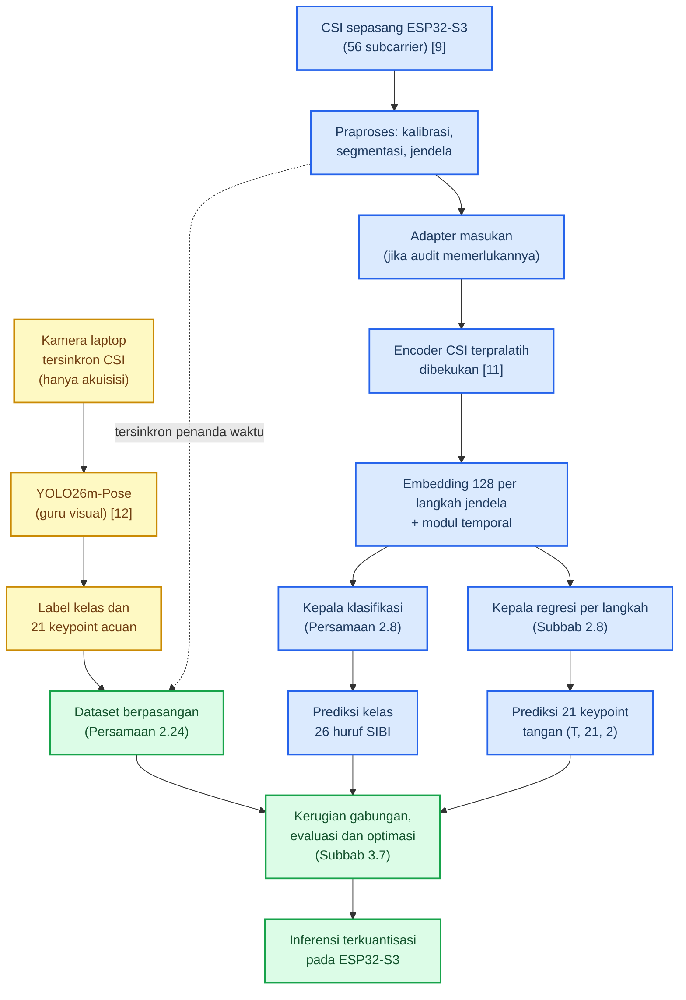
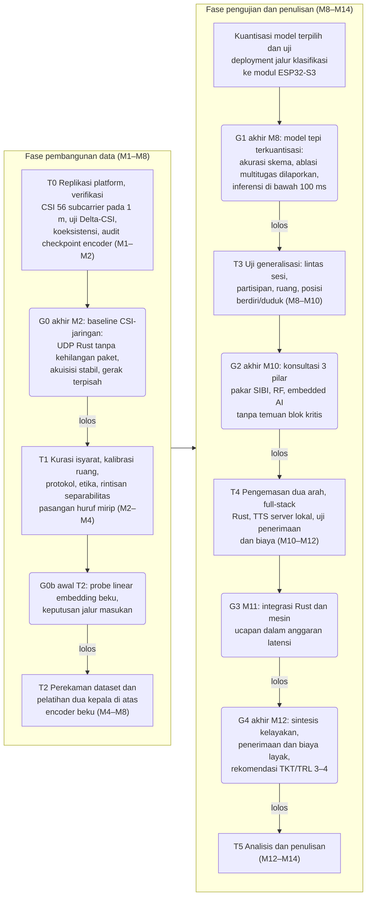
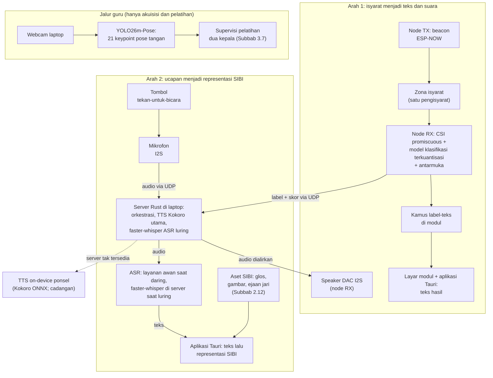
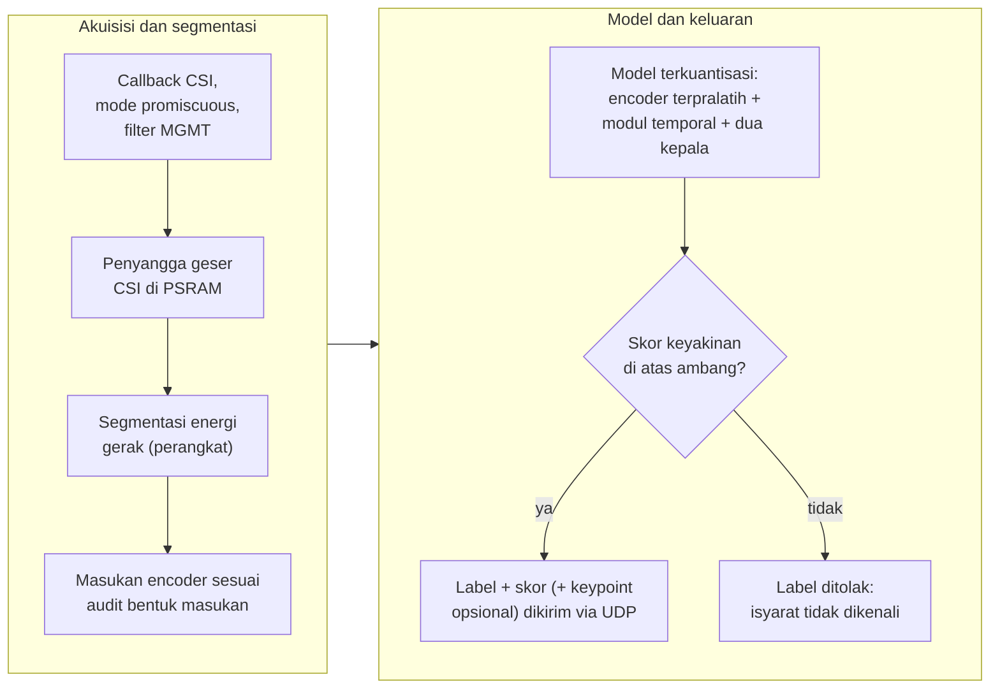

# STUDI KELAYAKAN PURWARUPA SenseSIBI: SISTEM PENERJEMAHAN DUA ARAH HURUF SIBI BERBASIS WI-FI CSI DENGAN INFERENSI ESP32-S3 DAN PEMROSESAN SERVER

**PROPOSAL PENELITIAN**

| Identitas | Keterangan |
|---|---|
| Judul | STUDI KELAYAKAN PURWARUPA SenseSIBI: SISTEM PENERJEMAHAN DUA ARAH HURUF SIBI BERBASIS WI-FI CSI DENGAN INFERENSI ESP32-S3 DAN PEMROSESAN SERVER |
| Jenis dokumen | Proposal penelitian (seminar proposal), BAB I sampai III + Daftar Pustaka; revisi terarah dan aditif atas v16: kontrak masukan *encoder* dikunci, supervisi 24 huruf statis dan J/Z dipisahkan, persamaan pembaruan tetapan disatukan, *deployment* mengikuti Pilihan 1, arsitektur audio disatukan, kriteria gerbang diperkuat; 55 halaman (naik dari 49 pada v16) |
| Disusun oleh | [PERLU DATA: nama penulis] |
| NIM | [PERLU DATA: NIM penulis] |
| Program studi | [PERLU DATA: program studi] |
| Universitas | [PERLU DATA: nama universitas] |
| Pembimbing | [PERLU DATA: nama pembimbing, jika sudah ditentukan] |
| Tahun | [PERLU DATA: tahun penyusunan] |

> Catatan penyusunan: versi ini menyunting naskah v16 sebagai revisi terarah dan aditif atas evaluasi kritis; tidak ada bab yang ditulis ulang dan ruang lingkup sistem tidak berubah. Kontrak masukan *encoder* dikunci menjadi delapan fitur turunan per jendela satu detik dan diuji gerbang G0b; supervisi 24 huruf statis dipisahkan dari huruf gerak J dan Z; himpunan tetapan terlatih dirumuskan utuh pada Persamaan 2.15′ dengan modul temporal dua cabang; *deployment* mengikuti Pilihan 1 (kepala klasifikasi saja, kepala regresi sebagai supervisi tambahan); arsitektur audio disatukan dengan sintesis TTS di server lokal sebagai jalur utama (keputusan D3); kriteria gerbang G1 diperkuat; beban perekaman dihitung ke dalam protokol. Tiga keputusan terbuka, yaitu akhiran judul, model *deployment*, dan lokasi TTS, dicatat pada Tabel 3.7. Penanda [PERLU DATA] dan [PERLU VALIDASI] tetap menandai hal yang belum dapat ditetapkan; rincian perubahan per subbab ada pada Log Perubahan gelombang 17 di ujung naskah.

---
# BAB I PENDAHULUAN

## 1.1 Latar Belakang

Anak tunarungu hampir selalu lahir dari orang tua yang bisa mendengar. Sejak hari-hari pertama, komunikasi di rumah berjalan dengan dua bahasa yang tidak saling mengerti: orang tua berbicara dengan suara, anak menjawab dengan isyarat. Orang tua lalu harus mempelajari bahasa isyarat dari nol, padahal waktu dan kesempatan berlatih serba terbatas. Angkanya memang timpang. Di Indonesia ada sekitar 1,92 juta penyandang tunarungu, sementara juru bahasa isyarat hanya sekitar 500 orang [1], sehingga satu juru bahasa harus melayani hampir 4.000 orang. Untuk kebutuhan harian seperti menceritakan sakit atau bertanya kepada penjual di pasar, menunggu juru bahasa jelas bukan jalan keluar. Undang-Undang Nomor 8 Tahun 2016 sudah menjamin hak setiap penyandang disabilitas untuk berkomunikasi [2], tetapi tanpa alat bantu yang benar-benar terjangkau, jaminan itu berjalan lambat.

Kesenjangan seperti itu paling terasa di ruang kelas. Guru menjelaskan dengan suara; siswa tunarungu menangkap sebagian, menebak sisanya, lalu mudah kehilangan alur pelajaran. SIBI menjadi bahasa pengantar pada pendidikan formal; bentuk isyaratnya dibakukan pemerintah dalam *Kamus Sistem Isyarat Bahasa Indonesia* [3]. Survei terhadap 100 responden tunarungu di Jawa dan Bali melaporkan 91% memakai BISINDO sehari-hari, sementara SIBI menempel pada konteks sekolah [4]; keduanya memang hidup di ranah yang berbeda dan tidak saling menggantikan. Karena penelitian ini menyasar alat bantu pembelajaran di sekolah, SIBI yang dipilih. Seluruh pelaksanaannya direncanakan di Jawa Timur tanpa mengikat kerja sama dengan lembaga tertentu.

Upaya membangun alat bantu komunikasi dua arah sebenarnya sudah ada, tetapi jalurnya baru setengah jalan. Sistem yang mengubah ucapan atau teks menjadi animasi isyarat hanya melayani satu arah: orang pendengar berbicara, sistem mengisyaratkan. Arah sebaliknya, isyarat siswa yang dibaca mesin, belum tersedia sebagai alat yang siap dipakai; riset di Indonesia masih berkutat di jalur kamera, misalnya pengenalan huruf BISINDO dari citra dengan CNN [5]. Kendala kamera itu ada dua dan keduanya praktis. Kamera menuntut pencahayaan serta posisi yang tepat, dan begitu cahaya sedikit berubah, akurasi ikut jatuh; kamera yang terus menyala juga membuat penggunanya merasa diawasi, tidak nyaman dipakai sepanjang hari di kelas.

Untuk menghindari dua kendala itu, sinyal Wi-Fi membuka jalan lain tanpa kamera. Sinyal ini membawa informasi kanal bernama *Channel State Information* (CSI) [6]. Begitu tangan bergerak di antara pemancar dan penerima, jalur pantulan sinyal bergeser dan CSI berubah mengikuti pola gerakannya; perubahan itulah yang dibaca untuk mengenali gerak tanpa sensor yang dikenakan di tubuh. SignFi, contoh terkemukanya, mengenali 276 isyarat *American Sign Language* (ASL) dari CSI [7], dan CSI bahkan peka terhadap gerak halus sampai ke gerakan jari [6]. Penelusuran pada Google Scholar, Crossref, dan OpenAlex hingga Oktober 2026 belum menemukan satu pun penerapan CSI untuk isyarat SIBI.

Perangkat yang dibutuhkan pun sederhana dan murah. Modul ESP32-S3, mikrokontroler seharga sekitar Rp150.000, sudah memiliki radio Wi-Fi 2,4 GHz dengan dukungan CSI resmi [8], [9]. Dua modul cukup untuk satu pasang: yang satu memancarkan sinyal, yang lain menangkapnya. Zona isyarat berada di antara keduanya. *Firmware* penangkap CSI yang teruji untuk modul ini tersedia pada platform terbuka RuView [10]. Biaya sepasang node lengkap diperkirakan di bawah Rp350.000, jauh lebih ringan daripada kamera ditambah komputer pengolah citra. Murah di sini bukan soal angka semata; harga yang terjangkau mengundang sekolah berani memasang alat ini di lebih dari satu ruang.

Jawabannya, penelitian ini merancang purwarupa bernama SenseSIBI, singkatan dari *Sensing & Translation of SIBI*. Arah pertamanya berjalan dari siswa: ia mengisyaratkan huruf, modul menangkap pola CSI, model yang berjalan langsung di modul mengenalinya, teks muncul di layar, lalu dibunyikan sebagai suara. Arah kedua berjalan dari guru: ia menekan tombol lalu berbicara; ucapannya dikenali menjadi teks, lalu bentuk isyaratnya ikut tampil di layar. Model pengenal isyaratnya tidak dilatih dari nol. *Encoder* CSI terpralatih dari RuView [11] menjadi tulang punggungnya. Representasinya dibekukan, lalu dua kepala tugas dilatih di atasnya: satu kepala mengenali 26 kelas huruf, satu lagi memperkirakan 21 titik jari tangan. Model penglihatan YOLO26m-Pose yang sudah terlatih pada data citra SIBI milik peneliti berperan sebagai guru yang memberi label itu [12]. Kamera hanya dipakai guru saat data direkam; setelah kedua kepala terlatih, seluruh sistem bekerja tanpa kamera.

Sebagai studi kelayakan, penelitian ini sengaja membatasi klaimnya. Objek pengenalan dibatasi pada alfabet manual SIBI satu tangan sebanyak 26 huruf, yaitu 24 huruf statis ditambah dua huruf gerak J dan Z, bukan penerjemahan kalimat penuh. Kemampuan membedakan huruf diuji lebih dahulu sebelum klaim yang lebih jauh dibuat; tiap tahap ditutup gerbang keputusan, dan kegagalan tetap dilaporkan sebagai temuan. Dalam batas itulah penelitian ini mencoba menjawab pertanyaan yang sederhana sekaligus jujur: apakah sepasang modul Wi-Fi murah sungguh bisa menjadi jembatan komunikasi dua arah antara siswa tunarungu dan gurunya di kelas?

## 1.2 Rumusan Masalah

Dari latar belakang yang telah dipaparkan, masalah yang dikaji dalam penelitian ini dirumuskan sebagai berikut.

1. Bagaimana merancang purwarupa penerjemah dua arah antara huruf SIBI dan teks beserta suara bahasa Indonesia dengan sepasang modul ESP32-S3 tanpa kamera, yang pada jalur isyarat menjadi teks memakai *encoder* CSI terpralatih RuView yang dibekukan dengan dua kepala tugas, yaitu kepala klasifikasi 26 huruf dan kepala regresi 21 *keypoint* tangan dengan label kelas dari protokol perekaman serta supervisi *keypoint* dari guru visual YOLO26m-Pose, menjalankan inferensi terkuantisasi langsung di modul, serta menghadirkan mesin ucapan dan pengenalan ucapan bahasa Indonesia?
2. Seberapa baik alfabet manual SIBI dikenali dari sinyal CSI oleh model *encoder* terpralatih berkepala dua, termasuk sumbangan kepala regresi yang diukur lewat ablasi, serta bagaimana kinerja kedua jalur penerjemahan pada skenario dalam sesi, lintas partisipan, dan lintas ruang?
3. Seberapa layak purwarupa menjadi alat bantu komunikasi jika ditinjau dari latensi inferensi terkuantisasi dan ujung ke ujung, cakupan kosakata, keandalan operasional, penerimaan pengguna, serta biaya perangkat dan layanan?

## 1.3 Tujuan Penelitian

Tujuan penelitian ini adalah sebagai berikut.

1. Merancang purwarupa penerjemah dua arah antara huruf SIBI dan teks beserta suara bahasa Indonesia dengan sepasang modul ESP32-S3 tanpa kamera, yang pada jalur isyarat menjadi teks memakai *encoder* CSI terpralatih RuView yang dibekukan dengan dua kepala tugas, yaitu kepala klasifikasi 26 huruf dan kepala regresi 21 *keypoint* tangan dengan label kelas dari protokol perekaman serta supervisi *keypoint* dari guru visual YOLO26m-Pose, menjalankan inferensi terkuantisasi langsung di modul, serta menghadirkan mesin ucapan dan pengenalan ucapan bahasa Indonesia.
2. Mengukur seberapa baik alfabet manual SIBI dikenali dari sinyal CSI oleh model *encoder* terpralatih berkepala dua, termasuk sumbangan kepala regresi yang diukur lewat ablasi, serta kinerja kedua jalur penerjemahan pada skenario dalam sesi, lintas partisipan, dan lintas ruang.
3. Menganalisis kelayakan purwarupa sebagai alat bantu komunikasi ditinjau dari latensi inferensi terkuantisasi dan ujung ke ujung, cakupan kosakata, keandalan operasional, penerimaan pengguna, serta biaya perangkat dan layanan.

## 1.4 Batasan Masalah

Agar fokus, ruang lingkup penelitian ini dibatasi sebagai berikut.

1. Objek pengenalan ialah alfabet manual SIBI satu tangan 26 huruf (24 statis serta huruf gerak J dan Z). Bentuk bakunya dicocokkan dengan *Kamus SIBI* [3] dan disetujui validator penutur tunarungu; sistem ini bukan penerjemah kalimat.
2. Pembeda utamanya adalah bentuk tangan dan jari beserta lintasan gerak J dan Z; ekspresi wajah serta penanda nonmanual tidak dikenali.
3. Penginderaan memakai sepasang modul ESP32-S3 (satu pemancar, satu penerima; 2,4 GHz, kanal 20 MHz) dengan layar, baterai, *speaker*, dan mikrofon pada node penerima; kamera hanya menyala saat perekaman data pelatihan.
4. YOLO26m-Pose berperan sebagai guru visual hanya pada saat akuisisi dan pelatihan; produk akhirnya bebas kamera dan bebas citra.
5. *Encoder* murid memakai *checkpoint* terpralatih `ruvnet/wifi-densepose-pretrained` dengan *embedding* 128 dimensi dan 9.280 parameter [11]; *encoder* dibekukan pada baseline, sedangkan LoRA dan pelatihan lanjutan diperlakukan sebagai eksperimen pembanding; masukan *checkpoint* berupa delapan fitur turunan per jendela satu detik disesuaikan lewat jalur fitur turunan atau adapter masukan yang dipilih pada gerbang G0b [PERLU VALIDASI: parameter normalisasi masukan dan keputusan jalur G0b].
6. Sintesis ucapan utama berjalan di server lokal dan audio diputar pada *speaker* node penerima, dengan mesin *on-device* pada ponsel sebagai cadangan; pengenalan ucapan memakai layanan awan dengan faster-whisper lokal sebagai cadangan; pilihan final mesin dan layanan tetap ditetapkan pada gerbang G3.
7. Arah kedua terbatas pada kamus tingkat kata dengan *fallback* ejaan jari; cakupan kamusnya diukur lalu dilaporkan.
8. Satu sesi hanya melibatkan satu pengisyarat dan sistem tidak mengidentifikasi individu; pengujian berlangsung di sedikitnya dua ruang berbeda di Jawa Timur yang sudah dikalibrasi.
9. Uji pengguna berskala kecil (3–5 pengguna) dan dianalisis secara deskriptif, tanpa statistik inferensial.
10. Isyarat kontinu, tata bahasa isyarat penuh, BISINDO, serta klasifikasi gerakan otomatis dari video berada di luar pembahasan.
11. Seluruh hasil dilaporkan sebagai bukti awal pada populasi terbatas, yaitu 3–4 pengisyarat, sedikitnya dua ruang, dan satu konfigurasi perangkat; skema *leave-one-subject-out*, pengguna baru, dan *leave-one-room-out* dibaca sebagai indikasi ketahanan awal, bukan bukti generalisasi populasi; klaim lintas populasi tidak dibuat.

## 1.5 Manfaat Penelitian

Manfaat penelitian ini terbagi atas manfaat teoretis dan manfaat praktis.

### 1.5.1 Manfaat Teoretis

Secara teoretis, penelitian ini menyumbang bukti awal tentang satu pertanyaan yang tajam: apakah *embedding* hasil pretraining kontrastif pada CSI masih informatif untuk gestur jari jika hanya dua kepala tugasnya yang dilatih. Bukti itu terikat pada alfabet manual dan belum tentu berlaku untuk isyarat kata maupun isyarat kontinu. Penelitian ini juga menghasilkan formulasi multitugas lintas modalitas yang mengawasi klasifikasi isyarat dengan regresi bentuk jari pada satu *embedding* bersama, serta *dataset* CSI berlabel beserta protokol perekamannya. Peneliti berikutnya bisa memakainya untuk bahasa isyarat lain, termasuk perluasan ke BISINDO.

### 1.5.2 Manfaat Praktis

Bagi sekolah yang kelak memakainya, penelitian ini memberi gambaran nyata tentang kelayakan alat bantu komunikasi dua arah berbahasa SIBI, lengkap dengan biaya perangkatnya. Purwarupa yang memunculkan teks, menyuarakan isyarat, dan memperagakan bentuk isyarat bagi lawan bicara akan lahir jika seluruh tahap berhasil. Jika berhenti lebih awal, laporan karakterisasi, protokol, dan *dataset* berlabel tetap menjadi warisan penelitian. Bagi keluarga siswa, kosakata yang tervalidasi memastikan isyarat yang muncul di layar benar bentuknya. Bagi komunitas riset, rancangan yang tidak terikat pada satu bahasa isyarat memudahkan replikasi di tempat lain.

## 1.6 Sistematika Penulisan

Secara ringkas, proposal ini disusun atas tiga bab. **BAB I Pendahuluan** memuat latar belakang, rumusan masalah, tujuan, batasan, manfaat, dan sistematika penulisan. **BAB II Kajian Pustaka** menghimpun teori dan penelitian terdahulu yang menjadi dasar perancangan, termasuk *encoder* CSI terpralatih, kedua kepala tugas, dan supervisi guru visual. **BAB III Metode Penelitian** memuat desain, tahapan, waktu dan lokasi, alat dan bahan, perancangan sistem, protokol perekaman, pengolahan sinyal dan pelatihan dua kepala, skenario pengujian, jadwal, parameter yang ditetapkan kemudian, serta risiko dan cadangannya.
# BAB II KAJIAN PUSTAKA

## 2.1 Bahasa Isyarat, SIBI, dan Kebutuhan Komunikasi Dua Arah

Bahasa isyarat menyampaikan makna lewat gerak tangan, lengan, tubuh, dan ekspresi wajah. Satu isyarat tersusun atas bentuk tangan, lokasi, gerak, serta orientasi telapak; cukup satu jari berubah bentuk, maknanya bisa ikut berubah. Susunan inilah yang menjadi acuan penelitian dalam memisahkan bagian isyarat yang bisa dinilai mesin dari bagian yang tetap memerlukan penilaian manusia [3]. SIBI ialah sistem isyarat baku pendidikan formal yang didokumentasikan kamus pemerintah [3], sedangkan BISINDO tumbuh alami di komunitas tunarungu. Survei terhadap 100 responden tunarungu di Jawa dan Bali menemukan 91% memakai BISINDO, sementara SIBI menempel pada konteks sekolah [4]. Penelitian ini tetap memilih SIBI karena sasarannya alat bantu pembelajaran di sekolah, bukan karena jumlah penuturnya lebih besar. Audit label pada dataset visual peneliti menegaskan pembagian kelas yang dipakai seluruh naskah: huruf C termasuk kelompok 24 huruf statis, sedangkan J dan Z satu-satunya huruf yang menuntut lintasan gerak.

Bicara antara pengguna isyarat dan orang pendengar menuntut dua arah. Keluarga dan guru berada di barisan paling depan untuk merasakan kesenjangan ini, sementara jumlah juru bahasa masih jauh dari cukup [1]; alat bantu yang dibangun karena itu harus melayani kedua arah; kamus satu arah tidak menyelesaikan masalahnya. Sistem satu arah yang mengubah ucapan menjadi animasi isyarat sudah lebih dulu hadir di Indonesia, tetapi untuk arah isyarat menjadi teks riset dalam negeri bertumpu pada kamera, misalnya CNN untuk huruf BISINDO [5]. Masalahnya, kamera menuntut pencahayaan dan garis pandang yang baik, dan kamera yang terus menyala membuat pengguna merasa diawasi. Dua kendala inilah yang mendorong pencarian jalur penginderaan tanpa kamera dan tanpa perangkat yang dikenakan.

## 2.2 Wi-Fi Channel State Information

*Channel State Information* (CSI) memuat informasi amplitudo dan fase pada setiap *subcarrier* sinyal Wi-Fi, yang bersama-sama menggambarkan kondisi jalur propagasi [6]. Tubuh yang bergerak di antara pemancar dan penerima mengubah panjang jalur pantulan; amplitudo dan fase tiap *subcarrier* pun ikut bergeser. Geseran inilah yang dipakai untuk mengenali gerak tanpa sensor yang dikenakan. Karena tiap *subcarrier* menempati frekuensi berbeda, satu pasang perangkat sekaligus menyediakan banyak kanal pengamatan [6].

Bentuk formalnya sederhana: pada kanal 20 MHz, tiap *subcarrier* ke-n membawa koefisien kanal kompleks

```rumus
h~n~(t) = |h~n~(t)| · exp( j · φ~n~(t) ) (2.1)
```

dengan n = 1, ..., 56, |h~n~(t)| amplitudo, φ~n~(t) fase, dan j satuan imajiner [6], [9]. Amplitudo dan fase inilah bahan mentah seluruh perhitungan pada bab-bab berikutnya.

Pemodelan CSI sendiri berpijak pada zona Fresnel [13]. Radius zona Fresnel ke-n pada suatu titik dihitung dari jarak titik itu ke pemancar d~1~ dan ke penerima d~2~ [13]:

```rumus
r~n~ = √( n · λ · d~1~ · d~2~ / ( d~1~ + d~2~ ) ) (2.2)
```

dengan λ panjang gelombang pembawa; pada 2,4 GHz, λ = c/f ≈ 12,5 cm. Angkanya bisa langsung dihitung untuk tautan baku penelitian ini. Pada jarak antarmodul 1 meter dengan tangan di titik tengah, radius zona pertama r~1~ = √(0,125 × 0,5 × 0,5) ≈ 0,18 meter. Ruang gerak jadi seluruhnya berada di zona yang paling peka terhadap perubahan jalur. Penempatan itu dirangkum pada Gambar 2.1. Artikulasi jari menggeser jalur pantulan pada orde sentimeter sampai milimeter, dan tiap bentuk huruf meninggalkan pola perubahan *subcarrier* yang khas.

```gambar
Sumber skrip: scripts/sensesibi-v10/gambar_g15_fresnel.py (matplotlib mplot3d) -> assets-v16/gambar-2.1.png
```

Gambar 2.1 Zona Fresnel pertama pada tautan baku 1 meter; tangan pengisyarat berada di dalam zona (ilustrasi skematis tiga dimensi, tidak berskala) [6], [13]

Gerak tubuh juga melahirkan pergeseran Doppler yang besarnya mengikuti kecepatan gerak v [6], [14]:

```rumus
f~D~ = ( v / λ ) · ( cos α + cos β ) (2.3)
```

dengan α dan β sudut antara arah gerak dan garis pandang ke pemancar serta ke penerima; nilai mutlaknya paling besar 2v/λ. Pita Doppler gerak isyarat yang relevan kira-kira 1–60 Hz [6], sedangkan kaidah Nyquist menuntut laju pencuplikan

```rumus
f~s~ ≥ 2 · f~maks~ (2.4)
```

Akibatnya bisa dihitung sejak awal. Pada laju *firmware* RuView 50 bingkai per detik [10], pita teramati hanya sampai 25 Hz, sehingga gerak tangan yang masih teramati tanpa pelipatan kira-kira v = 25 × 0,125/2 ≈ 1,6 meter per detik. Gerak jari yang lebih cepat berisiko terlipat, dan jika laju terukur lebih rendah lagi, pita yang dianalisis ikut menyempit; hal itu dilaporkan apa adanya.

Satu masalah masih tersisa: fase mentah tercemar derau osilator lokal. Teknik CSI-ratio membersihkannya lewat rasio atau perkalian konjugat tanpa perangkat tambahan [13]. Prinsip itu diadaptasi penelitian ini menjadi rasio terhadap rekam acuan kalibrasi ruang (Subbab 3.7):

```rumus
ρ~n~(t) = h~n~(t) / h~n~( t~0~ ) (2.5)
```

dengan t~0~ waktu kalibrasi ruang, yaitu 600 bingkai bawaan RuView [10]. Rasio ini membuang tanggapan statis ruang sehingga yang tersisa adalah perubahan akibat gerak; sisa derau fase yang berjalan lambat diukur pada T0 lalu dilaporkan.

Dari ketukan tombol sampai gerakan jari, bukti kepekaan CSI terhadap gerak halus cukup banyak [6]; akan tetapi, bukti-bukti itu lahir dari kondisi terkendali sehingga bagi penelitian ini statusnya sebatas hipotesis kerja. Model CSI juga mudah *overfitting* terhadap orang dan ruang. Widar3.0 menjawab masalah itu dengan profil kecepatan Doppler untuk pengenalan lintas domain [14]. Kelayakan satu tautan dua modul berantena tunggal untuk membedakan 26 bentuk tangan SIBI karenanya diperlakukan sebagai pertanyaan penelitian, bukan asumsi; uji Delta-CSI dan gerbang G1 yang mengujinya. Jika beberapa huruf terbukti tidak terpisahkan, himpunan huruf dipangkas (Tabel 3.7).

## 2.3 Modul ESP32-S3, Platform RuView, dan Koeksistensi Radio

ESP32-S3 ialah mikrokontroler Wi-Fi 802.11 b/g/n 2,4 GHz berantena tunggal dengan inti ganda 240 MHz, SRAM 512 KB, dan PSRAM hingga 8 MB [8]. Dukungan CSI tersedia resmi lewat repositori esp-csi; pada kanal 20 MHz, CSI memuat 56 *subcarrier* [9]. RuView merekomendasikan ESP32-S3 sebagai modul penangkap CSI sekaligus menyediakan rantai akuisisi lengkap [10] yang dipetakan pada Tabel 2.1. Repositori yang sama menerbitkan *checkpoint encoder* CSI terpralatih yang menjadi tulang punggung murid penelitian ini. Pembedaannya dari dua model lain pada ekosistem itu diuraikan pada Subbab 2.4.

Tabel 2.1 Pemetaan fitur RuView terhadap peran dalam penelitian ini

| Fitur RuView | Peran dalam penelitian ini |
|---|---|
| *Firmware* penangkap CSI (UDP) | Mengalirkan CSI dan label ke server |
| Station + UDP + CSI *promiscuous* + ESP-NOW pada satu *chip* | Dasar topologi satu kanal (Subbab 3.5) |
| Kalibrasi ruang 600 bingkai + 8 *anchor* | Kalibrasi tiap sesi; pemotongan segmen isyarat |
| Mode privasi | Membuang fitur biometrik selama penelitian |
| Akuisisi tersinkron kamera-CSI | Jalur guru; estimator memakai YOLO26m-Pose |
| *Checkpoint encoder* CSI terpralatih (*embedding* 128 dimensi) [11] | *Encoder* murid yang dibekukan pada baseline (Subbab 2.4) |

Fakta paling menentukan justru koeksistensi radio pada satu *chip*. *Firmware* RuView mampu menangkap CSI sambil memelihara koneksi *station* UDP serta sinkronisasi ESP-NOW secara serentak. Dua syaratnya: seluruh perangkat berada pada satu kanal dan mode hemat daya dimatikan [10]. Purwarupa karenanya tidak memerlukan modul gerbang khusus, tetapi ada satu catatan penting: RuView belum melalui telaah sejawat, jadi fungsinya diverifikasi sendiri pada gerbang G0.

## 2.4 Encoder CSI Terpralatih RuView dan Pembedaan Tiga Model

*Encoder* terpralatih yang menjadi tulang punggung jalur isyarat menjadi teks terdokumentasi lengkap pada kartu modelnya [11]. Arsitekturnya dua lapis *fully connected* dengan BatchNorm dan GELU yang memetakan fitur CSI menjadi *embedding* 128 dimensi ternormalisasi L2. Seluruhnya hanya 9.280 parameter. Pemetaannya ditulis

```rumus
z~i~ = f~θ0~( X~i~ ), z~i~ ∈ R^d^, d = 128 (2.6)
```

dengan X~i~ masukan ke-i, f~θ0~ pemetaan *encoder* bertetapan θ~0~, dan z~i~ vektor *embedding* keluaran. Pretrainingnya kontrastif dengan triplet loss dan InfoNCE pada temperatur 0,1. Pasangan positif diambil dari jendela dalam jarak 2 detik, pasangan negatif dari jarak lebih dari 30 detik, selama 60 epoch dengan AdamW dan perlindungan EWC terhadap lupa bencana [11]. Pada baseline penelitian ini, θ~0~ dibekukan; tetapan yang diperbarui mencakup adapter masukan (jika dipakai), modul temporal, dan kedua kepala tugas sebagaimana dirumuskan pada Persamaan 2.15′. Kontrak masukan *checkpoint* diikat secara eksplisit: *encoder* menerima satu vektor delapan fitur turunan per jendela satu detik (bentuk *batch* (B, 8)), bukan deret *subcarrier*, dan menghasilkan satu *embedding* 128 dimensi ternormalisasi L2 per jendela. Deret waktu karenanya hidup pada tingkat barisan jendela, bukan di dalam *encoder*. Parameter normalisasi masukan belum dipublikasikan kartu modelnya sehingga dicari pada artefak *checkpoint* saat audit T0 [PERLU VALIDASI: parameter normalisasi masukan pada artefak checkpoint].

Satu angka pada kartu model itu perlu dibaca hati-hati. Akurasi triplet-temporal *held-out* sebesar 82,3% tercatat pada 20% akhir rekaman menurut waktu, dengan pembanding 66,4% untuk fitur mentah tanpa *encoder* dan 69,6% untuk *encoder* berinisialisasi acak [11]. Angka itu menghitung peluang bahwa jarak anchor ke positif temporal lebih pendek daripada jaraknya ke negatif temporal. Yang diukurnya ialah kualitas geometri *embedding* pada tugas jarak, bukan akurasi klasifikasi SIBI dan bukan pula galat *keypoint*. Dua hal terakhir justru yang hendak diukur penelitian ini, dan kartu model tidak memuat keduanya.

Ketidaksesuaian bentuk masukan menjadi temuan audit yang paling menentukan. Kartu model mencatat masukan delapan fitur turunan CSI pada laju 1 Hz, yaitu kehadiran, gerak, napas, detak jantung, varians fase, jumlah orang, deteksi jatuh, dan RSSI [11]. Jalur akuisisi penelitian ini, sebaliknya, menghasilkan 56 *subcarrier* pada 50 bingkai per detik [9], [10], sehingga *encoder* itu tidak dapat langsung diberi *subcarrier* mentah. Dua jalur penyelesaiannya disiapkan dan diputuskan setelah audit T0. Jalur pertama menghitung ulang delapan fitur turunan bawaan RuView dari bingkai CSI; jalur kedua melatih adapter masukan kecil yang memetakan jendela CSI ke ruang masukan *encoder*. Keduanya dinyatakan terbuka dengan penanda [PERLU VALIDASI] sampai audit selesai, dan riset ini tidak mengklaim kompatibilitas sebelum terverifikasi.

Delapan fitur itu perlu dibaca dengan jujur sebagai kontrak lingkungan, bukan kontrak artikulasi. Napas, detak jantung, jumlah orang, dan deteksi jatuh hampir tidak berubah selama artikulasi jari; informasi gerak tangan terkonsentrasi pada fitur gerak dan varians fase; pretraining dilakukan pada data ruangan delapan jam dengan supervisi sensor PIR dan BME280 [11], bukan pada gerak tangan. Kelayakan representasi ini bagi huruf SIBI karena itu diperlakukan sebagai hipotesis yang diuji pada gerbang G0b (Subbab 3.7), bukan sebagai sifat yang menyertai *checkpoint*.

Dua model lain pada ekosistem yang sama sering tertukar dengan *encoder* ini, sehingga keduanya dipisahkan sejak awal. Model `wifi-densepose-mmfi-pose` [15] adalah *checkpoint* pose terpisah. Masukannya amplitudo CSI berukuran [3, 114, 10] pada 100 Hz, yang diproses *encoder* Transformer 4 lapis 8 kepala menjadi keluaran [17, 2], yaitu 17 *keypoint* tubuh COCO dalam rentang [0, 1], dengan sekitar 2,3 juta parameter. Model itu dilatih pada dataset MM-Fi [16] yang memuat 40 subjek, 27 kategori aksi, dan lebih dari 320 ribu bingkai tersinkron dari lima modalitas. Kinerjanya PCK@20 ternormalisasi badan sebesar 82,69% untuk model tunggal dan 83,59% untuk ansambel. Angka itu turun menjadi sekitar 64% lintas subjek *zero-shot* dan 17,5% lintas lingkungan, lalu naik ke rentang 72% sampai 78% setelah kalibrasi 50 sampai 1.000 bingkai per orang [15]. Lisensi CC BY-NC 4.0 melekat padanya karena mengikuti lisensi datanya. Model ketiga, YOLO26m-Pose [12], ialah model penglihatan pada citra yang berperan sebagai guru visual dan dibahas pada Subbab 2.9. Tabel 2.2 merangkum pembedaan ketiganya.

Tabel 2.2 Pembedaan tiga model ekosistem yang tidak boleh tercampur dalam penelitian ini

| Aspek | Encoder CSI terpralatih [11] | Model pose MM-Fi [15] | Guru visual YOLO26m-Pose [12] |
|---|---|---|---|
| Berkas | `ruvnet/wifi-densepose-pretrained` | `ruvnet/wifi-densepose-mmfi-pose` | Repositori WPC peneliti (eksperimen `exp11_huruf24`) |
| Masukan | 8 fitur turunan CSI per jendela 1 detik (laju 1 Hz; *batch* (B, 8)); bukan deret *subcarrier* | Amplitudo CSI [3, 114, 10] @ 100 Hz | Citra RGB kamera |
| Keluaran | *Embedding* 128 dimensi ternormalisasi L2 | 17 *keypoint* tubuh COCO dalam [0, 1] | Kelas isyarat dan 21 *keypoint* tangan |
| Parameter | 9.280 | ±2,3 juta (varian utama) | [PERLU DATA: jumlah parameter model juara WPC] |
| Peran | Representasi murid, dibekukan pada baseline | Pembanding temuan lintas domain, bukan komponen model | Pemberi label kelas dan *keypoint* saat akuisisi |
| Status bukti | Kartu model; akurasi triplet-temporal 82,3% | Kartu model; PCK@20 82,69%; lisensi CC BY-NC 4.0 | Data pra-penelitian peneliti; mAP50 0,9580 pada 24 huruf statis |

Status tiga dokumen rancangan pada repositori RuView juga dinyatakan terbuka. ADR-024 mengusulkan model penyematan kontrastif AETHER; ADR-146 mengusulkan *encoder* RF bersama dengan tujuh kepala tugas dan ketidakpastian per kepala; ADR-150 mengusulkan *foundation encoder* yang tahan pergantian orang dan ruang. Ketiganya berstatus Proposed, artinya rancangan yang belum diimplementasikan [10]. Penelitian ini bersandar hanya pada *checkpoint* yang benar-benar tersedia; angka estimasi dari ADR dikutip dengan label estimasi rancangan setiap kali muncul.

## 2.5 Transfer Learning pada Encoder Beku: LoRA dan Pelatihan Lanjutan

Baseline penelitian ini membekukan *encoder* dan melatih hanya kedua kepala tugasnya. Alasannya metodologis: dengan *encoder* beku, kualitas *embedding* terpralatih untuk isyarat SIBI terbaca langsung dari kinerja kepala, sehingga sumbangan pretraining terpisah dari sumbangan penyetelan. Karena *encoder* hanya 9.280 parameter, biaya membandingkan skema adaptasi lain pun rendah, dan perbandingannya dijalankan pada data serta seed yang sama.

LoRA menambah pembaruan berperingkat rendah pada tetapan asli tanpa menyimpan gradien untuk seluruh matriks [17]:

```rumus
W~akhir~ = W~0~ + B · A (2.7)
```

dengan W~0~ matriks tetapan asli yang dibekukan, B berukuran d~keluar~ × r dan A berukuran r × d~masuk~, serta r peringkat adapter yang dipilih jauh lebih kecil daripada ukuran matriks; hanya B dan A yang dilatih. Adapter bekerja di dalam lapisan yang sudah ada sebagai jalur adaptasi yang hemat parameter. Perannya berbeda dari kepala tugas maupun dari pelatihan lanjutan, dan ia bukan prasyarat penelitian ini. Ketersediaannya bahkan terdokumentasi untuk kasus ruangan: kartu model menyertakan adapter `node-1.json` dan `node-2.json` masing-masing sekitar 21 KB [11]. ADR-150 menaksir adapter sekitar 11 KB mampu menyamai kinerja lintas subjek dengan 100 sampai 200 data berlabel per ruang [10]; angka itu berstatus estimasi rancangan, bukan hasil terukur. Kompatibilitas LoRA dengan alur ekspor ke ESP32-S3 belum terverifikasi, sehingga statusnya ditandai [PERLU VALIDASI: kompatibilitas LoRA dengan alur ekspor] dan diperiksa pada T0.

Pembanding ketiga ialah pelatihan lanjutan. Pelatihan sebagian membuka lapis terakhir saja, sedangkan pelatihan penuh membuka seluruh tetapan. Keduanya dijaga dengan EWC sebagaimana pretraining *encoder* melakukannya [11], dan keduanya dilaporkan berdampingan dengan hasil *encoder* beku. Ketiga skema itu (beku, beku plus LoRA, pelatihan lanjutan) diperlakukan sebagai eksperimen pembanding pada Subbab 3.7, bukan keputusan yang dikunci di muka.

## 2.6 Kepala Klasifikasi dan Kerugian Silang-Entropi

Kepala klasifikasi mengubah *embedding* menjadi skor tiap kelas huruf. Untuk K kelas dengan K = 26, skor logit dihitung dari

```rumus
a~i~ = W~c~ · z~i~ + b~c~ (2.8)
```

dengan W~c~ matriks berukuran K × 128 dan b~c~ vektor bias. Skor lalu diubah menjadi probabilitas lewat *softmax*

```rumus
q~ik~ = exp( a~ik~ ) / Σ~k~ exp( a~ik~ ) (2.9)
```

sehingga seluruh probabilitas berjumlah satu, dan kelas prediksi ialah kelas dengan probabilitas terbesar. Sebagai lantai pembanding, tebakan acak seragam pada K kelas bernilai 1/K ≈ 3,8%, dan angka itu dihitung ulang jika himpunan huruf dipangkas. Kerugian pelatihannya silang-entropi kategorikal; dengan label *one-hot* y~ik~ yang bernilai satu pada kelas benar dan nol pada kelas lain, kerugian atas N sampel dalam *batch* berbunyi

```rumus
L~cls~ = − ( 1 / N ) · Σ~i~ Σ~k~ y~ik~ · log q~ik~ (2.10)
```

yang menghukum prediksi yang percaya diri pada kelas salah. Jika data latih terbukti timpang antarhuruf, bobot kelas dipasang berbanding terbalik dengan frekuensi kelasnya; bobot itu dihitung hanya dari data latih dan keputusannya dicatat pada Tabel 3.7.

Klasifikator himpunan tertutup selalu memilih satu kelas, sehingga keluarannya dilengkapi skor keyakinan dan mekanisme penolakan [18]: keyakinan yang rendah memunculkan pesan isyarat tidak dikenali alih-alih menebak salah. Menolak lebih aman daripada menebak kelas yang salah. Ambangnya ditetapkan dari data validasi (Subbab 3.7).

## 2.7 Kepala Regresi 21 Keypoint dan Kerugian Smooth L1 Bermask

Target regresi mengikuti skema 21 *landmark* tangan MediaPipe Hands [19], skema yang sama dipakai *pseudo-labeling* pada dataset visual peneliti. Sesuai `kpt_shape` [21, 3], tiap sampel target memuat 21 titik dengan tiga nilai: koordinat x, koordinat y, dan tanda visibilitas. Komponen ketiga itu ialah penanda visibilitas atau keyakinan deteksi sesuai konvensi dataset dan Ultralytics; koordinat target karenanya dipakai berpasangan (x, y) saja, sedangkan visibilitas diperlakukan sebagai mask. Varian peringkas tunggal kepala, yang menjadi pembanding ablasi untuk huruf statis, memprediksi koordinat x dan y seluruh jendela dari satu vektor ringkasan,

```rumus
Q~i~ = reshape( W~r~ · z~i~ + b~r~, T, 21, 2 ) (2.11)
```

dengan W~r~ matriks berukuran 42T × 128 untuk jendela ber-T langkah, Q~i~ prediksi *keypoint*, dan P~i~ koordinat acuan dari guru visual. Varian utama kepala membaca tiap keadaan tersembunyi modul temporal secara langsung sehingga keluarannya tetap per langkah (Subbab 2.8); bentuk keluaran per langkah dipilih karena J dan Z dibedakan oleh lintasan gerak, bukan oleh satu pose. Jika eksperimen menunjukkan regresi cukup dipakai sebagai supervisi tambahan pada satu pose, dimensi T dilepas dan keterbatasannya untuk J dan Z dijelaskan di laporan. Keputusan ini dicatat pada Tabel 3.7.

Sistem koordinat target harus dibakukan sebelum pelatihan, dan di sinilah letak kehati-hatianya. Koordinat piksel kamera tidak otomatis dapat diprediksi dari CSI tanpa definisi koordinat, transformasi, atau kalibrasi yang dapat direproduksi. Koordinat itu juga tidak tahan terhadap perubahan posisi kamera, jarak, maupun orientasi. Kandidat yang kuat ialah koordinat ternormalisasi terhadap kotak deteksi guru atau terhadap titik pergelangan tangan. Pilihan finalnya ditetapkan pada T0 lalu dipakai konsisten oleh guru dan murid [PERLU VALIDASI: sistem koordinat dan normalisasi target regresi]. Kerugian regresinya Smooth L1 yang dibobot mask visibilitas [20]. Fungsi Smooth L1 berperilaku kuadratik dekat nol dan linear untuk galat besar,

```rumus
SmoothL1~δ~( x ) = 0,5 · x^2^ / δ untuk |x| ≤ δ, dan |x| − 0,5 · δ untuk |x| > δ (2.12)
```

dengan δ ambang peralihan, sehingga pencilan anotasi tidak mendominasi gradien. Kerugian bermask dihitung hanya pada titik yang terlihat:

```rumus
L~reg~ = ( Σ~i,t,j~ m~itj~ · SmoothL1~δ~( Q~itj~ − P~itj~ ) ) / ( Σ~i,t,j~ m~itj~ + ε ) (2.13)
```

dengan m~itj~ mask visibilitas dari guru yang bernilai satu jika titik j pada bingkai t terlihat dan nol jika terhalang, serta ε penahan pembagi nol; mask berlaku per *keypoint*, bukan per koordinat. Jika prediksi visibilitas juga diinginkan, kepala tambahan dengan kerugian silang-entropi biner disiapkan sebagai perluasan; keputusan memakainya dicatat pada Tabel 3.7.

## 2.8 Pembelajaran Multitugas, Modul Temporal, dan Kerugian Gabungan

Pembelajaran multitugas melatih beberapa tugas berbarengan di atas representasi yang dibagi, dan representasi yang baik untuk satu tugas kerap menolong tugas lain yang berkaitan [21]. Kedua tugas penelitian ini memang dua pandangan atas isyarat yang sama: kepala klasifikasi membacanya sebagai kelas diskret, sedangkan kepala regresi membacanya sebagai bentuk jari kontinu. Hipotesis kerjanya, supervisi *keypoint* ikut merapikan batas antarhuruf yang bentuknya mirip. Kerugian gabungan menjumlah keduanya dengan bobot:

```rumus
L~total~ = λ~cls~ · L~cls~ + λ~reg~ · L~reg~ (2.14)
```

Penetapan bobotnya tidak asal pilih. Silang-entropi bergerak pada orde logaritma jumlah kelas, sedangkan Smooth L1 bergerak pada satuan koordinat. Keduanya karena itu disamakan skalanya lebih dulu, misalnya dengan membagi tiap kerugian oleh nilai rata-ratanya pada epoch pertama; bobot λ baru ditala dari data validasi (Tabel 3.7). Konflik gradien antartugas dipantau lewat besar gradien tiap kepala; jika keduanya menarik representasi ke arah berlawanan, penyeimbangan gradien atau pelatihan bergantian dipertimbangkan dan perlakuannya dilaporkan. Pada baseline, pembaruan tetapan menyentuh seluruh tetapan di luar *encoder*:

```rumus
Θ~train~ = { φ~adapter~, θ~temporal~, θ~c~, θ~r~ }, θ~encoder~ = θ~0~ (2.15′)
```

dengan φ~adapter~ tetapan adapter masukan yang hanya hadir jika jalur adapter terpilih pada gerbang G0b, θ~temporal~ tetapan modul temporal, serta θ~c~ dan θ~r~ tetapan kedua kepala; pembaruannya mengikuti Θ~train~ ← Optimizer( ∇ L~total~ ). *Encoder* tetap dibekukan pada θ~0~ sepanjang baseline; skema pembukaan tetapan (LoRA dan pelatihan lanjutan) tetap diperlakukan sebagai pembanding pada Subbab 3.7.

Satu komponen dari rancangan lama tetap dipertahankan dan dievaluasi ulang perannya: 1D-CNN. Pada rancangan lama ia menjadi kepala tunggal di atas *backbone*. Pada rancangan ini ia kandidat modul temporal yang memelihara urutan waktu. Modul temporal bukan kepala tugas dan tidak dirancang sebagai peringkas tunggal: ia memproses barisan *embedding* per langkah dan mengeluarkan keadaan tersembunyi per langkah, h~1~ sampai h~T~. Kepala klasifikasi membaca ringkasan beratensi (*attention*) atas barisan itu menjadi satu vektor, sedangkan kepala regresi membaca tiap keadaan secara langsung, Q~t~ = reshape( W~r~ · h~t~ + b~r~, 21, 2 ) dengan W~r~ berukuran 42 × 128 sehingga keluaran regresi per segmen berbentuk T × 21 × 2 tanpa kehilangan urutan waktu. Varian peringkas tunggal (Persamaan 2.11) dipertahankan sebagai pembanding ablasi untuk huruf statis, dengan keterbatasannya bagi J dan Z dijelaskan pada laporan. Konsekuensinya, kandidat agregasi statistik rata-rata dan maksimum hanya berlaku untuk jalur klasifikasi; pelatihan multitugas dengan regresi temporal menuntut modul yang memelihara urutan. Parameter modul temporal ikut dilatih bersama kepala pada Persamaan 2.15′. Keputusan mempertahankannya atau menggantinya diambil dari hasil ablasi pada data yang sama (Subbab 3.7), bukan dari preferensi implementasi. Untuk menguji manfaat penggabungan itu, kepala tunggal yang dilatih sendiri-sendiri juga disiapkan sebagai pembanding pada split yang sama.

## 2.9 Guru Visual YOLO26m-Pose dan Supervisi Lintas Modalitas

Guru visual bekerja hanya pada tahap akuisisi data. Kamera laptop dan node penerima CSI merekam serentak dengan penanda waktu yang sama; pada tiap bingkai, YOLO26m-Pose [12] menghasilkan kelas isyarat beserta 21 *keypoint* tangan dan visibilitasnya. Label kelas dicocokkan dengan kartu pemandu protokol perekaman sehingga derau label terkendali. Kemampuan guru sudah teruji pada tahap pra-penelitian di repositori WPC milik peneliti. Dataset versi 2 memuat 49 kelas isyarat dengan total 7.210 gambar yang terbagi menjadi 6.231 latih, 650 validasi, dan 329 uji; *keypoint*-nya dihasilkan lewat *pseudo-labeling* MediaPipe HandLandmarker [19]. Eksperimen `exp11_huruf24` pada 24 huruf statis mencatat *pose* mAP50 0,9580 dengan akurasi huruf 97,6%; angka itu berlaku untuk 24 huruf statis pada data visual dan tidak dikutip sebagai kemampuan guru mengenali J dan Z, yang supervisinya diambil dari lintasan *keypoint* dan label protokol. Dari angka itu terbaca bahwa 21 titik artikulasi jari memuat informasi cukup untuk gestur mikro SIBI. Perlu ditegaskan dua hal: seluruh angka itu adalah hasil model visual pada data visual, bukan hasil model Wi-Fi. Selain itu, dataset itu tidak memuat satu pun rekaman CSI, sehingga pasangan data baru harus direkam sendiri pada T2.

Peran guru dipisahkan menurut jenis target. Untuk 24 huruf statis, label kelas pelatihan diambil dari protokol perekaman (kartu pemandu), sedangkan guru menyumbang deret 21 *keypoint* beserta visibilitasnya. Untuk J dan Z, label kelas juga berasal dari protokol; guru tidak diposisikan sebagai pengklasifikasi kedua huruf gerak itu kecuali model guru terbukti memuat kelasnya [PERLU VALIDASI: kelas J dan Z pada model juara WPC]. Dengan pemisahan ini, hasil `exp11_huruf24` pada 24 huruf statis tidak diperluas menjadi klaim pengenalan 26 huruf oleh guru.

Istilah untuk pola pengawasan ini dipilih dengan hati-hati. Karena murid hanya menerima label keras berupa kelas dan koordinat dari guru, istilah yang presisi ialah supervisi lintas modalitas berpandu guru atau *pseudo-label supervision*. Distilasi pengetahuan klasik yang memindahkan probabilitas lunak antarmodel tidak menggambarkan bentuk transfer ini [22]. Konsep guru-murid tetap dipertahankan secara luas: YOLO26m-Pose adalah guru visual saat akuisisi dan pelatihan, sedangkan model CSI adalah murid yang dipakai tanpa kamera pada inferensi akhir. Konsekuensi status pseudo-label juga dijalani jujur: keluaran guru yang belum diperiksa manusia bukan *ground truth* sempurna. Protokol perekaman karena itu menyertakan verifikasi sampel oleh validator, penyaringan bingkai gagal deteksi, dan pencatatan *jitter keypoint* (Subbab 3.6). Ekspektasi generalisasinya dijaga memakai temuan model pose MM-Fi [15]. Kinerja lintas subjek *zero-shot* hanya sekitar 64% dan lintas lingkungan 17,5%, naik ke 72% sampai 78% setelah kalibrasi 50 sampai 1.000 bingkai per orang. Angka itu dipakai sebagai acuan ekspektasi sekaligus alasan skema kalibrasi per orang dan per ruang disiapkan sebagai jalur cadangan (Tabel 3.8).

## 2.10 Pengenalan Isyarat Berbasis CSI dan Inferensi pada Perangkat

Riset pengenalan bahasa isyarat dari CSI sudah berjalan di beberapa negara. SignFi mengenali 276 isyarat ASL dengan akurasi hingga 99,8% di laboratorium, walau turun menjadi 86,66% ketika diuji pada lima pengguna baru [7]; namun, jalur ini belum menyentuh SIBI. Kebaruan penelitian ini ada pada penerapan CSI untuk alfabet SIBI, formulasi dua kepala tugas di atas *encoder* terpralatih, serta penyatuan dua arah bersama pemrosesan bahasa Indonesia (Subbab 2.15). Model utamanya kini tiga bagian: *encoder* terpralatih yang dibekukan (Subbab 2.4), modul temporal untuk deret waktu (Subbab 2.8), dan dua kepala tugas. Pembandingnya sesama model CSI, yaitu varian kepala tunggal tanpa kepala regresi yang dilatih pada data dan seed sama (ablasi, Subbab 3.7). Inferensi dirancang berjalan langsung di modul. ESP-DL membuktikan hal itu mungkin dengan contoh pengenalan gestur tangan int8 69,2 ms pada keluarga ESP32 [23]. TensorFlow Lite Micro menjadi alternatifnya. Tolok ukur CSI-isyarat pada ESP32-S3 sendiri belum ada, jadi waktu inferensi aktual diukur sendiri (Subbab 3.7).

## 2.11 TTS dan ASR Bahasa Indonesia

Purwarupa membutuhkan mesin sintesis ucapan (*text-to-speech*, TTS) dan pengenalan ucapan (*automatic speech recognition*, ASR). Tiga kriteria menyeleksi keduanya: dukungan bahasa Indonesia terverifikasi, jalur *on-device* dan lokal tersedia, serta biaya berkelanjutan yang masuk akal bagi sekolah. Mesin TTS yang direncanakan ialah Kokoro-82M ONNX berserta sekitar 82 juta parameter [24]; dengan keputusan D3, mesin itu diposisikan pada dua lokasi, yaitu server lokal sebagai jalur utama dan ponsel melalui ONNX Runtime sebagai jalur cadangan, dan keduanya memakai prasyarat suara Indonesia yang sama serta diverifikasi pada G3. *Model card* resminya mencantumkan delapan bahasa tanpa bahasa Indonesia, sehingga ketersediaan suara Indonesia perlu diverifikasi pada gerbang G3; jika memang belum tersedia, jalur beralih ke MMS-TTS-ind, model TTS Indonesia dari Meta [25]. Layanan TTS dan ASR awan hadir sebagai pembanding latensi dan mutu, dan pilihan finalnya ditetapkan setelah uji banding (Tabel 3.7).

Pada sisi ASR, Whisper dilatih dengan lima juta jam audio dan mendukung lebih dari 100 bahasa, termasuk Indonesia [26]. Ketika internet terputus, server lokal mengambil alih dengan implementasi faster-whisper sebagai cadangan. Galat kata Whisper untuk percakapan bahasa Indonesia belum terverifikasi dari sumber primer, jadi akurasinya diukur sendiri pada skenario pengujian (Subbab 3.8).

## 2.12 Pemetaan Teks ke Representasi SIBI di Layar

Terjemahan teks menjadi isyarat tidak mungkin dilakukan kata demi kata karena bahasa isyarat memiliki tata bahasa sendiri. Arah kedua karenanya dirancang pada tingkat kamus kata dengan ejaan jari sebagai cadangan. Struktur SIBI mendukung rancangan ini sebab alfabet manualnya lengkap: 26 huruf dan 9 angka [3].

Tampilan pada arah kedua disusun atas dua lapis. Lapis utama memunculkan glos dan gambar bentuk tangan untuk kata yang tersedia di kamus; ukuran gambarnya sekitar dua puluh sampai tiga puluh kilobita sehingga muat di penyimpanan modul. Lapis kedua berupa animasi yang dialirkan dari server, jika waktu pengembangan memungkinkan. Kata di luar kamus dialihkan ke ejaan jari. Sebagai metrik utama arah ini, cakupan kamus, yaitu proporsi kata uji yang terwakili, diukur dan dilaporkan (Subbab 3.8).

## 2.13 Komunikasi Modul, Server, dan Topologi Jaringan

Seluruh perangkat, dari kedua modul penginderaan sampai ponsel, berbagi satu kanal Wi-Fi yang sama sehingga penangkapan CSI berjalan serentak dengan komunikasi data [10]. Peran jembatan jaringan sekaligus penjangkar kanal dipegang *access point*, yang bentuknya bisa *router* sekolah maupun *hotspot* ponsel. Sinkronisasi antarmodul memakai ESP-NOW, sedangkan aliran data ke server memakai UDP [10].

Perangkat lunak server ditulis seluruhnya dalam Rust: konkurensi ditangani Tokio, Axum menyediakan HTTP dan WebSocket, Leptos membangun dasbor yang dikompilasi ke WASM, dan Tauri menjadi aplikasi klien ponsel. Alasannya praktis. Tanpa pengumpul sampah, pemrosesan bingkai UDP tetap cepat; binernya hemat memori; dan satu sistem tipe mendeteksi perubahan format bingkai saat kompilasi. Target *parsing* di bawah 0,2 ms dan memori server di bawah 40 MB adalah target rancangan yang baru diukur pada gerbang G3, bukan hasil yang dijanjikan. Server lokal pada laptop menjalankan server RuView, server Rust, faster-whisper, serta TTS Kokoro/MMS sebagai jalur utama luring sehingga pemrosesan teks dan suara tetap berjalan tanpa internet; server Rust bukan sekadar perantara, melainkan titik orkestrasi kedua arah penerjemahan. Perlu dicatat pemisahan bahasanya: pelatihan model berjalan di komputer dengan Python dan PyTorch (Subbab 3.7), sedangkan Rust dipakai untuk *runtime* server dan klien; keduanya tidak saling menggantikan.

## 2.14 Evaluasi Kelayakan

Penilaian kelayakan berjalan bertahap lewat lima gerbang G0 sampai G4 (BAB III), dan tiap tahap menghasilkan artefak tetap sehingga kegagalan pun tetap terdokumentasi. Rekomendasi akhirnya menyatakan posisi purwarupa pada skala kesiapterapan teknologi (TKT) yang mengikuti kerangka *technology readiness level* [27]. Kinerja klasifikasi diukur dengan akurasi, presisi, *recall*, skor F1 makro, serta *confusion matrix* per isyarat, selalu dibandingkan terhadap peluang acak. Untuk kelas huruf k, presisi dan *recall* dihitung dari jumlah benar positif TP~k~, salah positif FP~k~, serta salah negatif FN~k~ pada *confusion matrix*:

```rumus
P~k~ = TP~k~ / ( TP~k~ + FP~k~ ) (2.16)
```

```rumus
R~k~ = TP~k~ / ( TP~k~ + FN~k~ ) (2.17)
```

```rumus
F1~k~ = 2 · P~k~ · R~k~ / ( P~k~ + R~k~ ) (2.18)
```

```rumus
F1~makro~ = ( 1 / K ) · Σ~k~ F1~k~ (2.19)
```

```rumus
p~acak~ = 1 / K (2.20)
```

Untuk K = 26 huruf, p~acak~ ≈ 3,8%, dan angka ini dihitung ulang jika himpunan huruf dipangkas (Subbab 3.8.2). Kinerja kepala regresi diukur dengan MPJPE, yaitu rata-rata jarak Euclid antara prediksi dan acuan pada titik yang terlihat,

```rumus
MPJPE = ( Σ~i,t,j~ m~itj~ · || Q~itj~ − P~itj~ || ) / Σ~i,t,j~ m~itj~ (2.21)
```

serta PCK, yaitu proporsi *keypoint* yang galatnya masuk ambang relatif,

```rumus
PCK@α = ( Σ~i,t,j~ m~itj~ · 1( || Q~itj~ − P~itj~ || ≤ α · d~ref~ ) ) / Σ~i,t,j~ m~itj~ (2.22)
```

dengan 1(·) bernilai satu jika kondisinya terpenuhi, α ambang relatif, dan d~ref~ skala acuan yang mengikuti sistem koordinat yang dibakukan (Subbab 2.7); NME dilaporkan sebagai alternatif yang ternormalisasi. Galat per *keypoint* juga diringkas untuk mengenali titik jari mana yang paling sulit diprediksi dari CSI. Pada baseline Pilihan 1, MPJPE dan PCK@α berstatus metrik pemantauan yang dilaporkan, bukan syarat gerbang; jika Pilihan 2 yang terpilih, ambang kelayakan regresi ditetapkan lebih dulu pada Tabel 3.7 sebelum G1 dinilai. Pada jalur ucapan, kesalahan pengenalan kata diukur dengan laju galat kata (*word error rate*, WER), yaitu jumlah substitusi S, penghapusan D, dan penyisipan I terhadap N kata acuan:

```rumus
WER = ( S + D + I ) / N (2.23)
```

dan akurasi kata dilaporkan sebagai 1 − WER. Pembagian acak di dalam satu sesi tidak dipakai sebab repetisi berurutan bisa membocorkan informasi latih ke uji. Empat dimensi tambahan menilai kelayakan alat komunikasinya: latensi ujung ke ujung, cakupan kamus, keandalan operasional, dan biaya. Persepsi pengguna diukur dengan kuesioner skala Likert [28] lalu dianalisis secara deskriptif, sedangkan kewajaran keluaran dinilai validator penutur tunarungu.

## 2.15 Penelitian Terdahulu

Penelitian terdahulu yang paling relevan dibandingkan pada Tabel 2.3, mencakup pengenalan isyarat dan gestur dari sinyal Wi-Fi serta pengenalan isyarat berbasis kamera di Indonesia.

Tabel 2.3 Perbandingan penelitian terdahulu

| No. | Peneliti (Tahun) | Modalitas dan arah | Bahasa isyarat | Bebas kamera | Fokus |
|---|---|---|---|---|---|
| 1 | Ma dkk. (2018) [7] | CSI; isyarat menjadi teks | ASL, 276 isyarat | Ya | Pengenalan berskala besar |
| 2 | Zhang dkk. (2022) [14] | CSI; gestur lintas domain | Gestur umum | Ya | Generalisasi lintas orang dan ruang |
| 3 | Dwijayanti dkk. (2021) [5] | Citra; isyarat menjadi teks | BISINDO | Tidak | CNN pengenalan citra |
| 4 | Penelitian ini | CSI sepasang ESP32-S3; *encoder* terpralatih berkepala dua (klasifikasi dan regresi); supervisi guru visual; inferensi tepi; TTS *on-device* | SIBI, alfabet 26 huruf | Ya | Purwarupa penerjemah dua arah |

Dua kelompok penelitian bisa dibaca dari Tabel 2.3. Pengenalan isyarat dan gestur dari Wi-Fi [7], [14] berjalan tanpa kamera tetapi belum menjangkau SIBI. Riset Indonesia berbasis kamera [5] membuktikan tingginya minat, namun tetap terikat pencahayaan dan garis pandang. Dalam batas penelusuran, publikasi pengenalan isyarat SIBI dari CSI maupun purwarupa dua arah yang memadukannya dengan TTS dan ASR bahasa Indonesia pada ESP32-S3 belum ditemukan. Kebaruan penelitian ini karenanya bersifat kombinatif: CSI satu tautan pada sepasang ESP32-S3 untuk alfabet SIBI, dua kepala tugas di atas *encoder* terpralatih, supervisi lintas modalitas berpandu guru, inferensi tepi, serta integrasi dua arah dengan pemrosesan bahasa Indonesia. Di luar itu, kebaruan tidak diklaim untuk pengenalan kontinu maupun penerjemahan kalimat penuh.

## 2.16 Matriks Justifikasi Pemilihan Komponen

Tabel 2.4 merangkum jawaban atas pertanyaan "mengapa X dan bukan Y" untuk delapan keputusan arsitektur. Seluruh target kinerja di dalamnya adalah target rancangan yang baru diukur pada gerbang BAB III, bukan hasil yang dijanjikan.

Tabel 2.4 Matriks justifikasi pemilihan komponen (Mengapa X dan Bukan Y?)

| No. | Keputusan | Komponen dipilih | Alternatif ditinggalkan | Justifikasi |
|---|---|---|---|---|
| 1 | Tumpukan UI dan server | Seluruhnya Rust: Tokio/Axum, Leptos (WASM), Tauri | Node.js, Streamlit, Electron, React/JS | *Parsing* UDP di bawah 0,2 ms; memori di bawah 40 MB; satu sistem tipe (Subbab 2.13) |
| 2 | Mesin TTS | Kokoro TTS ONNX luring; prasyarat suara Indonesia pada G3; alternatif MMS-TTS-ind [24], [25] | TTS awan, VITS/Tacotron penuh | Model 82 juta parameter diinferensikan luring di server lokal (utama) dan ponsel (cadangan) (Subbab 2.11) |
| 3 | Node penginderaan | ESP32-S3 [8] | ESP32 biasa, C3/C6, Arduino Uno | Instruksi vektor int8; PSRAM penyangga CSI dan model; API CSI resmi (Subbab 2.3) |
| 4 | Penginderaan radio | CSI-Ratio 2,4 GHz kanal 20 MHz [13] | RSSI, radar khusus, *time of flight* | RSSI terlalu kasar; CSI-ratio membersihkan derau fase tanpa perangkat tambahan (Subbab 2.2) |
| 5 | Model guru visi | YOLO26m-Pose 21 *keypoint* [12] | YOLOv8-pose, MediaPipe langsung, UNet | 21 titik artikulasi vital untuk membedakan huruf mirip dan lintasan J/Z; mAP50 0,9580 dan akurasi 97,6% pada 24 huruf statis (Subbab 2.9) |
| 6 | Model murid tepi | *Encoder* CSI terpralatih dibekukan + modul temporal + dua kepala [11] | SVM, MLP berat, pelatihan dari nol | *Checkpoint* 9.280 parameter teruji kontrastif; beku memisahkan sumbangan pretraining; target inferensi terkuantisasi di bawah 100 ms (Subbab 2.4 dan 2.8) |
| 7 | Dua kepala tugas | Klasifikasi 26 huruf + regresi 21 *keypoint* dengan kerugian gabungan [21] | Kepala klasifikasi saja | Supervisi *keypoint* berpotensi merapikan batas kelas yang mirip; manfaatnya diuji lewat ablasi (Subbab 3.7) |
| 8 | Metode supervisi | Supervisi lintas modalitas berpandu guru; label keras kelas dan *keypoint* [22] | Pelatihan CSI murni; distilasi *soft target* | CSI abstrak memerlukan supervisi spasial guru; bentuk transfer yang dipakai memang label keras, bukan probabilitas lunak (Subbab 2.9) |

## 2.17 Kerangka Pemikiran dan Arsitektur Model

Kerangka pemikiran penelitian ini mengalir dari data sampai perangkat, seperti dirangkum Gambar 2.2. Sinyal CSI dari sepasang ESP32-S3 melewati praproses dan, jika audit menemukannya perlu, adapter masukan yang menyamakan bentuk jendela CSI dengan ruang masukan *encoder* terpralatih. *Encoder* yang dibekukan menghasilkan barisan *embedding* 128 dimensi; modul temporal memproses barisan itu menjadi keadaan tersembunyi per langkah, lalu kepala klasifikasi membaca ringkasannya menjadi kelas huruf dan kepala regresi membaca tiap langkah menjadi 21 koordinat *keypoint*. Keduanya dilatih serentak dengan kerugian gabungan di bawah supervisi guru visual yang hanya aktif saat akuisisi data. Model terpilih lalu dikuantisasi dan dijalankan di modul, sementara arah kedua sistem tetap berjalan lewat ASR, kamus, dan TTS sebagaimana dirancang (Subbab 3.5).



Gambar 2.2 Arsitektur model jalur isyarat menjadi teks: satu encoder CSI terpralatih yang dibekukan, modul temporal, dua kepala tugas yang berbagi representasi, jalur guru visual yang hanya aktif saat akuisisi data, dan jalur deployment ke ESP32-S3; simpul kuning = jalur guru visual, biru = jalur model Wi-Fi, hijau = pelatihan dan deployment

Dataset yang menopang kerangka ini dirumuskan sebagai pasangan berunsur:

```rumus
D~pas~ = { ( X~i~, y~i~, P~i~, m~i~, s~i~, q~i~ ) }, i = 1, ..., N (2.24)
```

dengan X~i~ jendela CSI, y~i~ label kelas isyarat, P~i~ koordinat 21 *keypoint* acuan, m~i~ mask visibilitasnya, s~i~ metadata subjek, sesi, ruang, serta perangkat, dan q~i~ skor kualitas anotasi guru; keseluruhan pasangan direkam sendiri pada T2 karena tidak ada sumber lain yang menyediakannya. Dengan rumusan itu, teori CSI dan zona Fresnel (Subbab 2.2) menyediakan sinyal, *encoder* terpralatih (Subbab 2.4) menyediakan representasi, dan transfer learning (Subbab 2.5) menyediakan skema adaptasi. Kedua formulasi kepala (Subbab 2.6 dan 2.7) menyediakan keluaran tugas, pembelajaran multitugas (Subbab 2.8) mengikat semuanya dalam satu kerugian, dan guru visual (Subbab 2.9) menyediakan labelnya sebelum hasilnya diukur di tepi (Subbab 2.10).
# BAB III METODE PENELITIAN

## 3.1 Desain Penelitian

Penelitian ini berbentuk studi kelayakan kuantitatif bergerbang. Sisi kuantitatifnya mengukur tiga hal: kemampuan CSI dari satu tautan antarmodul ESP32-S3 membedakan 26 huruf alfabet manual SIBI, kemampuan model terkuantisasi berjalan di modul, dan kinerja kedua jalur penerjemahan. Komponen yang lulus uji dikemas menjadi purwarupa, lalu dinilai lewat uji operasional, uji kegunaan skala kecil, dan penilaian validator penutur tunarungu. Mengapa bergerbang? Belum ada yang membuktikan CSI mampu membedakan isyarat SIBI, dan kemampuan semacam itu tidak boleh diperlakukan sebagai asumsi; setiap tahap menghasilkan artefak tetap, kegagalan gerbang dicatat sebagai temuan, dan kriteria akurasi dirumuskan relatif terhadap peluang acak (Subbab 2.14). Inti pelatihannya adalah supervisi lintas modalitas berpandu guru (Subbab 3.7): label kelas dari protokol perekaman serta deret 21 *keypoint* dari guru kamera YOLO26m-Pose mengawasi pelatihan dua kepala tugas di atas *encoder* CSI terpralatih yang dibekukan. Model terpilihnya lalu dijalankan langsung di modul. Rumusan pertama dijawab pada replikasi platform hingga perancangan model, kedua pada uji klasifikasi, regresi, dan *deployment*, ketiga pada uji operasional, kegunaan, dan penilaian validator.

## 3.2 Tahapan Penelitian

Empat belas minggu (M1 sampai M14) dibagi ke dalam enam tahap: replikasi platform dan karakterisasi (T0), kurasi isyarat dan protokol (T1), perekaman *dataset* serta pelatihan dua kepala (T2), uji generalisasi (T3), pengemasan purwarupa dan uji penerimaan (T4), serta analisis dan penulisan (T5). Lima gerbang keputusan menutup rangkaian itu, ditambah sub-gerbang G0b yang mengaudit kompatibilitas representasi *encoder* atas data pilot sebelum pelatihan penuh; kriteria dan tindakan jika gagal dirinci pada Tabel 3.5; penerimaan pengguna dan biaya dinilai G4, yang kemudian menyusun rekomendasi posisi TKT/TRL 3–4 [27]. Alur lolosnya dirangkum pada Gambar 3.1. Jika G0 gagal dua kali, jalur CSI dihentikan dan dilaporkan sebagai temuan; kriteria seluruh gerbang difinalkan bersama pembimbing sebelum dinilai (Tabel 3.7).



Gambar 3.1 Tahapan penelitian T0–T5 dan gerbang keputusan G0–G4 (jalur lolos; tindakan jika gagal pada Tabel 3.5)

Tahap T0 sampai T2 lebih dulu membangun dasar data. T0 menyiapkan dua modul dengan *firmware* `esp32-csi-node` RuView [10], lalu menjalankan empat uji tanpa partisipan. Uji itu mencakup verifikasi 56 *subcarrier* stabil pada jarak baku 1 meter, uji Delta-CSI (Subbab 3.8.1), koeksistensi radio dengan *streaming* audio aktif, dan pengukuran laju pencuplikan. T0 juga mengaudit *checkpoint encoder* [11]: bentuk masukan, parameter normalisasi masukan, jumlah parameter, normalisasi L2, dukungan ekspor, dan kompatibilitas LoRA (Subbab 3.7). T1 meliputi kurasi 26 huruf bersama validator, kalibrasi ruang, protokol dan etika, serta perizinan (Subbab 3.6); pasangan huruf paling mirip juga ditetapkan di sini sebagai bahan gerbang G1.

Pada T2, *dataset* kurang lebih 30 repetisi per isyarat per sesi direkam disertai video yang tersinkron (Subbab 3.6). Alur pelatihannya berbentuk supervisi berpandu guru: segmen disaring lewat *keypoint* guru, jendela CSI disandingkan dengan label guru berdasarkan penanda waktu, lalu kedua kepala dilatih di atas *encoder* yang dibekukan dengan kerugian gabungan. Model terpilih selanjutnya dikuantisasi dan diuji di modul (Subbab 3.7). T2 melahirkan *dataset* berlabel, model terlatih, dan laporan *deployment*. G1 menilai hasilnya; jika gagal, cakupan dipangkas menjadi himpunan huruf dengan pembeda CSI terkuat (Tabel 3.7).

Tahap T3 sampai T5 berisi pengujian dan pelaporan. Generalisasi lintas sesi, partisipan, ruang, serta posisi berdiri-duduk diuji pada T3, termasuk pada satu pengguna baru tanpa pelatihan ulang (Subbab 3.7) dengan acuan Widar3.0 [14]. Jika ketahanan lintas pengguna rendah, cakupan berubah menjadi personalisasi per pengguna dan dilaporkan sebagai temuan. T4 mengemas model menjadi purwarupa dua arah (Subbab 3.5), menjalankan uji operasional dan jalur ucapan (Subbab 3.8) yang dinilai G3. Rangkaian itu ditutup uji penerimaan, penilaian validator, dan analisis biaya yang dinilai G4. Pada T5, seluruh artefak dianalisis dan laporan kelayakan disusun lengkap dengan rekomendasi TKT/TRL 3–4 [27] beserta keterbatasan eksplisitnya (Subbab 1.4).

## 3.3 Waktu dan Lokasi Penelitian

Pelaksanaan penelitian jatuh pada [PERLU DATA: bulan dan tahun pelaksanaan penelitian] di Jawa Timur. Penelitian ini tidak bersandar pada mitra lembaga; partisipan direkrut langsung oleh peneliti, sedangkan perekaman dan pengujian berlangsung di sedikitnya dua ruang berbeda, misalnya ruang kelas dan ruang kerja, sebagai jumlah minimum skema *leave-one-room-out*. Tiap ruang dikalibrasi lebih dulu sebelum perekaman (Subbab 3.5).

## 3.4 Alat dan Bahan

Tabel 3.1 dan Tabel 3.2 menyajikan perangkat keras dan perangkat lunak penelitian. Node penginderaan dipegang sepasang modul ESP32-S3: TX memancarkan *beacon* ESP-NOW, sedangkan RX mengekstrak CSI 56 *subcarrier* pada 2,4 GHz kanal 20 MHz sekaligus memuat antarmuka. Supaya eksperimen bisa diulang, versi perangkat lunak dicatat bersama log pelatihan. Bahan penelitiannya meliputi *checkpoint encoder* terpralatih [11], *dataset* CSI berpasangan yang direkam sendiri, dataset citra WPC beserta model guru YOLO26m-Pose dari repositori peneliti, lembar definisi huruf, aset tampilan arah kedua, formulir persetujuan, instrumen uji, dan kuesioner persepsi. Perekaman dilakukan sendiri karena pengenalan isyarat SIBI dari CSI memang belum ditemukan dalam penelusuran (Subbab 2.15).

Tabel 3.1 Perangkat keras penelitian

| No. | Nama | Spesifikasi | Jumlah | Keterangan |
|---|---|---|---|---|
| 1 | Modul ESP32-S3 | PSRAM 8 MB; 2,4 GHz 802.11b/g/n, kanal 20 MHz (56 *subcarrier*), 1T1R; varian yang direkomendasikan RuView [10] | 2 unit | Node TX (pemancar *beacon*) dan node RX (penerima CSI dan antarmuka) |
| 2 | Layar modul | OLED 0,96 inci I2C (128×64) atau TFT 1,3 inci SPI (240×240) [PERLU DATA: model final] | 1 unit | Tampilan huruf, baterai, kanal, mode kerja |
| 3 | *Rotary encoder* EC11 dan tombol tekan | Putar 360 derajat, 20 detak per putaran, tombol terintegrasi; sakelar sesaat *pull-up* internal | 1–2 unit | Navigasi menu, sensitivitas, tekan-untuk-bicara, reset |
| 4 | Pengeras suara dengan DAC I2S | Mini 8 Ohm 3 W, penguat kelas D MAX98357A | 1 set | Pemutaran suara TTS hasil sintesis server yang dialirkan ke modul (keputusan D3 pada Tabel 3.7); *speaker* ponsel sebagai cadangan |
| 5 | Mikrofon I2S | INMP441, MEMS omnidireksional, SNR 61 dBA | 1 unit | Pintu suara arah kedua |
| 6 | Baterai Li-Po, BMS 1S, pengisi TP4056 | Li-Po 3,7 V 2.500–3.000 mAh [PERLU DATA: kapasitas final berdasarkan uji arus]; proteksi; pengisi 1 A USB-C | 1–2 set | Daya portabel, proteksi, dan pengisian |
| 7 | Laptop | ASUS TUF Dash F15 FX516PR: i7-11370H, RTX 3070 Laptop 8 GB VRAM, RAM 16 GB | 1 unit | Server Rust (penelan CSI, orkestrasi, ASR lokal cadangan, TTS lokal utama, dasbor); akuisisi jalur guru; pelatihan dua kepala; evaluasi |
| 8 | Ponsel pintar | Poco F4 5G: Snapdragon 870, RAM 6 GB, Android | 1 unit | Klien Tauri (tampilan teks dan representasi SIBI), mesin TTS *on-device* sebagai cadangan, *hotspot* cadangan |
| 9 | *Access point* | *Router* Wi-Fi 2,4 GHz dengan internet [PERLU DATA: pilihan final] | 1 unit | Jembatan jaringan dan penjangkar kanal, bukan penginderaan |
| 10 | *Webcam* | Bawaan laptop | 1 unit | Hanya untuk jalur guru |

Foto pada Gambar 3.2 memudahkan mengenali bentuk sembilan perangkat pada Tabel 3.1; webcam memakai bawaan laptop sehingga tidak difoto terpisah. Foto produk hanya menjadi pengenal bentuk, bukan acuan merek maupun spesifikasi, dan rujukan spesifikasinya tetap Tabel 3.1 [PERLU ILUSTRASI: foto dokumentasi sendiri setelah seluruh perangkat dibeli].

```gambar
Sumber skrip: scripts/sensesibi-v10/gambar_g15_alatbahan.py (grid foto hasil pencarian gambar daring) -> assets-v16/gambar-3.2.png
```

Gambar 3.2 Perangkat keras penelitian; huruf pada tiap foto mengikuti baris Tabel 3.1 (foto produk sebagai pengenal bentuk, bukan acuan merek)

Tabel 3.2 Perangkat lunak penelitian

| No. | Nama | Fungsi dalam penelitian |
|---|---|---|
| 1 | *Firmware* dan *server* RuView [10] | Menangkap CSI, mengirim UDP, kalibrasi ruang, segmentasi |
| 2 | *Checkpoint* encoder CSI terpralatih `ruvnet/wifi-densepose-pretrained` beserta adapter LoRA ruangannya [11] | *Encoder* murid yang dibekukan pada baseline; kandidat adaptasi LoRA |
| 3 | `scripts/collect-ground-truth.py` (diadaptasi) | Sinkron kamera-CSI; estimator memakai YOLO26m-Pose |
| 4 | Model guru YOLO26m-Pose dan repositori alur kerja YOLO26 peneliti [12] | Ekstraksi *keypoint*; konversi *dataset*, pelatihan deterministik, pencatatan eksperimen (Subbab 3.7) |
| 5 | Layanan GPU Kaggle | Pelatihan lanjutan guru dan pembanding adaptasi *encoder* jika GPU lokal tidak cukup |
| 6 | Python dan PyTorch | Pelatihan dua kepala, LoRA, pelatihan lanjutan, evaluasi; kompatibel dengan *checkpoint* dan mendukung autograd |
| 7 | ESP-DL dengan akselerasi ESP-NN (alternatif: TensorFlow Lite Micro) [23] | Menjalankan model terkuantisasi pada node RX |
| 8 | faster-whisper dan MMS-TTS-ind [26], [25]; layanan ucapan awan [PERLU DATA: layanan final hasil uji banding] | ASR cadangan lokal (faster-whisper); alternatif TTS lokal (MMS-TTS-ind); ASR utama saat daring |
| 9 | Rust, Tokio, Axum, Leptos, Tauri | Server seluruhnya Rust, dasbor WASM, aplikasi klien ponsel |
| 10 | Kokoro TTS ONNX dan ONNX Runtime [24] | Mesin TTS utama di server lokal dan cadangan *on-device* di ponsel; prasyarat suara Indonesia pada G3 |
| 11 | Kamus label-teks dan teks-isyarat | Dikembangkan sendiri; kamus label-teks dimuat pada modul |

## 3.5 Perancangan Sistem

Gambar 3.3 memperlihatkan keseluruhan sistem: dua jalur operasional tanpa kamera ditambah satu jalur guru yang hanya aktif saat akuisisi dan pelatihan. Pada arah pertama, *beacon* ESP-NOW node pemancar melintasi zona isyarat, gerak pengisyarat mengubah deret CSI yang ditangkap node penerima, dan model berkepala klasifikasi yang terkuantisasi dijalankan langsung di modul menghasilkan label beserta skor keyakinan. Label dikirim melalui UDP ke server Rust sebagai telemetri, dipetakan menjadi teks Indonesia, lalu teks itu tampil di layar modul dan aplikasi Tauri sekaligus disintesis mesin TTS di server lokal; audio hasil sintesis dialirkan kembali ke modul dan diputar pada *speaker* DAC I2S. Jika aliran audio ke modul tidak stabil atau server tidak tersedia, sintesis beralih ke mesin *on-device* pada ponsel dan pemutaran memakai *speaker* ponsel; peralihan itu dicatat. Dengan keputusan *deployment* Pilihan 1 (Tabel 3.7), kepala regresi berperan sebagai supervisi tambahan saat pelatihan dan dilepas pada *deployment* sehingga keluaran perangkat ialah label huruf beserta skor keyakinan.

Pada arah kedua, tombol tekan-untuk-bicara mengaktifkan mikrofon I2S pada node penerima; audio ditangkap di modul lalu dialirkan ke server Rust, yang meneruskannya ke layanan ASR awan saat daring atau memprosesnya sendiri dengan faster-whisper. Teks hasil pengenalan dipetakan ke representasi SIBI dari aset modul dan tampil pada aplikasi Tauri, dengan indikator opsional di layar modul. Saat internet terputus, kedua arah tetap berjalan karena ASR dan TTS beralih ke server lokal; kebutuhan pemrosesan audio di node penerima sebatas penangkapan dan pengaliran, bukan pengenalan. Jalur guru, yang memakai *webcam* dan YOLO26m-Pose untuk mengekstrak deret *keypoint* sebagai supervisi pelatihan, bukan bagian produk akhir.



Gambar 3.3 Arsitektur produk akhir tanpa kamera. Subgraf arah 1 = isyarat menjadi teks dan suara; subgraf arah 2 = ucapan menjadi representasi SIBI; subgraf jalur guru hanya aktif saat akuisisi dan pelatihan; garis putus-putus = jalur cadangan TTS *on-device* pada ponsel jika server tidak tersedia.

Topologi jaringannya menyatukan seluruh perangkat pada satu *access point* dan satu kanal, sehingga penangkapan CSI berjalan serentak dengan komunikasi data (Subbab 2.3). Node pemancar memancarkan *beacon* sebagai sumber bingkai CSI, sedangkan node penerima mengirim bingkai, label, dan skor melalui UDP kepada server Rust sebagai telemetri riset. Server lokal menjalankan server RuView, server Rust, faster-whisper sebagai ASR cadangan, serta TTS Kokoro/MMS sebagai jalur utama sintesis luring.

Kedua modul dipasang setinggi dada dan saling mengapit zona isyarat; uji Delta-CSI memeriksa kesesuaiannya. Zona hanya ditempati satu pengisyarat per sesi, sistem tidak mengidentifikasi individu, dan jarak antarmodul (baku 1 meter) ditetapkan pada T0 lalu dicatat dalam metadata sesi (Tabel 3.7). Karena CSI peka terhadap perubahan ruang [10], [14], setiap sesi diawali kalibrasi ruang bawaan RuView selama kurang lebih empat menit dengan 600 bingkai dan 8 *anchor*. Posisi perabot, pendingin ruangan, serta orang yang lewat dicatat sebagai kovariat analisis.

*Enclosure* cetak tiga dimensi bahan PLA atau ABS menampung papan, baterai, BMS, TP4056, serta seluruh antarmuka node penerima. Layar, pengeras suara, dan mikrofon berada pada muka depan atau atas, *rotary encoder* dan tombol pada samping, port USB-C pada bawah. Node pemancar dikemas serupa tanpa antarmuka. Pemetaan pin GPIO pada Tabel 3.3 dipilih agar tidak menabrak pin *strapping* (GPIO 0, 3, 45, 46) maupun kanal USB bawaan papan [8], dan diverifikasi ulang pada T0. Rantai dayanya tersusun atas baterai, BMS 1S, TP4056, dan regulator 3,3 volt papan; tegangan baterai diukur lewat pembagi tegangan sehingga persentase baterai bisa tampil di layar. [PERLU DATA: berkas model enclosure final] [PERLU ILUSTRASI: foto atau render enclosure dan tata letak komponennya]

Skema tiga dimensi pada Gambar 3.4 merangkum penempatan seluruh komponen node penerima di dalam enclosure; pemetaan pinnya mengikuti Tabel 3.3 dan dimensinya difinalkan setelah uji T0.

```gambar
Sumber skrip: scripts/sensesibi-v10/gambar_g15_rxnode.py (matplotlib mplot3d) -> assets-v16/gambar-3.4.png
```

Gambar 3.4 Skema penempatan komponen node penerima di dalam enclosure (ilustrasi tiga dimensi, tidak berskala)

Tabel 3.3 Matriks pinout wiring GPIO node penerima

| No. | Subsistem | Pin modul | GPIO ESP32-S3 | Fungsi |
|---|---|---|---|---|
| 1 | Layar I2C (OLED) | SDA / SCL | GPIO 8 / GPIO 9 | Jalur data dan *clock* bus I2C |
| 2 | *Rotary encoder* EC11 | CLK (A) / DT (B) / SW | GPIO 10 / GPIO 11 / GPIO 12 | Detak, arah putaran, tombol |
| 3 | Tombol tekan | OUT | GPIO 13 | Tekan-untuk-bicara dan reset; *pull-up* internal |
| 4 | Mikrofon INMP441 | SCK / WS / SD | GPIO 14 / GPIO 15 / GPIO 16 | *Clock*, *word select*, data I2S penerima |
| 5 | DAC MAX98357A | BCLK / LRC / DIN | GPIO 17 / GPIO 18 / GPIO 21 | *Clock*, penanda kiri-kanan, data I2S pengirim |
| 6 | Pemantau tegangan baterai | ADC | GPIO 1 (ADC1_CH0) | Keluaran pembagi tegangan baterai |

Seluruh perangkat lunak server dan klien ditulis dalam Rust (Subbab 2.13): pendengar UDP bingkai CSI berjalan di atas Tokio, sementara Axum menyediakan HTTP dan WebSocket bagi dasbor Leptos WASM. Aplikasi Tauri pada ponsel menerima teks hasil isyarat sekaligus menjadi klien antarmuka dua arah. Target *parsing* bingkai di bawah 0,2 ms serta memori server di bawah 40 MB baru diukur pada G3 (Subbab 3.8.3). Mesin sintesis utamanya berjalan di server lokal dengan Kokoro-82M ONNX yang diinferensikan luring [24], sementara jalur cadangan *on-device* berjalan di ponsel lewat ONNX Runtime di dalam Tauri. Target latensinya didefinisikan sebagai waktu menuju audio pertama (*time-to-first-audio*, TTFA) di bawah 100 ms pada frasa uji paling banyak lima kata; durasi sintesis keseluruhan dilaporkan terpisah. Prasyaratnya hanya satu, yaitu tersedia suara bahasa Indonesia pada Kokoro; jika belum, jalur beralih ke MMS-TTS-ind [25] dan peralihan itu dilaporkan.

## 3.6 Protokol Perekaman Dataset, Partisipan, dan Etika

Partisipan terdiri atas 3–4 pengisyarat kompeten, sedikitnya satu validator penutur tunarungu, serta 3–5 pengguna uji dari kelompok sasaran, yaitu guru, siswa tunarungu, dan wali murid. Agar skema lintas sesi bisa dijalankan, setiap pengisyarat direkam dalam sedikitnya dua sesi. Kurasi isyarat mengacu pada *Kamus SIBI* [3]: lembar definisi memuat konfigurasi tangan-jari serta lintasan J dan Z, lalu validator menyetujuinya. Pasangan huruf paling mirip ditetapkan sebagai bahan G1, sedangkan kosakata tampilan arah kedua meliputi 26 huruf dan 9 angka [3] serta kata terpilih. Perekaman memakai *elisitasi* terisolasi, satu huruf per segmen dengan jeda antarrepetisi: huruf statis diperagakan sebagai pose yang ditahan sejenak, J dan Z sebagai lintasan gerak. Prosedur perekaman setiap sesi adalah sebagai berikut.

1. Menyiapkan seluruh peralatan yang dipakai.
2. Memasang kedua modul, pemancar dan penerima, lalu menghubungkan seluruh perangkat ke *access point* pada satu kanal.
3. Menjalankan kalibrasi ruang seraya mencatat metadata sesi: tanggal, ruang, kode pengisyarat, posisi modul, dan kondisi latar.
4. Menjalankan `scripts/collect-ground-truth.py` supaya perekaman CSI dan *webcam* berjalan sinkron dengan penanda waktu bersama, lalu memverifikasi ulang kualitas sinkronisasi lewat uji kejadian di awal sesi, misalnya satu ketukan tangan yang terbaca kedua sensor [PERLU DATA: toleransi sinkronisasi yang diterima].
5. Memunculkan kartu pemandu huruf target, merekam satu repetisi, memberi jeda, lalu mengulanginya sampai setiap huruf mencapai kurang lebih 30 repetisi.
6. Membuang segmen yang tangan tidak terdeteksi model guru, yang mengalami *jitter* *keypoint* ekstrem, atau yang terpotong, lalu mencatat tingkat segmen terbuang dan skor kualitas anotasi tiap segmen.
7. Meminta validator mengambil sampel segmen untuk memeriksa kebenaran bentuk isyarat; label guru berstatus *pseudo-label* sampai pemeriksaan ini selesai.

Beban perekaman dihitung agar protokolnya realistis dan etis. Dengan 26 huruf dan kurang lebih 30 repetisi, satu sesi memuat sekitar 780 repetisi; pada asumsi lima detik per repetisi, perekaman murninya sekitar 65 menit, dan dengan jeda blok, kalibrasi, serta persiapan, satu sesi memakan waktu sekitar 97 menit. Setiap sesi dibagi blok sekitar sepuluh menit dengan jeda wajib sekurang-kurangnya tiga menit di antaranya; paling banyak dua sesi per hari untuk satu pengisyarat; pengisyarat boleh menghentikan repetisi kapan saja tanpa konsekuensi. Tingkat kelelahan diamati dari penurunan mutu segmen pada blok akhir dan dilaporkan bersama tingkat segmen terbuang.

Baru setelah persetujuan etik dari [PERLU DATA: lembaga atau komisi pemberi persetujuan etik] serta persetujuan tertulis setiap partisipan diperoleh, perekaman dimulai; partisipan berhak mengundurkan diri kapan saja. Formulir persetujuan menerangkan bahwa kamera hanya menyala pada sesi akuisisi jalur guru, produk akhir bebas kamera, dan mode privasi RuView aktif. Video semata-mata dipakai untuk verifikasi batas segmen, penyaringan kualitas, dan diagnosis; penyimpanannya terbatas dan tidak dipublikasikan. Karena audio arah kedua dikirim ke layanan awan, tujuannya diungkapkan pada formulir dan kebijakan penyimpanan layanan diperiksa sebelum dipakai. *Dataset* yang dipublikasikan hanya memuat CSI, label, *keypoint*, dan metadata tanpa identitas.

## 3.7 Pengolahan Sinyal, Pelatihan Dua Kepala, dan Deployment

Bingkai CSI dibatasi *firmware* RuView paling sering setiap 20 ms atau 50 bingkai per detik [10]; laju aktualnya diukur pada T0, dan jika terukur lebih rendah, pita Doppler yang dianalisis dipangkas hingga setengah laju aktual. Deret CSI dipotong menjadi segmen huruf dengan segmentasi energi gerak memakai Delta-CSI, yaitu rata-rata besar perubahan koefisien kanal kompleks antarbingkai pada seluruh 56 *subcarrier*:

```rumus
d( t ) = ( 1 / 56 ) · Σ~n~ | h~n~(t) − h~n~( t − 1 ) | (3.1)
```

Segmen dianggap memuat gerak jika d(t) melampaui ambang τ selama sekurang-kurangnya panjang jendela minimum; J dan Z terpotong jelas dari energinya, sedangkan huruf statis memakai jendela tahan pose yang ambang dan panjangnya ditetapkan dari data validasi, bukan dari data uji (Tabel 3.7). Fitur tiap segmen, yaitu amplitudo dan fase *subcarrier* terpilih serta spektrum Doppler [6], [14], diringkas menjadi masukan *encoder*. Sebagai pembanding sensitivitas pada uji Delta-CSI (Subbab 3.8.1), varian berbasis amplitudo saja juga dihitung dan dilaporkan berdampingan:

```rumus
d~|H|~( t ) = ( 1 / 56 ) · Σ~n~ | |h~n~(t)| − |h~n~( t − 1 )| |
```

Langkah berikutnya menutup temuan audit Subbab 2.4: bentuk masukan *checkpoint* harus disesuaikan sebelum dipakai. Kartu model mencatat masukan delapan fitur turunan pada laju 1 Hz [11], sedangkan jalur akuisisi menghasilkan 56 *subcarrier* pada 50 bingkai per detik [9], [10]. Dua jalur penyelesaian karenanya disiapkan: menghitung ulang delapan fitur turunan bawaan RuView dari bingkai CSI, atau melatih adapter masukan kecil yang memetakan jendela CSI ke ruang masukan *encoder* [PERLU VALIDASI: bentuk masukan checkpoint dan rancangan adapter]. Setelah bentuk masukan pasti, alur fitur dibakukan pada tiga tingkat: bingkai CSI (56 *subcarrier*, hingga 50 bingkai per detik), jendela fitur sepanjang W = 1 detik yang diringkas menjadi satu vektor delapan fitur, dan langkah *embedding*, yaitu satu keluaran *encoder* per jendela. Jalur pertama menghitung ulang delapan fitur turunan bawaan RuView dari bingkai CSI; jalur kedua melatih adapter masukan kecil berbasis konvolusi satu dimensi yang memetakan jendela CSI mentah ke vektor masukan *encoder* sehingga informasi *subcarrier* tidak diringkas lebih dulu oleh rumus tetap. Pada kedua jalur, *encoder* diterapkan per jendela, bukan per bingkai, sesuai kontrak laju 1 Hz kartu model [11].

Resolusi temporal dijaga dengan jendela bergulir berlompatan H = 0,25 detik (usulan; dikalibrasi pada T2) sehingga satu segmen huruf menghasilkan satu sampai sekitar tiga belas langkah *embedding* tergantung durasinya. Untuk J dan Z, kelas tidak dibaca dari satu jendela: barisan langkah diproses modul temporal secara berurutan dan klasifikasinya diambil dari ringkasan barisan tersebut. Dengan itu lintasan gerak J dan Z tetap tersedia pada laju empat langkah per detik, cukup untuk lintasan sekitar satu detik, tanpa melanggar kontrak masukan *encoder*. Kandidat modul temporal ialah 1D-CNN ringan dari rancangan lama yang memelihara urutan waktu per langkah; agregasi statistik hanya menjadi kandidat bagi jalur klasifikasi, dan pilihan di antara keduanya diambil dari hasil ablasi pada data yang sama (Subbab 2.8).

Kompatibilitas representasi diuji pada gerbang G0b sebagai eksperimen sungguh-sungguh, bukan asumsi. Gerbang G0b dinilai setelah G0 atas data pilot satu pengisyarat satu sesi (sekitar 97 menit) yang direkam lebih dulu atau diambil dari sesi pertama T2. Alat ujinya *probe* linear, yaitu pengklasifikasi linear sederhana di atas *embedding* beku; cara ini baku untuk membaca seberapa informatif sebuah representasi tanpa melatih model penuh. Rangkaiannya: *probe* 24 huruf statis pada skema blok temporal, *probe* sekuensial atas gabungan langkah tiap segmen, *probe* biner J terhadap Z, serta dua kontrol, yaitu *probe* pada fitur mentah ringkas dan kontrol label-acak (p < 0,05), agar hasilnya tidak menipu. Ambang usulannya: F1 makro *probe* sekurang-kurangnya 0,30 dan sekurang-kurangnya tiga kali peluang acak; *probe* J–Z sekurang-kurangnya 70%; seluruhnya difinalkan bersama pembimbing sebelum gerbang dinilai. Jalur fitur turunan dipakai jika lulus; jika gagal tetapi adapter lulus, adapter yang dipilih; jika keduanya gagal, *encoder* beku ditinggalkan menuju skema adaptasi LoRA dan pelatihan lanjutan (Subbab 2.5) dan hasilnya dilaporkan sebagai temuan.

*Dataset* murid terbentuk dengan menyelaraskan tiga deret menurut penanda waktu: jendela CSI hasil segmentasi, label huruf dari kartu pemandu protokol, dan deret *keypoint* guru. Guru memakai model juara pra-penelitian dari repositori peneliti [12]. Label kelas tiap segmen diambil dari kartu pemandu protokol; keluaran kelas guru hanya dipakai sebagai salinan pembanding untuk penyaringan kualitas, bukan sebagai label kebenaran. Ketidakcocokan antara label protokol dan kelas guru dicatat sebagai temuan kualitas anotasi dan dilaporkan bersama tingkat segmen terbuang. Jika rekaman baru memperlihatkan pergeseran domain yang menurunkan kualitas deteksi, guru menjalani pelatihan lanjutan di layanan GPU Kaggle dengan alur kerja yang sudah teruji itu sebelum labelnya dipakai. Seluruh pasangan direkam dalam struktur *dataset* berpasangan Subbab 2.17, lengkap dengan mask visibilitas, metadata sesi, dan skor kualitas anotasi.

Deret *keypoint* guru disampel ulang ke pusat tiap jendela fitur sehingga tiap langkah *embedding* memiliki satu target 21 × 2; keluaran regresi model didefinisikan pada laju yang sama. Untuk pelaporan galat lintasan J dan Z, deret prediksi diinterpolasi kembali ke laju kamera agar dapat dibandingkan bingkai demi bingkai dengan acuan guru, dan metode interpolasinya dinyatakan pada laporan. Panjang T ditetapkan 16 langkah per segmen (usulan; difinalkan dari distribusi durasi segmen pada data pilot T2), menutup segmen hingga sekitar empat detik pada lompatan 0,25 detik. Segmen lebih pendek diberi *padding* nol dengan mask valid, dan kerugian regresi dinormalisasi oleh jumlah langkah valid; mask visibilitas Persamaan 2.13 diperluas satu dimensi waktu. Resampling ke panjang tetap tidak dipakai untuk pelatihan J dan Z karena menyeragamkan durasi dan menghapus petunjuk kecepatan yang justru membedakan kedua huruf itu.

Enam skema pada Tabel 3.4 mengukur kinerja; untuk skema dalam sesi, pembagiannya temporal per blok dan tidak acak. Data validasi hanya berasal dari data latih, sehingga data uji tidak pernah dipakai untuk memilih *subcarrier*, menormalkan fitur, menetapkan ambang, ataupun menala bobot kerugian (Tabel 3.7).

Tabel 3.4 Skema pembagian data

| No. | Skema | Data latih | Data uji | Aspek yang diukur |
|---|---|---|---|---|
| 1 | Dalam sesi (blok temporal) | Blok awal satu sesi | Blok akhir sesi yang sama | Separabilitas orang, ruang, sesi sama |
| 2 | Lintas sesi | Sebagian sesi pengisyarat di satu ruang | Sesi lain, ruang sama | Ketahanan antarsesi |
| 3 | Lintas partisipan (*leave-one-subject-out*) | Semua pengisyarat kecuali satu | Pengisyarat yang ditinggalkan, bergiliran | Ketahanan pergantian orang |
| 4 | Lintas ruang (*leave-one-room-out*) | Semua ruang kecuali satu | Ruang yang ditinggalkan, bergiliran | Ketahanan pergantian ruang |
| 5 | Pengguna baru | Seluruh pengisyarat | Satu pengguna baru tanpa pelatihan ulang | Kesiapan orang baru |
| 6 | Lintas posisi | Posisi berdiri (atau sebaliknya) | Posisi duduk | Ketahanan pergeseran posisi |

Pelatihan berjalan di komputer dengan Python dan PyTorch karena keduanya kompatibel dengan *checkpoint* dan mendukung autograd serta pengoptimal; layanan GPU Kaggle dipakai jika kapasitas GPU lokal tidak cukup. Baseline dilatih dengan urutan yang eksplisit. *Encoder* dimuat lalu dibekukan, dan geometri *embedding*-nya diverifikasi lewat uji triplet kecil pada data sendiri. Setelah itu, kedua kepala beserta modul temporal dilatih serentak dengan kerugian gabungan Persamaan 2.14 dan 2.15′, memakai seed tetap dan *early stopping* pada data validasi. Ablasi dijalankan sebagai rangkaian pembanding pada data dan seed yang sama: kepala klasifikasi saja tanpa kepala regresi, multitugas penuh, dan variasi bobot λ~reg~; manfaat supervisi *keypoint* dibaca dari selisih ketiganya, termasuk jika manfaatnya nihil. Sebagai pembanding lanjutan jika waktu dan data mencukupi, adaptasi LoRA (Persamaan 2.7) [17] dan pelatihan lanjutan sebagian atau seluruhnya dijalankan pada pembagian yang sama. Seluruh hasilnya dilaporkan berdampingan, bukan hanya yang terbaik.

Keluaran klasifikator dilengkapi skor keyakinan dan mekanisme penolakan [18]. Segmen di bawah ambang berujung status penolakan pada kedua arah: *speaker* tidak mengucapkan apa pun dan layar memunculkan pesan isyarat tidak dikenali. Menolak lebih aman daripada menebak kelas yang salah; ambangnya ditetapkan dari data validasi, dan kecukupannya diperiksa lewat laju deteksi palsu serta penilaian validator (Subbab 3.8).

Setelah terpilih, model *deployment* disusun menurut Pilihan 1: *encoder*, adapter (jika dipakai), modul temporal, dan kepala klasifikasi digabung menjadi satu *graph* inferensi lalu dikuantisasi; kepala regresi dilepas setelah pelatihan karena perannya supervisi tambahan. Kepala regresi ikut dijalankan pada *deployment* (Pilihan 2) hanya jika keputusan pada Tabel 3.7 menyatakannya, dengan tambahan biaya memori, komputasi, dan kuantisasi yang diukur serta dilaporkan. Skema kuantisasinya affine 8-bit [23]: nilai x dipetakan ke bilangan bulat q lewat skala s dan titik nol z~0~

```rumus
q = round( x / s ) + z~0~, dengan s = ( x~maks~ − x~min~ ) / 255 (3.2)
```

dengan parameter s dan z~0~ dihitung dari data kalibrasi; varian float16, int8, dan int4 dievaluasi masing-masing sesuai dukungan operator pada *runtime*. Jalur ekspornya dinyatakan realistis dan bertahap. Format bobot *checkpoint* diperiksa lebih dulu, lalu operator BatchNorm dan GELU diverifikasi pada *runtime* kandidat di ESP32-S3, baik lewat ESP-DL dengan akselerasi ESP-NN maupun TensorFlow Lite Micro [23]. Klaim dukungan operator tidak dibuat sebelum terverifikasi [PERLU VALIDASI: dukungan operator runtime tepi]. Radio tetap terikat satu kanal bersama *access point* dengan *power save* dimatikan [10]. Alur inferensi pada perangkat tampak pada Gambar 3.5. Bingkai *promiscuous* masuk ke penyangga geser, segmen terdeteksi dari energi gerak, dan masukan *encoder* disiapkan sesuai hasil audit. Model terkuantisasi menghasilkan kelas dan skor, lalu keluaran di atas ambang dikirim melalui UDP. Waktu inferensi per segmen, pemakaian memori, serta pengaruhnya pada laju pemrosesan diukur lalu dilaporkan; jika model terbukti terlalu berat, klasifikasi pindah ke server menurut jalur cadangan (Subbab 3.11).



Gambar 3.5 Inferensi langsung pada ESP32-S3 dengan model gabungan encoder, modul temporal, dan dua kepala; seluruh waktunya diukur, bukan dijanjikan

## 3.8 Skenario Pengujian dan Metrik Evaluasi

G0 berdiri di atas uji Delta-CSI dan koeksistensi, G1 di atas uji model pada Subbab 3.8.2, G2 di atas konsultasi tiga pilar, G3 di atas uji operasional dan jalur ucapan, serta G4 di atas uji kegunaan, penilaian validator, dan analisis biaya. Satu uji lagi, cakupan kamus, melengkapi analisis tanpa menjadi syarat gerbang. Seluruh hasil klasifikasi, regresi, dan operasional dilaporkan sebagai bukti awal pada populasi terbatas 3–4 pengisyarat, sedikitnya dua ruang, dan satu konfigurasi perangkat; skema *leave-one-subject-out*, pengguna baru, dan *leave-one-room-out* dibaca sebagai indikasi ketahanan awal, bukan bukti generalisasi populasi (Subbab 1.4).

### 3.8.1 Uji Delta-CSI dan Koeksistensi

Satu pertanyaan dijawab uji Delta-CSI: apakah gerak tubuh menghasilkan perubahan CSI yang terpisah jelas dari kondisi tanpa gerak (ukuran keterpisahannya pada Tabel 3.7). Prosedurnya sebagai berikut.

1. Memasang kedua modul pada posisi awal sehingga mengapit zona isyarat.
2. Merekam CSI dalam tiga kondisi: ruang kosong, pengisyarat diam, dan pengisyarat bergerak.
3. Menjalankan modul penerima dengan CSI, koneksi *station*, dan UDP secara serentak, termasuk saat *streaming* audio, serta mencatat laju CSI aktual dan paket yang hilang.
4. Membandingkan pola antarkondisi, lalu mencatat dan menganalisis hasilnya sebagai bahan G0.

### 3.8.2 Uji Klasifikasi, Regresi, dan Ablasi

Keenam skema Tabel 3.4 diuji dengan metrik Subbab 2.14, selalu dibandingkan terhadap peluang acak sekitar 3,8% untuk 26 kelas; angka acak itu dihitung ulang jika cakupan dipangkas. Akurasi dilaporkan dalam dua versi, yaitu tanpa penolakan pada seluruh segmen uji dan dengan penolakan pada segmen yang diterima. *Recall* tiap kelas dilaporkan, dengan *recall* J dan Z terpisah beserta *confusion* terhadap huruf paling mirip. Kinerja kepala regresi dilaporkan dengan MPJPE, NME, PCK@α, dan galat per *keypoint* (Subbab 2.14), dan galat itu dirinci untuk pasangan huruf paling mirip serta lintasan J dan Z. Pembanding ablasi dilaporkan berdampingan: kepala klasifikasi saja, multitugas penuh, dan variasi bobot λ~reg~; manfaat supervisi *keypoint* dinyatakan dari selisihnya, termasuk jika manfaatnya nihil.

### 3.8.3 Uji Operasional

Tiga hal diukur pada uji operasional: deteksi palsu per jam tanpa peragaan, latensi ujung ke ujung tiap arah, dan konsumsi arus modul. Prosedurnya sebagai berikut.

1. Menjalankan purwarupa di ruang yang sudah terkalibrasi.
2. Merekam kondisi tanpa peragaan, termasuk ketika orang lewat dan kipas menyala, lalu mencatat isyarat yang terdeteksi.
3. Meminta pengisyarat memperagakan isyarat target, lalu mencatat waktu selesainya isyarat dan terdengarnya suara; pada arah kedua, mengucapkan frasa uji dan mencatat waktu representasi tampil.
4. Mengukur arus modul pada beberapa kondisi kerja, kemudian menghitung estimasi ketahanan baterai.
5. Menghitung biaya purwarupa dari harga komponen serta perkiraan biaya layanan ucapan per jam pemakaian.
6. Menganalisis deteksi palsu, latensi pada kedua arah, dan ketahanan baterai terhadap indikator layak yang ditetapkan kemudian (Tabel 3.7).

Tiga perhitungan penunjang dirumuskan lebih dulu agar hasilnya bisa diperiksa ulang. Latensi ujung ke ujung ialah penjumlahan waktu tiap tahap:

```rumus
t~total~ = t~segmentasi~ + t~inferensi~ + t~pemetaan~ + t~keluaran~ (3.3)
```

dengan t~inferensi~ mencakup seluruh model gabungan (Subbab 3.7) dan t~keluaran~ mencakup sintesis ucapan pada arah pertama serta tampilnya representasi isyarat pada arah kedua; anggaran per tahap dan ambang totalnya diuji pada G3 (Tabel 3.5). Ketahanan baterai diestimasi dari kapasitas baterai C~baterai~ dan arus rata-rata terukur I~rata~:

```rumus
T~baterai~ ≈ 0,8 · C~baterai~ / I~rata~ (3.4)
```

Faktor 0,8 menampung efisiensi konverter dan penuaan baterai. Sebagai ilustrasi angka, baterai 2.500 mAh pada arus rata-rata 250 mA bertahan kira-kira delapan jam; angka arus sebenarnya diukur pada langkah keempat, bukan diasumsikan. Biaya total purwarupa menjumlahkan harga seluruh komponen b~j~ dan biaya layanan ucapan per jam:

```rumus
B~total~ = Σ~j~ b~j~ + b~layanan~ · t~pakai~ (3.5)
```

dengan t~pakai~ jam pemakaian layanan selama uji.

### 3.8.4 Uji Jalur Ucapan dan Cakupan Kamus

Komponen bahasa pada kedua arah dinilai lewat uji jalur ucapan, yang membandingkan jalur *on-device*, awan, dan server lokal disertai cakupan kamus arah kedua. Prosedurnya sebagai berikut.

1. Menyiapkan daftar frasa uji pendek berbahasa Indonesia [PERLU DATA: daftar frasa uji dan jumlah penutur] yang memuat kata di dalam dan di luar kamus.
2. Merekam teks keluaran layanan ASR awan, lalu menghitung akurasi katanya terhadap teks acuan.
3. Mengukur waktu pengenalan, pemetaan, waktu menuju audio pertama (TTFA) sintesis TTS, serta total ujung ke ujung pada kedua arah.
4. Mengulang pengukuran pada kedua kandidat mesin (Kokoro ONNX dan MMS-TTS-ind) di server lokal maupun *on-device* ponsel serta jalur pembanding awan, lalu menimbang mutu dan latensinya.
5. Memverifikasi prasyarat suara Indonesia sambil mengukur *parsing* UDP dan memori server Rust (Subbab 2.13).
6. Mencatat proporsi kata uji yang tampil sebagai representasi isyarat, ejaan jari, dan gagal tampil, kemudian menganalisis mutu, latensi, serta ketergantungan internet sebagai bahan keputusan G3 (Tabel 3.7).

### 3.8.5 Uji Kegunaan dan Penilaian Validator

Uji kegunaan diposisikan sebagai uji kelayakan skala kecil: hasilnya dianalisis secara deskriptif untuk menemukan hambatan pemakaian dan mengarahkan perbaikan purwarupa, bukan sebagai bukti efektivitas pada populasi pengguna; rumusan ini selaras dengan Batasan no. 9. Keterpakaian purwarupa ditelaah lewat uji kegunaan bersama 3–5 pengguna kelompok sasaran pada skenario tugas terbimbing, yaitu saling menyampaikan pesan pendek melalui ejaan huruf dan kosakata tampilan. Tiap pengguna menjalani langkah berikut.

1. Menjelaskan tujuan uji, batas kosakata, kenyataan bahwa kamera tidak menyala, dan hak mundur, lalu meminta persetujuan tertulis.
2. Memberi waktu berlatih singkat bersama kamus tampilan.
3. Menjalankan tugas komunikasi dua arah sambil mencatat keberhasilan, waktu penyelesaian, dan keluaran yang menyesatkan.
4. Meminta pengguna mengisi kuesioner skala Likert [28] mengenai kegunaan, kejelasan, dan keinginan memakai ulang.
5. Merekapitulasi hasil, lalu menganalisisnya secara deskriptif tanpa klaim kausal.

Kewajaran keluaran kedua arah dinilai validator penutur tunarungu; keluaran sistem dan penilaian independennya dicatat dalam tabel silang, sedangkan kasus yang dinilai keliru dilaporkan tersendiri. Sebagai analisis sekunder, kesalahan klasifikator dikaitkan luring dengan kemiripan pose pada deret *keypoint* guru agar kesalahan konfigurasi mirip dapat dibedakan dari kesalahan sinyal lemah.

### 3.8.6 Kriteria Gerbang Keputusan

Tabel 3.5 menyajikan kriteria tiap gerbang beserta tindakan jika gagal. Kelayakan pada rumusan ketiga ditinjau per dimensi, bukan semata dari lolosnya G4, dan ambang kuantitatifnya difinalkan bersama pembimbing sebelum gerbang dinilai.

Tabel 3.5 Kriteria gerbang keputusan

| Gerbang | Nama dan waktu | Kriteria lolos (ambang usulan) | Tindakan jika gagal |
|---|---|---|---|
| G0 | Baseline CSI dan jaringan, akhir M2 | Akuisisi 56 *subcarrier* 1 m ke UDP Rust terbaca stabil; laju sekurang-kurangnya 25 bingkai per detik; paket hilang tidak melampaui 0,1%; pola bergerak terpisah dari diam; audit *checkpoint encoder* selesai | Perbaikan penempatan satu kali; gagal lagi berarti jalur CSI dihentikan dan dilaporkan |
| G0b | Audit kompatibilitas representasi *encoder*, setelah G0 atas data pilot (awal T2) | *Probe* linear di atas *embedding* beku: F1 makro 24 huruf statis sekurang-kurangnya 0,30 dan sekurang-kurangnya tiga kali peluang acak; *probe* biner J–Z sekurang-kurangnya 70% [usulan]; kontrol label-acak signifikan (p < 0,05); keputusan jalur masukan tercatat | Jalur fitur turunan gagal maka jalur adapter diuji; keduanya gagal maka skema adaptasi LoRA/pelatihan lanjutan (Subbab 2.5) dan hasilnya dilaporkan sebagai temuan |
| G1 | Model tepi terkuantisasi dan dua kepala, akhir M8 | Akurasi dalam sesi sekurang-kurangnya 50% (sekitar 13 kali acak 3,8%); F1 makro sekurang-kurangnya 0,45 [usulan]; tidak ada kelas dengan *recall* nol pada himpunan huruf terpilih; melampaui pembanding ablasi kepala tunggal dengan manfaat multitugas dilaporkan; *recall* J dan Z dilaporkan terpisah beserta *confusion* terhadap huruf paling mirip; MPJPE dilaporkan sebagai pemantauan; inferensi terkuantisasi di bawah 100 ms; seluruh ambang difinalkan bersama pembimbing sebelum G1 dinilai | Pangkas himpunan huruf pembeda terkuat, lalu nilai ulang |
| G2 | Tiga pilar pakar, akhir M10 | Penilaian tertulis pakar SIBI-aksesibilitas, RF-*wireless sensing*, dan *embedded AI* masuk semua; tanpa temuan blok kritis; skor rata-rata per pilar sekurang-kurangnya 3 dari 5 | Perbaiki temuan blok atau sempitkan klaim, lalu nilai ulang |
| G3 | Integrasi Rust dan mesin ucapan, M11 | Latensi arah 1 tidak melampaui 2 detik dan arah 2 tidak melampaui 3 detik pada jalur utama server lokal (5 detik untuk jalur cadangan *on-device*); TTFA TTS di bawah 100 ms pada frasa uji paling banyak lima kata; *parsing* UDP di bawah 0,2 ms; memori server di bawah 40 MB; suara Indonesia tersedia atau peralihan dilaporkan | Beralih ke mesin alternatif, lalu jalur *on-device* ponsel atau awan; melampaui berarti temuan |
| G4 | Sintesis kelayakan, akhir M12 | Skor persepsi rata-rata sekurang-kurangnya 3,0 dari 5; validator menyetujui kewajaran; biaya lengkap; rekomendasi TKT/TRL 3–4 tertulis | Hasil negatif tetap dilaporkan; rekomendasi menyatakan posisi lebih rendah beserta alasan |

## 3.9 Jadwal Penelitian

Tabel 3.6 memuat jadwal empat belas minggu; tanda ■ menandai minggu pelaksanaan.

Tabel 3.6 Jadwal penelitian

| No. | Kegiatan | M1 | M2 | M3 | M4 | M5 | M6 | M7 | M8 | M9 | M10 | M11 | M12 | M13 | M14 | Gerbang |
|---|---|---|---|---|---|---|---|---|---|---|---|---|---|---|---|---|---|
| 1 | T0 Replikasi platform, audit *checkpoint*, uji Delta-CSI, dan koeksistensi | ■ | ■ | | | | | | | | | | | | | G0 (akhir M2) |
| 2 | T1 Kurasi alfabet SIBI dan kosakata, kalibrasi ruang, protokol, perizinan | | ■ | ■ | ■ | | | | | | | | | | | — |
| 3 | T2 Perekaman *dataset*, pelatihan dua kepala, kuantisasi, uji *deployment* | | | | ■ | ■ | ■ | ■ | ■ | | | | | | | G1 (akhir M8) |
| 4 | T3 Uji lintas sesi, partisipan, ruang, dan pengguna baru | | | | | | | | ■ | ■ | ■ | | | | | G2 (akhir M10) |
| 5 | T4 Pengemasan dua arah, Rust, TTS server lokal, uji operasional, jalur ucapan, kamus, kegunaan, validator | | | | | | | | | | ■ | ■ | ■ | | | G3 (M11), G4 (akhir M12) |
| 6 | T5 Analisis dan penulisan | | | | | | | | | | | | ■ | ■ | ■ | — |

## 3.10 Parameter Rancangan yang Ditetapkan Kemudian

Sebagian parameter bergantung pada kesepakatan pembimbing, hasil tahap sebelumnya, atau data validasi. Parameter semacam itu dihimpun pada Tabel 3.7 dan ditetapkan lebih dulu sebelum dipakai menilai data uji maupun gerbang terkait.

Tabel 3.7 Parameter rancangan yang ditetapkan kemudian

| No. | Parameter | Waktu atau dasar penetapan | Status |
|---|---|---|---|
| 1 | Finalisasi ambang seluruh gerbang G0–G4 | Sebelum gerbang dinilai | [PERLU DATA: finalisasi ambang usulan Tabel 3.5 bersama pembimbing] |
| 2 | Ambang G1, tindakan gagal kedua, dan kriteria pemangkasan himpunan huruf | Sebelum eksperimen | [PERLU DATA: ambang, tindakan, dan kriteria pemangkasan tanpa data uji] |
| 3 | Kriteria kualitas model guru | Sebelum pelatihan murid | [PERLU DATA: ambang deteksi tangan, batas jitter, prosedur sampel] |
| 4 | Pemilihan *subcarrier*, lintasan puncak, dan segmentasi huruf statis | Sebelum dipakai | [PERLU DATA: kriteria, definisi operasional, ambang dan jendela tahan pose] |
| 5 | Pembagian data dan strategi Widar3.0 | Sebelum dipakai | [PERLU DATA: blok, proporsi latih-validasi-uji, komponen strategi, repetisi uji] |
| 6 | Pilihan jalur masukan *encoder* (fitur turunan atau adapter), parameter normalisasi masukan, dan panjang barisan T | Hasil audit T0 dan gerbang G0b | [PERLU VALIDASI: parameter normalisasi masukan checkpoint; keputusan jalur G0b; finalisasi T dari data pilot] |
| 7 | Sistem koordinat target regresi, skala acuan d~ref~, dan ambang α | Sebelum pelatihan | [PERLU VALIDASI: sistem koordinat dan ambang PCK] |
| 8 | Status modul temporal final (1D-CNN atau agregasi statistik) | Dari hasil ablasi | [PERLU DATA: keputusan modul temporal beserta bukti ablasi] |
| 9 | Bobot λ~cls~, λ~reg~, normalisasi skala kerugian, dan ambang keyakinan | Dari data validasi | [PERLU DATA: nilai bobot, skema normalisasi, dan ambang] |
| 10 | Peringkat LoRA r dan lapis yang disadap | Sebelum adaptasi dijalankan | [PERLU VALIDASI: kompatibilitas LoRA dengan alur ekspor dan pilihan r] |
| 11 | Perlakuan data uji | Sebelum dipakai | [PERLU DATA: segmen tersaring kamera atau segmentasi tanpa koreksi] |
| 12 | Inklusi partisipan, sesi per ruang, dan token apresiasi | Sebelum dipakai | [PERLU DATA: kriteria kompetensi, kefasihan validator, pengguna uji, token] |
| 13 | Publikasi *dataset* dan persetujuan etik | Sebelum dipakai | [PERLU DATA: izin, repositori, lisensi, lembaga persetujuan etik] |
| 14 | Rubrik tiga pilar pakar dan personalisasi jika G2 gagal | Sebelum G2 dinilai | [PERLU DATA: rubrik, ambang skor, prosedur data latih pengguna] |
| 15 | Indikator layak operasional dan durasi pengamatan deteksi palsu | Sebelum G3 dinilai | [PERLU DATA: anggaran latensi, batas deteksi palsu, baterai minimum, durasi] |
| 16 | Kanal, jarak antarmodul, zona, model layar, audio, dan kapasitas baterai | Pada T0 atau sebelum T4 | [PERLU DATA: penetapan, model layar final, kapasitas dari uji arus] |
| 17 | Lokasi sintesis dan pemutaran TTS (keputusan D3: server lokal utama, ponsel cadangan), mesin final, layanan ASR, dan frasa uji | Pada G3 | [PERLU DATA: keputusan final lokasi, mesin, layanan, dan daftar frasa dari uji banding] |
| 18 | Kuesioner, rubrik validator dan pakar, serta asumsi biaya G4 | Sebelum T4 | [PERLU DATA: butir kuesioner, rubrik, batas kesesuaian, harga dan asumsi] |
| 19 | Model *deployment* (Pilihan 1: klasifikator saja; Pilihan 2: dua kepala aktif) | Tujuan eksperimen dan hasil ablasi manfaat regresi | [PERLU DATA: keputusan dan dasarnya] |
| 20 | Akhiran judul (PEMROSESAN SERVER atau CLOUD PROCESSING) | Kesesuaian dengan arsitektur aktual yang berpusat di server | [PERLU DATA: keputusan akhiran judul bersama pembimbing] |

## 3.11 Risiko dan Alternatif Cadangan

Tabel 3.8 merangkum risiko utama beserta mitigasinya. Cadangan disusun bertingkat mengikuti titik kegagalan, sehingga kegagalan komponen hanya mempersempit klaim tanpa menghentikan penelitian; setiap pemakaian cadangan tercatat dalam laporan akhir.

Tabel 3.8 Risiko dan mitigasi

| No. | Risiko | Dampak | Mitigasi dan cadangan |
|---|---|---|---|
| 1 | Pola CSI isyarat tidak terpisah pada konfigurasi dua modul | G0 gagal; jalur CSI tidak layak | Perbaikan penempatan satu kali; gagal lagi berarti dihentikan dan dilaporkan |
| 2 | Bentuk masukan *checkpoint* tidak sesuai jendela CSI (delapan fitur turunan lawan 56 *subcarrier*) | *Encoder* tidak bisa dipakai langsung | Hitung fitur turunan bawaan RuView atau latih adapter masukan; hasil audit T0 dilaporkan |
| 3 | *Embedding encoder* beku tidak memisahkan kelas huruf | Kepala tidak dapat belajar | Jalur adaptasi LoRA dan pelatihan lanjutan; hasilnya dibandingkan apa adanya |
| 4 | Konflik gradien antartugas multitugas | Salah satu tugas terhambat | Penyeimbangan gradien atau pelatihan bergantian; kepala tunggal pembanding |
| 5 | Akurasi lintas partisipan, ruang, atau posisi rendah (G2 gagal) | Klaim pengguna baru tak dapat dibuat | Personalisasi per pengguna (cadangan A); dilaporkan |
| 6 | Model terkuantisasi terlalu berat atau lambat di modul | Inferensi tepi tidak tercapai | Klasifikasi dipindah ke server, modul kirim fitur (cadangan B) |
| 7 | Beban radio gabungan CSI, UDP, dan audio bermasalah | Purwarupa tidak stabil | Modul ketiga khusus antarmuka (cadangan C) |
| 8 | Layanan ucapan tidak memadai, termasuk suara Kokoro belum tersedia | Jalur ucapan terganggu | Beralih ke MMS-TTS-ind ONNX, lalu server lokal atau awan (cadangan D) |
| 9 | Aset representasi isyarat mahal | Cakupan arah kedua sempit | Batasi ke glos dan gambar plus ejaan jari |
| 10 | Ketahanan baterai di bawah target | Klaim portabilitas melemah | Ukur arus, sesuaikan target, laporkan apa adanya |
| 11 | Rekrutmen, etika, atau kuota GPU terlambat | Jadwal mundur | Dua ruang dan pengisyarat cadangan; pelatihan terkompresi; minggu transisi |
| 12 | Huruf sangat mirip tak terpisahkan CSI | Himpunan kelas menyempit | Pangkas himpunan pada G1 sesuai Tabel 3.7; laporkan pasangan gagal |
# DAFTAR PUSTAKA

[1] Kementerian Koordinator Bidang Pembangunan Manusia dan Kebudayaan, "Kemenko PMK bergerak bersama wujudkan selaras bahasa isyarat," 3 Okt. 2025. [Online]. Available: https://www.kemenkopmk.go.id/kemenko-pmk-bergerak-bersama-wujudkan-selaras-bahasa-isyarat, diakses 24 Okt. 2026.

[2] Republik Indonesia, *Undang-Undang Nomor 8 Tahun 2016 tentang Penyandang Disabilitas*. Jakarta, Indonesia, 2016.

[3] Departemen Pendidikan dan Kebudayaan, *Kamus Sistem Isyarat Bahasa Indonesia* (edisi pertama). Jakarta, Indonesia: Departemen Pendidikan dan Kebudayaan, 1994.

[4] R. A. Mursita, "Respon tunarungu terhadap penggunaan Sistem Bahasa Isyarat Indonesia (SIBI) dan Bahasa Isyarat Indonesia (BISINDO) dalam komunikasi," *INKLUSI*, vol. 2, no. 2, p. 221, 2015, doi: 10.14421/ijds.2202.

[5] S. Dwijayanti, Hermawati, S. I. Taqiyyah, H. Hikmarika, and B. Y. Suprapto, "Indonesia sign language recognition using convolutional neural network," *International Journal of Advanced Computer Science and Applications*, vol. 12, no. 10, 2021, doi: 10.14569/IJACSA.2021.0121046.

[6] Y. Ma, G. Zhou, and S. Wang, "WiFi sensing with channel state information: A survey," *ACM Computing Surveys*, vol. 52, no. 3, pp. 1–36, 2019, doi: 10.1145/3310194.

[7] Y. Ma, G. Zhou, S. Wang, H. Zhao, and W. Jung, "SignFi: Sign language recognition using WiFi," *Proceedings of the ACM on Interactive, Mobile, Wearable and Ubiquitous Technologies*, vol. 2, no. 1, pp. 1–21, 2018, doi: 10.1145/3191755.

[8] Espressif Systems, *ESP32-S3 Series Datasheet*, versi 2.2, 2026. [Online]. Available: https://www.espressif.com/sites/default/files/documentation/esp32-s3_datasheet_en.pdf, diakses 25 Okt. 2026.

[9] Espressif Systems, "esp-csi: Wi-Fi channel state information based sensing," repositori GitHub. [Online]. Available: https://github.com/espressif/esp-csi, diakses 25 Okt. 2026.

[10] ruvnet, "RuView," repositori GitHub. [Online]. Available: https://github.com/ruvnet/RuView, diakses 13 Nov. 2026.

[11] ruvnet, "wifi-densepose-pretrained," model card Hugging Face. [Online]. Available: https://huggingface.co/ruvnet/wifi-densepose-pretrained, diakses 13 Nov. 2026.

[12] Ultralytics, "Pose estimation" dan "Hand keypoints pose estimation dataset," Ultralytics YOLO Docs. [Online]. Available: https://docs.ultralytics.com/tasks/pose/ dan https://docs.ultralytics.com/datasets/pose/hand-keypoints/, diakses 8 Nov. 2026.

[13] D. Wu, Y. Zeng, F. Zhang, and D. Zhang, "WiFi CSI-based device-free sensing: From Fresnel zone model to CSI-ratio model," *CCF Transactions on Pervasive Computing and Interaction*, vol. 4, no. 1, pp. 88–102, 2022, doi: 10.1007/s42486-021-00077-z.

[14] Y. Zhang, Y. Zheng, K. Qian, G. Zhang, Y. Liu, C. Wu, and Z. Yang, "Widar3.0: Zero-effort cross-domain gesture recognition with Wi-Fi," *IEEE Transactions on Pattern Analysis and Machine Intelligence*, vol. 44, no. 11, pp. 8671–8685, 2022, doi: 10.1109/TPAMI.2021.3105387.

[15] ruvnet, "wifi-densepose-mmfi-pose," model card Hugging Face. [Online]. Available: https://huggingface.co/ruvnet/wifi-densepose-mmfi-pose, diakses 13 Nov. 2026.

[16] J. Yang, H. Huang, Y. Zhou, X. Chen, Y. Xu, S. Yuan, H. Zou, C. X. Lu, and L. Xie, "MM-Fi: Multi-modal non-intrusive 4D human dataset for versatile wireless sensing," in *Proc. NeurIPS Datasets and Benchmarks Track*, 2023. [Online]. Available: https://arxiv.org/abs/2305.10345, doi: 10.48550/arXiv.2305.10345.

[17] E. J. Hu, Y. Shen, P. Wallis, Z. Allen-Zhu, Y. Li, S. Wang, L. Wang, and W. Chen, "LoRA: Low-rank adaptation of large language models," in *Proc. 10th International Conference on Learning Representations (ICLR)*, 2022.

[18] C. K. Chow, "On optimum recognition error and reject tradeoff," *IEEE Transactions on Information Theory*, vol. 16, no. 1, pp. 41–46, 1970, doi: 10.1109/TIT.1970.1054406.

[19] F. Zhang, V. Bazarevsky, A. Vakunov, A. Tkachenka, G. Sung, C.-L. Chang, and M. Grundmann, "MediaPipe Hands: On-device real-time hand tracking," arXiv:2006.10214, 2020, doi: 10.48550/arXiv.2006.10214.

[20] R. Girshick, "Fast R-CNN," in *Proceedings of the IEEE International Conference on Computer Vision (ICCV)*, 2015, pp. 1440–1448.

[21] R. Caruana, "Multitask learning," *Machine Learning*, vol. 28, no. 1, pp. 41–75, 1997, doi: 10.1023/A:1007379606734.

[22] G. Hinton, O. Vinyals, and J. Dean, "Distilling the knowledge in a neural network," arXiv:1503.02531, 2015, doi: 10.48550/arXiv.1503.02531.

[23] Espressif Systems, "esp-dl: Espressif deep-learning library for ESP32-S3," repositori GitHub. [Online]. Available: https://github.com/espressif/esp-dl, diakses 25 Okt. 2026.

[24] hexgrad, "Kokoro-82M," model card Hugging Face. [Online]. Available: https://huggingface.co/hexgrad/Kokoro-82M dan https://doi.org/10.57967/hf/4329, diakses 25 Okt. 2026.

[25] Meta AI, "Massively Multilingual Speech (MMS): Indonesian text-to-speech," model card Hugging Face facebook/mms-tts-ind. [Online]. Available: https://huggingface.co/facebook/mms-tts-ind, diakses 25 Okt. 2026.

[26] A. Radford *et al.*, "Robust speech recognition via large-scale weak supervision," arXiv:2212.04356, 2022, doi: 10.48550/arXiv.2212.04356.

[27] J. C. Mankins, "Technology readiness assessments: A retrospective," *Acta Astronautica*, vol. 65, no. 9-10, pp. 1216–1223, 2009, doi: 10.1016/j.actaastro.2009.03.058.

[28] R. Likert, "A technique for the measurement of attitudes," *Archives of Psychology*, no. 140, pp. 5–55, 1932.
