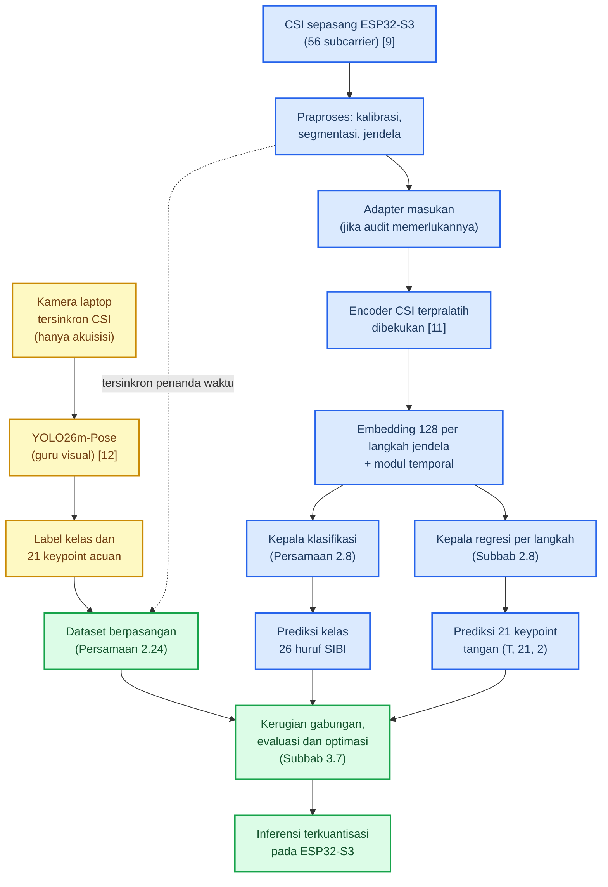

# BAB II KAJIAN PUSTAKA

## 2.1 Bahasa Isyarat, SIBI, dan Kebutuhan Komunikasi Dua Arah

Bahasa isyarat menyampaikan makna lewat gerak tangan, lengan, tubuh, dan ekspresi wajah. Satu isyarat tersusun atas bentuk tangan, lokasi, gerak, serta orientasi telapak; cukup satu jari berubah bentuk, maknanya bisa ikut berubah. Susunan inilah yang menjadi acuan penelitian dalam memisahkan bagian isyarat yang bisa dinilai mesin dari bagian yang tetap memerlukan penilaian manusia [3]. SIBI ialah sistem isyarat baku pendidikan formal yang didokumentasikan kamus pemerintah [3], sedangkan BISINDO tumbuh alami di komunitas tunarungu. Survei terhadap 100 responden tunarungu di Jawa dan Bali menemukan 91% memakai BISINDO, sementara SIBI menempel pada konteks sekolah [4]. Penelitian ini tetap memilih SIBI karena sasarannya alat bantu pembelajaran di sekolah, bukan karena jumlah penuturnya lebih besar. Audit label pada dataset visual peneliti menegaskan pembagian kelas yang dipakai seluruh naskah: huruf C termasuk kelompok 24 huruf statis, sedangkan J dan Z satu-satunya huruf yang menuntut lintasan gerak.

Bicara antara pengguna isyarat dan orang pendengar menuntut dua arah. Keluarga dan guru berada di barisan paling depan untuk merasakan kesenjangan ini, sementara jumlah juru bahasa masih jauh dari cukup [1]; alat bantu yang dibangun karena itu harus melayani kedua arah; kamus satu arah tidak menyelesaikan masalahnya. Sistem satu arah yang mengubah ucapan menjadi animasi isyarat sudah lebih dulu hadir di Indonesia, tetapi untuk arah isyarat menjadi teks riset dalam negeri bertumpu pada kamera, misalnya CNN untuk huruf BISINDO [5]. Masalahnya, kamera menuntut pencahayaan dan garis pandang yang baik, dan kamera yang terus menyala membuat pengguna merasa diawasi. Dua kendala inilah yang mendorong pencarian jalur penginderaan tanpa kamera dan tanpa perangkat yang dikenakan.

## 2.2 Wi-Fi Channel State Information

*Channel State Information* (CSI) memuat informasi amplitudo dan fase pada setiap *subcarrier* sinyal Wi-Fi, yang bersama-sama menggambarkan kondisi jalur propagasi [6]. Tubuh yang bergerak di antara pemancar dan penerima mengubah panjang jalur pantulan; amplitudo dan fase tiap *subcarrier* pun ikut bergeser. Geseran inilah yang dipakai untuk mengenali gerak tanpa sensor yang dikenakan. Karena tiap *subcarrier* menempati frekuensi berbeda, satu pasang perangkat sekaligus menyediakan banyak kanal pengamatan [6].

Bentuk formalnya sederhana: pada kanal 20 MHz, tiap *subcarrier* ke-n membawa koefisien kanal kompleks

```rumus
h~n~(t) = |h~n~(t)| · exp( j · φ~n~(t) ) (2.1)
```

dengan n = 1, ..., 56, |h~n~(t)| amplitudo, φ~n~(t) fase, dan j satuan imajiner [6], [9]. Amplitudo dan fase inilah bahan mentah seluruh perhitungan pada bab-bab berikutnya.

Pemodelan CSI sendiri berpijak pada zona Fresnel [13]. Radius zona Fresnel ke-n pada suatu titik dihitung dari jarak titik itu ke pemancar d~1~ dan ke penerima d~2~ [13]:

```rumus
r~n~ = √( n · λ · d~1~ · d~2~ / ( d~1~ + d~2~ ) ) (2.2)
```

dengan λ panjang gelombang pembawa; pada 2,4 GHz, λ = c/f ≈ 12,5 cm. Angkanya bisa langsung dihitung untuk tautan baku penelitian ini. Pada jarak antarmodul 1 meter dengan tangan di titik tengah, radius zona pertama r~1~ = √(0,125 × 0,5 × 0,5) ≈ 0,18 meter. Ruang gerak jadi seluruhnya berada di zona yang paling peka terhadap perubahan jalur. Penempatan itu dirangkum pada Gambar 2.1. Artikulasi jari menggeser jalur pantulan pada orde sentimeter sampai milimeter, dan tiap bentuk huruf meninggalkan pola perubahan *subcarrier* yang khas.

```gambar
Sumber skrip: scripts/sensesibi-v10/gambar_g15_fresnel.py (matplotlib mplot3d) -> assets-v16/gambar-2.1.png
```

Gambar 2.1 Zona Fresnel pertama pada tautan baku 1 meter; tangan pengisyarat berada di dalam zona (ilustrasi skematis tiga dimensi, tidak berskala) [6], [13]

Gerak tubuh juga melahirkan pergeseran Doppler yang besarnya mengikuti kecepatan gerak v [6], [14]:

```rumus
f~D~ = ( v / λ ) · ( cos α + cos β ) (2.3)
```

dengan α dan β sudut antara arah gerak dan garis pandang ke pemancar serta ke penerima; nilai mutlaknya paling besar 2v/λ. Pita Doppler gerak isyarat yang relevan kira-kira 1–60 Hz [6], sedangkan kaidah Nyquist menuntut laju pencuplikan

```rumus
f~s~ ≥ 2 · f~maks~ (2.4)
```

Akibatnya bisa dihitung sejak awal. Pada laju *firmware* RuView 50 bingkai per detik [10], pita teramati hanya sampai 25 Hz, sehingga gerak tangan yang masih teramati tanpa pelipatan kira-kira v = 25 × 0,125/2 ≈ 1,6 meter per detik. Gerak jari yang lebih cepat berisiko terlipat, dan jika laju terukur lebih rendah lagi, pita yang dianalisis ikut menyempit; hal itu dilaporkan apa adanya.

Satu masalah masih tersisa: fase mentah tercemar derau osilator lokal. Teknik CSI-ratio membersihkannya lewat rasio atau perkalian konjugat tanpa perangkat tambahan [13]. Prinsip itu diadaptasi penelitian ini menjadi rasio terhadap rekam acuan kalibrasi ruang (Subbab 3.7):

```rumus
ρ~n~(t) = h~n~(t) / h~n~( t~0~ ) (2.5)
```

dengan t~0~ waktu kalibrasi ruang, yaitu 600 bingkai bawaan RuView [10]. Rasio ini membuang tanggapan statis ruang sehingga yang tersisa adalah perubahan akibat gerak; sisa derau fase yang berjalan lambat diukur pada T0 lalu dilaporkan.

Dari ketukan tombol sampai gerakan jari, bukti kepekaan CSI terhadap gerak halus cukup banyak [6]; akan tetapi, bukti-bukti itu lahir dari kondisi terkendali sehingga bagi penelitian ini statusnya sebatas hipotesis kerja. Model CSI juga mudah *overfitting* terhadap orang dan ruang. Widar3.0 menjawab masalah itu dengan profil kecepatan Doppler untuk pengenalan lintas domain [14]. Kelayakan satu tautan dua modul berantena tunggal untuk membedakan 26 bentuk tangan SIBI karenanya diperlakukan sebagai pertanyaan penelitian, bukan asumsi; uji Delta-CSI dan gerbang G1 yang mengujinya. Jika beberapa huruf terbukti tidak terpisahkan, himpunan huruf dipangkas (Tabel 3.7).

## 2.3 Modul ESP32-S3, Platform RuView, dan Koeksistensi Radio

ESP32-S3 ialah mikrokontroler Wi-Fi 802.11 b/g/n 2,4 GHz berantena tunggal dengan inti ganda 240 MHz, SRAM 512 KB, dan PSRAM hingga 8 MB [8]. Dukungan CSI tersedia resmi lewat repositori esp-csi; pada kanal 20 MHz, CSI memuat 56 *subcarrier* [9]. RuView merekomendasikan ESP32-S3 sebagai modul penangkap CSI sekaligus menyediakan rantai akuisisi lengkap [10] yang dipetakan pada Tabel 2.1. Repositori yang sama menerbitkan *checkpoint encoder* CSI terpralatih yang menjadi tulang punggung murid penelitian ini. Pembedaannya dari dua model lain pada ekosistem itu diuraikan pada Subbab 2.4.

Tabel 2.1 Pemetaan fitur RuView terhadap peran dalam penelitian ini

| Fitur RuView | Peran dalam penelitian ini |
|---|---|
| *Firmware* penangkap CSI (UDP) | Mengalirkan CSI dan label ke server |
| Station + UDP + CSI *promiscuous* + ESP-NOW pada satu *chip* | Dasar topologi satu kanal (Subbab 3.5) |
| Kalibrasi ruang 600 bingkai + 8 *anchor* | Kalibrasi tiap sesi; pemotongan segmen isyarat |
| Mode privasi | Membuang fitur biometrik selama penelitian |
| Akuisisi tersinkron kamera-CSI | Jalur guru; estimator memakai YOLO26m-Pose |
| *Checkpoint encoder* CSI terpralatih (*embedding* 128 dimensi) [11] | *Encoder* murid yang dibekukan pada baseline (Subbab 2.4) |

Fakta paling menentukan justru koeksistensi radio pada satu *chip*. *Firmware* RuView mampu menangkap CSI sambil memelihara koneksi *station* UDP serta sinkronisasi ESP-NOW secara serentak. Dua syaratnya: seluruh perangkat berada pada satu kanal dan mode hemat daya dimatikan [10]. Purwarupa karenanya tidak memerlukan modul gerbang khusus, tetapi ada satu catatan penting: RuView belum melalui telaah sejawat, jadi fungsinya diverifikasi sendiri pada gerbang G0.

## 2.4 Encoder CSI Terpralatih RuView dan Pembedaan Tiga Model

*Encoder* terpralatih yang menjadi tulang punggung jalur isyarat menjadi teks terdokumentasi lengkap pada kartu modelnya [11]. Arsitekturnya dua lapis *fully connected* dengan BatchNorm dan GELU yang memetakan fitur CSI menjadi *embedding* 128 dimensi ternormalisasi L2. Seluruhnya hanya 9.280 parameter. Pemetaannya ditulis

```rumus
z~i~ = f~θ0~( X~i~ ), z~i~ ∈ R^d^, d = 128 (2.6)
```

dengan X~i~ masukan ke-i, f~θ0~ pemetaan *encoder* bertetapan θ~0~, dan z~i~ vektor *embedding* keluaran. Pretrainingnya kontrastif dengan triplet loss dan InfoNCE pada temperatur 0,1. Pasangan positif diambil dari jendela dalam jarak 2 detik, pasangan negatif dari jarak lebih dari 30 detik, selama 60 epoch dengan AdamW dan perlindungan EWC terhadap lupa bencana [11]. Pada baseline penelitian ini, θ~0~ dibekukan; tetapan yang diperbarui mencakup adapter masukan (jika dipakai), modul temporal, dan kedua kepala tugas sebagaimana dirumuskan pada Persamaan 2.15′. Kontrak masukan *checkpoint* diikat secara eksplisit: *encoder* menerima satu vektor delapan fitur turunan per jendela satu detik (bentuk *batch* (B, 8)), bukan deret *subcarrier*, dan menghasilkan satu *embedding* 128 dimensi ternormalisasi L2 per jendela. Deret waktu karenanya hidup pada tingkat barisan jendela, bukan di dalam *encoder*. Parameter normalisasi masukan belum dipublikasikan kartu modelnya sehingga dicari pada artefak *checkpoint* saat audit T0 [PERLU VALIDASI: parameter normalisasi masukan pada artefak checkpoint].

Satu angka pada kartu model itu perlu dibaca hati-hati. Akurasi triplet-temporal *held-out* sebesar 82,3% tercatat pada 20% akhir rekaman menurut waktu, dengan pembanding 66,4% untuk fitur mentah tanpa *encoder* dan 69,6% untuk *encoder* berinisialisasi acak [11]. Angka itu menghitung peluang bahwa jarak anchor ke positif temporal lebih pendek daripada jaraknya ke negatif temporal. Yang diukurnya ialah kualitas geometri *embedding* pada tugas jarak, bukan akurasi klasifikasi SIBI dan bukan pula galat *keypoint*. Dua hal terakhir justru yang hendak diukur penelitian ini, dan kartu model tidak memuat keduanya.

Ketidaksesuaian bentuk masukan menjadi temuan audit yang paling menentukan. Kartu model mencatat masukan delapan fitur turunan CSI pada laju 1 Hz, yaitu kehadiran, gerak, napas, detak jantung, varians fase, jumlah orang, deteksi jatuh, dan RSSI [11]. Jalur akuisisi penelitian ini, sebaliknya, menghasilkan 56 *subcarrier* pada 50 bingkai per detik [9], [10], sehingga *encoder* itu tidak dapat langsung diberi *subcarrier* mentah. Dua jalur penyelesaiannya disiapkan dan diputuskan setelah audit T0. Jalur pertama menghitung ulang delapan fitur turunan bawaan RuView dari bingkai CSI; jalur kedua melatih adapter masukan kecil yang memetakan jendela CSI ke ruang masukan *encoder*. Keduanya dinyatakan terbuka dengan penanda [PERLU VALIDASI] sampai audit selesai, dan riset ini tidak mengklaim kompatibilitas sebelum terverifikasi.

Delapan fitur itu perlu dibaca dengan jujur sebagai kontrak lingkungan, bukan kontrak artikulasi. Napas, detak jantung, jumlah orang, dan deteksi jatuh hampir tidak berubah selama artikulasi jari; informasi gerak tangan terkonsentrasi pada fitur gerak dan varians fase; pretraining dilakukan pada data ruangan delapan jam dengan supervisi sensor PIR dan BME280 [11], bukan pada gerak tangan. Kelayakan representasi ini bagi huruf SIBI karena itu diperlakukan sebagai hipotesis yang diuji pada gerbang G0b (Subbab 3.7), bukan sebagai sifat yang menyertai *checkpoint*.

Dua model lain pada ekosistem yang sama sering tertukar dengan *encoder* ini, sehingga keduanya dipisahkan sejak awal. Model `wifi-densepose-mmfi-pose` [15] adalah *checkpoint* pose terpisah. Masukannya amplitudo CSI berukuran [3, 114, 10] pada 100 Hz, yang diproses *encoder* Transformer 4 lapis 8 kepala menjadi keluaran [17, 2], yaitu 17 *keypoint* tubuh COCO dalam rentang [0, 1], dengan sekitar 2,3 juta parameter. Model itu dilatih pada dataset MM-Fi [16] yang memuat 40 subjek, 27 kategori aksi, dan lebih dari 320 ribu bingkai tersinkron dari lima modalitas. Kinerjanya PCK@20 ternormalisasi badan sebesar 82,69% untuk model tunggal dan 83,59% untuk ansambel. Angka itu turun menjadi sekitar 64% lintas subjek *zero-shot* dan 17,5% lintas lingkungan, lalu naik ke rentang 72% sampai 78% setelah kalibrasi 50 sampai 1.000 bingkai per orang [15]. Lisensi CC BY-NC 4.0 melekat padanya karena mengikuti lisensi datanya. Model ketiga, YOLO26m-Pose [12], ialah model penglihatan pada citra yang berperan sebagai guru visual dan dibahas pada Subbab 2.9. Tabel 2.2 merangkum pembedaan ketiganya.

Tabel 2.2 Pembedaan tiga model ekosistem yang tidak boleh tercampur dalam penelitian ini

| Aspek | Encoder CSI terpralatih [11] | Model pose MM-Fi [15] | Guru visual YOLO26m-Pose [12] |
|---|---|---|---|
| Berkas | `ruvnet/wifi-densepose-pretrained` | `ruvnet/wifi-densepose-mmfi-pose` | Repositori WPC peneliti (eksperimen `exp11_huruf24`) |
| Masukan | 8 fitur turunan CSI per jendela 1 detik (laju 1 Hz; *batch* (B, 8)); bukan deret *subcarrier* | Amplitudo CSI [3, 114, 10] @ 100 Hz | Citra RGB kamera |
| Keluaran | *Embedding* 128 dimensi ternormalisasi L2 | 17 *keypoint* tubuh COCO dalam [0, 1] | Kelas isyarat dan 21 *keypoint* tangan |
| Parameter | 9.280 | ±2,3 juta (varian utama) | [PERLU DATA: jumlah parameter model juara WPC] |
| Peran | Representasi murid, dibekukan pada baseline | Pembanding temuan lintas domain, bukan komponen model | Pemberi label kelas dan *keypoint* saat akuisisi |
| Status bukti | Kartu model; akurasi triplet-temporal 82,3% | Kartu model; PCK@20 82,69%; lisensi CC BY-NC 4.0 | Data pra-penelitian peneliti; mAP50 0,9580 pada 24 huruf statis |

Status tiga dokumen rancangan pada repositori RuView juga dinyatakan terbuka. ADR-024 mengusulkan model penyematan kontrastif AETHER; ADR-146 mengusulkan *encoder* RF bersama dengan tujuh kepala tugas dan ketidakpastian per kepala; ADR-150 mengusulkan *foundation encoder* yang tahan pergantian orang dan ruang. Ketiganya berstatus Proposed, artinya rancangan yang belum diimplementasikan [10]. Penelitian ini bersandar hanya pada *checkpoint* yang benar-benar tersedia; angka estimasi dari ADR dikutip dengan label estimasi rancangan setiap kali muncul.

## 2.5 Transfer Learning pada Encoder Beku: LoRA dan Pelatihan Lanjutan

Baseline penelitian ini membekukan *encoder* dan melatih hanya kedua kepala tugasnya. Alasannya metodologis: dengan *encoder* beku, kualitas *embedding* terpralatih untuk isyarat SIBI terbaca langsung dari kinerja kepala, sehingga sumbangan pretraining terpisah dari sumbangan penyetelan. Karena *encoder* hanya 9.280 parameter, biaya membandingkan skema adaptasi lain pun rendah, dan perbandingannya dijalankan pada data serta seed yang sama.

LoRA menambah pembaruan berperingkat rendah pada tetapan asli tanpa menyimpan gradien untuk seluruh matriks [17]:

```rumus
W~akhir~ = W~0~ + B · A (2.7)
```

dengan W~0~ matriks tetapan asli yang dibekukan, B berukuran d~keluar~ × r dan A berukuran r × d~masuk~, serta r peringkat adapter yang dipilih jauh lebih kecil daripada ukuran matriks; hanya B dan A yang dilatih. Adapter bekerja di dalam lapisan yang sudah ada sebagai jalur adaptasi yang hemat parameter. Perannya berbeda dari kepala tugas maupun dari pelatihan lanjutan, dan ia bukan prasyarat penelitian ini. Ketersediaannya bahkan terdokumentasi untuk kasus ruangan: kartu model menyertakan adapter `node-1.json` dan `node-2.json` masing-masing sekitar 21 KB [11]. ADR-150 menaksir adapter sekitar 11 KB mampu menyamai kinerja lintas subjek dengan 100 sampai 200 data berlabel per ruang [10]; angka itu berstatus estimasi rancangan, bukan hasil terukur. Kompatibilitas LoRA dengan alur ekspor ke ESP32-S3 belum terverifikasi, sehingga statusnya ditandai [PERLU VALIDASI: kompatibilitas LoRA dengan alur ekspor] dan diperiksa pada T0.

Pembanding ketiga ialah pelatihan lanjutan. Pelatihan sebagian membuka lapis terakhir saja, sedangkan pelatihan penuh membuka seluruh tetapan. Keduanya dijaga dengan EWC sebagaimana pretraining *encoder* melakukannya [11], dan keduanya dilaporkan berdampingan dengan hasil *encoder* beku. Ketiga skema itu (beku, beku plus LoRA, pelatihan lanjutan) diperlakukan sebagai eksperimen pembanding pada Subbab 3.7, bukan keputusan yang dikunci di muka.

## 2.6 Kepala Klasifikasi dan Kerugian Silang-Entropi

Kepala klasifikasi mengubah *embedding* menjadi skor tiap kelas huruf. Untuk K kelas dengan K = 26, skor logit dihitung dari

```rumus
a~i~ = W~c~ · z~i~ + b~c~ (2.8)
```

dengan W~c~ matriks berukuran K × 128 dan b~c~ vektor bias. Skor lalu diubah menjadi probabilitas lewat *softmax*

```rumus
q~ik~ = exp( a~ik~ ) / Σ~k~ exp( a~ik~ ) (2.9)
```

sehingga seluruh probabilitas berjumlah satu, dan kelas prediksi ialah kelas dengan probabilitas terbesar. Sebagai lantai pembanding, tebakan acak seragam pada K kelas bernilai 1/K ≈ 3,8%, dan angka itu dihitung ulang jika himpunan huruf dipangkas. Kerugian pelatihannya silang-entropi kategorikal; dengan label *one-hot* y~ik~ yang bernilai satu pada kelas benar dan nol pada kelas lain, kerugian atas N sampel dalam *batch* berbunyi

```rumus
L~cls~ = − ( 1 / N ) · Σ~i~ Σ~k~ y~ik~ · log q~ik~ (2.10)
```

yang menghukum prediksi yang percaya diri pada kelas salah. Jika data latih terbukti timpang antarhuruf, bobot kelas dipasang berbanding terbalik dengan frekuensi kelasnya; bobot itu dihitung hanya dari data latih dan keputusannya dicatat pada Tabel 3.7.

Klasifikator himpunan tertutup selalu memilih satu kelas, sehingga keluarannya dilengkapi skor keyakinan dan mekanisme penolakan [18]: keyakinan yang rendah memunculkan pesan isyarat tidak dikenali alih-alih menebak salah. Menolak lebih aman daripada menebak kelas yang salah. Ambangnya ditetapkan dari data validasi (Subbab 3.7).

## 2.7 Kepala Regresi 21 Keypoint dan Kerugian Smooth L1 Bermask

Target regresi mengikuti skema 21 *landmark* tangan MediaPipe Hands [19], skema yang sama dipakai *pseudo-labeling* pada dataset visual peneliti. Sesuai `kpt_shape` [21, 3], tiap sampel target memuat 21 titik dengan tiga nilai: koordinat x, koordinat y, dan tanda visibilitas. Komponen ketiga itu ialah penanda visibilitas atau keyakinan deteksi sesuai konvensi dataset dan Ultralytics; koordinat target karenanya dipakai berpasangan (x, y) saja, sedangkan visibilitas diperlakukan sebagai mask. Varian peringkas tunggal kepala, yang menjadi pembanding ablasi untuk huruf statis, memprediksi koordinat x dan y seluruh jendela dari satu vektor ringkasan,

```rumus
Q~i~ = reshape( W~r~ · z~i~ + b~r~, T, 21, 2 ) (2.11)
```

dengan W~r~ matriks berukuran 42T × 128 untuk jendela ber-T langkah, Q~i~ prediksi *keypoint*, dan P~i~ koordinat acuan dari guru visual. Varian utama kepala membaca tiap keadaan tersembunyi modul temporal secara langsung sehingga keluarannya tetap per langkah (Subbab 2.8); bentuk keluaran per langkah dipilih karena J dan Z dibedakan oleh lintasan gerak, bukan oleh satu pose. Jika eksperimen menunjukkan regresi cukup dipakai sebagai supervisi tambahan pada satu pose, dimensi T dilepas dan keterbatasannya untuk J dan Z dijelaskan di laporan. Keputusan ini dicatat pada Tabel 3.7.

Sistem koordinat target harus dibakukan sebelum pelatihan, dan di sinilah letak kehati-hatianya. Koordinat piksel kamera tidak otomatis dapat diprediksi dari CSI tanpa definisi koordinat, transformasi, atau kalibrasi yang dapat direproduksi. Koordinat itu juga tidak tahan terhadap perubahan posisi kamera, jarak, maupun orientasi. Kandidat yang kuat ialah koordinat ternormalisasi terhadap kotak deteksi guru atau terhadap titik pergelangan tangan. Pilihan finalnya ditetapkan pada T0 lalu dipakai konsisten oleh guru dan murid [PERLU VALIDASI: sistem koordinat dan normalisasi target regresi]. Kerugian regresinya Smooth L1 yang dibobot mask visibilitas [20]. Fungsi Smooth L1 berperilaku kuadratik dekat nol dan linear untuk galat besar,

```rumus
SmoothL1~δ~( x ) = 0,5 · x^2^ / δ untuk |x| ≤ δ, dan |x| − 0,5 · δ untuk |x| > δ (2.12)
```

dengan δ ambang peralihan, sehingga pencilan anotasi tidak mendominasi gradien. Kerugian bermask dihitung hanya pada titik yang terlihat:

```rumus
L~reg~ = ( Σ~i,t,j~ m~itj~ · SmoothL1~δ~( Q~itj~ − P~itj~ ) ) / ( Σ~i,t,j~ m~itj~ + ε ) (2.13)
```

dengan m~itj~ mask visibilitas dari guru yang bernilai satu jika titik j pada bingkai t terlihat dan nol jika terhalang, serta ε penahan pembagi nol; mask berlaku per *keypoint*, bukan per koordinat. Jika prediksi visibilitas juga diinginkan, kepala tambahan dengan kerugian silang-entropi biner disiapkan sebagai perluasan; keputusan memakainya dicatat pada Tabel 3.7.

## 2.8 Pembelajaran Multitugas, Modul Temporal, dan Kerugian Gabungan

Pembelajaran multitugas melatih beberapa tugas berbarengan di atas representasi yang dibagi, dan representasi yang baik untuk satu tugas kerap menolong tugas lain yang berkaitan [21]. Kedua tugas penelitian ini memang dua pandangan atas isyarat yang sama: kepala klasifikasi membacanya sebagai kelas diskret, sedangkan kepala regresi membacanya sebagai bentuk jari kontinu. Hipotesis kerjanya, supervisi *keypoint* ikut merapikan batas antarhuruf yang bentuknya mirip. Kerugian gabungan menjumlah keduanya dengan bobot:

```rumus
L~total~ = λ~cls~ · L~cls~ + λ~reg~ · L~reg~ (2.14)
```

Penetapan bobotnya tidak asal pilih. Silang-entropi bergerak pada orde logaritma jumlah kelas, sedangkan Smooth L1 bergerak pada satuan koordinat. Keduanya karena itu disamakan skalanya lebih dulu, misalnya dengan membagi tiap kerugian oleh nilai rata-ratanya pada epoch pertama; bobot λ baru ditala dari data validasi (Tabel 3.7). Konflik gradien antartugas dipantau lewat besar gradien tiap kepala; jika keduanya menarik representasi ke arah berlawanan, penyeimbangan gradien atau pelatihan bergantian dipertimbangkan dan perlakuannya dilaporkan. Pada baseline, pembaruan tetapan menyentuh seluruh tetapan di luar *encoder*:

```rumus
Θ~train~ = { φ~adapter~, θ~temporal~, θ~c~, θ~r~ }, θ~encoder~ = θ~0~ (2.15′)
```

dengan φ~adapter~ tetapan adapter masukan yang hanya hadir jika jalur adapter terpilih pada gerbang G0b, θ~temporal~ tetapan modul temporal, serta θ~c~ dan θ~r~ tetapan kedua kepala; pembaruannya mengikuti Θ~train~ ← Optimizer( ∇ L~total~ ). *Encoder* tetap dibekukan pada θ~0~ sepanjang baseline; skema pembukaan tetapan (LoRA dan pelatihan lanjutan) tetap diperlakukan sebagai pembanding pada Subbab 3.7.

Satu komponen dari rancangan lama tetap dipertahankan dan dievaluasi ulang perannya: 1D-CNN. Pada rancangan lama ia menjadi kepala tunggal di atas *backbone*. Pada rancangan ini ia kandidat modul temporal yang memelihara urutan waktu. Modul temporal bukan kepala tugas dan tidak dirancang sebagai peringkas tunggal: ia memproses barisan *embedding* per langkah dan mengeluarkan keadaan tersembunyi per langkah, h~1~ sampai h~T~. Kepala klasifikasi membaca ringkasan beratensi (*attention*) atas barisan itu menjadi satu vektor, sedangkan kepala regresi membaca tiap keadaan secara langsung, Q~t~ = reshape( W~r~ · h~t~ + b~r~, 21, 2 ) dengan W~r~ berukuran 42 × 128 sehingga keluaran regresi per segmen berbentuk T × 21 × 2 tanpa kehilangan urutan waktu. Varian peringkas tunggal (Persamaan 2.11) dipertahankan sebagai pembanding ablasi untuk huruf statis, dengan keterbatasannya bagi J dan Z dijelaskan pada laporan. Konsekuensinya, kandidat agregasi statistik rata-rata dan maksimum hanya berlaku untuk jalur klasifikasi; pelatihan multitugas dengan regresi temporal menuntut modul yang memelihara urutan. Parameter modul temporal ikut dilatih bersama kepala pada Persamaan 2.15′. Keputusan mempertahankannya atau menggantinya diambil dari hasil ablasi pada data yang sama (Subbab 3.7), bukan dari preferensi implementasi. Untuk menguji manfaat penggabungan itu, kepala tunggal yang dilatih sendiri-sendiri juga disiapkan sebagai pembanding pada split yang sama.

## 2.9 Guru Visual YOLO26m-Pose dan Supervisi Lintas Modalitas

Guru visual bekerja hanya pada tahap akuisisi data. Kamera laptop dan node penerima CSI merekam serentak dengan penanda waktu yang sama; pada tiap bingkai, YOLO26m-Pose [12] menghasilkan kelas isyarat beserta 21 *keypoint* tangan dan visibilitasnya. Label kelas dicocokkan dengan kartu pemandu protokol perekaman sehingga derau label terkendali. Kemampuan guru sudah teruji pada tahap pra-penelitian di repositori WPC milik peneliti. Dataset versi 2 memuat 49 kelas isyarat dengan total 7.210 gambar yang terbagi menjadi 6.231 latih, 650 validasi, dan 329 uji; *keypoint*-nya dihasilkan lewat *pseudo-labeling* MediaPipe HandLandmarker [19]. Eksperimen `exp11_huruf24` pada 24 huruf statis mencatat *pose* mAP50 0,9580 dengan akurasi huruf 97,6%; angka itu berlaku untuk 24 huruf statis pada data visual dan tidak dikutip sebagai kemampuan guru mengenali J dan Z, yang supervisinya diambil dari lintasan *keypoint* dan label protokol. Dari angka itu terbaca bahwa 21 titik artikulasi jari memuat informasi cukup untuk gestur mikro SIBI. Perlu ditegaskan dua hal: seluruh angka itu adalah hasil model visual pada data visual, bukan hasil model Wi-Fi. Selain itu, dataset itu tidak memuat satu pun rekaman CSI, sehingga pasangan data baru harus direkam sendiri pada T2.

Peran guru dipisahkan menurut jenis target. Untuk 24 huruf statis, label kelas pelatihan diambil dari protokol perekaman (kartu pemandu), sedangkan guru menyumbang deret 21 *keypoint* beserta visibilitasnya. Untuk J dan Z, label kelas juga berasal dari protokol; guru tidak diposisikan sebagai pengklasifikasi kedua huruf gerak itu kecuali model guru terbukti memuat kelasnya [PERLU VALIDASI: kelas J dan Z pada model juara WPC]. Dengan pemisahan ini, hasil `exp11_huruf24` pada 24 huruf statis tidak diperluas menjadi klaim pengenalan 26 huruf oleh guru.

Istilah untuk pola pengawasan ini dipilih dengan hati-hati. Karena murid hanya menerima label keras berupa kelas dan koordinat dari guru, istilah yang presisi ialah supervisi lintas modalitas berpandu guru atau *pseudo-label supervision*. Distilasi pengetahuan klasik yang memindahkan probabilitas lunak antarmodel tidak menggambarkan bentuk transfer ini [22]. Konsep guru-murid tetap dipertahankan secara luas: YOLO26m-Pose adalah guru visual saat akuisisi dan pelatihan, sedangkan model CSI adalah murid yang dipakai tanpa kamera pada inferensi akhir. Konsekuensi status pseudo-label juga dijalani jujur: keluaran guru yang belum diperiksa manusia bukan *ground truth* sempurna. Protokol perekaman karena itu menyertakan verifikasi sampel oleh validator, penyaringan bingkai gagal deteksi, dan pencatatan *jitter keypoint* (Subbab 3.6). Ekspektasi generalisasinya dijaga memakai temuan model pose MM-Fi [15]. Kinerja lintas subjek *zero-shot* hanya sekitar 64% dan lintas lingkungan 17,5%, naik ke 72% sampai 78% setelah kalibrasi 50 sampai 1.000 bingkai per orang. Angka itu dipakai sebagai acuan ekspektasi sekaligus alasan skema kalibrasi per orang dan per ruang disiapkan sebagai jalur cadangan (Tabel 3.8).

## 2.10 Pengenalan Isyarat Berbasis CSI dan Inferensi pada Perangkat

Riset pengenalan bahasa isyarat dari CSI sudah berjalan di beberapa negara. SignFi mengenali 276 isyarat ASL dengan akurasi hingga 99,8% di laboratorium, walau turun menjadi 86,66% ketika diuji pada lima pengguna baru [7]; namun, jalur ini belum menyentuh SIBI. Kebaruan penelitian ini ada pada penerapan CSI untuk alfabet SIBI, formulasi dua kepala tugas di atas *encoder* terpralatih, serta penyatuan dua arah bersama pemrosesan bahasa Indonesia (Subbab 2.15). Model utamanya kini tiga bagian: *encoder* terpralatih yang dibekukan (Subbab 2.4), modul temporal untuk deret waktu (Subbab 2.8), dan dua kepala tugas. Pembandingnya sesama model CSI, yaitu varian kepala tunggal tanpa kepala regresi yang dilatih pada data dan seed sama (ablasi, Subbab 3.7). Inferensi dirancang berjalan langsung di modul. ESP-DL membuktikan hal itu mungkin dengan contoh pengenalan gestur tangan int8 69,2 ms pada keluarga ESP32 [23]. TensorFlow Lite Micro menjadi alternatifnya. Tolok ukur CSI-isyarat pada ESP32-S3 sendiri belum ada, jadi waktu inferensi aktual diukur sendiri (Subbab 3.7).

## 2.11 TTS dan ASR Bahasa Indonesia

Purwarupa membutuhkan mesin sintesis ucapan (*text-to-speech*, TTS) dan pengenalan ucapan (*automatic speech recognition*, ASR). Tiga kriteria menyeleksi keduanya: dukungan bahasa Indonesia terverifikasi, jalur *on-device* dan lokal tersedia, serta biaya berkelanjutan yang masuk akal bagi sekolah. Mesin TTS yang direncanakan ialah Kokoro-82M ONNX berserta sekitar 82 juta parameter [24]; dengan keputusan D3, mesin itu diposisikan pada dua lokasi, yaitu server lokal sebagai jalur utama dan ponsel melalui ONNX Runtime sebagai jalur cadangan, dan keduanya memakai prasyarat suara Indonesia yang sama serta diverifikasi pada G3. *Model card* resminya mencantumkan delapan bahasa tanpa bahasa Indonesia, sehingga ketersediaan suara Indonesia perlu diverifikasi pada gerbang G3; jika memang belum tersedia, jalur beralih ke MMS-TTS-ind, model TTS Indonesia dari Meta [25]. Layanan TTS dan ASR awan hadir sebagai pembanding latensi dan mutu, dan pilihan finalnya ditetapkan setelah uji banding (Tabel 3.7).

Pada sisi ASR, Whisper dilatih dengan lima juta jam audio dan mendukung lebih dari 100 bahasa, termasuk Indonesia [26]. Ketika internet terputus, server lokal mengambil alih dengan implementasi faster-whisper sebagai cadangan. Galat kata Whisper untuk percakapan bahasa Indonesia belum terverifikasi dari sumber primer, jadi akurasinya diukur sendiri pada skenario pengujian (Subbab 3.8).

## 2.12 Pemetaan Teks ke Representasi SIBI di Layar

Terjemahan teks menjadi isyarat tidak mungkin dilakukan kata demi kata karena bahasa isyarat memiliki tata bahasa sendiri. Arah kedua karenanya dirancang pada tingkat kamus kata dengan ejaan jari sebagai cadangan. Struktur SIBI mendukung rancangan ini sebab alfabet manualnya lengkap: 26 huruf dan 9 angka [3].

Tampilan pada arah kedua disusun atas dua lapis. Lapis utama memunculkan glos dan gambar bentuk tangan untuk kata yang tersedia di kamus; ukuran gambarnya sekitar dua puluh sampai tiga puluh kilobita sehingga muat di penyimpanan modul. Lapis kedua berupa animasi yang dialirkan dari server, jika waktu pengembangan memungkinkan. Kata di luar kamus dialihkan ke ejaan jari. Sebagai metrik utama arah ini, cakupan kamus, yaitu proporsi kata uji yang terwakili, diukur dan dilaporkan (Subbab 3.8).

## 2.13 Komunikasi Modul, Server, dan Topologi Jaringan

Seluruh perangkat, dari kedua modul penginderaan sampai ponsel, berbagi satu kanal Wi-Fi yang sama sehingga penangkapan CSI berjalan serentak dengan komunikasi data [10]. Peran jembatan jaringan sekaligus penjangkar kanal dipegang *access point*, yang bentuknya bisa *router* sekolah maupun *hotspot* ponsel. Sinkronisasi antarmodul memakai ESP-NOW, sedangkan aliran data ke server memakai UDP [10].

Perangkat lunak server ditulis seluruhnya dalam Rust: konkurensi ditangani Tokio, Axum menyediakan HTTP dan WebSocket, Leptos membangun dasbor yang dikompilasi ke WASM, dan Tauri menjadi aplikasi klien ponsel. Alasannya praktis. Tanpa pengumpul sampah, pemrosesan bingkai UDP tetap cepat; binernya hemat memori; dan satu sistem tipe mendeteksi perubahan format bingkai saat kompilasi. Target *parsing* di bawah 0,2 ms dan memori server di bawah 40 MB adalah target rancangan yang baru diukur pada gerbang G3, bukan hasil yang dijanjikan. Server lokal pada laptop menjalankan server RuView, server Rust, faster-whisper, serta TTS Kokoro/MMS sebagai jalur utama luring sehingga pemrosesan teks dan suara tetap berjalan tanpa internet; server Rust bukan sekadar perantara, melainkan titik orkestrasi kedua arah penerjemahan. Perlu dicatat pemisahan bahasanya: pelatihan model berjalan di komputer dengan Python dan PyTorch (Subbab 3.7), sedangkan Rust dipakai untuk *runtime* server dan klien; keduanya tidak saling menggantikan.

## 2.14 Evaluasi Kelayakan

Penilaian kelayakan berjalan bertahap lewat lima gerbang G0 sampai G4 (BAB III), dan tiap tahap menghasilkan artefak tetap sehingga kegagalan pun tetap terdokumentasi. Rekomendasi akhirnya menyatakan posisi purwarupa pada skala kesiapterapan teknologi (TKT) yang mengikuti kerangka *technology readiness level* [27]. Kinerja klasifikasi diukur dengan akurasi, presisi, *recall*, skor F1 makro, serta *confusion matrix* per isyarat, selalu dibandingkan terhadap peluang acak. Untuk kelas huruf k, presisi dan *recall* dihitung dari jumlah benar positif TP~k~, salah positif FP~k~, serta salah negatif FN~k~ pada *confusion matrix*:

```rumus
P~k~ = TP~k~ / ( TP~k~ + FP~k~ ) (2.16)
```

```rumus
R~k~ = TP~k~ / ( TP~k~ + FN~k~ ) (2.17)
```

```rumus
F1~k~ = 2 · P~k~ · R~k~ / ( P~k~ + R~k~ ) (2.18)
```

```rumus
F1~makro~ = ( 1 / K ) · Σ~k~ F1~k~ (2.19)
```

```rumus
p~acak~ = 1 / K (2.20)
```

Untuk K = 26 huruf, p~acak~ ≈ 3,8%, dan angka ini dihitung ulang jika himpunan huruf dipangkas (Subbab 3.8.2). Kinerja kepala regresi diukur dengan MPJPE, yaitu rata-rata jarak Euclid antara prediksi dan acuan pada titik yang terlihat,

```rumus
MPJPE = ( Σ~i,t,j~ m~itj~ · || Q~itj~ − P~itj~ || ) / Σ~i,t,j~ m~itj~ (2.21)
```

serta PCK, yaitu proporsi *keypoint* yang galatnya masuk ambang relatif,

```rumus
PCK@α = ( Σ~i,t,j~ m~itj~ · 1( || Q~itj~ − P~itj~ || ≤ α · d~ref~ ) ) / Σ~i,t,j~ m~itj~ (2.22)
```

dengan 1(·) bernilai satu jika kondisinya terpenuhi, α ambang relatif, dan d~ref~ skala acuan yang mengikuti sistem koordinat yang dibakukan (Subbab 2.7); NME dilaporkan sebagai alternatif yang ternormalisasi. Galat per *keypoint* juga diringkas untuk mengenali titik jari mana yang paling sulit diprediksi dari CSI. Pada baseline Pilihan 1, MPJPE dan PCK@α berstatus metrik pemantauan yang dilaporkan, bukan syarat gerbang; jika Pilihan 2 yang terpilih, ambang kelayakan regresi ditetapkan lebih dulu pada Tabel 3.7 sebelum G1 dinilai. Pada jalur ucapan, kesalahan pengenalan kata diukur dengan laju galat kata (*word error rate*, WER), yaitu jumlah substitusi S, penghapusan D, dan penyisipan I terhadap N kata acuan:

```rumus
WER = ( S + D + I ) / N (2.23)
```

dan akurasi kata dilaporkan sebagai 1 − WER. Pembagian acak di dalam satu sesi tidak dipakai sebab repetisi berurutan bisa membocorkan informasi latih ke uji. Empat dimensi tambahan menilai kelayakan alat komunikasinya: latensi ujung ke ujung, cakupan kamus, keandalan operasional, dan biaya. Persepsi pengguna diukur dengan kuesioner skala Likert [28] lalu dianalisis secara deskriptif, sedangkan kewajaran keluaran dinilai validator penutur tunarungu.

## 2.15 Penelitian Terdahulu

Penelitian terdahulu yang paling relevan dibandingkan pada Tabel 2.3, mencakup pengenalan isyarat dan gestur dari sinyal Wi-Fi serta pengenalan isyarat berbasis kamera di Indonesia.

Tabel 2.3 Perbandingan penelitian terdahulu

| No. | Peneliti (Tahun) | Modalitas dan arah | Bahasa isyarat | Bebas kamera | Fokus |
|---|---|---|---|---|---|
| 1 | Ma dkk. (2018) [7] | CSI; isyarat menjadi teks | ASL, 276 isyarat | Ya | Pengenalan berskala besar |
| 2 | Zhang dkk. (2022) [14] | CSI; gestur lintas domain | Gestur umum | Ya | Generalisasi lintas orang dan ruang |
| 3 | Dwijayanti dkk. (2021) [5] | Citra; isyarat menjadi teks | BISINDO | Tidak | CNN pengenalan citra |
| 4 | Penelitian ini | CSI sepasang ESP32-S3; *encoder* terpralatih berkepala dua (klasifikasi dan regresi); supervisi guru visual; inferensi tepi; TTS *on-device* | SIBI, alfabet 26 huruf | Ya | Purwarupa penerjemah dua arah |

Dua kelompok penelitian bisa dibaca dari Tabel 2.3. Pengenalan isyarat dan gestur dari Wi-Fi [7], [14] berjalan tanpa kamera tetapi belum menjangkau SIBI. Riset Indonesia berbasis kamera [5] membuktikan tingginya minat, namun tetap terikat pencahayaan dan garis pandang. Dalam batas penelusuran, publikasi pengenalan isyarat SIBI dari CSI maupun purwarupa dua arah yang memadukannya dengan TTS dan ASR bahasa Indonesia pada ESP32-S3 belum ditemukan. Kebaruan penelitian ini karenanya bersifat kombinatif: CSI satu tautan pada sepasang ESP32-S3 untuk alfabet SIBI, dua kepala tugas di atas *encoder* terpralatih, supervisi lintas modalitas berpandu guru, inferensi tepi, serta integrasi dua arah dengan pemrosesan bahasa Indonesia. Di luar itu, kebaruan tidak diklaim untuk pengenalan kontinu maupun penerjemahan kalimat penuh.

## 2.16 Matriks Justifikasi Pemilihan Komponen

Tabel 2.4 merangkum jawaban atas pertanyaan "mengapa X dan bukan Y" untuk delapan keputusan arsitektur. Seluruh target kinerja di dalamnya adalah target rancangan yang baru diukur pada gerbang BAB III, bukan hasil yang dijanjikan.

Tabel 2.4 Matriks justifikasi pemilihan komponen (Mengapa X dan Bukan Y?)

| No. | Keputusan | Komponen dipilih | Alternatif ditinggalkan | Justifikasi |
|---|---|---|---|---|
| 1 | Tumpukan UI dan server | Seluruhnya Rust: Tokio/Axum, Leptos (WASM), Tauri | Node.js, Streamlit, Electron, React/JS | *Parsing* UDP di bawah 0,2 ms; memori di bawah 40 MB; satu sistem tipe (Subbab 2.13) |
| 2 | Mesin TTS | Kokoro TTS ONNX luring; prasyarat suara Indonesia pada G3; alternatif MMS-TTS-ind [24], [25] | TTS awan, VITS/Tacotron penuh | Model 82 juta parameter diinferensikan luring di server lokal (utama) dan ponsel (cadangan) (Subbab 2.11) |
| 3 | Node penginderaan | ESP32-S3 [8] | ESP32 biasa, C3/C6, Arduino Uno | Instruksi vektor int8; PSRAM penyangga CSI dan model; API CSI resmi (Subbab 2.3) |
| 4 | Penginderaan radio | CSI-Ratio 2,4 GHz kanal 20 MHz [13] | RSSI, radar khusus, *time of flight* | RSSI terlalu kasar; CSI-ratio membersihkan derau fase tanpa perangkat tambahan (Subbab 2.2) |
| 5 | Model guru visi | YOLO26m-Pose 21 *keypoint* [12] | YOLOv8-pose, MediaPipe langsung, UNet | 21 titik artikulasi vital untuk membedakan huruf mirip dan lintasan J/Z; mAP50 0,9580 dan akurasi 97,6% pada 24 huruf statis (Subbab 2.9) |
| 6 | Model murid tepi | *Encoder* CSI terpralatih dibekukan + modul temporal + dua kepala [11] | SVM, MLP berat, pelatihan dari nol | *Checkpoint* 9.280 parameter teruji kontrastif; beku memisahkan sumbangan pretraining; target inferensi terkuantisasi di bawah 100 ms (Subbab 2.4 dan 2.8) |
| 7 | Dua kepala tugas | Klasifikasi 26 huruf + regresi 21 *keypoint* dengan kerugian gabungan [21] | Kepala klasifikasi saja | Supervisi *keypoint* berpotensi merapikan batas kelas yang mirip; manfaatnya diuji lewat ablasi (Subbab 3.7) |
| 8 | Metode supervisi | Supervisi lintas modalitas berpandu guru; label keras kelas dan *keypoint* [22] | Pelatihan CSI murni; distilasi *soft target* | CSI abstrak memerlukan supervisi spasial guru; bentuk transfer yang dipakai memang label keras, bukan probabilitas lunak (Subbab 2.9) |

## 2.17 Kerangka Pemikiran dan Arsitektur Model

Kerangka pemikiran penelitian ini mengalir dari data sampai perangkat, seperti dirangkum Gambar 2.2. Sinyal CSI dari sepasang ESP32-S3 melewati praproses dan, jika audit menemukannya perlu, adapter masukan yang menyamakan bentuk jendela CSI dengan ruang masukan *encoder* terpralatih. *Encoder* yang dibekukan menghasilkan barisan *embedding* 128 dimensi; modul temporal memproses barisan itu menjadi keadaan tersembunyi per langkah, lalu kepala klasifikasi membaca ringkasannya menjadi kelas huruf dan kepala regresi membaca tiap langkah menjadi 21 koordinat *keypoint*. Keduanya dilatih serentak dengan kerugian gabungan di bawah supervisi guru visual yang hanya aktif saat akuisisi data. Model terpilih lalu dikuantisasi dan dijalankan di modul, sementara arah kedua sistem tetap berjalan lewat ASR, kamus, dan TTS sebagaimana dirancang (Subbab 3.5).



Gambar 2.2 Arsitektur model jalur isyarat menjadi teks: satu encoder CSI terpralatih yang dibekukan, modul temporal, dua kepala tugas yang berbagi representasi, jalur guru visual yang hanya aktif saat akuisisi data, dan jalur deployment ke ESP32-S3; simpul kuning = jalur guru visual, biru = jalur model Wi-Fi, hijau = pelatihan dan deployment

Dataset yang menopang kerangka ini dirumuskan sebagai pasangan berunsur:

```rumus
D~pas~ = { ( X~i~, y~i~, P~i~, m~i~, s~i~, q~i~ ) }, i = 1, ..., N (2.24)
```

dengan X~i~ jendela CSI, y~i~ label kelas isyarat, P~i~ koordinat 21 *keypoint* acuan, m~i~ mask visibilitasnya, s~i~ metadata subjek, sesi, ruang, serta perangkat, dan q~i~ skor kualitas anotasi guru; keseluruhan pasangan direkam sendiri pada T2 karena tidak ada sumber lain yang menyediakannya. Dengan rumusan itu, teori CSI dan zona Fresnel (Subbab 2.2) menyediakan sinyal, *encoder* terpralatih (Subbab 2.4) menyediakan representasi, dan transfer learning (Subbab 2.5) menyediakan skema adaptasi. Kedua formulasi kepala (Subbab 2.6 dan 2.7) menyediakan keluaran tugas, pembelajaran multitugas (Subbab 2.8) mengikat semuanya dalam satu kerugian, dan guru visual (Subbab 2.9) menyediakan labelnya sebelum hasilnya diukur di tepi (Subbab 2.10).
