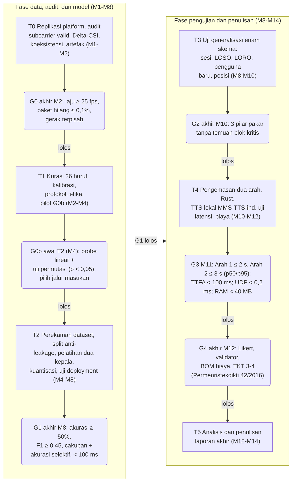
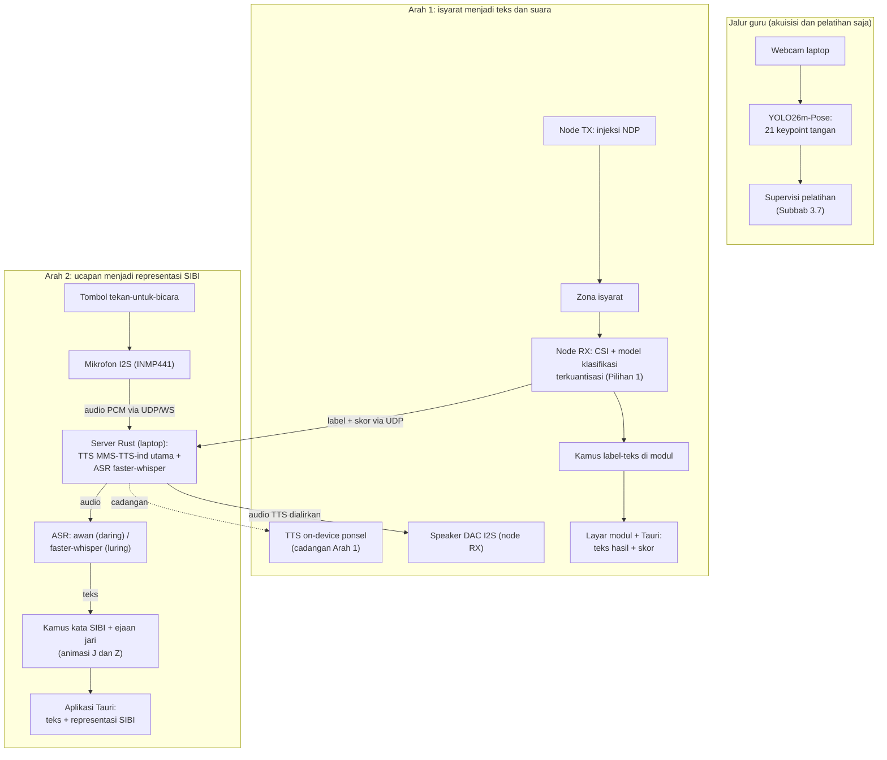
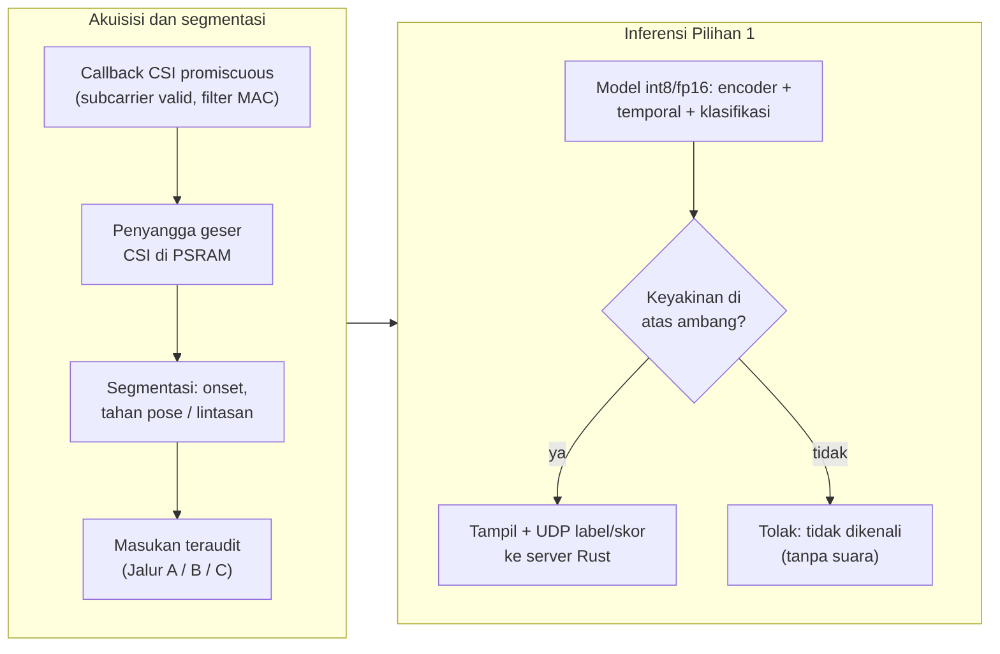

# BAB III METODE PENELITIAN

## 3.1 Desain Penelitian

Penelitian ini berbentuk studi kelayakan kuantitatif bergerbang. Sisi kuantitatifnya mengukur tiga hal: kemampuan CSI dari satu tautan antarmodul ESP32-S3 membedakan 26 huruf alfabet manual SIBI, kemampuan model terkuantisasi berjalan di modul, dan kinerja kedua jalur penerjemahan. Komponen yang lulus uji dikemas menjadi purwarupa, lalu dinilai lewat uji operasional, uji kegunaan skala kecil, dan penilaian validator penutur tunarungu. Mengapa bergerbang? Belum ada yang membuktikan CSI mampu membedakan isyarat SIBI, dan kemampuan semacam itu tidak boleh diperlakukan sebagai asumsi; setiap tahap menghasilkan artefak tetap, kegagalan gerbang dicatat sebagai temuan, dan kriteria akurasi dirumuskan relatif terhadap peluang acak (Subbab 2.14). Inti pelatihannya adalah supervisi lintas modalitas berpandu guru (Subbab 3.7): label kelas dari protokol perekaman serta deret 21 *keypoint* dari guru kamera YOLO26m-Pose mengawasi pelatihan adapter masukan (jika digunakan), modul temporal, dan kedua kepala tugas di atas *encoder* CSI terpralatih yang dibekukan pada baseline. Model terpilihnya lalu dijalankan langsung di modul. Rumusan pertama dijawab pada replikasi platform hingga perancangan model, kedua pada uji klasifikasi, regresi, dan *deployment*, ketiga pada uji operasional, kegunaan, dan penilaian validator.

## 3.2 Tahapan Penelitian

Empat belas minggu (M1 sampai M14) dibagi ke dalam enam tahap: replikasi platform dan karakterisasi (T0), kurasi isyarat dan protokol (T1), perekaman *dataset* serta pelatihan dua kepala (T2), uji generalisasi (T3), pengemasan purwarupa dan uji penerimaan (T4), serta analisis dan penulisan (T5). Lima gerbang keputusan menutup rangkaian itu, ditambah sub-gerbang G0b yang mengaudit kompatibilitas representasi *encoder* atas data pilot sebelum pelatihan penuh; kriteria dan tindakan jika gagal dirinci pada Tabel 3.5; penerimaan pengguna dan biaya dinilai G4, yang kemudian menyusun rekomendasi posisi TKT/TRL 3–4 [27]. Alur lolosnya dirangkum pada Gambar 3.1. Jika G0 gagal dua kali, jalur CSI dihentikan dan dilaporkan sebagai temuan; kriteria seluruh gerbang difinalkan bersama pembimbing sebelum dinilai (Tabel 3.7).



Gambar 3.1 Tahapan penelitian T0–T5, gerbang keputusan G0–G4, dan sub-gerbang G0b (jalur lolos; kuantisasi dan uji deployment berada pada T2; tindakan jika gagal merujuk Tabel 3.5)

Tahap T0 sampai T2 lebih dulu membangun dasar data. T0 menyiapkan dua modul dengan *firmware* `esp32-csi-node` RuView [10], lalu menjalankan empat uji tanpa partisipan. Uji itu mencakup verifikasi himpunan *subcarrier* valid N~valid~ (pemeriksaan LLTF atau HT-LTF, *pilot*, dan `first_word_invalid`) stabil pada jarak baku 1 meter, audit sisa *phase drift* Persamaan (2.5), uji pilot keterpisahan awal beberapa pose tangan statis di samping pemisahan gerak dan diam, uji Delta-CSI (Subbab 3.8.1), koeksistensi radio dengan *streaming* audio aktif, dan pengukuran laju pencuplikan. T0 juga mengaudit *checkpoint encoder* [11]: bentuk masukan, parameter normalisasi masukan, jumlah parameter, normalisasi L2, dukungan ekspor, dan kompatibilitas LoRA (Subbab 3.7). T1 meliputi kurasi 26 huruf bersama validator, kalibrasi ruang, protokol dan etika, serta perizinan (Subbab 3.6); pasangan huruf paling mirip juga ditetapkan di sini sebagai bahan gerbang G1.

Pada T2, *dataset* kurang lebih 30 repetisi per isyarat per sesi direkam disertai video yang tersinkron (Subbab 3.6). Alur pelatihannya berbentuk supervisi berpandu guru: segmen disaring lewat *keypoint* guru, jendela CSI disandingkan dengan label guru berdasarkan penanda waktu, lalu kedua kepala dilatih di atas *encoder* yang dibekukan dengan kerugian gabungan. Model terpilih selanjutnya dikuantisasi dan diuji di modul (Subbab 3.7). T2 melahirkan *dataset* berlabel, model terlatih, dan laporan *deployment*. G1 menilai hasilnya; jika gagal, cakupan dipangkas menjadi himpunan huruf dengan pembeda CSI terkuat (Tabel 3.7).

Tahap T3 sampai T5 berisi pengujian dan pelaporan. Generalisasi lintas sesi, partisipan, ruang, serta posisi berdiri-duduk diuji pada T3, termasuk pada satu pengguna baru tanpa pelatihan ulang (Subbab 3.7) dengan acuan Widar3.0 [14]. Jika ketahanan lintas pengguna rendah, cakupan berubah menjadi personalisasi per pengguna dan dilaporkan sebagai temuan. T4 mengemas model menjadi purwarupa dua arah (Subbab 3.5), menjalankan uji operasional dan jalur ucapan (Subbab 3.8) yang dinilai G3. Rangkaian itu ditutup uji penerimaan, penilaian validator, dan analisis biaya yang dinilai G4. Pada T5, seluruh artefak dianalisis dan laporan kelayakan disusun lengkap dengan rekomendasi TKT/TRL 3–4 [27] beserta keterbatasan eksplisitnya (Subbab 1.4).

## 3.3 Waktu dan Lokasi Penelitian

Pelaksanaan penelitian jatuh pada [PERLU DATA: bulan dan tahun pelaksanaan penelitian] di Jawa Timur. Penelitian ini tidak bersandar pada mitra lembaga; partisipan direkrut langsung oleh peneliti, sedangkan perekaman dan pengujian berlangsung di sedikitnya dua ruang berbeda, misalnya ruang kelas dan ruang kerja, sebagai jumlah minimum skema *leave-one-room-out*. Tiap ruang dikalibrasi lebih dulu sebelum perekaman (Subbab 3.5).

## 3.4 Alat dan Bahan

Tabel 3.1 dan Tabel 3.2 menyajikan perangkat keras dan perangkat lunak penelitian. Node penginderaan dipegang sepasang modul ESP32-S3: TX menyuntikkan bingkai *sounding* NDP, sedangkan RX menangkap CSI 56 *subcarrier* pada 2,4 GHz kanal 20 MHz melalui *callback* CSI sekaligus memuat antarmuka. Supaya eksperimen bisa diulang, versi atau komit *firmware* RuView serta perangkat lunak lain dicatat bersama log pelatihan. Bahan penelitiannya meliputi *checkpoint encoder* terpralatih [11], *dataset* CSI berpasangan yang direkam sendiri, dataset citra WPC beserta model guru YOLO26m-Pose dari repositori peneliti, lembar definisi huruf, aset tampilan arah kedua, formulir persetujuan, instrumen uji, dan kuesioner persepsi. Perekaman dilakukan sendiri karena pengenalan isyarat SIBI dari CSI memang belum ditemukan dalam penelusuran (Subbab 2.15).

Tabel 3.1 Perangkat keras penelitian

| No. | Nama | Spesifikasi | Jumlah | Keterangan |
|---|---|---|---|---|
| 1 | Modul ESP32-S3 | PSRAM 8 MB; 2,4 GHz 802.11b/g/n, kanal 20 MHz (56 *subcarrier*), 1T1R; varian yang direkomendasikan RuView [10] | 2 unit | Node TX (pemancar bingkai *sounding* NDP) dan node RX (penerima CSI dan antarmuka) |
| 2 | Layar modul | OLED 0,96 inci I2C (128×64) atau TFT 1,3 inci SPI (240×240) [PERLU DATA: model final] | 1 unit | Tampilan huruf, baterai, kanal, mode kerja |
| 3 | *Rotary encoder* EC11 dan tombol tekan | Putar 360 derajat, 20 detak per putaran, tombol terintegrasi; sakelar sesaat *pull-up* internal | 1–2 unit | Navigasi menu, sensitivitas, tekan-untuk-bicara, reset |
| 4 | Pengeras suara dengan DAC I2S | Mini 8 Ohm 3 W, penguat kelas D MAX98357A | 1 set | Pemutaran suara TTS hasil sintesis server yang dialirkan ke modul (keputusan D3 pada Tabel 3.7); *speaker* ponsel sebagai cadangan |
| 5 | Mikrofon I2S | INMP441, MEMS omnidireksional, SNR 61 dBA | 1 unit | Pintu suara arah kedua |
| 6 | Baterai Li-Po, BMS 1S, pengisi TP4056 | Li-Po 3,7 V 2.500–3.000 mAh [PERLU DATA: kapasitas final berdasarkan uji arus]; proteksi; pengisi 1 A USB-C | 1–2 set | Daya portabel, proteksi, dan pengisian |
| 7 | Laptop | ASUS TUF Dash F15 FX516PR: i7-11370H, RTX 3070 Laptop 8 GB VRAM, RAM 16 GB | 1 unit | Server Rust (penelan CSI, orkestrasi, ASR lokal cadangan, TTS lokal utama, dasbor); akuisisi jalur guru; pelatihan dua kepala; evaluasi |
| 8 | Ponsel pintar | Poco F4 5G: Snapdragon 870, RAM 6 GB, Android | 1 unit | Klien Tauri (tampilan teks dan representasi SIBI), mesin TTS *on-device* sebagai cadangan, *hotspot* cadangan |
| 9 | *Access point* | *Router* Wi-Fi 2,4 GHz dengan internet [PERLU DATA: pilihan final] | 1 unit | Jembatan jaringan dan penjangkar kanal, bukan penginderaan |
| 10 | *Webcam* | Bawaan laptop | 1 unit | Hanya untuk jalur guru |

Foto pada Gambar 3.2 memudahkan mengenali bentuk sembilan perangkat pada Tabel 3.1; webcam memakai bawaan laptop sehingga tidak difoto terpisah. Foto produk hanya menjadi pengenal bentuk, bukan acuan merek maupun spesifikasi, dan rujukan spesifikasinya tetap Tabel 3.1 [PERLU ILUSTRASI: foto dokumentasi sendiri setelah seluruh perangkat dibeli].

```gambar
Sumber skrip: scripts/sensesibi-v10/gambar_g15_alatbahan.py (grid foto hasil pencarian gambar daring) -> assets-v16/gambar-3.2.png
```

Gambar 3.2 Perangkat keras penelitian; huruf pada tiap foto mengikuti baris Tabel 3.1 (foto produk sebagai ilustrasi pengenal bentuk sementara sebelum perangkat dirakit, bukan acuan merek)

Tabel 3.2 Perangkat lunak penelitian

| No. | Nama | Fungsi dalam penelitian |
|---|---|---|
| 1 | *Firmware* dan *server* RuView [10] | Menangkap CSI, mengirim UDP, kalibrasi ruang, segmentasi |
| 2 | *Checkpoint* encoder CSI terpralatih `ruvnet/wifi-densepose-pretrained` beserta adapter LoRA ruangannya [11] | *Encoder* murid yang dibekukan pada baseline; kandidat adaptasi LoRA |
| 3 | `scripts/collect-ground-truth.py` (diadaptasi) | Sinkron kamera-CSI; estimator memakai YOLO26m-Pose |
| 4 | Model guru YOLO26m-Pose dan repositori alur kerja YOLO26 peneliti [12] | Ekstraksi *keypoint*; konversi *dataset*, pelatihan deterministik, pencatatan eksperimen (Subbab 3.7) |
| 5 | Layanan GPU Kaggle | Pelatihan lanjutan guru dan pembanding adaptasi *encoder* jika GPU lokal tidak cukup |
| 6 | Python dan PyTorch | Pelatihan dua kepala, LoRA, pelatihan lanjutan, evaluasi; kompatibel dengan *checkpoint* dan mendukung autograd |
| 7 | ESP-DL dengan akselerasi ESP-NN (alternatif: TensorFlow Lite Micro) [23] | Menjalankan model terkuantisasi pada node RX |
| 8 | faster-whisper, MMS-TTS-ind ONNX (kandidat utama), Kokoro ONNX (pembanding) [26], [25], [24]; layanan ucapan awan [PERLU DATA: layanan final hasil uji banding] | ASR cadangan lokal (faster-whisper); TTS utama operasional di server lokal (MMS-TTS-ind); TTS pembanding (Kokoro); ASR utama saat daring |
| 9 | Rust, Tokio, Axum, Leptos, Tauri | Server seluruhnya Rust, dasbor WASM, aplikasi klien ponsel |
| 10 | ONNX Runtime dan Kokoro TTS ONNX [24] | *Runtime* evaluasi TTS di server lokal dan ponsel (Tauri); Kokoro diuji sebagai pembanding jika suara Indonesia tersedia sebelum G3 |
| 11 | Kamus label-teks dan teks-isyarat | Dikembangkan sendiri; kamus label-teks dimuat pada modul |

## 3.5 Perancangan Sistem

Gambar 3.3 memperlihatkan keseluruhan sistem: dua jalur operasional tanpa kamera ditambah satu jalur guru yang hanya aktif saat akuisisi dan pelatihan. Pada arah pertama, bingkai *sounding* NDP yang disuntikkan node pemancar melintasi zona isyarat, gerak pengisyarat mengubah deret CSI yang ditangkap node penerima, dan model berkepala klasifikasi yang terkuantisasi dijalankan langsung di modul menghasilkan label beserta skor keyakinan. Label dikirim melalui UDP ke server Rust sebagai telemetri, dipetakan menjadi teks Indonesia, lalu teks itu tampil di layar modul dan aplikasi Tauri sekaligus disintesis mesin TTS di server lokal; audio hasil sintesis dialirkan kembali ke modul dan diputar pada *speaker* DAC I2S. Jika aliran audio ke modul tidak stabil atau server tidak tersedia, sintesis beralih ke mesin *on-device* pada ponsel dan pemutaran memakai *speaker* ponsel; peralihan itu dicatat. Dengan keputusan *deployment* Pilihan 1 (Tabel 3.7), kepala regresi berperan sebagai supervisi tambahan saat pelatihan dan dilepas pada *deployment* sehingga keluaran perangkat ialah label huruf beserta skor keyakinan.

Pada arah kedua, tombol tekan-untuk-bicara mengaktifkan mikrofon I2S pada node penerima; audio ditangkap di modul lalu dialirkan ke server Rust, yang meneruskannya ke layanan ASR awan saat daring atau memprosesnya sendiri dengan faster-whisper. Teks hasil pengenalan dipetakan ke representasi SIBI dari aset modul dan tampil pada aplikasi Tauri, dengan indikator opsional di layar modul. Saat internet terputus, kedua arah tetap berjalan karena ASR dan TTS beralih ke server lokal; kebutuhan pemrosesan audio di node penerima sebatas penangkapan dan pengaliran, bukan pengenalan. Jalur guru, yang memakai *webcam* dan YOLO26m-Pose untuk mengekstrak deret *keypoint* sebagai supervisi pelatihan, bukan bagian produk akhir.



Gambar 3.3 Arsitektur produk akhir tanpa kamera. Subgraf Arah 1 = isyarat menjadi teks dan suara, dengan cadangan TTS *on-device* ponsel untuk Arah 1; subgraf Arah 2 = ucapan menjadi representasi SIBI; subgraf jalur guru hanya aktif saat akuisisi dan pelatihan; garis putus-putus = jalur cadangan.

Topologi jaringannya menyatukan seluruh perangkat pada satu *access point* dan satu kanal, sehingga penangkapan CSI berjalan serentak dengan komunikasi data (Subbab 2.3). Node pemancar menyuntikkan bingkai *sounding* NDP sebagai sumber bingkai CSI, sedangkan node penerima mengirim bingkai CSI mentah saat akuisisi serta label dan skor saat *deployment* melalui UDP kepada server Rust sebagai telemetri riset. Server lokal menjalankan server RuView, server Rust, faster-whisper sebagai ASR cadangan, serta TTS MMS-TTS-ind sebagai jalur utama sintesis luring. Untuk menjamin aliran audio dua arah tidak melumpuhkan penangkapan CSI 50 bingkai per detik pada kanal Wi-Fi yang sama, spesifikasi protokol audio ditetapkan secara eksplisit sebelum G3. Jalur mikrofon Arah 2 (INMP441 I2S) menggunakan cuplikan PCM 16-bit mono 16 kHz yang dikirim dalam paket berukuran tetap melalui UDP berpenyangga atau aliran TCP/WebSocket saat tombol PTT ditekan, disertai nomor urut untuk mendeteksi paket hilang beserta batas waktu dan pengulangan pada server Rust. Jalur *speaker* Arah 1 (MAX98357A I2S) menerima aliran audio PCM 16-bit mono (atau berkas klip ter-*cache* untuk 26 huruf tunggal) ke penyangga cincin (*ring buffer*) di PSRAM modul RX guna mencegah *underrun* akibat jitter Wi-Fi. Dampak lalu lintas audio terhadap kestabilan laju CSI dan *packet loss* diukur langsung pada T0 dan G3; apabila koeksistensi pada satu modul RX menimbulkan degradasi CSI melampaui ambang G0, jalur cadangan C (memisahkan antarmuka audio ke modul ketiga atau pemutaran di ponsel) diaktifkan dan dilaporkan.

Kedua modul dipasang setinggi dada dan saling mengapit zona isyarat; uji Delta-CSI memeriksa kesesuaiannya. Zona hanya ditempati satu pengisyarat per sesi, sistem tidak mengidentifikasi individu, dan jarak antarmodul (baku 1 meter) ditetapkan pada T0 lalu dicatat dalam metadata sesi (Tabel 3.7). Karena CSI peka terhadap perubahan ruang [10], [14], setiap sesi diawali kalibrasi ruang bawaan RuView selama kurang lebih empat menit dengan 600 bingkai dan 8 *anchor*. Posisi perabot, pendingin ruangan, serta orang yang lewat dicatat sebagai kovariat analisis.

*Enclosure* cetak tiga dimensi bahan PLA atau ABS menampung papan, baterai, BMS, TP4056, serta seluruh antarmuka node penerima. Layar, pengeras suara, dan mikrofon berada pada muka depan atau atas, *rotary encoder* dan tombol pada samping, port USB-C pada bawah. Node pemancar dikemas serupa tanpa antarmuka. Pemetaan pin GPIO pada Tabel 3.3 dipilih agar tidak menabrak pin *strapping* (GPIO 0, 3, 45, 46) maupun kanal USB bawaan papan [8], dan diverifikasi ulang pada T0. Rantai dayanya tersusun atas baterai, BMS 1S, TP4056, dan regulator 3,3 volt papan; tegangan baterai diukur lewat pembagi tegangan sehingga persentase baterai bisa tampil di layar. Pada rantai daya itu, regulator 3,3 V dipastikan memiliki kapasitas arus kontinu memadai (target 500 sampai 800 mA guna menampung lonjakan arus Wi-Fi TX dan penguat kelas D MAX98357A saat *speaker* 8 Ω 3 W aktif), serta modul TP4056 diuji untuk memastikan tidak terjadi gangguan pengisian akibat beban puncak sistem (*load-sharing* atau larangan operasi aktif saat pengisian jika modul tanpa *power-path*). Estimasi ketahanan baterai (Persamaan 3.4) didasarkan pada pengukuran arus aktual I~rata~ dalam kondisi diam, inferensi aktif, *streaming* audio, dan pemutaran *speaker*. [PERLU DATA: berkas model enclosure final] [PERLU ILUSTRASI: foto atau render enclosure dan tata letak komponennya]

Skema tiga dimensi pada Gambar 3.4 merangkum penempatan seluruh komponen node penerima di dalam enclosure; pemetaan pinnya mengikuti Tabel 3.3 dan dimensinya difinalkan setelah uji T0.

```gambar
Sumber skrip: scripts/sensesibi-v10/gambar_g15_rxnode.py (matplotlib mplot3d) -> assets-v16/gambar-3.4.png
```

Gambar 3.4 Skema penempatan komponen node penerima di dalam enclosure (ilustrasi tiga dimensi, tidak berskala)

Tabel 3.3 Matriks pinout wiring GPIO node penerima

| No. | Subsistem | Pin modul | GPIO ESP32-S3 | Fungsi |
|---|---|---|---|---|
| 1 | Layar I2C (OLED) | SDA / SCL | GPIO 8 / GPIO 9 | Jalur data dan *clock* bus I2C |
| 2 | *Rotary encoder* EC11 | CLK (A) / DT (B) / SW | GPIO 10 / GPIO 11 / GPIO 12 | Detak, arah putaran, tombol |
| 3 | Tombol tekan | OUT | GPIO 13 | Tekan-untuk-bicara dan reset; *pull-up* internal |
| 4 | Mikrofon INMP441 | SCK / WS / SD | GPIO 14 / GPIO 15 / GPIO 16 | *Clock*, *word select*, data I2S penerima |
| 5 | DAC MAX98357A | BCLK / LRC / DIN | GPIO 17 / GPIO 18 / GPIO 21 | *Clock*, penanda kiri-kanan, data I2S pengirim |
| 6 | Pemantau tegangan baterai | ADC | GPIO 1 (ADC1_CH0) | Keluaran pembagi tegangan baterai |

Seluruh perangkat lunak server dan klien ditulis dalam Rust (Subbab 2.13): pendengar UDP bingkai CSI berjalan di atas Tokio, sementara Axum menyediakan HTTP dan WebSocket bagi dasbor Leptos WASM. Aplikasi Tauri pada ponsel menerima teks hasil isyarat sekaligus menjadi klien antarmuka dua arah. Target *parsing* bingkai di bawah 0,2 ms serta memori server di bawah 40 MB baru diukur pada G3 (Subbab 3.8.3). Mesin sintesis utama di server lokal memakai `facebook/mms-tts-ind` (dikonversi ke ONNX untuk evaluasi luring; sekitar 36,3 juta parameter) karena verifikasi resmi `hexgrad/Kokoro-82M` (`VOICES.md`, 14 November 2026) memastikan tidak tersedianya suara bahasa Indonesia pada rilis v1.0 [24], [25]; Kokoro-82M ONNX tetap disiapkan sebagai pembanding apabila rilis atau adapter bahasa Indonesia terverifikasi sebelum G3. Untuk menjaga konsistensi pengukuran, target waktu menuju audio pertama (*time-to-first-audio*, TTFA) di bawah 100 ms pada frasa uji hingga lima kata didefinisikan terpisah dari durasi sintesis total dan diukur pada kondisi terdokumentasi: perangkat keras laptop uji (CPU i7-11370H dan GPU RTX 3070), *execution provider* ONNX Runtime (CPU atau CUDA), presisi model (FP32, FP16, atau INT8), serta ukuran *chunk* penyangga audio pertama, dengan pelaporan persentil p50 dan p95. Untuk keluaran huruf tunggal pada Arah 1, klip audio 26 huruf di-*pre-cache* agar pemutaran tetap instan.

## 3.6 Protokol Perekaman Dataset, Partisipan, dan Etika

Partisipan terdiri atas 3–4 pengisyarat kompeten, sedikitnya satu validator penutur tunarungu, serta 3–5 pengguna uji dari kelompok sasaran, yaitu guru, siswa tunarungu, dan wali murid. Agar skema lintas sesi bisa dijalankan, setiap pengisyarat direkam dalam sedikitnya dua sesi. Kurasi isyarat mengacu pada *Kamus SIBI* [3]: lembar definisi memuat konfigurasi tangan-jari serta lintasan J dan Z, lalu validator menyetujuinya. Pasangan huruf paling mirip ditetapkan sebagai bahan G1, sedangkan kosakata tampilan arah kedua meliputi 26 huruf dan 9 angka [3] serta kata terpilih. Perekaman memakai *elisitasi* terisolasi, satu huruf per segmen dengan jeda antarrepetisi: huruf statis diperagakan sebagai pose yang ditahan sejenak, J dan Z sebagai lintasan gerak. Prosedur perekaman setiap sesi adalah sebagai berikut.

1. Menyiapkan seluruh peralatan yang dipakai.
2. Memasang kedua modul, pemancar dan penerima, lalu menghubungkan seluruh perangkat ke *access point* pada satu kanal.
3. Menjalankan kalibrasi ruang seraya mencatat metadata sesi: tanggal, ruang, kode pengisyarat, posisi modul, dan kondisi latar.
4. Menjalankan `scripts/collect-ground-truth.py` menggunakan sumber penanda waktu monotonik tunggal pada laptop sebagai acuan penyelarasan *timestamp* bingkai kamera (target sekitar 30 fps) dan bingkai CSI (sekitar 50 fps). Kualitas sinkronisasi diverifikasi melalui uji ketukan tangan di awal dan akhir setiap sesi dengan batas galat selisih waktu maksimum [PERLU DATA: toleransi sinkronisasi akhir, misalnya 20 ms atau satu bingkai CSI]. Bingkai kamera yang hilang (*frame drop*) dicatat; jika jeda melebihi toleransi, segmen ditandai tidak valid untuk target regresi tanpa interpolasi paksa gerakan yang hilang.
5. Memunculkan kartu pemandu huruf target dengan urutan huruf yang diacak di dalam setiap blok guna mencegah efek urutan (*order effect*) dan akumulasi kelelahan pada kelas huruf tertentu, merekam satu repetisi, memberi jeda antarrepetisi, hingga tiap huruf mencapai sekitar 30 repetisi per sesi.
6. Membuang segmen yang gagal deteksi tangan oleh model guru, mengalami *jitter* *keypoint* melampaui ambang, atau terpotong, serta melakukan audit kualitas *keypoint* khusus lintasan dinamis J dan Z (melaporkan *detection rate*, laju *frame drop*, dan konsistensi kelancaran lintasan selama gerak cepat, karena kinerja `exp11_huruf24` pada 24 huruf statis tidak otomatis menjamin keandalan *keypoint* pada gerakan J/Z); tingkat segmen terbuang dan skor kualitas anotasi tiap segmen dicatat.
7. Meminta validator penutur tunarungu memeriksa sampel acak terstratifikasi sebesar [PERLU DATA: proporsi sampel, misalnya sekurang-kurangnya 10% segmen per kelas atau minimal 3 repetisi per huruf per pengisyarat] dan menjalankan uji reliabilitas kesepakatan jika penilai lebih dari satu orang; label keluaran guru berstatus *pseudo-label* sampai audit validator selesai. Rujukan teknis model guru merujuk dokumentasi Ultralytics [12] serta artefak repositori WPC peneliti [PERLU DATA: tag rilis/commit dan hash *checkpoint* exp11_huruf24].

Beban perekaman dihitung agar protokolnya realistis dan etis. Dengan 26 huruf dan kurang lebih 30 repetisi, satu sesi memuat sekitar 780 repetisi; pada asumsi lima detik per repetisi, perekaman murninya sekitar 65 menit, dan dengan jeda blok, kalibrasi, serta persiapan, satu sesi memakan waktu sekitar 97 menit. Setiap sesi dibagi blok sekitar sepuluh menit dengan jeda wajib sekurang-kurangnya tiga menit di antaranya; paling banyak dua sesi per hari untuk satu pengisyarat; pengisyarat boleh menghentikan repetisi kapan saja tanpa konsekuensi. Tingkat kelelahan diamati dari penurunan mutu segmen pada blok akhir dan dilaporkan bersama tingkat segmen terbuang.

Baru setelah persetujuan etik dari [PERLU DATA: lembaga atau komisi pemberi persetujuan etik] serta persetujuan tertulis (*informed consent*) yang disajikan dalam format bahasa Indonesia yang jelas dan aksesibel bagi partisipan Tuli (didampingi juru bahasa isyarat atau panduan visual jika diperlukan) diperoleh, perekaman dimulai; partisipan berhak mengundurkan diri kapan saja. Apabila uji kegunaan (T4) melibatkan siswa di bawah usia 18 tahun, penelitian wajib memperoleh persetujuan tertulis orang tua atau wali sekaligus persetujuan sukarela anak (*child assent*); jika tidak, partisipan dibatasi pada kelompok dewasa (sedikitnya 18 tahun). Formulir persetujuan menerangkan batas ruang lingkup kamera (hanya saat akuisisi pelatihan), mode privasi RuView aktif, serta pengiriman audio Arah 2 ke layanan awan saat mode daring. Video mentah hanya disimpan pada media terenkripsi dengan akses terbatas peneliti untuk keperluan verifikasi batas segmen, penyaringan kualitas, dan peninjauan validator, lalu dihapus secara permanen dalam batas waktu [PERLU DATA: misalnya maksimal 30 hari] setelah seluruh validasi anotasi selesai. *Dataset* yang dibagikan tidak mencantumkan nama atau identitas langsung, namun penelitian mengakui bahwa pola kinematika tangan, audio, atau metadata sesi tetap berpotensi memiliki risiko identifikasi ulang sehingga tidak diklaim sepenuhnya anonim tanpa batas, dan tata kelolanya tunduk pada perjanjian akses terbatas.

## 3.7 Pengolahan Sinyal, Pelatihan Dua Kepala, dan Deployment

Bingkai CSI dibatasi *firmware* RuView paling sering setiap 20 ms atau 50 bingkai per detik [10]; laju aktualnya diukur pada T0, dan jika terukur lebih rendah, pita Doppler yang dianalisis dipangkas hingga setengah laju aktual. Deret CSI dipotong menjadi segmen huruf dengan segmentasi energi gerak memakai Delta-CSI, yaitu rata-rata besar perubahan koefisien kanal kompleks antarbingkai pada seluruh 56 *subcarrier*:

```rumus
d( t ) = ( 1 / |N~valid~| ) · Σ~n~ | h~n~(t) − h~n~( t − 1 ) | , n ∈ N~valid~ (3.1)
```

Segmentasi tidak mengandalkan ambang energi gerak τ semata karena huruf statis memperagakan pose yang ditahan diam, saat nilai energi gerak d(t) justru turun mendekati kondisi tenang. Alur segmentasi memisahkan tiga fase: (1) deteksi awal gerak (*onset*) saat d(t) melampaui ambang τ~onset~; (2) untuk 24 huruf statis, pencuplikan jendela tahan pose (*pose-hold window*) berdurasi L~hold~ sesudah *onset* mereda atau stabil, yang ambang dan durasinya ditala dari data validasi (bukan data uji); serta (3) untuk huruf dinamis J dan Z, penangkapan jendela lintasan penuh selama energi gerak melampaui ambang τ~dinamis~ hingga kembali tenang. Fitur tiap segmen, yaitu amplitudo dan fase *subcarrier* terpilih serta spektrum Doppler [6], [14], diringkas menjadi masukan *encoder*. Sebagai pembanding sensitivitas pada uji Delta-CSI (Subbab 3.8.1), varian berbasis amplitudo saja juga dihitung dan dilaporkan berdampingan:

```rumus
d~|H|~( t ) = ( 1 / |N~valid~| ) · Σ~n~ | |h~n~(t)| − |h~n~( t − 1 )| | , n ∈ N~valid~
```

Langkah berikutnya menutup temuan audit Subbab 2.4: bentuk masukan *checkpoint* harus disesuaikan sebelum dipakai. Kartu model mencatat masukan delapan fitur turunan pada laju 1 Hz [11], sedangkan jalur akuisisi menghasilkan 56 *subcarrier* pada 50 bingkai per detik [9], [10]. Empat rute evaluasi karenanya disiapkan sesuai Subbab 2.4: Jalur A (menghitung ulang delapan fitur turunan bawaan RuView beserta *standardizer*-nya), Jalur B1 (adapter rekonstruksi fitur), Jalur B2 (adapter terpandu tugas), serta Pembanding C (*baseline* CSI temporal lebih kaya tanpa penyempitan delapan fitur) [PERLU VALIDASI: bentuk masukan *checkpoint* dan rancangan adapter]. Setelah bentuk masukan pasti, alur fitur dibakukan pada tiga tingkat: bingkai CSI (56 *subcarrier*, hingga 50 bingkai per detik), jendela fitur sepanjang W = 1 detik yang diringkas menjadi satu vektor delapan fitur, dan langkah *embedding*, yaitu satu keluaran *encoder* per jendela. Jalur pertama menghitung ulang delapan fitur turunan bawaan RuView dari bingkai CSI; jalur kedua melatih adapter masukan kecil berbasis konvolusi satu dimensi yang memetakan jendela CSI mentah ke vektor masukan *encoder* sehingga informasi *subcarrier* tidak diringkas lebih dulu oleh rumus tetap. Pada kedua jalur, *encoder* diterapkan per jendela, bukan per bingkai, sesuai kontrak laju 1 Hz kartu model [11].

Pada rute *encoder* RuView (Jalur A dan Jalur B), setiap vektor masukan merangkum jendela sepanjang W = 1 detik dengan pergeseran (*hop*) H = 0,25 detik (usulan; dikalibrasi pada T2), menghasilkan tumpang tindih (*overlap*) sebesar 75%. Laju empat langkah per detik (1/H = 4 Hz) merupakan laju lompatan jendela yang saling tumpang tindih, bukan empat pengamatan temporal independen, karena setiap *embedding* tetap mengagregasi konteks satu detik. Untuk J dan Z, kelas tidak dibaca dari satu jendela: barisan langkah diproses modul temporal secara berurutan dan klasifikasinya diambil dari ringkasan barisan tersebut; lintasan gerak J dan Z karena itu tetap tersedia tanpa melanggar kontrak masukan *encoder*. Karena agregasi W = 1 detik berisiko mengaburkan lintasan cepat J dan Z, eksperimen wajib membandingkan konfigurasi (W = 1,0 s, H = 0,25 s) terhadap jendela lebih pendek (W = 0,5 s dengan H = 0,10 sampai 0,25 s) dan terhadap Pembanding C (*baseline* CSI temporal langsung pada W = 0,2 s atau laju bingkai asli tanpa penyempitan delapan fitur). Kandidat modul temporal ialah 1D-CNN ringan dari rancangan lama yang memelihara urutan waktu per langkah; agregasi statistik hanya menjadi kandidat bagi jalur klasifikasi, dan pilihan di antara keduanya diambil dari hasil ablasi pada data yang sama (Subbab 2.8).

Kompatibilitas representasi diuji pada gerbang G0b sebagai eksperimen sungguh-sungguh, bukan asumsi. Gerbang G0b dinilai setelah G0 atas data pilot satu pengisyarat satu sesi (sekitar 97 menit) yang direkam lebih dulu atau diambil dari sesi pertama T2. Alat ujinya *probe* linear, yaitu pengklasifikasi linear sederhana di atas *embedding* beku; cara ini baku untuk membaca seberapa informatif sebuah representasi tanpa melatih model penuh. Rangkaiannya: *probe* 24 huruf statis pada skema blok temporal, *probe* sekuensial atas gabungan langkah tiap segmen, *probe* biner J terhadap Z, serta perbandingan langsung terhadap Pembanding C (fitur CSI mentah atau lebih kaya). Untuk memvalidasi signifikansi statistik secara benar, dilakukan uji permutasi (*permutation test*): label kelas diacak pada level blok atau repetisi independen (bukan per *window* tumpang tindih) sebanyak M = 1.000 iterasi untuk membentuk distribusi *null* acak; pengujian dinyatakan signifikan apabila skor F1 makro *probe* berlabel asli melampaui persentil ke-95 distribusi *null* (p~perm~ < 0,05), sementara skor pada label teracak tetap berada di sekitar peluang acak. Ambang usulannya: F1 makro *probe* sekurang-kurangnya 0,30 dan sekurang-kurangnya tiga kali peluang acak; *probe* J–Z sekurang-kurangnya 70%; seluruhnya difinalkan bersama pembimbing sebelum gerbang dinilai. Jalur A dipakai jika lulus; jika gagal, diuji Jalur B1 (rekonstruksi) dan Jalur B2 (adapter terpandu tugas); jika seluruh jalur masukan delapan fitur tetap gagal, skema adaptasi LoRA dan pelatihan lanjutan (Subbab 2.5) diuji secara berdampingan dengan Pembanding C (CSI lebih kaya tanpa penyempitan delapan fitur), karena adaptasi bobot *encoder* tidak dapat memulihkan informasi jari yang hilang sebelum masuk *encoder*; seluruh hasilnya dilaporkan sebagai temuan.

*Dataset* murid terbentuk dengan menyelaraskan tiga deret menurut penanda waktu: jendela CSI hasil segmentasi, label huruf dari kartu pemandu protokol, dan deret *keypoint* guru. Guru memakai model juara pra-penelitian dari repositori peneliti [12]. Label kelas tiap segmen diambil dari kartu pemandu protokol; keluaran kelas guru hanya dipakai sebagai salinan pembanding untuk penyaringan kualitas, bukan sebagai label kebenaran. Ketidakcocokan antara label protokol dan kelas guru dicatat sebagai temuan kualitas anotasi dan dilaporkan bersama tingkat segmen terbuang. Jika rekaman baru memperlihatkan pergeseran domain yang menurunkan kualitas deteksi, guru menjalani pelatihan lanjutan di layanan GPU Kaggle dengan alur kerja yang sudah teruji itu sebelum labelnya dipakai. Seluruh pasangan direkam dalam struktur *dataset* berpasangan Subbab 2.17, lengkap dengan mask visibilitas, metadata sesi, dan skor kualitas anotasi.

Deret *keypoint* guru dipasangkan ke titik pusat waktu tiap jendela CSI dengan laju yang sama dengan keluaran modul temporal. Untuk mengevaluasi galat lintasan J dan Z secara jujur, metrik MPJPE dan PCK@α dilaporkan secara utama pada resolusi langkah model (dengan mask efektif m∗~itj~ sesuai Persamaan 2.13a agar langkah *padding* tidak terhitung). Apabila dilakukan interpolasi ke laju kamera untuk perbandingan visual bingkai demi bingkai dengan acuan guru, ditegaskan bahwa interpolasi tidak menciptakan informasi temporal baru yang tidak diamati dan hasilnya hanya berstatus pelaporan sekunder; metode interpolasinya dinyatakan pada laporan. Panjang T ditetapkan 16 langkah per segmen (usulan; difinalkan dari distribusi durasi segmen pada data pilot T2 tanpa memakai data uji); pada lompatan H = 0,25 detik, selisih pusat jendela pertama ke langkah ke-16 adalah (16 − 1) × 0,25 = 3,75 detik, sedangkan rentang sinyal mentah yang tercakup dari awal jendela pertama hingga akhir jendela ke-16 mencapai 4,75 detik untuk segmen valid penuh. Segmen lebih pendek diberi *padding* nol dengan mask valid, dan kerugian regresi dinormalisasi oleh jumlah langkah valid; mask visibilitas Persamaan 2.13 diperluas satu dimensi waktu. Resampling ke panjang tetap tidak dipakai untuk pelatihan J dan Z karena menyeragamkan durasi dan menghapus petunjuk kecepatan yang justru membedakan kedua huruf itu.

Enam skema pada Tabel 3.4 mengukur kinerja; untuk skema dalam sesi, pembagiannya temporal per blok dan tidak acak. Untuk mencegah kebocoran data (*data leakage*) akibat tumpang tindih jendela sebesar 75%, seluruh pembagian data latih, validasi, dan uji pada keenam skema wajib dilakukan pada level rekaman mentah, sesi, atau blok/grup repetisi sebelum pembentukan jendela bergulir (*sliding windows*), disertai celah pemisah (*purge gap*) sekurang-kurangnya sepanjang W (satu detik) pada perbatasan blok agar tidak ada jendela yang memotong batas set latih dan uji. Data validasi hanya berasal dari data latih, sehingga data uji tidak pernah dipakai untuk memilih *subcarrier*, menormalkan fitur, menetapkan ambang, ataupun menala bobot kerugian (Tabel 3.7).

Tabel 3.4 Skema pembagian data

| No. | Skema | Data latih | Data uji | Aspek yang diukur |
|---|---|---|---|---|
| 1 | Dalam sesi (blok temporal) | Blok awal satu sesi | Blok akhir sesi yang sama | Separabilitas orang, ruang, sesi sama |
| 2 | Lintas sesi | Sebagian sesi pengisyarat di satu ruang | Sesi lain, ruang sama | Ketahanan antarsesi |
| 3 | Lintas partisipan (*leave-one-subject-out*) | Semua pengisyarat kecuali satu | Pengisyarat yang ditinggalkan, bergiliran | Ketahanan pergantian orang |
| 4 | Lintas ruang (*leave-one-room-out*) | Semua ruang kecuali satu | Ruang yang ditinggalkan, bergiliran | Ketahanan pergantian ruang |
| 5 | Pengguna baru | Seluruh pengisyarat | Satu pengguna baru tanpa pelatihan ulang | Kesiapan orang baru |
| 6 | Lintas posisi | Posisi berdiri (atau sebaliknya) | Posisi duduk | Ketahanan pergeseran posisi |

Pelatihan berjalan di komputer dengan Python dan PyTorch karena keduanya kompatibel dengan *checkpoint* dan mendukung autograd serta pengoptimal; layanan GPU Kaggle dipakai jika kapasitas GPU lokal tidak cukup. Baseline dilatih dengan urutan yang eksplisit. *Encoder* dimuat lalu dibekukan, dan geometri *embedding*-nya diverifikasi lewat uji triplet kecil pada data sendiri. Setelah itu, kedua kepala beserta modul temporal dilatih serentak dengan kerugian gabungan Persamaan (2.14) dan (2.15), memakai *seed* tetap dan *early stopping* pada data validasi. Ablasi dijalankan sebagai rangkaian pembanding pada data dan seed yang sama: kepala klasifikasi saja tanpa kepala regresi, multitugas penuh, dan variasi bobot λ~reg~; manfaat supervisi *keypoint* dibaca dari selisih ketiganya, termasuk jika manfaatnya nihil. Sebagai pembanding lanjutan jika waktu dan data mencukupi, adaptasi LoRA (Persamaan 2.7) [17] dan pelatihan lanjutan sebagian atau seluruhnya dijalankan pada pembagian yang sama. Seluruh hasilnya dilaporkan berdampingan, bukan hanya yang terbaik.

Keluaran klasifikator dilengkapi skor keyakinan dan mekanisme penolakan [18]. Segmen di bawah ambang berujung status penolakan pada kedua arah: *speaker* tidak mengucapkan apa pun dan layar memunculkan pesan isyarat tidak dikenali. Menolak lebih aman daripada menebak kelas yang salah; ambangnya ditetapkan dari data validasi, dan kecukupannya diperiksa lewat laju deteksi palsu serta penilaian validator (Subbab 3.8).

Setelah terpilih, model *deployment* disusun menurut Pilihan 1: *encoder*, adapter (jika dipakai), modul temporal, dan kepala klasifikasi digabung menjadi satu *graph* inferensi lalu dikuantisasi; kepala regresi dilepas setelah pelatihan karena perannya supervisi tambahan. Kepala regresi ikut dijalankan pada *deployment* (Pilihan 2) hanya jika keputusan pada Tabel 3.7 menyatakannya, dengan tambahan biaya memori, komputasi, dan kuantisasi yang diukur serta dilaporkan. Skema kuantisasinya affine 8-bit [23]: nilai x dipetakan ke bilangan bulat q lewat skala s dan titik nol z~0~

```rumus
q = round( x / s ) + z~0~, dengan s = ( x~maks~ − x~min~ ) / 255 (3.2)
```

dengan parameter s dan z~0~ dihitung dari data kalibrasi; varian float16, int8, dan int4 dievaluasi masing-masing sesuai dukungan operator pada *runtime*. Jalur ekspornya dinyatakan realistis dan bertahap. Format bobot *checkpoint* diperiksa lebih dulu, lalu operator BatchNorm dan GELU diverifikasi pada *runtime* kandidat di ESP32-S3, baik lewat ESP-DL dengan akselerasi ESP-NN maupun TensorFlow Lite Micro [23]. Klaim dukungan operator tidak dibuat sebelum terverifikasi [PERLU VALIDASI: dukungan operator runtime tepi]. Radio tetap terikat satu kanal bersama *access point* dengan *power save* dimatikan [10]. Alur inferensi pada perangkat tampak pada Gambar 3.5. Bingkai hasil *callback* CSI masuk ke penyangga geser, segmen terdeteksi dari energi gerak, dan masukan *encoder* disiapkan sesuai hasil audit. Model terkuantisasi menghasilkan kelas dan skor, lalu keluaran di atas ambang dikirim melalui UDP. Waktu inferensi per segmen, pemakaian memori, serta pengaruhnya pada laju pemrosesan diukur lalu dilaporkan; jika model terbukti terlalu berat, klasifikasi pindah ke server menurut jalur cadangan (Subbab 3.11).



Gambar 3.5 Alur inferensi langsung pada ESP32-S3 menurut rancangan *deployment* Pilihan 1 tanpa kepala regresi, dengan segmentasi tiga fase dan mekanisme tolak; seluruh latensi dan memori diukur langsung pada perangkat, bukan dijanjikan

## 3.8 Skenario Pengujian dan Metrik Evaluasi

G0 berdiri di atas uji Delta-CSI dan koeksistensi, G1 di atas uji model pada Subbab 3.8.2, G2 di atas konsultasi tiga pilar, G3 di atas uji operasional dan jalur ucapan, serta G4 di atas uji kegunaan, penilaian validator, dan analisis biaya. Satu uji lagi, cakupan kamus, melengkapi analisis tanpa menjadi syarat gerbang. Seluruh hasil klasifikasi, regresi, dan operasional dilaporkan sebagai bukti awal pada populasi terbatas 3–4 pengisyarat, sedikitnya dua ruang, dan satu konfigurasi perangkat; skema *leave-one-subject-out*, pengguna baru, dan *leave-one-room-out* dibaca sebagai indikasi ketahanan awal, bukan bukti generalisasi populasi (Subbab 1.4).

### 3.8.1 Uji Delta-CSI dan Koeksistensi

Satu pertanyaan dijawab uji Delta-CSI: apakah gerak tubuh menghasilkan perubahan CSI yang terpisah jelas dari kondisi tanpa gerak (ukuran keterpisahannya pada Tabel 3.7). Prosedurnya sebagai berikut.

1. Memasang kedua modul pada posisi awal sehingga mengapit zona isyarat.
2. Merekam CSI dalam tiga kondisi: ruang kosong, pengisyarat diam, dan pengisyarat bergerak.
3. Menjalankan modul penerima dengan CSI, koneksi *station*, dan UDP secara serentak, termasuk saat *streaming* audio, serta mencatat laju CSI aktual dan paket yang hilang.
4. Membandingkan pola antarkondisi, lalu mencatat dan menganalisis hasilnya sebagai bahan G0.

### 3.8.2 Uji Klasifikasi, Regresi, dan Ablasi

Keenam skema Tabel 3.4 diuji dengan metrik Subbab 2.14, selalu dibandingkan terhadap peluang acak sekitar 3,8% untuk 26 kelas; angka acak itu dihitung ulang jika cakupan dipangkas. Akurasi dilaporkan dalam dua versi, yaitu tanpa penolakan pada seluruh segmen uji dan dengan penolakan pada segmen yang diterima. *Recall* tiap kelas dilaporkan, dengan *recall* J dan Z terpisah beserta *confusion* terhadap huruf paling mirip. Kinerja kepala regresi dilaporkan dengan MPJPE, NME, PCK@α, dan galat per *keypoint* (Subbab 2.14), dan galat itu dirinci untuk pasangan huruf paling mirip serta lintasan J dan Z. Pembanding ablasi dilaporkan berdampingan: kepala klasifikasi saja, multitugas penuh, dan variasi bobot λ~reg~; manfaat supervisi *keypoint* dinyatakan dari selisihnya, termasuk jika manfaatnya nihil. Evaluasi klasifikasi juga memisahkan dua taraf penilaian: (a) kelayakan ilmiah awal (*scientific feasibility*), yakni bukti adanya daya pisah sinyal CSI jauh di atas peluang acak maupun pembanding tunggal, dan (b) kegunaan operasional (*operational usability*) untuk komunikasi nyata di kelas. Untuk mekanisme penolakan [18], setiap eksperimen wajib melaporkan bersama-sama akurasi keseluruhan tanpa penolakan, cakupan diterima (*accepted coverage*), akurasi selektif (*selective accuracy*) pada segmen yang lolos ambang keyakinan, laju terima palsu (*false accept*), laju tolak palsu (*false reject*), serta waktu inferensi persentil p50 dan p95.

### 3.8.3 Uji Operasional

Tiga hal diukur pada uji operasional: deteksi palsu per jam tanpa peragaan, latensi ujung ke ujung tiap arah, dan konsumsi arus modul. Prosedurnya sebagai berikut.

1. Menjalankan purwarupa di ruang yang sudah terkalibrasi.
2. Merekam kondisi tanpa peragaan, termasuk ketika orang lewat dan kipas menyala, lalu mencatat isyarat yang terdeteksi.
3. Meminta pengisyarat memperagakan isyarat target, lalu mencatat waktu selesainya isyarat dan terdengarnya suara; pada arah kedua, mengucapkan frasa uji dan mencatat waktu representasi tampil.
4. Mengukur arus modul pada beberapa kondisi kerja, kemudian menghitung estimasi ketahanan baterai.
5. Menghitung biaya purwarupa dari harga komponen serta perkiraan biaya layanan ucapan per jam pemakaian.
6. Menganalisis deteksi palsu, latensi pada kedua arah, dan ketahanan baterai terhadap indikator layak yang ditetapkan kemudian (Tabel 3.7).

Tiga perhitungan penunjang dirumuskan lebih dulu agar hasilnya bisa diperiksa ulang. Latensi ujung ke ujung dirumuskan terpisah untuk masing-masing arah karena perbedaan komponennya, dan keduanya diukur pada mode daring serta luring dengan pelaporan persentil p50 dan p95:

```rumus
T~1~ = t~CSI-buf~ + t~seg~ + t~inf-tepi~ + t~tel~ + t~peta~ + t~TTS~ + t~audio-dl~ + t~putar~ (3.3a)
T~2~ = t~rekam~ + t~audio-ul~ + t~ASR~ + t~kamus~ + t~tampil~ (3.3b)
```

dengan T~1~ mencakup latensi pasca-akhir segmen isyarat hingga awal pemutaran suara (termasuk varian klip ter-*cache* 26 huruf maupun sintesis langsung) dan T~2~ mencakup akhir ujaran PTT hingga tampilnya representasi SIBI di aplikasi Tauri; anggaran per tahap dan ambang totalnya diuji pada G3 (Tabel 3.5). Biaya purwarupa dihitung dari tabel BOM riil seluruh komponen dengan memisahkan harga pasangan modul ESP32-S3 inti dari total komponen antarmuka lengkap (Persamaan 3.5). Ketahanan baterai diestimasi dari kapasitas baterai C~baterai~ dan arus rata-rata terukur I~rata~:

```rumus
T~baterai~ ≈ 0,8 · C~baterai~ / I~rata~ (3.4)
```

Faktor 0,8 menampung efisiensi konverter dan penuaan baterai. Sebagai ilustrasi angka, baterai 2.500 mAh pada arus rata-rata 250 mA bertahan kira-kira delapan jam; angka arus sebenarnya diukur pada langkah keempat, bukan diasumsikan. Biaya total purwarupa menjumlahkan harga seluruh komponen b~j~ dan biaya layanan ucapan per jam:

```rumus
B~total~ = Σ~j~ b~j~ + b~layanan~ · t~pakai~ (3.5)
```

dengan t~pakai~ jam pemakaian layanan selama uji.

### 3.8.4 Uji Jalur Ucapan dan Cakupan Kamus

Komponen bahasa pada kedua arah dinilai lewat uji jalur ucapan, yang membandingkan jalur *on-device*, awan, dan server lokal disertai cakupan kamus arah kedua. Prosedurnya sebagai berikut.

1. Menyiapkan daftar frasa uji pendek berbahasa Indonesia [PERLU DATA: daftar frasa uji dan jumlah penutur] yang memuat kata di dalam dan di luar kamus.
2. Merekam teks keluaran layanan ASR awan (daring) dan `faster-whisper` (luring) pada frasa uji bahasa Indonesia, lalu melaporkan WER beserta rincian (S, D, I, N) (Persamaan 2.23) dan *exact-match rate* tanpa memakai rumus 1 − WER.
3. Mengukur waktu pengenalan, pemetaan, waktu menuju audio pertama (TTFA) sintesis TTS, serta total ujung ke ujung pada kedua arah.
4. Mengulang pengukuran pada kandidat mesin (MMS-TTS-ind ONNX sebagai kandidat utama dan Kokoro ONNX sebagai pembanding) di server lokal maupun *on-device* ponsel serta jalur pembanding awan, lalu menimbang mutu dan latensinya.
5. Memverifikasi prasyarat suara Indonesia sambil mengukur *parsing* UDP dan memori server Rust (Subbab 2.13).
6. Mencatat proporsi kata uji yang tampil sebagai representasi isyarat, ejaan jari, dan gagal tampil, kemudian menganalisis mutu, latensi, serta ketergantungan internet sebagai bahan keputusan G3 (Tabel 3.7).

### 3.8.5 Uji Kegunaan dan Penilaian Validator

Uji kegunaan diposisikan sebagai uji kelayakan skala kecil: hasilnya dianalisis secara deskriptif untuk menemukan hambatan pemakaian dan mengarahkan perbaikan purwarupa, bukan sebagai bukti efektivitas pada populasi pengguna; rumusan ini selaras dengan Batasan no. 9. Keterpakaian purwarupa ditelaah lewat uji kegunaan bersama 3–5 pengguna kelompok sasaran pada skenario tugas terbimbing, yaitu saling menyampaikan pesan pendek melalui ejaan huruf dan kosakata tampilan. Tiap pengguna menjalani langkah berikut.

1. Menjelaskan tujuan uji, batas kosakata, kenyataan bahwa kamera tidak menyala, dan hak mundur, lalu meminta persetujuan tertulis.
2. Memberi waktu berlatih singkat bersama kamus tampilan.
3. Menjalankan tugas komunikasi dua arah sambil mencatat keberhasilan, waktu penyelesaian, dan keluaran yang menyesatkan.
4. Meminta pengguna mengisi kuesioner skala Likert [28] mengenai kegunaan, kejelasan, dan keinginan memakai ulang.
5. Merekapitulasi hasil, lalu menganalisisnya secara deskriptif tanpa klaim kausal.

Kewajaran keluaran kedua arah dinilai validator penutur tunarungu; keluaran sistem dan penilaian independennya dicatat dalam tabel silang, sedangkan kasus yang dinilai keliru dilaporkan tersendiri. Sebagai analisis sekunder, kesalahan klasifikator dikaitkan luring dengan kemiripan pose pada deret *keypoint* guru agar kesalahan konfigurasi mirip dapat dibedakan dari kesalahan sinyal lemah.

### 3.8.6 Kriteria Gerbang Keputusan

Tabel 3.5 menyajikan kriteria tiap gerbang beserta tindakan jika gagal. Kelayakan pada rumusan ketiga ditinjau per dimensi, bukan semata dari lolosnya G4, dan ambang kuantitatifnya difinalkan bersama pembimbing sebelum gerbang dinilai.

Tabel 3.5 Kriteria gerbang keputusan

| Gerbang | Nama dan waktu | Kriteria lolos (ambang usulan) | Tindakan jika gagal |
|---|---|---|---|
| G0 | Baseline CSI dan jaringan, akhir M2 | Versi atau komit *firmware* RuView dikunci dan tercatat; konfigurasi dua node peran tetap terverifikasi berjalan tanpa implementasi ESP-NOW tambahan; akuisisi *subcarrier* valid N~valid~ (LLTF/HT-LTF, *pilot*, `first_word_invalid` diaudit) pada jarak 1 m ke UDP Rust terbaca stabil saat injeksi NDP dan pengiriman UDP berjalan bersamaan; laju sekurang-kurangnya 25 bingkai per detik; paket hilang tidak melampaui 0,1%; pola bergerak terpisah dari diam; keterpisahan awal beberapa pose tangan statis teramati; audit sisa *phase drift* Persamaan (2.5) dan audit artefak *encoder* (pemilihan berkas v1/v2, *standardizer*) selesai | Perbaikan penempatan satu kali; gagal lagi berarti jalur CSI dihentikan dan dilaporkan |
| G0b | Audit kompatibilitas representasi *encoder*, setelah G0 atas data pilot (awal T2) | *Probe* linear 24 huruf statis dan *probe* sekuensial di atas *embedding* beku: F1 makro sekurang-kurangnya 0,30 dan sekurang-kurangnya tiga kali peluang acak; *probe* biner J–Z sekurang-kurangnya 70% [usulan]; skor label asli melampaui persentil ke-95 distribusi *null* uji permutasi blok/repetisi (p~perm~ < 0,05); perbandingan langsung terhadap Pembanding C tercatat; keputusan jalur masukan tercatat | Jalur A gagal maka Jalur B1/B2 diuji; seluruh jalur delapan fitur gagal maka LoRA/pelatihan lanjutan dijalankan berdampingan dengan Pembanding C (CSI lebih kaya tanpa *bottleneck* 8 fitur) dan hasilnya dilaporkan sebagai temuan |
| G1 | Model tepi terkuantisasi dan dua kepala, akhir M8 | Akurasi dalam sesi sekurang-kurangnya 50% (sekitar 13 kali acak 3,8%) sebagai ambang kelayakan ilmiah awal, bukan klaim siap pakai operasional; F1 makro sekurang-kurangnya 0,45 [usulan]; tidak ada kelas dengan *recall* nol pada himpunan huruf terpilih; melampaui pembanding ablasi kepala tunggal dengan manfaat multitugas dilaporkan; cakupan diterima dan akurasi selektif dilaporkan berpasangan; *recall* J dan Z dilaporkan terpisah beserta *confusion* terhadap huruf paling mirip; MPJPE pada resolusi langkah model dilaporkan sebagai pemantauan; inferensi terkuantisasi di bawah 100 ms; pemangkasan himpunan huruf dilarang memakai informasi data uji; seluruh ambang difinalkan bersama pembimbing sebelum G1 dinilai | Pangkas himpunan huruf pembeda terkuat berbasis data validasi, lalu nilai ulang |
| G2 | Tiga pilar pakar, akhir M10 | Penilaian tertulis pakar SIBI-aksesibilitas, RF-*wireless sensing*, dan *embedded AI* masuk semua; tanpa temuan blok kritis; skor rata-rata per pilar sekurang-kurangnya 3 dari 5 | Perbaiki temuan blok atau sempitkan klaim, lalu nilai ulang |
| G3 | Integrasi Rust dan mesin ucapan, M11 | Latensi Persamaan (3.3a) Arah 1 tidak melampaui 2 detik dan Persamaan (3.3b) Arah 2 tidak melampaui 3 detik pada jalur utama server lokal (5 detik untuk jalur cadangan *on-device*), diukur daring dan luring dengan pelaporan p50 dan p95; TTFA di bawah 100 ms pada frasa uji paling banyak lima kata pada kondisi terdokumentasi; *parsing* UDP di bawah 0,2 ms; memori server di bawah 40 MB; konfigurasi TTS Indonesia default MMS-TTS-ind ONNX (dengan *pre-cache* 26 huruf tunggal) kecuali Kokoro mendukung bahasa Indonesia sebelum G3 | Beralih ke mesin alternatif, lalu jalur *on-device* ponsel atau awan; melampaui berarti temuan |
| G4 | Sintesis kelayakan, akhir M12 | Skor persepsi rata-rata sekurang-kurangnya 3,0 dari 5 (dianalisis deskriptif: median, rentang, per partisipan); validator menyetujui kewajaran; BOM biaya lengkap; rekomendasi TKT 3–4 tertulis mengacu pada Permenristekdikti Nomor 42 Tahun 2016 [31] beserta indikator capaian Perdirjen Penguatan Risbang 603/E1.2/2016 | Hasil negatif tetap dilaporkan; rekomendasi menyatakan posisi lebih rendah beserta alasan |

## 3.9 Jadwal Penelitian

Tabel 3.6 memuat jadwal empat belas minggu; tanda ■ menandai minggu pelaksanaan.

Tabel 3.6 Jadwal penelitian

| No. | Kegiatan | M1 | M2 | M3 | M4 | M5 | M6 | M7 | M8 | M9 | M10 | M11 | M12 | M13 | M14 | Gerbang |
|---|---|---|---|---|---|---|---|---|---|---|---|---|---|---|---|---|---|
| 1 | T0 Replikasi platform, audit *checkpoint*, uji Delta-CSI, dan koeksistensi | ■ | ■ | | | | | | | | | | | | | G0 (akhir M2) |
| 2 | T1 Kurasi alfabet SIBI dan kosakata, kalibrasi ruang, protokol, perizinan, perekaman pilot G0b | | ■ | ■ | ■ | | | | | | | | | | | G0b (awal T2 / M4) |
| 3 | T2 Perekaman *dataset*, pelatihan dua kepala, kuantisasi, uji *deployment* | | | | ■ | ■ | ■ | ■ | ■ | | | | | | | G1 (akhir M8) |
| 4 | T3 Uji lintas sesi, partisipan, ruang, dan pengguna baru | | | | | | | | ■ | ■ | ■ | | | | | G2 (akhir M10) |
| 5 | T4 Pengemasan dua arah, Rust, TTS server lokal, uji operasional, jalur ucapan, kamus, kegunaan, validator | | | | | | | | | | ■ | ■ | ■ | | | G3 (M11), G4 (akhir M12) |
| 6 | T5 Analisis dan penulisan | | | | | | | | | | | | ■ | ■ | ■ | — |

## 3.10 Parameter Rancangan yang Ditetapkan Kemudian

Sebagian parameter bergantung pada kesepakatan pembimbing, hasil tahap sebelumnya, atau data validasi. Parameter semacam itu dihimpun pada Tabel 3.7 dan ditetapkan lebih dulu sebelum dipakai menilai data uji maupun gerbang terkait. Untuk memperjelas batas keputusan, Tabel 3.7 terbagi dua kelompok: baris 1, 13, 14, 16, 17, 19, dan 20 merupakan keputusan desain dan administratif inti yang memerlukan konfirmasi pembimbing, sedangkan baris 2 sampai 12, 15, 18, dan 21 merupakan parameter teknis dan *hyperparameter* yang penetapannya berbasis hasil audit atau data validasi.

Tabel 3.7 Parameter rancangan yang ditetapkan kemudian

| No. | Parameter | Waktu atau dasar penetapan | Status |
|---|---|---|---|
| 1 | Finalisasi ambang seluruh gerbang G0–G4 | Sebelum gerbang dinilai | [PERLU DATA: finalisasi ambang usulan Tabel 3.5 bersama pembimbing] |
| 2 | Ambang G1, tindakan gagal kedua, dan kriteria pemangkasan himpunan huruf | Sebelum eksperimen | [PERLU DATA: ambang, tindakan, dan kriteria pemangkasan tanpa data uji] |
| 3 | Kriteria kualitas model guru | Sebelum pelatihan murid | [PERLU DATA: ambang deteksi tangan, batas jitter, prosedur sampel] |
| 4 | Pemilihan *subcarrier*, lintasan puncak, dan segmentasi huruf statis | Sebelum dipakai | [PERLU DATA: kriteria, definisi operasional, ambang dan jendela tahan pose] |
| 5 | Pembagian data dan strategi Widar3.0 | Sebelum dipakai | [PERLU DATA: blok, proporsi latih-validasi-uji, komponen strategi, repetisi uji] |
| 6 | Pilihan jalur masukan *encoder* (fitur turunan atau adapter), parameter normalisasi masukan, dan panjang barisan T | Hasil audit T0 dan gerbang G0b | [PERLU VALIDASI: parameter normalisasi masukan checkpoint; keputusan jalur G0b; finalisasi T dari data pilot] |
| 7 | Sistem koordinat target regresi, konvensi *handedness*, skala acuan d~ref~, dan ambang α | Sebelum pelatihan | [PERLU VALIDASI: sistem koordinat, *handedness*, dan ambang PCK] |
| 8 | Status modul temporal final (1D-CNN atau agregasi statistik) | Dari hasil ablasi | [PERLU DATA: keputusan modul temporal beserta bukti ablasi] |
| 9 | Bobot λ~cls~, λ~reg~, normalisasi skala kerugian, dan ambang keyakinan | Dari data validasi | [PERLU DATA: nilai bobot, skema normalisasi, dan ambang] |
| 10 | Peringkat LoRA r dan lapis yang disadap | Sebelum adaptasi dijalankan | [PERLU VALIDASI: kompatibilitas LoRA dengan alur ekspor dan pilihan r] |
| 11 | Perlakuan data uji | Sebelum dipakai | [PERLU DATA: segmen tersaring kamera atau segmentasi tanpa koreksi] |
| 12 | Inklusi partisipan, sesi per ruang, dan token apresiasi | Sebelum dipakai | [PERLU DATA: kriteria kompetensi, kefasihan validator, pengguna uji, token] |
| 13 | Publikasi *dataset* dan persetujuan etik | Sebelum dipakai | [PERLU DATA: izin, repositori, lisensi, lembaga persetujuan etik] |
| 14 | Rubrik tiga pilar pakar dan personalisasi jika G2 gagal | Sebelum G2 dinilai | [PERLU DATA: rubrik, ambang skor, prosedur data latih pengguna] |
| 15 | Indikator layak operasional dan durasi pengamatan deteksi palsu | Sebelum G3 dinilai | [PERLU DATA: anggaran latensi, batas deteksi palsu, baterai minimum, durasi] |
| 16 | Kanal, jarak antarmodul, zona, model layar, audio, dan kapasitas baterai | Pada T0 atau sebelum T4 | [PERLU DATA: penetapan, model layar final, kapasitas dari uji arus] |
| 17 | Prioritas mesin TTS operasional (verifikasi primer: Kokoro v1.0 tanpa suara Indonesia; kandidat utama MMS-TTS-ind ONNX dengan *pre-cache* 26 huruf), lokasi sintesis D3, layanan ASR, dan frasa uji | Pada G3 | [PERLU KONFIRMASI: pergeseran default ke MMS-TTS-ind menunggu persetujuan; keputusan final mesin, lokasi, layanan, dan daftar frasa dari uji banding G3] |
| 18 | Kuesioner, rubrik validator dan pakar, serta asumsi biaya G4 | Sebelum T4 | [PERLU DATA: butir kuesioner, rubrik, batas kesesuaian, harga dan asumsi] |
| 19 | Model *deployment* (Pilihan 1: klasifikator saja, kepala regresi dilepas setelah pelatihan; Pilihan 2: dua kepala aktif) | Tujuan eksperimen dan hasil ablasi manfaat regresi | [PERLU KONFIRMASI: teks Subbab 3.5 dan 3.7 mengarah ke Pilihan 1 (klasifikator saja); penguncian final menunggu konfirmasi pembimbing dan hasil ablasi] |
| 20 | Akhiran judul (PEMROSESAN SERVER atau CLOUD PROCESSING) | Kesesuaian dengan arsitektur aktual yang berpusat di server | [PERLU DATA: keputusan akhiran judul bersama pembimbing] |
| 21 | Peran ESP-NOW dan konfigurasi node akuisisi CSI (ESP-NOW dikeluarkan dari jalur inti; dua node peran tetap diverifikasi tanpa implementasi ESP-NOW tambahan; sinkronisasi *mesh* hanya jika diperlukan) | Keputusan pemilik 14 Nov 2026 atas audit dokumentasi *firmware* RuView [32], [33] | Ditetapkan; ESP-NOW diaktifkan kembali hanya jika konfigurasi *mesh* TDM memerlukannya dan penggunaannya dilaporkan |

## 3.11 Risiko dan Alternatif Cadangan

Tabel 3.8 merangkum risiko utama beserta mitigasinya. Cadangan disusun bertingkat mengikuti titik kegagalan, sehingga kegagalan komponen hanya mempersempit klaim tanpa menghentikan penelitian; setiap pemakaian cadangan tercatat dalam laporan akhir.

Tabel 3.8 Risiko dan mitigasi

| No. | Risiko | Dampak | Mitigasi dan cadangan |
|---|---|---|---|
| 1 | Pola CSI isyarat tidak terpisah pada konfigurasi dua modul | G0 gagal; jalur CSI tidak layak | Perbaikan penempatan satu kali; gagal lagi berarti dihentikan dan dilaporkan |
| 2 | Bentuk masukan *checkpoint* tidak sesuai jendela CSI (delapan fitur turunan lawan 56 *subcarrier*) | *Encoder* tidak bisa dipakai langsung | Hitung fitur turunan bawaan RuView atau latih adapter masukan; hasil audit T0 dilaporkan |
| 3 | *Embedding* *encoder* beku tidak memisahkan kelas huruf | Kepala tidak dapat belajar | Uji Jalur B2 (adapter terpandu tugas), LoRA/pelatihan lanjutan, dan Pembanding C (*baseline* CSI temporal lebih kaya tanpa *bottleneck* 8 fitur) secara berdampingan untuk membedakan kegagalan representasi masukan dari kegagalan bobot *encoder*; hasilnya dilaporkan apa adanya |
| 4 | Konflik gradien antartugas multitugas | Salah satu tugas terhambat | Penyeimbangan gradien atau pelatihan bergantian; kepala tunggal pembanding |
| 5 | Akurasi lintas partisipan, ruang, atau posisi rendah (G2 gagal) | Klaim pengguna baru tak dapat dibuat | Personalisasi per pengguna (cadangan A); dilaporkan |
| 6 | Model terkuantisasi terlalu berat atau lambat di modul | Inferensi tepi tidak tercapai | Klasifikasi dipindah ke server, modul kirim fitur (cadangan B) |
| 7 | Beban radio gabungan CSI, UDP, dan audio bermasalah | Purwarupa tidak stabil | Modul ketiga khusus antarmuka (cadangan C) |
| 8 | Layanan ucapan tidak memadai; Kokoro-82M v1.0 terkonfirmasi tanpa suara Indonesia [24] | Jalur ucapan terganggu | MMS-TTS-ind ONNX + *pre-cache* audio 26 huruf tunggal sebagai konfigurasi utama, lalu cadangan server lokal, ponsel, atau awan (cadangan D) |
| 9 | Aset representasi isyarat mahal | Cakupan arah kedua sempit | Batasi ke glos dan gambar plus ejaan jari |
| 10 | Ketahanan baterai di bawah target | Klaim portabilitas melemah | Ukur arus, sesuaikan target, laporkan apa adanya |
| 11 | Rekrutmen, etika, atau kuota GPU terlambat | Jadwal mundur | Dua ruang dan pengisyarat cadangan; pelatihan terkompresi; minggu transisi |
| 12 | Huruf sangat mirip tak terpisahkan CSI | Himpunan kelas menyempit | Pangkas himpunan pada G1 sesuai Tabel 3.7; laporkan pasangan gagal |
| 13 | Konfigurasi dua node peran tetap tidak terverifikasi pada *firmware* RuView yang dipakai; dokumentasi standarnya memakai *mesh* multistatik 3–6 node dengan TDM [33] | G0 tidak dapat dinilai atau CSI tidak stabil | Kunci versi atau komit *firmware*, uji dua node tanpa ESP-NOW tambahan pada perangkat nyata; jika bermasalah, ikuti konfigurasi node pada dokumentasi *firmware* termasuk pengaturan TDM, lalu laporkan sebagai penyimpangan rancangan yang disengaja |
