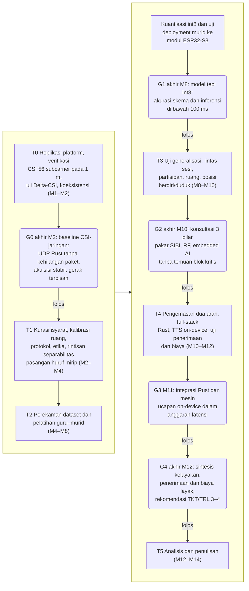
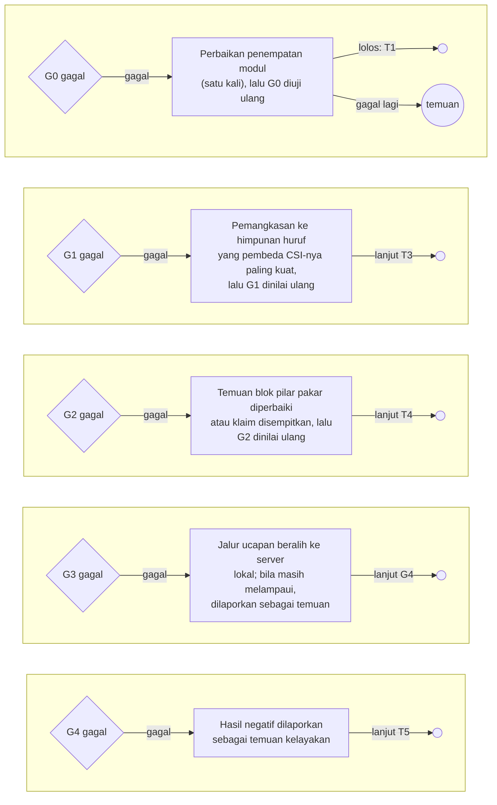
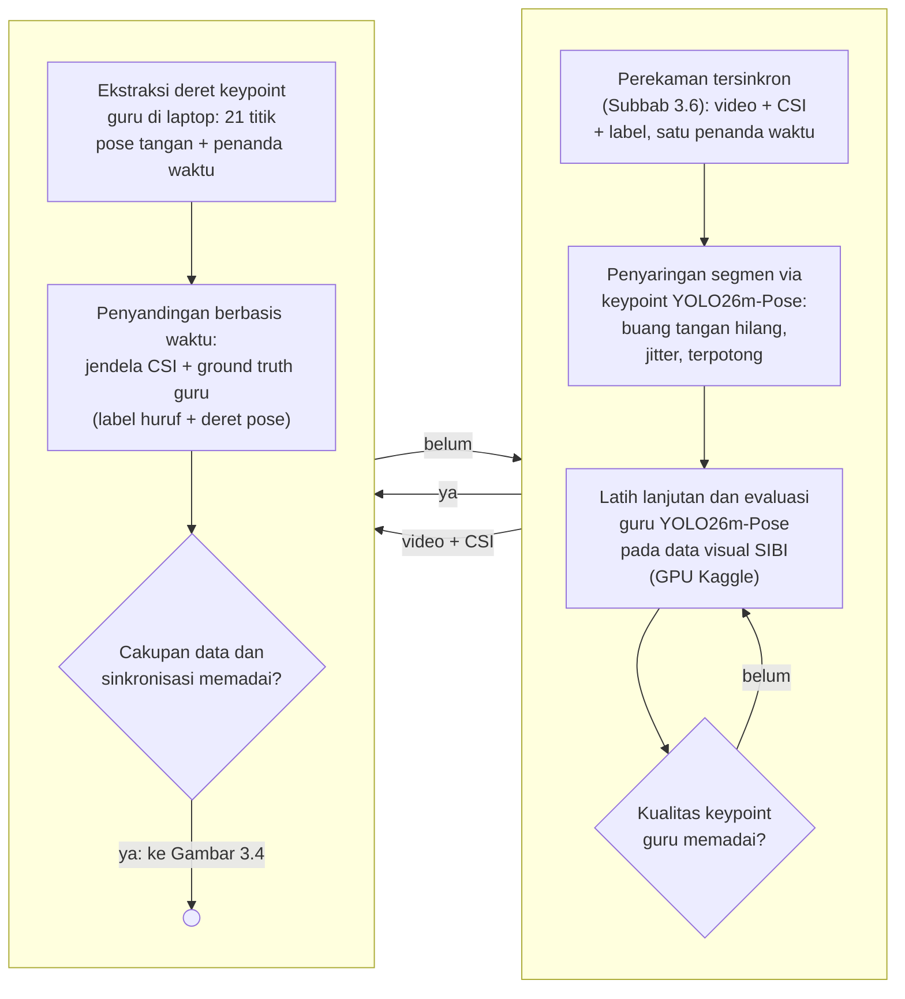
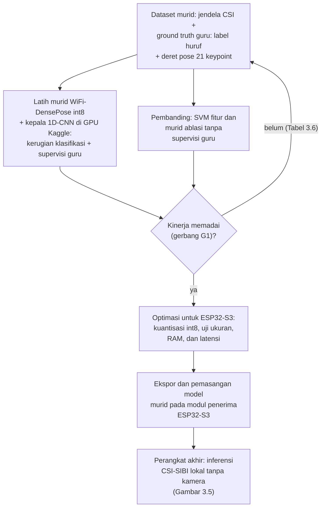
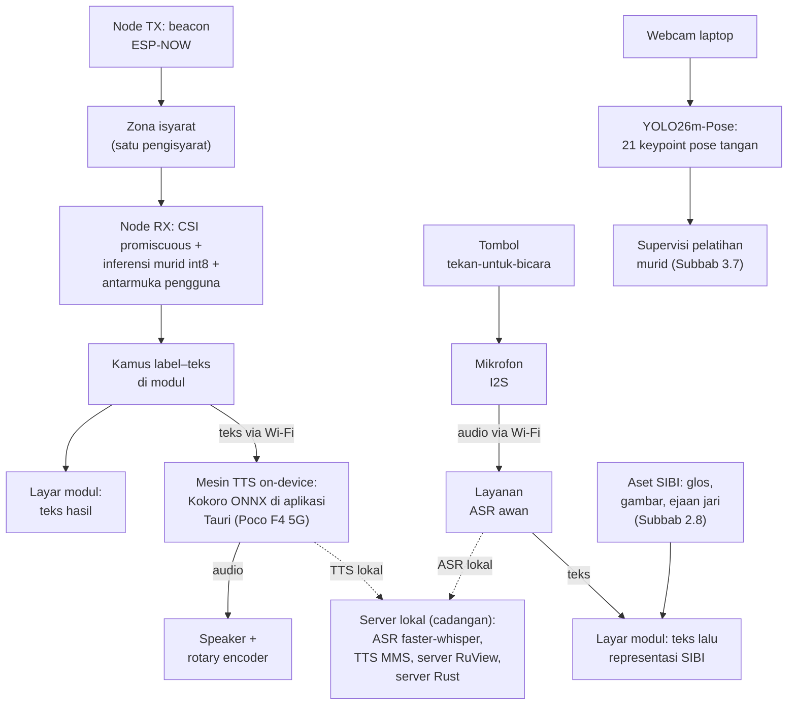
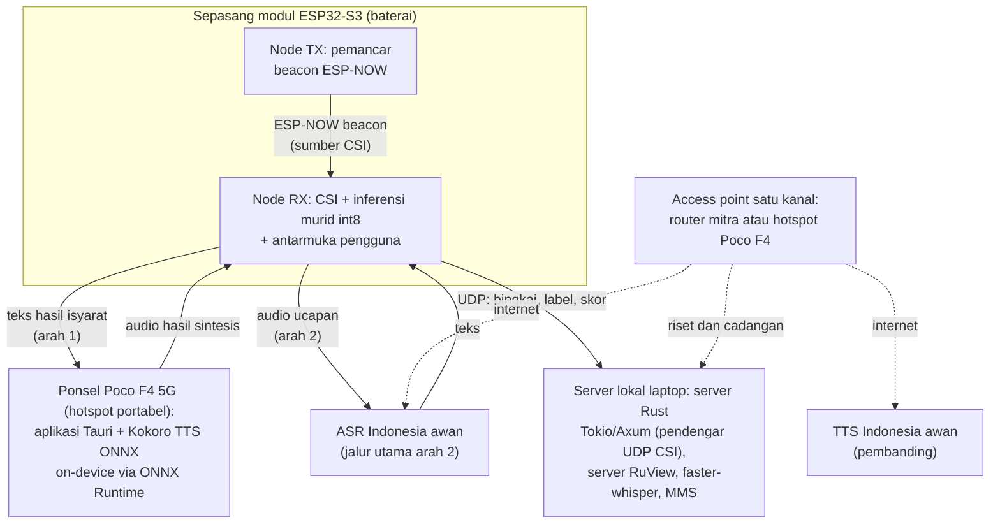
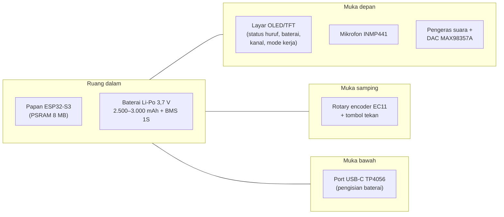
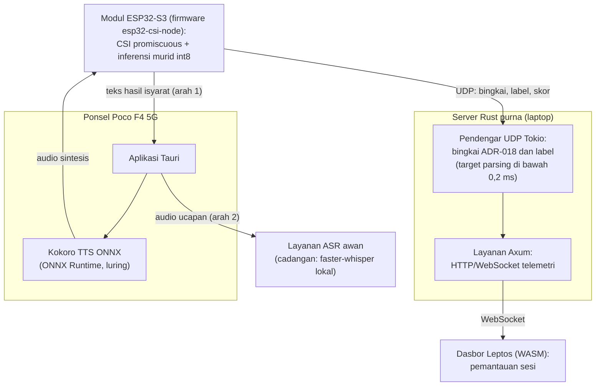
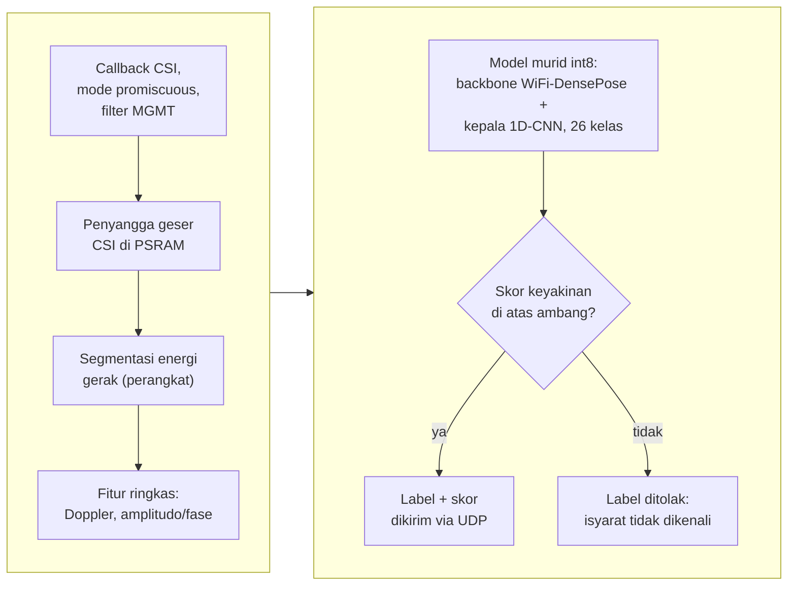
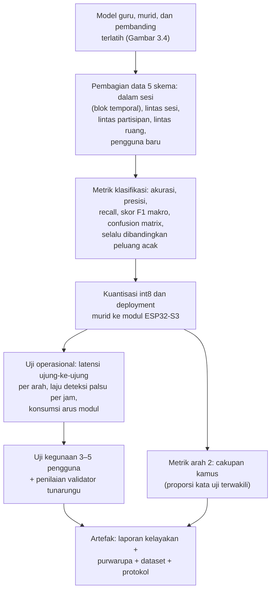

# BAB III METODE PENELITIAN

## 3.1 Desain Penelitian

Penelitian ini dirancang sebagai studi kelayakan kuantitatif bergerbang yang menghasilkan purwarupa penerjemah dua arah. Bagian kuantitatif mengukur sejauh mana Wi-Fi CSI dari tautan antarmodul ESP32-S3 dapat membedakan 26 huruf alfabet manual SIBI, yaitu 24 huruf statis serta huruf gerak J dan Z. Bagian itu juga mengukur sejauh mana model terkuantisasi berjalan pada perangkat. Selain itu, diukur sejauh mana jalur isyarat menjadi teks dan suara serta jalur teks atau ucapan menjadi representasi SIBI bekerja pada skenario yang ditetapkan. Setelah komponen diuji, purwarupa dikemas lalu dikaji kelayakannya sebagai alat bantu komunikasi kosakata terbatas melalui uji operasional, uji kegunaan skala kecil, dan penilaian validator penutur tunarungu. Struktur bergerbang dipilih karena kemampuan CSI membedakan isyarat SIBI belum dapat dipastikan sebelum data dikumpulkan; setiap tahap menghasilkan artefak tetap, kegagalan gerbang dicatat sebagai temuan, dan kriteria akurasi dirumuskan relatif terhadap peluang acak (Subbab 2.10). Inti metodologi pelatihannya berbentuk distilasi guru–murid. Model guru kamera YOLO26m-Pose mengekstrak deret 21 *keypoint* pose tangan dan label huruf dari video perekaman tersinkron; keluaran tersebut menjadi *ground truth* dan supervisi pelatihan bagi model murid ber-*backbone* WiFi-DensePose int8 dengan kepala 1D-CNN yang mengenali huruf dari jendela CSI dan berjalan langsung pada modul (Subbab 3.7).

Rumusan masalah pertama dijawab pada tahap replikasi platform, perancangan arsitektur, kurasi isyarat dan protokol, serta penerapan distilasi guru–murid. Rumusan masalah kedua dijawab melalui uji klasifikasi, uji *deployment*, dan uji jalur bahasa pada tahap perekaman dan generalisasi. Rumusan masalah ketiga ditinjau melalui uji operasional, uji kegunaan, dan penilaian validator pada tahap pengemasan purwarupa.

## 3.2 Tahapan Penelitian

Penelitian berlangsung selama empat belas minggu (M1–M14) dalam enam tahap. Tahapan dimulai dari replikasi platform dan uji karakterisasi meja kerja (T0), kemudian kurasi isyarat dan protokol (T1), perekaman *dataset* serta pelatihan guru–murid (T2), uji generalisasi (T3), pengemasan purwarupa dua arah dan uji penerimaan pengguna (T4), hingga analisis dan penulisan (T5). Lima gerbang keputusan menutup rangkaian tersebut. G0 (baseline CSI dan jaringan) memverifikasi akuisisi CSI 56 *subcarrier* pada jarak 1 meter yang diterima pendengar UDP server Rust tanpa kehilangan paket pada uji baku. G1 (model tepi int8 dan distilasi guru–murid) menilai hasil distilasi, yaitu akurasi klasifikasi 24 huruf statis serta J dan Z pada skema pembagian data beserta waktu inferensi int8 pada modul. G2 (konsultasi tiga pilar pakar) menelaah usabilitas, keandalan sinyal, dan kelayakan *embedded AI* bersama pakar SIBI dan aksesibilitas tunarungu, pakar RF dan *wireless sensing*, serta pakar *embedded AI*. G3 (integrasi full-stack Rust dan mesin ucapan) mengukur latensi terjemahan isyarat-ke-suara dan suara-ke-visual melalui dasbor Leptos, aplikasi Tauri, dan Kokoro TTS ONNX *on-device*. G4 (sintesis kelayakan) menilai penerimaan pengguna akhir dan biaya purwarupa lalu menyusun rekomendasi posisi purwarupa pada skala TKT/TRL 3–4 [91]. Jalur lolos dirangkum pada Gambar 3.1, sedangkan jalur gagal, tindakan korektif, dan uji ulang tiap gerbang dirinci pada Gambar 3.2. Bila G0 gagal untuk kedua kalinya setelah perbaikan, jalur CSI dihentikan dan dilaporkan sebagai temuan karakterisasi, lalu penelitian berlanjut ke T5; tindakan bila gerbang lain gagal mengikuti Tabel 3.6. Kriteria lolos dan tindakan bila gagal direncanakan difinalkan bersama pembimbing sebelum gerbang terkait dinilai; parameter yang menyertainya dihimpun pada Tabel 3.8.

Gambar 3.1 Tahapan penelitian T0–T5 dan gerbang keputusan G0–G4 (jalur lolos; jalur gagal dirinci pada Gambar 3.2)

Gambar 3.2 Jalur gagal dan remediasi gerbang keputusan G0–G4. Lingkaran kosong = lanjut ke tahap yang tertera pada label sisi; lingkaran "temuan" = penelitian berlanjut dengan hasil dilaporkan sebagai temuan. Kriteria lengkap tiap gerbang diuraikan pada Subbab 3.2.1–3.2.6 dan parameter yang menyertai pada Tabel 3.6.

### 3.2.1 Tahap T0: Replikasi Platform dan Uji Karakterisasi (M1–M2)

Dua modul ESP32-S3 disiapkan dengan *firmware* `esp32-csi-node` dari RuView [32]; node pemancar TX memancarkan paket *beacon* ESP-NOW, sedangkan node penerima RX mengekstrak CSI dari paket tersebut melalui mode *promiscuous* dan mengemasnya dalam bingkai UDP format ADR-018. Empat uji dilakukan pada tahap ini tanpa partisipan. Pertama, uji meja kerja dan garis pandang langsung (*benchtop and line-of-sight*) memverifikasi bahwa seluruh 56 *subcarrier*, yaitu 52 data dan 4 pilot, terbaca stabil pada konfigurasi baku jarak 1 meter antarmodul. Kedua, uji Delta-CSI (Subbab 3.8.1) dilakukan untuk mengetahui apakah pola CSI saat bergerak terpisah dari kondisi diam dan ruang kosong. Ketiga, uji koeksistensi radio dilakukan dengan menjalankan penangkapan CSI, koneksi *station* ke *access point*, dan pengiriman UDP secara serentak pada modul penerima, termasuk ketika *streaming* audio dari mikrofon diaktifkan, lalu laju CSI aktual dan kehilangan paket diukur. Keempat, laju pencuplikan aktual diukur sebagai dasar penetapan pita Doppler (Subbab 3.7.1). Seluruh pengukuran kehilangan paket dan lalu lintas bingkai pada tahap ini memakai pendengar UDP server Rust purna (Tokio) sehingga target lalu lintas jaringan purwarupa ikut terverifikasi sejak G0. Keluaran tahap ini adalah laporan karakterisasi sinyal sebagai bahan G0.

### 3.2.2 Tahap T1: Kurasi Isyarat, Kalibrasi Ruang, dan Protokol (M2–M4)

T1 mencakup kurasi 26 huruf alfabet manual SIBI bersama validator penutur tunarungu, kalibrasi ruang mitra, penyusunan protokol perekaman dan etika, serta perizinan (Subbab 3.6). Kurasi juga menetapkan himpunan tampilan arah kedua, yaitu 26 huruf dan 9 angka ditambah kata terpilih dari kamus (Subbab 2.8), serta pasangan huruf dengan konfigurasi tangan yang paling mirip sebagai bahan G1. Rintisan separabilitas 2–3 pasang huruf tersebut dijalankan dengan uji *nearest-centroid* sederhana yang rata-ratanya dihitung tanpa repetisi yang sedang diuji; hasilnya bukan gerbang, melainkan bahan penyetelan protokol, yaitu penambahan repetisi bagi pasangan yang rawan tertukar dan rencana pemangkasan bila G1 nantinya gagal (Tabel 3.8).

### 3.2.3 Tahap T2: Perekaman Dataset, Pelatihan Guru–Murid, dan Uji Deployment (M4–M8)

*Dataset* direkam dengan kurang lebih 30 repetisi per isyarat per sesi disertai video tersinkron melalui adaptasi skrip `scripts/collect-ground-truth.py` (ADR-079) dari RuView (Subbab 3.6). Alur pelatihan pada tahap ini berbentuk distilasi guru–murid: tahap perekaman, penyaringan segmen, pelatihan guru, dan penyandingan data ditunjukkan pada Gambar 3.3, sedangkan pelatihan murid, pembanding, dan *deployment* ditunjukkan pada Gambar 3.4. Model guru YOLO26m-Pose menjalani pelatihan lanjutan pada data visual SIBI di layanan server GPU Kaggle memakai pipeline pelatihan YOLO26 yang telah terimplementasi pada repositori milik peneliti (Subbab 3.7.4), lalu kualitas *keypoint*-nya dievaluasi sebelum dipakai. Jendela CSI dan *ground truth* guru berupa label huruf serta deret pose 21 *keypoint* diselaraskan berdasarkan penanda waktu untuk membentuk *dataset* murid; kemudian murid ber-*backbone* WiFi-DensePose int8 dengan kepala 1D-CNN dilatih dengan supervisi label dan replikasi deret pose guru (Subbab 3.7.5). Dua pembanding dilatih pada data yang sama, yaitu SVM dan murid ablasi tanpa supervisi guru. Setelah pelatihan, model terpilih dikuantisasi int8, di-*deploy* ke modul penerima, lalu waktu inferensi dan pemakaian memorinya diukur pada laju bingkai aktual. Keluaran T2 adalah *dataset* murid berlabel, model guru dan murid terlatih, serta laporan *deployment*; G1 menilai hasil distilasi, yaitu akurasi klasifikasi 24 huruf statis serta J dan Z pada skema dalam sesi yang direkam di ruang kelas mitra beserta akurasi skema lintas domain pada data yang sama dan waktu inferensi int8 pada modul, dan bila G1 gagal, cakupan dipangkas menjadi himpunan huruf yang pembeda CSI-nya paling kuat (Tabel 3.8).

Gambar 3.3 Distilasi guru–murid tahap data: perekaman tersinkron, penyaringan segmen, model guru, dan penyandingan berbasis waktu

Gambar 3.4 Distilasi guru–murid tahap pelatihan: dataset murid ber-supervisi guru, pembanding, gerbang kinerja, dan deployment

### 3.2.4 Tahap T3: Uji Generalisasi (M8–M10)

Model mudah mengalami *overfitting* pada orang dan ruang tempat data latih direkam [52] sehingga model diuji lintas sesi, lintas partisipan, lintas ruang, pada variasi posisi berdiri dan duduk, serta pada satu pengguna baru tanpa pelatihan ulang (Subbab 3.7.6). Strategi lintas domain Widar3.0 [53] dijadikan acuan tanpa mengasumsikan hasil yang sama pada isyarat SIBI. Hasil uji generalisasi tersebut menjadi bahan konsultasi tiga pilar pakar pada G2; bila ketahanan lintas pengguna terbukti rendah, cakupan menjadi personalisasi per pengguna yang memerlukan data latih singkat dari setiap pengguna, dan perubahan itu dilaporkan sebagai temuan.

### 3.2.5 Tahap T4: Pengemasan Purwarupa Dua Arah dan Uji Kegunaan (M10–M12)

Model murid yang telah berjalan di modul dikemas menjadi purwarupa dua arah (Subbab 3.5) dengan mengaktifkan tumpukan perangkat lunak purna Rust, yaitu server Tokio/Axum, dasbor Leptos, dan aplikasi Tauri pada ponsel, serta mesin ucapan pada kedua arah. Pengemasan memanfaatkan antarmuka pada modul penerima, yaitu tombol tekan-untuk-bicara, rotary encoder volume, layar, dan *speaker*, serta menambahkan pemetaan teks ke representasi SIBI dan inferensi Kokoro TTS ONNX *on-device* (Subbab 3.5.6 dan 3.5.7). Selanjutnya dilakukan uji operasional, uji jalur ucapan, dan uji cakupan kamus (Subbab 3.8); G3 menilai latensi terjemahan isyarat-ke-suara dan suara-ke-visual pada jalur utama *on-device* maupun jalur cadangan awan dan server lokal. Tahap ini ditutup uji penerimaan pengguna akhir dari kelompok sasaran, yaitu guru, siswa tunarungu, dan wali murid, penilaian validator, serta analisis biaya purwarupa; G4 menilai penerimaan tersebut, persetujuan validator atas kewajaran keluaran, hasil analisis biaya, lalu menyintesis rekomendasi kelayakan beserta posisi purwarupa pada skala TKT/TRL 3–4.

### 3.2.6 Tahap T5: Analisis dan Penulisan (M12–M14)

Seluruh artefak dianalisis dan disusun menjadi laporan kelayakan beserta rekomendasi berdasarkan gerbang yang lolos dan yang gagal. Laporan memuat keterbatasan secara eksplisit, yaitu klaim pengenalan terikat pada alfabet manual 26 huruf, ekspresi wajah dan penanda nonmanual tidak dikenali, arah kedua berbentuk kamus kata-level dan ejaan jari, serta keluaran berupa huruf atau kata, bukan kalimat isyarat (Subbab 1.4). Rekomendasi menyatakan posisi purwarupa pada skala kesiapterapan teknologi (TKT/TRL) sesuai kerangka *technology readiness level* [91], dengan sasaran TKT/TRL 3–4 bagi purwarupa yang melewati seluruh gerbang.

## 3.3 Waktu dan Lokasi Penelitian

Penelitian dilaksanakan pada [PERLU DATA: bulan dan tahun pelaksanaan penelitian] di [PERLU DATA: nama sekolah/lembaga mitra]. Perekaman dan pengujian dilakukan di sedikitnya dua ruang, yaitu jumlah minimum bagi skema *leave-one-room-out*, dan setiap ruang dikalibrasi sebelum perekaman (Subbab 3.5.4). Penyiapan sistem secara mandiri oleh pengguna di luar lembaga mitra berada di luar cakupan penelitian.

## 3.4 Alat dan Bahan

Perangkat keras penelitian disajikan pada Tabel 3.1. Sepasang modul ESP32-S3 menjadi node penginderaan: node pemancar (TX) memancarkan paket *beacon* ESP-NOW dan node penerima (RX) mengekstrak CSI 56 *subcarrier* pada pita 2,4 GHz (IEEE 802.11b/g/n) dengan kanal 20 MHz dan antena tunggal 1T1R; node penerima sekaligus memuat antarmuka pengguna. Sebelas baris pertama tabel merupakan komponen BoM purwarupa yang diuraikan pada Subbab 2.13, sedangkan dua baris terakhir merupakan perangkat pendukung riset.

Tabel 3.1 Perangkat keras penelitian

| No. | Nama | Spesifikasi | Jumlah | Keterangan |
|---|---|---|---|---|
| 1 | Modul ESP32-S3 | Papan pengembangan ESP32-S3 dengan PSRAM, varian yang direkomendasikan RuView [32]; 2,4 GHz 802.11b/g/n, kanal 20 MHz (56 *subcarrier*: 52 data + 4 pilot), 1T1R | 2 unit | Node TX (pemancar *beacon* ESP-NOW) dan node RX (penerima CSI dan antarmuka pengguna) |
| 2 | Layar modul | OLED 0,96 inci I2C (128×64) atau TFT 1,3 inci SPI (240×240) [PERLU DATA: model final] | 1 unit | Tampilan huruf terdeteksi, baterai, kanal, dan mode kerja TX/RX |
| 3 | *Rotary encoder* EC11 | Putar 360 derajat, 20 detak per putaran, dengan tombol tekan terintegrasi | 1 unit | Navigasi menu, penyesuaian sensitivitas, pemindahan kanal |
| 4 | Tombol tekan | Sakelar sesaat (*tactile switch*) dengan *pull-up* internal | 1–2 unit | Tombol tekan-untuk-bicara, kalibrasi ulang acuan CSI, reset sistem |
| 5 | Pengeras suara dengan DAC I2S | Pengeras suara mini 8 Ohm 3 W dengan penguat kelas D MAX98357A | 1 set | Pemutaran suara TTS langsung dari modul |
| 6 | Mikrofon I2S | INMP441, MEMS omnidireksional, SNR 61 dBA [94] | 1 unit | Pintu suara arah kedua |
| 7 | Baterai Li-Po | 3,7 V, 2.500–3.000 mAh [PERLU DATA: kapasitas final berdasarkan hasil uji arus] | 1–2 set | Daya portabel sepasang modul |
| 8 | BMS 1S | Papan proteksi lithium (pengisian lebih, pengosongan lebih, arus lebih, hubung singkat) | 1–2 set | Keamanan operasional baterai |
| 9 | Modul pengisi TP4056 | Pengisi lithium 1 A dengan port USB-C dan LED indikator | 1–2 set | Pengisian baterai memakai pengisi ponsel standar |
| 10 | Laptop | ASUS TUF Dash F15 FX516PR: Intel Core i7-11370H, RTX 3070 Laptop 8 GB VRAM, RAM 16 GB | 1 unit | Mesin akuisisi jalur guru, pengembangan, pelatih model, dan server lokal cadangan |
| 11 | Ponsel pintar | Poco F4 5G: Snapdragon 870, RAM 6 GB, Android | 1 unit | Gerbang *hotspot* portabel, aplikasi klien Tauri, mesin TTS *on-device* Kokoro ONNX |
| 12 | *Access point* | *Router* Wi-Fi 2,4 GHz dengan akses internet [PERLU DATA: pilihan final] | 1 unit | Jembatan jaringan dan penjangkar kanal bagi server dan layanan ucapan, bukan perangkat penginderaan; peran ini dapat digantikan *hotspot* Poco F4; seluruh modul berada pada satu kanal |
| 13 | *Webcam* | Bawaan laptop | 1 unit | Hanya menyala pada jalur guru saat akuisisi dan pelatihan |

Perangkat lunak penelitian disajikan pada Tabel 3.2. Versi setiap perangkat lunak dicatat bersama log konfigurasi pelatihan agar eksperimen dapat diulang.

Tabel 3.2 Perangkat lunak penelitian

| No. | Nama | Fungsi dalam penelitian |
|---|---|---|
| 1 | *Firmware* dan *server* RuView | Menangkap CSI pada modul, mengirimkannya melalui UDP, mengalibrasi ruang, dan menyegmentasi deret saat riset |
| 2 | `scripts/collect-ground-truth.py` (ADR-079, diadaptasi) | Menyinkronkan akuisisi kamera dan CSI; estimator pose asli diganti YOLO26m-Pose |
| 3 | Model guru pose tangan YOLO26m-Pose | Mengekstrak deret 21 *keypoint* pose tangan pada jalur guru; hasilnya menjadi supervisi tambahan pelatihan murid dan dasar penyaringan segmen |
| 4 | Layanan server GPU Kaggle | Melatih model guru YOLO26m-Pose dan murid CSI ber-*backbone* WiFi-DensePose |
| 5 | Repositori pipeline pelatihan YOLO26 (WPC) milik peneliti | Menyediakan skrip konversi dataset bergate kualitas, pelatihan deterministik pada GPU Kaggle, pencatatan eksperimen otomatis, verifikasi artefak, dan bobot terlatih; diadaptasi untuk pelatihan guru (Subbab 3.7.4) |
| 6 | Model WiFi-DensePose terpralatih (ruvnet/wifi-densepose-pretrained dan ruvnet/wifi-densepose-mmfi-pose) [32] | Inisialisasi *backbone* murid CSI dan preseden pemetaan CSI ke *keypoint* |
| 7 | Python, scikit-learn, PyTorch | Ekstraksi fitur, pelatihan SVM dan murid ber-*backbone* WiFi-DensePose, serta evaluasi |
| 8 | ESP-DL dengan akselerasi ESP-NN (alternatif: TensorFlow Lite Micro) | Menjalankan murid int8 pada node RX |
| 9 | faster-whisper | ASR Bahasa Indonesia cadangan pada server lokal dan pembanding jalur awan |
| 10 | MMS-TTS-ind | TTS Bahasa Indonesia cadangan pada server lokal, alternatif mesin *on-device* melalui ekspor ONNX, dan pembanding jalur awan |
| 11 | Layanan TTS awan | Pembanding mutu dan jalur cadangan sintesis pada arah pertama [PERLU DATA: layanan final hasil uji banding] |
| 12 | Layanan ASR awan | Jalur utama pengenalan ucapan pada arah kedua [PERLU DATA: layanan final hasil uji banding] |
| 13 | Rust, Tokio, dan Axum | Server purwarupa purna Rust: pendengar UDP bingkai CSI dan layanan HTTP/WebSocket telemetri [36], [37] |
| 14 | Leptos | Dasbor web riset purwarupa yang dikompilasi ke WASM [38] |
| 15 | Tauri | Kerangka aplikasi klien pada ponsel Poco F4 5G [39] |
| 16 | Kokoro TTS ONNX dan ONNX Runtime | Mesin TTS *on-device* pada ponsel; prasyarat suara Indonesia diverifikasi pada G3 [41], [40] |
| 17 | Kamus label-teks dan teks-isyarat | Dikembangkan sendiri sebagai bagian purwarupa; salinan kamus label-teks dimuat pada modul |

Bahan penelitian meliputi *dataset* CSI beserta deret pose guru hasil perekaman sendiri, kode dan data pelatihan model guru YOLO26 dari repositori milik peneliti yang telah diverifikasi kelengkapannya (Tabel 3.2), lembar definisi huruf, aset tampilan arah kedua (gambar huruf, angka, dan kata terpilih), formulir persetujuan partisipan, instrumen uji, serta kuesioner persepsi. *Dataset* direkam sendiri karena penelitian yang mengenali isyarat SIBI dari CSI belum ditemukan dalam penelusuran literatur (Subbab 2.11).

## 3.5 Perancangan Sistem

Komponen penyusun purwarupa SenseSIBI beserta spesifikasi dan fungsinya dirangkum pada Tabel 3.3, kemudian tiap subsistem diuraikan pada Subbab 3.5.1 sampai 3.5.4.

Tabel 3.3 Matriks komponen arsitektur purwarupa

| Komponen | Spesifikasi dan implementasi teknis | Fungsi utama |
|---|---|---|
| Node penginderaan TX/RX | Sepasang modul ESP32-S3, pita 2,4 GHz (IEEE 802.11b/g/n), kanal 20 MHz (56 *subcarrier*: 52 data + 4 pilot), antena tunggal 1T1R | Memancarkan *beacon* ESP-NOW dan mengekstrak CSI 56 *subcarrier* |
| Firmware modul | *Firmware* `esp32-csi-node` (RuView) dengan bingkai UDP format ADR-018 [32] | Akuisisi CSI mode *promiscuous* dan pengemasan paket UDP |
| Pembersih derau sinyal | Algoritma CSI-ratio terhadap rekam acuan kalibrasi (Subbab 2.3) | Mengeliminasi derau fase osilator lokal dan offset fase acak tanpa perangkat tambahan |
| Jembatan jaringan / AP | *Router* Wi-Fi, *hotspot* laptop, atau *hotspot* Poco F4 5G dengan penjangkar kanal sama | Jembatan komunikasi data; bukan perangkat penginderaan |
| Model guru (pelatihan) | YOLO26m-Pose 21 *keypoint* pose tangan pada server GPU | Menuntun pelatihan model Wi-Fi melalui akuisisi tersinkron ADR-079 |
| *Backbone* model tepi | WiFi-DensePose int8 (ruvnet/wifi-densepose-pretrained) dengan akselerasi ESP-NN/ESP-DL [32] | Ekstraksi fitur spasial sinyal CSI |
| Kepala klasifikasi tepi | 1D-CNN terkuantisasi int8 pada modul ESP32-S3 | Inferensi 24 huruf statis serta gestur dinamis J dan Z tanpa kamera |
| Server purwarupa purna Rust | Tokio (pendengar UDP bingkai CSI) dan Axum (HTTP/WebSocket) dengan dasbor Leptos WASM [36], [37], [38] | Menerima bingkai CSI dan telemetri, mengatur alir dua arah, memantau sesi |
| Mesin TTS *on-device* | Kokoro TTS ONNX melalui ONNX Runtime pada aplikasi Tauri di ponsel Poco F4 5G; prasyarat suara Indonesia diverifikasi pada G3 [39], [40], [41] | Sintesis suara arah pertama secara luring dengan target inferensi di bawah 100 ms |
| Mesin ASR dan TTS cadangan | Layanan ASR awan; faster-whisper dan MMS-TTS-ind pada server lokal | Jalur utama pengenalan ucapan arah kedua, pembanding, dan cadangan sintesis |

### 3.5.1 Arsitektur Dua Arah

Sistem dirancang dalam dua jalur operasional tanpa kamera dan satu jalur guru yang hanya aktif saat akuisisi data dan pelatihan, seperti ditunjukkan pada Gambar 3.5. Pada jalur arah pertama, node pemancar memancarkan paket *beacon* ESP-NOW; gerak pengisyarat mengubah deret CSI yang ditangkap node penerima melalui mode *promiscuous*; model murid int8 berjalan pada modul dan menghasilkan label beserta skor keyakinan; label dipetakan menjadi teks Indonesia melalui kamus label-teks kecil pada modul. Teks tampil di layar node penerima, lalu dikirim melalui jaringan ke aplikasi Tauri pada ponsel yang menginferensikan Kokoro TTS ONNX secara luring; audio hasil sintesis diputar pada pengeras suara modul dengan volume yang diatur rotary encoder atau pada pengeras suara ponsel. Pada jalur arah kedua, tombol tekan-untuk-bicara pada node penerima mengaktifkan mikrofon; ucapan dikirim ke layanan ASR; teks hasil pengenalan tampil di layar, lalu dipetakan ke representasi SIBI dari aset yang tersimpan pada modul (Subbab 2.8). Saat koneksi internet tidak tersedia, jalur sintesis tetap berjalan *on-device*, sedangkan jalur ASR beralih ke server lokal laptop yang menjalankan faster-whisper; MMS-TTS-ind pada server lokal menjadi cadangan sintesis bila mesin *on-device* belum tersedia suara Indonesinya. Jalur guru memakai *webcam* dan YOLO26m-Pose untuk mengekstrak deret *keypoint* yang menjadi supervisi tambahan pelatihan murid serta dasar penyaringan segmen; jalur ini bukan bagian produk akhir.

Gambar 3.5 Arsitektur produk akhir tanpa kamera. Rantai kiri = arah 1 (isyarat menjadi teks dan suara); rantai tengah = arah 2 (ucapan menjadi representasi SIBI); rantai kanan = jalur guru yang hanya aktif saat akuisisi data dan pelatihan; garis putus-putus = beralih ke server lokal ketika internet tidak tersedia.

### 3.5.2 Topologi Modul dan Jaringan

Topologi jaringan purwarupa ditunjukkan pada Gambar 3.6. Seluruh perangkat, yaitu sepasang modul, server lokal laptop, dan ponsel Poco F4 5G, terhubung ke satu *access point* pada kanal yang sama sehingga penangkapan CSI dan komunikasi data berjalan serentak (Subbab 2.4). Peran *access point* dapat dipegang *router* mitra atau fitur *hotspot* ponsel Poco F4 5G. *Access point* tersebut berperan murni sebagai jembatan jaringan dan penjangkar kanal, bukan sebagai perangkat penginderaan. Node pemancar memancarkan *beacon* ESP-NOW sebagai sumber bingkai CSI bagi node penerima, node penerima mengirim bingkai, label, dan skor melalui UDP kepada server Rust sebagai telemetri riset, serta meneruskan teks hasil isyarat ke aplikasi Tauri pada ponsel dan audio singkat ucapan ke layanan ASR. Server lokal menjalankan server RuView untuk keperluan riset, server Rust purwarupa, serta faster-whisper dan MMS-TTS-ind sebagai jalur ucapan cadangan; kamus label-teks dimuat sebagai salinan kecil pada modul. Laptop dapat berperan sebagai *access point* melalui *hotspot* ketika purwarupa berjalan penuh pada mode cadangan lokal tanpa layanan awan.

Gambar 3.6 Topologi perangkat: sepasang modul, ponsel sebagai gerbang *hotspot* sekaligus mesin TTS *on-device*, server Rust pada laptop, layanan ASR awan, dan jalur cadangan server lokal

### 3.5.3 Penempatan Modul dan Zona Isyarat

Modul pemancar dan modul penerima dipasang pada dudukan setinggi dada pengisyarat dan mengapit zona isyarat agar tangan dan lengan pengisyarat berada di antara keduanya; kesesuaiannya diperiksa melalui uji Delta-CSI. Zona isyarat hanya ditempati satu pengisyarat dalam setiap sesi dan sistem tidak mengidentifikasi individu. Jarak antarmodul, dengan konfigurasi baku 1 meter pada tahap karakterisasi, ukuran zona, dan penempatan antarmuka pengguna ditetapkan pada T0 dan dicatat dalam metadata sesi (Tabel 3.8).

### 3.5.4 Kalibrasi Ruang

Setiap sesi diawali kalibrasi ruang bawaan RuView selama kurang lebih empat menit dengan 600 bingkai dan 8 *anchor* karena CSI peka terhadap perubahan kondisi ruang [32], [52]. Posisi perabot, kipas angin atau pendingin ruangan yang menyala, dan orang yang lewat dicatat sebagai kovariat untuk menganalisis perbedaan kinerja antarsesi dan antarruang.

### 3.5.5 Tata Letak Fisik, Enclosure, dan Wiring Pinout GPIO

Node penerima dikemas dalam *enclosure* cetak tiga dimensi bahan PLA atau ABS yang menampung papan ESP32-S3, baterai Li-Po, modul BMS, dan modul pengisi TP4056 sekaligus seluruh antarmuka pengguna pada Subbab 2.13. Layar dipasang pada muka depan, *rotary encoder* dan tombol tekan pada muka samping, port USB-C modul TP4056 pada muka bawah, sedangkan pengeras suara dan mikrofon INMP441 ditempatkan pada muka depan atau atas agar arah audio tidak terhalang. Node pemancar dikemas dengan *enclosure* serupa tanpa antarmuka pengguna. Tata letak *enclosure* node penerima ditunjukkan pada Gambar 3.7 dan pemetaan pin GPIO-nya dirangkum pada Tabel 3.4. [PERLU DATA: berkas model enclosure tiga dimensi final]

Tabel 3.4 Matriks pinout wiring GPIO node penerima

| No. | Subsistem | Pin modul | GPIO ESP32-S3 | Fungsi |
|---|---|---|---|---|
| 1 | Layar I2C (OLED) | SDA | GPIO 8 | Jalur data bus I2C |
| 2 | Layar I2C (OLED) | SCL | GPIO 9 | Jalur clock bus I2C |
| 3 | *Rotary encoder* EC11 | CLK (A) | GPIO 10 | Detak putaran |
| 4 | *Rotary encoder* EC11 | DT (B) | GPIO 11 | Arah putaran |
| 5 | *Rotary encoder* EC11 | SW | GPIO 12 | Tombol tekan *encoder* |
| 6 | Tombol tekan | OUT | GPIO 13 | Tekan-untuk-bicara dan reset; *pull-up* internal |
| 7 | Mikrofon INMP441 | SCK | GPIO 14 | Clock I2S penerima |
| 8 | Mikrofon INMP441 | WS | GPIO 15 | *Word select* I2S penerima |
| 9 | Mikrofon INMP441 | SD | GPIO 16 | Data I2S penerima |
| 10 | DAC MAX98357A | BCLK | GPIO 17 | Clock I2S pengirim |
| 11 | DAC MAX98357A | LRC | GPIO 18 | Penanda kiri-kanan I2S pengirim |
| 12 | DAC MAX98357A | DIN | GPIO 21 | Data I2S pengirim |
| 13 | Pemantau tegangan baterai | ADC | GPIO 1 (ADC1_CH0) | Keluaran pembagi tegangan baterai |

Pin pada Tabel 3.4 dipilih agar jalur I2S, I2C, dan masukan digital tidak menabrak pin *strapping* (GPIO 0, 3, 45, dan 46) maupun kanal USB bawaan papan [33]. Penetapan pin diverifikasi ulang pada T0 karena sebagian papan pengembangan menetapkan pin I2C bawaan yang berbeda; bila berbeda, matriks ini diperbarui dan perubahannya dicatat pada metadata sesi (Tabel 3.8). Rantai daya node penerima terdiri atas baterai Li-Po, modul BMS 1S, modul pengisi TP4056, dan regulator 3,3 volt papan; tegangan baterai diukur melalui pembagi tegangan pada pin ADC sehingga persentase baterai dapat ditampilkan di layar dan dicatat sebagai kovariat uji operasional.

Gambar 3.7 Tata letak *enclosure* node penerima cetak tiga dimensi: layar dan audio pada muka depan, masukan taktil pada samping, port pengisian pada bawah, dan ruang dalam menampung papan serta rantai daya

### 3.5.6 Perancangan Perangkat Lunak Full-Stack Rust

Perangkat lunak purwarupa ditulis purna Rust (Subbab 2.9). Pada sisi server, *runtime* asinkron Tokio menjalankan pendengar UDP yang menerima bingkai CSI format ADR-018 dan telemetri label dari modul [36], sedangkan kerangka Axum menyediakan layanan HTTP dan WebSocket bagi dasbor [37]. Dasbor riset ditulis Leptos dan dikompilasi ke WASM sehingga seluruh logika tampilan memakai sistem tipe yang sama dengan server [38]. Pada sisi klien, aplikasi Tauri pada ponsel Poco F4 5G menerima teks hasil isyarat, menjalankan Kokoro TTS ONNX, dan mengirim audio ucapan pendengar ke layanan ASR [39]. Alur data perangkat lunak tersebut ditunjukkan pada Gambar 3.8. Target rancangan lalu lintas *parsing* satu bingkai UDP di bawah 0,2 ms dan pemakaian memori server di bawah 40 MB diukur pada G3 (Subbab 3.8.4).

Gambar 3.8 Alur perangkat lunak purna Rust: firmware modul, pendengar UDP Tokio, layanan Axum, dasbor Leptos, aplikasi Tauri, mesin TTS on-device, dan layanan ASR

### 3.5.7 Inferensi On-Device Kokoro TTS pada Poco F4 5G

Mesin sintesis ucapan dirancang berjalan sepenuhnya pada ponsel Poco F4 5G. Model Kokoro-82M berparameter sekitar 82 juta tersedia sebagai bobot terbuka [42] dan terekspor ke format ONNX dengan ukuran 100–300 MB dalam bentuk terkuantisasi [41]; ONNX Runtime menjalankan model tersebut secara *native* di dalam aplikasi Tauri [40]. Dengan jalur ini, sintesis tidak menyentuh jaringan sehingga latensi jaringan seluler tereliminasi, kuota data terhemat, dan privasi teks percakapan terjaga. Target rancangan waktu inferensi per frasa pendek adalah di bawah 100 ms pada prosesor Snapdragon 870; angka ini diukur pada G3.

Prasyarat satu-satunya bagi jalur ini adalah ketersediaan suara bahasa Indonesia pada Kokoro. *Model card* resmi pada audit Oktober 2026 mencantumkan delapan bahasa dan 54 suara tanpa bahasa Indonesia [42]; karena itu G3 memverifikasi tiga hal sekaligus, yaitu ketersediaan suara Indonesia (misalnya suara komunitas atau hasil penyetelan lanjutan), mutu hasil sintesis menurut penilaian validator, dan latensi terukur pada perangkat. Bila suara Indonesia belum tersedia, mesin *on-device* beralih ke ekspor ONNX dari MMS-TTS-ind [43], [44] dan peralihan itu dilaporkan sebagai temuan; layanan awan dan TTS MMS pada server lokal tetap menjadi pembanding mutu dan latensi (Subbab 2.7).

## 3.6 Protokol Perekaman Dataset, Partisipan, dan Etika

### 3.6.1 Partisipan

Partisipan terdiri atas 3–4 pengisyarat kompeten, sedikitnya satu validator penutur tunarungu, dan 3–5 pengguna uji. Pengisyarat kompeten adalah guru atau pembina SIBI yang memperagakan isyarat untuk *dataset*; validator memeriksa lembar definisi huruf, memeriksa sampel segmen, dan menilai kewajaran keluaran purwarupa; pengguna uji, yang direkrut dari kelompok sasaran yaitu guru, siswa tunarungu, dan wali murid, mencoba purwarupa dua arah pada uji kegunaan. Kriteria inklusi dan rekrutmen tercantum pada Tabel 3.8. Setiap pengisyarat direkam dalam sedikitnya dua sesi agar skema lintas sesi dapat dijalankan. Skema lintas ruang hanya memisahkan pengaruh ruang dari pengaruh orang bila pengisyarat yang sama direkam di setiap ruang.

### 3.6.2 Kurasi Isyarat dan Kosakata Tampilan

Alfabet manual yang menjadi objek pengenalan mencakup 26 huruf, yaitu 24 huruf statis serta huruf gerak J dan Z, dengan bentuk baku mengacu pada *Kamus SIBI* [58]. Lembar definisi setiap huruf memuat deskripsi konfigurasi tangan dan jari serta lintasan gerak untuk J dan Z, validator menyetujui lembar tersebut, dan pasangan huruf dengan konfigurasi tangan yang paling mirip ditetapkan sebagai bahan rintisan separabilitas dan pengujian G1. Kosakata tampilan arah kedua mencakup 26 huruf dan 9 angka ditambah kata terpilih sebagai landasan ejaan jari [13].

### 3.6.3 Prosedur Perekaman

Perekaman memakai *elisitasi* terisolasi, yaitu satu huruf per segmen dengan jeda antarrepetisi; huruf statis diperagakan sebagai pose yang ditahan sejenak, sedangkan J dan Z diperagakan sebagai lintasan gerak. Adapun prosedur perekaman setiap sesi adalah sebagai berikut.

1. Menyiapkan peralatan yang digunakan.
2. Memasang modul pemancar dan modul penerima, lalu menghubungkan seluruh perangkat ke *access point* pada satu kanal.
3. Menjalankan kalibrasi ruang dan mencatat metadata sesi, yaitu tanggal, ruang, kode pengisyarat, posisi modul, dan kondisi latar.
4. Menjalankan `scripts/collect-ground-truth.py` agar perekaman CSI dan *webcam* sinkron.
5. Menampilkan kartu pemandu huruf target, merekam satu repetisi, memberi jeda, dan mengulanginya hingga setiap huruf mencapai kurang lebih 30 repetisi.
6. Membuang segmen bila tangan tidak terdeteksi model guru, terjadi *jitter* *keypoint* ekstrem, atau segmen terpotong, lalu mencatat tingkat segmen terbuang per huruf dan per pengisyarat.
7. Meminta validator mengambil sampel segmen untuk memeriksa kebenaran bentuk isyarat yang diperagakan.

### 3.6.4 Etika Penelitian

Perekaman dimulai setelah persetujuan lembaga mitra dan persetujuan tertulis setiap partisipan diperoleh [PERLU DATA: lembaga atau komisi pemberi persetujuan etik]. Partisipan berhak mengundurkan diri kapan saja tanpa konsekuensi. Formulir persetujuan menyatakan bahwa kamera hanya menyala pada sesi akuisisi dan pelatihan jalur guru, bahwa produk akhir bebas kamera, dan bahwa mode privasi RuView aktif selama penelitian. Video hanya dipakai untuk verifikasi batas segmen, penyaringan kualitas, dan diagnosis; video disimpan secara terbatas dan tidak dipublikasikan. Audio ucapan pada arah kedua dikirim ke layanan awan; oleh karena itu, tujuan pengiriman tersebut diungkapkan pada formulir persetujuan dan kebijakan penyimpanan layanan final diperiksa sebelum layanan dipakai. *Dataset* publik hanya memuat CSI, label, dan *keypoint* tanpa identitas partisipan. Token apresiasi validator tercantum pada Tabel 3.8.

## 3.7 Pengolahan Sinyal, Ekstraksi Fitur, Pelatihan Guru–Murid, dan Deployment

### 3.7.1 Laju Pencuplikan

*Firmware* RuView membatasi pengiriman bingkai CSI paling sering setiap 20 ms sehingga laju maksimumnya 50 bingkai per detik [32]; laju aktual diukur pada T0. Pita Doppler 1–60 Hz hanya terwakili bila laju pencuplikan sedikitnya 120 Hz (Subbab 2.3). Bila laju terukur lebih rendah, pita yang dianalisis dibatasi hingga setengah laju aktual dan pembatasan itu dilaporkan.

### 3.7.2 Segmentasi

Deret CSI dipotong menjadi segmen huruf dengan segmentasi berbasis energi gerak RuView [32]; huruf gerak J dan Z terpotong jelas dari energi geraknya, sedangkan huruf statis memerlukan jendela tahan pose yang ambang dan panjangnya ditetapkan pada Tabel 3.8. Batas segmen diverifikasi dengan deret *keypoint* hanya selama perekaman *dataset*; pada purwarupa, segmentasi berjalan pada modul tanpa kamera.

### 3.7.3 Ekstraksi Fitur

Fitur setiap segmen terdiri atas amplitudo dan fase *subcarrier* terpilih yang saling melengkapi [49], spektrum Doppler pada pita yang ditetapkan setelah T0 [53], serta statistik ringkas berupa energi, entropi, dan lintasan puncak [21]. Kriteria pemilihan *subcarrier* dan definisi lintasan puncak tercantum pada Tabel 3.8. Fitur diringkas menjadi satu vektor untuk SVM dan disusun sebagai deret per langkah waktu untuk 1D-CNN.

### 3.7.4 Model Guru Kamera YOLO26m-Pose

Distilasi pengetahuan merupakan teknik melatih model murid yang ringan agar meniru keluaran atau representasi model guru yang lebih kuat [78]. Metode ini dipilih karena CSI tidak memuat citra tubuh sehingga posisi tubuh tidak dapat dilabeli langsung dari data CSI, sedangkan kamera memilikinya secara alami. Preseden pemindahan pengetahuan visi ke model Wi-Fi telah ada pada Person-in-WiFi [77] dan DensePose from WiFi [72] (Subbab 2.5). Dalam penelitian ini, YOLO26m-Pose berperan sebagai model guru kamera yang mengekstrak deret 21 *keypoint* pose tangan dari video perekaman dan hasilnya menjadi supervisi tambahan bagi model murid CSI.

Guru menjalani pelatihan lanjutan (*fine-tuning*) pada data visual SIBI hasil perekaman T2 dan pelatihannya dijalankan pada layanan server GPU Kaggle. Pelatihan tersebut tidak dibangun dari nol karena repositori milik peneliti (Tabel 3.2) memuat alur kerja YOLO26 yang lengkap dan telah teruji ujung ke ujung: skrip konversi *dataset* multi-sumber dengan gerbang kualitas berjenjang (deduplikasi *checksum* md5, penjaga kebocoran antar-*split* berbasis *perceptual hash*, dan gerbang anotasi *keypoint* otomatis), skrip pelatihan deterministik dengan *seed* tetap pada GPU Kaggle, pencatatan eksperimen otomatis yang memutuskan menyimpan atau mengembalikan konfigurasi berdasar satu metrik validasi, verifikasi kelengkapan artefak per eksperimen, serta bobot model pose SIBI terlatih bermanifes *checksum*. Sembilan eksperimen yang tercatat pada repositori menghasilkan model juara pose tangan 21 *keypoint* dengan *pose* mAP50 0,8944 pada 49 kelas isyarat (25 huruf dan 24 kata) pada *split* validasi, dan eksperimen lanjutan pada himpunan 24 huruf statis mencatat mAP50 0,9580 dengan akurasi huruf 97,6%, sehingga kemampuan melatih guru pose tangan pada data visual SIBI telah terbukti sebelum penelitian ini dimulai. Struktur keluarannya mengikuti standar 21 *keypoint* pose tangan, yaitu satu titik pergelangan tangan dan empat titik artikulasi pada setiap jari [55]. Model juara tersebut dipakai sebagai bentuk awal guru sehingga penargetan ulang kepala *keypoint* tidak diperlukan. Penyesuaian yang diperlukan adalah penyiapan data visual SIBI hasil perekaman T2 ke format *dataset* pelatihan, penyetelan konfigurasi, dan validasi hasil mengikuti alur baku pelatihan, validasi, dan ekspor model Ultralytics [55]. Pelatihan lanjutan dipilih agar deteksi tangan dan kestabilan *keypoint* pada konfigurasi huruf SIBI meningkat dibandingkan model awal. Sebelum dipakai, kualitas guru dievaluasi melalui tiga ukuran, yaitu proporsi bingkai dengan tangan terdeteksi, tingkat *jitter* *keypoint*, dan pemeriksaan sampel bingkai oleh peneliti; kriteria lolos ketiganya tercantum pada Tabel 3.8. Deret *keypoint* hasil guru disertai penanda waktu sehingga dapat disandingkan dengan jendela CSI dan label kelas.

Selama akuisisi data, model guru berperan sebagai penyedia *ground truth*: deret 21 *keypoint* dan label huruf keluarannya direkam tersinkron dengan CSI mengikuti pola ADR-079, kemudian keduanya menjadi supervisi pelatihan murid. Kartu pemandu protokol *elisitasi* tetap menentukan huruf yang diperintahkan pada setiap repetisi (Subbab 3.6) sehingga label guru dapat dicocokkan dengan perintah protokol dan ketidaksesuaiannya tercatat sebagai segmen yang diperiksa. Klasifikasi gerakan otomatis dari video tanpa perintah protokol menuntut pengklasifikasi temporal di atas deret *keypoint* dan berada di luar cakupan penelitian ini karena perintah protokol telah tersedia.

### 3.7.5 Dataset Murid dan Pelatihan Distilasi Guru–Murid

*Dataset* murid dibentuk dengan menyelaraskan tiga deret berdasarkan penanda waktu, yaitu jendela CSI hasil segmentasi, label huruf dari *ground truth* guru, dan deret pose guru. Masukan murid berupa jendela deret CSI, bukan cuplikan tunggal: huruf statis memerlukan jendela agar pola kanal saat pose ditahan dan getar halus tangan terekam, sedangkan huruf gerak J dan Z bersifat temporal sehingga polanya hanya tampak pada urutan waktu (Subbab 2.3). Target pelatihan berupa label huruf hasil *ground truth* guru, sedangkan deret pose guru menjadi supervisi distilasi yang melengkapi label.

Model murid ber-*backbone* WiFi-DensePose int8 yang diinisialisasi dari ruvnet/wifi-densepose-pretrained [32] dengan kepala 1D-CNN dilatih dengan PyTorch [83] pada layanan server GPU Kaggle memakai fungsi kerugian gabungan: kerugian klasifikasi kelas ditambah suku supervisi guru yang mengikat representasi internal murid pada deret pose guru. Bentuk dan bobot suku supervisi ditetapkan dari data validasi dan dicatat pada Tabel 3.8. Dua pembanding dilatih pada data yang sama, yaitu SVM atas fitur ringkas sebagai pembanding dasar [81], [82] dan murid ablasi tanpa suku supervisi guru. Pembanding ablasi memungkinkan manfaat supervisi guru dinilai langsung dari data penelitian ini alih-alih diasumsikan.

Setelah pelatihan, murid memprediksi kelas isyarat dari jendela CSI saja tanpa kamera dan tanpa deret pose. Hiperparameter dipilih berdasarkan data validasi yang terpisah dari data uji. Model yang dipilih untuk purwarupa adalah model dengan keseimbangan terbaik antara kinerja validasi dan biaya inferensi pada perangkat. Kinerja murid beserta kedua pembandingnya dievaluasi pada lima skema pembagian data (Subbab 3.7.6).

### 3.7.6 Skema Pembagian Data

Kinerja diukur dengan enam skema pembagian data pada Tabel 3.5. Skema dalam sesi memakai pembagian data temporal per blok, yaitu blok repetisi awal untuk pelatihan dan blok akhir untuk pengujian. Pembagian acak tidak dipakai karena repetisi berurutan cenderung mirip sehingga informasi dapat bocor dari data latih ke data uji.

Tabel 3.5 Skema pembagian data

| No. | Skema | Data latih | Data uji | Aspek yang diukur |
|---|---|---|---|---|
| 1 | Dalam sesi (blok temporal) | Blok awal satu sesi | Blok akhir sesi yang sama | Separabilitas pada orang, ruang, dan sesi yang sama |
| 2 | Lintas sesi | Sebagian sesi pengisyarat di satu ruang | Sesi lain pengisyarat dan ruang yang sama | Ketahanan terhadap perubahan antarsesi |
| 3 | Lintas partisipan (*leave-one-subject-out*) | Semua pengisyarat kecuali satu | Pengisyarat yang ditinggalkan, bergiliran | Ketahanan terhadap pergantian orang |
| 4 | Lintas ruang (*leave-one-room-out*) | Semua ruang kecuali satu | Ruang yang ditinggalkan, bergiliran | Ketahanan terhadap pergantian ruang |
| 5 | Pengguna baru | Seluruh pengisyarat *dataset* | Satu pengguna baru tanpa pelatihan ulang | Kesiapan dipakai orang baru tanpa perekaman tambahan |
| 6 | Lintas posisi | Data latih posisi berdiri (atau sebaliknya) | Data uji posisi duduk | Ketahanan terhadap pergeseran posisi berdiri dan duduk |

Skema kedua sampai keenam mengukur ketahanan terhadap perubahan domain [52]; karena jumlah pengisyarat dan ruang kecil, hasil lintas partisipan dan lintas ruang dilaporkan untuk setiap putaran. Data validasi hanya diambil dari data latih sehingga data uji tidak dipakai untuk memilih *subcarrier*, menormalkan fitur, memilih hiperparameter, atau menetapkan ambang (Tabel 3.8).

### 3.7.7 Keluaran dengan Penolakan

Keluaran klasifikator dilengkapi skor keyakinan [84]. Segmen dengan skor di bawah ambang menghasilkan status penolakan pada kedua arah: pada arah pertama, *speaker* tidak mengucapkan apa pun dan sistem menampilkan pesan "isyarat tidak dikenali". Pada purwarupa ini, penolakan lebih aman daripada menebak kelas yang salah. Ambang ditetapkan dari data validasi dan kecukupannya diperiksa melalui laju deteksi palsu serta penilaian validator (Subbab 3.8).

### 3.7.8 Kuantisasi dan Deployment ke Modul

Model murid terpilih dikuantisasi int8 lalu dijalankan pada modul penerima melalui ESP-DL dengan akselerasi ESP-NN dan penyangga pada PSRAM; TensorFlow Lite Micro menjadi runtime alternatif. Selama penangkapan CSI, radio modul terikat pada satu kanal bersama *access point* dengan *power save* dimatikan (WIFI_PS_NONE) [32], sebagaimana dipakai *firmware* RuView. Alur inferensi pada perangkat ditunjukkan pada Gambar 3.9: bingkai CSI dari mode *promiscuous* masuk ke penyangga geser, segmen terdeteksi dari energi gerak, fitur dihitung, model int8 menghasilkan kelas beserta skor, dan keluaran di atas ambang dikirim melalui UDP. Waktu inferensi per segmen, pemakaian memori, dan pengaruhnya terhadap laju pemrosesan bingkai diukur dan dilaporkan; bila model terbukti terlalu berat untuk dijalankan pada perangkat, klasifikasi dipindahkan ke server sesuai jalur cadangan (Subbab 3.11).

Gambar 3.9 Inferensi langsung pada ESP32-S3

## 3.8 Skenario Pengujian dan Metrik Evaluasi

Uji Delta-CSI dan koeksistensi mendasari G0, uji klasifikasi dan uji *deployment* mendasari G1, konsultasi tiga pilar pakar mendasari G2, uji operasional dan uji jalur ucapan mendasari G3, serta uji kegunaan, penilaian validator, dan analisis biaya mendasari G4. Uji cakupan kamus melengkapi analisis tanpa menjadi syarat gerbang. Rantai perekaman hingga pelatihan telah ditunjukkan pada Gambar 3.3 dan Gambar 3.4, sedangkan rantai evaluasi dari model terpilih hingga artefak akhir ditunjukkan pada Gambar 3.10.

Gambar 3.10 Alur evaluasi: pembagian data, metrik, uji operasional, uji kegunaan, dan artefak akhir

### 3.8.1 Uji Delta-CSI dan Koeksistensi

Uji Delta-CSI dilakukan untuk mengetahui apakah gerak tubuh menghasilkan perubahan CSI yang terpisah jelas dari kondisi tanpa gerak, dengan ukuran keterpisahan pada Tabel 3.8. Adapun prosedurnya adalah sebagai berikut.

1. Memasang kedua modul pada posisi awal yang mengapit zona isyarat.
2. Merekam CSI pada kondisi ruang kosong, pengisyarat diam, dan pengisyarat bergerak di zona isyarat.
3. Menjalankan modul penerima dengan CSI, koneksi *station*, dan UDP aktif secara serentak, termasuk saat *streaming* audio dinyalakan, lalu mencatat laju CSI aktual dan paket yang hilang.
4. Membandingkan pola antarkondisi, lalu mencatat dan menganalisis hasilnya sebagai bahan G0.

### 3.8.2 Uji Klasifikasi

Uji klasifikasi pada keenam skema memakai metrik pada Subbab 2.10. Setiap metrik dilaporkan bersama peluang acak, yaitu satu dibagi jumlah kelas, sekitar 3,8% untuk 26 kelas huruf, dan dihitung ulang bila cakupan dipangkas ke himpunan huruf yang lebih kecil. Tingkat penolakan dilaporkan; akurasi dilaporkan dalam dua bentuk, yaitu akurasi tanpa penolakan atas seluruh segmen uji dan akurasi dengan penolakan atas segmen yang diterima saja. Sebagai pembanding internal, murid ablasi tanpa supervisi guru dilaporkan berdampingan dengan murid utama sehingga manfaat supervisi guru dinilai langsung dari data; SVM dilaporkan sebagai pembanding dasar.

### 3.8.3 Uji Operasional

Uji operasional mengukur laju deteksi palsu per jam saat tidak ada peragaan, latensi ujung ke ujung setiap arah, dan konsumsi arus modul. Adapun prosedurnya adalah sebagai berikut.

1. Menjalankan purwarupa di ruang yang telah dikalibrasi.
2. Merekam kondisi tanpa peragaan isyarat, termasuk saat ada gangguan berupa orang lewat dan kipas angin menyala, lalu mencatat setiap isyarat yang terdeteksi.
3. Meminta pengisyarat memperagakan isyarat target, mencatat waktu selesainya isyarat dan waktu suara terdengar; pada arah kedua, meminta pengguna mengucapkan frasa uji dan mencatat waktu representasi tampil.
4. Mengukur arus modul lengkap dengan alat ukur arus pada beberapa kondisi kerja, lalu menghitung estimasi ketahanan baterai.
5. Menghitung biaya purwarupa dari harga komponen serta perkiraan biaya layanan ucapan per jam pemakaian sebagai bahan analisis kelayakan adopsi.
6. Menghitung laju deteksi palsu, latensi kedua arah, dan estimasi ketahanan baterai, lalu menganalisisnya terhadap indikator layak (Tabel 3.8).

### 3.8.4 Uji Jalur Ucapan

Uji jalur ucapan menilai komponen bahasa pada kedua arah, termasuk pembandingan jalur *on-device*, jalur awan, dan jalur server lokal. Adapun prosedurnya adalah sebagai berikut.

1. Menyiapkan daftar frasa uji pendek berbahasa Indonesia [PERLU DATA: daftar frasa uji dan jumlah penutur] yang diucapkan ke mikrofon modul.
2. Merekam teks hasil layanan ASR awan, lalu menghitung akurasi kata terhadap teks acuan.
3. Mengukur waktu pengenalan per frasa, waktu pemetaan, waktu inferensi TTS *on-device* pada ponsel, serta waktu total ujung ke ujung kedua arah.
4. Mengulang pengukuran pada kedua kandidat mesin *on-device*, yaitu Kokoro TTS ONNX dan ekspor ONNX MMS-TTS-ind, serta pada jalur pembanding berupa layanan awan dan server lokal faster-whisper dan MMS, lalu membandingkan mutu dan latensi seluruh jalur.
5. Memverifikasi prasyarat jalur *on-device*, yaitu ketersediaan suara bahasa Indonesia pada mesin terpilih, serta mengukur lalu lintas *parsing* bingkai UDP dan pemakaian memori server Rust sebagai target rancangan (Subbab 2.9).
6. Menganalisis keseimbangan antara mutu, latensi, dan ketergantungan pada koneksi internet sebagai bahan penetapan pilihan final pada G3 (Tabel 3.8).

### 3.8.5 Uji Cakupan Kamus Arah Kedua

Cakupan kamus dihitung sebagai proporsi frasa uji yang kata-katanya terwakili oleh representasi yang tersedia; kata yang tidak terwakili dialihkan ke ejaan jari dan dilaporkan terpisah. Adapun prosedurnya adalah sebagai berikut.

1. Menyiapkan daftar frasa uji yang mencakup kata dalam kamus dan kata di luar kamus.
2. Menjalankan setiap frasa melalui pintu teks dan pintu suara.
3. Mencatat proporsi kata yang tampil sebagai representasi isyarat, sebagai ejaan jari, dan yang gagal tampil, lalu menganalisisnya.

### 3.8.6 Uji Kegunaan

Uji kegunaan dengan 3–5 pengguna dari kelompok sasaran, yaitu guru, siswa tunarungu, dan wali murid, menelaah keterpakaian purwarupa sebagai alat bantu komunikasi kosakata terbatas pada skenario tugas terbimbing, yaitu saling menyampaikan pesan pendek melalui ejaan huruf dan kosakata tampilan yang tersedia. Adapun langkah uji untuk setiap pengguna adalah sebagai berikut.

1. Menjelaskan tujuan uji, batas kosakata, kondisi kamera yang tidak menyala pada purwarupa, dan hak mundur, lalu meminta persetujuan tertulis.
2. Memberi waktu berlatih singkat dengan kamus tampilan agar pengguna mengenal kosakata yang tersedia.
3. Menjalankan skenario tugas komunikasi dua arah bersama lawan bicara, mencatat keberhasilan penyampaian pesan, waktu penyelesaian, dan kejadian keluaran yang menyesatkan.
4. Meminta pengguna mengisi kuesioner persepsi skala Likert tentang kegunaan, kejelasan keluaran, dan keinginan memakai ulang.
5. Merekapitulasi hasil, lalu menganalisisnya secara deskriptif tanpa klaim kausal.

Data dianalisis secara deskriptif karena jumlah pengguna sedikit dan tidak ada kelompok pembanding; perubahan apa pun dilaporkan sebagai gambaran capaian, bukan pengaruh yang diuji.

### 3.8.7 Penilaian Validator dan Diagnosis Kesalahan

Validator penutur tunarungu menilai kewajaran keluaran purwarupa, yaitu kesesuaian teks hasil pengenalan dengan isyarat yang diperagakan serta kewajaran representasi yang ditampilkan pada arah kedua. Untuk setiap percobaan, keluaran sistem dan penilaian independen validator dicatat dalam tabel silang; kasus keluaran sistem yang dinilai keliru oleh validator dilaporkan tersendiri karena dapat menyesatkan pengguna. Sebagai analisis sekunder, kesalahan klasifikator dikaitkan secara luring dengan kemiripan pose tangan pada deret *keypoint* guru untuk membedakan kesalahan akibat konfigurasi tangan yang mirip dari kesalahan akibat sinyal CSI yang lemah.

### 3.8.8 Kriteria Gerbang Keputusan

Kriteria setiap gerbang beserta tindakan bila gagal disajikan pada Tabel 3.6. Kelayakan pada rumusan masalah ketiga ditinjau per dimensi, yaitu latensi kedua arah, cakupan kamus, keandalan operasional, penilaian tiga pilar pakar, penerimaan pengguna, penilaian validator, dan biaya, bukan dari lolosnya G4 semata. Ambang kuantitatif pada tabel berikut merupakan usulan awal yang difinalkan bersama pembimbing sebelum gerbang terkait dinilai; parameter yang menyertainya dihimpun pada Tabel 3.8.

Tabel 3.6 Kriteria gerbang keputusan

| Gerbang | Nama dan waktu | Ukuran | Kriteria lolos (ambang usulan) | Tindakan bila gagal |
|---|---|---|---|---|
| G0 | Baseline CSI dan jaringan, akhir M2 | Akuisisi CSI 56 *subcarrier* pada jarak 1 m ke pendengar UDP server Rust, uji Delta-CSI, dan koeksistensi radio | Seluruh 56 *subcarrier* terbaca stabil; laju bingkai sekurang-kurangnya 25 bingkai per detik; kehilangan paket pada uji baku tidak melampaui 0,1%; pola CSI bergerak terpisah dari diam dan kosong | Penempatan modul diperbaiki satu kali; bila gagal lagi, jalur CSI dihentikan dan dilaporkan sebagai temuan karakterisasi |
| G1 | Model tepi int8 dan distilasi guru–murid, akhir M8 | Akurasi klasifikasi 24 huruf statis serta J dan Z pada skema dalam sesi yang direkam di ruang kelas mitra, akurasi skema lintas domain, waktu inferensi int8 pada modul, dan pembanding SVM serta ablasi | Akurasi tanpa penolakan pada skema dalam sesi sekurang-kurangnya 50% atau sekitar 13 kali peluang acak 3,8%, dan melampaui pembanding SVM; waktu inferensi int8 pada modul di bawah 100 ms; akurasi skema lintas domain dilaporkan sebagai bahan G2 | Cakupan dipangkas menjadi himpunan huruf yang pembeda CSI-nya paling kuat, lalu G1 dinilai ulang |
| G2 | Konsultasi tiga pilar pakar, akhir M10 | Penilaian tertulis pakar SIBI dan aksesibilitas tunarungu atas usabilitas gestur, privasi bebas kamera, dan kelayakan latensi; pakar RF dan *wireless sensing* atas kestabilan CSI-ratio, interferensi *multipath*, dan penjangkaran kanal; pakar *embedded AI* atas kuantisasi int8, alokasi PSRAM, dan kecepatan inferensi 1D-CNN | Ketiga pilar menyerahkan penilaian tertulis; tidak ada temuan blok kritis yang belum ditindaklanjuti; skor kelayakan rata-rata per pilar sekurang-kurangnya 3 dari 5 | Temuan blok diperbaiki atau klaim disempitkan, lalu G2 dinilai ulang |
| G3 | Integrasi full-stack Rust dan mesin ucapan, M11 | Latensi isyarat-ke-suara dan suara-ke-visual ujung ke ujung melalui dasbor Leptos, aplikasi Tauri, dan TTS *on-device*; ketersediaan suara Indonesia mesin *on-device*; lalu lintas *parsing* bingkai UDP dan pemakaian memori server Rust | Latensi arah pertama tidak melampaui 2 detik dan arah kedua tidak melampaui 3 detik pada jalur utama *on-device*, atau 5 detik pada jalur cadangan; inferensi TTS *on-device* per frasa pendek di bawah 100 ms; suara Indonesia tersedia pada mesin terpilih atau peralihan ke alternatif *on-device* dilaporkan | Jalur sintesis beralih ke alternatif *on-device*, lalu ke server lokal atau awan; bila masih melampaui, dilaporkan sebagai temuan |
| G4 | Sintesis kelayakan dan laporan kelayakan, akhir M12 | Penerimaan pengguna dari kelompok sasaran, penilaian validator, analisis biaya, dan penyusunan rekomendasi TKT/TRL | Skor persepsi rata-rata sekurang-kurangnya 3,0 dari 5 pada seluruh dimensi; validator menyetujui kewajaran keluaran; analisis biaya lengkap; rekomendasi posisi TKT/TRL 3–4 tertulis | Hasil negatif tetap dilaporkan sebagai temuan kelayakan; rekomendasi menyatakan posisi TKT/TRL yang lebih rendah beserta alasannya |

## 3.9 Jadwal Penelitian

Jadwal empat belas minggu disajikan pada Tabel 3.7. Tanda ■ menunjukkan minggu pelaksanaan; minggu yang ditempati dua tahap menandai peralihan antartahap.

Tabel 3.7 Jadwal penelitian

| No. | Kegiatan | M1 | M2 | M3 | M4 | M5 | M6 | M7 | M8 | M9 | M10 | M11 | M12 | M13 | M14 | Gerbang |
|---|---|---|---|---|---|---|---|---|---|---|---|---|---|---|---|---|
| 1 | T0 Replikasi platform, uji Delta-CSI, dan uji koeksistensi | ■ | ■ | | | | | | | | | | | | | G0 (akhir M2) |
| 2 | T1 Kurasi alfabet manual SIBI dan kosakata tampilan, kalibrasi ruang, protokol, perizinan | | ■ | ■ | ■ | | | | | | | | | | | — |
| 3 | T2 Perekaman *dataset*, pelatihan guru–murid dan pembanding, kuantisasi, uji *deployment* | | | | ■ | ■ | ■ | ■ | ■ | | | | | | | G1 (akhir M8) |
| 4 | T3 Uji lintas sesi, lintas partisipan, lintas ruang, dan pengguna baru | | | | | | | | ■ | ■ | ■ | | | | | G2 (akhir M10) |
| 5 | T4 Pengemasan purwarupa dua arah, full-stack Rust, TTS *on-device*, uji operasional, jalur ucapan, cakupan kamus, kegunaan, validator | | | | | | | | | | ■ | ■ | ■ | | | G3 (M11), G4 (akhir M12) |
| 6 | T5 Analisis dan penulisan | | | | | | | | | | | | ■ | ■ | ■ | — |

## 3.10 Parameter Rancangan yang Ditetapkan Kemudian

Parameter yang bergantung pada kesepakatan pembimbing, hasil tahap sebelumnya, atau data validasi dihimpun pada Tabel 3.8. Setiap parameter direncanakan ditetapkan sebelum dipakai untuk menilai data uji atau gerbang terkait.

Tabel 3.8 Parameter rancangan yang ditetapkan kemudian

| No. | Parameter | Waktu atau dasar penetapan | Status |
|---|---|---|---|
| 1 | Finalisasi ambang G0 | Sebelum T0 | [PERLU DATA: finalisasi ambang usulan G0 pada Tabel 3.6 bersama pembimbing] |
| 2 | Kriteria pemangkasan himpunan huruf | Sebelum G1 dinilai | [PERLU DATA: kriteria pemangkasan yang tidak memakai data uji] |
| 3 | Inklusi dan rekrutmen partisipan | Sebelum dipakai | [PERLU DATA: kriteria kompetensi pengisyarat, kefasihan validator, kriteria pengguna uji, dan teknik rekrutmen] |
| 4 | Sesi per ruang | Sebelum dipakai | [PERLU DATA: jumlah sesi per pengisyarat dan per ruang] |
| 5 | Publikasi *dataset* | Sebelum dipakai | [PERLU DATA: izin publikasi, repositori, dan lisensi *dataset*] |
| 6 | Token apresiasi validator | Sebelum dipakai | [PERLU DATA: bentuk token, dikonfirmasi pembimbing] |
| 7 | Ambang G1 | Sebelum eksperimen | [PERLU DATA: finalisasi ambang akurasi G1, disepakati bersama pembimbing] |
| 8 | Tindakan bila G1 gagal kedua kalinya | Sebelum eksperimen | [PERLU DATA: tindakan, disepakati bersama pembimbing] |
| 9 | Pemilihan *subcarrier* | Sebelum dipakai | [PERLU DATA: kriteria pemilihan subcarrier] |
| 10 | Definisi lintasan puncak | Sebelum dipakai | [PERLU DATA: definisi operasional] |
| 11 | Pembagian data | Sebelum dipakai | [PERLU DATA: ukuran blok dan proporsi data latih, validasi, uji] |
| 12 | Perlakuan data uji | Sebelum dipakai | [PERLU DATA: segmen tersaring kamera atau hasil segmentasi tanpa koreksi] |
| 13 | Ambang skor keyakinan | Dari data validasi | [PERLU DATA: ambang, ditetapkan dari data validasi] |
| 14 | Profil pengguna baru | Sebelum T3 | [PERLU DATA: profil dan jumlah repetisi uji] |
| 15 | Strategi Widar3.0 yang diadopsi | Sebelum dipakai | [PERLU DATA: komponen strategi yang diadopsi] |
| 16 | Rubrik dan ambang G2 | Sebelum G2 dinilai | [PERLU DATA: rubrik konsultasi dan ambang skor kelayakan tiga pilar pakar G2, disepakati bersama pembimbing] |
| 17 | Personalisasi bila G2 gagal | Sebelum T4 | [PERLU DATA: prosedur perekaman data latih pengguna] |
| 18 | Indikator layak operasional | Sebelum G3 dinilai | [PERLU DATA: finalisasi anggaran latensi G3 termasuk ambang inferensi TTS *on-device*, batas laju deteksi palsu, dan ketahanan baterai minimum] |
| 19 | Lama pengamatan deteksi palsu | Sebelum T4 | [PERLU DATA: durasi perekaman tanpa isyarat] |
| 20 | Kanal, jarak antarmodul, dan zona isyarat | Pada T0 | [PERLU DATA: penetapan dan catatan pengukuran] |
| 21 | Model layar, audio, dan kapasitas baterai | Sebelum T4 | [PERLU DATA: penetapan model final layar OLED atau TFT dan kapasitas baterai berdasar uji arus] |
| 22 | Mesin TTS *on-device* final dan layanan ASR | Pada G3 | [PERLU DATA: keputusan mesin *on-device* (Kokoro suara Indonesia atau ekspor ONNX MMS-TTS-ind) dan layanan ASR, berdasarkan uji banding jalur] |
| 23 | Daftar frasa uji ucapan | Sebelum T4 | [PERLU DATA: daftar frasa dan jumlah penutur uji] |
| 24 | Kuesioner, rubrik validator, dan rubrik pakar | Sebelum T4 | [PERLU DATA: butir kuesioner, rubrik penilaian validator, dan rubrik tiga pilar pakar] |
| 25 | Batas kesesuaian validator G4 | Sebelum T4 | [PERLU DATA: batas kesesuaian minimum, disepakati bersama pembimbing] |
| 26 | Kriteria kualitas model guru | Sebelum pelatihan murid | [PERLU DATA: ambang proporsi deteksi tangan, batas *jitter* *keypoint*, dan prosedur pemeriksaan sampel] |
| 27 | Bentuk dan bobot suku supervisi guru | Dari data validasi | [PERLU DATA: bentuk suku distilasi dan bobotnya, ditetapkan dari data validasi] |
| 28 | Segmentasi huruf statis | Sebelum dipakai | [PERLU DATA: ambang energi dan panjang jendela tahan pose untuk huruf statis] |
| 29 | Asumsi analisis biaya G4 | Sebelum G4 dinilai | [PERLU DATA: daftar harga komponen dan asumsi biaya layanan ucapan per jam] |

## 3.11 Risiko dan Alternatif Cadangan

Risiko utama beserta mitigasinya dirangkum pada Tabel 3.9. Alternatif cadangan disusun bertingkat sesuai titik kegagalan sehingga kegagalan salah satu komponen tidak menghentikan penelitian, melainkan mempersempit klaimnya.

Tabel 3.9 Risiko dan mitigasi

| No. | Risiko | Dampak | Mitigasi dan cadangan |
|---|---|---|---|
| 1 | Pola CSI isyarat tidak terpisah pada konfigurasi dua modul | G0 gagal; jalur CSI tidak layak | Perbaikan penempatan satu kali; bila tetap gagal, dihentikan dan dilaporkan sebagai temuan karakterisasi |
| 2 | Akurasi lintas partisipan, ruang, atau posisi rendah (G2 gagal) | Klaim pengguna baru tidak dapat dibuat | Personalisasi per pengguna (cadangan A); dilaporkan sebagai temuan |
| 3 | Model int8 terlalu berat atau lambat di modul | Inferensi tepi tidak tercapai | Klasifikasi dipindahkan ke server dengan modul hanya mengirim fitur (cadangan B); klaim inferensi tepi diturunkan menjadi hasil uji banding |
| 4 | Beban radio gabungan CSI, UDP, dan audio bermasalah | Purwarupa dua arah tidak stabil | Penambahan modul ketiga khusus antarmuka pengguna sehingga node RX hanya menangani CSI dan inferensi (cadangan C) |
| 5 | Latensi atau mutu layanan ucapan awan tidak memadai, atau koneksi internet tidak tersedia saat penggunaan | Jalur ucapan purwarupa terganggu | Beralih ke server lokal laptop yang menjalankan faster-whisper dan MMS-TTS sebagai jalur cadangan; mutu dan latensi kedua jalur dilaporkan (cadangan D) |
| 6 | Aset representasi isyarat mahal dibuat | Cakupan arah kedua sempit | Batasi tampilan ke glos dan gambar konfigurasi plus ejaan jari; animasi menjadi pengayaan |
| 7 | Ketahanan baterai di bawah target | Klaim portabilitas melemah | Ukur arus tiap kondisi, sesuaikan target atau parameter hemat daya, laporkan apa adanya |
| 8 | Rekrutmen partisipan atau persetujuan etika terlambat | Jadwal T2 mundur | T1 memuat dua ruang dan pengisyarat cadangan; jadwal transisi satu minggu |
| 9 | Kuota atau aksesibilitas layanan server GPU Kaggle terbatas saat pelatihan | Jadwal pelatihan guru dan murid mundur | Lingkungan pelatihan dan data disiapkan terkompresi agar sesi efisien; pelatihan murid yang ringan dapat dipindahkan ke laptop; jadwal disesuaikan |
| 10 | Huruf dengan konfigurasi tangan yang sangat mirip tidak dapat dipisahkan CSI | Himpunan kelas efektif menyempit | Pemangkasan himpunan huruf pada G1 mengikuti kriteria Tabel 3.8; pasangan yang gagal dilaporkan sebagai temuan kelayakan |
| 11 | Suara bahasa Indonesia untuk Kokoro belum tersedia saat G3 | Jalur utama TTS *on-device* tidak dapat memakai mesin yang direncanakan | Mesin *on-device* beralih ke ekspor ONNX MMS-TTS-ind; layanan awan dan server lokal menjadi pembanding (Subbab 3.5.7) |
| 12 | Komponen tumpukan Rust atau aplikasi Tauri belum stabil saat integrasi T4 | Pengemasan G3 mundur | Fitur dasbor dipangkas ke fungsi inti pemantauan sesi; server RuView tetap menangani riset; penundaan ditampung minggu transisi T4 dan penurunan fitur dilaporkan |

Cadangan A sampai D tidak mengubah rumusan masalah, tetapi mempersempit klaim sehingga konsistensi antara tujuan, metode, dan laporan tetap terjaga. Setiap pemakaian cadangan dicatat dalam laporan akhir beserta alasannya agar pembaca dapat menilai posisi klaim akhir penelitian terhadap rancangan awal.

---
