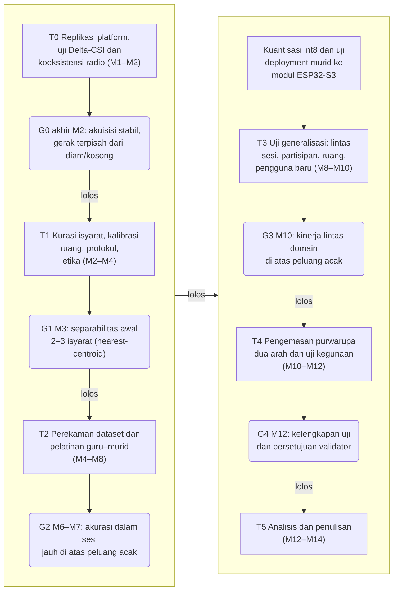
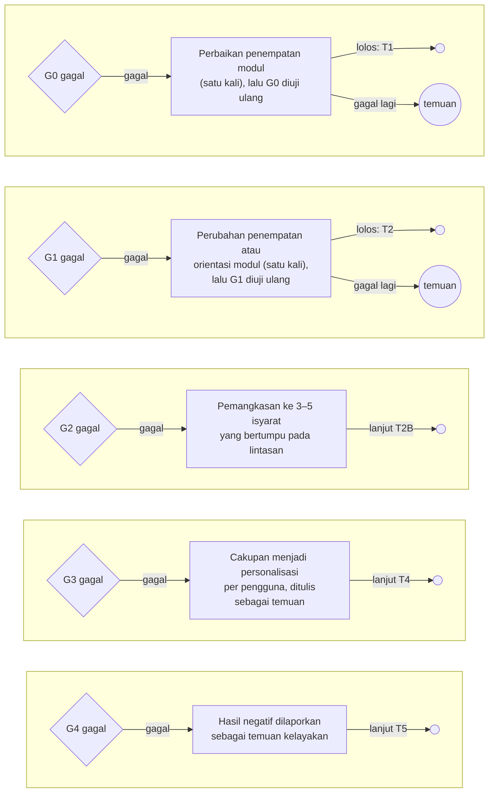
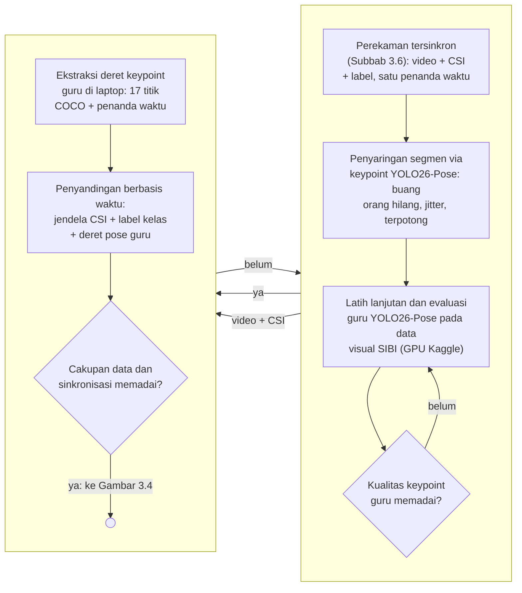
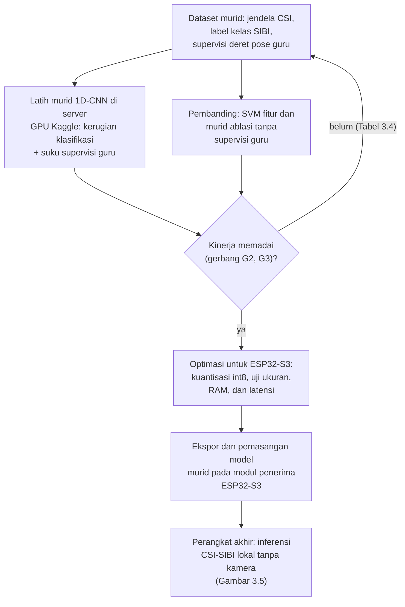
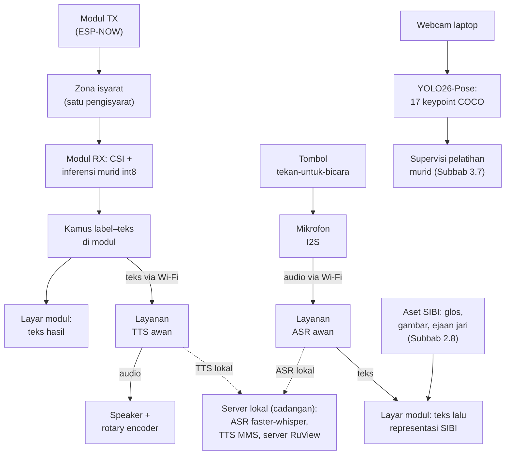
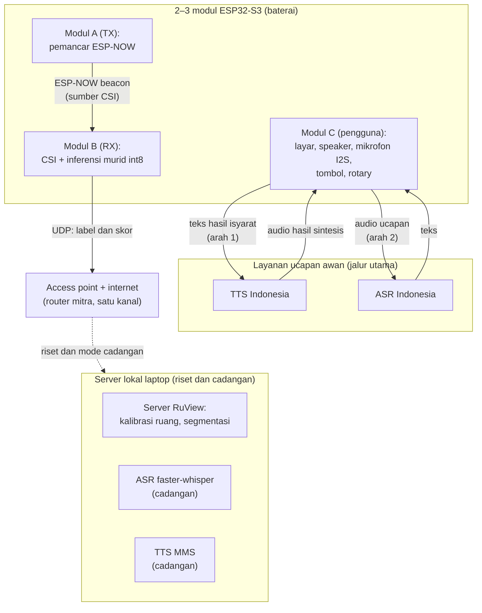
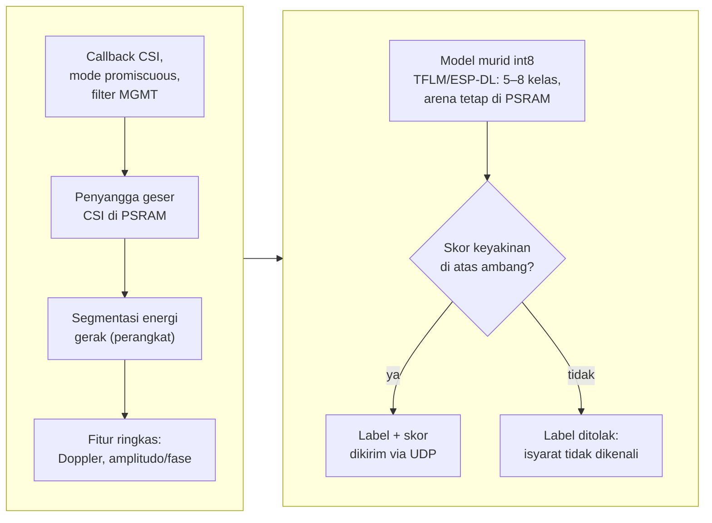
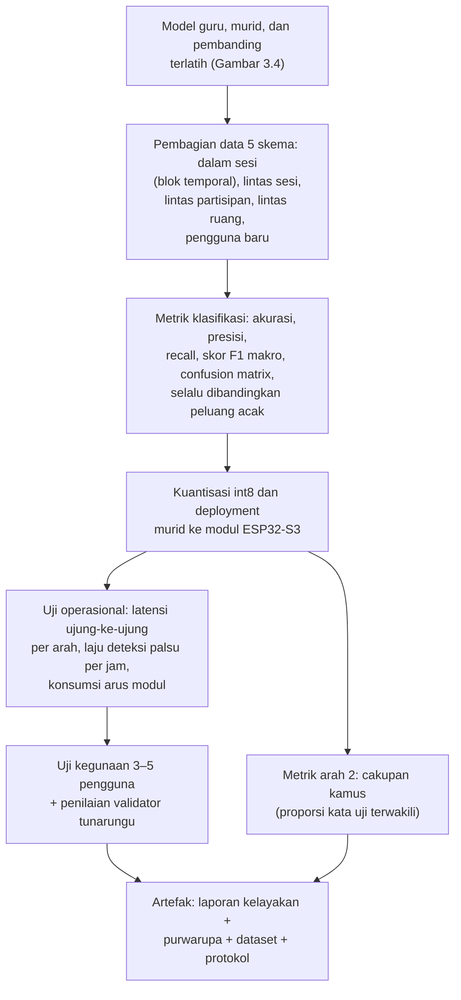

# BAB III METODE PENELITIAN

## 3.1 Desain Penelitian

Penelitian ini dirancang sebagai studi kelayakan kuantitatif bergerbang yang menghasilkan purwarupa penerjemah dua arah. Bagian kuantitatif mengukur sejauh mana Wi-Fi CSI dari tautan antarmodul ESP32-S3 dapat membedakan 5–8 isyarat SIBI terisolasi. Bagian itu juga mengukur sejauh mana model terkuantisasi berjalan pada perangkat serta sejauh mana jalur isyarat menjadi teks dan suara dan jalur teks atau ucapan menjadi representasi SIBI bekerja pada skenario yang ditetapkan. Setelah komponen diuji, purwarupa dikemas lalu dikaji kelayakannya sebagai alat bantu komunikasi kosakata terbatas melalui uji operasional, uji kegunaan skala kecil, dan penilaian validator penutur tunarungu. Struktur bergerbang dipilih karena kemampuan CSI membedakan isyarat SIBI belum dapat dipastikan sebelum data dikumpulkan; setiap tahap menghasilkan artefak tetap, kegagalan gerbang dicatat sebagai temuan, dan kriteria akurasi dirumuskan relatif terhadap peluang acak (Subbab 2.10). Inti metodologi pelatihannya berbentuk distilasi guru–murid. Model guru kamera YOLO26-Pose mengekstrak deret pose gerakan SIBI dari video perekaman; deret tersebut menjadi supervisi tambahan bagi model murid yang mengenali isyarat dari jendela CSI dan berjalan langsung pada modul (Subbab 3.7).

Rumusan masalah pertama dijawab pada tahap replikasi platform, perancangan arsitektur, kurasi isyarat dan protokol, serta penerapan distilasi guru–murid. Rumusan masalah kedua dijawab melalui uji klasifikasi, uji *deployment*, dan uji jalur bahasa pada tahap perekaman dan generalisasi. Rumusan masalah ketiga ditinjau melalui uji operasional, uji kegunaan, dan penilaian validator pada tahap pengemasan purwarupa.

## 3.2 Tahapan Penelitian

Penelitian berlangsung selama empat belas minggu (M1–M14) dalam enam tahap. Tahapan dimulai dari replikasi platform dan uji karakterisasi (T0), kemudian kurasi isyarat dan protokol (T1), perekaman *dataset* serta pelatihan guru–murid (T2), uji generalisasi (T3), pengemasan purwarupa dua arah dan uji kegunaan (T4), hingga analisis dan penulisan (T5). Lima tahap pertama ditutup gerbang keputusan G0–G4: jalur lolos dirangkum pada Gambar 3.1, sedangkan jalur gagal, tindakan korektif, dan uji ulang tiap gerbang dirinci pada Gambar 3.2. Bila G0 gagal kedua kali setelah perbaikan, jalur CSI dihentikan dan dilaporkan sebagai temuan karakterisasi, lalu penelitian lanjut ke T5; bila G1 gagal kedua kali, tindakan mengikuti Tabel 3.6 dan dicatat sebagai temuan. Kriteria lolos dan tindakan bila gagal direncanakan ditetapkan sebelum gerbang terkait dinilai; parameter yang belum ditetapkan dihimpun pada Tabel 3.6.

Gambar 3.1 Tahapan penelitian T0–T5 dan gerbang keputusan G0–G4 (jalur lolos; jalur gagal dirinci pada Gambar 3.2)

Gambar 3.2 Jalur gagal dan remediasi gerbang keputusan G0–G4. Lingkaran kosong = lanjut ke tahap yang tertera pada label sisi; lingkaran "temuan" = penelitian berlanjut dengan hasil dilaporkan sebagai temuan. Kriteria lengkap tiap gerbang diuraikan pada Subbab 3.2.1–3.2.5 dan parameter yang menyertai pada Tabel 3.6.

### 3.2.1 Tahap T0: Replikasi Platform dan Uji Karakterisasi (M1–M2)

Dua modul ESP32-S3 disiapkan dengan *firmware* RuView [28], lalu *pipeline* akuisisi tersinkron diuji tanpa partisipan. Tiga uji dilakukan pada tahap ini. Pertama, uji Delta-CSI (Subbab 3.8.1) untuk mengetahui apakah pola CSI saat bergerak terpisah dari kondisi diam dan ruang kosong. Kedua, uji koeksistensi radio: modul penerima dijalankan dengan penangkapan CSI, koneksi *station* ke *access point*, dan pengiriman UDP secara serentak, lalu laju CSI aktual dan kehilangan paket diukur, termasuk ketika streaming audio dari mikrofon diaktifkan. Ketiga, pengukuran laju pencuplikan aktual sebagai dasar penetapan pita Doppler (Subbab 3.7.1). Keluaran tahap ini adalah laporan karakterisasi sinyal sebagai bahan G0.

### 3.2.2 Tahap T1: Kurasi Isyarat, Kalibrasi Ruang, dan Protokol (M2–M4)

T1 mencakup kurasi 5–8 isyarat bersama validator penutur tunarungu, kalibrasi ruang mitra, penyusunan protokol perekaman dan etika, serta perizinan (Subbab 3.6). Kurasi juga menetapkan himpunan tampilan arah kedua, yaitu isyarat terpilih ditambah 26 huruf dan 9 angka sebagai kosakata ejaan jari (Subbab 2.8). G1 menguji separabilitas awal 2–3 isyarat dengan uji *nearest-centroid* sederhana yang rata-ratanya dihitung tanpa repetisi yang sedang diuji.

### 3.2.3 Tahap T2: Perekaman Dataset, Pelatihan Guru–Murid, dan Uji Deployment (M4–M8)

*Dataset* direkam dengan kurang lebih 30 repetisi per isyarat per sesi disertai video tersinkron (Subbab 3.6). Alur pelatihan pada tahap ini berbentuk distilasi guru–murid: tahap perekaman, penyaringan segmen, pelatihan guru, dan penyandingan data ditunjukkan pada Gambar 3.3, sedangkan pelatihan murid, pembanding, dan deployment ditunjukkan pada Gambar 3.4. Model guru YOLO26-Pose dilatih lanjutan pada data visual SIBI di layanan server GPU Kaggle, lalu kualitas *keypoint*-nya dievaluasi sebelum dipakai (Subbab 3.7.4). Jendela CSI, label kelas dari anotasi protokol, dan deret pose guru diselaraskan berdasarkan penanda waktu untuk membentuk *dataset* murid; kemudian murid 1D-CNN dilatih dengan supervisi label dan deret pose guru (Subbab 3.7.5). Dua pembanding dilatih pada data yang sama, yaitu SVM dan murid ablasi tanpa supervisi guru. Setelah pelatihan, model terpilih dikuantisasi int8, di-*deploy* ke modul penerima, lalu diukur waktu inferensi dan pemakaian memorinya pada laju bingkai aktual. Keluaran T2 adalah *dataset* murid berlabel, model guru dan murid terlatih, serta laporan *deployment*; bila G2 gagal, cakupan dipangkas menjadi 3–5 isyarat yang pembedanya paling bertumpu pada lintasan (Tabel 3.6).

Gambar 3.3 Distilasi guru–murid tahap data: perekaman tersinkron, penyaringan segmen, model guru, dan penyandingan berbasis waktu

Gambar 3.4 Distilasi guru–murid tahap pelatihan: dataset murid ber-supervisi guru, pembanding, gerbang kinerja, dan deployment

### 3.2.4 Tahap T3: Uji Generalisasi (M8–M10)

Model mudah *overfitting* pada orang dan ruang tempat data latih direkam [39] sehingga model diuji lintas sesi, lintas partisipan, lintas ruang, dan pada satu pengguna baru tanpa pelatihan ulang (Subbab 3.7.6). Strategi lintas domain Widar3.0 [40] dijadikan acuan tanpa mengasumsikan hasil yang sama pada isyarat SIBI. Bila G3 gagal, cakupan menjadi personalisasi per pengguna yang memerlukan data latih singkat dari setiap pengguna dan perubahan itu dilaporkan sebagai temuan.

### 3.2.5 Tahap T4: Pengemasan Purwarupa Dua Arah dan Uji Kegunaan (M10–M12)

Model murid yang telah berjalan di modul dikemas menjadi purwarupa dua arah (Subbab 3.5) dengan mengaktifkan layanan ucapan awan pada kedua arah. Pengemasan menambahkan tombol tekan-untuk-bicara dan rotary encoder volume pada modul pengguna, pemetaan teks ke representasi SIBI, serta tampilan layar modul dan pemutaran audio pada *speaker*. Selanjutnya dilakukan uji operasional, uji jalur ucapan, uji cakupan kamus, uji kegunaan dengan 3–5 pengguna, dan penilaian validator (Subbab 3.8). G4 menilai kelengkapan data uji dan persetujuan validator atas kewajaran keluaran.

### 3.2.6 Tahap T5: Analisis dan Penulisan (M12–M14)

Seluruh artefak dianalisis dan disusun menjadi laporan kelayakan beserta rekomendasi berdasarkan gerbang yang lolos dan yang gagal. Laporan memuat keterbatasan secara eksplisit, yaitu konfigurasi jari dan ekspresi wajah tidak dikenali, arah kedua berbentuk kamus kata-level dan ejaan jari, serta seluruh klaim terikat pada kosakata terbatas (Subbab 1.4).

## 3.3 Waktu dan Lokasi Penelitian

Penelitian dilaksanakan pada [PERLU DATA: bulan dan tahun pelaksanaan penelitian] di [PERLU DATA: nama sekolah/lembaga mitra]. Perekaman dan pengujian dilakukan di sedikitnya dua ruang, yaitu jumlah minimum bagi skema *leave-one-room-out*, dan setiap ruang dikalibrasi sebelum perekaman (Subbab 3.5.4). Penyiapan sistem secara mandiri oleh pengguna di luar lembaga mitra berada di luar cakupan.

## 3.4 Alat dan Bahan

Perangkat keras penelitian disajikan pada Tabel 3.1. Dua modul ESP32-S3 berperan sebagai modul pemancar dan modul penerima, sedangkan modul ketiga direncanakan sebagai modul pengguna yang memuat layar, *speaker*, mikrofon, tombol tekan-untuk-bicara, dan rotary encoder volume; pemakaian dua atau tiga modul ditetapkan sesuai hasil uji beban pada T0.

Tabel 3.1 Perangkat keras penelitian

| No. | Nama | Spesifikasi | Jumlah | Keterangan |
|---|---|---|---|---|
| 1 | Modul ESP32-S3 | Papan pengembangan ESP32-S3 dengan PSRAM, varian yang direkomendasikan RuView [28] | 3 unit | Modul TX, modul RX, dan modul pengguna (dapat dipakai bergilir dengan cadangan) |
| 2 | Layar modul | Layar SPI/TFT kecil (1,8–2,8 inci) [PERLU DATA: model final] | 1–2 unit | Tampilan representasi SIBI pada modul pengguna |
| 3 | Antarmuka audio modul | Mikrofon I2S dan *speaker* dengan penguat I2S; contoh model yang umum adalah INMP441 dan MAX98357A [PERLU DATA: model final] | 1 set | Pintu suara arah kedua dan pemutaran TTS |
| 4 | Tombol dan rotary encoder | Tombol sesaat untuk mengaktifkan mikrofon dan rotary encoder untuk pengaturan volume *speaker* | 1 set | Antarmuka pengguna pada modul pengguna |
| 5 | Baterai modul | Baterai Li-ion atau Li-Po dengan regulator daya [PERLU DATA: kapasitas target berdasarkan hasil uji arus] | 1–2 set | Ketahanan modul diukur pada uji operasional |
| 6 | Laptop | ASUS TUF Dash F15 FX516PR: Intel Core i7-11370H, RTX 3070 Laptop 8 GB VRAM, RAM 16 GB | 1 unit | Mesin akuisisi jalur guru, pengembangan, dan server lokal cadangan |
| 7 | *Access point* | Router Wi-Fi 2,4 GHz dengan akses internet atau fitur hotspot laptop [PERLU DATA: pilihan final] | 1 unit | Seluruh modul berada pada satu kanal; akses internet menopang layanan ucapan awan |
| 8 | *Webcam* | Bawaan laptop | 1 unit | Hanya menyala pada jalur guru saat akuisisi dan pelatihan |

Perangkat lunak penelitian disajikan pada Tabel 3.2. Versi setiap perangkat lunak dicatat bersama log konfigurasi pelatihan agar eksperimen dapat diulang.

Tabel 3.2 Perangkat lunak penelitian

| No. | Nama | Fungsi dalam penelitian |
|---|---|---|
| 1 | *Firmware* dan *server* RuView | Menangkap CSI pada modul, mengirimkannya melalui UDP, mengalibrasi ruang, dan menyegmentasi deret saat riset |
| 2 | `scripts/collect-ground-truth.py` (ADR-079, diadaptasi) | Menyinkronkan akuisisi kamera dan CSI; estimator pose asli diganti YOLO26-Pose |
| 3 | Model guru YOLO26-Pose | Mengekstrak deret 17 *keypoint* format COCO pada jalur guru; hasilnya menjadi supervisi tambahan pelatihan murid dan dasar penyaringan segmen |
| 4 | Layanan server GPU Kaggle | Melatih model guru YOLO26-Pose dan model murid CSI |
| 5 | Python, scikit-learn, PyTorch | Ekstraksi fitur, pelatihan SVM dan murid 1D-CNN, serta evaluasi |
| 6 | TensorFlow Lite Micro dan ESP-DL | Menjalankan murid int8 pada modul penerima |
| 7 | faster-whisper | ASR Bahasa Indonesia cadangan pada server lokal dan pembanding jalur awan |
| 8 | MMS-TTS-ind | TTS Bahasa Indonesia cadangan pada server lokal dan pembanding jalur awan |
| 9 | Layanan TTS awan | Jalur utama sintesis pada arah pertama [PERLU DATA: layanan final hasil uji banding] |
| 10 | Layanan ASR awan | Jalur utama pengenalan ucapan pada arah kedua [PERLU DATA: layanan final hasil uji banding] |
| 11 | Kamus label-teks dan teks-isyarat | Dikembangkan sendiri sebagai bagian purwarupa; salinan kamus label-teks dimuat pada modul |

Bahan penelitian meliputi *dataset* CSI beserta deret pose guru hasil perekaman sendiri, lembar definisi isyarat, aset tampilan arah kedua (gambar huruf, angka, dan isyarat terpilih), formulir persetujuan partisipan, instrumen uji, serta kuesioner persepsi. *Dataset* direkam sendiri karena penelitian yang mengenali isyarat SIBI dari CSI belum ditemukan dalam penelusuran literatur (Subbab 2.11).

## 3.5 Perancangan Sistem

### 3.5.1 Arsitektur Dua Arah

Sistem dirancang dalam dua jalur operasional tanpa kamera dan satu jalur guru yang hanya aktif saat akuisisi data dan pelatihan, seperti ditunjukkan pada Gambar 3.5. Pada jalur arah pertama, modul pemancar memancarkan bingkai bersama; gerak pengisyarat mengubah deret CSI pada modul penerima; model murid int8 berjalan pada modul dan menghasilkan label beserta skor keyakinan; label dipetakan menjadi teks Indonesia melalui kamus kecil pada modul; teks tampil di layar modul pengguna, lalu dikirim ke layanan TTS awan; audio hasil sintesis diputar pada *speaker* modul dengan volume yang diatur rotary encoder. Pada jalur arah kedua, tombol tekan-untuk-bicara pada modul pengguna mengaktifkan mikrofon; ucapan dikirim ke layanan ASR awan; teks hasil pengenalan tampil di layar, lalu dipetakan ke representasi SIBI dari aset yang tersimpan pada modul (Subbab 2.8). Saat koneksi internet tidak tersedia, kedua jalur beralih ke server lokal laptop yang menjalankan MMS-TTS-ind dan faster-whisper sebagai cadangan. Jalur guru memakai *webcam* dan YOLO26-Pose untuk mengekstrak deret *keypoint* yang menjadi supervisi tambahan pelatihan murid serta dasar penyaringan segmen; jalur ini bukan bagian produk akhir.

Gambar 3.5 Arsitektur produk akhir tanpa kamera. Rantai kiri = arah 1 (isyarat menjadi teks dan suara); rantai tengah = arah 2 (ucapan menjadi representasi SIBI); rantai kanan = jalur guru yang hanya aktif saat akuisisi data dan pelatihan; garis putus-putus = beralih ke server lokal ketika internet tidak tersedia.

### 3.5.2 Topologi Modul dan Jaringan

Topologi jaringan purwarupa ditunjukkan pada Gambar 3.6. Seluruh perangkat, yaitu 2–3 modul dan server laptop, terhubung ke satu *access point* pada kanal yang sama sehingga penangkapan CSI dan komunikasi data berjalan serentak (Subbab 2.4). *Access point* tersebut juga menyediakan akses internet yang menopang layanan ucapan awan pada kedua arah. Modul pemancar dan modul penerima berkomunikasi melalui ESP-NOW untuk bingkai bersama, modul penerima mengirim label dan skor melalui UDP sebagai telemetri riset, dan modul pengguna mengirim teks atau audio singkat ke layanan ucapan awan. Server lokal menjalankan *server* RuView untuk keperluan riset serta faster-whisper dan TTS MMS sebagai jalur ucapan cadangan; kamus label-teks dimuat sebagai salinan kecil pada modul. Laptop dapat berperan sebagai *access point* melalui hotspot ketika purwarupa berjalan penuh pada mode cadangan lokal tanpa layanan awan.

Gambar 3.6 Topologi perangkat, komunikasi antarmodul, layanan awan, dan server

### 3.5.3 Penempatan Modul dan Zona Isyarat

Modul pemancar dan modul penerima dipasang pada dudukan setinggi dada pengisyarat dan mengapit zona isyarat agar gerak lengan dan tubuh atas berada di antara keduanya; kesesuaiannya diperiksa melalui uji Delta-CSI. Zona isyarat hanya ditempati satu pengisyarat dalam setiap sesi dan sistem tidak mengidentifikasi individu. Jarak antarmodul, ukuran zona, dan penempatan modul pengguna ditetapkan pada T0 dan dicatat dalam metadata sesi (Tabel 3.6).

### 3.5.4 Kalibrasi Ruang

Setiap sesi diawali kalibrasi ruang bawaan RuView selama kurang lebih empat menit dengan 600 bingkai dan 8 *anchor* karena CSI peka terhadap perubahan kondisi ruang [28], [39]. Posisi perabot, kipas angin atau pendingin ruangan yang menyala, dan orang yang lewat dicatat sebagai kovariat untuk menganalisis perbedaan kinerja antarsesi dan antarruang.

## 3.6 Protokol Perekaman Dataset, Partisipan, dan Etika

### 3.6.1 Partisipan

Partisipan terdiri atas 3–4 pengisyarat kompeten, sedikitnya satu validator penutur tunarungu, dan 3–5 pengguna uji. Pengisyarat kompeten adalah guru atau pembina SIBI yang memperagakan isyarat untuk *dataset*; validator menentukan pemilihan kosakata, memeriksa sampel segmen, dan menilai kewajaran keluaran purwarupa; pengguna uji mencoba purwarupa dua arah pada uji kegunaan. Kriteria inklusi dan rekrutmen tercantum pada Tabel 3.6. Setiap pengisyarat direkam dalam sedikitnya dua sesi agar skema lintas sesi dapat dijalankan, dan skema lintas ruang hanya memisahkan pengaruh ruang dari pengaruh orang bila pengisyarat yang sama direkam di setiap ruang.

### 3.6.2 Kurasi Isyarat dan Kosakata Tampilan

Isyarat pengenalan dipilih melalui dua saringan (Subbab 1.4) dengan acuan *Kamus SIBI* [45], sedangkan kosakata tampilan arah kedua mencakup isyarat terpilih tersebut ditambah 26 huruf dan 9 angka sebagai landasan ejaan jari [13]. Hasilnya adalah daftar 5–8 isyarat terisolasi [PERLU DATA: daftar isyarat SIBI terpilih] yang dideskripsikan dalam lembar definisi isyarat sebagai acuan perekaman dan penilaian.

### 3.6.3 Prosedur Perekaman

Perekaman memakai *elisitasi* terisolasi, yaitu satu isyarat per segmen dengan jeda antarrepetisi. Adapun prosedur perekaman setiap sesi adalah sebagai berikut.

1. Menyiapkan peralatan yang digunakan.
2. Memasang modul pemancar dan modul penerima, lalu menghubungkan seluruh perangkat ke *access point* pada satu kanal.
3. Menjalankan kalibrasi ruang dan mencatat metadata sesi, yaitu tanggal, ruang, kode pengisyarat, posisi modul, dan kondisi latar.
4. Menjalankan `scripts/collect-ground-truth.py` agar perekaman CSI dan *webcam* tersinkron.
5. Menampilkan kartu pemandu isyarat target, merekam satu repetisi, memberi jeda, dan mengulanginya hingga setiap isyarat mencapai kurang lebih 30 repetisi.
6. Membuang segmen bila orang tidak terdeteksi YOLO26-Pose, *jitter* *keypoint* ekstrem, atau segmen terpotong, lalu mencatat tingkat segmen terbuang per isyarat dan per pengisyarat.
7. Meminta validator mengambil sampel segmen untuk memeriksa kebenaran bentuk isyarat yang diperagakan.

### 3.6.4 Etika Penelitian

Perekaman dimulai setelah persetujuan institusi mitra dan persetujuan tertulis setiap partisipan diperoleh [PERLU DATA: lembaga atau komisi pemberi persetujuan etik]. Partisipan berhak mengundurkan diri kapan saja tanpa konsekuensi. Formulir persetujuan menyatakan bahwa kamera hanya menyala pada sesi akuisisi dan pelatihan jalur guru, bahwa produk akhir bebas kamera, dan bahwa mode privasi RuView aktif selama penelitian. Video hanya dipakai untuk verifikasi batas segmen, penyaringan kualitas, dan diagnosis; video disimpan terbatas dan tidak dipublikasikan. Audio ucapan pada arah kedua dikirim ke layanan awan sehingga tujuan pengiriman tersebut diungkapkan pada formulir persetujuan dan kebijakan penyimpanan layanan final diperiksa sebelum layanan dipakai. *Dataset* publik hanya memuat CSI, label, dan *keypoint* tanpa identitas partisipan. Token apresiasi validator tercantum pada Tabel 3.6.

## 3.7 Pengolahan Sinyal, Ekstraksi Fitur, Pelatihan Guru–Murid, dan Deployment

### 3.7.1 Laju Pencuplikan

*Firmware* RuView membatasi pengiriman bingkai CSI paling sering setiap 20 ms sehingga laju maksimumnya 50 bingkai per detik [28]; laju aktual diukur pada T0. Pita Doppler 1–60 Hz hanya terwakili bila laju pencuplikan sedikitnya 120 Hz (Subbab 2.3). Bila laju terukur lebih rendah, pita yang dianalisis dibatasi hingga setengah laju aktual dan pembatasan itu dilaporkan.

### 3.7.2 Segmentasi

Deret CSI dipotong menjadi segmen isyarat dengan segmentasi berbasis energi gerak RuView [28]. Batas segmen diverifikasi dengan deret *keypoint* hanya selama perekaman *dataset*; pada purwarupa, segmentasi berjalan pada modul tanpa kamera.

### 3.7.3 Ekstraksi Fitur

Fitur setiap segmen terdiri atas amplitudo dan fase *subcarrier* terpilih yang saling melengkapi [54], spektrum Doppler pada pita yang ditetapkan setelah T0 [40], serta statistik ringkas berupa energi, entropi, dan lintasan puncak [20]. Kriteria pemilihan *subcarrier* dan definisi lintasan puncak tercantum pada Tabel 3.6. Fitur diringkas menjadi satu vektor untuk SVM dan disusun sebagai deret per langkah waktu untuk 1D-CNN.

### 3.7.4 Model Guru Kamera YOLO26-Pose

Distilasi pengetahuan merupakan teknik melatih model murid yang ringan agar meniru keluaran atau representasi model guru yang lebih kuat [80]. Metode ini dipilih karena CSI tidak memuat citra tubuh sehingga posisi tubuh tidak dapat dilabeli langsung dari data CSI, sedangkan kamera memilikinya secara alami; preseden pemindahan pengetahuan visi ke model Wi-Fi telah ada pada Person-in-WiFi [63] dan DensePose from WiFi [64] (Subbab 2.5). Dalam penelitian ini, YOLO26-Pose berperan sebagai model guru kamera yang mengekstrak deret 17 *keypoint* format COCO dari video perekaman dan hasilnya menjadi supervisi tambahan bagi model murid CSI.

Guru dilatih lanjutan (*fine-tuning*) pada data visual SIBI hasil perekaman T2 dan pelatihannya dijalankan pada layanan server GPU Kaggle. Pelatihan lanjutan dipilih agar deteksi orang dan kestabilan *keypoint* pada gerakan tangan SIBI meningkat dibandingkan model awal. Kualitas guru dievaluasi sebelum dipakai melalui tiga ukuran, yaitu proporsi bingkai dengan orang terdeteksi, tingkat *jitter* *keypoint*, dan pemeriksaan sampel bingkai oleh peneliti; kriteria lolos ketiganya tercantum pada Tabel 3.6. Deret *keypoint* hasil guru disertai penanda waktu sehingga dapat disandingkan dengan jendela CSI dan label kelas.

Model guru tidak mengklasifikasikan isyarat. Label kelas SIBI berasal dari anotasi protokol *elisitasi*, yaitu kartu pemandu yang menentukan isyarat pada setiap segmen (Subbab 3.6) sehingga makna isyarat tidak bergantung pada dugaan model visi. Klasifikasi gerakan otomatis dari video menuntut pengklasifikasi temporal di atas deret *keypoint* dan berada di luar cakupan penelitian ini karena label kelas telah tersedia dari protokol.

### 3.7.5 Dataset Murid dan Pelatihan Distilasi Guru–Murid

Dataset murid dibentuk dengan menyelaraskan tiga deret berdasarkan penanda waktu, yaitu jendela CSI hasil segmentasi, label kelas dari anotasi protokol, dan deret pose guru. Masukan murid berupa jendela deret CSI, bukan cuplikan tunggal, karena gerakan SIBI bersifat temporal sehingga polanya hanya tampak pada urutan waktu (Subbab 2.3). Target pelatihan berupa label kelas, sedangkan deret pose guru menjadi supervisi tambahan yang melengkapi label.

Model murid 1D-CNN dilatih dengan PyTorch [70] pada layanan server GPU Kaggle memakai fungsi kerugian gabungan: kerugian klasifikasi kelas ditambah suku supervisi guru yang mengikat representasi internal murid pada deret pose guru. Bentuk dan bobot suku supervisi ditetapkan dari data validasi dan dicatat pada Tabel 3.6. Dua pembanding dilatih pada data yang sama, yaitu SVM atas fitur ringkas sebagai pembanding dasar [68], [69] dan murid ablasi tanpa suku supervisi guru. Pembanding ablasi memungkinkan manfaat supervisi guru dinilai langsung dari data penelitian ini alih-alih diasumsikan.

Setelah pelatihan, murid memprediksi kelas isyarat dari jendela CSI saja tanpa kamera dan tanpa deret pose. Hiperparameter dipilih berdasarkan data validasi yang terpisah dari data uji, dan model yang dipilih untuk purwarupa adalah model dengan keseimbangan terbaik antara kinerja validasi dan biaya inferensi pada perangkat. Kinerja murid beserta kedua pembandingnya dievaluasi pada lima skema pembagian data (Subbab 3.7.6).

### 3.7.6 Skema Pembagian Data

Kinerja diukur dengan lima skema pembagian data pada Tabel 3.3. Skema dalam sesi memakai pembagian data temporal per blok, yaitu blok repetisi awal untuk pelatihan dan blok akhir untuk pengujian; pembagian acak tidak dipakai karena repetisi berurutan cenderung mirip sehingga informasi dapat bocor dari data latih ke data uji.

Tabel 3.3 Skema pembagian data

| No. | Skema | Data latih | Data uji | Aspek yang diukur |
|---|---|---|---|---|
| 1 | Dalam sesi (blok temporal) | Blok awal satu sesi | Blok akhir sesi yang sama | Separabilitas pada orang, ruang, dan sesi yang sama |
| 2 | Lintas sesi | Sebagian sesi pengisyarat di satu ruang | Sesi lain pengisyarat dan ruang yang sama | Ketahanan terhadap perubahan antarsesi |
| 3 | Lintas partisipan (*leave-one-subject-out*) | Semua pengisyarat kecuali satu | Pengisyarat yang ditinggalkan, bergiliran | Ketahanan terhadap pergantian orang |
| 4 | Lintas ruang (*leave-one-room-out*) | Semua ruang kecuali satu | Ruang yang ditinggalkan, bergiliran | Ketahanan terhadap pergantian ruang |
| 5 | Pengguna baru | Seluruh pengisyarat *dataset* | Satu pengguna baru tanpa pelatihan ulang | Kesiapan dipakai orang baru tanpa perekaman tambahan |

Skema kedua sampai kelima mengukur ketahanan terhadap perubahan domain [39]; karena jumlah pengisyarat dan ruang kecil, hasil lintas partisipan dan lintas ruang dilaporkan untuk setiap putaran. Data validasi hanya diambil dari data latih sehingga data uji tidak dipakai untuk memilih *subcarrier*, menormalkan fitur, memilih hiperparameter, atau menetapkan ambang (Tabel 3.6).

### 3.7.7 Keluaran dengan Penolakan

Keluaran klasifikator dilengkapi skor keyakinan [71]. Segmen dengan skor di bawah ambang menghasilkan status penolakan pada kedua arah: pada arah pertama, *speaker* tidak mengucapkan apa pun dan sistem menampilkan pesan isyarat tidak dikenali; pada purwarupa ini penolakan lebih aman daripada menebak kelas yang salah. Ambang ditetapkan dari data validasi dan kecukupannya diperiksa melalui laju deteksi palsu serta penilaian validator (Subbab 3.8).

### 3.7.8 Kuantisasi dan Deployment ke Modul

Model murid terpilih dikuantisasi int8 lalu dijalankan pada modul penerima melalui TensorFlow Lite Micro atau ESP-DL dengan penyangga pada PSRAM. Selama penangkapan CSI, radio modul terikat pada satu kanal bersama *access point* dengan *power save* dimatikan (WIFI_PS_NONE) [28], sebagaimana dipakai *firmware* RuView. Alur inferensi pada perangkat ditunjukkan pada Gambar 3.7: bingkai CSI dari mode promiscuous masuk ke penyangga geser, segmen terdeteksi dari energi gerak, fitur dihitung, model int8 menghasilkan kelas beserta skor, dan keluaran di atas ambang dikirim melalui UDP. Waktu inferensi per segmen, pemakaian memori, dan pengaruhnya terhadap laju pemrosesan bingkai diukur dan dilaporkan; bila model terbukti terlalu berat untuk dijalankan pada perangkat, klasifikasi dipindahkan ke server sesuai jalur cadangan (Subbab 3.11).

Gambar 3.7 Inferensi langsung pada ESP32-S3

## 3.8 Skenario Pengujian dan Metrik Evaluasi

Uji Delta-CSI dan koeksistensi mendasari G0, uji *nearest-centroid* mendasari G1, uji klasifikasi mendasari G2 dan G3, serta uji kegunaan dan penilaian validator mendasari G4. Uji operasional, uji jalur ucapan, dan uji cakupan kamus melengkapi analisis tanpa menjadi syarat gerbang. Rantai perekaman hingga pelatihan telah ditunjukkan pada Gambar 3.3 dan Gambar 3.4, sedangkan rantai evaluasi dari model terpilih hingga artefak akhir ditunjukkan pada Gambar 3.8.

Gambar 3.8 Alur evaluasi: pembagian data, metrik, uji operasional, uji kegunaan, dan artefak akhir

### 3.8.1 Uji Delta-CSI dan Koeksistensi

Uji Delta-CSI dilakukan untuk mengetahui apakah gerak tubuh menghasilkan perubahan CSI yang terpisah jelas dari kondisi tanpa gerak, dengan ukuran keterpisahan pada Tabel 3.6. Adapun prosedurnya adalah sebagai berikut.

1. Memasang kedua modul pada posisi awal yang mengapit zona isyarat.
2. Merekam CSI pada kondisi ruang kosong, pengisyarat diam, dan pengisyarat bergerak di zona isyarat.
3. Menjalankan modul penerima dengan CSI, koneksi station, dan UDP aktif secara serentak, termasuk saat streaming audio dinyalakan, lalu mencatat laju CSI aktual dan paket yang hilang.
4. Membandingkan pola antarkondisi, lalu mencatat dan menganalisis hasilnya sebagai bahan G0.

### 3.8.2 Uji Klasifikasi

Uji klasifikasi pada kelima skema memakai metrik pada Subbab 2.10. Setiap metrik dilaporkan bersama peluang acak, yaitu 20% untuk lima kelas dan 12,5% untuk delapan kelas, serta 33,3% bila cakupan dipangkas menjadi tiga isyarat. Tingkat penolakan dilaporkan, dan akurasi dilaporkan dalam dua bentuk, yaitu akurasi tanpa penolakan atas seluruh segmen uji dan akurasi dengan penolakan atas segmen yang diterima saja. Sebagai pembanding internal, murid ablasi tanpa supervisi guru dilaporkan berdampingan dengan murid utama sehingga manfaat supervisi guru dinilai langsung dari data; SVM dilaporkan sebagai pembanding dasar.

### 3.8.3 Uji Operasional

Uji operasional mengukur laju deteksi palsu per jam saat tidak ada peragaan, latensi ujung ke ujung setiap arah, dan konsumsi arus modul. Adapun prosedurnya adalah sebagai berikut.

1. Menjalankan purwarupa di ruang yang telah dikalibrasi.
2. Merekam kondisi tanpa peragaan isyarat, termasuk saat ada gangguan berupa orang lewat dan kipas angin menyala, lalu mencatat setiap isyarat yang terdeteksi.
3. Meminta pengisyarat memperagakan isyarat target, mencatat waktu selesainya isyarat dan waktu suara tampil; pada arah kedua, meminta pengguna mengucapkan frasa uji dan mencatat waktu representasi tampil.
4. Mengukur arus modul lengkap dengan alat ukur arus pada beberapa kondisi kerja, lalu menghitung estimasi ketahanan baterai.
5. Menghitung laju deteksi palsu, latensi kedua arah, dan estimasi ketahanan baterai, lalu menganalisisnya terhadap indikator layak (Tabel 3.6).

### 3.8.4 Uji Jalur Ucapan

Uji jalur ucapan menilai komponen bahasa pada kedua arah, termasuk pembandingan jalur awan dan jalur lokal. Adapun prosedurnya adalah sebagai berikut.

1. Menyiapkan daftar frasa uji Bahasa Indonesia pendek [PERLU DATA: daftar frasa uji dan jumlah penutur] yang diucapkan ke mikrofon modul.
2. Merekam teks hasil layanan ASR awan, lalu menghitung akurasi kata terhadap teks acuan.
3. Mengukur waktu pengenalan per frasa, waktu pemetaan, waktu sintesis layanan TTS awan, serta waktu total ujung ke ujung kedua arah.
4. Mengulang pengukuran pada jalur lokal cadangan yang menjalankan faster-whisper dan MMS-TTS-ind, lalu membandingkan mutu dan latensi kedua jalur.
5. Menganalisis keseimbangan antara mutu, latensi, dan ketergantungan koneksi internet sebagai bahan penetapan pilihan final (Tabel 3.6).

### 3.8.5 Uji Cakupan Kamus Arah Kedua

Cakupan kamus dihitung sebagai proporsi frasa uji yang kata-katanya terwakili representasi tersedia; kata yang tidak terwakili jatuh ke ejaan jari dan dilaporkan terpisah. Adapun prosedurnya adalah sebagai berikut.

1. Menyiapkan daftar frasa uji yang mencakup kata dalam kamus dan kata di luar kamus.
2. Menjalankan setiap frasa melalui pintu teks dan pintu suara.
3. Mencatat proporsi kata yang tampil sebagai representasi isyarat, sebagai ejaan jari, dan yang gagal tampil, lalu menganalisisnya.

### 3.8.6 Uji Kegunaan

Uji kegunaan dengan 3–5 pengguna menelaah keterpakaian purwarupa sebagai alat bantu komunikasi kosakata terbatas pada skenario tugas terbimbing, yaitu saling menyampaikan pesan pendek dari kosakata yang tersedia. Adapun langkah uji untuk setiap pengguna adalah sebagai berikut.

1. Menjelaskan tujuan uji, batas kosakata, kondisi kamera yang tidak menyala pada purwarupa, dan hak mundur, lalu meminta persetujuan tertulis.
2. Memberi waktu berlatih singkat dengan kamus tampilan agar pengguna mengenal kosakata yang tersedia.
3. Menjalankan skenario tugas komunikasi dua arah bersama lawan bicara, mencatat keberhasilan pesan tersampaikan, waktu penyelesaian, dan kejadian keluaran yang menyesatkan.
4. Meminta pengguna mengisi kuesioner persepsi skala Likert tentang kegunaan, kejelasan keluaran, dan keinginan memakai ulang.
5. Merekapitulasi hasil, lalu menganalisisnya secara deskriptif tanpa klaim kausal.

Data dianalisis secara deskriptif karena pengguna sedikit dan tidak ada kelompok pembanding; perubahan apa pun dilaporkan sebagai gambaran capaian, bukan pengaruh yang diuji.

### 3.8.7 Penilaian Validator dan Diagnosis Kesalahan

Validator penutur tunarungu menilai kewajaran keluaran purwarupa, yaitu kesesuaian teks hasil pengenalan dengan isyarat yang diperagakan serta kewajaran representasi yang ditampilkan pada arah kedua. Untuk setiap percobaan, keluaran sistem dan penilaian independen validator dicatat dalam tabel silang; kasus keluaran sistem yang dinilai keliru oleh validator dilaporkan tersendiri karena dapat menyesatkan pengguna. Sebagai analisis sekunder, kesalahan klasifikator dikaitkan secara luring dengan kemiripan lintasan tubuh dari deret *keypoint* YOLO26-Pose untuk membedakan kesalahan akibat lintasan yang mirip dari kesalahan akibat sinyal CSI yang lemah.

### 3.8.8 Kriteria Gerbang Keputusan

Kriteria setiap gerbang beserta tindakan bila gagal disajikan pada Tabel 3.4. Kelayakan pada rumusan masalah ketiga ditinjau per dimensi, yaitu latensi kedua arah, cakupan kamus, keandalan operasional, persepsi pengguna, dan penilaian validator, bukan dari lolosnya G4 semata.

Tabel 3.4 Kriteria gerbang keputusan

| Gerbang | Waktu | Ukuran | Kriteria lolos | Tindakan bila gagal |
|---|---|---|---|---|
| G0 | Akhir M2 | Uji Delta-CSI dan koeksistensi | Pola CSI bergerak terpisah dari diam dan kosong; CSI, koneksi station, dan UDP berjalan serentak dengan kehilangan paket terkendali (ambang pada Tabel 3.6) | Penempatan modul diperbaiki satu kali; bila gagal lagi, jalur CSI dihentikan dan dilaporkan sebagai temuan karakterisasi |
| G1 | M3 | Separabilitas awal 2–3 isyarat (*nearest-centroid*) | Repetisi isyarat yang sama lebih dekat satu sama lain daripada ke isyarat lain | Penempatan atau orientasi modul diubah satu kali; bila gagal lagi, tindakan mengikuti Tabel 3.6 |
| G2 | M6–M7 | Akurasi skema dalam sesi | Jauh di atas peluang acak; ambang pada Tabel 3.6 | Cakupan dipangkas menjadi 3–5 isyarat yang bertumpu pada lintasan |
| G3 | M10 | Kinerja lintas partisipan dan lintas ruang | Di atas peluang acak; ambang pada Tabel 3.6 | Cakupan menjadi personalisasi per pengguna dan ditulis sebagai temuan |
| G4 | M12 | Kelengkapan uji dan persetujuan validator | Data uji operasional, jalur ucapan, cakupan kamus, dan kegunaan tercatat; validator menyetujui kewajaran keluaran | Hasil negatif tetap dilaporkan sebagai temuan kelayakan |

## 3.9 Jadwal Penelitian

Jadwal empat belas minggu disajikan pada Tabel 3.5. Tanda ■ menunjukkan minggu pelaksanaan; minggu yang ditempati dua tahap menandai peralihan antartahap.

Tabel 3.5 Jadwal penelitian

| No. | Kegiatan | M1 | M2 | M3 | M4 | M5 | M6 | M7 | M8 | M9 | M10 | M11 | M12 | M13 | M14 | Gerbang |
|---|---|---|---|---|---|---|---|---|---|---|---|---|---|---|---|---|
| 1 | T0 Replikasi platform, uji Delta-CSI, dan uji koeksistensi | ■ | ■ | | | | | | | | | | | | | G0 (akhir M2) |
| 2 | T1 Kurasi isyarat dan kosakata tampilan, kalibrasi ruang, protokol, perizinan | | ■ | ■ | ■ | | | | | | | | | | | G1 (M3) |
| 3 | T2 Perekaman *dataset*, pelatihan guru–murid dan pembanding, kuantisasi, uji *deployment* | | | | ■ | ■ | ■ | ■ | ■ | | | | | | | G2 (M6–M7) |
| 4 | T3 Uji lintas sesi, lintas partisipan, lintas ruang, dan pengguna baru | | | | | | | | ■ | ■ | ■ | | | | | G3 (M10) |
| 5 | T4 Pengemasan purwarupa dua arah, uji operasional, jalur ucapan, cakupan kamus, kegunaan, validator | | | | | | | | | | ■ | ■ | ■ | | | G4 (M12) |
| 6 | T5 Analisis dan penulisan | | | | | | | | | | | | ■ | ■ | ■ | — |

## 3.10 Parameter Rancangan yang Ditetapkan Kemudian

Parameter yang bergantung pada kesepakatan pembimbing, hasil tahap sebelumnya, atau data validasi dihimpun pada Tabel 3.6. Setiap parameter direncanakan ditetapkan sebelum dipakai untuk menilai data uji atau gerbang terkait.

Tabel 3.6 Parameter rancangan yang ditetapkan kemudian

| No. | Parameter | Waktu atau dasar penetapan | Status |
|---|---|---|---|
| 1 | Kriteria G0 | Sebelum T0 | [PERLU DATA: ukuran keterpisahan Delta-CSI dan ambang kehilangan paket pada uji koeksistensi] |
| 2 | Tindakan bila G1 gagal kedua kalinya | Sebelum eksperimen | [PERLU DATA: tindakan, disepakati bersama pembimbing] |
| 3 | Inklusi dan rekrutmen partisipan | Sebelum dipakai | [PERLU DATA: kriteria kompetensi pengisyarat, kefasihan validator, kriteria pengguna uji, dan teknik rekrutmen] |
| 4 | Sesi per ruang | Sebelum dipakai | [PERLU DATA: jumlah sesi per pengisyarat dan per ruang] |
| 5 | Publikasi *dataset* | Sebelum dipakai | [PERLU DATA: izin publikasi, repositori, dan lisensi *dataset*] |
| 6 | Token apresiasi validator | Sebelum dipakai | [PERLU DATA: bentuk token, dikonfirmasi pembimbing] |
| 7 | Ambang G2 | Sebelum eksperimen | [PERLU DATA: ambang, disepakati bersama pembimbing] |
| 8 | Kriteria pemangkasan isyarat | Sebelum G2 dinilai | [PERLU DATA: kriteria pemangkasan yang tidak memakai data uji] |
| 9 | Pemilihan *subcarrier* | Sebelum dipakai | [PERLU DATA: kriteria pemilihan subcarrier] |
| 10 | Definisi lintasan puncak | Sebelum dipakai | [PERLU DATA: definisi operasional] |
| 11 | Pembagian data | Sebelum dipakai | [PERLU DATA: ukuran blok dan proporsi data latih, validasi, uji] |
| 12 | Perlakuan data uji | Sebelum dipakai | [PERLU DATA: segmen tersaring kamera atau hasil segmentasi tanpa koreksi] |
| 13 | Ambang skor keyakinan | Dari data validasi | [PERLU DATA: ambang, ditetapkan dari data validasi] |
| 14 | Profil pengguna baru | Sebelum T3 | [PERLU DATA: profil dan jumlah repetisi uji] |
| 15 | Strategi Widar3.0 yang diadopsi | Sebelum dipakai | [PERLU DATA: komponen strategi yang diadopsi] |
| 16 | Ambang G3 | Sebelum T3 | [PERLU DATA: ambang, disepakati bersama pembimbing] |
| 17 | Personalisasi bila G3 gagal | Sebelum T4 | [PERLU DATA: prosedur perekaman data latih pengguna] |
| 18 | Indikator layak operasional | Sebelum T4 | [PERLU DATA: batas latensi ujung ke ujung tiap arah, batas laju deteksi palsu, dan ketahanan baterai minimum] |
| 19 | Lama pengamatan deteksi palsu | Sebelum T4 | [PERLU DATA: durasi perekaman tanpa isyarat] |
| 20 | Kanal, jarak antarmodul, dan zona isyarat | Pada T0 | [PERLU DATA: penetapan dan catatan pengukuran] |
| 21 | Model layar, audio, dan kapasitas baterai | Sebelum T4 | [PERLU DATA: penetapan model final dan kapasitas berdasar uji arus] |
| 22 | Pilihan layanan ucapan awan dan ukuran model lokal | Pada T4 | [PERLU DATA: keputusan berdasarkan hasil uji banding jalur awan dan jalur lokal] |
| 23 | Daftar frasa uji ucapan | Sebelum T4 | [PERLU DATA: daftar frasa dan jumlah penutur uji] |
| 24 | Kuesioner dan rubrik validator | Sebelum T4 | [PERLU DATA: butir kuesioner dan rubrik penilaian] |
| 25 | Batas kesesuaian validator G4 | Sebelum T4 | [PERLU DATA: batas kesesuaian minimum, disepakati bersama pembimbing] |
| 26 | Kriteria kualitas model guru | Sebelum pelatihan murid | [PERLU DATA: ambang proporsi deteksi orang, batas *jitter* *keypoint*, dan prosedur pemeriksaan sampel] |
| 27 | Bentuk dan bobot suku supervisi guru | Dari data validasi | [PERLU DATA: bentuk suku distilasi dan bobotnya, ditetapkan dari data validasi] |

## 3.11 Risiko dan Alternatif Cadangan

Risiko utama beserta mitigasinya dirangkum pada Tabel 3.7. Alternatif cadangan disusun bertingkat sesuai titik kegagalan sehingga kegagalan salah satu komponen tidak menghentikan penelitian, melainkan mempersempit klaimnya.

Tabel 3.7 Risiko dan mitigasi

| No. | Risiko | Dampak | Mitigasi dan cadangan |
|---|---|---|---|
| 1 | Pola CSI isyarat tidak terpisah pada konfigurasi dua modul | G0 gagal; jalur CSI tidak layak | Perbaikan penempatan satu kali; bila tetap gagal, dihentikan dan dilaporkan sebagai temuan karakterisasi |
| 2 | Akurasi lintas partisipan atau lintas ruang rendah | Klaim pengguna baru tidak dapat dibuat | Personalisasi per pengguna (cadangan A); dilaporkan sebagai temuan |
| 3 | Model int8 terlalu berat atau lambat di modul | Inferensi tepi tidak tercapai | Klasifikasi dipindahkan ke server dengan modul hanya mengirim fitur (cadangan B); klaim inferensi tepi diturunkan menjadi hasil uji banding |
| 4 | Beban radio gabungan CSI, UDP, dan audio bermasalah | Purwarupa dua arah tidak stabil | Pemisahan peran modul menjadi modul CSI dan modul pengguna (cadangan C) |
| 5 | Latensi atau mutu layanan ucapan awan tidak memadai, atau koneksi internet tidak tersedia saat penggunaan | Jalur ucapan purwarupa terganggu | Beralih ke server lokal laptop yang menjalankan faster-whisper dan MMS-TTS sebagai jalur cadangan; mutu dan latensi kedua jalur dilaporkan (cadangan D) |
| 6 | Aset representasi isyarat mahal dibuat | Cakupan arah kedua sempit | Batasi tampilan ke glos dan gambar konfigurasi plus ejaan jari; animasi menjadi pengayaan |
| 7 | Ketahanan baterai di bawah target | Klaim portabilitas melemah | Ukur arus tiap kondisi, sesuaikan target atau parameter hemat daya, laporkan apa adanya |
| 8 | Rekrutmen partisipan atau persetujuan etika terlambat | Jadwal T2 mundur | T1 memuat dua ruang dan pengisyarat cadangan; jadwal transisi satu minggu |
| 9 | Kuota atau aksesibilitas layanan server GPU Kaggle terbatas saat pelatihan | Jadwal pelatihan guru dan murid mundur | Lingkungan pelatihan dan data disiapkan terkompresi agar sesi efisien; pelatihan murid yang ringan dapat dipindahkan ke laptop; jadwal disesuaikan |

Cadangan A sampai D tidak mengubah rumusan masalah, tetapi mempersempit klaim sehingga konsistensi antara tujuan, metode, dan laporan tetap terjaga. Setiap pemakaian cadangan dicatat dalam laporan akhir beserta alasannya agar pembaca dapat menilai posisi klaim akhir penelitian terhadap rancangan awal.
