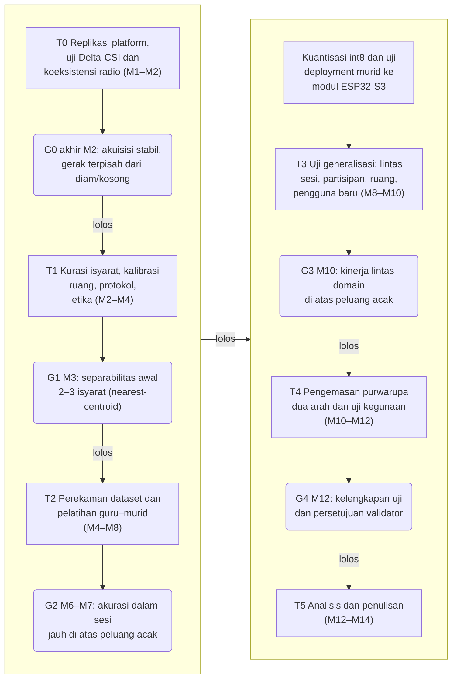
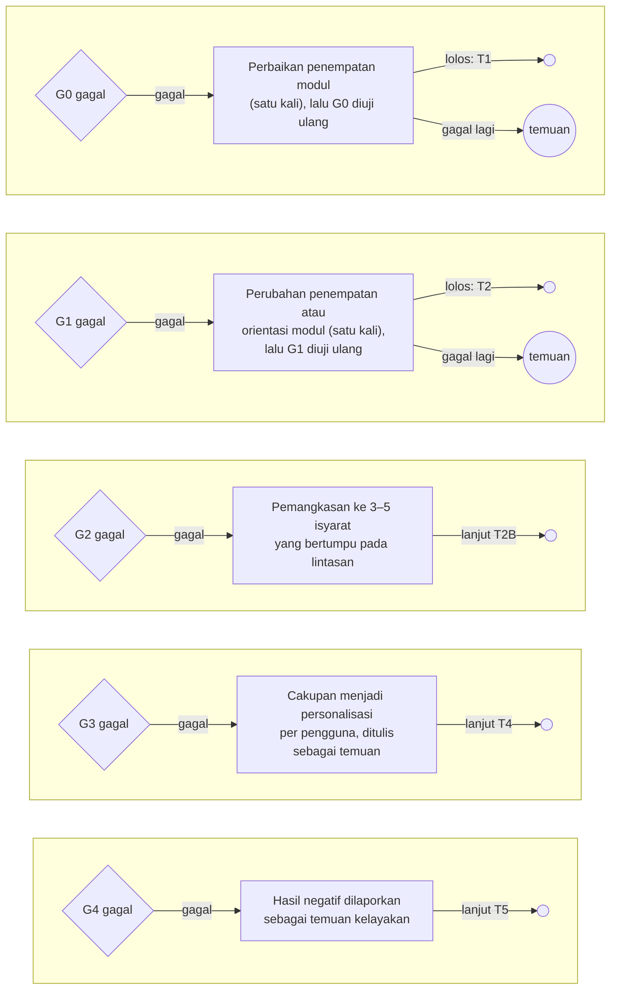
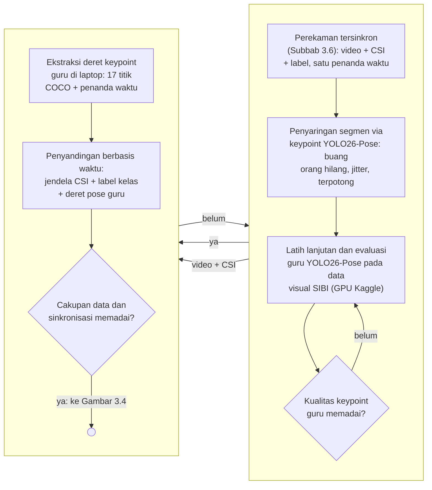
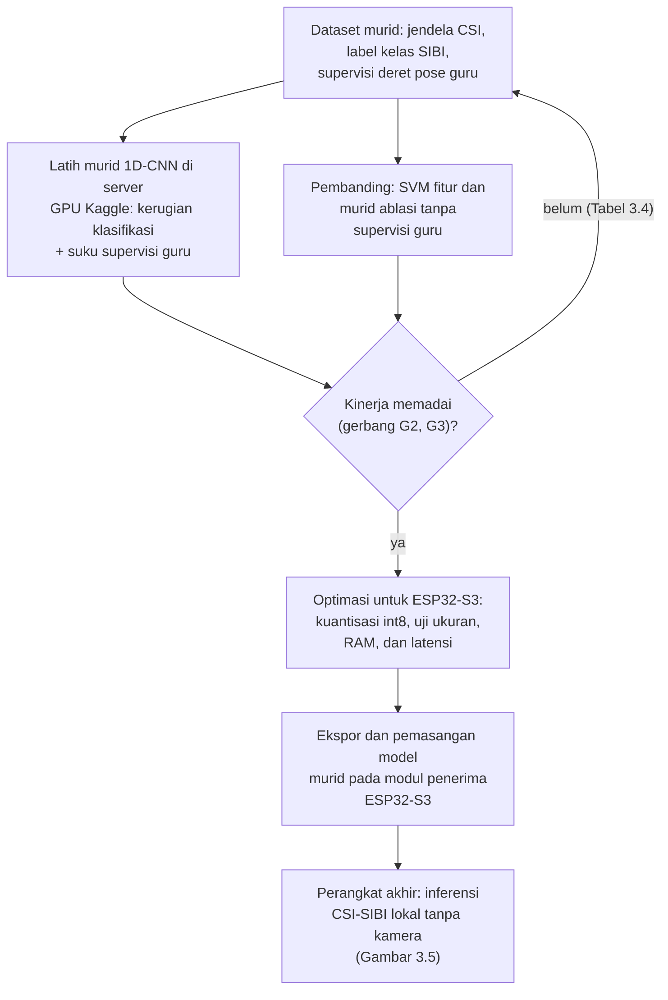

# BAB III METODE PENELITIAN

## 3.1 Desain Penelitian

Penelitian ini dirancang sebagai studi kelayakan kuantitatif bergerbang yang menghasilkan purwarupa penerjemah dua arah. Bagian kuantitatif mengukur sejauh mana Wi-Fi CSI dari tautan antarmodul ESP32-S3 dapat membedakan 5–8 isyarat SIBI terisolasi. Bagian itu juga mengukur sejauh mana model terkuantisasi berjalan pada perangkat. Selain itu, diukur sejauh mana jalur isyarat menjadi teks dan suara serta jalur teks atau ucapan menjadi representasi SIBI bekerja pada skenario yang ditetapkan. Setelah komponen diuji, purwarupa dikemas lalu dikaji kelayakannya sebagai alat bantu komunikasi kosakata terbatas melalui uji operasional, uji kegunaan skala kecil, dan penilaian validator penutur tunarungu. Struktur bergerbang dipilih karena kemampuan CSI membedakan isyarat SIBI belum dapat dipastikan sebelum data dikumpulkan; setiap tahap menghasilkan artefak tetap, kegagalan gerbang dicatat sebagai temuan, dan kriteria akurasi dirumuskan relatif terhadap peluang acak (Subbab 2.10). Inti metodologi pelatihannya berbentuk distilasi guru–murid. Model guru kamera YOLO26-Pose mengekstrak deret pose gerakan SIBI dari video perekaman; deret tersebut menjadi supervisi tambahan bagi model murid yang mengenali isyarat dari jendela CSI dan berjalan langsung pada modul (Subbab 3.7).

Rumusan masalah pertama dijawab pada tahap replikasi platform, perancangan arsitektur, kurasi isyarat dan protokol, serta penerapan distilasi guru–murid. Rumusan masalah kedua dijawab melalui uji klasifikasi, uji *deployment*, dan uji jalur bahasa pada tahap perekaman dan generalisasi. Rumusan masalah ketiga ditinjau melalui uji operasional, uji kegunaan, dan penilaian validator pada tahap pengemasan purwarupa.

## 3.2 Tahapan Penelitian

Penelitian berlangsung selama empat belas minggu (M1–M14) dalam enam tahap. Tahapan dimulai dari replikasi platform dan uji karakterisasi (T0), kemudian kurasi isyarat dan protokol (T1), perekaman *dataset* serta pelatihan guru–murid (T2), uji generalisasi (T3), pengemasan purwarupa dua arah dan uji kegunaan (T4), hingga analisis dan penulisan (T5). Lima tahap pertama ditutup gerbang keputusan G0–G4: jalur lolos dirangkum pada Gambar 3.1, sedangkan jalur gagal, tindakan korektif, dan uji ulang tiap gerbang dirinci pada Gambar 3.2. Bila G0 gagal untuk kedua kalinya setelah perbaikan, jalur CSI dihentikan dan dilaporkan sebagai temuan karakterisasi, lalu penelitian berlanjut ke T5; bila G1 gagal untuk kedua kalinya, tindakan mengikuti Tabel 3.6 dan dicatat sebagai temuan. Kriteria lolos dan tindakan bila gagal direncanakan untuk ditetapkan sebelum gerbang terkait dinilai; parameter yang belum ditetapkan dihimpun pada Tabel 3.6.

Gambar 3.1 Tahapan penelitian T0–T5 dan gerbang keputusan G0–G4 (jalur lolos; jalur gagal dirinci pada Gambar 3.2)

Gambar 3.2 Jalur gagal dan remediasi gerbang keputusan G0–G4. Lingkaran kosong = lanjut ke tahap yang tertera pada label sisi; lingkaran "temuan" = penelitian berlanjut dengan hasil dilaporkan sebagai temuan. Kriteria lengkap tiap gerbang diuraikan pada Subbab 3.2.1–3.2.5 dan parameter yang menyertai pada Tabel 3.6.

### 3.2.1 Tahap T0: Replikasi Platform dan Uji Karakterisasi (M1–M2)

Dua modul ESP32-S3 disiapkan dengan *firmware* RuView [28], lalu *pipeline* akuisisi tersinkron diuji tanpa partisipan. Tiga uji dilakukan pada tahap ini. Pertama, uji Delta-CSI (Subbab 3.8.1) dilakukan untuk mengetahui apakah pola CSI saat bergerak terpisah dari kondisi diam dan ruang kosong. Kedua, uji koeksistensi radio dilakukan dengan menjalankan penangkapan CSI, koneksi *station* ke *access point*, dan pengiriman UDP secara serentak pada modul penerima. Laju CSI aktual dan kehilangan paket kemudian diukur, termasuk ketika *streaming* audio dari mikrofon diaktifkan. Ketiga, laju pencuplikan aktual diukur sebagai dasar penetapan pita Doppler (Subbab 3.7.1). Keluaran tahap ini adalah laporan karakterisasi sinyal sebagai bahan G0.

### 3.2.2 Tahap T1: Kurasi Isyarat, Kalibrasi Ruang, dan Protokol (M2–M4)

T1 mencakup kurasi 5–8 isyarat bersama validator penutur tunarungu, kalibrasi ruang mitra, penyusunan protokol perekaman dan etika, serta perizinan (Subbab 3.6). Kurasi juga menetapkan himpunan tampilan arah kedua, yaitu isyarat terpilih ditambah 26 huruf dan 9 angka sebagai kosakata ejaan jari (Subbab 2.8). G1 menguji separabilitas awal 2–3 isyarat dengan uji *nearest-centroid* sederhana yang rata-ratanya dihitung tanpa repetisi yang sedang diuji.

### 3.2.3 Tahap T2: Perekaman Dataset, Pelatihan Guru–Murid, dan Uji Deployment (M4–M8)

*Dataset* direkam dengan kurang lebih 30 repetisi per isyarat per sesi disertai video tersinkron (Subbab 3.6). Alur pelatihan pada tahap ini berbentuk distilasi guru–murid: tahap perekaman, penyaringan segmen, pelatihan guru, dan penyandingan data ditunjukkan pada Gambar 3.3, sedangkan pelatihan murid, pembanding, dan *deployment* ditunjukkan pada Gambar 3.4. Model guru YOLO26-Pose dilatih lanjutan pada data visual SIBI di layanan server GPU Kaggle, lalu kualitas *keypoint*-nya dievaluasi sebelum dipakai (Subbab 3.7.4). Jendela CSI, label kelas dari anotasi protokol, dan deret pose guru diselaraskan berdasarkan penanda waktu untuk membentuk *dataset* murid; kemudian murid 1D-CNN dilatih dengan supervisi label dan deret pose guru (Subbab 3.7.5). Dua pembanding dilatih pada data yang sama, yaitu SVM dan murid ablasi tanpa supervisi guru. Setelah pelatihan, model terpilih dikuantisasi int8, di-*deploy* ke modul penerima, lalu waktu inferensi dan pemakaian memorinya diukur pada laju bingkai aktual. Keluaran T2 adalah *dataset* murid berlabel, model guru dan murid terlatih, serta laporan *deployment*; bila G2 gagal, cakupan dipangkas menjadi 3–5 isyarat yang pembedanya paling bertumpu pada lintasan (Tabel 3.6).

Gambar 3.3 Distilasi guru–murid tahap data: perekaman tersinkron, penyaringan segmen, model guru, dan penyandingan berbasis waktu

Gambar 3.4 Distilasi guru–murid tahap pelatihan: dataset murid ber-supervisi guru, pembanding, gerbang kinerja, dan deployment

### 3.2.4 Tahap T3: Uji Generalisasi (M8–M10)

Model mudah mengalami *overfitting* pada orang dan ruang tempat data latih direkam [39] sehingga model diuji lintas sesi, lintas partisipan, lintas ruang, dan pada satu pengguna baru tanpa pelatihan ulang (Subbab 3.7.6). Strategi lintas domain Widar3.0 [40] dijadikan acuan tanpa mengasumsikan hasil yang sama pada isyarat SIBI. Bila G3 gagal, cakupan menjadi personalisasi per pengguna yang memerlukan data latih singkat dari setiap pengguna, dan perubahan itu dilaporkan sebagai temuan.

### 3.2.5 Tahap T4: Pengemasan Purwarupa Dua Arah dan Uji Kegunaan (M10–M12)

Model murid yang telah berjalan di modul dikemas menjadi purwarupa dua arah (Subbab 3.5) dengan mengaktifkan layanan ucapan awan pada kedua arah. Pengemasan menambahkan tombol tekan-untuk-bicara dan rotary encoder volume pada modul pengguna, pemetaan teks ke representasi SIBI, serta tampilan layar modul dan pemutaran audio pada *speaker*. Selanjutnya dilakukan uji operasional, uji jalur ucapan, uji cakupan kamus, uji kegunaan dengan 3–5 pengguna, dan penilaian validator (Subbab 3.8). G4 menilai kelengkapan data uji dan persetujuan validator atas kewajaran keluaran.

### 3.2.6 Tahap T5: Analisis dan Penulisan (M12–M14)

Seluruh artefak dianalisis dan disusun menjadi laporan kelayakan beserta rekomendasi berdasarkan gerbang yang lolos dan yang gagal. Laporan memuat keterbatasan secara eksplisit, yaitu konfigurasi jari dan ekspresi wajah tidak dikenali, arah kedua berbentuk kamus kata-level dan ejaan jari, serta seluruh klaim terikat pada kosakata terbatas (Subbab 1.4).
