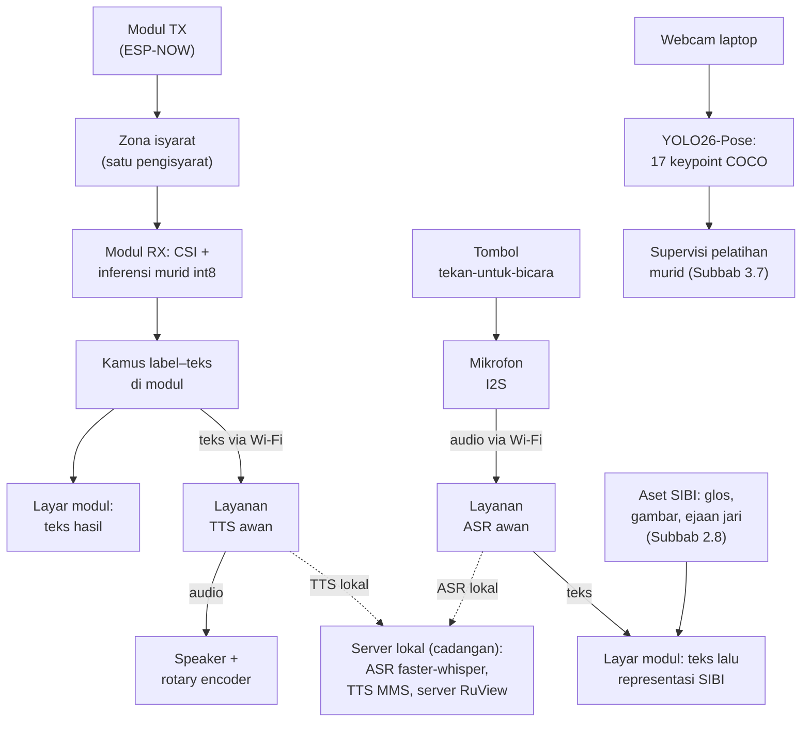
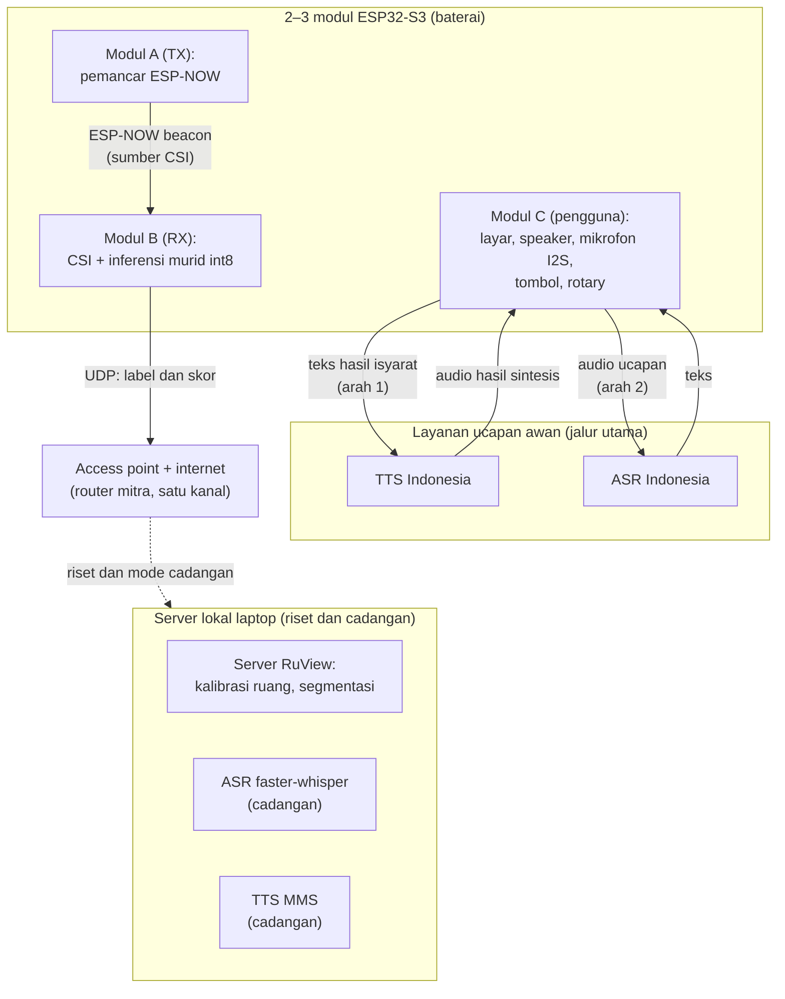

## 3.3 Waktu dan Lokasi Penelitian

Penelitian dilaksanakan pada [PERLU DATA: bulan dan tahun pelaksanaan penelitian] di [PERLU DATA: nama sekolah/lembaga mitra]. Perekaman dan pengujian dilakukan di sedikitnya dua ruang, yaitu jumlah minimum bagi skema *leave-one-room-out*, dan setiap ruang dikalibrasi sebelum perekaman (Subbab 3.5.4). Penyiapan sistem secara mandiri oleh pengguna di luar lembaga mitra berada di luar cakupan.

## 3.4 Alat dan Bahan

Perangkat keras penelitian disajikan pada Tabel 3.1. Dua modul ESP32-S3 berperan sebagai modul pemancar dan modul penerima, sedangkan modul ketiga direncanakan sebagai modul pengguna yang memuat layar, *speaker*, mikrofon, tombol tekan-untuk-bicara, dan rotary encoder volume; pemakaian dua atau tiga modul ditetapkan sesuai hasil uji beban pada T0.

Tabel 3.1 Perangkat keras penelitian

| No. | Nama | Spesifikasi | Jumlah | Keterangan |
|---|---|---|---|---|
| 1 | Modul ESP32-S3 | Papan pengembangan ESP32-S3 dengan PSRAM, varian yang direkomendasikan RuView [28] | 3 unit | Modul TX, modul RX, dan modul pengguna (dapat dipakai bergilir dengan cadangan) |
| 2 | Layar modul | Layar SPI/TFT kecil (1,8–2,8 inci) [PERLU DATA: model final] | 1–2 unit | Tampilan representasi SIBI pada modul pengguna |
| 3 | Antarmuka audio modul | Mikrofon I2S dan *speaker* dengan penguat I2S; contoh model yang umum adalah INMP441 dan MAX98357A [PERLU DATA: model final] | 1 set | Pintu suara arah kedua dan pemutaran TTS |
| 4 | Tombol dan rotary encoder | Tombol sesaat untuk mengaktifkan mikrofon dan rotary encoder untuk pengaturan volume *speaker* | 1 set | Antarmuka pengguna pada modul pengguna |
| 5 | Baterai modul | Baterai Li-ion atau Li-Po dengan regulator daya [PERLU DATA: kapasitas target berdasarkan hasil uji arus] | 1–2 set | Ketahanan modul diukur pada uji operasional |
| 6 | Laptop | ASUS TUF Dash F15 FX516PR: Intel Core i7-11370H, RTX 3070 Laptop 8 GB VRAM, RAM 16 GB | 1 unit | Mesin akuisisi jalur guru, pengembangan, dan server lokal cadangan |
| 7 | *Access point* | Router Wi-Fi 2,4 GHz dengan akses internet atau fitur hotspot laptop [PERLU DATA: pilihan final] | 1 unit | Seluruh modul berada pada satu kanal; akses internet menopang layanan ucapan awan |
| 8 | *Webcam* | Bawaan laptop | 1 unit | Hanya menyala pada jalur guru saat akuisisi dan pelatihan |

Perangkat lunak penelitian disajikan pada Tabel 3.2. Versi setiap perangkat lunak dicatat bersama log konfigurasi pelatihan agar eksperimen dapat diulang.

Tabel 3.2 Perangkat lunak penelitian

| No. | Nama | Fungsi dalam penelitian |
|---|---|---|
| 1 | *Firmware* dan *server* RuView | Menangkap CSI pada modul, mengirimkannya melalui UDP, mengalibrasi ruang, dan menyegmentasi deret saat riset |
| 2 | `scripts/collect-ground-truth.py` (ADR-079, diadaptasi) | Menyinkronkan akuisisi kamera dan CSI; estimator pose asli diganti YOLO26-Pose |
| 3 | Model guru YOLO26-Pose | Mengekstrak deret 17 *keypoint* format COCO pada jalur guru; hasilnya menjadi supervisi tambahan pelatihan murid dan dasar penyaringan segmen |
| 4 | Layanan server GPU Kaggle | Melatih model guru YOLO26-Pose dan model murid CSI |
| 5 | Python, scikit-learn, PyTorch | Ekstraksi fitur, pelatihan SVM dan murid 1D-CNN, serta evaluasi |
| 6 | TensorFlow Lite Micro dan ESP-DL | Menjalankan murid int8 pada modul penerima |
| 7 | faster-whisper | ASR Bahasa Indonesia cadangan pada server lokal dan pembanding jalur awan |
| 8 | MMS-TTS-ind | TTS Bahasa Indonesia cadangan pada server lokal dan pembanding jalur awan |
| 9 | Layanan TTS awan | Jalur utama sintesis pada arah pertama [PERLU DATA: layanan final hasil uji banding] |
| 10 | Layanan ASR awan | Jalur utama pengenalan ucapan pada arah kedua [PERLU DATA: layanan final hasil uji banding] |
| 11 | Kamus label-teks dan teks-isyarat | Dikembangkan sendiri sebagai bagian purwarupa; salinan kamus label-teks dimuat pada modul |

Bahan penelitian meliputi *dataset* CSI beserta deret pose guru hasil perekaman sendiri, lembar definisi isyarat, aset tampilan arah kedua (gambar huruf, angka, dan isyarat terpilih), formulir persetujuan partisipan, instrumen uji, serta kuesioner persepsi. *Dataset* direkam sendiri karena penelitian yang mengenali isyarat SIBI dari CSI belum ditemukan dalam penelusuran literatur (Subbab 2.11).

## 3.5 Perancangan Sistem

### 3.5.1 Arsitektur Dua Arah

Sistem dirancang dalam dua jalur operasional tanpa kamera dan satu jalur guru yang hanya aktif saat akuisisi data dan pelatihan, seperti ditunjukkan pada Gambar 3.5. Pada jalur arah pertama, modul pemancar memancarkan bingkai bersama; gerak pengisyarat mengubah deret CSI pada modul penerima; model murid int8 berjalan pada modul dan menghasilkan label beserta skor keyakinan; label dipetakan menjadi teks Indonesia melalui kamus kecil pada modul; teks tampil di layar modul pengguna, lalu dikirim ke layanan TTS awan; audio hasil sintesis diputar pada *speaker* modul dengan volume yang diatur rotary encoder. Pada jalur arah kedua, tombol tekan-untuk-bicara pada modul pengguna mengaktifkan mikrofon; ucapan dikirim ke layanan ASR awan; teks hasil pengenalan tampil di layar, lalu dipetakan ke representasi SIBI dari aset yang tersimpan pada modul (Subbab 2.8). Saat koneksi internet tidak tersedia, kedua jalur beralih ke server lokal laptop yang menjalankan MMS-TTS-ind dan faster-whisper sebagai cadangan. Jalur guru memakai *webcam* dan YOLO26-Pose untuk mengekstrak deret *keypoint* yang menjadi supervisi tambahan pelatihan murid serta dasar penyaringan segmen; jalur ini bukan bagian produk akhir.

Gambar 3.5 Arsitektur produk akhir tanpa kamera. Rantai kiri = arah 1 (isyarat menjadi teks dan suara); rantai tengah = arah 2 (ucapan menjadi representasi SIBI); rantai kanan = jalur guru yang hanya aktif saat akuisisi data dan pelatihan; garis putus-putus = beralih ke server lokal ketika internet tidak tersedia.

### 3.5.2 Topologi Modul dan Jaringan

Topologi jaringan purwarupa ditunjukkan pada Gambar 3.6. Seluruh perangkat, yaitu 2–3 modul dan server laptop, terhubung ke satu *access point* pada kanal yang sama sehingga penangkapan CSI dan komunikasi data berjalan serentak (Subbab 2.4). *Access point* tersebut juga menyediakan akses internet yang menopang layanan ucapan awan pada kedua arah. Modul pemancar dan modul penerima berkomunikasi melalui ESP-NOW untuk bingkai bersama, modul penerima mengirim label dan skor melalui UDP sebagai telemetri riset, dan modul pengguna mengirim teks atau audio singkat ke layanan ucapan awan. Server lokal menjalankan *server* RuView untuk keperluan riset serta faster-whisper dan TTS MMS sebagai jalur ucapan cadangan; kamus label-teks dimuat sebagai salinan kecil pada modul. Laptop dapat berperan sebagai *access point* melalui hotspot ketika purwarupa berjalan penuh pada mode cadangan lokal tanpa layanan awan.

Gambar 3.6 Topologi perangkat, komunikasi antarmodul, layanan awan, dan server

### 3.5.3 Penempatan Modul dan Zona Isyarat

Modul pemancar dan modul penerima dipasang pada dudukan setinggi dada pengisyarat dan mengapit zona isyarat agar gerak lengan dan tubuh atas berada di antara keduanya; kesesuaiannya diperiksa melalui uji Delta-CSI. Zona isyarat hanya ditempati satu pengisyarat dalam setiap sesi dan sistem tidak mengidentifikasi individu. Jarak antarmodul, ukuran zona, dan penempatan modul pengguna ditetapkan pada T0 dan dicatat dalam metadata sesi (Tabel 3.6).

### 3.5.4 Kalibrasi Ruang

Setiap sesi diawali kalibrasi ruang bawaan RuView selama kurang lebih empat menit dengan 600 bingkai dan 8 *anchor* karena CSI peka terhadap perubahan kondisi ruang [28], [39]. Posisi perabot, kipas angin atau pendingin ruangan yang menyala, dan orang yang lewat dicatat sebagai kovariat untuk menganalisis perbedaan kinerja antarsesi dan antarruang.

## 3.6 Protokol Perekaman Dataset, Partisipan, dan Etika

### 3.6.1 Partisipan

Partisipan terdiri atas 3–4 pengisyarat kompeten, sedikitnya satu validator penutur tunarungu, dan 3–5 pengguna uji. Pengisyarat kompeten adalah guru atau pembina SIBI yang memperagakan isyarat untuk *dataset*; validator menentukan pemilihan kosakata, memeriksa sampel segmen, dan menilai kewajaran keluaran purwarupa; pengguna uji mencoba purwarupa dua arah pada uji kegunaan. Kriteria inklusi dan rekrutmen tercantum pada Tabel 3.6. Setiap pengisyarat direkam dalam sedikitnya dua sesi agar skema lintas sesi dapat dijalankan, dan skema lintas ruang hanya memisahkan pengaruh ruang dari pengaruh orang bila pengisyarat yang sama direkam di setiap ruang.

### 3.6.2 Kurasi Isyarat dan Kosakata Tampilan

Isyarat pengenalan dipilih melalui dua saringan (Subbab 1.4) dengan acuan *Kamus SIBI* [45], sedangkan kosakata tampilan arah kedua mencakup isyarat terpilih tersebut ditambah 26 huruf dan 9 angka sebagai landasan ejaan jari [13]. Hasilnya adalah daftar 5–8 isyarat terisolasi [PERLU DATA: daftar isyarat SIBI terpilih] yang dideskripsikan dalam lembar definisi isyarat sebagai acuan perekaman dan penilaian.

### 3.6.3 Prosedur Perekaman

Perekaman memakai *elisitasi* terisolasi, yaitu satu isyarat per segmen dengan jeda antarrepetisi. Adapun prosedur perekaman setiap sesi adalah sebagai berikut.

1. Menyiapkan peralatan yang digunakan.
2. Memasang modul pemancar dan modul penerima, lalu menghubungkan seluruh perangkat ke *access point* pada satu kanal.
3. Menjalankan kalibrasi ruang dan mencatat metadata sesi, yaitu tanggal, ruang, kode pengisyarat, posisi modul, dan kondisi latar.
4. Menjalankan `scripts/collect-ground-truth.py` agar perekaman CSI dan *webcam* tersinkron.
5. Menampilkan kartu pemandu isyarat target, merekam satu repetisi, memberi jeda, dan mengulanginya hingga setiap isyarat mencapai kurang lebih 30 repetisi.
6. Membuang segmen bila orang tidak terdeteksi YOLO26-Pose, *jitter* *keypoint* ekstrem, atau segmen terpotong, lalu mencatat tingkat segmen terbuang per isyarat dan per pengisyarat.
7. Meminta validator mengambil sampel segmen untuk memeriksa kebenaran bentuk isyarat yang diperagakan.

### 3.6.4 Etika Penelitian

Perekaman dimulai setelah persetujuan institusi mitra dan persetujuan tertulis setiap partisipan diperoleh [PERLU DATA: lembaga atau komisi pemberi persetujuan etik]. Partisipan berhak mengundurkan diri kapan saja tanpa konsekuensi. Formulir persetujuan menyatakan bahwa kamera hanya menyala pada sesi akuisisi dan pelatihan jalur guru, bahwa produk akhir bebas kamera, dan bahwa mode privasi RuView aktif selama penelitian. Video hanya dipakai untuk verifikasi batas segmen, penyaringan kualitas, dan diagnosis; video disimpan terbatas dan tidak dipublikasikan. Audio ucapan pada arah kedua dikirim ke layanan awan sehingga tujuan pengiriman tersebut diungkapkan pada formulir persetujuan dan kebijakan penyimpanan layanan final diperiksa sebelum layanan dipakai. *Dataset* publik hanya memuat CSI, label, dan *keypoint* tanpa identitas partisipan. Token apresiasi validator tercantum pada Tabel 3.6.
