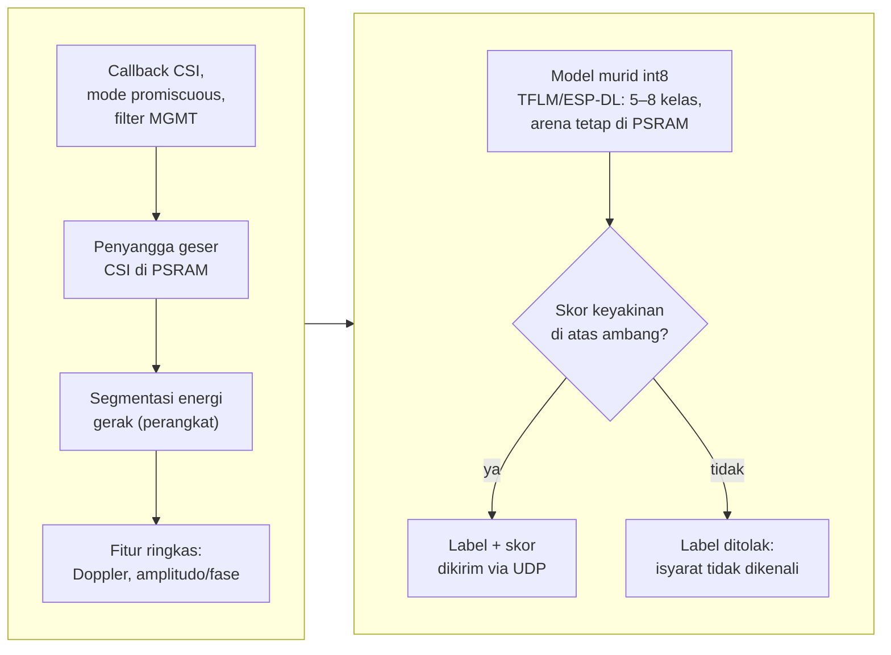

## 3.7 Pengolahan Sinyal, Ekstraksi Fitur, Pelatihan Guru–Murid, dan Deployment

### 3.7.1 Laju Pencuplikan

*Firmware* RuView membatasi pengiriman bingkai CSI paling sering setiap 20 ms sehingga laju maksimumnya 50 bingkai per detik [28]; laju aktual diukur pada T0. Pita Doppler 1–60 Hz hanya terwakili bila laju pencuplikan sedikitnya 120 Hz (Subbab 2.3). Bila laju terukur lebih rendah, pita yang dianalisis dibatasi hingga setengah laju aktual dan pembatasan itu dilaporkan.

### 3.7.2 Segmentasi

Deret CSI dipotong menjadi segmen isyarat dengan segmentasi berbasis energi gerak RuView [28]. Batas segmen diverifikasi dengan deret *keypoint* hanya selama perekaman *dataset*; pada purwarupa, segmentasi berjalan pada modul tanpa kamera.

### 3.7.3 Ekstraksi Fitur

Fitur setiap segmen terdiri atas amplitudo dan fase *subcarrier* terpilih yang saling melengkapi [54], spektrum Doppler pada pita yang ditetapkan setelah T0 [40], serta statistik ringkas berupa energi, entropi, dan lintasan puncak [20]. Kriteria pemilihan *subcarrier* dan definisi lintasan puncak tercantum pada Tabel 3.6. Fitur diringkas menjadi satu vektor untuk SVM dan disusun sebagai deret per langkah waktu untuk 1D-CNN.

### 3.7.4 Model Guru Kamera YOLO26-Pose

Distilasi pengetahuan merupakan teknik melatih model murid yang ringan agar meniru keluaran atau representasi model guru yang lebih kuat [80]. Metode ini dipilih karena CSI tidak memuat citra tubuh sehingga posisi tubuh tidak dapat dilabeli langsung dari data CSI, sedangkan kamera memilikinya secara alami; preseden pemindahan pengetahuan visi ke model Wi-Fi telah ada pada Person-in-WiFi [63] dan DensePose from WiFi [64] (Subbab 2.5). Dalam penelitian ini, YOLO26-Pose berperan sebagai model guru kamera yang mengekstrak deret 17 *keypoint* format COCO dari video perekaman dan hasilnya menjadi supervisi tambahan bagi model murid CSI.

Guru dilatih lanjutan (*fine-tuning*) pada data visual SIBI hasil perekaman T2 dan pelatihannya dijalankan pada layanan server GPU Kaggle. Pelatihan lanjutan dipilih agar deteksi orang dan kestabilan *keypoint* pada gerakan tangan SIBI meningkat dibandingkan model awal. Kualitas guru dievaluasi sebelum dipakai melalui tiga ukuran, yaitu proporsi bingkai dengan orang terdeteksi, tingkat *jitter* *keypoint*, dan pemeriksaan sampel bingkai oleh peneliti; kriteria lolos ketiganya tercantum pada Tabel 3.6. Deret *keypoint* hasil guru disertai penanda waktu sehingga dapat disandingkan dengan jendela CSI dan label kelas.

Model guru tidak mengklasifikasikan isyarat. Label kelas SIBI berasal dari anotasi protokol *elisitasi*, yaitu kartu pemandu yang menentukan isyarat pada setiap segmen (Subbab 3.6) sehingga makna isyarat tidak bergantung pada dugaan model visi. Klasifikasi gerakan otomatis dari video menuntut pengklasifikasi temporal di atas deret *keypoint* dan berada di luar cakupan penelitian ini karena label kelas telah tersedia dari protokol.

### 3.7.5 Dataset Murid dan Pelatihan Distilasi Guru–Murid

Dataset murid dibentuk dengan menyelaraskan tiga deret berdasarkan penanda waktu, yaitu jendela CSI hasil segmentasi, label kelas dari anotasi protokol, dan deret pose guru. Masukan murid berupa jendela deret CSI, bukan cuplikan tunggal, karena gerakan SIBI bersifat temporal sehingga polanya hanya tampak pada urutan waktu (Subbab 2.3). Target pelatihan berupa label kelas, sedangkan deret pose guru menjadi supervisi tambahan yang melengkapi label.

Model murid 1D-CNN dilatih dengan PyTorch [70] pada layanan server GPU Kaggle memakai fungsi kerugian gabungan: kerugian klasifikasi kelas ditambah suku supervisi guru yang mengikat representasi internal murid pada deret pose guru. Bentuk dan bobot suku supervisi ditetapkan dari data validasi dan dicatat pada Tabel 3.6. Dua pembanding dilatih pada data yang sama, yaitu SVM atas fitur ringkas sebagai pembanding dasar [68], [69] dan murid ablasi tanpa suku supervisi guru. Pembanding ablasi memungkinkan manfaat supervisi guru dinilai langsung dari data penelitian ini alih-alih diasumsikan.

Setelah pelatihan, murid memprediksi kelas isyarat dari jendela CSI saja tanpa kamera dan tanpa deret pose. Hiperparameter dipilih berdasarkan data validasi yang terpisah dari data uji, dan model yang dipilih untuk purwarupa adalah model dengan keseimbangan terbaik antara kinerja validasi dan biaya inferensi pada perangkat. Kinerja murid beserta kedua pembandingnya dievaluasi pada lima skema pembagian data (Subbab 3.7.6).

### 3.7.6 Skema Pembagian Data

Kinerja diukur dengan lima skema pembagian data pada Tabel 3.3. Skema dalam sesi memakai pembagian data temporal per blok, yaitu blok repetisi awal untuk pelatihan dan blok akhir untuk pengujian; pembagian acak tidak dipakai karena repetisi berurutan cenderung mirip sehingga informasi dapat bocor dari data latih ke data uji.

Tabel 3.3 Skema pembagian data

| No. | Skema | Data latih | Data uji | Aspek yang diukur |
|---|---|---|---|---|
| 1 | Dalam sesi (blok temporal) | Blok awal satu sesi | Blok akhir sesi yang sama | Separabilitas pada orang, ruang, dan sesi yang sama |
| 2 | Lintas sesi | Sebagian sesi pengisyarat di satu ruang | Sesi lain pengisyarat dan ruang yang sama | Ketahanan terhadap perubahan antarsesi |
| 3 | Lintas partisipan (*leave-one-subject-out*) | Semua pengisyarat kecuali satu | Pengisyarat yang ditinggalkan, bergiliran | Ketahanan terhadap pergantian orang |
| 4 | Lintas ruang (*leave-one-room-out*) | Semua ruang kecuali satu | Ruang yang ditinggalkan, bergiliran | Ketahanan terhadap pergantian ruang |
| 5 | Pengguna baru | Seluruh pengisyarat *dataset* | Satu pengguna baru tanpa pelatihan ulang | Kesiapan dipakai orang baru tanpa perekaman tambahan |

Skema kedua sampai kelima mengukur ketahanan terhadap perubahan domain [39]; karena jumlah pengisyarat dan ruang kecil, hasil lintas partisipan dan lintas ruang dilaporkan untuk setiap putaran. Data validasi hanya diambil dari data latih sehingga data uji tidak dipakai untuk memilih *subcarrier*, menormalkan fitur, memilih hiperparameter, atau menetapkan ambang (Tabel 3.6).

### 3.7.7 Keluaran dengan Penolakan

Keluaran klasifikator dilengkapi skor keyakinan [71]. Segmen dengan skor di bawah ambang menghasilkan status penolakan pada kedua arah: pada arah pertama, *speaker* tidak mengucapkan apa pun dan sistem menampilkan pesan isyarat tidak dikenali; pada purwarupa ini penolakan lebih aman daripada menebak kelas yang salah. Ambang ditetapkan dari data validasi dan kecukupannya diperiksa melalui laju deteksi palsu serta penilaian validator (Subbab 3.8).

### 3.7.8 Kuantisasi dan Deployment ke Modul

Model murid terpilih dikuantisasi int8 lalu dijalankan pada modul penerima melalui TensorFlow Lite Micro atau ESP-DL dengan penyangga pada PSRAM. Selama penangkapan CSI, radio modul terikat pada satu kanal bersama *access point* dengan *power save* dimatikan (WIFI_PS_NONE) [28], sebagaimana dipakai *firmware* RuView. Alur inferensi pada perangkat ditunjukkan pada Gambar 3.7: bingkai CSI dari mode promiscuous masuk ke penyangga geser, segmen terdeteksi dari energi gerak, fitur dihitung, model int8 menghasilkan kelas beserta skor, dan keluaran di atas ambang dikirim melalui UDP. Waktu inferensi per segmen, pemakaian memori, dan pengaruhnya terhadap laju pemrosesan bingkai diukur dan dilaporkan; bila model terbukti terlalu berat untuk dijalankan pada perangkat, klasifikasi dipindahkan ke server sesuai jalur cadangan (Subbab 3.11).

Gambar 3.7 Inferensi langsung pada ESP32-S3
