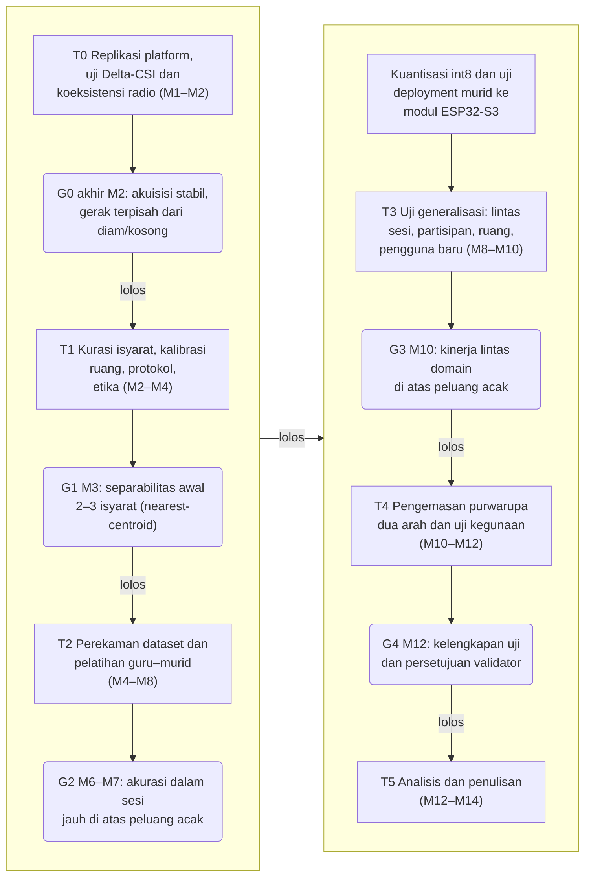
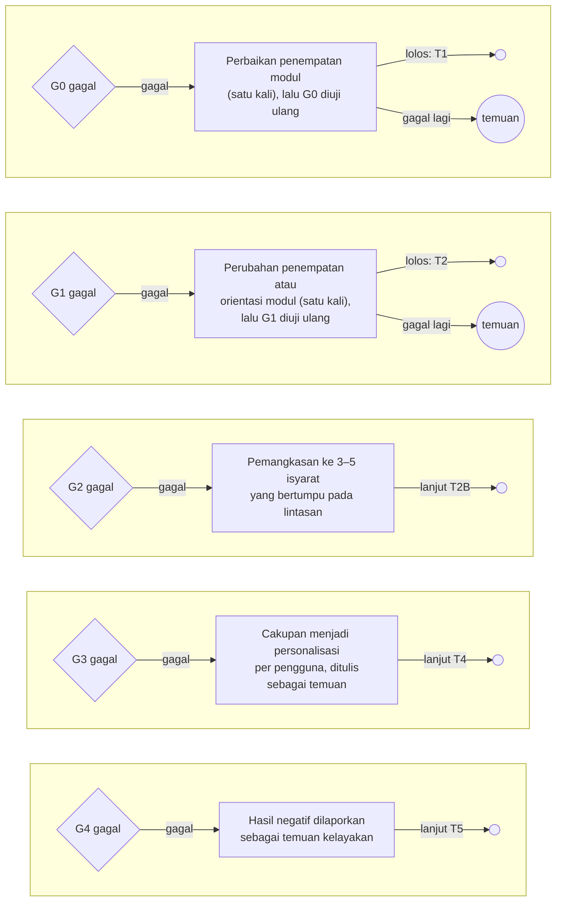
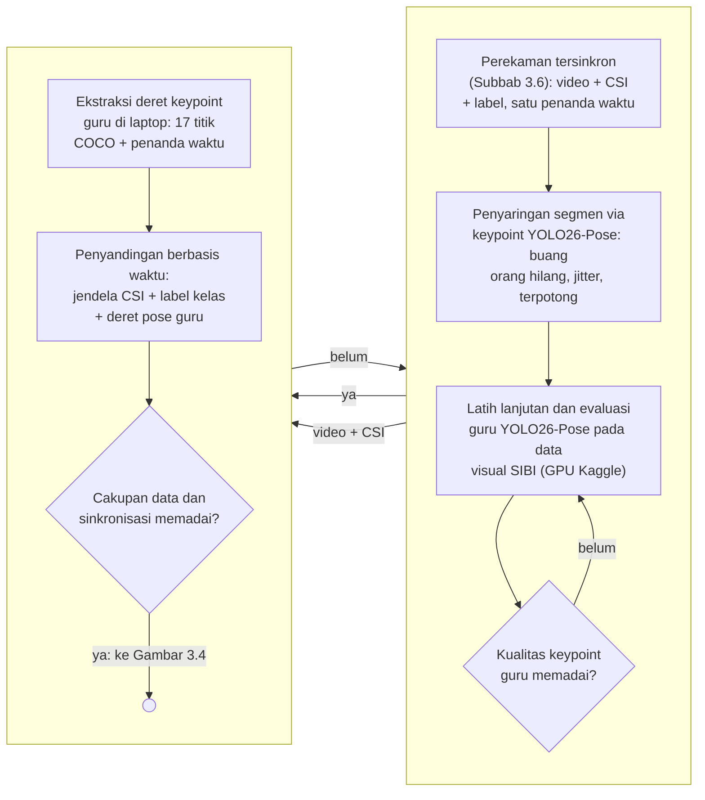
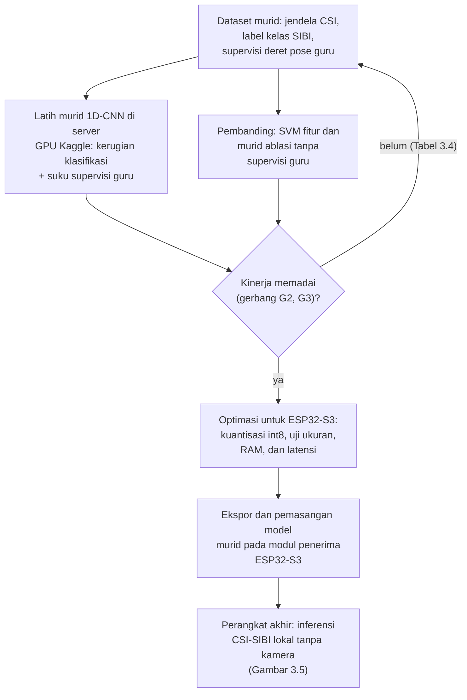
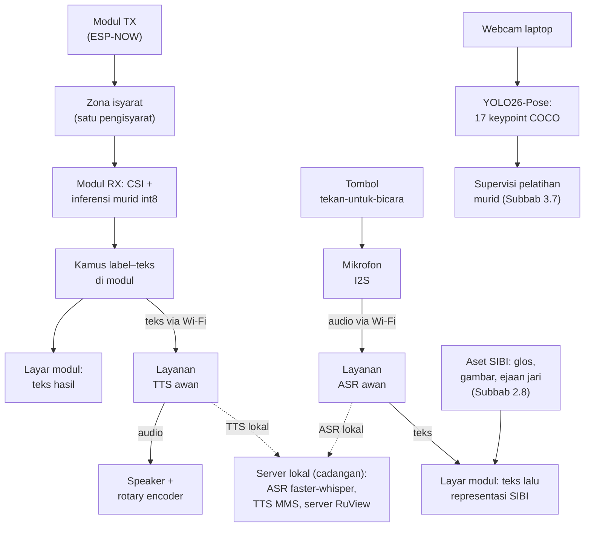
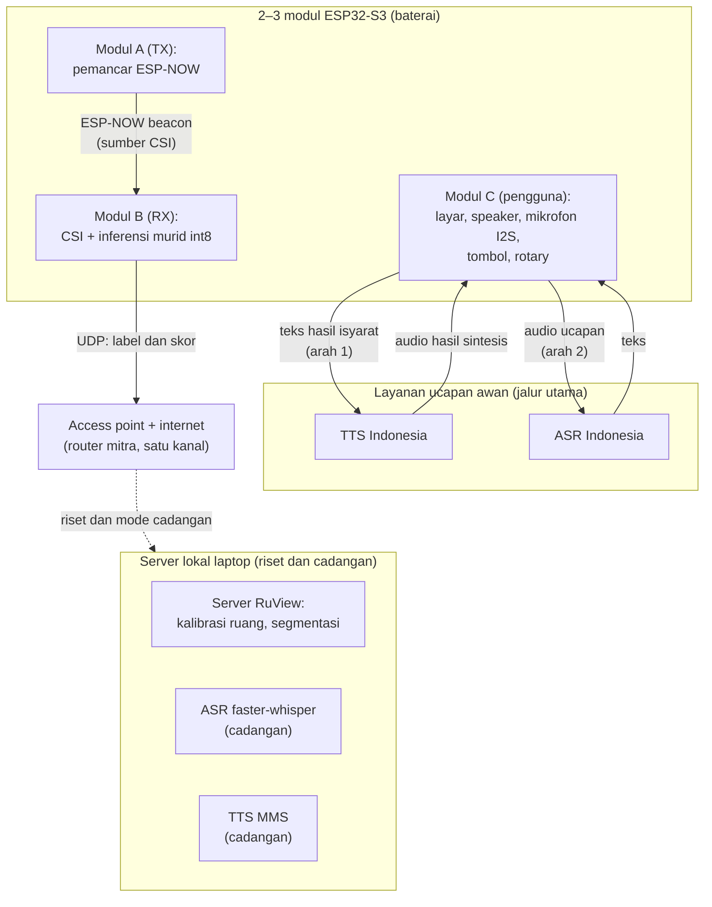
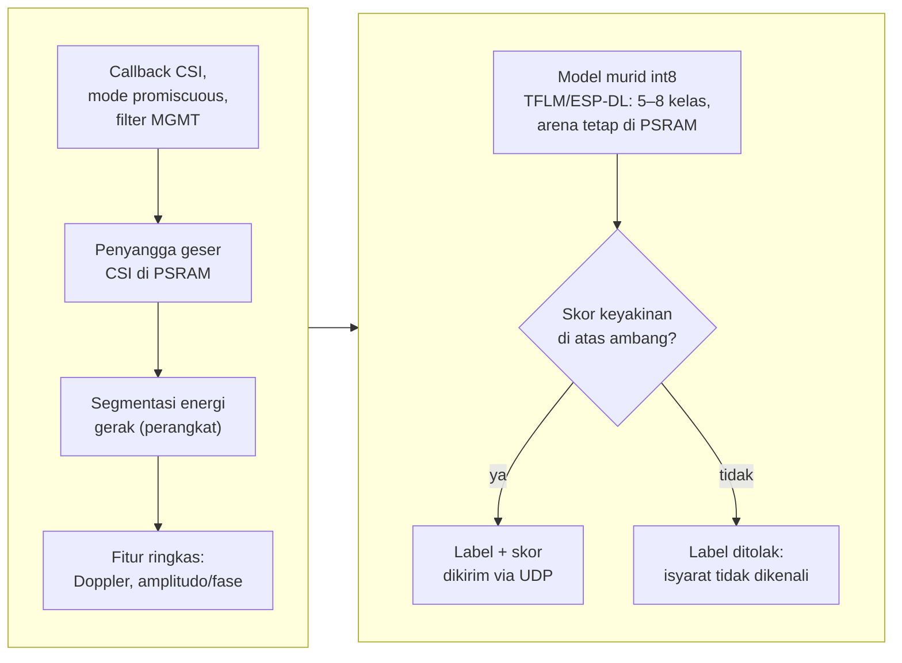
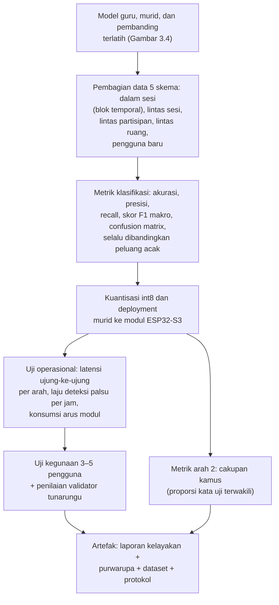

# STUDI KELAYAKAN PURWARUPA SISTEM PENERJEMAHAN DUA ARAH ANTARA SISTEM ISYARAT BAHASA INDONESIA (SIBI) DAN TEKS ATAU UJARAN BAHASA INDONESIA BERBASIS WI-FI CHANNEL STATE INFORMATION (CSI) DENGAN INFERENSI MODEL PADA ESP32-S3 DAN PEMROSESAN BAHASA PADA SERVER UNTUK KOSAKATA TERBATAS

**PROPOSAL PENELITIAN**

| Identitas | Keterangan |
|---|---|
| Judul | STUDI KELAYAKAN PURWARUPA SISTEM PENERJEMAHAN DUA ARAH ANTARA SISTEM ISYARAT BAHASA INDONESIA (SIBI) DAN TEKS ATAU UJARAN BAHASA INDONESIA BERBASIS WI-FI CHANNEL STATE INFORMATION (CSI) DENGAN INFERENSI MODEL PADA ESP32-S3 DAN PEMROSESAN BAHASA PADA SERVER UNTUK KOSAKATA TERBATAS |
| Jenis dokumen | Proposal penelitian (seminar proposal), BAB I–III + Daftar Pustaka |
| Disusun oleh | [PERLU DATA: nama penulis] |
| NIM | [PERLU DATA: NIM penulis] |
| Program studi | [PERLU DATA: program studi] |
| Universitas | [PERLU DATA: nama universitas] |
| Pembimbing | [PERLU DATA: nama pembimbing, bila sudah ditetapkan] |
| Tahun | [PERLU DATA: tahun penyusunan] |

> Catatan penyusunan: draft utuh ini disusun dari dossier bahan `Bahan-Proposal-Translator-SIBI.md` (26 Oktober 2026) dan proposal revisi terverifikasi, dengan struktur serta register korpus sempro-mepet, kaidah bahasa naskah-id (EYD V), dan optimasi kata berjenjang GEPA pada kalimat kritis. Metodologi utama naskah adalah distilasi guru–murid: YOLO26-Pose sebagai guru kamera yang mensupervisi pelatihan murid CSI untuk inferensi tepi pada ESP32-S3. Naskah memuat diagram hanya pada BAB III (Gambar 3.1–3.8) yang tersimpan sebagai berkas Mermaid pada folder `diagram/`; berkas diagram BAB I–II (G1.1, G1.2, G2.1–G2.3) tetap tersimpan pada folder yang sama sebagai konteks bacaan dan tidak dimuat di naskah. Penanda `[PERLU DATA: ...]` menandai keputusan yang menunggu pemilik penelitian, pembimbing, atau hasil tahap sebelumnya.

---

# BAB I PENDAHULUAN

## 1.1 Latar Belakang

Sebagian besar anak tunarungu lahir di tengah keluarga pendengar. Mitchell dan Karchmer [1], [2] mencatat proporsi tersebut sebesar 90–95% pada data siswa tunarungu di Amerika Serikat sekaligus membantah anggapan lama bahwa sekitar 10% anak tunarungu memiliki orang tua tunarungu. Angka sebanding untuk Indonesia belum ditemukan dalam penelusuran penelitian ini pada Google Scholar, Crossref, dan OpenAlex hingga Oktober 2026 sehingga angka dari Amerika Serikat dipakai sebagai gambaran umum. Keluarga pendengar dari anak yang berkomunikasi dengan isyarat perlu ikut mempelajari bahasa isyarat, padahal proses belajarnya membutuhkan dukungan yang terstruktur [3] dan menghadapi hambatan praktis sehari-hari [4]. Kondisi tersebut menandakan bahwa komunikasi antara tunarungu dan pendengar di lingkungan keluarga tidak dapat dianggap terjadi dengan sendirinya.

Komunikasi yang dimaksud bersifat dua arah. Penutur tunarungu menyampaikan pikiran melalui isyarat, sedangkan lawan bicara pendengar membalasnya melalui ucapan atau tulisan; kedua arah sama-sama tersendat apabila salah satu pihak tidak menguasai moda lawannya. Di Indonesia, juru bahasa isyarat yang dapat menjembatani kedua arah masih terbatas, yaitu sekitar 500 orang untuk sekitar 1,92 juta penyandang tunarungu atau kira-kira satu juru bahasa untuk 3.840 orang [5]. Secara hukum, Undang-Undang Nomor 8 Tahun 2016 tentang Penyandang Disabilitas mengakui bahasa isyarat dan mewajibkan aksesibilitas komunikasi [6]. Kewajiban itu sulit dipenuhi bila kemampuan menjembatani dua arah hanya dimiliki segelintir juru bahasa sehingga teknologi bantu komunikasi yang murah dan tersedia menjadi salah satu jalur pelengkap [7].

Sistem Isyarat Bahasa Indonesia (SIBI) dipilih sebagai objek penelitian meskipun bukan moda yang paling banyak dipakai komunitas tunarungu dalam keseharian. Survei ekosistem bahasa isyarat yang dilaporkan Badan Riset dan Inovasi Nasional mencatat penggunaan Bahasa Isyarat Indonesia (BISINDO) sebesar 77,7%, SIBI 1,9%, campuran 14,9%, dan lainnya 5,6% [8]. Survei serupa pada 100 responden tunarungu di Jawa dan Bali melaporkan 91% memakai BISINDO untuk komunikasi sehari-hari [9]. Kedua survei tersebut menegaskan bahwa komunitas tunarungu lebih dekat ke BISINDO, tetapi juga menunjukkan tempat SIBI hidup, yaitu jalur pendidikan formal. Melalui Surat Pemberitahuan Direktorat Pendidikan Dasar Nomor 868/C/U/95, sekolah luar biasa yang menerapkan komunikasi total diwajibkan memakai sistem isyarat yang telah dibakukan [10]. Penelitian di SLB Negeri Ogan Ilir juga menunjukkan murid tunarungu memakai SIBI dalam pembelajaran sehari-hari di sekolah [11]. Dengan demikian, purwarupa penerjemah dua arah yang dibangun untuk konteks pendidikan formal lebih tepat memakai SIBI, sedangkan perluasan ke BISINDO menuntut penggantian kosakata dan validasi ulang bersama penuturnya.

Teknologi yang telah tersedia untuk kebutuhan tersebut masih terbagi menurut arah dan belum menyatu. Pada arah ucapan atau teks menjadi isyarat, aplikasi yang ada berbentuk kamus kata-level. KASIBI mengubah suara menjadi teks lalu menampilkan animasi peraga tiga dimensi dari basis data kosakata [12], sedangkan OpenSIBI memakai layanan pengenal ucapan lalu mencocokkan kata ke model tiga dimensi yang juga dianimasikan di layar [13]. Keduanya mengakui cakupan kosakatanya sangat terbatas. Pada arah isyarat menjadi teks, penelitian di Indonesia bertumpu pada citra atau video dari kamera [14], [15], termasuk penerapan berbasis *smartphone* untuk huruf SIBI statis [16], [17]. Pendekatan berbasis kamera menuntut pencahayaan dan garis pandang tertentu sehingga ketangguhannya menurun saat kondisi berubah [18], sedangkan kehadiran kamera yang terus menyala selama percakapan diduga memengaruhi kenyamanan pengguna dan dikaitkan dengan kelelahan nonverbal [19]. Kesenjangan-kesenjangan tersebut menjadi titik berangkat penelitian ini.

Penginderaan berbasis Wi-Fi *Channel State Information* (CSI) menjadi kandidat pengganti kamera pada arah isyarat menjadi teks. CSI memuat informasi amplitudo dan fase pada setiap *subcarrier* yang berubah ketika gerak tubuh mengganggu jalur propagasi sinyal [20]. Ma dkk. [21] membangun SignFi yang mengenali 276 isyarat *American Sign Language* (ASL) dari CSI. Sistem DF-WiSLR mengenali 49 gestur tanpa perangkat yang dikenakan pengguna [22], dan pendekatan serupa telah dicoba pada *Filipino Sign Language* [23]. Preseden terbaru, WiSign, bahkan mengenali kalimat ASL kontinu dari CSI perangkat Wi-Fi komersial [24]. Kepekaan CSI terhadap gerak halus juga telah terbukti pada gerak yang jauh lebih kecil daripada gerak lengan: WiKey mengenali ketukan tombol dengan akurasi klasifikasi 96,4% untuk tombol tunggal pada kondisi terkendali [25]. Pemantauan napas dari CSI berhasil mengklasifikasikan pola pernapasan dengan akurasi 99,54% [26]. Meskipun demikian, belum ditemukan publikasi yang memakai CSI untuk mengenali isyarat SIBI maupun purwarupa penerjemah dua arah yang memadukan penginderaan CSI dengan pemrosesan bahasa Indonesia. Penelusuran tersebut mencakup Google Scholar, Crossref, dan OpenAlex hingga Oktober 2026 dengan kata kunci bahasa Inggris dan bahasa Indonesia (Subbab 2.11).

Perangkat penginderaan yang dipakai penelitian ini adalah modul ESP32-S3, yaitu mikrokontroler murah dengan radio Wi-Fi 2,4 GHz yang mendukung perolehan CSI secara resmi [27] dan direkomendasikan platform RuView untuk modul penangkap CSI [28]. ESP32-S3 memiliki inti ganda 240 MHz, SRAM 512 KB, dan PSRAM terpasang hingga 8 MB [29]. Dua fakta teknis menjadi dasar kelayakan rancangan. Pertama, satu *chip* ESP32-S3 terbukti mampu menjalankan penangkapan CSI, koneksi *station* ke *access point*, dan pengiriman data secara serentak sebagaimana dijalankan *firmware* RuView [28]. Koeksistensi itu mensyaratkan seluruh perangkat berada pada satu kanal serta radio tidak memasuki mode hemat daya. Kedua, inferensi model terkuantisasi pada perangkat didukung tolok ukur resmi: pustaka ESP-NN mempercepat model pendeteksi orang dari 2.300 ms menjadi 54 ms pada ESP32-S3 [30]. Pustaka ESP-DL juga menyediakan model contoh pengenalan gestur tangan dengan waktu inferensi 69,2 ms [31]. Dengan demikian, purwarupa dirancang agar pengenalan isyarat berjalan langsung pada modul, sementara keluarannya diteruskan ke layanan ucapan awan untuk disuarakan.

Purwarupa yang dirancang terdiri atas 2–3 modul ESP32-S3 yang portabel dan direncanakan memiliki layar, baterai, *speaker*, mikrofon, tombol tekan-untuk-bicara, dan rotary encoder volume. Pada arah pertama, modul pemancar dan modul penerima mengapit zona isyarat. Modul penerima menangkap CSI, mengenali isyarat melalui model murid yang berjalan pada perangkat, memetakan label menjadi teks melalui kamus label-teks kecil pada modul, lalu mengirim teks ke layanan sintesis ucapan awan dan menampilkannya di layar. Pada arah kedua, tombol pada modul mengaktifkan mikrofon; ucapan dikirim ke layanan pengenal ucapan awan untuk diubah menjadi teks, kemudian teks dipetakan ke representasi SIBI dan ditampilkan di layar modul. Laptop ASUS TUF Dash F15 FX516PR (Intel Core i7-11370H, GPU RTX 3070 Laptop 8 GB VRAM, RAM 16 GB) menjadi mesin akuisisi jalur guru, mesin pengembangan, dan server lokal cadangan. Pelatihan model guru dan model murid dijalankan pada layanan server GPU Kaggle. Teknologi pemrosesan bahasanya telah dicocokkan dengan sumber primernya. Pengenal ucapan Whisper mendukung lebih dari 100 bahasa termasuk Indonesia [32], dan implementasi faster-whisper terbukti jauh lebih cepat daripada waktu nyata pada GPU kelas 8 GB [33]. Untuk sintesis suara, model MMS menyediakan *checkpoint* bahasa Indonesia yang dapat dijalankan lokal [34], [35], sedangkan layanan awan Google dan Azure menyediakan suara Indonesia [36], [37]. Model ringan Kokoro justru tidak mencakup bahasa Indonesia sehingga tidak dipakai [38]. Pada purwarupa, jalur ucapan memakai layanan awan berbahasa Indonesia dengan server lokal sebagai jalur cadangan dan pembanding.

Sebagai studi kelayakan, penelitian ini tidak mengklaim penerjemahan kontinu kosakata penuh. Kosakata dibatasi pada 5–8 isyarat SIBI terisolasi yang dibedakan oleh lintasan lengan, tubuh atas, atau kepala, bukan oleh bentuk jari, dengan alasan resolusi spasial CSI pada satu tautan antarmodul (Subbab 2.3). Model berbasis CSI juga mudah mengalami *overfitting* terhadap orang dan ruang tempat data direkam [39] sehingga kinerja diukur lintas partisipan dan lintas ruang dengan acuan strategi Widar3.0 [40]. Model murid CSI dilatih dengan distilasi guru–murid (*teacher–student*): model guru kamera YOLO26-Pose mengekstrak deret pose gerakan SIBI dari video perekaman, sedangkan label kelas tetap berasal dari anotasi protokol (Subbab 2.5). Model murid belajar mengenali isyarat dari jendela CSI dengan supervisi tambahan deret pose guru, lalu berjalan sendiri pada modul tanpa kamera sehingga kamera dan model guru hanya aktif pada tahap akuisisi data dan pelatihan [41], [42]. Pemetaan teks ke representasi SIBI pada arah kedua dibatasi pada kamus kata-level dengan *fallback* ejaan jari sebagaimana preseden KASIBI dan OpenSIBI. Penerjemahan tata bahasa penuh masih menjadi masalah terbuka internasional [43], [44]. Setiap tahapan ditutup gerbang keputusan sehingga kegagalan tetap dilaporkan sebagai temuan kelayakan. Berdasarkan uraian tersebut, penelitian ini merancang dan membangun purwarupa sistem penerjemahan dua arah antara SIBI dan teks atau ujaran bahasa Indonesia berbasis Wi-Fi CSI dengan inferensi model pada modul ESP32-S3 dan pemrosesan bahasa pada server. Pemrosesan bahasa tersebut memakai layanan ucapan awan sebagai jalur utama dan server lokal sebagai cadangan, sedangkan kelayakan purwarupa diuji sebagai alat bantu komunikasi untuk kosakata terbatas pada konteks pendidikan formal.

## 1.2 Rumusan Masalah

Berdasarkan latar belakang yang telah dipaparkan, masalah yang dikaji dalam penelitian ini dapat dirumuskan sebagai berikut.

1. Bagaimana merancang purwarupa sistem penerjemahan dua arah antara SIBI dan teks atau ujaran bahasa Indonesia berbasis dua hingga tiga modul ESP32-S3 yang menangkap CSI dan menjalankan inferensi model pada perangkat, dengan pemrosesan bahasa pada server melalui layanan ucapan awan dan server lokal cadangan, termasuk protokol perekaman *dataset* isyarat terisolasi serta pelatihan model murid CSI dengan supervisi model guru YOLO26-Pose?
2. Bagaimana kinerja pengenalan 5–8 isyarat SIBI terisolasi dari CSI melalui inferensi pada perangkat, serta kinerja jalur isyarat menjadi teks dan suara dan jalur teks atau ucapan menjadi representasi SIBI, pada skenario dalam sesi, lintas partisipan, dan lintas ruang?
3. Bagaimana kelayakan purwarupa sebagai alat bantu komunikasi dua arah untuk kosakata terbatas ditinjau dari latensi ujung ke ujung, cakupan kosakata, keandalan operasional, dan penilaian validator penutur tunarungu?

## 1.3 Tujuan Penelitian

Berdasarkan rumusan masalah tersebut, penelitian ini bertujuan:

1. Merancang purwarupa sistem penerjemahan dua arah antara SIBI dan teks atau ujaran bahasa Indonesia berbasis dua hingga tiga modul ESP32-S3 yang menangkap CSI dan menjalankan inferensi model pada perangkat, dengan pemrosesan bahasa pada server melalui layanan ucapan awan dan server lokal cadangan, termasuk protokol perekaman *dataset* isyarat terisolasi serta pelatihan model murid CSI dengan supervisi model guru YOLO26-Pose.
2. Mengukur kinerja pengenalan 5–8 isyarat SIBI terisolasi dari CSI melalui inferensi pada perangkat, serta kinerja jalur isyarat menjadi teks dan suara dan jalur teks atau ucapan menjadi representasi SIBI, pada skenario dalam sesi, lintas partisipan, dan lintas ruang.
3. Menguji kelayakan purwarupa sebagai alat bantu komunikasi dua arah untuk kosakata terbatas berdasarkan latensi ujung ke ujung, cakupan kosakata, keandalan operasional, dan penilaian validator penutur tunarungu.

## 1.4 Batasan Masalah

Ruang lingkup penelitian ini dibatasi sebagai berikut.

1. Objek pengenalan adalah 5–8 isyarat SIBI terisolasi yang lolos dua saringan, yaitu separabilitas fisik (isyarat dibedakan oleh lintasan lengan, tubuh atas, atau kepala, bukan oleh bentuk jari) dan validitas pedagogis (disetujui validator penutur tunarungu dan dicocokkan dengan *Kamus SIBI* [45]). Sistem yang dibangun bukan penerjemah kalimat dan tidak menangani pengenalan isyarat kontinu.
2. Konfigurasi jari dan ekspresi wajah tidak dikenali. Batas ini mengikat kedua arah sehingga keluaran arah pertama hanya menyangkut lintasan gerak, sedangkan arah kedua menampilkan representasi tingkat kata dan ejaan jari, bukan tata bahasa isyarat penuh beserta penanda nonmanual.
3. Perangkat keras terdiri atas 2–3 modul ESP32-S3 (masing-masing direncanakan memiliki layar kecil, baterai, *speaker*, mikrofon I2S, tombol tekan-untuk-bicara, dan rotary encoder volume) serta satu laptop ASUS TUF Dash F15 FX516PR (Intel Core i7-11370H, RTX 3070 Laptop 8 GB VRAM, RAM 16 GB) sebagai mesin akuisisi jalur guru, mesin pengembangan, dan server lokal cadangan. Pelatihan model guru dan murid memakai layanan server GPU Kaggle.
4. Kamera dan YOLO26-Pose hanya dipakai sebagai model guru pada tahap akuisisi data dan pelatihan di laptop dan layanan server GPU Kaggle. Label kelas isyarat berasal dari anotasi protokol, bukan keluaran model guru, dan produk akhir tidak memakai kamera maupun citra.
5. Pemrosesan bahasa memakai teknologi yang terverifikasi mendukung bahasa Indonesia: layanan sintesis ucapan dan pengenalan ucapan otomatis awan menjadi jalur utama, sedangkan Whisper dan MMS-TTS-ind pada server lokal menjadi cadangan dan pembanding; pilihan final ditetapkan pada T4 (Tabel 3.6).
6. Arah kedua dibatasi pada kamus kata-level dengan *fallback* ejaan jari (26 huruf dan angka 1–9) sebagaimana preseden OpenSIBI; cakupan kamus diukur dan dilaporkan, tidak dijanjikan mencakup kosakata kamus SIBI penuh.
7. Setiap sesi melibatkan satu pengisyarat pada zona akuisisi; sistem tidak mengidentifikasi individu, dan pengujian dilakukan di sedikitnya dua ruang mitra yang dikalibrasi dalam penelitian ini.
8. Uji pengguna dilakukan dalam skala kecil dengan 3–5 pengguna dan dianalisis secara deskriptif tanpa statistik inferensial.
9. Penelitian ini tidak membahas pengenalan isyarat kontinu, penerjemahan kalimat dengan tata bahasa isyarat penuh beserta penanda nonmanual, penggunaan BISINDO, maupun klasifikasi gerakan otomatis dari video oleh model guru.

## 1.5 Manfaat Penelitian

Manfaat penelitian ini dibedakan menjadi manfaat teoretis dan manfaat praktis.

### 1.5.1 Manfaat Teoretis

Penelitian ini diharapkan memberikan bukti awal kelayakan pengenalan sekelompok kecil isyarat SIBI terisolasi dari CSI satu tautan antarmodul ESP32-S3, disertai bukti kelayakan inferensi model terkuantisasi pada perangkat untuk tugas tersebut. Bukti itu tidak berlaku bagi kosakata yang dibedakan oleh bentuk jari. Penelitian ini juga menyediakan *dataset* CSI isyarat SIBI berlabel beserta deret pose model guru dan protokol perekamannya sehingga dapat menjadi pembanding bagi penelitian penginderaan nirkabel untuk bahasa isyarat lain, termasuk perluasan ke BISINDO. Kajian integrasi penginderaan CSI dengan jalur sintesis ucapan dan pengenalan ucapan otomatis bahasa Indonesia pada satu purwarupa memberikan contoh dokumentasi arsitektur tepi–awan yang dapat ditelusuri ulang peneliti berikutnya.

### 1.5.2 Manfaat Praktis

Bagi lembaga pendidikan mitra, penelitian ini memberikan gambaran kelayakan purwarupa alat bantu komunikasi dua arah berbahasa SIBI yang dapat dipakai guru dan keluarga pada kegiatan pembelajaran, beserta protokol kurasi kosakata yang disusun bersama validator penutur tunarungu. Bila tahapan penelitian mencapai gerbang terakhir, dihasilkan purwarupa yang menampilkan teks dan menyuarakan isyarat SIBI yang dikenali serta menampilkan representasi isyarat bagi lawan bicara pendengar. Bila penelitian berhenti lebih awal, artefak berupa laporan karakterisasi sinyal, protokol, atau *dataset* berlabel tetap dihasilkan. Bagi keluarga siswa tunarungu, kosakata yang divalidasi penutur tunarungu memastikan bentuk isyarat yang ditampilkan baku sesuai jalur pendidikan formal. Bagi komunitas riset, *dataset* dan rancangan yang tidak terikat pada satu bahasa isyarat memudahkan replikasi dan pembandingan metode.

## 1.6 Sistematika Penulisan

Proposal penelitian ini terdiri atas tiga bab dengan sistematika sebagai berikut.

**BAB I Pendahuluan** memuat latar belakang, rumusan masalah, tujuan penelitian, batasan masalah, manfaat penelitian, dan sistematika penulisan.

**BAB II Kajian Pustaka** memuat kajian teori dan penelitian terdahulu yang menjadi dasar perancangan. Kajian mencakup bahasa isyarat dan SIBI, kebutuhan komunikasi dua arah dan sistem terdahulu, Wi-Fi CSI, modul ESP32-S3 dan platform RuView beserta koeksistensi radionya, peran YOLO26-Pose sebagai model guru kamera dalam distilasi guru–murid, pengenalan isyarat dan gestur berbasis CSI serta inferensi pada perangkat, sintesis ucapan dan pengenalan ucapan otomatis bahasa Indonesia, pemetaan teks ke representasi SIBI di layar, komunikasi perangkat dan server, evaluasi kelayakan, serta penelitian terdahulu yang relevan.

**BAB III Metode Penelitian** memuat desain penelitian; tahapan penelitian beserta gerbang keputusan; waktu dan lokasi penelitian; alat dan bahan; perancangan sistem; protokol perekaman *dataset* beserta partisipan dan etika; pengolahan sinyal, ekstraksi fitur, pelatihan guru–murid, dan *deployment*; skenario pengujian dan metrik evaluasi; jadwal penelitian; parameter rancangan yang ditetapkan kemudian; serta risiko dan alternatif cadangan.

# BAB II KAJIAN PUSTAKA

## 2.1 Bahasa Isyarat dan Sistem Isyarat Bahasa Indonesia

Bahasa isyarat merupakan bahasa visual yang menyampaikan makna melalui gerak tangan, lengan, tubuh, dan ekspresi wajah [46], [47]. Secara struktural, sebuah isyarat tersusun atas bentuk tangan, lokasi, gerak, orientasi telapak tangan, dan komponen nonmanual seperti ekspresi wajah; perbedaan pada satu parameter saja dapat membedakan makna dua isyarat [46], [47]. Dalam penelitian ini, parameter tersebut menjadi acuan untuk memisahkan bagian isyarat yang dapat dinilai mesin dari bagian yang tetap memerlukan penilaian manusia (Subbab 2.3 dan 2.8).

Pemakaian bahasa isyarat di Indonesia tidak seragam. Survei ekosistem bahasa isyarat menunjukkan BISINDO jauh lebih banyak dipakai respondennya daripada SIBI, sedangkan SIBI berkembang di jalur pendidikan formal [8]; angka pemakaian dan keterbatasan sampel survei tersebut telah dipaparkan pada Subbab 1.1. Survei pada responden tunarungu di Jawa dan Bali melaporkan bahwa 91% responden memakai BISINDO untuk komunikasi sehari-hari karena konsep SIBI dianggap sulit [9]. SIBI sendiri merupakan sistem isyarat baku yang dikembangkan untuk keperluan pendidikan formal, sedangkan BISINDO berkembang secara alami di komunitas tunarungu; kajian pada mahasiswa tunarungu [48] dan pada siswa SLB [49] menjelaskan perbedaan pemakaian keduanya. Bentuk baku isyarat SIBI didokumentasikan dalam *Kamus Sistem Isyarat Bahasa Indonesia* yang selanjutnya disebut *Kamus SIBI* [45], dan bentuk digitalnya tersedia melalui Kamus SIBI Digital [10].

Pemilihan SIBI dalam penelitian ini didasarkan pada jalur pendidikan formal yang menjadi konteks pemakaian purwarupa, bukan pada jumlah penuturnya (Subbab 1.1). Alat yang dirancang tidak dimaksudkan untuk menggantikan BISINDO dalam komunikasi komunitas tunarungu sehari-hari. Rancangan sistem tidak terikat pada satu bahasa isyarat tertentu sehingga perluasan ke BISINDO pada prinsipnya dapat dilakukan dengan mengganti *dataset*, menyeleksi ulang kosakata dengan kriteria yang sama, dan melakukan validasi bersama validator penutur BISINDO. Kelayakan perluasan tersebut tidak diuji dalam penelitian ini dan diusulkan sebagai penelitian lanjutan.

## 2.2 Kebutuhan Komunikasi Dua Arah dan Sistem Terdahulu

Komunikasi antara penutur isyarat dan pendengar menuntut kemampuan pada kedua arah, yaitu memahami isyarat yang diperagakan dan membalasnya dengan moda yang dapat dipahami lawan bicara. Sebagian besar anak tunarungu lahir dari orang tua pendengar [1] sehingga keluarga pendengar berada di barisan pertama yang merasakan kebutuhan tersebut; mereka yang belajar bahasa isyarat membutuhkan dukungan belajar terstruktur serta menghadapi hambatan praktis [3], [4]. Juru bahasa isyarat profesional yang dapat menjembatani kedua arah jumlahnya terbatas [5] sehingga teknologi bantu komunikasi berperan sebagai pelengkap [7]. Dalam penelitian ini, kebutuhan tersebut diterjemahkan menjadi purwarupa yang bekerja dua arah, bukan sekadar kamus satu arah.

Sistem terdahulu di Indonesia dapat dikelompokkan menurut arah kerjanya. Pada arah ucapan atau teks menjadi isyarat, KASIBI mengubah suara menjadi teks melalui layanan pengenal ucapan, mencocokkan kata pada basis data, lalu menampilkan animasi peraga tiga dimensi; sistem tersebut diuji sebagai media pembelajaran dan memperoleh rata-rata skor 3,362 dari 4 [12]. OpenSIBI memakai mekanisme serupa dengan menyimpan model tiga dimensi format Collada pada *application programming interface* (API) sehingga aplikasi Android dapat menganimasikannya; cakupannya 50 kosakata yang terdiri atas 9 angka, 26 huruf, dan 15 kata, dan penulisnya mengakui keterbatasan kosakata sebagai kelemahan utama [13]. Kedua sistem tersebut membuktikan bahwa arah balik kata-level secara teknis dapat dibangun, tetapi sekaligus menandai biaya pembuatan aset per isyarat yang tinggi. Aplikasi pembelajaran dasar lain menyasar arah manusia belajar isyarat [50].

Pada arah isyarat menjadi teks, riset Indonesia umumnya bertumpu pada citra atau video dari kamera [14]. Dwijayanti dkk. [15] memakai *convolutional neural network* (CNN) untuk citra huruf dan angka BISINDO, Kindy dkk. [51] menyusun *dataset* video BISINDO tingkat kata, Wiguna dan Rojali [52] mengenali kalimat BISINDO dari video, dan Sebastian dkk. [53] memakai pengenalan gestur tubuh yang memperhitungkan informasi spasial. Khusus SIBI, Soekarta dkk. [16] membangun aplikasi Android berbasis MediaPipe untuk 24 huruf statis, disusul aplikasi pengenalan alfabet statis berbasis TensorFlow Lite [17]. Seluruh kelompok ini memerlukan kamera saat sistem dipakai sehingga keberhasilannya bergantung pada pencahayaan dan garis pandang [18], [47].

Pendekatan lain yang tidak memerlukan kamera adalah sensor yang dikenakan pada tangan, seperti sarung tangan sensor dan sensor inersia, yang dapat menangkap konfigurasi jari. Namun, perangkatnya harus dikenakan dan dikalibrasi setiap kali dipakai [47], [23] sehingga tidak cocok untuk percakapan yang berlangsung santai. Paparan kamera yang terus menyala selama percakapan juga dikaitkan dengan kelelahan nonverbal [19]. Oleh karena itu, penelitian ini menelusuri penginderaan berbasis sinyal Wi-Fi yang bekerja tanpa kamera dan tanpa perangkat yang dikenakan, sementara sistem terdahulu yang paling dekat dengan arah balik, yaitu KASIBI dan OpenSIBI, menjadi preseden perancangan jalur kedua purwarupa (Subbab 2.8).

## 2.3 Wi-Fi Channel State Information

Wi-Fi *Channel State Information* (CSI) merupakan informasi amplitudo dan fase pada setiap *subcarrier* yang menggambarkan kondisi kanal propagasi antara pemancar dan penerima Wi-Fi [20]. Sinyal Wi-Fi tiba di penerima melalui beberapa jalur, yaitu jalur langsung dan jalur pantulan dari dinding, perabot, serta tubuh manusia. Ketika tubuh bergerak di antara pemancar dan penerima, panjang jalur pantulan berubah sehingga amplitudo dan fase pada setiap *subcarrier* ikut berubah; perubahan itulah yang dimanfaatkan untuk mengenali gerak tanpa sensor yang dikenakan di tubuh [20].

Amplitudo dan fase memuat informasi yang berbeda tentang perubahan kanal. Cai dkk. [54] memanfaatkan keduanya sebagai informasi yang saling melengkapi untuk pengenalan gestur. Setiap *subcarrier* menempati frekuensi yang sedikit berbeda sehingga satu gerak yang sama menghasilkan perubahan yang tidak identik pada setiap *subcarrier* [20]. Dengan demikian, CSI menyediakan banyak kanal pengamatan dari satu pasang pemancar dan penerima.

Gerak lengan juga menghasilkan komponen Doppler, yaitu pergeseran frekuensi yang sebanding dengan laju perubahan panjang jalur pantulan [20], [40]. Komponen tersebut dapat diukur dari deret CSI dan mencerminkan kecepatan gerak. Penelitian ini memusatkan analisis Doppler pada pita frekuensi gerak 1–60 Hz; agar pita tersebut terwakili, laju pencuplikan CSI harus sekurang-kurangnya dua kali frekuensi tertingginya, yaitu 120 Hz, sesuai kriteria Nyquist [55], [56]. *Firmware* RuView membatasi pengiriman bingkai CSI paling sering setiap 20 ms, yang setara dengan laju maksimum 50 bingkai per detik, menurut kode sumber *firmware*-nya [28]; laju aktual pada konfigurasi penelitian diukur pada tahap replikasi (BAB III). Bila laju terukur lebih rendah daripada 120 Hz, pita Doppler yang dapat diamati menyempit hingga setengah laju pencuplikan aktual dan pembatasan itu dilaporkan.

Kepekaan CSI terhadap gerak halus telah dibuktikan pada gerak yang jauh lebih kecil daripada gerak lengan. WiKey mengenali ketukan tombol dari CSI dengan tingkat deteksi lebih dari 97,5% dan akurasi klasifikasi 96,4% untuk kunci tunggal pada lingkungan terkendali [25]. Pemantauan pernapasan dari Wi-Fi CSI berhasil mengklasifikasikan pola pernapasan dengan akurasi 99,54% dan laju napas dengan akurasi 98,69% pada kanal yang cukup baik [26], padahal gerak dada akibat napas berada pada orde milimeter. Kedua preseden tersebut menunjukkan bahwa CSI peka terhadap gerak skala sentimeter hingga milimeter pada kondisi jarak dekat dan pengguna tunggal. Meskipun demikian, keduanya bekerja pada kondisi terkendali sehingga keberhasilannya tidak serta-merta berlaku pada konfigurasi penelitian ini; bukti itu dipakai sebagai dasar hipotesis kerja, bukan jaminan hasil.

Pola CSI tidak hanya dipengaruhi oleh gerak isyarat, tetapi juga oleh pengisyarat yang memperagakannya dan ruang tempat perekaman. Akibatnya, model berbasis CSI mudah mengalami *overfitting* terhadap orang dan ruang tempat data pelatihan direkam [39]. Chen dkk. merangkum strategi generalisasi lintas domain untuk mengatasi persoalan tersebut, sedangkan Zhang dkk. mengusulkan Widar3.0 yang mengenali gestur lintas domain tanpa pelatihan ulang dengan profil kecepatan yang diturunkan dari Doppler [40]. Dalam penelitian ini, strategi lintas domain dijadikan acuan rancangan fitur, sedangkan kemampuan generalisasi sistem diukur langsung melalui skenario pengujian (Subbab 2.10 dan 3.8).

Panjang gelombang Wi-Fi pada pita 2,4 GHz sekitar 12,5 cm dan membatasi resolusi spasial CSI. Sejumlah penelitian melaporkan pengenalan isyarat dan gestur tangan dari CSI dengan perangkat riset multiantena. SignFi memakai NIC Intel 5300 dengan tiga antena penerima [21]. Wi-SL memakai router dengan dua antena pemancar dan tiga antena penerima pada kanal 40 MHz dengan laju pencuplikan 400 Hz [57]. HandFi memakai NIC Intel 5300 sebagai penerima dari router Wi-Fi komersial [58]. Penelitian ini tidak mengasumsikan kemampuan tersebut juga dimiliki perangkat yang digunakan. Dengan satu tautan antara dua modul ESP32-S3 yang masing-masing berantena tunggal, perbedaan konfigurasi jari dan ekspresi wajah diasumsikan terlalu halus untuk dibedakan secara andal. Asumsi tersebut diperiksa melalui uji Delta-CSI (BAB III) sehingga cakupan pengenalan dibatasi pada lintasan lengan, tubuh atas, dan kepala. Batas resolusi tersebut menentukan saringan separabilitas fisik pada kurasi kosakata (Subbab 3.6) dan makna keluaran sistem pada kedua arah.

## 2.4 Modul ESP32-S3, Platform RuView, dan Koeksistensi Radio

ESP32-S3 merupakan mikrokontroler dengan radio Wi-Fi 802.11 b/g/n pada pita 2,4 GHz dan tautan tunggal satu antena (1T1R) [29]. Prosesornya berinti ganda Xtensa LX7 yang berjalan pada 240 MHz dengan instruksi vektor; memorinya terdiri atas SRAM internal 512 KB, ROM 384 KB, dan PSRAM terpasang hingga 8 MB sesuai varian *chip* [29]. Dukungan CSI tersedia secara resmi untuk seluruh seri ESP32, termasuk ESP32-S3, melalui repositori esp-csi [27]; pada kanal 20 MHz 802.11n, CSI yang dilaporkan mencakup 56 *subcarrier* yang terdiri atas 52 *subcarrier* data dan 4 *subcarrier* pilot [27]. Basis akuisisi CSI mandiri pada keluarga ESP32 dikembangkan oleh Hernandez dan Bulut [59], dan ESP32-S3 adalah varian yang direkomendasikan dokumentasi RuView untuk modul penangkap CSI [28].

RuView merupakan proyek sumber terbuka yang menyediakan rantai akuisisi dan pengolahan CSI pada ESP32. Komponennya meliputi *firmware* ESP32 penangkap CSI dengan format bingkai ADR-018 yang dikirim melalui *User Datagram Protocol* (UDP), server pengolahan sinyal, kalibrasi ruang bawaan, segmentasi berbasis energi gerak, *dashboard* web, mode privasi, dan *pipeline* akuisisi tersinkron kamera–CSI melalui skrip `scripts/collect-ground-truth.py` (ADR-079) [28]. ADR atau *architecture decision record* adalah catatan keputusan arsitektur yang dipakai repositori tersebut untuk mendokumentasikan keputusan desain [28]. Kalibrasi ruang bawaan memakai 600 bingkai dan 8 *anchor* selama kurang lebih empat menit, sedangkan mode privasi menekan fitur biometrik agar tidak diterbitkan keluar dari server [28].

Fakta teknis yang paling menentukan arsitektur purwarupa adalah koeksistensi radio pada satu *chip*. *Firmware* RuView menjalankan tiga fungsi radio secara serentak pada satu ESP32-S3: menangkap CSI melalui mode *promiscuous*, terhubung sebagai *station* ke *access point* untuk mengirim data melalui UDP, dan menerima sinkronisasi ESP-NOW dari modul pemancar [28]. ESP-NOW sendiri merupakan protokol komunikasi tanpa *access point* yang memuat hingga 250 bita per paket dan dipakai RuView sebagai sumber bingkai bersama antarmodul [28]. Tiga syarat wajib menyertai pola tersebut. Seluruh perangkat berada pada satu kanal mengikuti kanal *access point*, penyaringan paket mode *promiscuous* dibatasi pada kelompok paket manajemen agar beban interupsi terkendali, dan mode hemat daya radio dimatikan karena CSI menuntut radio tetap terjaga [28]. Dengan bukti itu, purwarupa tidak memerlukan modul gerbang khusus; setiap modul dapat menjalankan peran ganda sekaligus, dan topologi lengkapnya diuraikan pada Subbab 3.5. Tabel 2.1 memetakan fitur RuView terhadap perannya dalam penelitian ini.

Tabel 2.1 Pemetaan fitur RuView terhadap peran dalam penelitian ini

| Fitur RuView | Peran dalam penelitian ini |
|---|---|
| *Firmware* ESP32 penangkap CSI (format bingkai ADR-018, *streaming* UDP) | Mengalirkan CSI dan label hasil inferensi dari modul ke *server* lokal |
| Koneksi station + UDP + CSI promiscuous + sinkronisasi ESP-NOW pada satu chip | Dasar topologi satu kanal purwarupa (Subbab 3.5) |
| Kalibrasi ruang bawaan (600 bingkai + 8 *anchor*) | Mengkalibrasi ruang mitra pada awal setiap sesi |
| Segmentasi berbasis energi gerak | Memotong deret CSI menjadi segmen isyarat terisolasi |
| *Dashboard* web | Pemantauan sesi riset; tampilan pengguna akhir ada di layar modul |
| Mode privasi | Membuang fitur biometrik selama penelitian |
| *Pipeline* akuisisi tersinkron kamera–CSI (ADR-079) | Jalur guru riset dengan estimator diganti YOLO26-Pose |
| Modul estimasi pose *on-device* | Tidak dipakai |

Modul estimasi pose *on-device* RuView tidak dipakai karena pengenalan isyarat dilakukan langsung dari fitur CSI (Subbab 2.6). Karena RuView bersumber dari repositori perangkat lunak dan tidak melalui telaah sejawat, fungsi yang dipakai diverifikasi lebih dulu pada tahap replikasi melalui gerbang keputusan G0 sebelum dipakai untuk perekaman (BAB III).

## 2.5 Estimasi Pose Berbasis Visi sebagai Model Guru Kamera

Estimasi pose merupakan tugas visi komputer untuk memperkirakan posisi *keypoint* tubuh manusia dari citra atau video [60]. YOLO26 merupakan keluarga model visi waktu nyata terbaru dari Ultralytics yang mendukung deteksi, segmentasi, klasifikasi, dan estimasi pose dalam satu kerangka [41]. YOLO26-Pose dilatih pada *dataset keypoint* COCO dan menghasilkan 17 *keypoint* tubuh per orang, mencakup titik wajah, bahu, siku, dan pergelangan tangan, tanpa *keypoint* jari [42]. Analisis independen atas YOLO26 menunjukkan bahwa model ini dirancang untuk efisiensi inferensi dan kesiapan penerapan pada perangkat tepi [61].

Dalam penelitian ini, YOLO26-Pose dipakai sebagai model guru kamera (*camera teacher*) pada tahap akuisisi data dan pelatihan. *Pipeline* akuisisi tersinkron mengikuti pola ADR-079 RuView yang aslinya memakai MediaPipe PoseLandmarker [62]; estimatornya diganti dengan YOLO26-Pose yang keluarannya juga 17 *keypoint* format COCO sehingga formatnya setara dengan skrip asli. Pemakaian visi sebagai pemberi supervisi bagi pelatihan model Wi-Fi telah memiliki preseden: Person-in-WiFi memperoleh persepsi tubuh dari sinyal Wi-Fi dengan supervisi kamera [63], dan DensePose from WiFi memetakan sinyal Wi-Fi ke koordinat permukaan tubuh dengan jaringan visi sebagai guru [64]. Teknik umum di baliknya, yaitu distilasi pengetahuan, melatih model murid yang ringan agar meniru keluaran atau representasi model guru yang lebih kuat [80]. Label kelas SIBI tetap berasal dari kartu pemandu pada protokol *elisitasi* sehingga model guru tidak mengklasifikasikan isyarat; klasifikasi gerakan otomatis dari video menuntut pengklasifikasi temporal di atas deret *keypoint* dan menjadi pengembangan lanjutan di luar cakupan. Deret *keypoint* guru juga tetap dipakai untuk verifikasi batas segmen, penyaringan segmen buruk, dan diagnosis kesalahan secara luring (Subbab 3.8).

Peran kamera dengan demikian terbatas pada tahap akuisisi data dan pelatihan serta tidak pernah menyala pada produk akhir. Batas ini penting karena keluaran model hanya mencakup tubuh tanpa *keypoint* jari; batas tersebut sejalan dengan cakupan pengenalan yang memang dibatasi pada lintasan lengan, tubuh atas, dan kepala (Subbab 2.3). Setelah model murid dilatih dan di-*deploy* ke modul, seluruh jalur operasional berjalan tanpa kamera dan tanpa citra sehingga klaim produk tanpa kamera dapat diuji langsung pada purwarupa.

## 2.6 Pengenalan Isyarat dan Gestur Berbasis CSI serta Inferensi pada Perangkat

Pengenalan bahasa isyarat dari CSI telah diteliti pada beberapa bahasa isyarat di luar Indonesia. SignFi mengenali 276 isyarat ASL [21], sistem multiperangkat yang tangguh diajukan Shang dan Wu [65], DF-WiSLR mengenali 49 gestur tanpa perangkat yang dikenakan [22], model deret waktu berbasis *Long Short-Term Memory* dikembangkan Ahmed dkk. [66], WiASL mengenali tulisan ASL dengan perangkat Wi-Fi komersial [67], dan pendekatan CSI dicoba pada *Filipino Sign Language* [23]. WiSign memperluas arah tersebut dengan mengenali kalimat ASL kontinu dari CSI dengan segmentasi berbasis kepadatan spektrum [24]. Keberadaan WiSign menunjukkan bahwa pengenalan kontinu bukan wilayah yang sama sekali belum disentuh. Oleh karena itu, kebaruan penelitian ini tidak diklaim pada pengenalan kontinu, melainkan pada penerapan CSI untuk SIBI dan pada integrasinya dengan jalur pemrosesan bahasa dua arah (Subbab 2.11).

Rancangan fitur mengikuti praktik kelompok penelitian tersebut: amplitudo dan fase *subcarrier* terpilih yang saling melengkapi [54], spektrum Doppler pada pita 1–60 Hz [40], serta statistik ringkas berupa energi, entropi, dan lintasan puncak [20], [58]. *Support Vector Machine* (SVM) mencari batas pemisah antarkelas dengan margin terbesar [68] dan dipilih sebagai pembanding dasar karena kuat pada *dataset* berukuran kecil [69]. Model utamanya adalah *one-dimensional Convolutional Neural Network* (1D-CNN) berukuran kecil yang menerapkan konvolusi sepanjang sumbu waktu dan cocok untuk data deret waktu [70]. Dalam penelitian ini, 1D-CNN berperan sebagai model murid yang dilatih dari jendela CSI dengan supervisi tambahan deret pose guru (Subbab 3.7).

Klasifikator himpunan tertutup selalu memilih salah satu kelas, termasuk ketika gerak yang diperagakan bukan bagian kosakata; mekanisme penolakan ditambahkan agar keluaran berkeyakinan rendah tidak dipaksakan menjadi kelas tertentu [71]. Keluaran klasifikator dilengkapi skor keyakinan; bila skor berada di bawah ambang, sistem menampilkan pesan isyarat tidak dikenali. Ambang ditetapkan dari data validasi (Tabel 3.6) dan kecukupannya ditelusuri melalui laju deteksi palsu serta penilaian validator (Subbab 3.8).

Inferensi pada penelitian ini dirancang berjalan langsung pada modul penerima, bukan pada server. Kelayakannya ditopang tiga tolok ukur resmi pada perangkat ESP32-S3. Pertama, pustaka ESP-NN mempercepat model pendeteksi orang berukuran 293,5 KB dari 2.300 ms menjadi 54 ms pada ESP32-S3 [30]. Kedua, pustaka ESP-DL menyediakan model contoh terkuantisasi int8, termasuk model pengenalan gestur tangan dengan waktu inferensi 69,2 ms dan MobileNetV2 dengan 437,9 ms [31]. Ketiga, contoh TensorFlow Lite Micro pada ESP32, seperti *micro speech* berukuran 18,4 KB, menunjukkan bahwa model kecil berjalan dengan penyangga terkendali [72]. Masukan klasifikasi CSI berupa vektor fitur deret pendek yang jauh lebih kecil daripada citra sehingga klasifikasi 5–8 kelas berada pada kelas kompleksitas yang lebih rendah daripada contoh-contoh tersebut. Meskipun demikian, karena belum ada publikasi tolok ukur model CSI-isyarat pada ESP32-S3, waktu inferensi aktual tetap diukur pada tahap *deployment* (Subbab 3.7). Model murid dilatih dengan PyTorch pada layanan server GPU Kaggle, dikuantisasi int8, lalu dijalankan melalui TensorFlow Lite Micro atau ESP-DL dengan penyangga pada PSRAM.

## 2.7 TTS dan ASR Bahasa Indonesia

Purwarupa memerlukan dua teknologi ucapan: *text-to-speech* (TTS) untuk mengubah teks hasil pengenalan menjadi suara pada arah pertama, dan *automatic speech recognition* (ASR) untuk mengubah ucapan menjadi teks pada arah kedua. Kriteria pemilihannya ada tiga: dukungan bahasa Indonesia yang terverifikasi dari sumber resmi, ketersediaan jalur awan dan jalur lokal, serta biaya yang berkelanjutan untuk purwarupa. Audit teknologi dilakukan dengan memeriksa langsung *model card* resmi dan dokumentasi layanan (Subbab 2.7 ini) sehingga pilihan tidak didasarkan pada klaim pihak ketiga.

Untuk TTS, model ringan Kokoro-82M sering menjadi rujukan hemat sumber daya, tetapi *model card* resminya mencantumkan delapan bahasa dan 54 suara tanpa bahasa Indonesia sehingga Kokoro tidak dapat dipakai [38]. Pilihan yang terverifikasi mendukung bahasa Indonesia ada tiga. Pertama, proyek Massively Multilingual Speech (MMS) menyediakan *checkpoint* TTS bahasa Indonesia facebook/mms-tts-ind berbasis arsitektur VITS yang dapat diunduh dan dijalankan secara lokal dengan lisensi CC-BY-NC 4.0 [34], [35]. Kedua, layanan Google Cloud TTS menyediakan suara id-ID tingkat Standard dan Premium dengan biaya sekitar empat dolar AS per juta karakter untuk tingkat Standard setelah jatah gratis bulanan [36]. Ketiga, layanan Azure menyediakan suara neural Indonesia id-ID-GadisNeural dan id-ID-ArdiNeural [37]. Dalam penelitian ini, layanan awan menjadi jalur utama purwarupa, sedangkan TTS lokal MMS menjadi jalur cadangan saat koneksi internet tidak tersedia sekaligus pembanding mutu dan latensi; lisensi nonkomersial MMS dicatat sebagai batas pemakaian di luar penelitian.

Untuk ASR, Whisper adalah model terbuka yang dilatih pada lima juta jam data dan mendukung lebih dari 100 bahasa, termasuk bahasa Indonesia [32]. Implementasi faster-whisper berbasis CTranslate2 mencatat tolok ukur pada GPU RTX 3070 Ti 8 GB yang sekelas dengan server penelitian ini. Pada tolok ukur tersebut, model large-v3 dalam mode int8 memakai sekitar 2,9 GB VRAM dan menyelesaikan 13 menit audio dalam 59 detik, atau sekitar tiga belas kali lebih cepat daripada waktu nyata [33]. Dengan anggaran 8 GB VRAM, server lokal dapat menjalankan faster-whisper dan TTS MMS secara bersamaan. Layanan ASR awan juga menyediakan dukungan bahasa Indonesia [37]; pilihan jalur awan atau lokal ditetapkan dari uji banding pada T4 (Tabel 3.6). Tingkat galat kata Whisper untuk ucapan Indonesia pada domain percakapan pendek belum terverifikasi dari sumber primer sehingga akurasi kata pada pemakaian nyata diukur sendiri pada tahap pengujian (Subbab 3.8).

Pada arah pertama, modul pemancar memancarkan bingkai bersama melalui ESP-NOW; gerak pengisyarat di zona isyarat mengubah amplitudo, fase, dan komponen Doppler pada deret CSI; modul penerima melakukan segmentasi, ekstraksi fitur, dan inferensi model int8 pada perangkat. Label beserta skor keyakinannya dipetakan menjadi teks Indonesia melalui kamus label-teks kecil pada modul, lalu teks dikirim ke layanan TTS awan dan audio hasilnya diputar pada *speaker* modul. Segmen dengan skor di bawah ambang tidak diproses sebagai label, melainkan dilaporkan sebagai status penolakan.

Alur arah kedua dimulai ketika tombol tekan-untuk-bicara pada modul mengaktifkan mikrofon. Ucapan ditangkap mikrofon, dikirim ke layanan ASR awan, dikenali menjadi teks Indonesia, kemudian teks diproses untuk dipetakan ke representasi SIBI sebagaimana diuraikan pada Subbab 2.8. Saat koneksi internet tidak tersedia, kedua arah beralih ke server lokal yang menjalankan faster-whisper dan MMS. Latensi setiap komponen jalur ucapan, yaitu pengenalan, pemetaan, dan sintesis, diukur pada tahap pengujian operasional dan dibandingkan dengan indikator layak yang ditetapkan sebelum pengukuran (Tabel 3.6).

Pembagian jalur awan dan server lokal ditetapkan sebagai berikut. Jalur ucapan purwarupa memakai layanan ucapan awan berbahasa Indonesia sehingga modul hanya mengirim teks atau audio singkat dan tidak menjalankan pemrosesan bahasa; server lokal laptop menjadi jalur cadangan saat koneksi internet tidak tersedia sekaligus pembanding pengukuran. Latensi layanan ucapan awan dari Indonesia belum terdokumentasi pada sumber yang diinspeksi sehingga seluruh angka latensi diukur sendiri pada tahap pengujian dan tidak dijadikan dasar klaim apa pun sebelum terukur.

## 2.8 Pemetaan Teks ke Representasi SIBI di Layar

Pemetaan teks bahasa Indonesia menjadi representasi isyarat tidak dapat dilakukan dengan substitusi kata demi kata. Bahasa isyarat memiliki tata bahasa yang berbeda dari bahasa lisan, termasuk penggunaan ruang dan penanda nonmanual sehingga penerjemahan mesin bahasa isyarat tingkat kalimat masih menjadi masalah terbuka dalam literatur internasional [43]. Evaluasi avatar bahasa isyarat Jepang menunjukkan bahwa komponen *mouthing*, yaitu gerak mulut yang menyertai isyarat, merupakan isu kelas satu pada keterbacaan avatar [44]. Oleh karena itu, arah kedua purwarupa dirancang pada tingkat yang lebih rendah dan lebih dapat dipertanggungjawabkan, yaitu kamus tingkat kata dengan mekanisme ejaan jari sebagai cadangan.

Struktur SIBI sendiri mendukung pendekatan bertingkat tersebut. SIBI memiliki alfabet manual satu tangan yang lengkap: sistem pembelajarannya mencakup 26 huruf A sampai Z dan 9 angka [13], sedangkan *dataset* riset citra statis hanya memuat 24 kelas huruf tanpa J dan Z karena keduanya melibatkan gerakan [73], [16]. SIBI juga memiliki kata berinfleksi: Rakun dkk. mengenali kata jadian SIBI dengan *Hidden Markov Model* [74] dan karya lanjutannya mengurai komponen gestur kata berinfleksi tersebut [75]. Keberadaan struktur ini menandakan bahwa pemetaan teks ke isyarat SIBI secara sistematis mungkin dikembangkan lebih jauh, tetapi mekanisme lengkap pembentukan kata jadian belum terdokumentasi pada sumber yang dapat diakses penelitian ini sehingga tidak dirinci dalam rancangan.

Preseden arah kedua di Indonesia berbentuk kamus tingkat kata. KASIBI memetakan setiap kata hasil pengenalan ucapan ke satu animasi peraga tiga dimensi [12], sedangkan OpenSIBI menyimpan model tiga dimensi format Collada pada API dan menganimasikannya di aplikasi; cakupan OpenSIBI hanya 50 kosakata dan penulisnya menyebut banyaknya kosakata sebagai keterbatasan utama [13]. Preseden internasional yang memadukan pengenalan dengan pembangkitan isyarat untuk pembelajaran telah ada sejak Sagawa dan Takeuchi [76]. Kedua preseden Indonesia menunjukkan dua fakta sekaligus: arah kedua secara teknis layak dibangun dan biaya aset per isyarat adalah hambatan utama cakupan kosakata.

Berdasarkan bukti tersebut, tampilan arah kedua purwarupa dirancang dua lapis. Lapis utama menampilkan glos teks dan gambar konfigurasi tangan untuk kosakata yang tersedia, termasuk 26 huruf dan 9 angka. Estimasi internal menunjukkan sekitar dua puluh hingga tiga puluh kilobita per gambar kecil sehingga himpunan aset lapis ini muat di penyimpanan modul. Lapis kedua, yang diaktifkan bila waktu pengembangan memungkinkan, menampilkan animasi per isyarat yang di-*render* atau dialirkan dari server karena video tidak muat disimpan utuh pada memori modul. Kata yang tidak terdapat pada kamus dialihkan ke ejaan jari, yaitu urutan gambar huruf, sebagaimana semangat cakupan OpenSIBI yang menjadikan huruf sebagai bagian inti kosakata. Notasi tulis isyarat seperti SignWriting tidak dipakai karena tidak ditemukan penerapannya untuk SIBI dan keterbacaannya bagi pengguna awam rendah.

Dengan rancangan tersebut, keluaran arah kedua adalah representasi tingkat kata dan ejaan jari, bukan kalimat isyarat bertata bahasa lengkap. Cakupan kamus, yaitu proporsi kata uji yang terwakili oleh representasi yang tersedia, diukur dan dilaporkan sebagai metrik utama arah ini (Subbab 3.8). Penelitian ini tidak mengklaim cakupan kosakata kamus SIBI penuh karena jumlah kosakata kamus itu sendiri belum terverifikasi dari sumber yang layak kutip.

## 2.9 Komunikasi Modul, Server, dan Topologi Jaringan

Seluruh komunikasi purwarupa berlangsung pada satu kanal Wi-Fi yang mengikuti kanal *access point* sehingga modul dapat menjalankan penangkapan CSI dan komunikasi data secara serentak (Subbab 2.4). Sinkronisasi antarmodul memakai ESP-NOW yang memuat hingga 250 bita per paket [28]. Dari modul ke server, aliran data memakai UDP sebagaimana *firmware* RuView [28], sedangkan aliran audio dari mikrofon dan audio hasil TTS ke modul memakai protokol tingkat aplikasi yang dipilih pada tahap perancangan detail. Dokumentasi resmi menyediakan contoh protokol tersebut pada platform ESP32 sehingga pemilihannya bukan risiko kelayakan, melainkan keputusan rekayasa.

Server lokal menjalankan komponen riset dan cadangan: server RuView untuk kalibrasi ruang dan pemrosesan sesi riset, faster-whisper dan TTS MMS sebagai jalur ucapan cadangan, serta penyimpan aset animasi arah kedua bila lapis animasi diaktifkan. Anggaran VRAM 8 GB pada mode cadangan tetap memadai karena faster-whisper int8 memakai sekitar 2,9 GB [33] dan model TTS MMS berukuran jauh lebih kecil. Jalur ucapan utama berupa layanan TTS dan ASR awan mengakses internet melalui *access point* yang sama; kamus label-teks dimuat sebagai salinan kecil pada modul, sedangkan aset representasi kata tersimpan pada penyimpanan modul (Subbab 2.8). Laptop juga dapat berperan sebagai *access point* melalui fitur *hotspot* ketika purwarupa berjalan penuh pada mode cadangan lokal.

## 2.10 Evaluasi Kelayakan

Studi kelayakan digunakan untuk menilai apakah suatu pendekatan dapat dijalankan sebelum dikembangkan lebih jauh [77]. Dalam penelitian ini, kelayakan dinilai bertahap melalui gerbang keputusan G0–G4 (BAB III). Kriteria gerbang yang menyangkut kinerja klasifikasi dirumuskan relatif terhadap peluang acak, bukan sebagai target akurasi. Setiap tahap menghasilkan artefak tetap berupa laporan karakterisasi sinyal, protokol perekaman, *dataset* berlabel, model ter-*deploy*, atau laporan kelayakan sehingga kegagalan pada suatu gerbang tetap dilaporkan sebagai temuan.

Kinerja klasifikasi diukur dengan akurasi, presisi, *recall*, skor F1 makro, dan *confusion matrix* per isyarat [78]. Skor F1 makro merata-ratakan skor setiap isyarat tanpa pembobotan sehingga setiap isyarat berbobot sama, sedangkan *confusion matrix* memperlihatkan pasangan isyarat yang saling tertukar. Setiap metrik dilaporkan bersama peluang acak, yaitu satu dibagi jumlah kelas. Pengujian mencakup skenario dalam sesi, lintas sesi, lintas partisipan, dan lintas ruang; pembagian acak tidak dipakai pada skenario dalam sesi karena repetisi yang berurutan cenderung mirip sehingga informasi dapat bocor dari data latih ke data uji.

Kelayakan purwarupa sebagai alat komunikasi dinilai dari tiga dimensi tambahan di luar klasifikasi. Pertama, latensi ujung ke ujung diukur untuk setiap arah, yaitu selang dari selesainya isyarat hingga suara diputar pada arah pertama dan selang dari selesainya ucapan hingga representasi tampil pada arah kedua. Kedua, cakupan kamus arah kedua diukur sebagai proporsi kata uji yang terwakili. Ketiga, keandalan operasional ditinjau dari laju deteksi palsu per jam saat tidak ada isyarat dan konsumsi arus modul sebagai indikator ketahanan baterai. Persepsi pengguna diukur dengan kuesioner skala Likert [79] dan dianalisis secara deskriptif tanpa statistik inferensial, sedangkan kewajaran keluaran sistem dinilai oleh validator penutur tunarungu.

## 2.11 Penelitian Terdahulu

Penelitian ini disusun dengan mempertimbangkan penelitian terdahulu pada empat topik, yaitu pengenalan bahasa isyarat dari sinyal Wi-Fi, kepekaan CSI terhadap gerak halus, transfer visi ke Wi-Fi, dan sistem isyarat SIBI atau BISINDO di Indonesia pada kedua arah. Tabel 2.2 membandingkan penelitian tersebut berdasarkan modalitas, arah kerja, bahasa isyarat, kebebasan dari kamera saat sistem dipakai, dan fokus penelitian.

Tabel 2.2 Perbandingan penelitian terdahulu

| No. | Peneliti (Tahun) | Modalitas dan arah | Bahasa isyarat | Bebas kamera saat dipakai | Fokus penelitian |
|---|---|---|---|---|---|
| 1 | Ma dkk. (2018) [21] | CSI; isyarat menjadi teks | ASL, 276 isyarat | Ya | Pengenalan isyarat berskala besar |
| 2 | Zhang dkk. (2020) [24] | CSI; isyarat menjadi teks | ASL, kalimat kontinu | Ya | Pengenalan kalimat kontinu |
| 3 | Shang dan Wu (2017) [65] | Wi-Fi multi-perangkat; isyarat menjadi teks | Tidak disebutkan | Ya | Ketangguhan sistem |
| 4 | Ahmed dkk. (2020) [22] | CSI; isyarat menjadi teks | 49 gestur | Ya | Pengenalan tanpa perangkat dikenakan |
| 5 | Baldeo dkk. (2024) [23] | CSI; isyarat menjadi teks | Filipino Sign Language | Ya | Pengenalan bahasa isyarat |
| 6 | Ali dkk. (2015) [25] | CSI; ketukan menjadi identitas tombol | Bukan bahasa isyarat | Ya | Bukti kepekaan gerak jari |
| 7 | Mosleh dkk. (2022) [26] | CSI; pola napas | Bukan bahasa isyarat | Ya | Bukti kepekaan gerak milimeter |
| 8 | Wang dkk. (2019) [63] | Wi-Fi dengan supervisi kamera saat pelatihan | Bukan bahasa isyarat | Ya | Persepsi tubuh dari Wi-Fi |
| 9 | Geng dkk. (2023) [64] | Wi-Fi dengan jaringan visi sebagai guru | Bukan bahasa isyarat | Ya | Pose padat per bagian tubuh |
| 10 | Dwijayanti dkk. (2021) [15] | Citra; isyarat menjadi teks | BISINDO (huruf dan angka) | Tidak | CNN pengenalan citra |
| 11 | Kindy dkk. (2025) [51] | Video; isyarat menjadi teks | BISINDO tingkat kata | Tidak | Dataset dan baseline |
| 12 | Wiguna dan Rojali (2025) [52] | Video; isyarat menjadi teks | BISINDO tingkat kalimat | Tidak | Pengenalan kalimat |
| 13 | Soekarta dkk. (2024) [16] | Citra; isyarat menjadi teks | SIBI, 24 huruf statis | Tidak | Aplikasi Android berbasis MediaPipe |
| 14 | Zikky dan Akbar (2019) [12] | Suara menjadi animasi 3D | SIBI | Ya | Kamus suara-isyarat |
| 15 | Fatmawati dkk. (2022) [13] | Suara menjadi animasi 3D | SIBI, 50 kosakata | Ya | Aplikasi pembelajaran OpenSIBI |
| 16 | Rakun dkk. (2015) [74] | Citra; isyarat menjadi teks | SIBI, kata berinfleksi | Tidak | HMM kata jadian SIBI |
| 17 | Penelitian ini | CSI dua-tiga modul ESP32-S3, distilasi guru–murid YOLO26-Pose ke CSI, inferensi tepi; dua arah | SIBI | Ya | Purwarupa penerjemah dua arah kosakata terbatas |

Tabel 2.2 memperlihatkan empat kelompok penelitian. Kelompok pertama mengenali bahasa isyarat dari sinyal Wi-Fi [21], [24], [65], [22], [23] dan membuktikan bahwa isyarat dapat dikenali tanpa kamera saat sistem dipakai, termasuk pengenalan kalimat kontinu oleh WiSign [24]; kelompok ini tidak menjangkau SIBI dan tidak memadukan hasilnya dengan jalur pemrosesan bahasa. Kelompok kedua membuktikan kepekaan CSI terhadap gerak halus [25], [26] sehingga asumsi kelayakan penginderaan gerak lengan memiliki dasar, tetapi keduanya bukan sistem isyarat. Kelompok ketiga memindahkan pengetahuan visi ke Wi-Fi [63], [64] dan menjadi preseden langsung distilasi guru–murid pada penelitian ini: kamera hanya aktif saat akuisisi data dan pelatihan, sedangkan perangkat akhir mengenali isyarat dari CSI saja. Kelompok keempat menjangkau SIBI dan BISINDO [15], [51], [52], [16], [74], tetapi hampir seluruhnya berbasis kamera pada arah isyarat menjadi teks; hanya dua kamus suara menjadi animasi yang bekerja pada arah balik [12], [13] dan keduanya satu arah dengan kosakata sangat terbatas.

Dalam batas penelusuran literatur penelitian ini, belum ditemukan publikasi yang mengenali isyarat SIBI dari CSI maupun purwarupa penerjemah dua arah yang memadukan penginderaan CSI dengan TTS dan ASR bahasa Indonesia pada perangkat ESP32-S3. Penelusuran tersebut mencakup Google Scholar, Crossref, dan OpenAlex hingga Oktober 2026 dengan kata kunci bahasa Inggris dan bahasa Indonesia (Subbab 1.1). Dengan demikian, kebaruan penelitian ini bersifat kombinatif, yaitu menggabungkan penginderaan CSI satu tautan antarmodul untuk SIBI, distilasi guru–murid dari YOLO26-Pose ke model CSI, inferensi pada perangkat, dan integrasi dua arah dengan pemrosesan bahasa Indonesia berbasis layanan awan. Penelitian ini tidak mengklaim kebaruan pada pengenalan kontinu yang telah dijangkau WiSign untuk ASL [24]. Penelitian ini juga tidak mengklaim kebaruan pada arah balik tingkat kata yang telah dibangun KASIBI dan OpenSIBI [12], [13] maupun penerjemahan kalimat penuh yang masih menjadi masalah terbuka [43].

# BAB III METODE PENELITIAN

## 3.1 Desain Penelitian

Penelitian ini dirancang sebagai studi kelayakan kuantitatif bergerbang yang menghasilkan purwarupa penerjemah dua arah. Bagian kuantitatif mengukur sejauh mana Wi-Fi CSI dari tautan antarmodul ESP32-S3 dapat membedakan 5–8 isyarat SIBI terisolasi. Bagian itu juga mengukur sejauh mana model terkuantisasi berjalan pada perangkat. Selain itu, diukur sejauh mana jalur isyarat menjadi teks dan suara serta jalur teks atau ucapan menjadi representasi SIBI bekerja pada skenario yang ditetapkan. Setelah komponen diuji, purwarupa dikemas lalu dikaji kelayakannya sebagai alat bantu komunikasi kosakata terbatas melalui uji operasional, uji kegunaan skala kecil, dan penilaian validator penutur tunarungu. Struktur bergerbang dipilih karena kemampuan CSI membedakan isyarat SIBI belum dapat dipastikan sebelum data dikumpulkan; setiap tahap menghasilkan artefak tetap, kegagalan gerbang dicatat sebagai temuan, dan kriteria akurasi dirumuskan relatif terhadap peluang acak (Subbab 2.10). Inti metodologi pelatihannya berbentuk distilasi guru–murid. Model guru kamera YOLO26-Pose mengekstrak deret pose gerakan SIBI dari video perekaman; deret tersebut menjadi supervisi tambahan bagi model murid yang mengenali isyarat dari jendela CSI dan berjalan langsung pada modul (Subbab 3.7).

Rumusan masalah pertama dijawab pada tahap replikasi platform, perancangan arsitektur, kurasi isyarat dan protokol, serta penerapan distilasi guru–murid. Rumusan masalah kedua dijawab melalui uji klasifikasi, uji *deployment*, dan uji jalur bahasa pada tahap perekaman dan generalisasi. Rumusan masalah ketiga ditinjau melalui uji operasional, uji kegunaan, dan penilaian validator pada tahap pengemasan purwarupa.

## 3.2 Tahapan Penelitian

Penelitian berlangsung selama empat belas minggu (M1–M14) dalam enam tahap. Tahapan dimulai dari replikasi platform dan uji karakterisasi (T0), kemudian kurasi isyarat dan protokol (T1), perekaman *dataset* serta pelatihan guru–murid (T2), uji generalisasi (T3), pengemasan purwarupa dua arah dan uji kegunaan (T4), hingga analisis dan penulisan (T5). Lima tahap pertama ditutup gerbang keputusan G0–G4: jalur lolos dirangkum pada Gambar 3.1, sedangkan jalur gagal, tindakan korektif, dan uji ulang tiap gerbang dirinci pada Gambar 3.2. Bila G0 gagal untuk kedua kalinya setelah perbaikan, jalur CSI dihentikan dan dilaporkan sebagai temuan karakterisasi, lalu penelitian berlanjut ke T5; bila G1 gagal untuk kedua kalinya, tindakan mengikuti Tabel 3.6 dan dicatat sebagai temuan. Kriteria lolos dan tindakan bila gagal direncanakan untuk ditetapkan sebelum gerbang terkait dinilai; parameter yang belum ditetapkan dihimpun pada Tabel 3.6.

Gambar 3.1 Tahapan penelitian T0–T5 dan gerbang keputusan G0–G4 (jalur lolos; jalur gagal dirinci pada Gambar 3.2)

Gambar 3.2 Jalur gagal dan remediasi gerbang keputusan G0–G4. Lingkaran kosong = lanjut ke tahap yang tertera pada label sisi; lingkaran "temuan" = penelitian berlanjut dengan hasil dilaporkan sebagai temuan. Kriteria lengkap tiap gerbang diuraikan pada Subbab 3.2.1–3.2.5 dan parameter yang menyertai pada Tabel 3.6.

### 3.2.1 Tahap T0: Replikasi Platform dan Uji Karakterisasi (M1–M2)

Dua modul ESP32-S3 disiapkan dengan *firmware* RuView [28], lalu *pipeline* akuisisi tersinkron diuji tanpa partisipan. Tiga uji dilakukan pada tahap ini. Pertama, uji Delta-CSI (Subbab 3.8.1) dilakukan untuk mengetahui apakah pola CSI saat bergerak terpisah dari kondisi diam dan ruang kosong. Kedua, uji koeksistensi radio dilakukan dengan menjalankan penangkapan CSI, koneksi *station* ke *access point*, dan pengiriman UDP secara serentak pada modul penerima. Laju CSI aktual dan kehilangan paket kemudian diukur, termasuk ketika *streaming* audio dari mikrofon diaktifkan. Ketiga, laju pencuplikan aktual diukur sebagai dasar penetapan pita Doppler (Subbab 3.7.1). Keluaran tahap ini adalah laporan karakterisasi sinyal sebagai bahan G0.

### 3.2.2 Tahap T1: Kurasi Isyarat, Kalibrasi Ruang, dan Protokol (M2–M4)

T1 mencakup kurasi 5–8 isyarat bersama validator penutur tunarungu, kalibrasi ruang mitra, penyusunan protokol perekaman dan etika, serta perizinan (Subbab 3.6). Kurasi juga menetapkan himpunan tampilan arah kedua, yaitu isyarat terpilih ditambah 26 huruf dan 9 angka sebagai kosakata ejaan jari (Subbab 2.8). G1 menguji separabilitas awal 2–3 isyarat dengan uji *nearest-centroid* sederhana yang rata-ratanya dihitung tanpa repetisi yang sedang diuji.

### 3.2.3 Tahap T2: Perekaman Dataset, Pelatihan Guru–Murid, dan Uji Deployment (M4–M8)

*Dataset* direkam dengan kurang lebih 30 repetisi per isyarat per sesi disertai video tersinkron (Subbab 3.6). Alur pelatihan pada tahap ini berbentuk distilasi guru–murid: tahap perekaman, penyaringan segmen, pelatihan guru, dan penyandingan data ditunjukkan pada Gambar 3.3, sedangkan pelatihan murid, pembanding, dan *deployment* ditunjukkan pada Gambar 3.4. Model guru YOLO26-Pose menjalani pelatihan lanjutan pada data visual SIBI di layanan server GPU Kaggle, lalu kualitas *keypoint*-nya dievaluasi sebelum dipakai (Subbab 3.7.4). Jendela CSI, label kelas dari anotasi protokol, dan deret pose guru diselaraskan berdasarkan penanda waktu untuk membentuk *dataset* murid; kemudian murid 1D-CNN dilatih dengan supervisi label dan deret pose guru (Subbab 3.7.5). Dua pembanding dilatih pada data yang sama, yaitu SVM dan murid ablasi tanpa supervisi guru. Setelah pelatihan, model terpilih dikuantisasi int8, di-*deploy* ke modul penerima, lalu waktu inferensi dan pemakaian memorinya diukur pada laju bingkai aktual. Keluaran T2 adalah *dataset* murid berlabel, model guru dan murid terlatih, serta laporan *deployment*; bila G2 gagal, cakupan dipangkas menjadi 3–5 isyarat yang pembedanya paling bertumpu pada lintasan (Tabel 3.6).

Gambar 3.3 Distilasi guru–murid tahap data: perekaman tersinkron, penyaringan segmen, model guru, dan penyandingan berbasis waktu

Gambar 3.4 Distilasi guru–murid tahap pelatihan: dataset murid ber-supervisi guru, pembanding, gerbang kinerja, dan deployment

### 3.2.4 Tahap T3: Uji Generalisasi (M8–M10)

Model mudah mengalami *overfitting* pada orang dan ruang tempat data latih direkam [39] sehingga model diuji lintas sesi, lintas partisipan, lintas ruang, dan pada satu pengguna baru tanpa pelatihan ulang (Subbab 3.7.6). Strategi lintas domain Widar3.0 [40] dijadikan acuan tanpa mengasumsikan hasil yang sama pada isyarat SIBI. Bila G3 gagal, cakupan menjadi personalisasi per pengguna yang memerlukan data latih singkat dari setiap pengguna, dan perubahan itu dilaporkan sebagai temuan.

### 3.2.5 Tahap T4: Pengemasan Purwarupa Dua Arah dan Uji Kegunaan (M10–M12)

Model murid yang telah berjalan di modul dikemas menjadi purwarupa dua arah (Subbab 3.5) dengan mengaktifkan layanan ucapan awan pada kedua arah. Pengemasan menambahkan tombol tekan-untuk-bicara dan rotary encoder volume pada modul pengguna, pemetaan teks ke representasi SIBI, serta tampilan layar modul dan pemutaran audio pada *speaker*. Selanjutnya dilakukan uji operasional, uji jalur ucapan, uji cakupan kamus, uji kegunaan dengan 3–5 pengguna, dan penilaian validator (Subbab 3.8). G4 menilai kelengkapan data uji dan persetujuan validator atas kewajaran keluaran.

### 3.2.6 Tahap T5: Analisis dan Penulisan (M12–M14)

Seluruh artefak dianalisis dan disusun menjadi laporan kelayakan beserta rekomendasi berdasarkan gerbang yang lolos dan yang gagal. Laporan memuat keterbatasan secara eksplisit, yaitu konfigurasi jari dan ekspresi wajah tidak dikenali, arah kedua berbentuk kamus kata-level dan ejaan jari, serta seluruh klaim terikat pada kosakata terbatas (Subbab 1.4).

## 3.3 Waktu dan Lokasi Penelitian

Penelitian dilaksanakan pada [PERLU DATA: bulan dan tahun pelaksanaan penelitian] di [PERLU DATA: nama sekolah/lembaga mitra]. Perekaman dan pengujian dilakukan di sedikitnya dua ruang, yaitu jumlah minimum bagi skema *leave-one-room-out*, dan setiap ruang dikalibrasi sebelum perekaman (Subbab 3.5.4). Penyiapan sistem secara mandiri oleh pengguna di luar lembaga mitra berada di luar cakupan penelitian.

## 3.4 Alat dan Bahan

Perangkat keras penelitian disajikan pada Tabel 3.1. Dua modul ESP32-S3 berperan sebagai modul pemancar dan modul penerima, sedangkan modul ketiga direncanakan sebagai modul pengguna yang memuat layar, *speaker*, mikrofon, tombol tekan-untuk-bicara, dan rotary encoder volume. Pemakaian dua atau tiga modul ditetapkan sesuai hasil uji beban pada T0.

Tabel 3.1 Perangkat keras penelitian

| No. | Nama | Spesifikasi | Jumlah | Keterangan |
|---|---|---|---|---|
| 1 | Modul ESP32-S3 | Papan pengembangan ESP32-S3 dengan PSRAM, varian yang direkomendasikan RuView [28] | 3 unit | Modul TX, modul RX, dan modul pengguna (dapat dipakai bergilir dengan cadangan) |
| 2 | Layar modul | Layar SPI/TFT kecil (1,8–2,8 inci) [PERLU DATA: model final] | 1–2 unit | Tampilan representasi SIBI pada modul pengguna |
| 3 | Antarmuka audio modul | Mikrofon I2S dan *speaker* dengan penguat I2S; contoh model yang umum adalah INMP441 dan MAX98357A [PERLU DATA: model final] | 1 set | Pintu suara arah kedua dan pemutaran TTS |
| 4 | Tombol dan rotary encoder | Tombol sesaat untuk mengaktifkan mikrofon dan rotary encoder untuk pengaturan volume *speaker* | 1 set | Antarmuka pengguna pada modul pengguna |
| 5 | Baterai modul | Baterai Li-ion atau Li-Po dengan regulator daya [PERLU DATA: kapasitas target berdasarkan hasil uji arus] | 1–2 set | Ketahanan modul diukur pada uji operasional |
| 6 | Laptop | ASUS TUF Dash F15 FX516PR: Intel Core i7-11370H, RTX 3070 Laptop 8 GB VRAM, RAM 16 GB | 1 unit | Mesin akuisisi jalur guru, pengembangan, dan server lokal cadangan |
| 7 | *Access point* | Router Wi-Fi 2,4 GHz dengan akses internet atau fitur hotspot laptop [PERLU DATA: pilihan final] | 1 unit | Seluruh modul berada pada satu kanal; akses internet menopang layanan ucapan awan |
| 8 | *Webcam* | Bawaan laptop | 1 unit | Hanya menyala pada jalur guru saat akuisisi dan pelatihan |

Perangkat lunak penelitian disajikan pada Tabel 3.2. Versi setiap perangkat lunak dicatat bersama log konfigurasi pelatihan agar eksperimen dapat diulang.

Tabel 3.2 Perangkat lunak penelitian

| No. | Nama | Fungsi dalam penelitian |
|---|---|---|
| 1 | *Firmware* dan *server* RuView | Menangkap CSI pada modul, mengirimkannya melalui UDP, mengalibrasi ruang, dan menyegmentasi deret saat riset |
| 2 | `scripts/collect-ground-truth.py` (ADR-079, diadaptasi) | Menyinkronkan akuisisi kamera dan CSI; estimator pose asli diganti YOLO26-Pose |
| 3 | Model guru YOLO26-Pose | Mengekstrak deret 17 *keypoint* format COCO pada jalur guru; hasilnya menjadi supervisi tambahan pelatihan murid dan dasar penyaringan segmen |
| 4 | Layanan server GPU Kaggle | Melatih model guru YOLO26-Pose dan model murid CSI |
| 5 | Python, scikit-learn, PyTorch | Ekstraksi fitur, pelatihan SVM dan murid 1D-CNN, serta evaluasi |
| 6 | TensorFlow Lite Micro dan ESP-DL | Menjalankan murid int8 pada modul penerima |
| 7 | faster-whisper | ASR Bahasa Indonesia cadangan pada server lokal dan pembanding jalur awan |
| 8 | MMS-TTS-ind | TTS Bahasa Indonesia cadangan pada server lokal dan pembanding jalur awan |
| 9 | Layanan TTS awan | Jalur utama sintesis pada arah pertama [PERLU DATA: layanan final hasil uji banding] |
| 10 | Layanan ASR awan | Jalur utama pengenalan ucapan pada arah kedua [PERLU DATA: layanan final hasil uji banding] |
| 11 | Kamus label-teks dan teks-isyarat | Dikembangkan sendiri sebagai bagian purwarupa; salinan kamus label-teks dimuat pada modul |

Bahan penelitian meliputi *dataset* CSI beserta deret pose guru hasil perekaman sendiri, lembar definisi isyarat, aset tampilan arah kedua (gambar huruf, angka, dan isyarat terpilih), formulir persetujuan partisipan, instrumen uji, serta kuesioner persepsi. *Dataset* direkam sendiri karena penelitian yang mengenali isyarat SIBI dari CSI belum ditemukan dalam penelusuran literatur (Subbab 2.11).

## 3.5 Perancangan Sistem

### 3.5.1 Arsitektur Dua Arah

Sistem dirancang dalam dua jalur operasional tanpa kamera dan satu jalur guru yang hanya aktif saat akuisisi data dan pelatihan, seperti ditunjukkan pada Gambar 3.5. Pada jalur arah pertama, modul pemancar memancarkan bingkai bersama; gerak pengisyarat mengubah deret CSI pada modul penerima; model murid int8 berjalan pada modul dan menghasilkan label beserta skor keyakinan; label dipetakan menjadi teks Indonesia melalui kamus label-teks kecil pada modul. Teks tampil di layar modul pengguna, lalu dikirim ke layanan TTS awan; audio hasil sintesis diputar pada *speaker* modul dengan volume yang diatur rotary encoder. Pada jalur arah kedua, tombol tekan-untuk-bicara pada modul pengguna mengaktifkan mikrofon; ucapan dikirim ke layanan ASR awan; teks hasil pengenalan tampil di layar, lalu dipetakan ke representasi SIBI dari aset yang tersimpan pada modul (Subbab 2.8). Saat koneksi internet tidak tersedia, kedua jalur beralih ke server lokal laptop yang menjalankan MMS-TTS-ind dan faster-whisper sebagai cadangan. Jalur guru memakai *webcam* dan YOLO26-Pose untuk mengekstrak deret *keypoint* yang menjadi supervisi tambahan pelatihan murid serta dasar penyaringan segmen; jalur ini bukan bagian produk akhir.

Gambar 3.5 Arsitektur produk akhir tanpa kamera. Rantai kiri = arah 1 (isyarat menjadi teks dan suara); rantai tengah = arah 2 (ucapan menjadi representasi SIBI); rantai kanan = jalur guru yang hanya aktif saat akuisisi data dan pelatihan; garis putus-putus = beralih ke server lokal ketika internet tidak tersedia.

### 3.5.2 Topologi Modul dan Jaringan

Topologi jaringan purwarupa ditunjukkan pada Gambar 3.6. Seluruh perangkat, yaitu 2–3 modul dan server lokal laptop, terhubung ke satu *access point* pada kanal yang sama sehingga penangkapan CSI dan komunikasi data berjalan serentak (Subbab 2.4). *Access point* tersebut juga menyediakan akses internet yang menopang layanan ucapan awan pada kedua arah. Modul pemancar dan modul penerima berkomunikasi melalui ESP-NOW untuk bingkai bersama, modul penerima mengirim label dan skor melalui UDP sebagai telemetri riset, dan modul pengguna mengirim teks atau audio singkat ke layanan ucapan awan. Server lokal menjalankan server RuView untuk keperluan riset serta faster-whisper dan MMS-TTS-ind sebagai jalur ucapan cadangan; kamus label-teks dimuat sebagai salinan kecil pada modul. Laptop dapat berperan sebagai *access point* melalui *hotspot* ketika purwarupa berjalan penuh pada mode cadangan lokal tanpa layanan awan.

Gambar 3.6 Topologi perangkat, komunikasi antarmodul, layanan awan, dan server

### 3.5.3 Penempatan Modul dan Zona Isyarat

Modul pemancar dan modul penerima dipasang pada dudukan setinggi dada pengisyarat dan mengapit zona isyarat agar gerak lengan dan tubuh atas berada di antara keduanya; kesesuaiannya diperiksa melalui uji Delta-CSI. Zona isyarat hanya ditempati satu pengisyarat dalam setiap sesi dan sistem tidak mengidentifikasi individu. Jarak antarmodul, ukuran zona, dan penempatan modul pengguna ditetapkan pada T0 dan dicatat dalam metadata sesi (Tabel 3.6).

### 3.5.4 Kalibrasi Ruang

Setiap sesi diawali kalibrasi ruang bawaan RuView selama kurang lebih empat menit dengan 600 bingkai dan 8 *anchor* karena CSI peka terhadap perubahan kondisi ruang [28], [39]. Posisi perabot, kipas angin atau pendingin ruangan yang menyala, dan orang yang lewat dicatat sebagai kovariat untuk menganalisis perbedaan kinerja antarsesi dan antarruang.

## 3.6 Protokol Perekaman Dataset, Partisipan, dan Etika

### 3.6.1 Partisipan

Partisipan terdiri atas 3–4 pengisyarat kompeten, sedikitnya satu validator penutur tunarungu, dan 3–5 pengguna uji. Pengisyarat kompeten adalah guru atau pembina SIBI yang memperagakan isyarat untuk *dataset*; validator menentukan kosakata, memeriksa sampel segmen, dan menilai kewajaran keluaran purwarupa; pengguna uji mencoba purwarupa dua arah pada uji kegunaan. Kriteria inklusi dan rekrutmen tercantum pada Tabel 3.6. Setiap pengisyarat direkam dalam sedikitnya dua sesi agar skema lintas sesi dapat dijalankan. Skema lintas ruang hanya memisahkan pengaruh ruang dari pengaruh orang bila pengisyarat yang sama direkam di setiap ruang.

### 3.6.2 Kurasi Isyarat dan Kosakata Tampilan

Isyarat pengenalan dipilih melalui dua saringan (Subbab 1.4) dengan acuan *Kamus SIBI* [45], sedangkan kosakata tampilan arah kedua mencakup isyarat terpilih tersebut ditambah 26 huruf dan 9 angka sebagai landasan ejaan jari [13]. Hasilnya adalah daftar 5–8 isyarat terisolasi [PERLU DATA: daftar isyarat SIBI terpilih] yang dideskripsikan dalam lembar definisi isyarat sebagai acuan perekaman dan penilaian.

### 3.6.3 Prosedur Perekaman

Perekaman memakai *elisitasi* terisolasi, yaitu satu isyarat per segmen dengan jeda antarrepetisi. Adapun prosedur perekaman setiap sesi adalah sebagai berikut.

1. Menyiapkan peralatan yang digunakan.
2. Memasang modul pemancar dan modul penerima, lalu menghubungkan seluruh perangkat ke *access point* pada satu kanal.
3. Menjalankan kalibrasi ruang dan mencatat metadata sesi, yaitu tanggal, ruang, kode pengisyarat, posisi modul, dan kondisi latar.
4. Menjalankan `scripts/collect-ground-truth.py` agar perekaman CSI dan *webcam* sinkron.
5. Menampilkan kartu pemandu isyarat target, merekam satu repetisi, memberi jeda, dan mengulanginya hingga setiap isyarat mencapai kurang lebih 30 repetisi.
6. Membuang segmen bila orang tidak terdeteksi YOLO26-Pose, terjadi *jitter* *keypoint* ekstrem, atau segmen terpotong, lalu mencatat tingkat segmen terbuang per isyarat dan per pengisyarat.
7. Meminta validator mengambil sampel segmen untuk memeriksa kebenaran bentuk isyarat yang diperagakan.

### 3.6.4 Etika Penelitian

Perekaman dimulai setelah persetujuan lembaga mitra dan persetujuan tertulis setiap partisipan diperoleh [PERLU DATA: lembaga atau komisi pemberi persetujuan etik]. Partisipan berhak mengundurkan diri kapan saja tanpa konsekuensi. Formulir persetujuan menyatakan bahwa kamera hanya menyala pada sesi akuisisi dan pelatihan jalur guru, bahwa produk akhir bebas kamera, dan bahwa mode privasi RuView aktif selama penelitian. Video hanya dipakai untuk verifikasi batas segmen, penyaringan kualitas, dan diagnosis; video disimpan secara terbatas dan tidak dipublikasikan. Audio ucapan pada arah kedua dikirim ke layanan awan; oleh karena itu, tujuan pengiriman tersebut diungkapkan pada formulir persetujuan dan kebijakan penyimpanan layanan final diperiksa sebelum layanan dipakai. *Dataset* publik hanya memuat CSI, label, dan *keypoint* tanpa identitas partisipan. Token apresiasi validator tercantum pada Tabel 3.6.

## 3.7 Pengolahan Sinyal, Ekstraksi Fitur, Pelatihan Guru–Murid, dan Deployment

### 3.7.1 Laju Pencuplikan

*Firmware* RuView membatasi pengiriman bingkai CSI paling sering setiap 20 ms sehingga laju maksimumnya 50 bingkai per detik [28]; laju aktual diukur pada T0. Pita Doppler 1–60 Hz hanya terwakili bila laju pencuplikan sedikitnya 120 Hz (Subbab 2.3). Bila laju terukur lebih rendah, pita yang dianalisis dibatasi hingga setengah laju aktual dan pembatasan itu dilaporkan.

### 3.7.2 Segmentasi

Deret CSI dipotong menjadi segmen isyarat dengan segmentasi berbasis energi gerak RuView [28]. Batas segmen diverifikasi dengan deret *keypoint* hanya selama perekaman *dataset*; pada purwarupa, segmentasi berjalan pada modul tanpa kamera.

### 3.7.3 Ekstraksi Fitur

Fitur setiap segmen terdiri atas amplitudo dan fase *subcarrier* terpilih yang saling melengkapi [54], spektrum Doppler pada pita yang ditetapkan setelah T0 [40], serta statistik ringkas berupa energi, entropi, dan lintasan puncak [20]. Kriteria pemilihan *subcarrier* dan definisi lintasan puncak tercantum pada Tabel 3.6. Fitur diringkas menjadi satu vektor untuk SVM dan disusun sebagai deret per langkah waktu untuk 1D-CNN.

### 3.7.4 Model Guru Kamera YOLO26-Pose

Distilasi pengetahuan merupakan teknik melatih model murid yang ringan agar meniru keluaran atau representasi model guru yang lebih kuat [80]. Metode ini dipilih karena CSI tidak memuat citra tubuh sehingga posisi tubuh tidak dapat dilabeli langsung dari data CSI, sedangkan kamera memilikinya secara alami. Preseden pemindahan pengetahuan visi ke model Wi-Fi telah ada pada Person-in-WiFi [63] dan DensePose from WiFi [64] (Subbab 2.5). Dalam penelitian ini, YOLO26-Pose berperan sebagai model guru kamera yang mengekstrak deret 17 *keypoint* format COCO dari video perekaman dan hasilnya menjadi supervisi tambahan bagi model murid CSI.

Guru menjalani pelatihan lanjutan (*fine-tuning*) pada data visual SIBI hasil perekaman T2 dan pelatihannya dijalankan pada layanan server GPU Kaggle. Pelatihan lanjutan dipilih agar deteksi orang dan kestabilan *keypoint* pada gerakan tangan SIBI meningkat dibandingkan model awal. Sebelum dipakai, kualitas guru dievaluasi melalui tiga ukuran, yaitu proporsi bingkai dengan orang terdeteksi, tingkat *jitter* *keypoint*, dan pemeriksaan sampel bingkai oleh peneliti; kriteria lolos ketiganya tercantum pada Tabel 3.6. Deret *keypoint* hasil guru disertai penanda waktu sehingga dapat disandingkan dengan jendela CSI dan label kelas.

Model guru tidak mengklasifikasikan isyarat. Label kelas SIBI berasal dari anotasi protokol *elisitasi*, yaitu kartu pemandu yang menentukan isyarat pada setiap segmen (Subbab 3.6) sehingga makna isyarat tidak bergantung pada dugaan model visi. Klasifikasi gerakan otomatis dari video menuntut pengklasifikasi temporal di atas deret *keypoint* dan berada di luar cakupan penelitian ini karena label kelas telah tersedia dari protokol.

### 3.7.5 Dataset Murid dan Pelatihan Distilasi Guru–Murid

*Dataset* murid dibentuk dengan menyelaraskan tiga deret berdasarkan penanda waktu, yaitu jendela CSI hasil segmentasi, label kelas dari anotasi protokol, dan deret pose guru. Masukan murid berupa jendela deret CSI, bukan cuplikan tunggal, karena gerakan SIBI bersifat temporal sehingga polanya hanya tampak pada urutan waktu (Subbab 2.3). Target pelatihan berupa label kelas, sedangkan deret pose guru menjadi supervisi tambahan yang melengkapi label.

Model murid 1D-CNN dilatih dengan PyTorch [70] pada layanan server GPU Kaggle memakai fungsi kerugian gabungan: kerugian klasifikasi kelas ditambah suku supervisi guru yang mengikat representasi internal murid pada deret pose guru. Bentuk dan bobot suku supervisi ditetapkan dari data validasi dan dicatat pada Tabel 3.6. Dua pembanding dilatih pada data yang sama, yaitu SVM atas fitur ringkas sebagai pembanding dasar [68], [69] dan murid ablasi tanpa suku supervisi guru. Pembanding ablasi memungkinkan manfaat supervisi guru dinilai langsung dari data penelitian ini alih-alih diasumsikan.

Setelah pelatihan, murid memprediksi kelas isyarat dari jendela CSI saja tanpa kamera dan tanpa deret pose. Hiperparameter dipilih berdasarkan data validasi yang terpisah dari data uji. Model yang dipilih untuk purwarupa adalah model dengan keseimbangan terbaik antara kinerja validasi dan biaya inferensi pada perangkat. Kinerja murid beserta kedua pembandingnya dievaluasi pada lima skema pembagian data (Subbab 3.7.6).

### 3.7.6 Skema Pembagian Data

Kinerja diukur dengan lima skema pembagian data pada Tabel 3.3. Skema dalam sesi memakai pembagian data temporal per blok, yaitu blok repetisi awal untuk pelatihan dan blok akhir untuk pengujian. Pembagian acak tidak dipakai karena repetisi berurutan cenderung mirip sehingga informasi dapat bocor dari data latih ke data uji.

Tabel 3.3 Skema pembagian data

| No. | Skema | Data latih | Data uji | Aspek yang diukur |
|---|---|---|---|---|
| 1 | Dalam sesi (blok temporal) | Blok awal satu sesi | Blok akhir sesi yang sama | Separabilitas pada orang, ruang, dan sesi yang sama |
| 2 | Lintas sesi | Sebagian sesi pengisyarat di satu ruang | Sesi lain pengisyarat dan ruang yang sama | Ketahanan terhadap perubahan antarsesi |
| 3 | Lintas partisipan (*leave-one-subject-out*) | Semua pengisyarat kecuali satu | Pengisyarat yang ditinggalkan, bergiliran | Ketahanan terhadap pergantian orang |
| 4 | Lintas ruang (*leave-one-room-out*) | Semua ruang kecuali satu | Ruang yang ditinggalkan, bergiliran | Ketahanan terhadap pergantian ruang |
| 5 | Pengguna baru | Seluruh pengisyarat *dataset* | Satu pengguna baru tanpa pelatihan ulang | Kesiapan dipakai orang baru tanpa perekaman tambahan |

Skema kedua sampai kelima mengukur ketahanan terhadap perubahan domain [39]; karena jumlah pengisyarat dan ruang kecil, hasil lintas partisipan dan lintas ruang dilaporkan untuk setiap putaran. Data validasi hanya diambil dari data latih sehingga data uji tidak dipakai untuk memilih *subcarrier*, menormalkan fitur, memilih hiperparameter, atau menetapkan ambang (Tabel 3.6).

### 3.7.7 Keluaran dengan Penolakan

Keluaran klasifikator dilengkapi skor keyakinan [71]. Segmen dengan skor di bawah ambang menghasilkan status penolakan pada kedua arah: pada arah pertama, *speaker* tidak mengucapkan apa pun dan sistem menampilkan pesan "isyarat tidak dikenali". Pada purwarupa ini, penolakan lebih aman daripada menebak kelas yang salah. Ambang ditetapkan dari data validasi dan kecukupannya diperiksa melalui laju deteksi palsu serta penilaian validator (Subbab 3.8).

### 3.7.8 Kuantisasi dan Deployment ke Modul

Model murid terpilih dikuantisasi int8 lalu dijalankan pada modul penerima melalui TensorFlow Lite Micro atau ESP-DL dengan penyangga pada PSRAM. Selama penangkapan CSI, radio modul terikat pada satu kanal bersama *access point* dengan *power save* dimatikan (WIFI_PS_NONE) [28], sebagaimana dipakai *firmware* RuView. Alur inferensi pada perangkat ditunjukkan pada Gambar 3.7: bingkai CSI dari mode *promiscuous* masuk ke penyangga geser, segmen terdeteksi dari energi gerak, fitur dihitung, model int8 menghasilkan kelas beserta skor, dan keluaran di atas ambang dikirim melalui UDP. Waktu inferensi per segmen, pemakaian memori, dan pengaruhnya terhadap laju pemrosesan bingkai diukur dan dilaporkan; bila model terbukti terlalu berat untuk dijalankan pada perangkat, klasifikasi dipindahkan ke server sesuai jalur cadangan (Subbab 3.11).

Gambar 3.7 Inferensi langsung pada ESP32-S3

## 3.8 Skenario Pengujian dan Metrik Evaluasi

Uji Delta-CSI dan koeksistensi mendasari G0, uji *nearest-centroid* mendasari G1, uji klasifikasi mendasari G2 dan G3, serta uji kegunaan dan penilaian validator mendasari G4. Uji operasional, uji jalur ucapan, dan uji cakupan kamus melengkapi analisis tanpa menjadi syarat gerbang. Rantai perekaman hingga pelatihan telah ditunjukkan pada Gambar 3.3 dan Gambar 3.4, sedangkan rantai evaluasi dari model terpilih hingga artefak akhir ditunjukkan pada Gambar 3.8.

Gambar 3.8 Alur evaluasi: pembagian data, metrik, uji operasional, uji kegunaan, dan artefak akhir

### 3.8.1 Uji Delta-CSI dan Koeksistensi

Uji Delta-CSI dilakukan untuk mengetahui apakah gerak tubuh menghasilkan perubahan CSI yang terpisah jelas dari kondisi tanpa gerak, dengan ukuran keterpisahan pada Tabel 3.6. Adapun prosedurnya adalah sebagai berikut.

1. Memasang kedua modul pada posisi awal yang mengapit zona isyarat.
2. Merekam CSI pada kondisi ruang kosong, pengisyarat diam, dan pengisyarat bergerak di zona isyarat.
3. Menjalankan modul penerima dengan CSI, koneksi *station*, dan UDP aktif secara serentak, termasuk saat *streaming* audio dinyalakan, lalu mencatat laju CSI aktual dan paket yang hilang.
4. Membandingkan pola antarkondisi, lalu mencatat dan menganalisis hasilnya sebagai bahan G0.

### 3.8.2 Uji Klasifikasi

Uji klasifikasi pada kelima skema memakai metrik pada Subbab 2.10. Setiap metrik dilaporkan bersama peluang acak, yaitu 20% untuk lima kelas dan 12,5% untuk delapan kelas, serta 33,3% bila cakupan dipangkas menjadi tiga isyarat. Tingkat penolakan dilaporkan; akurasi dilaporkan dalam dua bentuk, yaitu akurasi tanpa penolakan atas seluruh segmen uji dan akurasi dengan penolakan atas segmen yang diterima saja. Sebagai pembanding internal, murid ablasi tanpa supervisi guru dilaporkan berdampingan dengan murid utama sehingga manfaat supervisi guru dinilai langsung dari data; SVM dilaporkan sebagai pembanding dasar.

### 3.8.3 Uji Operasional

Uji operasional mengukur laju deteksi palsu per jam saat tidak ada peragaan, latensi ujung ke ujung setiap arah, dan konsumsi arus modul. Adapun prosedurnya adalah sebagai berikut.

1. Menjalankan purwarupa di ruang yang telah dikalibrasi.
2. Merekam kondisi tanpa peragaan isyarat, termasuk saat ada gangguan berupa orang lewat dan kipas angin menyala, lalu mencatat setiap isyarat yang terdeteksi.
3. Meminta pengisyarat memperagakan isyarat target, mencatat waktu selesainya isyarat dan waktu suara terdengar; pada arah kedua, meminta pengguna mengucapkan frasa uji dan mencatat waktu representasi tampil.
4. Mengukur arus modul lengkap dengan alat ukur arus pada beberapa kondisi kerja, lalu menghitung estimasi ketahanan baterai.
5. Menghitung laju deteksi palsu, latensi kedua arah, dan estimasi ketahanan baterai, lalu menganalisisnya terhadap indikator layak (Tabel 3.6).

### 3.8.4 Uji Jalur Ucapan

Uji jalur ucapan menilai komponen bahasa pada kedua arah, termasuk pembandingan jalur awan dan jalur lokal. Adapun prosedurnya adalah sebagai berikut.

1. Menyiapkan daftar frasa uji pendek berbahasa Indonesia [PERLU DATA: daftar frasa uji dan jumlah penutur] yang diucapkan ke mikrofon modul.
2. Merekam teks hasil layanan ASR awan, lalu menghitung akurasi kata terhadap teks acuan.
3. Mengukur waktu pengenalan per frasa, waktu pemetaan, waktu sintesis layanan TTS awan, serta waktu total ujung ke ujung kedua arah.
4. Mengulang pengukuran pada jalur lokal cadangan yang menjalankan faster-whisper dan MMS-TTS-ind, lalu membandingkan mutu dan latensi kedua jalur.
5. Menganalisis keseimbangan antara mutu, latensi, dan ketergantungan pada koneksi internet sebagai bahan penetapan pilihan final (Tabel 3.6).

### 3.8.5 Uji Cakupan Kamus Arah Kedua

Cakupan kamus dihitung sebagai proporsi frasa uji yang kata-katanya terwakili oleh representasi yang tersedia; kata yang tidak terwakili dialihkan ke ejaan jari dan dilaporkan terpisah. Adapun prosedurnya adalah sebagai berikut.

1. Menyiapkan daftar frasa uji yang mencakup kata dalam kamus dan kata di luar kamus.
2. Menjalankan setiap frasa melalui pintu teks dan pintu suara.
3. Mencatat proporsi kata yang tampil sebagai representasi isyarat, sebagai ejaan jari, dan yang gagal tampil, lalu menganalisisnya.

### 3.8.6 Uji Kegunaan

Uji kegunaan dengan 3–5 pengguna menelaah keterpakaian purwarupa sebagai alat bantu komunikasi kosakata terbatas pada skenario tugas terbimbing, yaitu saling menyampaikan pesan pendek dari kosakata yang tersedia. Adapun langkah uji untuk setiap pengguna adalah sebagai berikut.

1. Menjelaskan tujuan uji, batas kosakata, kondisi kamera yang tidak menyala pada purwarupa, dan hak mundur, lalu meminta persetujuan tertulis.
2. Memberi waktu berlatih singkat dengan kamus tampilan agar pengguna mengenal kosakata yang tersedia.
3. Menjalankan skenario tugas komunikasi dua arah bersama lawan bicara, mencatat keberhasilan penyampaian pesan, waktu penyelesaian, dan kejadian keluaran yang menyesatkan.
4. Meminta pengguna mengisi kuesioner persepsi skala Likert tentang kegunaan, kejelasan keluaran, dan keinginan memakai ulang.
5. Merekapitulasi hasil, lalu menganalisisnya secara deskriptif tanpa klaim kausal.

Data dianalisis secara deskriptif karena jumlah pengguna sedikit dan tidak ada kelompok pembanding; perubahan apa pun dilaporkan sebagai gambaran capaian, bukan pengaruh yang diuji.

### 3.8.7 Penilaian Validator dan Diagnosis Kesalahan

Validator penutur tunarungu menilai kewajaran keluaran purwarupa, yaitu kesesuaian teks hasil pengenalan dengan isyarat yang diperagakan serta kewajaran representasi yang ditampilkan pada arah kedua. Untuk setiap percobaan, keluaran sistem dan penilaian independen validator dicatat dalam tabel silang; kasus keluaran sistem yang dinilai keliru oleh validator dilaporkan tersendiri karena dapat menyesatkan pengguna. Sebagai analisis sekunder, kesalahan klasifikator dikaitkan secara luring dengan kemiripan lintasan tubuh dari deret *keypoint* YOLO26-Pose untuk membedakan kesalahan akibat lintasan yang mirip dari kesalahan akibat sinyal CSI yang lemah.

### 3.8.8 Kriteria Gerbang Keputusan

Kriteria setiap gerbang beserta tindakan bila gagal disajikan pada Tabel 3.4. Kelayakan pada rumusan masalah ketiga ditinjau per dimensi, yaitu latensi kedua arah, cakupan kamus, keandalan operasional, persepsi pengguna, dan penilaian validator, bukan dari lolosnya G4 semata.

Tabel 3.4 Kriteria gerbang keputusan

| Gerbang | Waktu | Ukuran | Kriteria lolos | Tindakan bila gagal |
|---|---|---|---|---|
| G0 | Akhir M2 | Uji Delta-CSI dan koeksistensi | Pola CSI bergerak terpisah dari diam dan kosong; CSI, koneksi station, dan UDP berjalan serentak dengan kehilangan paket terkendali (ambang pada Tabel 3.6) | Penempatan modul diperbaiki satu kali; bila gagal lagi, jalur CSI dihentikan dan dilaporkan sebagai temuan karakterisasi |
| G1 | M3 | Separabilitas awal 2–3 isyarat (*nearest-centroid*) | Repetisi isyarat yang sama lebih dekat satu sama lain daripada ke isyarat lain | Penempatan atau orientasi modul diubah satu kali; bila gagal lagi, tindakan mengikuti Tabel 3.6 |
| G2 | M6–M7 | Akurasi skema dalam sesi | Jauh di atas peluang acak; ambang pada Tabel 3.6 | Cakupan dipangkas menjadi 3–5 isyarat yang bertumpu pada lintasan |
| G3 | M10 | Kinerja lintas partisipan dan lintas ruang | Di atas peluang acak; ambang pada Tabel 3.6 | Cakupan menjadi personalisasi per pengguna dan ditulis sebagai temuan |
| G4 | M12 | Kelengkapan uji dan persetujuan validator | Data uji operasional, jalur ucapan, cakupan kamus, dan kegunaan tercatat; validator menyetujui kewajaran keluaran | Hasil negatif tetap dilaporkan sebagai temuan kelayakan |

## 3.9 Jadwal Penelitian

Jadwal empat belas minggu disajikan pada Tabel 3.5. Tanda ■ menunjukkan minggu pelaksanaan; minggu yang ditempati dua tahap menandai peralihan antartahap.

Tabel 3.5 Jadwal penelitian

| No. | Kegiatan | M1 | M2 | M3 | M4 | M5 | M6 | M7 | M8 | M9 | M10 | M11 | M12 | M13 | M14 | Gerbang |
|---|---|---|---|---|---|---|---|---|---|---|---|---|---|---|---|---|
| 1 | T0 Replikasi platform, uji Delta-CSI, dan uji koeksistensi | ■ | ■ | | | | | | | | | | | | | G0 (akhir M2) |
| 2 | T1 Kurasi isyarat dan kosakata tampilan, kalibrasi ruang, protokol, perizinan | | ■ | ■ | ■ | | | | | | | | | | | G1 (M3) |
| 3 | T2 Perekaman *dataset*, pelatihan guru–murid dan pembanding, kuantisasi, uji *deployment* | | | | ■ | ■ | ■ | ■ | ■ | | | | | | | G2 (M6–M7) |
| 4 | T3 Uji lintas sesi, lintas partisipan, lintas ruang, dan pengguna baru | | | | | | | | ■ | ■ | ■ | | | | | G3 (M10) |
| 5 | T4 Pengemasan purwarupa dua arah, uji operasional, jalur ucapan, cakupan kamus, kegunaan, validator | | | | | | | | | | ■ | ■ | ■ | | | G4 (M12) |
| 6 | T5 Analisis dan penulisan | | | | | | | | | | | | ■ | ■ | ■ | — |

## 3.10 Parameter Rancangan yang Ditetapkan Kemudian

Parameter yang bergantung pada kesepakatan pembimbing, hasil tahap sebelumnya, atau data validasi dihimpun pada Tabel 3.6. Setiap parameter direncanakan ditetapkan sebelum dipakai untuk menilai data uji atau gerbang terkait.

Tabel 3.6 Parameter rancangan yang ditetapkan kemudian

| No. | Parameter | Waktu atau dasar penetapan | Status |
|---|---|---|---|
| 1 | Kriteria G0 | Sebelum T0 | [PERLU DATA: ukuran keterpisahan Delta-CSI dan ambang kehilangan paket pada uji koeksistensi] |
| 2 | Tindakan bila G1 gagal kedua kalinya | Sebelum eksperimen | [PERLU DATA: tindakan, disepakati bersama pembimbing] |
| 3 | Inklusi dan rekrutmen partisipan | Sebelum dipakai | [PERLU DATA: kriteria kompetensi pengisyarat, kefasihan validator, kriteria pengguna uji, dan teknik rekrutmen] |
| 4 | Sesi per ruang | Sebelum dipakai | [PERLU DATA: jumlah sesi per pengisyarat dan per ruang] |
| 5 | Publikasi *dataset* | Sebelum dipakai | [PERLU DATA: izin publikasi, repositori, dan lisensi *dataset*] |
| 6 | Token apresiasi validator | Sebelum dipakai | [PERLU DATA: bentuk token, dikonfirmasi pembimbing] |
| 7 | Ambang G2 | Sebelum eksperimen | [PERLU DATA: ambang, disepakati bersama pembimbing] |
| 8 | Kriteria pemangkasan isyarat | Sebelum G2 dinilai | [PERLU DATA: kriteria pemangkasan yang tidak memakai data uji] |
| 9 | Pemilihan *subcarrier* | Sebelum dipakai | [PERLU DATA: kriteria pemilihan subcarrier] |
| 10 | Definisi lintasan puncak | Sebelum dipakai | [PERLU DATA: definisi operasional] |
| 11 | Pembagian data | Sebelum dipakai | [PERLU DATA: ukuran blok dan proporsi data latih, validasi, uji] |
| 12 | Perlakuan data uji | Sebelum dipakai | [PERLU DATA: segmen tersaring kamera atau hasil segmentasi tanpa koreksi] |
| 13 | Ambang skor keyakinan | Dari data validasi | [PERLU DATA: ambang, ditetapkan dari data validasi] |
| 14 | Profil pengguna baru | Sebelum T3 | [PERLU DATA: profil dan jumlah repetisi uji] |
| 15 | Strategi Widar3.0 yang diadopsi | Sebelum dipakai | [PERLU DATA: komponen strategi yang diadopsi] |
| 16 | Ambang G3 | Sebelum T3 | [PERLU DATA: ambang, disepakati bersama pembimbing] |
| 17 | Personalisasi bila G3 gagal | Sebelum T4 | [PERLU DATA: prosedur perekaman data latih pengguna] |
| 18 | Indikator layak operasional | Sebelum T4 | [PERLU DATA: batas latensi ujung ke ujung tiap arah, batas laju deteksi palsu, dan ketahanan baterai minimum] |
| 19 | Lama pengamatan deteksi palsu | Sebelum T4 | [PERLU DATA: durasi perekaman tanpa isyarat] |
| 20 | Kanal, jarak antarmodul, dan zona isyarat | Pada T0 | [PERLU DATA: penetapan dan catatan pengukuran] |
| 21 | Model layar, audio, dan kapasitas baterai | Sebelum T4 | [PERLU DATA: penetapan model final dan kapasitas berdasar uji arus] |
| 22 | Pilihan layanan ucapan awan dan ukuran model lokal | Pada T4 | [PERLU DATA: keputusan berdasarkan hasil uji banding jalur awan dan jalur lokal] |
| 23 | Daftar frasa uji ucapan | Sebelum T4 | [PERLU DATA: daftar frasa dan jumlah penutur uji] |
| 24 | Kuesioner dan rubrik validator | Sebelum T4 | [PERLU DATA: butir kuesioner dan rubrik penilaian] |
| 25 | Batas kesesuaian validator G4 | Sebelum T4 | [PERLU DATA: batas kesesuaian minimum, disepakati bersama pembimbing] |
| 26 | Kriteria kualitas model guru | Sebelum pelatihan murid | [PERLU DATA: ambang proporsi deteksi orang, batas *jitter* *keypoint*, dan prosedur pemeriksaan sampel] |
| 27 | Bentuk dan bobot suku supervisi guru | Dari data validasi | [PERLU DATA: bentuk suku distilasi dan bobotnya, ditetapkan dari data validasi] |

## 3.11 Risiko dan Alternatif Cadangan

Risiko utama beserta mitigasinya dirangkum pada Tabel 3.7. Alternatif cadangan disusun bertingkat sesuai titik kegagalan sehingga kegagalan salah satu komponen tidak menghentikan penelitian, melainkan mempersempit klaimnya.

Tabel 3.7 Risiko dan mitigasi

| No. | Risiko | Dampak | Mitigasi dan cadangan |
|---|---|---|---|
| 1 | Pola CSI isyarat tidak terpisah pada konfigurasi dua modul | G0 gagal; jalur CSI tidak layak | Perbaikan penempatan satu kali; bila tetap gagal, dihentikan dan dilaporkan sebagai temuan karakterisasi |
| 2 | Akurasi lintas partisipan atau lintas ruang rendah | Klaim pengguna baru tidak dapat dibuat | Personalisasi per pengguna (cadangan A); dilaporkan sebagai temuan |
| 3 | Model int8 terlalu berat atau lambat di modul | Inferensi tepi tidak tercapai | Klasifikasi dipindahkan ke server dengan modul hanya mengirim fitur (cadangan B); klaim inferensi tepi diturunkan menjadi hasil uji banding |
| 4 | Beban radio gabungan CSI, UDP, dan audio bermasalah | Purwarupa dua arah tidak stabil | Pemisahan peran modul menjadi modul CSI dan modul pengguna (cadangan C) |
| 5 | Latensi atau mutu layanan ucapan awan tidak memadai, atau koneksi internet tidak tersedia saat penggunaan | Jalur ucapan purwarupa terganggu | Beralih ke server lokal laptop yang menjalankan faster-whisper dan MMS-TTS sebagai jalur cadangan; mutu dan latensi kedua jalur dilaporkan (cadangan D) |
| 6 | Aset representasi isyarat mahal dibuat | Cakupan arah kedua sempit | Batasi tampilan ke glos dan gambar konfigurasi plus ejaan jari; animasi menjadi pengayaan |
| 7 | Ketahanan baterai di bawah target | Klaim portabilitas melemah | Ukur arus tiap kondisi, sesuaikan target atau parameter hemat daya, laporkan apa adanya |
| 8 | Rekrutmen partisipan atau persetujuan etika terlambat | Jadwal T2 mundur | T1 memuat dua ruang dan pengisyarat cadangan; jadwal transisi satu minggu |
| 9 | Kuota atau aksesibilitas layanan server GPU Kaggle terbatas saat pelatihan | Jadwal pelatihan guru dan murid mundur | Lingkungan pelatihan dan data disiapkan terkompresi agar sesi efisien; pelatihan murid yang ringan dapat dipindahkan ke laptop; jadwal disesuaikan |

Cadangan A sampai D tidak mengubah rumusan masalah, tetapi mempersempit klaim sehingga konsistensi antara tujuan, metode, dan laporan tetap terjaga. Setiap pemakaian cadangan dicatat dalam laporan akhir beserta alasannya agar pembaca dapat menilai posisi klaim akhir penelitian terhadap rancangan awal.

---

# DAFTAR PUSTAKA

[1] R. E. Mitchell and M. A. Karchmer, "Chasing the mythical ten percent: Parental hearing status of deaf and hard of hearing students in the United States," *Sign Language Studies*, vol. 4, no. 2, pp. 138–163, 2004, doi: 10.1353/sls.2004.0005.

[2] R. E. Mitchell and M. A. Karchmer, "Parental hearing status and signing among deaf and hard of hearing students," *Sign Language Studies*, vol. 5, no. 2, pp. 231–244, 2005, doi: 10.1353/sls.2005.0004.

[3] A. M. Lieberman, J. Mitchiner, and E. Pontecorvo, "Hearing parents learning American Sign Language with their deaf children: A mixed-methods survey," *Applied Linguistics Review*, vol. 15, no. 1, pp. 309–333, 2022, doi: 10.1515/applirev-2021-0120.

[4] J. Ritmeester, B. Sümer, M. Boonstra, M. de Meulder, B. van der Aa, and F. Roelofsen, "Navigating sign language learning: Insights from hearing parents of deaf and hard-of-hearing children," *Journal of Deaf Studies and Deaf Education*, vol. 31, no. 1, pp. 85–103, 2025, doi: 10.1093/jdsade/enaf059.

[5] Kementerian Koordinator Bidang Pembangunan Manusia dan Kebudayaan, "Kemenko PMK bergerak bersama wujudkan selaras bahasa isyarat," 3 Okt. 2025. [Online]. Available: https://www.kemenkopmk.go.id/kemenko-pmk-bergerak-bersama-wujudkan-selaras-bahasa-isyarat, diakses 24 Okt. 2026.

[6] Republik Indonesia, *Undang-Undang Nomor 8 Tahun 2016 tentang Penyandang Disabilitas*. Jakarta, Indonesia, 2016.

[7] P. A. Rodríguez-Correa, A. Valencia-Arias, O. N. Patiño-Toro, Y. Oblitas Díaz, and R. Teodori De la Puente, "Benefits and development of assistive technologies for Deaf people's communication: A systematic review," *Frontiers in Education*, vol. 8, Art. no. 1121597, 2023, doi: 10.3389/feduc.2023.1121597.

[8] Badan Riset dan Inovasi Nasional, "BRIN dorong penguatan ekosistem bahasa isyarat, BISINDO dominan digunakan penyandang tuli," 26 Agu. 2026. [Online]. Available: https://brin.go.id/news/130095, diakses 24 Okt. 2026.

[9] R. A. Mursita, "Respon tunarungu terhadap penggunaan Sistem Bahasa Isyarat Indonesia (SIBI) dan Bahasa Isyarat Indonesia (BISINDO) dalam komunikasi," *INKLUSI*, vol. 2, no. 2, p. 221, 2015, doi: 10.14421/ijds.2202.

[10] Lembaga Penelitian dan Pengembangan Sistem Isyarat Bahasa Indonesia, "Kamus SIBI Digital," Direktorat Pendidikan Masyarakat dan Pendidikan Khusus, Kementerian Pendidikan dan Kebudayaan RI, 2020. [Online]. Available: https://pkplk.kemendikdasmen.go.id/sibi, diakses 24 Okt. 2026.

[11] S. As Satillah, K. Khotimah, N. N. Muslihah, R. Rahmayanti, W. Mirip, Y. D. Suryani, and L. D. A. Pagarwati, "Ragam bahasa anak tunarungu dengan SIBI di SLB N Ogan Ilir," *Jurnal Anak Usia Dini Holistik Integratif (AUDHI)*, vol. 7, no. 1, pp. 31–43, 2024, doi: 10.36722/jaudhi.v7i1.2876.

[12] M. Zikky and Z. F. Akbar, "Kamus sistem isyarat bahasa Indonesia (KASIBI) dengan voice recognition sebagai pendukung belajar bahasa isyarat berbasis Android," *Jurnal Sains Terapan*, vol. 5, no. 2, 2019, doi: 10.32487/jst.v5i2.732.

[13] R. Fatmawati, R. Asmara, Y. R. Prayogi, and R. Y. Hakkun, "Aplikasi pembelajaran sistem isyarat bahasa Indonesia (SIBI) berbasis voice menggunakan OpenSIBI," *Technomedia Journal*, vol. 7, no. 1, pp. 22–39, 2022, doi: 10.33050/tmj.v7i1.1690.

[14] S. A. Sanjaya and H. F. Ilone, "BISINDO sign language recognition: A systematic literature review of deep learning techniques for image processing," *Indonesian Journal of Computer Science*, vol. 12, no. 6, 2023, doi: 10.33022/ijcs.v12i6.3539.

[15] S. Dwijayanti, Hermawati, S. I. Taqiyyah, H. Hikmarika, and B. Y. Suprapto, "Indonesia sign language recognition using convolutional neural network," *International Journal of Advanced Computer Science and Applications*, vol. 12, no. 10, 2021, doi: 10.14569/IJACSA.2021.0121046.

[16] R. Soekarta, S. Aras, R. Rezki, and N. K. D. P. Ainun, "Sistem deteksi simbol isyarat pada SIBI (Sistem Isyarat Bahasa Indonesia) menggunakan Mediapipe berbasis Android," *Insect (Informatics and Security): Jurnal Teknik Informatika*, vol. 10, no. 2, pp. 90–100, 2024, doi: 10.33506/insect.v10i2.4079.

[17] R. A. Maulana, A. R. Adriansyah, and Z. Imaduddin, "Integrasi model deep learning pada pengembangan aplikasi Android pendeteksi bahasa isyarat SIBI menggunakan Jetpack Compose," *DBESTI: Journal of Digital Business and Technology Innovation*, vol. 3, no. 1, pp. 78–85, 2026, doi: 10.54914/dbesti.v3i1.2081.

[18] A. Sadeghzadeh, A. F. M. Shahen Shah, and M. B. Islam, "MLMSign: Multi-lingual multi-modal illumination-invariant sign language recognition," *Intelligent Systems with Applications*, vol. 22, Art. no. 200384, 2024, doi: 10.1016/j.iswa.2024.200384.

[19] J. N. Bailenson, "Nonverbal overload: A theoretical argument for the causes of Zoom fatigue," *Technology, Mind, and Behavior*, vol. 2, no. 1, 2021, doi: 10.1037/tmb0000030.

[20] Y. Ma, G. Zhou, and S. Wang, "WiFi sensing with channel state information: A survey," *ACM Computing Surveys*, vol. 52, no. 3, pp. 1–36, 2019, doi: 10.1145/3310194.

[21] Y. Ma, G. Zhou, S. Wang, H. Zhao, and W. Jung, "SignFi: Sign language recognition using WiFi," *Proceedings of the ACM on Interactive, Mobile, Wearable and Ubiquitous Technologies*, vol. 2, no. 1, pp. 1–21, 2018, doi: 10.1145/3191755.

[22] H. F. Thariq Ahmed, H. Ahmad, K. Narasingamurthi, H. Harkat, and S. K. Phang, "DF-WiSLR: Device-free Wi-Fi-based sign language recognition," *Pervasive and Mobile Computing*, vol. 69, Art. no. 101289, 2020, doi: 10.1016/j.pmcj.2020.101289.

[23] J. M. E. G. Baldeo, J. A. P. Canlas, K. D. C. Clata, D. C. C. Flores, J. J. D. Surot, and J. M. R. Reyes, "Filipino sign language recognition using Wi-Fi channel state information," in *Proc. TENCON 2024 – 2024 IEEE Region 10 Conf.*, 2024, pp. 1026–1029, doi: 10.1109/TENCON61640.2024.10903008.

[24] L. Zhang, Y. Zhang, and X. Zheng, "WiSign: Ubiquitous American Sign Language recognition using commercial Wi-Fi devices," *ACM Transactions on Intelligent Systems and Technology*, vol. 11, no. 3, pp. 1–24, 2020, doi: 10.1145/3377553.

[25] K. Ali, A. X. Liu, W. Wang, and M. Shahzad, "Keystroke recognition using WiFi signals," in *Proc. 21st Annual Int. Conf. Mobile Computing and Networking (MobiCom)*, 2015, pp. 90–102, doi: 10.1145/2789168.2790109.

[26] S. Mosleh, J. B. Coder, C. G. Scully, K. Forsyth, and M. O. Al Kalaa, "Monitoring respiratory motion with Wi-Fi CSI: Characterizing performance and the BreatheSmart algorithm," *IEEE Access*, vol. 10, pp. 131932–131951, 2022, doi: 10.1109/ACCESS.2022.3230003.

[27] Espressif Systems, "esp-csi: Wi-Fi channel state information based sensing," repositori GitHub. [Online]. Available: https://github.com/espressif/esp-csi, diakses 25 Okt. 2026.

[28] ruvnet, "RuView," repositori GitHub. [Online]. Available: https://github.com/ruvnet/RuView, commit fefb0f9, diakses 24 Okt. 2026.

[29] Espressif Systems, *ESP32-S3 Series Datasheet*, versi 2.2, 2026. [Online]. Available: https://www.espressif.com/sites/default/files/documentation/esp32-s3_datasheet_en.pdf, diakses 25 Okt. 2026.

[30] Espressif Systems, "esp-nn: Neural network kernel library for Espressif chips," repositori GitHub. [Online]. Available: https://github.com/espressif/esp-nn, diakses 25 Okt. 2026.

[31] Espressif Systems, "esp-dl: Espressif deep-learning library for ESP32-S3," repositori GitHub. [Online]. Available: https://github.com/espressif/esp-dl, diakses 25 Okt. 2026.

[32] A. Radford *et al.*, "Robust speech recognition via large-scale weak supervision," arXiv:2212.04356, 2022, doi: 10.48550/arXiv.2212.04356.

[33] SYSTRAN, "faster-whisper: Whisper transcription with CTranslate2," repositori GitHub. [Online]. Available: https://github.com/SYSTRAN/faster-whisper, diakses 25 Okt. 2026.

[34] V. Pratap *et al.*, "Scaling speech technology to 1,000+ languages," arXiv:2305.13516, 2023, doi: 10.48550/arXiv.2305.13516.

[35] Meta AI, "Massively Multilingual Speech (MMS): Indonesian text-to-speech," model card Hugging Face facebook/mms-tts-ind. [Online]. Available: https://huggingface.co/facebook/mms-tts-ind, diakses 25 Okt. 2026.

[36] Google Cloud, "Supported voices and languages for Text-to-Speech" dan "Text-to-Speech pricing," dokumentasi resmi. [Online]. Available: https://cloud.google.com/text-to-speech/docs/list-voices-and-types dan https://cloud.google.com/text-to-speech/pricing, diakses 25 Okt. 2026.

[37] Microsoft, "Language and voice support for Azure AI Speech service," Microsoft Learn. [Online]. Available: https://learn.microsoft.com/azure/ai-services/speech-service/language-support, diakses 25 Okt. 2026.

[38] hexgrad, "Kokoro-82M," model card Hugging Face. [Online]. Available: https://huggingface.co/hexgrad/Kokoro-82M dan https://doi.org/10.57967/hf/4329, diakses 25 Okt. 2026.

[39] C. Chen, G. Zhou, and Y. Lin, "Cross-domain WiFi sensing with channel state information: A survey," *ACM Computing Surveys*, vol. 55, no. 11, pp. 1–37, 2023, doi: 10.1145/3570325.

[40] Y. Zhang, Y. Zheng, K. Qian, G. Zhang, Y. Liu, C. Wu, and Z. Yang, "Widar3.0: Zero-effort cross-domain gesture recognition with Wi-Fi," *IEEE Transactions on Pattern Analysis and Machine Intelligence*, vol. 44, no. 11, pp. 8671–8685, 2022, doi: 10.1109/TPAMI.2021.3105387.

[41] G. Jocher, J. Qiu, M. Liu, S. Lyu, F. C. Akyon, and M. E. Kalfaoglu, "Ultralytics YOLO26: Unified real-time end-to-end vision models," arXiv:2606.03748, 2026, doi: 10.48550/arXiv.2606.03748.

[42] Ultralytics, "Pose estimation," Ultralytics YOLO Docs. [Online]. Available: https://docs.ultralytics.com/tasks/pose/, diakses 25 Okt. 2026.

[43] F. Picron, D. Van Landuyt, and R. Omardeen, "(Towards) Sign language machine translation in practice," in *Machine Translation: Technologies and Applications*. Cham, Switzerland: Springer, 2024, pp. 327–343, doi: 10.1007/978-3-031-47362-3_14.

[44] K. Hakozaki, T. Murakami, T. Uchida, and H. Kaneko, "Evaluation of Japanese Sign Language avatar with mouthing in news content," in *Proc. 27th Int. ACM SIGACCESS Conf. Computers and Accessibility (ASSETS)*, 2025, pp. 1–5, doi: 10.1145/3663547.3759693.

[45] Departemen Pendidikan dan Kebudayaan, *Kamus Sistem Isyarat Bahasa Indonesia* (edisi pertama). Jakarta, Indonesia: Departemen Pendidikan dan Kebudayaan, 1994.

[46] W. C. Stokoe, "Sign language structure: An outline of the visual communication systems of the American deaf," *Journal of Deaf Studies and Deaf Education*, vol. 10, no. 1, pp. 3–37, 2005, doi: 10.1093/deafed/eni001 (cetak ulang monograf 1960).

[47] S. C. W. Ong and S. Ranganath, "Automatic sign language analysis: A survey and the future beyond lexical meaning," *IEEE Transactions on Pattern Analysis and Machine Intelligence*, vol. 27, no. 6, pp. 873–891, 2005, doi: 10.1109/TPAMI.2005.112.

[48] A. S. Nugraheni, A. P. Husain, and H. Unayah, "Optimalisasi penggunaan bahasa isyarat dengan SIBI dan BISINDO pada mahasiswa difabel tunarungu di Prodi PGMI UIN Sunan Kalijaga," *Jurnal Holistika*, vol. 5, no. 1, pp. 28–33, 2023, doi: 10.24853/holistika.5.1.28-33.

[49] M. Malika and Berlianti, "Penggunaan bahasa isyarat SIBI dan BISINDO untuk siswa tuli di Sekolah Luar Biasa Negeri Pembina Medan," *Concept: Journal of Social Humanities and Education*, vol. 4, no. 3, pp. 78–87, 2025, doi: 10.55606/concept.v4i3.2178.

[50] B. I. Rodhiyah and S. Wulandari, "Aplikasi berbasis mobile sebagai sarana pembelajaran dasar bahasa isyarat," *INTECOMS: Journal of Information Technology and Computer Science*, vol. 7, no. 1, pp. 58–63, 2024, doi: 10.31539/intecoms.v7i1.8326.

[51] G. O. Kindy, G. Leonali, and H. Lucky, "Word-level BISINDO: A novel video Indonesian sign language dataset and baseline methods," *Procedia Computer Science*, vol. 269, pp. 249–258, 2025, doi: 10.1016/j.procs.2025.08.277.

[52] K. L. Wiguna and Rojali, "Sentence-level Indonesian sign language (BISINDO) recognition using 3D CNN-LSTM and 3D CNN-BiLSTM models," *International Journal of Advanced Computer Science and Applications*, vol. 16, no. 9, 2025, doi: 10.14569/IJACSA.2025.0160941.

[53] C. Sebastian, J. Limanza, L. Laurentia, J. Harefa, and K. Jingga, "Indonesian sign language (BISINDO) recognition using spatially aware body gesture recognition," *Procedia Computer Science*, vol. 269, pp. 1002–1011, 2025, doi: 10.1016/j.procs.2025.09.042.

[54] Z. Cai, Z. Li, Z. Chen, H. Zhuo, L. Zheng, X. Wu, and Y. Liu, "Device-free wireless sensing for gesture recognition based on complementary CSI amplitude and phase," *Sensors*, vol. 24, no. 11, Art. no. 3414, 2024, doi: 10.3390/s24113414.

[55] H. Nyquist, "Certain topics in telegraph transmission theory," *Transactions of the American Institute of Electrical Engineers*, vol. 47, no. 2, pp. 617–644, 1928, doi: 10.1109/T-AIEE.1928.5055024.

[56] C. E. Shannon, "Communication in the presence of noise," *Proceedings of the IRE*, vol. 37, no. 1, pp. 10–21, 1949, doi: 10.1109/JRPROC.1949.232969.

[57] Z. Hao, Y. Duan, X. Dang, Y. Liu, and D. Zhang, "Wi-SL: Contactless fine-grained gesture recognition uses channel state information," *Sensors*, vol. 20, no. 14, Art. no. 4025, 2020, doi: 10.3390/s20144025.

[58] P. Sruthi, S. Satapathy, and S. K. Udgata, "HandFi: WiFi sensing based hand gesture recognition using channel state information," *Procedia Computer Science*, vol. 235, pp. 426–435, 2024, doi: 10.1016/j.procs.2024.04.042.

[59] S. M. Hernandez and E. Bulut, "Lightweight and standalone IoT based WiFi sensing for active repositioning and mobility," in *Proc. 2020 IEEE 21st Int. Symp. "A World of Wireless, Mobile and Multimedia Networks" (WoWMoM)*, 2020, pp. 277–286, doi: 10.1109/WoWMoM49955.2020.00056.

[60] C. Zheng *et al.*, "Deep learning-based human pose estimation: A survey," *ACM Computing Surveys*, vol. 56, no. 1, pp. 1–37, 2023, doi: 10.1145/3603618.

[61] R. Sapkota, R. H. Cheppally, A. Sharda, and M. Karkee, "YOLO26: Key architectural enhancements and performance benchmarking for real-time object detection," arXiv:2509.25164, 2025, doi: 10.48550/arXiv.2509.25164.

[62] C. Lugaresi *et al.*, "MediaPipe: A framework for building perception pipelines," arXiv:1906.08172, 2019, doi: 10.48550/arXiv.1906.08172.

[63] F. Wang, S. Zhou, S. Panev, J. Han, and D. Huang, "Person-in-WiFi: Fine-grained person perception using WiFi," in *Proc. IEEE/CVF Int. Conf. Computer Vision (ICCV)*, 2019, pp. 5451–5460, doi: 10.1109/ICCV.2019.00555.

[64] J. Geng, D. Huang, and F. De la Torre, "DensePose from WiFi," arXiv:2301.00250, 2023, doi: 10.48550/arXiv.2301.00250.

[65] J. Shang and J. Wu, "A robust sign language recognition system with multiple Wi-Fi devices," in *Proc. Workshop on Mobility in the Evolving Internet Architecture (MobiArch)*, 2017, pp. 19–24, doi: 10.1145/3097620.3097624.

[66] H. F. Thariq Ahmed, H. Ahmad, S. K. Phang, H. Harkat, and K. Narasingamurthi, "Wi-Fi CSI based human sign language recognition using LSTM network," in *Proc. 2021 IEEE Int. Conf. Industry 4.0, Artificial Intelligence, and Communications Technology (IAICT)*, 2021, pp. 51–57, doi: 10.1109/IAICT52856.2021.9532548.

[67] Y. Qin, S. Pan, W. Zhou, D. Pan, and Z. Li, "WiASL: American Sign Language writing recognition system using commercial WiFi devices," *Measurement*, vol. 218, Art. no. 113125, 2023, doi: 10.1016/j.measurement.2023.113125.

[68] C. Cortes and V. Vapnik, "Support-vector networks," *Machine Learning*, vol. 20, no. 3, pp. 273–297, 1995, doi: 10.1007/BF00994018.

[69] G. Mountrakis, J. Im, and C. Ogole, "Support vector machines in remote sensing: A review," *ISPRS Journal of Photogrammetry and Remote Sensing*, vol. 66, no. 3, pp. 247–259, 2011, doi: 10.1016/j.isprsjprs.2010.11.001.

[70] S. Kiranyaz, O. Avci, O. Abdeljaber, T. Ince, M. Gabbouj, and D. J. Inman, "1D convolutional neural networks and applications: A survey," *Mechanical Systems and Signal Processing*, vol. 151, Art. no. 107398, 2021, doi: 10.1016/j.ymssp.2020.107398.

[71] C. K. Chow, "On optimum recognition error and reject tradeoff," *IEEE Transactions on Information Theory*, vol. 16, no. 1, pp. 41–46, 1970, doi: 10.1109/TIT.1970.1054406.

[72] Espressif Systems, "tflite-micro-esp-examples," repositori GitHub. [Online]. Available: https://github.com/espressif/tflite-micro-esp-examples, diakses 25 Okt. 2026.

[73] A. Safrida, E. Mulyanto, and M. Naufal, "Optimasi klasifikasi citra alfabet Sistem Isyarat Bahasa Indonesia (SIBI) menggunakan augmentasi data dan fine-tuning MobileNetV2," *Rabit: Jurnal Teknologi dan Sistem Informasi Univrab*, vol. 11, no. 2, pp. 4377–4391, 2026, doi: 10.36341/rabit.v11i2.8340.

[74] E. Rakun, M. I. Fanany, I. W. Wisesa, and A. Tjandra, "A heuristic Hidden Markov Model to recognize inflectional words in sign system for Indonesian language known as SIBI (Sistem Isyarat Bahasa Indonesia)," in *Proc. 2015 Int. Conf. Technology, Informatics, Management, Engineering and Environment (TIME-E)*, 2015, pp. 53–58, doi: 10.1109/TIME-E.2015.7389747.

[75] K. Anggraini, E. Rakun, and L. Y. Stefanus, "Recognizing the components of inflectional word gestures in Indonesian Sign System known as SIBI (Sistem Isyarat Bahasa Indonesia) by using lip motion," in *Proc. 2019 Int. Conf. Electrical Engineering and Informatics (ICEEI)*, 2019, pp. 384–389, doi: 10.1109/ICEEI47359.2019.8988806.

[76] H. Sagawa and M. Takeuchi, "A teaching system of Japanese sign language using sign language recognition and generation methods," in *Proc. 10th ACM Int. Conf. Multimedia*, 2002, pp. 137–145, doi: 10.1145/641007.641035.

[77] D. J. Bowen, M. Kreuter, B. Spring, L. Cofta-Woerpel, L. Linnan, D. Weiner, S. Bakken, C. P. Kaplan, L. Squiers, C. Fabrizio, and M. Fernandez, "How we design feasibility studies," *American Journal of Preventive Medicine*, vol. 36, no. 5, pp. 452–457, 2009, doi: 10.1016/j.amepre.2009.02.002.

[78] M. Sokolova and G. Lapalme, "A systematic analysis of performance measures for classification tasks," *Information Processing & Management*, vol. 45, no. 4, pp. 427–437, 2009, doi: 10.1016/j.ipm.2009.03.002.

[79] R. Likert, "A technique for the measurement of attitudes," *Archives of Psychology*, no. 140, pp. 5–55, 1932.

[80] G. Hinton, O. Vinyals, and J. Dean, "Distilling the knowledge in a neural network," arXiv:1503.02531, 2015, doi: 10.48550/arXiv.1503.02531.

<!-- ===== AKHIR NASKAH — DI BAWAH INI LOG, TIDAK DIKONVERSI KE DOCX ===== -->

## Log Perubahan

| Lokasi (subbab) | Sebelum | Sesudah | Alasan |
|---|---|---|---|
| Baris judul (kepala naskah) | Purwarupa Penerjemah Dua Arah Isyarat SIBI … Studi Kelayakan Kosakata Terbatas | STUDI KELAYAKAN PURWARUPA SISTEM PENERJEMAHAN DUA ARAH … UNTUK KOSAKATA TERBATAS | Judul baru dari pemilik (28 Oktober 2026) menggantikan judul terkunci lama |
| Tabel identitas, baris Judul | judul lama | judul baru (sama dengan baris judul) | Judul baru dari pemilik |
| Catatan penyusunan (kepala naskah) | (Gambar 3.1–3.6) | (Gambar 3.1–3.8) | Koreksi wajib paket bahan (Poin 4): sisa audit diagram lama |
| Lintas bab, prosa saja | Bahasa Indonesia (bukan bagian nama diri), 7 tempat setelah sunting per bab | bahasa Indonesia | EYD V; menyeragamkan konvensi yang sudah dipakai BAB II. Nama diri (Sistem Isyarat Bahasa Indonesia), judul subbab, tabel, dan Daftar Pustaka tidak disentuh |
| Lintas bab, prosa saja | chip (2 tempat) | *chip* | Istilah asing dimiringkan, menyeragamkan dengan BAB I |
| 3.2.3 | Model guru YOLO26-Pose dilatih lanjutan | Model guru YOLO26-Pose menjalani pelatihan lanjutan | Menyeragamkan dengan 3.7.4 |
| 1.1 ¶5 | Pemantauan napas dari CSI juga berhasil mengklasifikasikan | Pemantauan napas dari CSI berhasil mengklasifikasikan | Kohesi: kalimat tepat sebelumnya sudah memakai "juga" ("juga telah terbukti"), jadi "juga" yang kedua dibuang. |
| 1.1 ¶5 | untuk kunci tunggal pada kondisi terkendali [25] | untuk tombol tunggal pada kondisi terkendali [25] | Konsistensi istilah dalam satu kalimat ("ketukan tombol" ... "tombol tunggal"). "Kunci tunggal" adalah kalke dari "single key". Angka dan sitasi tidak berubah. |
| 1.1 ¶6 | satu chip ESP32-S3 | satu *chip* ESP32-S3 | Istilah asing wajib dimiringkan (berkas 3). Kata aslinya dipertahankan dan tidak diganti dengan serapan "cip" agar intervensi seminimal mungkin. |
| 1.1 ¶6 | sebagaimana dijalankan *firmware* RuView [28]; koeksistensi itu mensyaratkan | sebagaimana dijalankan *firmware* RuView [28]. Koeksistensi itu mensyaratkan | Kalimat efektif: kalimat sepanjang sekitar 39 kata dipecah pada titik koma. Isi dan posisi sitasi tetap. |
| 1.1 ¶6 | berjalan langsung pada modul sementara keluarannya diteruskan | berjalan langsung pada modul, sementara keluarannya diteruskan | EYD V: di sini "sementara" menghubungkan dua klausa setara yang berkontras (sama dengan "sedangkan"), jadi diawali koma. |
| 1.1 ¶7 | mengapit zona isyarat; modul penerima menangkap CSI, ... memetakan label menjadi teks pada kamus kecil modul, | mengapit zona isyarat. Modul penerima menangkap CSI, ... memetakan label menjadi teks melalui kamus label-teks kecil pada modul, | Kalimat sepanjang sekitar 44 kata dipecah pada titik koma. Istilahnya diseragamkan dengan istilah inti "kamus label-teks" (berkas 2, keputusan 7: "Kamus label-teks kecil dimuat di modul"). Kata "kecil" dipertahankan agar informasinya tidak hilang. |
| 1.1 ¶7 | layanan sintesis ucapan *cloud* / layanan pengenal ucapan *cloud* / layanan *cloud* Google dan Azure / memakai layanan *cloud* berbahasa Indonesia | layanan sintesis ucapan awan / layanan pengenal ucapan awan / layanan awan Google dan Azure / memakai layanan awan berbahasa Indonesia | Konsistensi istilah inti ("layanan ucapan awan", TTS/ASR awan) yang sudah dipakai di ¶6, 1.2, 1.3, dan 1.4. Ada empat kemunculan. |
| 1.1 ¶7 | untuk dienali menjadi teks | untuk diubah menjadi teks | Memperbaiki salah ketik "dienali". Bentuk "dikenali menjadi teks" juga janggal (kalke "recognized into text") dan mengulang "pengenal" dalam frasa yang sama, jadi dipakai "diubah menjadi teks". |
| 1.1 ¶7 | server lokal cadangan; pelatihan model guru dan model murid dijalankan | server lokal cadangan. Pelatihan model guru dan model murid dijalankan | Kalimat sepanjang lebih dari 40 kata dipecah pada titik koma. Isi dan spesifikasi tetap. |
| 1.1 ¶7 | Teknologi pemrosesan bahasanya telah diaudit ke sumber primernya. | Teknologi pemrosesan bahasanya telah dicocokkan dengan sumber primernya. | Kolokasi "diaudit ke" tidak lazim (kalke "audited against"). Subjek kalimat tidak diubah. Usulan peninjau "Dukungan ..." tidak dipakai karena menggeser subjek klaim. |
| 1.1 ¶8 | yang dibedakan lintasan lengan, tubuh atas, atau kepala, bukan oleh bentuk jari | yang dibedakan oleh lintasan lengan, tubuh atas, atau kepala, bukan oleh bentuk jari | Kesejajaran: ruas kedua sudah memakai "oleh", jadi ruas pertama juga diberi "oleh". |
| 1.1 ¶8 | Model berbasis CSI juga mudah *overfitting* terhadap | Model berbasis CSI juga mudah mengalami *overfitting* terhadap | Kalimat efektif: *overfitting* adalah nomina asing, jadi tidak bisa langsung menjadi predikat setelah "mudah". |
| 1.1 ¶8 | dibatasi menjadi kamus kata-level dengan *fallback* ejaan jari | dibatasi pada kamus kata-level dengan *fallback* ejaan jari | "dibatasi pada" lebih idiomatis dan sudah dipakai dalam paragraf yang sama ("Kosakata dibatasi pada"). Istilah "kata-level" sengaja tidak diubah (lihat temuan). |
| 1.1 ¶8 | penelitian ini merancang bangun purwarupa | penelitian ini merancang dan membangun purwarupa | "Rancang bangun" adalah nomina, sedangkan bentuk verba "merancang bangun" tidak baku. |
| 1.3 kalimat pengantar | penelitian ini bertujuan untuk: | penelitian ini bertujuan: | Kalimat efektif: "bertujuan" langsung diikuti verba pada butir (Merancang/Mengukur/Menguji), jadi "untuk" mubazir. |
| 1.4 butir 1 | (isyarat dibedakan lintasan lengan, tubuh atas, atau kepala, bukan bentuk jari) | (isyarat dibedakan oleh lintasan lengan, tubuh atas, atau kepala, bukan oleh bentuk jari) | Kesejajaran, diseragamkan dengan rumusan yang sama di 1.1 ¶8 dan 1.5.1. |
| 1.4 butir 2 | tidak dikenali; batas ini mengikat kedua arah | tidak dikenali. Batas ini mengikat kedua arah | Kalimat sepanjang sekitar 37 kata dipecah pada titik koma tanpa mengubah isi. |
| 1.4 butir 3 | server lokal cadangan; pelatihan model guru dan murid memakai | server lokal cadangan. Pelatihan model guru dan murid memakai | Kalimat sepanjang sekitar 55 kata dipecah pada titik koma. Spesifikasi tidak berubah. |
| 1.4 butir 4 | layanan server GPU Kaggle; label kelas isyarat berasal | layanan server GPU Kaggle. Label kelas isyarat berasal | Kalimat yang menggabungkan tiga klausa dipecah pada titik koma. Isi tetap. |
| 1.4 butir 6 | Arah kedua dibatasi menjadi kamus kata-level | Arah kedua dibatasi pada kamus kata-level | Disamakan dengan suntingan di 1.1 ¶8 ("dibatasi pada"). |
| 1.5.1 ¶1 | pembanding bagi penelitian penginderaan nirkabel berbahasa isyarat lain, | pembanding bagi penelitian penginderaan nirkabel untuk bahasa isyarat lain, | "berbahasa isyarat" diganti "untuk bahasa isyarat" karena yang dimaksud adalah penelitian untuk bahasa isyarat, bukan penelitian yang berbahasa isyarat. Kata "lain" tetap menerangkan bahasa isyarat (selain SIBI) agar "termasuk perluasan ke BISINDO" tetap punya induk. Suntingan sebelumnya ("penelitian lain tentang ...") dibatalkan sesuai temuan tinjauan KESETIAAN. |
| 1.5.1 ¶1 | arsitektur tepi-awan | arsitektur tepi–awan | Diseragamkan dengan pasangan relasional lain dalam naskah dan daftar istilah inti, yang memakai tanda pisah pendek (guru–murid). |
| 1.5.2 ¶1 | pada kegiatan pembelajaran, bersama protokol kurasi kosakata yang disusun bersama validator | pada kegiatan pembelajaran, beserta protokol kurasi kosakata yang disusun bersama validator | Kata "bersama" muncul dua kali dengan fungsi berbeda. Yang pertama diganti "beserta". |
| 1.5.2 ¶1 | bagi lawan bicara pendengar; bila penelitian berhenti lebih awal, | bagi lawan bicara pendengar. Bila penelitian berhenti lebih awal, | Kalimat yang memuat dua pengandaian dipecah pada titik koma. Isi tetap. |
| 2.1 ¶3 | Alat yang dirancang tidak dimaksudkan menggantikan BISINDO | Alat yang dirancang tidak dimaksudkan untuk menggantikan BISINDO | Kaidah dan kealamian: verba "dimaksudkan" lazim diikuti "untuk" sebelum verba tujuan. |
| 2.1 ¶3 | melakukan validasi bersama validator penutur BISINDO; kelayakan perluasan tersebut tidak diuji | melakukan validasi bersama validator penutur BISINDO. Kelayakan perluasan tersebut tidak diuji | Kalimat efektif: kalimat 47 kata dipecah di titik koma menjadi dua kalimat utuh. Isi dan kualifikasi ("tidak diuji", "penelitian lanjutan") tidak berubah. Usulan tinjauan. |
| 2.2 ¶3 | yang dapat menangkap konfigurasi jari; namun, perangkatnya harus dikenakan | yang dapat menangkap konfigurasi jari. Namun, perangkatnya harus dikenakan | Kalimat efektif: pertentangan yang diawali "namun" dijadikan kalimat sendiri sehingga kalimat induk 43 kata terpecah. Sitasi [47], [23] tetap pada klaimnya. Usulan tinjauan. |
| 2.3 ¶3 | yang setara laju maksimum 50 bingkai per detik | yang setara dengan laju maksimum 50 bingkai per detik | Kaidah: "setara" berpasangan dengan preposisi "dengan" (KBBI). |
| 2.3 ¶6 | Panjang gelombang Wi-Fi pada pita 2,4 GHz berkisar 12,5 cm | Panjang gelombang Wi-Fi pada pita 2,4 GHz sekitar 12,5 cm | Diksi: "berkisar" menyiratkan rentang, padahal yang disebut satu nilai perkiraan. Angka tetap. Usulan tinjauan. |
| 2.3 ¶6 | perangkat riset multi-antena | perangkat riset multiantena | EYD V: unsur terikat "multi" ditulis serangkai dengan kata dasar. |
| 2.3 ¶6 | dengan laju cuplik 400 Hz [57] | dengan laju pencuplikan 400 Hz [57] | Konsistensi istilah: konsep yang sama ditulis "laju pencuplikan" pada 2.3 ¶3 dan 4 kali di seluruh naskah, sedangkan "laju cuplik" hanya muncul di sini. |
| 2.3 ¶6 | terlalu halus untuk dibedakan secara andal; asumsi tersebut diperiksa melalui uji Delta-CSI (BAB III) | terlalu halus untuk dibedakan secara andal. Asumsi tersebut diperiksa melalui uji Delta-CSI (BAB III) | Kalimat efektif: kalimat 43 kata dipecah di titik koma. Isi tidak berubah. Usulan tinjauan. Masalah logika "diperiksa ... sehingga dibatasi" tetap dicatat sebagai temuan. |
| 2.4 ¶1 | Inti prosesornya ganda Xtensa LX7 berjalan pada 240 MHz dengan instruksi vektor | Prosesornya berinti ganda Xtensa LX7 yang berjalan pada 240 MHz dengan instruksi vektor | Kalimat efektif: struktur "Inti prosesornya ganda ... berjalan" kaku dan predikatnya kabur. Fakta (Xtensa LX7, 240 MHz, instruksi vektor) tidak berubah. |
| 2.4 ¶1 | Dukungan CSI tersedia resmi untuk seluruh seri ESP32 termasuk ESP32-S3 melalui repositori esp-csi [27] | Dukungan CSI tersedia secara resmi untuk seluruh seri ESP32, termasuk ESP32-S3, melalui repositori esp-csi [27] | Ragam baku: keterangan cara memakai "secara resmi". Tanda koma mengapit keterangan tambahan "termasuk ESP32-S3". Posisi sitasi tetap. |
| 2.4 ¶1 | dan varian ESP32-S3 adalah varian yang direkomendasikan dokumentasi RuView | dan ESP32-S3 adalah varian yang direkomendasikan dokumentasi RuView | Redundansi: kata "varian" muncul dua kali dalam satu klausa. |
| 2.4 ¶2 | *server* pengolahan sinyal | server pengolahan sinyal | Konsistensi istilah: daftar istilah inti dan mayoritas naskah (sekitar 30 kemunculan di BAB I–III) menulis "server" tegak. Usulan tinjauan. Sel Tabel 2.1 ("*server* lokal") tidak disentuh. |
| 2.4 ¶2 | agar tidak diterbitkan keluar dari *server* [28] | agar tidak diterbitkan keluar dari server [28] | Konsistensi istilah, sama seperti butir sebelumnya. Posisi sitasi tetap. |
| 2.4 ¶3 | menangkap CSI melalui mode promiscuous, terhubung sebagai *station* | menangkap CSI melalui mode *promiscuous*, terhubung sebagai *station* | EYD V: istilah asing dimiringkan, sejajar dengan *station* dan *access point* dalam kalimat yang sama dan dengan prosa BAB III ("mode *promiscuous*"). Usulan tinjauan. Tabel, caption, dan Mermaid tidak disentuh. |
| 2.4 ¶3 | penyaringan paket mode promiscuous dibatasi | penyaringan paket mode *promiscuous* dibatasi | EYD V: istilah asing dimiringkan, sama seperti butir sebelumnya. |
| 2.5 ¶2 | estimatornya diganti YOLO26-Pose yang keluarannya | estimatornya diganti dengan YOLO26-Pose yang keluarannya | Kaidah: "diganti" yang menyatakan pengganti memerlukan "dengan". Baris Tabel 2.1 ("estimator diganti YOLO26-Pose") tidak disentuh sesuai larangan. |
| 2.6 ¶1 | [24]; keberadaannya menunjukkan bahwa pengenalan kontinu bukan wilayah yang sama sekali belum disentuh sehingga kebaruan penelitian ini tidak diklaim | [24]. Keberadaan WiSign menunjukkan bahwa pengenalan kontinu bukan wilayah yang sama sekali belum disentuh. Oleh karena itu, kebaruan penelitian ini tidak diklaim | Kalimat ini terlalu panjang dan berantai (titik koma, 'sehingga', lalu 'melainkan'), jadi dipecah. Rujukan 'keberadaannya' diperjelas menjadi 'Keberadaan WiSign'. Sitasi [24] tetap di belakang klaim WiSign. |
| 2.6 ¶1 | sistem multi-perangkat yang tangguh diajukan Shang dan Wu [65] | sistem multiperangkat yang tangguh diajukan Shang dan Wu [65] | Menurut EYD V, bentuk terikat 'multi' ditulis serangkai dengan kata dasarnya (contoh: multiguna). Ini temuan tinjauan dan sahih. Sel tabel baris 3 tidak disentuh. |
| 2.6 ¶2 | cocok untuk data deret waktu [70]; dalam penelitian ini 1D-CNN berperan sebagai model murid | cocok untuk data deret waktu [70]. Dalam penelitian ini, 1D-CNN berperan sebagai model murid | Kalimat 44 kata berisi dua klausa bebas, jadi dipecah di titik koma (temuan tinjauan). Sitasi [70] tetap di belakang klaimnya. Paragraf menjadi empat kalimat. |
| 2.6 ¶3 | mekanisme penolakan dilengkapi agar | mekanisme penolakan ditambahkan agar | Salah kolokasi: mekanisme tidak 'dilengkapi'. Maksudnya, mekanisme itu ditambahkan pada klasifikator. |
| 2.6 ¶4; 2.9 ¶1; 2.9 ¶2 | bukan pada *server*; Dari modul ke *server*; *server* RuView | bukan pada server; Dari modul ke server; server RuView | Penulisan diseragamkan tegak, mengikuti daftar istilah inti ('server lokal', 'layanan server GPU Kaggle') dan tujuh kemunculan tegak lainnya di potongan ini (temuan tinjauan). |
| 2.7 ¶1 | biaya yang berkelanjutan untuk prototipe | biaya yang berkelanjutan untuk purwarupa | Konsistensi istilah inti: purwarupa. |
| 2.7 ¶1, ¶2 (3x), ¶3 (2x); 2.8 ¶1; 2.11 ¶3 | dukungan Bahasa Indonesia; tanpa Bahasa Indonesia; mendukung Bahasa Indonesia; TTS Bahasa Indonesia; termasuk Bahasa Indonesia; dukungan Bahasa Indonesia [37]; teks Bahasa Indonesia; ASR Bahasa Indonesia | dukungan bahasa Indonesia; tanpa bahasa Indonesia; mendukung bahasa Indonesia; TTS bahasa Indonesia; termasuk bahasa Indonesia; dukungan bahasa Indonesia [37]; teks bahasa Indonesia; ASR bahasa Indonesia | EYD V: kata 'bahasa' pada nama bahasa ditulis dengan huruf kecil di tengah kalimat (contoh: bahasa Bali). Penulisan ini menyelaraskan potongan dengan 'bahasa Inggris dan bahasa Indonesia' dan 'pemrosesan bahasa Indonesia' di 2.11 ¶3 (temuan tinjauan). Heading 2.7 dibiarkan. |
| 2.7 ¶2 | Pilihan yang terverifikasi mendukung Indonesia ada tiga. | Pilihan yang terverifikasi mendukung bahasa Indonesia ada tiga. | Yang didukung adalah bahasanya, bukan negaranya. Huruf kecil 'bahasa' mengikuti EYD V. |
| 2.7 ¶2 | dapat diunduh dan dijalankan lokal | dapat diunduh dan dijalankan secara lokal | Keterangan cara ditulis lengkap sesuai ragam baku. |
| 2.7 ¶3 | lebih dari 100 bahasa termasuk Indonesia [32] | lebih dari 100 bahasa, termasuk bahasa Indonesia [32] | Koma ditambahkan sebelum keterangan tambahan 'termasuk'. 'Indonesia' diperjelas sebagai nama bahasa dengan huruf kecil 'bahasa' sesuai EYD V. |
| 2.7 ¶3 | Dengan anggaran 8 GB VRAM, server cadangan dapat | Dengan anggaran 8 GB VRAM, server lokal dapat | Konsistensi istilah inti: server lokal (cadangan + riset). |
| 2.7 ¶3 | Layanan pengenal ucapan awan juga menyediakan | Layanan ASR awan juga menyediakan | Konsistensi istilah inti: layanan ucapan awan (TTS/ASR awan). ASR sudah didefinisikan pada ¶1. |
| 2.7 ¶4 | melalui kamus kecil pada modul | melalui kamus label-teks kecil pada modul | Konsistensi istilah inti: kamus label-teks (salinan kecil di modul). |
| 2.7 ¶5 | dienali menjadi teks Indonesia | dikenali menjadi teks Indonesia | Salah ketik. |
| 2.7 ¶6 | memakai layanan *cloud* berbahasa Indonesia | memakai layanan ucapan awan berbahasa Indonesia | Istilah asing diganti padanan 'awan' yang sudah dipakai di seluruh naskah, sesuai istilah inti 'layanan ucapan awan'. |
| 2.8 ¶1, ¶3; 2.11 ¶3 | kamus kata-level (dua kali); arah balik kata-level | kamus tingkat kata; arah balik tingkat kata | 'Kata-level' adalah kalke struktur bahasa Inggris. Penulisan diselaraskan dengan 'representasi tingkat kata' (2.8 ¶5) dan 'BISINDO tingkat kata' (Tabel 2.2). |
| 2.8 ¶2 | mengenali kata jadian SIBI dengan model *Hidden Markov Model* [74] | mengenali kata jadian SIBI dengan *Hidden Markov Model* [74] | Redundansi: kata 'model' muncul dua kali. |
| 2.8 ¶3 | arah kedua secara teknis layak dibangun, dan biaya aset | arah kedua secara teknis layak dibangun dan biaya aset | EYD V tidak memakai koma sebelum 'dan' pada perincian dua unsur. |
| 2.8 ¶4 | termasuk 26 huruf dan 9 angka; estimasi internal menunjukkan | termasuk 26 huruf dan 9 angka. Estimasi internal menunjukkan | Kalimat 41 kata dipecah di titik koma (temuan tinjauan). Paragraf menjadi lima kalimat, masih dalam batas 3–5. Angka dan bentuk tulisannya ('dua puluh hingga tiga puluh') tidak berubah. |
| 2.8 ¶4 | himpunan aset tingkat ini muat | himpunan aset lapis ini muat | Paragraf ini memakai istilah 'lapis utama/lapis kedua', jadi 'tingkat' diganti 'lapis' agar konsisten. |
| 2.8 ¶4 | animasi per isyarat yang dirender atau dialirkan dari server | animasi per isyarat yang di-*render* atau dialirkan dari server | EYD V: kata asing yang diberi imbuhan Indonesia ditulis dengan tanda hubung dan dimiringkan. Pola ini sama dengan 'ter-*deploy*' di 2.10 (temuan tinjauan). |
| 2.8 ¶4 | Kata yang tidak terdapat pada kamus dijatuhkan ke ejaan jari | Kata yang tidak terdapat pada kamus dialihkan ke ejaan jari | 'Dijatuhkan' adalah kalke dari 'fall back', jadi diganti kata yang alami. |
| 2.8 ¶5 | proporsi kata uji yang terwakili representasi tersedia | proporsi kata uji yang terwakili oleh representasi yang tersedia | Struktur pasif dilengkapi agar gramatikal dengan menambahkan 'oleh' dan 'yang'. |
| 2.8 ¶5 | metrik utama arah ini (Subbab 3.8); penelitian ini tidak mengklaim cakupan kosakata kamus SIBI penuh | metrik utama arah ini (Subbab 3.8). Penelitian ini tidak mengklaim cakupan kosakata kamus SIBI penuh | Kalimat 44 kata yang menggabungkan dua gagasan (metrik dan batas klaim) dipecah di titik koma (temuan tinjauan). Kualifikasi kejujuran tetap utuh dan tetap tajam. |
| 2.8 ¶5 | karena angka kosakata kamus itu sendiri | karena jumlah kosakata kamus itu sendiri | Pilihan kata: yang dimaksud adalah jumlah kosakata. Tidak ada angka numerik yang berubah. |
| 2.9 ¶1 | satu kanal Wi-Fi mengikuti kanal *access point* | satu kanal Wi-Fi yang mengikuti kanal *access point* | Penghubung 'yang' ditambahkan sebagai pewatas agar frasa tidak terbaca sebagai predikat ganda. |
| 2.9 ¶1 | yang dipilih pada tahap perancangan detail; dokumentasi resmi menyediakan contoh protokol tersebut | yang dipilih pada tahap perancangan detail. Dokumentasi resmi menyediakan contoh protokol tersebut | Kalimat 50 kata dipecah di titik koma tanpa mengubah isi (temuan tinjauan). Sitasi [28] tidak bergeser. |
| 2.9 ¶2 | layanan TTS dan ASR awan menempuh internet melalui | layanan TTS dan ASR awan mengakses internet melalui | 'Menempuh internet' tidak lazim, jadi diganti kolokasi yang alami. |
| 2.9 ¶2 | melalui fitur hotspot ketika | melalui fitur *hotspot* ketika | Istilah asing dicetak miring. |
| 2.10 ¶3 | hingga suara tampil pada arah pertama | hingga suara diputar pada arah pertama | Kolokasi: suara tidak 'tampil'. Kata diselaraskan dengan 'audio hasilnya diputar' (2.7 ¶4). Titik akhir pengukuran tetap sama. |
| 2.10 ¶3 | kewajaran keluaran sistem dinilai validator penutur tunarungu | kewajaran keluaran sistem dinilai oleh validator penutur tunarungu | 'Oleh' ditambahkan pada pasif yang pelakunya tidak langsung mengikuti verba, agar kalimat lebih jelas. |
| 2.11 ¶3 | Kebaruan penelitian ini dengan demikian bersifat kombinatif | Dengan demikian, kebaruan penelitian ini bersifat kombinatif | Penghubung antarkalimat dipindah ke awal kalimat dan diberi koma agar kohesi lebih alami. |
| 3.1 ¶1 | Bagian itu juga mengukur sejauh mana model terkuantisasi berjalan pada perangkat serta sejauh mana jalur isyarat menjadi teks dan suara dan jalur teks atau ucapan menjadi representasi SIBI bekerja pada skenario yang ditetapkan. | Bagian itu juga mengukur sejauh mana model terkuantisasi berjalan pada perangkat. Selain itu, diukur sejauh mana jalur isyarat menjadi teks dan suara serta jalur teks atau ucapan menjadi representasi SIBI bekerja pada skenario yang ditetapkan. | Kalimat asal memuat dua "dan" beruntun dan tiga ukuran sekaligus, sehingga batas antarjalur kabur. Suntingan sebelumnya memakai "juga" kedua yang tidak sejajar dengan "serta". Kalimat kini dipecah menjadi dua (temuan tinjauan 1). Isinya tetap, dan "serta" memisahkan kedua jalur dengan jelas. |
| 3.2 ¶1 | Bila G0 gagal kedua kali setelah perbaikan | Bila G0 gagal untuk kedua kalinya setelah perbaikan | Ini bentuk baku. Kata bilangan "kedua" tetap ada dan tetap sejalan dengan Tabel 3.6 ("gagal kedua kalinya"). |
| 3.2 ¶1 | lalu penelitian lanjut ke T5; bila G1 gagal kedua kali, | lalu penelitian berlanjut ke T5; bila G1 gagal untuk kedua kalinya, | "Lanjut" berkelas adjektiva, sedangkan kalimat ini memerlukan verba baku "berlanjut". "Kedua kalinya" diseragamkan dengan klausa G0. |
| 3.2 ¶1 | Kriteria lolos dan tindakan bila gagal direncanakan ditetapkan sebelum gerbang terkait dinilai | Kriteria lolos dan tindakan bila gagal direncanakan untuk ditetapkan sebelum gerbang terkait dinilai | Tanpa "untuk", "gagal direncanakan" mudah terbaca sebagai satu frasa. Penambahan "untuk" mencegah salah baca itu. |
| 3.2.1 ¶1 | Pertama, uji Delta-CSI (Subbab 3.8.1) untuk mengetahui apakah | Pertama, uji Delta-CSI (Subbab 3.8.1) dilakukan untuk mengetahui apakah | Kalimat asal tidak berpredikat. Penambahan "dilakukan" menjadikannya kalimat lengkap. |
| 3.2.1 ¶1 | Kedua, uji koeksistensi radio: modul penerima dijalankan dengan penangkapan CSI, koneksi *station* ke *access point*, dan pengiriman UDP secara serentak, lalu laju CSI aktual dan kehilangan paket diukur, termasuk ketika streaming audio dari mikrofon diaktifkan. | Kedua, uji koeksistensi radio dilakukan dengan menjalankan penangkapan CSI, koneksi *station* ke *access point*, dan pengiriman UDP secara serentak pada modul penerima. Laju CSI aktual dan kehilangan paket kemudian diukur, termasuk ketika *streaming* audio dari mikrofon diaktifkan. | Kalimat asal panjang (sekitar 35 kata) dan memuat dua langkah prosedur. Kalimat kini dipecah menjadi dua dengan pola "uji ... dilakukan" yang sejajar dengan butir Pertama dan Ketiga (temuan tinjauan 2). Urutan langkah, perangkat, dan ukurannya tetap. "*streaming*" dimiringkan sebagai istilah asing. |
| 3.2.1 ¶1 | Ketiga, pengukuran laju pencuplikan aktual sebagai dasar penetapan pita Doppler | Ketiga, laju pencuplikan aktual diukur sebagai dasar penetapan pita Doppler | Kalimat asal tidak berpredikat. Kalimat kini memakai predikat pasif "diukur" yang sejajar dengan butir lain. |
| 3.2.3 ¶1 | lalu diukur waktu inferensi dan pemakaian memorinya pada laju bingkai aktual. | lalu waktu inferensi dan pemakaian memorinya diukur pada laju bingkai aktual. | Urutan subjek dan predikat dibalik agar subjek klausa jelas dan sejajar dengan klausa sebelumnya. |
| 3.2.3 ¶1 (tipografi) | sedangkan pelatihan murid, pembanding, dan deployment ditunjukkan pada Gambar 3.4 | sedangkan pelatihan murid, pembanding, dan *deployment* ditunjukkan pada Gambar 3.4 | Daftar istilah inti pada berkas 3 menetapkan *deployment* dicetak miring. |
| 3.2.4 ¶1 | Model mudah *overfitting* pada orang dan ruang | Model mudah mengalami *overfitting* pada orang dan ruang | "*Overfitting*" adalah nomina, jadi kalimat memerlukan verba. Verba "mengalami" ditambahkan. |
| 3.2.4 ¶1 | dari setiap pengguna dan perubahan itu dilaporkan sebagai temuan. | dari setiap pengguna, dan perubahan itu dilaporkan sebagai temuan. | Kedua klausa bersubjek berbeda. Koma ditambahkan agar "pengguna dan perubahan" tidak terbaca sebagai satu frasa. |
| 3.3 ¶1 | Penyiapan sistem secara mandiri oleh pengguna di luar lembaga mitra berada di luar cakupan. | Penyiapan sistem secara mandiri oleh pengguna di luar lembaga mitra berada di luar cakupan penelitian. | Melengkapi frasa yang menggantung (cakupan apa); maknanya tidak berubah. |
| 3.4 ¶1 | ... dan rotary encoder volume; pemakaian dua atau tiga modul ditetapkan sesuai hasil uji beban pada T0. | ... dan rotary encoder volume. Pemakaian dua atau tiga modul ditetapkan sesuai hasil uji beban pada T0. | Kalimat dipecah: susunan modul dan penetapan jumlah modul adalah dua gagasan yang berbeda. Kalimat sebelumnya terlalu panjang. |
| 3.5.1 ¶1 | label dipetakan menjadi teks Indonesia melalui kamus kecil pada modul; | label dipetakan menjadi teks Indonesia melalui kamus label-teks kecil pada modul. | Menyesuaikan dengan istilah inti "kamus label-teks" yang dipakai di Tabel 3.2, 3.5.2, dan Gambar 3.5. Kata "kecil" tetap dipertahankan. Titik koma diganti titik karena pemecahan kalimat (butir berikut). |
| 3.5.1 ¶1 | ... melalui kamus label-teks kecil pada modul; teks tampil di layar modul pengguna, lalu dikirim ke layanan TTS awan; audio hasil sintesis diputar ... | ... melalui kamus label-teks kecil pada modul. Teks tampil di layar modul pengguna, lalu dikirim ke layanan TTS awan; audio hasil sintesis diputar ... | Kalimat alur arah pertama sekitar 70 kata dengan enam klausa bertitik koma. Kalimat dipecah menjadi dua: tahap pengenalan dan tahap keluaran. Isi dan urutan tidak berubah. |
| 3.5.2 ¶1 | Seluruh perangkat, yaitu 2–3 modul dan server laptop, terhubung | Seluruh perangkat, yaitu 2–3 modul dan server lokal laptop, terhubung | Konsistensi dengan istilah inti "server lokal" dan dengan "server lokal laptop" di 3.5.1. |
| 3.5.2 ¶1 | Server lokal menjalankan *server* RuView untuk keperluan riset | Server lokal menjalankan server RuView untuk keperluan riset | Kata "server" ditulis tegak di semua bagian prosa, termasuk "Server lokal" dalam kalimat yang sama, sesuai daftar istilah inti. Sel Tabel 3.2 baris 1 tidak disentuh. |
| 3.5.2 ¶1 | serta faster-whisper dan TTS MMS sebagai jalur ucapan cadangan | serta faster-whisper dan MMS-TTS-ind sebagai jalur ucapan cadangan | Nama model diseragamkan dengan Tabel 3.2 dan 3.5.1 (MMS-TTS-ind). Label simpul Mermaid "TTS MMS" tidak disentuh. |
| 3.5.2 ¶1 | *access point* melalui hotspot ketika | *access point* melalui *hotspot* ketika | EYD V: istilah asing ditulis miring. Sel Tabel 3.1 baris 7 yang juga memuat "hotspot" tegak tidak disentuh. |
| 3.6.1 ¶1 | validator menentukan pemilihan kosakata, | validator menentukan kosakata, | Verba "menentukan" dan nominalisasi "pemilihan" bertumpuk. Bentuk "menentukan kosakata" dipilih, bukan "memilih kosakata", agar peran validator tetap sama. |
| 3.6.1 ¶1 | ... agar skema lintas sesi dapat dijalankan, dan skema lintas ruang hanya memisahkan pengaruh ruang dari pengaruh orang bila ... | ... agar skema lintas sesi dapat dijalankan. Skema lintas ruang hanya memisahkan pengaruh ruang dari pengaruh orang bila ... | Kalimat dipecah: dua gagasan yang setara dan cukup panjang lebih jelas jika berdiri sendiri. Kualifikasi "hanya ... bila" tetap utuh. |
| 3.6.3 butir 4 | agar perekaman CSI dan *webcam* tersinkron. | agar perekaman CSI dan *webcam* sinkron. | KBBI mencatat adjektiva "sinkron". Bentuk "tersinkron" tidak baku. |
| 3.6.3 butir 6 | Membuang segmen bila orang tidak terdeteksi YOLO26-Pose, *jitter* *keypoint* ekstrem, atau segmen terpotong | Membuang segmen bila orang tidak terdeteksi YOLO26-Pose, terjadi *jitter* *keypoint* ekstrem, atau segmen terpotong | Menyejajarkan rincian anak kalimat "bila". Butir tengah semula berupa frasa nomina tanpa predikat. |
| 3.6.4 ¶1 | setelah persetujuan institusi mitra | setelah persetujuan lembaga mitra | Konsistensi istilah dengan 3.3 dan 3.4 ("lembaga mitra"). |
| 3.6.4 ¶1 | video disimpan terbatas dan tidak dipublikasikan | video disimpan secara terbatas dan tidak dipublikasikan | Kalimat efektif: "terbatas" di sini berfungsi sebagai keterangan cara, jadi perlu "secara". |
| 3.6.4 ¶1 | Audio ucapan pada arah kedua dikirim ke layanan awan sehingga tujuan pengiriman tersebut diungkapkan pada formulir persetujuan dan ... | Audio ucapan pada arah kedua dikirim ke layanan awan; oleh karena itu, tujuan pengiriman tersebut diungkapkan pada formulir persetujuan dan ... | "Sehingga" menyatakan akibat otomatis, padahal yang dimaksud adalah tindakan yang diambil sebagai konsekuensi. Penanda simpulan "oleh karena itu" lebih tepat secara logis. |
| 3.7.4 ¶1 | ... sedangkan kamera memilikinya secara alami; preseden pemindahan pengetahuan visi ke model Wi-Fi telah ada pada Person-in-WiFi [63] dan DensePose from WiFi [64] (Subbab 2.5). | ... sedangkan kamera memilikinya secara alami. Preseden pemindahan pengetahuan visi ke model Wi-Fi telah ada pada Person-in-WiFi [63] dan DensePose from WiFi [64] (Subbab 2.5). | Kalimat 43 kata memuat dua gagasan terpisah, yaitu alasan memilih metode dan preseden. Kalimat dipecah pada titik koma. Sitasi tetap melekat pada klaim preseden. |
| 3.7.4 ¶2 | Guru dilatih lanjutan (*fine-tuning*) pada data visual SIBI hasil perekaman T2 ... | Guru menjalani pelatihan lanjutan (*fine-tuning*) pada data visual SIBI hasil perekaman T2 ... | 'Dilatih lanjutan' tidak gramatikal karena 'lanjutan' adalah nomina atau adjektiva, bukan keterangan verba. Bentuk baru sejalan dengan kalimat berikutnya, 'Pelatihan lanjutan dipilih ...'. |
| 3.7.4 ¶2 | Kualitas guru dievaluasi sebelum dipakai melalui tiga ukuran, yaitu ... | Sebelum dipakai, kualitas guru dievaluasi melalui tiga ukuran, yaitu ... | Pada urutan lama, 'dipakai melalui tiga ukuran' dapat terbaca sebagai satu kesatuan. Keterangan waktu dipindah ke depan supaya maknanya tidak ambigu. |
| 3.7.5 ¶1 | Dataset murid dibentuk dengan menyelaraskan tiga deret ... | *Dataset* murid dibentuk dengan menyelaraskan tiga deret ... | Daftar istilah inti menetapkan *dataset* ditulis miring, dan di subbab lain istilah ini sudah miring. |
| 3.7.5 ¶3 | Hiperparameter dipilih berdasarkan data validasi yang terpisah dari data uji, dan model yang dipilih untuk purwarupa adalah model dengan keseimbangan terbaik ... | Hiperparameter dipilih berdasarkan data validasi yang terpisah dari data uji. Model yang dipilih untuk purwarupa adalah model dengan keseimbangan terbaik ... | Kalimat dipecah dua karena EYD V tidak memakai koma sebelum 'dan' dalam kalimat majemuk setara. Kedua klausa juga membawa gagasan berbeda. Isinya tidak berubah. |
| 3.7.6 ¶1 | ... yaitu blok repetisi awal untuk pelatihan dan blok akhir untuk pengujian; pembagian acak tidak dipakai karena ... | ... yaitu blok repetisi awal untuk pelatihan dan blok akhir untuk pengujian. Pembagian acak tidak dipakai karena ... | Kalimat 39 kata. Dua klausa bebas yang dirangkai dengan titik koma dipisah menjadi dua kalimat. Isinya tidak berubah. |
| 3.7.7 ¶1 | ... sistem menampilkan pesan isyarat tidak dikenali; pada purwarupa ini penolakan lebih aman daripada menebak kelas yang salah. | ... sistem menampilkan pesan "isyarat tidak dikenali". Pada purwarupa ini, penolakan lebih aman daripada menebak kelas yang salah. | Teks pesan diberi tanda petik supaya terbaca sebagai isi pesan, sama dengan label pada Gambar 3.7. Klausa alasan dijadikan kalimat sendiri. Koma ditambahkan setelah keterangan pembuka. |
| 3.7.8 ¶1 | bingkai CSI dari mode promiscuous masuk ke penyangga geser | bingkai CSI dari mode *promiscuous* masuk ke penyangga geser | Istilah asing dimiringkan sesuai EYD V. Blok mermaid tidak diubah. |
| 3.8.1 langkah 3 | koneksi station, dan UDP aktif secara serentak, termasuk saat streaming audio dinyalakan | koneksi *station*, dan UDP aktif secara serentak, termasuk saat *streaming* audio dinyalakan | Istilah asing dimiringkan (EYD V), seragam dengan bab lain yang sudah menulis *station* dan *streaming* |
| 3.8.2 ¶1 kalimat 3 | Tingkat penolakan dilaporkan, dan akurasi dilaporkan dalam dua bentuk | Tingkat penolakan dilaporkan; akurasi dilaporkan dalam dua bentuk | EYD V tidak memakai koma sebelum 'dan' dalam kalimat majemuk setara. Titik koma memisahkan dua klausa setara tanpa mengubah makna |
| 3.8.3 langkah 3 | waktu suara tampil | waktu suara terdengar | Kolokasi: suara tidak 'tampil' tetapi terdengar. 'Waktu representasi tampil' tetap karena memang ditampilkan di layar |
| 3.8.4 langkah 1 | daftar frasa uji Bahasa Indonesia pendek [PERLU DATA: ...] | daftar frasa uji pendek berbahasa Indonesia [PERLU DATA: ...] | Urutan atribut lebih alami ('pendek' melekat pada 'frasa uji') dan selaras dengan 'berbahasa Indonesia' di bab lain. Penanda tetap verbatim dan tetap di posisinya |
| 3.8.4 langkah 5 | ketergantungan koneksi internet | ketergantungan pada koneksi internet | Kata 'ketergantungan' memerlukan preposisi 'pada' (kalimat efektif) |
| 3.8.5 ¶1 | kata-katanya terwakili representasi tersedia; kata yang tidak terwakili jatuh ke ejaan jari | kata-katanya terwakili oleh representasi yang tersedia; kata yang tidak terwakili dialihkan ke ejaan jari | Pelaku pasif dan kata 'yang' yang hilang dilengkapi. 'Jatuh ke' adalah kalke dari 'fall back to', sehingga diganti dengan bentuk baku yang maknanya sama |
| 3.8.6 langkah 3 | mencatat keberhasilan pesan tersampaikan | mencatat keberhasilan penyampaian pesan | Frasa nomina yang gramatikal. Bentuk aslinya menumpuk dua predikat |
| 3.8.6 ¶ setelah daftar | karena pengguna sedikit | karena jumlah pengguna sedikit | Kalimat efektif: yang sedikit adalah jumlahnya. Angka dan kualifikasi tidak berubah |
| 1.1 ¶8 (kalimat penutup) | …penelitian ini merancang dan membangun purwarupa penerjemah dua arah isyarat SIBI berbasis Wi-Fi CSI pada modul ESP32-S3 dan menguji kelayakannya sebagai alat bantu komunikasi kosakata terbatas pada konteks pendidikan formal. | …purwarupa sistem penerjemahan dua arah antara SIBI dan teks atau ujaran bahasa Indonesia berbasis Wi-Fi CSI dengan inferensi model pada modul ESP32-S3 dan pemrosesan bahasa pada server. Pemrosesan bahasa tersebut memakai layanan ucapan awan sebagai jalur utama dan server lokal sebagai cadangan, sedangkan kelayakan purwarupa diuji sebagai alat bantu komunikasi untuk kosakata terbatas pada konteks pendidikan formal. | Penyelarasan dengan judul baru atas persetujuan pemilik (28 Okt 2026). Makna "server" ditegaskan sesuai keputusan terkunci no. 5. Fakta diverifikasi jev_verify (4/4 verified, auto) |
| 1.2 no. 1 dan 1.3 no. 1 | purwarupa penerjemah dua arah SIBI … yang menangkap CSI, melakukan inferensi pada perangkat, dan berkomunikasi dengan layanan ucapan awan, termasuk … | purwarupa sistem penerjemahan dua arah antara SIBI dan teks atau ujaran bahasa Indonesia … yang menangkap CSI dan menjalankan inferensi model pada perangkat, dengan pemrosesan bahasa pada server melalui layanan ucapan awan dan server lokal cadangan, termasuk … | Penyelarasan dengan judul baru atas persetujuan pemilik. Rumusan dan tujuan tetap saling cermin |
| 1.2 no. 3 dan 1.3 no. 3 | alat bantu komunikasi dua arah kosakata terbatas | alat bantu komunikasi dua arah untuk kosakata terbatas | Mengikuti frasa judul baru ("untuk kosakata terbatas"); rumusan dan tujuan tetap saling cermin |

## Daftar Temuan (inkonsistensi ambigu — TIDAK diperbaiki, hanya dilaporkan)

| Lokasi | Temuan | Usulan |
|---|---|---|
| 1.1 ¶4, ¶8; 1.4 butir 2, 6 (temuan tinjauan 'kata-level' DITOLAK SEBAGIAN) | Ada dua istilah untuk satu konsep: "kamus kata-level" (¶4, ¶8, 1.4 butir 6) dan "representasi tingkat kata" (1.4 butir 2). Bagian "dibatasi menjadi" → "dibatasi pada" sudah diterapkan. Penggantian "kata-level" → "tingkat kata" belum diterapkan karena berkas konteks pemilik memakai "kata-level", dan istilah ini kemungkinan muncul juga di BAB II dan III. | Bila pemilik setuju, seragamkan menjadi "kamus tingkat kata" serentak di seluruh naskah. |
| 1.1 ¶7; 1.4 butir 3 | "rotary encoder" ditulis tegak, padahal aturan berkas 3 meminta istilah asing dimiringkan. Daftar istilah inti juga menuliskannya tanpa miring. | Pemilik memilih antara *rotary encoder* (miring) atau tetap tegak, lalu bentuk itu dipakai di seluruh naskah. |
| 1.4 butir 7 | Butir ini memakai "zona akuisisi", sedangkan istilah inti dan 1.1 ¶7 memakai "zona isyarat". Belum jelas apakah keduanya konsep yang sama. | Bila konsepnya sama, ganti menjadi "zona isyarat". Bila berbeda, biarkan. |
| 1.1 ¶7 | Urutan "lalu mengirim teks ke layanan sintesis ucapan awan dan menampilkannya di layar" dapat dibaca seolah-olah teks dikirim lebih dulu. Keputusan terkunci no. 7 menyatakan teks tampil di layar sebelum dikirim ke TTS. | Pertimbangkan "..., lalu menampilkan teks di layar dan mengirimkannya ke layanan sintesis ucapan awan." Perlu konfirmasi pemilik karena menyangkut urutan proses. |
| 1.5.2 ¶1 | Klaim "kosakata yang divalidasi penutur tunarungu memastikan bentuk isyarat yang ditampilkan baku" cukup kuat untuk sebuah studi kelayakan. Frasa "berbahasa SIBI" juga kurang tepat karena SIBI adalah sistem isyarat. Keduanya tidak diubah karena termasuk klaim atau kualifikasi. | Pemilik dapat mempertimbangkan "membantu memastikan" serta "berbasis SIBI" sebagai pengganti "berbahasa SIBI". |
| 1.2 butir 2 dan 1.3 butir 2 | Frasa "jalur isyarat menjadi teks dan suara dan jalur teks atau ucapan menjadi ..." memuat "dan" ganda sehingga batas kedua jalur kabur. Selain itu, "ucapan" di naskah berbeda dengan "ujaran" pada judul baru. | Contoh: "kinerja jalur isyarat menjadi teks dan suara serta jalur teks atau ucapan menjadi representasi SIBI". Kata "serta" yang sudah ada sebelumnya perlu ikut ditata. Pemilik juga memutuskan apakah "ucapan" diseragamkan menjadi "ujaran". |
| Temuan tinjauan 'chip' (1.1 ¶6), diterapkan sebagian | Peninjau menawarkan dua pilihan: serapan "cip" atau *chip* miring. Yang dipilih *chip* miring karena paling minimal dan istilah ini kemungkinan muncul juga di bab lain. | Bila pemilik lebih suka serapan KBBI "cip", seragamkan di seluruh naskah. |
| Temuan tinjauan 'diaudit ke' (1.1 ¶7), diterapkan dengan redaksi lain | Usulan peninjau "Dukungan teknologi pemrosesan bahasa tersebut telah diperiksa terhadap ..." ditolak karena menambah kata "Dukungan", yang menggeser subjek klaim, dan "diperiksa terhadap" masih berupa kalke. Redaksi yang diterapkan: "telah dicocokkan dengan sumber primernya". | Pemilik dapat memilih "diverifikasi pada sumber primernya" bila ingin istilah yang lebih teknis. |
| 2.2 ¶2 | "arah balik kata-level" adalah kalke dari bahasa Inggris. Dalam subbab yang sama (¶3) dipakai "tingkat kata". Namun, "kata-level" muncul 8 kali di seluruh naskah, sedangkan "tingkat kata" hanya 4 kali. | TINJAUAN DITOLAK: usulan tinjauan ("pada tingkat kata" hanya di BAB II) justru membuat istilah tidak seragam di BAB I–III. Putuskan satu istilah untuk seluruh naskah, misalnya "tingkat kata" ("kamus tingkat kata", "arah balik tingkat kata"), lalu ganti serentak. |
| 2.4 ¶1, 2.4 ¶3, dan Tabel 2.1 | "chip" ditulis tegak ("sesuai varian chip", "pada satu chip", sel Tabel 2.1). Padanan KBBI-nya "cip". Di BAB I ("satu chip ESP32-S3") kata ini juga tegak. | TINJAUAN DITOLAK untuk saat ini: memiringkan atau mengganti kata ini hanya di BAB II membuatnya tidak seragam dengan BAB I dan sel tabel. Pilih "*chip*" (miring) atau "cip", lalu terapkan serentak di seluruh naskah. |
| 2.3 ¶6 | "router" (2 kali) ditulis tegak. Padanan KBBI-nya "ruter". Bila istilah asing yang dipakai, kata ini seharusnya dimiringkan. | Pilih "*router*" (miring) atau "ruter", lalu terapkan seragam di seluruh naskah. |
| 2.4 ¶3, Tabel 2.1, caption Gambar 3.7, Mermaid | Prosa BAB II kini memakai *promiscuous* miring. Sel Tabel 2.1 ("CSI promiscuous", "Koneksi station"), caption Gambar 3.7, dan Mermaid masih tegak. Bagian itu tidak boleh disentuh. | Pada tahap tata letak, miringkan juga "promiscuous" dan "station" di sel tabel dan caption bila pemilik setuju. |
| 2.3 ¶5 | "Chen dkk. merangkum strategi generalisasi lintas domain" tidak diikuti sitasi [n] langsung. Sitasi terdekat adalah [39] pada kalimat sebelumnya. Sitasi tidak boleh ditambah atau dipindah. | Pemilik perlu memastikan bahwa [39] memang karya Chen dkk. Bila ya, pertimbangkan menulis "Chen dkk. [39]". |
| 2.3 ¶6 | Setelah dipecah, kalimat "Asumsi tersebut diperiksa melalui uji Delta-CSI (BAB III) sehingga cakupan pengenalan dibatasi …" masih bermasalah secara logika: pembatasan cakupan berasal dari asumsi itu, bukan dari pemeriksaannya. Memperbaikinya berarti menyusun ulang klaim. | Misalnya: "…diasumsikan terlalu halus untuk dibedakan secara andal sehingga cakupan pengenalan dibatasi pada lintasan lengan, tubuh atas, dan kepala. Asumsi tersebut diperiksa melalui uji Delta-CSI (BAB III)." |
| 2.2 ¶2 | Frasa "menyasar arah manusia belajar isyarat [50]" janggal: "arah" dipakai di luar pengertian arah penerjemahan yang digunakan sepanjang subbab. | Misalnya: "Aplikasi pembelajaran dasar lain menyasar kebutuhan orang yang belajar isyarat [50]." Pemilik perlu memastikan rumusan ini sesuai dengan isi [50]. |
| 2.2 ¶1 | Rujukan "mereka" pada "mereka yang belajar bahasa isyarat" ambigu: bisa merujuk ke keluarga pendengar atau ke orang tua secara umum. | Bila sesuai dengan [3], [4], tulis "orang tua pendengar yang belajar bahasa isyarat …". |
| 2.11 Tabel 2.2 baris 17 dan 2.11 ¶3 | Prosa dan tabel masih memakai rumusan judul lama: 'purwarupa penerjemah dua arah', 'inferensi tepi', dan 'Purwarupa penerjemah dua arah kosakata terbatas'. Judul baru memakai 'sistem penerjemahan dua arah antara SIBI dan teks atau ujaran Bahasa Indonesia' dan 'inferensi model pada ESP32-S3'. Baris tabel tidak boleh disunting. | Pemilik dapat menyelaraskan sel tabel, misalnya menjadi 'Purwarupa sistem penerjemahan dua arah SIBI–teks/ujaran bahasa Indonesia untuk kosakata terbatas', dan sel modalitas menjadi '... inferensi model pada ESP32-S3; dua arah'. Pada 2.11 ¶3, 'purwarupa penerjemah dua arah' dapat diganti 'purwarupa sistem penerjemahan dua arah'. |
| Seluruh 2.6–2.11 | Judul baru memakai 'ujaran', sedangkan naskah konsisten memakai 'ucapan' (jalur ucapan, layanan ucapan awan, ASR = pengenal ucapan). Kata ini tidak diubah karena 'ucapan' termasuk daftar istilah inti. | Pertahankan 'ucapan' di prosa. Bila pemilik ingin selaras dengan judul, tambahkan satu kali penegasan di BAB I, misalnya 'ujaran (ucapan) bahasa Indonesia'. |
| 2.6 ¶1 vs Tabel 2.2 baris 4 | Prosa menyebut DF-WiSLR [22] mengenali 49 gestur dan menyebut model LSTM 'Ahmed dkk. [66]', sedangkan tabel mencantumkan 'Ahmed dkk. (2020) [22]' dengan 49 gestur. Kemungkinan ada ketaksesuaian penulis antara [22] dan [66]. | Periksa penulis [22] dan [66] di Daftar Pustaka, lalu selaraskan prosa atau baris tabel. Baris tabel dan sitasi tidak disentuh. |
| Tabel 2.2 baris 3 vs 2.6 ¶1 | Prosa kini memakai 'multiperangkat' sesuai EYD V, tetapi sel tabel baris 3 masih 'Wi-Fi multi-perangkat' karena baris tabel tidak boleh disunting. Naskah sumber juga memuat 'multi-antena' dan 'multi-modal' di potongan lain. | Pemilik dapat menyeragamkan sel tabel menjadi 'Wi-Fi multiperangkat', dan potongan lain menjadi 'multiantena' dan 'multimodal'. |
| 2.8 ¶1 (temuan tinjauan: 'isu kelas satu' -> 'isu utama') — DITOLAK | 'Isu kelas satu' memang kalke dari 'first-class issue'. Namun 'isu utama' dapat terbaca sebagai 'satu-satunya isu terpenting', sehingga berisiko menggeser kekuatan klaim terhadap sumber [44]. Suntingan ini sudah pernah diterapkan lalu dikembalikan karena alasan tersebut. | Ditolak karena prinsip minimal-intervensi dan larangan mengubah kekuatan klaim. Bila pemilik setuju setelah memeriksa [44], ganti dengan 'isu pokok' atau 'isu utama'. |
| 2.8 ¶3 (temuan tinjauan: pecah '...di aplikasi; cakupan OpenSIBI...') — DITOLAK | Sitasi [13] berada di akhir kalimat dan menopang dua klaim: OpenSIBI menyimpan model Collada pada API, dan cakupannya 50 kosakata. Bila kalimat dipecah di titik koma, klaim pertama menjadi kalimat tanpa sitasi, sehingga posisi sitasi relatif terhadap klaim berubah. | Ditolak karena melanggar aturan posisi sitasi. Bila pemilik tetap ingin memecah kalimat, sitasi [13] harus muncul di kedua kalimat, dan itu keputusan pemilik karena berarti menambah sitasi. |
| 2.11 ¶2 (dua temuan tinjauan: pecah kalimat 'Kelompok pertama...' dan 'Kelompok keempat...') — DITOLAK | Paragraf ini sudah lima kalimat: satu kalimat pengantar dan satu kalimat paralel untuk tiap kelompok. Satu pemecahan saja membuatnya enam kalimat, dua pemecahan membuatnya tujuh, sehingga melampaui standar paragraf 3–5 kalimat (berkas 3) dan merusak pola satu kalimat per kelompok. Titik koma di kedua kalimat itu juga sahih menurut EYD V. | Ditolak. Biarkan seperti sekarang. Bila pemilik ingin kalimat lebih pendek, paragraf perlu dipecah, dan itu perubahan struktur yang menjadi keputusan pemilik. |
| 2.7 ¶1 | Rujukan diri '(Subbab 2.7 ini)' terasa janggal karena kalimat itu sendiri berada di Subbab 2.7. | Pertimbangkan 'sebagaimana diuraikan pada subbab ini' atau hapus tanda kurungnya (keputusan pemilik). |
| 2.7 ¶4–¶6 | Tiga paragraf tentang alur arah pertama/kedua dan pembagian jalur awan–server lokal berada di bawah judul 'TTS dan ASR Bahasa Indonesia', padahal isinya arsitektur alur sistem. Paragraf 2.7 ¶6 juga tumpang-tindih dengan 2.7 ¶2 dan 2.9 ¶2. | Struktur tidak diubah. Pemilik dapat mempertimbangkan subjudul tersendiri atau memindahkan paragraf itu ke 2.9. |
| 2.6 ¶3 | Frasa 'menampilkan pesan isyarat tidak dikenali' dapat terbaca ambigu karena isi pesan tidak ditandai. | Bila konvensi naskah mengizinkan, beri tanda petik: 'menampilkan pesan "isyarat tidak dikenali"'. |
| Gambar 3.2 (caption) | Caption menyatakan bahwa kriteria lengkap tiap gerbang diuraikan pada Subbab 3.2.1–3.2.5. Kriteria lengkap beserta tindakan bila gagal justru ada pada Tabel 3.4 (Subbab 3.8.8). Subbab 3.2.1 juga tidak merinci kriteria G0. | Pemilik dapat menimbang redaksi berikut: "Kriteria lengkap tiap gerbang disajikan pada Tabel 3.4 dan parameter yang menyertai pada Tabel 3.6." Caption tidak diubah karena terkunci. |
| 3.2 ¶1 vs Gambar 3.2 (subgraf R0) | Menurut prosa, bila G0 gagal kedua kalinya, jalur CSI dihentikan lalu penelitian berlanjut ke T5. Di diagram, lingkaran "temuan" pada R0 hanya bermakna umum "penelitian berlanjut", tanpa tujuan T5 dan tanpa keterangan bahwa jalur CSI dihentikan. Keduanya tidak bertentangan, tetapi isinya tidak setara. | Diagram dibiarkan karena terkunci. Bila perlu, pemilik dapat menambah "(lanjut T5)" pada label sisi R0 di berkas .mmd sumber. |
| 3.1 ¶1 (pemetaan judul baru) | Desain penelitian sudah memuat kata kunci "dua arah", "kosakata terbatas", dan model yang berjalan pada modul. Desain ini belum menyebut "pemrosesan bahasa pada server". Prosa memakai "ucapan", sedangkan judul baru memakai "ujaran". | Pemilik dapat menimbang tambahan frasa pada kalimat ketiga, misalnya: "Selain itu, diukur sejauh mana jalur isyarat menjadi teks dan suara serta jalur teks atau ucapan menjadi representasi SIBI, dengan pemrosesan bahasa pada server, bekerja ...". Pilihan antara "ucapan" dan "ujaran" perlu diseragamkan di seluruh naskah. Tidak diubah sendiri. |
| 3.2 ¶1 (temuan tinjauan 3, DITOLAK) | Peninjau mengusulkan agar kalimat "Bila G0 gagal untuk kedua kalinya ... ; bila G1 gagal untuk kedua kalinya, ..." dipecah di titik koma karena panjangnya sekitar 35 kata. | Ditolak. Titik koma di antara dua klausa setara yang berkaitan (dua ketentuan gerbang yang sejajar) sah menurut EYD V. Panjang kalimat tidak berlebihan, dan pemecahan hanya soal selera gaya. Asas minimal-intervensi berlaku: bila ragu, jangan ubah. Pemilik tetap boleh memecahnya bila menghendaki. |
| 3.2.6 ¶1 (temuan tinjauan 4, DITOLAK untuk diterapkan di potongan ini) | Frasa "kamus kata-level" adalah kalke susunan Inggris (word-level). Padanan bakunya "kamus tingkat kata". | Tidak diterapkan di potongan ini. Frasa "kata-level" muncul berulang di bab lain (Bab I/II pada naskah-sumber.md) dan di dokumen konteks (2-KONTEKS-PROYEK.md) sebagai rumusan kualifikasi kejujuran. Mengubahnya hanya di sini akan menimbulkan dua istilah untuk satu konsep. Penggantian ke "kamus tingkat kata" dianjurkan, asal dilakukan serentak di seluruh naskah atas keputusan pemilik. |
| 3.2.5 ¶1 (temuan tinjauan 5, DITOLAK) | Peninjau mengusulkan agar "rotary encoder" dicetak miring sebagai istilah asing, seperti *speaker* dalam kalimat yang sama. | Ditolak. Daftar istilah inti pada berkas 3 menandai setiap istilah yang harus miring dengan keterangan "(miring)", tetapi "rotary encoder" dicantumkan tanpa keterangan itu. Seluruh naskah sumber dan dokumen konteks juga menulisnya tegak secara konsisten. Penerapan di sini saja akan merusak konsistensi. Bila pemilik ingin istilah ini miring, ubah daftar istilah dan seluruh naskah sekaligus. |
| 3.2.2 ¶1 | Frasa "uji *nearest-centroid* sederhana yang rata-ratanya dihitung tanpa repetisi yang sedang diuji" agak kabur, karena "rata-ratanya" merujuk ke *centroid*, bukan ke uji. | Redaksi alternatif: "...dengan uji *nearest-centroid* sederhana; *centroid* tiap isyarat dihitung tanpa repetisi yang sedang diuji." Tidak diubah karena ada risiko pergeseran makna teknis. |
| 3.5.1 ¶1 dan 3.5.2 ¶1 / Gambar 3.6 | Prosa dan Gambar 3.6 tidak menjelaskan jalur label dari modul penerima (tempat inferensi murid) ke modul pengguna (layar dan pengirim teks ke TTS) pada konfigurasi tiga modul. 3.5.2 hanya menyebut "modul penerima mengirim label dan skor melalui UDP sebagai telemetri riset", dan Gambar 3.6 tidak memuat sisi MB→MC. Selain itu, 3.5.1 menulis "kamus label-teks kecil pada modul" tanpa menyebut modul yang mana. | Pemilik menetapkan jalurnya, lalu menambahkan satu frasa di 3.5.2, misalnya "... modul penerima meneruskan label ke modul pengguna melalui [ESP-NOW/UDP]". Tetapkan juga letak kamus label-teks (modul penerima atau modul pengguna). Gambar 3.6 tidak diubah tanpa keputusan pemilik. |
| 3.5.1 ¶1 vs Gambar 3.5 | Prosa menulis teks "tampil di layar modul pengguna, lalu dikirim ke layanan TTS awan" (berurutan), sedangkan Gambar 3.5 menggambarkan MAPL→DSP1 dan MAPL→TTS sebagai dua cabang paralel. | Biarkan apa adanya bila urutan "tampil lalu dikirim" memang dimaksudkan (sesuai keputusan terkunci no. 7). Bila ingin selaras visual, ganti sisi menjadi DSP1 → TTS pada sumber .mmd. Itu keputusan pemilik dan tidak mengubah prosa. |
| 3.5.2 ¶1 vs Gambar 3.6 | Prosa menyatakan seluruh perangkat terhubung ke satu access point yang menyediakan internet, dan laptop dapat menjadi access point melalui hotspot. Gambar 3.6 menggambar MC→TTSA/STTA langsung tanpa melalui AP, dan simpul AP berlabel "(router mitra, satu kanal)" tanpa opsi hotspot laptop yang ada di Tabel 3.1 baris 7. | Catat sebagai penyederhanaan diagram. Bila perlu, tambahkan pada caption atau prosa bahwa lalu lintas modul pengguna ke layanan awan melewati access point. Tidak diubah karena caption dan Mermaid terkunci. |
| 3.5.1/3.5.2 vs Gambar 3.5–3.6 | Istilah tidak seragam antara prosa dan simpul diagram: prosa memakai "bingkai bersama" sedangkan Gambar 3.6 memakai "ESP-NOW beacon (sumber CSI)"; prosa memakai "kamus label-teks" (tanda hubung) sedangkan Gambar 3.5 memakai "Kamus label–teks" (tanda pisah); prosa memakai MMS-TTS-ind sedangkan simpul memakai "TTS MMS". | Bila sumber .mmd disinkronkan kelak, seragamkan simpul menjadi "bingkai bersama (beacon ESP-NOW)", "Kamus label-teks", dan "TTS MMS-TTS-ind". Kalau tidak, biarkan; maknanya tetap terbaca. |
| 3.4 Tabel 3.2 baris 1 | Prosa kini menulis "server" tegak di semua tempat ("server lokal", "server lokal laptop", "server RuView"). Sel Tabel 3.2 baris 1 masih menulis "*Firmware* dan *server* RuView" dengan "server" miring karena baris tabel terkunci. | Bila pemilik mengizinkan penyuntingan sel tabel, ubah menjadi "*Firmware* dan server RuView" agar seragam dengan prosa dan daftar istilah inti. |
| Heading 3.6 | Heading "Protokol Perekaman Dataset, Partisipan, dan Etika" menulis "Dataset" tegak, padahal istilah inti mewajibkan *dataset* miring. | Ubah menjadi "Protokol Perekaman *Dataset*, Partisipan, dan Etika" bila pemilik mengizinkan perubahan heading. |
| 3.6.2 ¶1 | Frasa "Isyarat pengenalan" agak kaku dan maksudnya isyarat yang dikenali pada arah pertama. Tidak diubah karena ragu. | "Isyarat untuk pengenalan arah pertama dipilih melalui dua saringan ..." |
| Tinjauan (4 temuan) | Keempat temuan tinjauan sahih dan sudah diterapkan: pemecahan kalimat alur arah pertama (3.5.1), "server laptop" menjadi "server lokal laptop" (3.5.2), "*server* RuView" menjadi tegak (3.5.2), dan "menentukan pemilihan kosakata" menjadi "menentukan kosakata" (3.6.1). Tidak ada yang ditolak. | Pada temuan keempat dipilih "menentukan kosakata", bukan "memilih kosakata", agar peran validator tidak bergeser. |
| 3.7.8 ¶1 (temuan tinjauan 3, DITOLAK) | Tinjauan mengusulkan agar 'Alur inferensi pada perangkat ditunjukkan pada Gambar 3.7: bingkai CSI ...' dipecah dengan titik setelah 'Gambar 3.7' karena kalimatnya panjang (38 kata). | Usulan ditolak. Titik dua sudah tepat menurut EYD V karena memperkenalkan rincian langkah alur, dan kalimatnya tetap jelas. Usulan ini soal selera gaya (tingkat G), dan aturan minimal-intervensi meminta kalimat dibiarkan bila ragu. |
| 3.7.7 ¶1 | Kalimat menyebut 'status penolakan pada kedua arah', tetapi yang diuraikan hanya arah pertama. Penolakan berbasis skor segmen CSI juga hanya berlaku untuk arah SIBI→teks/ujaran. Ini menyangkut substansi, jadi tidak saya ubah. | Pemilik memilih salah satu. (a) Ganti 'pada kedua arah' menjadi 'pada arah pertama' bila penolakan memang hanya untuk klasifikasi CSI. (b) Tambahkan uraian perilaku penolakan arah kedua bila memang ada di desain. |
| 3.7.7 ¶1 (dan seluruh naskah) | Naskah memakai dua istilah untuk konsep yang sama: 'klasifikator' (4 kali) dan 'pengklasifikasi' (2 kali, termasuk di 3.7.4 ¶3). | Seragamkan menjadi satu istilah di seluruh naskah, misalnya 'pengklasifikasi'. Karena penyeragaman ini lintas potongan, tidak saya ubah di sini. |
| Naskah lain (baris sumber ±134) | Istilah 'mode promiscuous' di prosa bagian lain masih ditulis tegak, sedangkan di 3.7.8 kini sudah miring. | Miringkan juga *promiscuous* di prosa bagian lain. Teks di blok mermaid dan sel tabel jangan diubah. |
| Heading 3.7, 3.7.5, 3.7.8 | Heading memuat istilah asing yang ditulis tegak, yaitu 'Deployment' dan 'Dataset'. Heading terkunci sehingga tidak saya sunting. | Pemilik dapat memutuskan apakah istilah ini dimiringkan (*Deployment*, *Dataset*) supaya sejalan dengan daftar istilah. |
| 3.7.4 ¶1 | 'Memilikinya' dalam 'sedangkan kamera memilikinya secara alami' rujukannya agak jauh ke 'citra tubuh', dan pilihan katanya kurang tepat. | Pertimbangkan 'sedangkan kamera merekamnya secara langsung' bila maknanya sesuai maksud pemilik. Tidak saya ubah karena aturan minimal-intervensi. |
| 3.10 ¶1 kalimat 2 (temuan tinjauan, tingkat G) — DITOLAK | Tinjauan mengusulkan 'Setiap parameter direncanakan ditetapkan sebelum dipakai untuk menilai ...' diubah menjadi 'direncanakan untuk ditetapkan ...'. Kalimat ini sudah diverifikasi: isinya identik di c7-asli.md dan c7.md baris 115. Usulan ini sama persis dengan suntingan yang sebelumnya dibatalkan. | Ditolak. Usulan itu memunculkan 'untuk ditetapkan ... untuk menilai' sehingga ada 'untuk' ganda dalam satu kalimat, dan alasan pembatalannya sebelumnya tetap berlaku. Bentuk 'direncanakan ditetapkan' (dua verba pasif berderet) gramatikal dan lazim, jadi tidak perlu diubah menurut prinsip minimal-intervensi. Bila pemilik ingin melenturkannya, pilihan yang tidak menggandakan 'untuk' adalah 'Setiap parameter rencananya ditetapkan sebelum dipakai untuk menilai data uji atau gerbang terkait.' |
| 3.8 ¶1 dibandingkan dengan Tabel 3.4 baris G4 | Prosa menyatakan uji operasional, jalur ucapan, dan cakupan kamus 'melengkapi analisis tanpa menjadi syarat gerbang'. Namun, kriteria lolos G4 pada Tabel 3.4 berbunyi 'Data uji operasional, jalur ucapan, cakupan kamus, dan kegunaan tercatat'. Jadi, keterekaman datanya justru menjadi syarat G4. | Pemilik menyelaraskan, misalnya: 'Uji operasional, uji jalur ucapan, dan uji cakupan kamus melengkapi analisis; hasilnya tidak menentukan lolos gerbang, tetapi kelengkapan datanya disyaratkan pada G4.' |
| 3.8.5 ¶1 dibandingkan dengan langkah 3 dan Gambar 3.8 (simpul COVER) | Cakupan kamus didefinisikan sebagai 'proporsi frasa uji yang kata-katanya terwakili', sedangkan langkah 3 dan Gambar 3.8 memakai proporsi kata ('proporsi kata uji terwakili'). Satuan ukurnya tidak konsisten. | Pilih satu satuan, kata atau frasa. Bila memilih kata, ubah definisinya menjadi 'proporsi kata pada frasa uji yang terwakili oleh representasi yang tersedia'. |
| Gambar 3.8 (mermaid, terkunci) dibandingkan dengan prosa | Ada beberapa ketidakseragaman istilah antara diagram dan prosa: simpul OP menulis 'ujung-ke-ujung', sedangkan prosa menulis 'ujung ke ujung'; simpul USE menulis 'validator tunarungu', sedangkan istilah inti adalah 'validator penutur tunarungu'; 'recall', 'confusion matrix', 'deployment', dan 'dataset' di simpul tidak dimiringkan. Selain itu, uji jalur ucapan (3.8.4) tidak muncul di alur Gambar 3.8, padahal prosa 3.8 ¶1 menyebut gambar itu sebagai rantai evaluasi hingga artefak. | Tidak diubah karena blok mermaid terkunci. Bila pemilik membuka diagram, seragamkan menjadi 'ujung ke ujung' dan 'validator penutur tunarungu', dan pertimbangkan simpul uji jalur ucapan. |
| 3.8.4 langkah 4 dibandingkan dengan Tabel 3.7 baris 5 | Prosa menyebut 'MMS-TTS-ind', sedangkan Tabel 3.7 menyebut 'MMS-TTS'. | Seragamkan nama model. Baris tabel terkunci, jadi keputusannya ada pada pemilik. |
| Tabel 3.4 baris G0 dan Tabel 3.6 baris 9 | Kata 'station' (Tabel 3.4) dan 'subcarrier' (di dalam penanda PERLU DATA pada Tabel 3.6) tidak dimiringkan, padahal prosa kini memakai *station*. Baris tabel dan penanda terkunci. | Dibiarkan. Bila pemilik mengizinkan, miringkan *station* di sel tabel. Penanda PERLU DATA tetap verbatim. |
| 3.8.1, 3.8.3, 3.8.4, 3.8.5, dan 3.8.6 | Kalimat pengantar daftar memakai pola yang sama lima kali ('Adapun prosedurnya adalah sebagai berikut.' / 'Adapun langkah uji ... adalah sebagai berikut.'). Pola ini baku, tetapi terasa templat. | Opsional: variasikan sebagian, misalnya 'Prosedurnya sebagai berikut.' atau 'Langkah ujinya meliputi hal berikut.'. Tidak diubah karena minimal-intervensi. |
| 3.8.6 ¶1 dan langkah 1 | Kata 'keterpakaian' tidak saya pastikan ada di KBBI. Frasa 'hak mundur' kurang lazim untuk etika penelitian. | Pertimbangkan 'kebergunaan/kegunaan' (istilah 'uji kegunaan' sudah dipakai) dan 'hak mengundurkan diri'. |
| 3.11 ¶ penutup | 'Cadangan A sampai D' dapat ditulis dengan tanda pisah rentang (A–D) sesuai konvensi naskah (M1–M14). | Opsional: 'Cadangan A–D'. Tidak diubah. |

## Pernyataan verifikasi

- Jumlah penanda [PERLU DATA] = 44: YA (teks dan urutan identik dengan naskah sumber; sebutan konvensi di catatan penyusunan tidak dihitung)
- 80 sitasi utuh + Daftar Pustaka verbatim: YA (80 nomor dikutip di tubuh; multiset sitasi per subbab sama dengan sumber; Daftar Pustaka identik byte demi byte)
- 8 blok mermaid verbatim (kecuali koreksi rujukan silang Poin 4): YA (8 blok identik; satu-satunya koreksi rujukan gambar ada di catatan penyusunan: "Gambar 3.1–3.6" menjadi "Gambar 3.1–3.8")
- Judul tidak berubah: TIDAK — judul sengaja diganti dengan judul baru dari pemilik (28 Oktober 2026), di baris judul dan tabel identitas; paragraf penutup latar belakang, rumusan no. 1 dan 3, serta tujuan no. 1 dan 3 diselaraskan dengan judul baru (atas persetujuan pemilik)
- Tidak ada angka yang berubah: YA (pemeriksa `cek.py` membandingkan multiset angka per subbab; satu-satunya selisih adalah koreksi "3.6" → "3.8" di atas; angka jangkar Poin 3 dicek satu per satu)
- Struktur: BAB I 6 subbab, BAB II 11 subbab, BAB III 11 subbab, 8 gambar, heading/tabel/caption identik dengan sumber: YA
- Kesetiaan makna (jev_compare, sampel paragraf dengan suntingan terbanyak, 1.1 ¶7 dan 2.6 ¶1): *same_fact*, keyakinan 0,98–1,00, keputusan *auto*
- Penyelarasan judul (jev_verify atas empat klaim baru di penutup latar belakang dan rumusan/tujuan no. 1 terhadap isi naskah dan keputusan terkunci): 4/4 *verified*, keputusan *auto*
