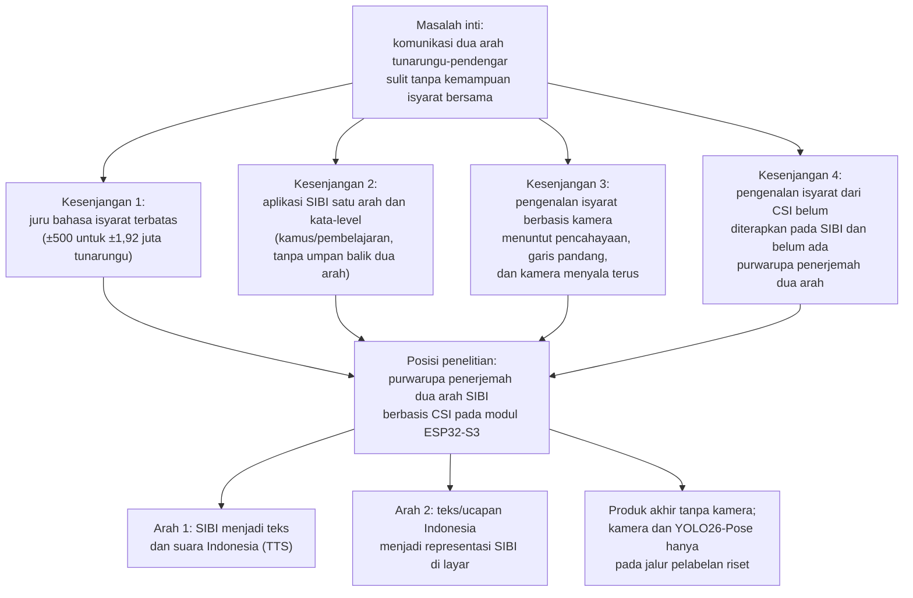
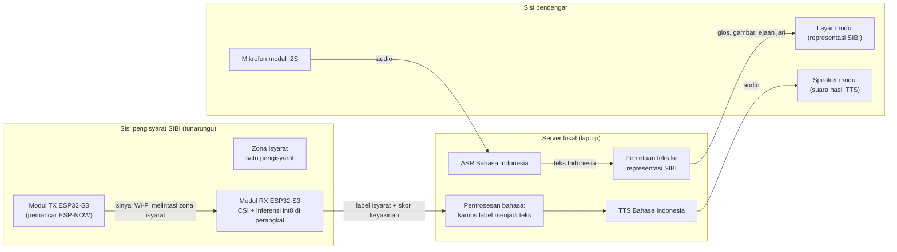
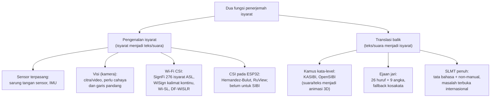
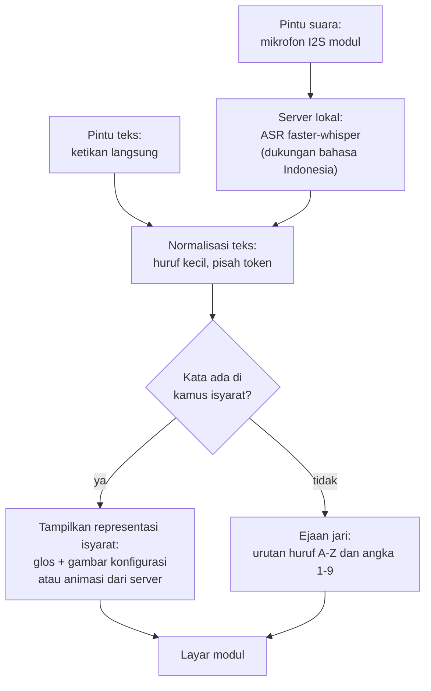
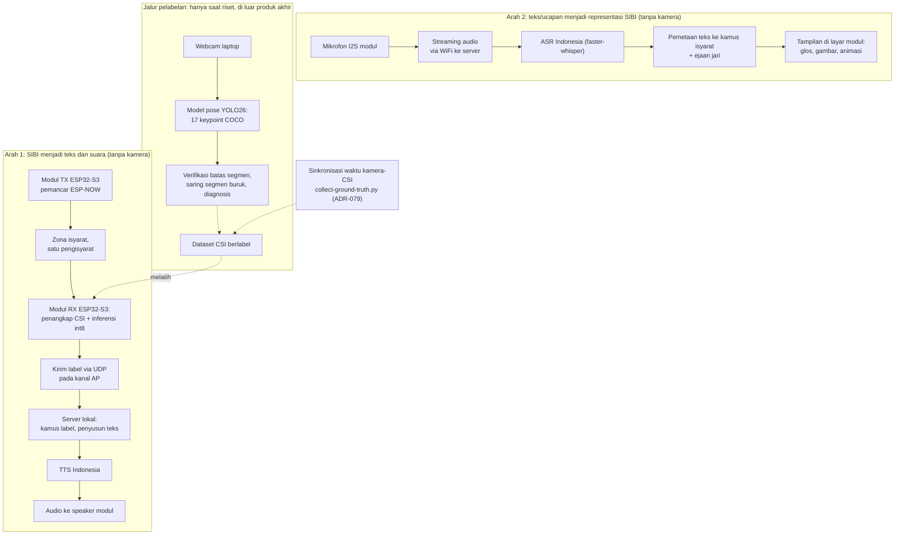
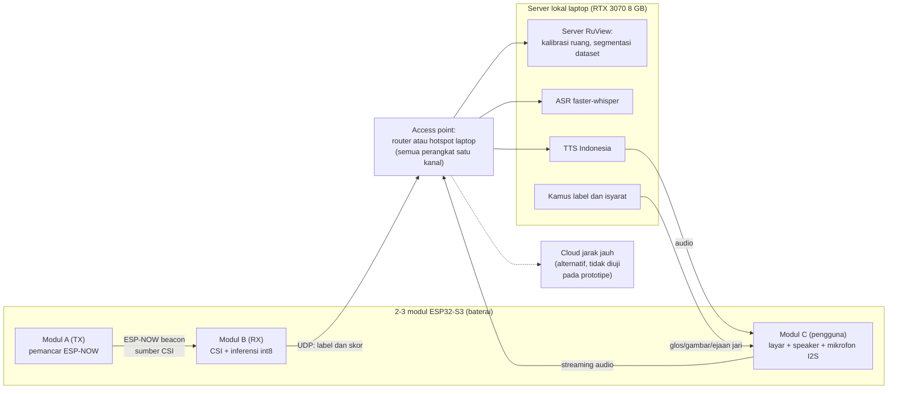
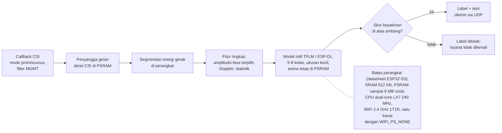
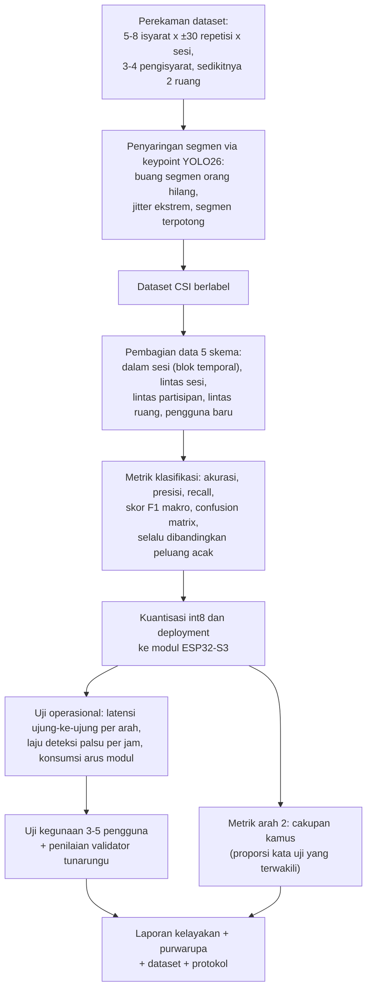

# Purwarupa Penerjemah Dua Arah Isyarat SIBI Berbasis Wi-Fi Channel State Information pada Modul ESP32-S3 dengan Inferensi Tepi dan Pemrosesan Bahasa pada Server: Studi Kelayakan Kosakata Terbatas

**PROPOSAL PENELITIAN**

| Identitas | Keterangan |
|---|---|
| Judul | Purwarupa Penerjemah Dua Arah Isyarat SIBI Berbasis Wi-Fi *Channel State Information* pada Modul ESP32-S3 dengan Inferensi Tepi dan Pemrosesan Bahasa pada Server: Studi Kelayakan Kosakata Terbatas |
| Jenis dokumen | Proposal penelitian (seminar proposal), BAB I–III + Daftar Pustaka |
| Disusun oleh | [PERLU DATA: nama penulis] |
| NIM | [PERLU DATA: NIM penulis] |
| Program studi | [PERLU DATA: program studi] |
| Universitas | [PERLU DATA: nama universitas] |
| Pembimbing | [PERLU DATA: nama pembimbing, bila sudah ditetapkan] |
| Tahun | [PERLU DATA: tahun penyusunan] |

> Catatan penyusunan: dokumen ini adalah revisi menyeluruh dari `Proposal-Sempro-DPJ4-SIBI-CSI.md` (revisi YOLO26, 25 Oktober 2026) sesuai visi produk terbaru pemilik penelitian, yaitu perangkat penerjemah dua arah yang portabel berbasis 2–3 modul ESP32-S3. Sumber diagram tersimpan sebagai berkas Mermaid pada folder `diagram/`. Penanda `[PERLU DATA: ...]` menandai keputusan yang menunggu pemilik penelitian, pembimbing, atau hasil tahap sebelumnya.

---

# BAB I PENDAHULUAN

## 1.1 Latar Belakang

Sebagian besar anak tunarungu lahir di tengah keluarga pendengar. Mitchell dan Karchmer [1], [2] menunjukkan kondisi tersebut melalui data siswa tunarungu di Amerika Serikat sekaligus membantah anggapan lama bahwa sekitar 10% anak tunarungu memiliki orang tua tunarungu; proporsi anak tunarungu dengan orang tua pendengar berkisar 90–95%. Angka sebanding untuk Indonesia belum ditemukan dalam penelusuran penelitian ini (Google Scholar, Crossref, dan OpenAlex hingga Oktober 2026) sehingga angka dari Amerika Serikat itu dipakai sebagai gambaran umum. Keluarga pendengar dari anak yang berkomunikasi dengan isyarat perlu ikut mempelajari bahasa isyarat, padahal proses belajarnya membutuhkan dukungan yang terstruktur [3] dan menghadapi hambatan praktis sehari-hari [4]. Kondisi tersebut menandakan bahwa komunikasi antara tunarungu dan pendengar di lingkungan keluarga tidak dapat dianggap terjadi dengan sendirinya.

Komunikasi yang dimaksud bersifat dua arah. Penutur tunarungu menyampaikan pikiran melalui isyarat, sedangkan lawan bicara pendengar membalasnya melalui ucapan atau tulisan; kedua arah sama-sama tersendat apabila salah satu pihak tidak menguasai moda lawannya. Di Indonesia, juru bahasa isyarat yang dapat menjembatani kedua arah masih terbatas, yaitu sekitar 500 orang untuk sekitar 1,92 juta penyandang tunarungu atau kira-kira satu juru bahasa untuk 3.840 orang [5]. Secara hukum, Undang-Undang Nomor 8 Tahun 2016 tentang Penyandang Disabilitas mengakui bahasa isyarat dan mewajibkan aksesibilitas komunikasi [6]. Kewajiban itu sulit dipenuhi bila kemampuan menjembatani dua arah hanya dimiliki segelintir juru bahasa sehingga teknologi bantu komunikasi yang murah dan tersedia menjadi salah satu jalur pelengkap [7].

Sistem Isyarat Bahasa Indonesia (SIBI) dipilih sebagai objek penelitian meskipun bukan moda yang paling banyak dipakai komunitas tunarungu dalam keseharian. Survei ekosistem bahasa isyarat yang dilaporkan Badan Riset dan Inovasi Nasional mencatat penggunaan Bahasa Isyarat Indonesia (BISINDO) sebesar 77,7%, SIBI 1,9%, campuran 14,9%, dan lainnya 5,6% [8]. Survei serupa pada 100 responden tunarungu di Jawa dan Bali melaporkan 91% memakai BISINDO untuk komunikasi sehari-hari [9]. Kedua survei tersebut menegaskan bahwa komunitas tunarungu lebih dekat ke BISINDO, tetapi juga menunjukkan tempat SIBI hidup: jalur pendidikan formal. Melalui Surat Pemberitahuan Direktorat Pendidikan Dasar Nomor 868/C/U/95, sekolah luar biasa yang menerapkan komunikasi total diwajibkan memakai sistem isyarat yang telah dibakukan [10], dan penelitian di SLB Negeri Ogan Ilir menunjukkan murid tunarungu memakai SIBI dalam pembelajaran sehari-hari di sekolah [11]. Dengan demikian, purwarupa penerjemah dua arah yang dibangun untuk konteks pendidikan formal lebih tepat memakai SIBI, sedangkan perluasan ke BISINDO menuntut penggantian kosakata dan validasi ulang bersama penuturnya.

Teknologi yang telah tersedia untuk kebutuhan tersebut masih terbagi menurut arah dan belum menyatu. Pada arah ucapan atau teks menjadi isyarat, aplikasi yang ada berbentuk kamus kata-level: KASIBI mengubah suara menjadi teks lalu menampilkan animasi peraga tiga dimensi dari basis data kosakata [12], sedangkan OpenSIBI memakai layanan pengenal ucapan lalu mencocokkan kata ke model tiga dimensi yang juga dianimasikan di layar [13]; keduanya mengakui cakupan kosakatanya sangat terbatas. Pada arah isyarat menjadi teks, penelitian di Indonesia bertumpu pada citra atau video dari kamera [14], [15], termasuk penerapan berbasis *smartphone* untuk huruf SIBI statis [16], [17]. Pendekatan berbasis kamera menuntut pencahayaan dan garis pandang tertentu sehingga ketangguhannya menurun saat kondisi berubah [18], sedangkan kehadiran kamera yang terus menyala selama percakapan diduga memengaruhi kenyamanan pengguna dan dikaitkan dengan kelelahan nonverbal [19]. Gambar 1.1 memeringkas kesenjangan tersebut sebagai peta masalah yang menjadi titik berangkat penelitian ini.

Gambar 1.1 Peta masalah dan kesenjangan penelitian

Penginderaan berbasis Wi-Fi *Channel State Information* (CSI) menjadi kandidat pengganti kamera pada arah isyarat menjadi teks. CSI memuat informasi amplitudo dan fase pada setiap *subcarrier* yang berubah ketika gerak tubuh mengganggu jalur propagasi sinyal [20]. Ma dkk. [21] membangun SignFi yang mengenali 276 isyarat *American Sign Language* (ASL) dari CSI, sedangkan DF-WiSLR mengenali 49 gestur tanpa perangkat yang dikenakan pengguna [22] dan pendekatan serupa telah dicoba pada *Filipino Sign Language* [23]. Preseden terbaru, WiSign, bahkan mengenali kalimat ASL kontinu dari CSI perangkat Wi-Fi komersial [24]. Kepekaan CSI terhadap gerak halus juga telah terbukti pada gerak yang jauh lebih kecil daripada gerak lengan: WiKey mengenali ketukan tombol dengan akurasi klasifikasi 96,4% untuk kunci tunggal pada kondisi terkendali [25], dan pemantauan napas dari CSI berhasil mengklasifikasikan pola pernapasan dengan akurasi 99,54% [26]. Meskipun demikian, dalam batas penelusuran literatur penelitian ini hingga Oktober 2026 dengan kata kunci bahasa Inggris dan bahasa Indonesia (Subbab 2.11), belum ditemukan publikasi yang memakai CSI untuk mengenali isyarat SIBI maupun purwarupa penerjemah dua arah yang memadukan penginderaan CSI dengan pemrosesan bahasa Indonesia.

Perangkat penginderaan yang dipakai penelitian ini adalah modul ESP32-S3, yaitu mikrokontroler murah dengan radio Wi-Fi 2,4 GHz yang mendukung perolehan CSI secara resmi [27] dan direkomendasikan platform RuView untuk node penangkap CSI [28]. ESP32-S3 memiliki inti ganda 240 MHz, SRAM 512 KB, dan PSRAM terpasang hingga 8 MB [29]. Dua fakta teknis menjadi dasar kelayakan rancangan. Pertama, satu chip ESP32-S3 terbukti mampu menjalankan penangkapan CSI, koneksi station ke *access point*, dan pengiriman data secara serentak sebagaimana dijalankan firmware RuView, dengan syarat seluruh perangkat berada pada satu kanal dan radio tidak memasuki mode hemat daya [28]. Kedua, inferensi model terkuantisasi pada perangkat didukung tolok ukur resmi: pustaka ESP-NN mempercepat model pendeteksi orang dari 2.300 ms menjadi 54 ms pada ESP32-S3 [30], dan pustaka ESP-DL menyediakan model contoh pengenalan gestur tangan dengan waktu inferensi 69,2 ms [31]. Dengan demikian, purwarupa dirancang agar pengenalan isyarat berjalan langsung pada modul sementara hasilnya dikirim ke server untuk diolah menjadi teks dan suara.

Purwarupa yang dirancang terdiri atas 2–3 modul ESP32-S3 yang portabel dan direncanakan memiliki layar, baterai, *speaker*, dan mikrofon, sebagaimana ditunjukkan pada Gambar 1.2. Pada arah pertama, modul pemancar dan modul penerima mengapit zona isyarat; modul penerima menangkap CSI, mengenali isyarat melalui model yang berjalan pada perangkat, lalu mengirim label hasil ke server. Pada arah kedua, ucapan dari mikrofon modul dikirim ke server untuk dienali menjadi teks, kemudian teks dipetakan ke representasi SIBI dan ditampilkan di layar modul. Server prototipe berupa laptop ASUS TUF Dash F15 FX516PR (Intel Core i7-11370H, GPU RTX 3070 Laptop 8 GB VRAM, RAM 16 GB) yang menjadi mesin pengembangan, pelatihan, dan server lokal sekaligus; layanan *cloud* jarak jauh dibahas sebagai alternatif, tetapi tidak diuji pada prototipe. Teknologi pemrosesan bahasanya telah diaudit kelayakannya: pengenal ucapan Whisper mendukung lebih dari 100 bahasa termasuk Indonesia [32] dan implementasi faster-whisper terbukti jauh lebih cepat daripada waktu nyata pada GPU kelas 8 GB [33]; untuk sintesis suara, model MMS menyediakan checkpoint Bahasa Indonesia yang dapat dijalankan lokal [34], [35], sedangkan layanan *cloud* Google dan Azure menyediakan suara Indonesia tersertifikasi [36], [37], dan model ringan Kokoro justru tidak mencakup Bahasa Indonesia sehingga tidak dipakai [38].

Gambar 1.2 Visi purwarupa penerjemah dua arah tanpa kamera

Sebagai studi kelayakan, penelitian ini tidak mengklaim penerjemahan kontinu kosakata penuh. Kosakata dibatasi pada 5–8 isyarat SIBI terisolasi yang dibedakan lintasan lengan, tubuh atas, atau kepala, bukan oleh bentuk jari, dengan alasan resolusi spasial CSI pada satu tautan antarmodu (Subbab 2.3). Model berbasis CSI juga mudah *overfitting* terhadap orang dan ruang tempat data direkam [39] sehingga kinerja diukur lintas partisipan dan lintas ruang dengan acuan strategi Widar3.0 [40]. Kamera dan model pose YOLO26 hanya dipakai pada jalur pelabelan selama pembuatan *dataset* riset, mengikuti pola yang telah ditetapkan revisi sebelumnya, dan tidak menjadi bagian produk akhir [41], [42]. Pemetaan teks ke representasi SIBI pada arah kedua dibatasi menjadi kamus kata-level dengan *fallback* ejaan jari sebagaimana preseden KASIBI dan OpenSIBI, bukan penerjemahan tata bahasa penuh yang masih menjadi masalah terbuka internasional [43], [44]. Setiap tahapan ditutup gerbang keputusan sehingga kegagalan tetap dilaporkan sebagai temuan kelayakan. Berdasarkan uraian tersebut, penelitian ini merancang bangun purwarupa penerjemah dua arah isyarat SIBI berbasis Wi-Fi CSI pada modul ESP32-S3 dan menguji kelayakannya sebagai alat bantu komunikasi kosakata terbatas pada konteks pendidikan formal.

## 1.2 Rumusan Masalah

Berdasarkan latar belakang yang telah dipaparkan, masalah yang dikaji dalam penelitian ini dapat dirumuskan sebagai berikut.

1. Bagaimana merancang purwarupa penerjemah dua arah SIBI berbasis dua hingga tiga modul ESP32-S3 yang menangkap CSI, melakukan inferensi pada perangkat, dan berkomunikasi dengan server lokal, termasuk protokol perekaman *dataset* isyarat terisolasi dengan pelabelan berbantuan model pose YOLO26?
2. Bagaimana kinerja pengenalan 5–8 isyarat SIBI terisolasi dari CSI melalui inferensi pada perangkat, serta kinerja jalur isyarat menjadi teks dan suara dan jalur teks atau ucapan menjadi representasi SIBI, pada skenario dalam sesi, lintas partisipan, dan lintas ruang?
3. Bagaimana kelayakan purwarupa sebagai alat bantu komunikasi dua arah kosakata terbatas ditinjau dari latensi ujung ke ujung, cakupan kosakata, keandalan operasional, dan penilaian validator penutur tunarungu?

## 1.3 Tujuan Penelitian

Berdasarkan rumusan masalah tersebut, penelitian ini bertujuan untuk:

1. Merancang purwarupa penerjemah dua arah SIBI berbasis dua hingga tiga modul ESP32-S3 yang menangkap CSI, melakukan inferensi pada perangkat, dan berkomunikasi dengan server lokal, termasuk protokol perekaman *dataset* isyarat terisolasi dengan pelabelan berbantuan model pose YOLO26.
2. Mengukur kinerja pengenalan 5–8 isyarat SIBI terisolasi dari CSI melalui inferensi pada perangkat, serta kinerja jalur isyarat menjadi teks dan suara dan jalur teks atau ucapan menjadi representasi SIBI, pada skenario dalam sesi, lintas partisipan, dan lintas ruang.
3. Menguji kelayakan purwarupa sebagai alat bantu komunikasi dua arah kosakata terbatas berdasarkan latensi ujung ke ujung, cakupan kosakata, keandalan operasional, dan penilaian validator penutur tunarungu.

## 1.4 Batasan Masalah

Ruang lingkup penelitian ini dibatasi sebagai berikut.

1. Objek pengenalan adalah 5–8 isyarat SIBI terisolasi yang lolos dua saringan, yaitu separabilitas fisik (isyarat dibedakan lintasan lengan, tubuh atas, atau kepala, bukan bentuk jari) dan validitas pedagogis (disetujui validator penutur tunarungu dan dicocokkan dengan *Kamus SIBI* [45]). Sistem yang dibangun bukan penerjemah kalimat dan tidak menangani pengenalan isyarat kontinu.
2. Konfigurasi jari dan ekspresi wajah tidak dikenali; batas ini mengikat kedua arah sehingga keluaran arah pertama hanya menyangkut lintasan gerak, sedangkan arah kedua menampilkan representasi tingkat kata dan ejaan jari, bukan tata bahasa isyarat penuh beserta penanda nonmanual.
3. Perangkat keras terdiri atas 2–3 modul ESP32-S3 (masing-masing direncanakan memiliki layar kecil, baterai, *speaker*, dan mikrofon I2S) serta satu laptop ASUS TUF Dash F15 FX516PR (Intel Core i7-11370H, RTX 3070 Laptop 8 GB VRAM, RAM 16 GB) sebagai mesin pengembangan, pelatihan, dan server lokal prototipe; layanan *cloud* jarak jauh dibahas sebagai alternatif arsitektur tanpa diuji.
4. Kamera dan model pose YOLO26 hanya dipakai pada jalur pelabelan selama perekaman *dataset* riset di laptop; produk akhir tidak memakai kamera maupun citra, dan modul tidak menjalankan model visi.
5. Pemrosesan bahasa memakai teknologi yang terverifikasi mendukung Bahasa Indonesia: ASR berbasis Whisper pada server lokal, dan TTS lokal MMS-TTS-ind dengan layanan *cloud* berbahasa Indonesia sebagai pembanding; pilihan final ditetapkan pada T4 (Tabel 3.6).
6. Arah kedua dibatasi menjadi kamus kata-level dengan *fallback* ejaan jari (26 huruf dan angka 1–9) sebagaimana preseden OpenSIBI; cakupan kamus diukur dan dilaporkan, tidak dijanjikan mencakup kosakata kamus SIBI penuh.
7. Setiap sesi melibatkan satu pengisyarat pada zona akuisisi; sistem tidak mengidentifikasi individu, dan pengujian dilakukan di sedikitnya dua ruang mitra yang dikalibrasi dalam penelitian ini.
8. Uji pengguna dilakukan dalam skala kecil dengan 3–5 pengguna dan dianalisis secara deskriptif tanpa statistik inferensial.
9. Penelitian ini tidak membahas pengenalan isyarat kontinu, penerjemahan kalimat dengan tata bahasa isyarat penuh beserta penanda nonmanual, penggunaan BISINDO, maupun penerapan layanan *cloud* jarak jauh pada prototipe.

## 1.5 Manfaat Penelitian

Manfaat penelitian ini dibedakan menjadi manfaat teoretis dan manfaat praktis.

### 1.5.1 Manfaat Teoretis

Penelitian ini diharapkan memberikan bukti awal kelayakan pengenalan sekelompok kecil isyarat SIBI terisolasi dari CSI satu tautan antarmodul ESP32-S3, disertai bukti kelayakan inferensi model terkuantisasi pada perangkat untuk tugas tersebut. Bukti itu tidak berlaku bagi kosakata yang dibedakan oleh bentuk jari. Penelitian ini juga menyediakan *dataset* CSI isyarat SIBI berlabel beserta protokol perekamannya sehingga dapat menjadi pembanding bagi penelitian penginderaan nirkabel berbahasa isyarat lain, termasuk perluasan ke BISINDO. Kajian integrasi penginderaan CSI dengan jalur TTS dan ASR Bahasa Indonesia pada satu purwarupa memberikan contoh dokumentasi arsitektur tepi-awan yang dapat ditelusuri ulang peneliti berikutnya.

### 1.5.2 Manfaat Praktis

Bagi lembaga pendidikan mitra, penelitian ini memberikan gambaran kelayakan purwarupa alat bantu komunikasi dua arah berbahasa SIBI yang dapat dipakai guru dan keluarga pada kegiatan pembelajaran, bersama protokol kurasi kosakata yang disusun bersama validator penutur tunarungu. Bila tahapan penelitian mencapai gerbang terakhir, dihasilkan purwarupa yang menampilkan teks dan menyuarakan isyarat SIBI yang dikenali serta menampilkan representasi isyarat bagi lawan bicara pendengar; bila penelitian berhenti lebih awal, artefak berupa laporan karakterisasi sinyal, protokol, atau *dataset* berlabel tetap dihasilkan. Bagi keluarga siswa tunarungu, kosakata yang divalidasi penutur tunarungu memastikan bentuk isyarat yang ditampilkan baku sesuai jalur pendidikan formal. Bagi komunitas riset, *dataset* dan rancangan yang tidak terikat pada satu bahasa isyarat memudahkan replikasi dan pembandingan metode.

## 1.6 Sistematika Penulisan

Proposal penelitian ini terdiri atas tiga bab dengan sistematika sebagai berikut.

**BAB I Pendahuluan** memuat latar belakang, rumusan masalah, tujuan penelitian, batasan masalah, manfaat penelitian, dan sistematika penulisan.

**BAB II Kajian Pustaka** memuat kajian tentang bahasa isyarat dan SIBI, kebutuhan komunikasi dua arah dan sistem terdahulu, Wi-Fi CSI, modul ESP32-S3 dan platform RuView beserta koeksistensi radionya, peran model pose YOLO26 sebagai alat bantu pelabelan riset, pengenalan isyarat dan gestur berbasis CSI serta inferensi pada perangkat, TTS dan ASR Bahasa Indonesia, pemetaan teks ke representasi SIBI di layar, komunikasi perangkat dan server, evaluasi kelayakan, serta penelitian terdahulu yang relevan.

**BAB III Metode Penelitian** memuat desain penelitian; tahapan penelitian beserta gerbang keputusan; waktu dan lokasi penelitian; alat dan bahan; perancangan sistem; protokol perekaman *dataset* beserta partisipan dan etika; pengolahan sinyal, ekstraksi fitur, klasifikasi, dan deployment; skenario pengujian dan metrik evaluasi; jadwal penelitian; parameter rancangan yang ditetapkan kemudian; serta risiko dan alternatif cadangan.

# BAB II KAJIAN PUSTAKA

## 2.1 Bahasa Isyarat dan Sistem Isyarat Bahasa Indonesia

Bahasa isyarat merupakan bahasa visual yang menyampaikan makna melalui gerak tangan, lengan, tubuh, dan ekspresi wajah [46], [47]. Secara struktural, sebuah isyarat tersusun atas bentuk tangan, lokasi, gerak, orientasi telapak tangan, dan komponen nonmanual seperti ekspresi wajah; perbedaan pada satu parameter saja dapat membedakan makna dua isyarat [46], [47]. Dalam penelitian ini, parameter tersebut menjadi acuan untuk memisahkan bagian isyarat yang dapat dinilai mesin dari bagian yang tetap memerlukan penilaian manusia (Subbab 2.3 dan 2.8).

Pemakaian bahasa isyarat di Indonesia tidak seragam. Survei ekosistem bahasa isyarat menunjukkan BISINDO jauh lebih banyak dipakai respondennya daripada SIBI, sedangkan SIBI berkembang di jalur pendidikan formal [8]; angka pemakaian dan keterbatasan sampel survei tersebut telah dipaparkan pada Subbab 1.1. Survei pada responden tunarungu di Jawa dan Bali melaporkan bahwa 91% responden memakai BISINDO untuk komunikasi sehari-hari karena konsep SIBI dianggap sulit [9]. SIBI sendiri merupakan sistem isyarat baku yang dikembangkan untuk keperluan pendidikan formal, sedangkan BISINDO berkembang secara alami di komunitas tunarungu; kajian pada mahasiswa tunarungu [48] dan pada siswa SLB [49] memerikan perbedaan pemakaian keduanya. Bentuk baku isyarat SIBI didokumentasikan dalam *Kamus Sistem Isyarat Bahasa Indonesia* yang selanjutnya disebut *Kamus SIBI* [45], dan bentuk digitalnya tersedia melalui Kamus SIBI Digital [10].

Pemilihan SIBI dalam penelitian ini didasarkan pada jalur pendidikan formal yang menjadi konteks pemakaian purwarupa, bukan pada jumlah penuturnya (Subbab 1.1). Alat yang dirancang tidak dimaksudkan menggantikan BISINDO dalam komunikasi komunitas tunarungu sehari-hari. Rancangan sistem tidak terikat pada satu bahasa isyarat tertentu sehingga perluasan ke BISINDO pada prinsipnya dapat dilakukan dengan mengganti *dataset*, menyeleksi ulang kosakata dengan kriteria yang sama, dan melakukan validasi bersama validator penutur BISINDO; kelayakan perluasan tersebut tidak diuji dalam penelitian ini dan diusulkan sebagai penelitian lanjutan.

## 2.2 Kebutuhan Komunikasi Dua Arah dan Sistem Terdahulu

Komunikasi antara penutur isyarat dan pendengar menuntut kemampuan pada kedua arah, yaitu memahami isyarat yang diperagakan dan membalasnya dengan moda yang dapat dipahami lawan bicara. Sebagian besar anak tunarungu lahir dari orang tua pendengar [1] sehingga keluarga pendengar berada di barisan pertama yang merasakan kebutuhan tersebut; mereka yang belajar bahasa isyarat membutuhkan dukungan belajar terstruktur serta menghadapi hambatan praktis [3], [4]. Juru bahasa isyarat profesional yang dapat menjembatani kedua arah jumlahnya terbatas [5] sehingga teknologi bantu komunikasi berperan sebagai pelengkap [7]. Dalam penelitian ini, kebutuhan tersebut diterjemahkan menjadi purwarupa yang bekerja dua arah, bukan sekadar kamus satu arah.

Sistem terdahulu di Indonesia dapat dikelompokkan menurut arah kerjanya, sebagaimana dirangkum pada taksonomi Gambar 2.1. Pada arah ucapan atau teks menjadi isyarat, KASIBI mengubah suara menjadi teks melalui layanan pengenal ucapan, mencocokkan kata pada basis data, lalu menampilkan animasi peraga tiga dimensi; sistem tersebut diuji sebagai media pembelajaran dan memperoleh rata-rata skor 3,362 dari 4 [12]. OpenSIBI memakai mekanisme serupa dengan menyimpan model tiga dimensi format Collada pada *application programming interface* (API) sehingga aplikasi Android dapat menganimasikannya; cakupannya 50 kosakata yang terdiri atas 9 angka, 26 huruf, dan 15 kata, dan penulisnya mengakui keterbatasan kosakata sebagai kelemahan utama [13]. Kedua sistem tersebut membuktikan bahwa arah balik kata-level secara teknis dapat dibangun, tetapi sekaligus menandai biaya pembuatan aset per isyarat yang tinggi. Aplikasi pembelajaran dasar lain menyasar arah manusia belajar isyarat [50].

Gambar 2.1 Taksonomi pengenalan isyarat dan translasi SIBI

Pada arah isyarat menjadi teks, riset Indonesia umumnya bertumpu pada citra atau video dari kamera [14]. Dwijayanti dkk. [15] memakai *convolutional neural network* (CNN) untuk citra huruf dan angka BISINDO, Kindy dkk. [51] menyusun *dataset* video BISINDO tingkat kata, Wiguna dan Rojali [52] mengenali kalimat BISINDO dari video, dan Sebastian dkk. [53] memakai pengenalan gestur tubuh yang memperhitungkan informasi spasial. Khusus SIBI, Soekarta dkk. [16] membangun aplikasi Android berbasis MediaPipe untuk 24 huruf statis, disusul aplikasi pengenalan alfabet statis berbasis TensorFlow Lite [17]. Seluruh kelompok ini memerlukan kamera saat sistem dipakai sehingga keberhasilannya bergantung pada pencahayaan dan garis pandang [18], [47].

Pendekatan lain yang tidak memerlukan kamera adalah sensor yang dikenakan pada tangan, seperti sarung tangan sensor dan sensor inersia, yang dapat menangkap konfigurasi jari; namun, perangkatnya harus dikenakan dan dikalibrasi setiap kali dipakai [47], [23] sehingga tidak cocok untuk percakapan yang berlangsung santai. Paparan kamera yang terus menyala selama percakapan juga dikaitkan dengan kelelahan nonverbal [19]. Oleh karena itu, penelitian ini menelusari penginderaan berbasis sinyal Wi-Fi yang bekerja tanpa kamera dan tanpa perangkat yang dikenakan, sementara sistem terdahulu yang paling dekat dengan arah balik, yaitu KASIBI dan OpenSIBI, menjadi preseden perancangan jalur kedua purwarupa (Subbab 2.8).

## 2.3 Wi-Fi Channel State Information

Wi-Fi *Channel State Information* (CSI) merupakan informasi amplitudo dan fase pada setiap *subcarrier* yang menggambarkan kondisi kanal propagasi antara pemancar dan penerima Wi-Fi [20]. Sinyal Wi-Fi tiba di penerima melalui beberapa jalur, yaitu jalur langsung dan jalur pantulan dari dinding, perabot, serta tubuh manusia. Ketika tubuh bergerak di antara pemancar dan penerima, panjang jalur pantulan berubah sehingga amplitudo dan fase pada setiap *subcarrier* ikut berubah; perubahan itulah yang dimanfaatkan untuk mengenali gerak tanpa sensor yang dikenakan di tubuh [20].

Amplitudo dan fase memuat informasi yang berbeda tentang perubahan kanal. Cai dkk. [54] memanfaatkan keduanya sebagai informasi yang saling melengkapi untuk pengenalan gestur. Setiap *subcarrier* menempati frekuensi yang sedikit berbeda sehingga satu gerak yang sama menghasilkan perubahan yang tidak identik pada setiap *subcarrier* [20]. Dengan demikian, CSI menyediakan banyak kanal pengamatan dari satu pasang pemancar dan penerima.

Gerak lengan juga menghasilkan komponen Doppler, yaitu pergeseran frekuensi yang sebanding dengan laju perubahan panjang jalur pantulan [20], [40]. Komponen tersebut dapat diukur dari deret CSI dan mencerminkan kecepatan gerak. Penelitian ini memusatkan analisis Doppler pada pita frekuensi gerak 1–60 Hz; agar pita tersebut terwakili, laju pencuplikan CSI harus sekurang-kurangnya dua kali frekuensi tertingginya, yaitu 120 Hz, sesuai kriteria Nyquist [55], [56]. *Firmware* RuView membatasi pengiriman bingkai CSI paling sering setiap 20 ms, yang setara laju maksimum 50 bingkai per detik, menurut kode sumber *firmware*-nya [28]; laju aktual pada konfigurasi penelitian diukur pada tahap replikasi (BAB III). Bila laju terukur lebih rendah daripada 120 Hz, pita Doppler yang dapat diamati menyempit hingga setengah laju pencuplikan aktual dan pembatasan itu dilaporkan.

Kepekaan CSI terhadap gerak halus telah dibuktikan pada gerak yang jauh lebih kecil daripada gerak lengan. WiKey mengenali ketukan tombol dari CSI dengan tingkat deteksi lebih dari 97,5% dan akurasi klasifikasi 96,4% untuk kunci tunggal pada lingkungan terkendali [25]. Pemantauan pernapasan dari Wi-Fi CSI berhasil mengklasifikasikan pola pernapasan dengan akurasi 99,54% dan laju napas dengan akurasi 98,69% pada kanal yang cukup baik [26], padahal gerak dada akibat napas berada pada orde milimeter. Kedua preseden tersebut menunjukkan bahwa CSI peka terhadap gerak skala sentimeter hingga milimeter pada kondisi jarak dekat dan pengguna tunggal. Meskipun demikian, keduanya bekerja pada kondisi terkendali sehingga keberhasilannya tidak serta-merta berlaku pada konfigurasi penelitian ini; bukti itu dipakai sebagai dasar hipotesis kerja, bukan jaminan hasil.

Pola CSI tidak hanya dipengaruhi oleh gerak isyarat, tetapi juga oleh pengisyarat yang memperagakannya dan ruang tempat perekaman. Akibatnya, model berbasis CSI mudah mengalami *overfitting* terhadap orang dan ruang tempat data pelatihan direkam [39]. Chen dkk. merangkum strategi generalisasi lintas domain untuk mengatasi persoalan tersebut, sedangkan Zhang dkk. mengusulkan Widar3.0 yang mengenali gestur lintas domain tanpa pelatihan ulang dengan profil kecepatan yang diturunkan dari Doppler [40]. Dalam penelitian ini, strategi lintas domain dijadikan acuan rancangan fitur, sedangkan kemampuan generalisasi sistem diukur langsung melalui skenario pengujian (Subbab 2.10 dan 3.8).

Panjang gelombang Wi-Fi pada pita 2,4 GHz berkisar 12,5 cm dan membatasi resolusi spasial CSI. Sejumlah penelitian melaporkan pengenalan isyarat dan gestur tangan dari CSI dengan perangkat riset multi-antena: SignFi memakai NIC Intel 5300 dengan tiga antena penerima [21], Wi-SL memakai router dengan dua antena pemancar dan tiga antena penerima pada kanal 40 MHz dengan laju cuplik 400 Hz [57], dan HandFi memakai NIC Intel 5300 sebagai penerima dari router Wi-Fi komersial [58]. Penelitian ini tidak mengasumsikan kemampuan tersebut juga dimiliki perangkat yang digunakan. Dengan satu tautan antara dua modul ESP32-S3 yang masing-masing berantena tunggal, perbedaan konfigurasi jari dan ekspresi wajah diasumsikan terlalu halus untuk dibedakan secara andal; asumsi tersebut diperiksa melalui uji Delta-CSI (BAB III) sehingga cakupan pengenalan dibatasi pada lintasan lengan, tubuh atas, dan kepala. Batas resolusi tersebut menentukan saringan separabilitas fisik pada kurasi kosakata (Subbab 3.6) dan makna keluaran sistem pada kedua arah.

## 2.4 Modul ESP32-S3, Platform RuView, dan Koeksistensi Radio

ESP32-S3 merupakan mikrokontroler dengan radio Wi-Fi 802.11 b/g/n pada pita 2,4 GHz dan tautan tunggal satu antena (1T1R) [29]. Inti prosesornya ganda Xtensa LX7 berjalan pada 240 MHz dengan instruksi vektor; memorinya terdiri atas SRAM internal 512 KB, ROM 384 KB, dan PSRAM terpasang hingga 8 MB sesuai varian chip [29]. Dukungan CSI tersedia resmi untuk seluruh seri ESP32 termasuk ESP32-S3 melalui repositori esp-csi [27]; pada kanal 20 MHz 802.11n, CSI yang dilaporkan mencakup 56 *subcarrier* yang terdiri atas 52 *subcarrier* data dan 4 *subcarrier* pilot [27]. Basis akuisisi CSI mandiri pada keluarga ESP32 dikembangkan oleh Hernandez dan Bulut [59], dan varian ESP32-S3 adalah varian yang direkomendasikan dokumentasi RuView untuk node penangkap CSI [28].

RuView merupakan proyek sumber terbuka yang menyediakan rantai akuisisi dan pengolahan CSI pada ESP32. Komponennya meliputi *firmware* ESP32 penangkap CSI dengan format bingkai ADR-018 yang dikirim melalui *User Datagram Protocol* (UDP), *server* pengolahan sinyal, kalibrasi ruang bawaan, segmentasi berbasis energi gerak, *dashboard* web, mode privasi, dan *pipeline* akuisisi tersinkron kamera–CSI melalui skrip `scripts/collect-ground-truth.py` (ADR-079) [28]. ADR atau *architecture decision record* adalah catatan keputusan arsitektur yang dipakai repositori tersebut untuk mendokumentasikan keputusan desain [28]. Kalibrasi ruang bawaan memakai 600 bingkai dan 8 *anchor* selama kurang lebih empat menit, sedangkan mode privasi menekan fitur biometrik agar tidak diterbitkan keluar dari *server* [28].

Fakta teknis yang paling menentukan arsitektur purwarupa adalah koeksistensi radio pada satu chip. *Firmware* RuView menjalankan tiga fungsi radio secara serentak pada satu ESP32-S3: menangkap CSI melalui mode promiscuous, terhubung sebagai station ke *access point* untuk mengirim data melalui UDP, dan menerima sinkronisasi ESP-NOW dari modul pemancar [28]. ESP-NOW sendiri merupakan protokol komunikasi tanpa *access point* yang memuat hingga 250 bita per paket dan dipakai RuView sebagai sumber bingkai bersama antarmodul [28]. Tiga syarat wajib menyertai pola tersebut: seluruh perangkat berada pada satu kanal mengikuti kanal *access point*, penyaringan paket mode promiscuous dibatasi pada kelompok paket manajemen agar beban interupsi terkendali, dan mode hemat daya radio dimatikan karena CSI menuntut radio tetap terjaga [28]. Dengan bukti itu, purwarupa tidak memerlukan modul gerbang khusus; setiap modul dapat menjalankan peran ganda sekaligus, dan topologi lengkapnya diuraikan pada Subbab 3.5. Tabel 2.1 memetakan fitur RuView terhadap perannya dalam penelitian ini.

Tabel 2.1 Pemetaan fitur RuView terhadap peran dalam penelitian ini

| Fitur RuView | Peran dalam penelitian ini |
|---|---|
| *Firmware* ESP32 penangkap CSI (format bingkai ADR-018, *streaming* UDP) | Mengalirkan CSI dan label hasil inferensi dari modul ke *server* lokal |
| Koneksi station + UDP + CSI promiscuous + sinkronisasi ESP-NOW pada satu chip | Dasar topologi satu kanal purwarupa (Subbab 3.5) |
| Kalibrasi ruang bawaan (600 bingkai + 8 *anchor*) | Mengkalibrasi ruang mitra pada awal setiap sesi |
| Segmentasi berbasis energi gerak | Memotong deret CSI menjadi segmen isyarat terisolasi |
| *Dashboard* web | Pemantauan sesi riset; tampilan pengguna akhir ada di layar modul |
| Mode privasi | Membuang fitur biometrik selama penelitian |
| *Pipeline* akuisisi tersinkron kamera–CSI (ADR-079) | Jalur pelabelan riset dengan estimator diganti model pose YOLO26 |
| Modul estimasi pose *on-device* | Tidak dipakai |

Modul estimasi pose *on-device* RuView tidak dipakai karena pengenalan isyarat dilakukan langsung dari fitur CSI (Subbab 2.6). Karena RuView bersumber dari repositori perangkat lunak dan tidak melalui telaah sejawat, fungsi yang dipakai diverifikasi lebih dulu pada tahap replikasi melalui gerbang keputusan G0 sebelum dipakai untuk perekaman (BAB III).

## 2.5 Estimasi Pose Berbasis Visi sebagai Alat Bantu Pelabelan Riset

Estimasi pose merupakan tugas visi komputer untuk memperkirakan posisi *keypoint* tubuh manusia dari citra atau video [60]. YOLO26 merupakan keluarga model visi waktu nyata terbaru dari Ultralytics yang mendukung deteksi, segmentasi, klasifikasi, dan estimasi pose dalam satu kerangka [41]. Model pose YOLO26 dilatih pada *dataset keypoint* COCO dan menghasilkan 17 *keypoint* tubuh per orang, mencakup titik wajah, bahu, siku, dan pergelangan tangan, tanpa *keypoint* jari [42]. Analisis independen atas YOLO26 menunjukkan bahwa model ini dirancang untuk efisiensi inferensi dan kesiapan penerapan pada perangkat tepi [61].

Dalam penelitian ini, model pose YOLO26 dipakai sebagai estimator terlatih tanpa pelatihan ulang hanya pada jalur pelabelan riset. *Pipeline* akuisisi tersinkron mengikuti pola ADR-079 RuView yang aslinya memakai MediaPipe PoseLandmarker [62] dengan estimator diganti model pose YOLO26 yang keluarannya juga 17 *keypoint* format COCO sehingga formatnya setara dengan skrip asli. Pemakaian visi sebagai pemberi supervisi bagi pelatihan model Wi-Fi telah memiliki preseden: Person-in-WiFi memperoleh persepsi tubuh dari sinyal Wi-Fi dengan supervisi kamera [63], dan DensePose from WiFi memetakan sinyal Wi-Fi ke koordinat permukaan tubuh dengan jaringan visi sebagai guru [64]. Namun, dalam penelitian ini kamera tidak mengajarkan pose kepada model CSI; label kelas berasal dari kartu pemandu pada protokol elisitasi, sedangkan deret *keypoint* hanya dipakai untuk verifikasi batas segmen, penyaringan segmen buruk, dan diagnosis kesalahan klasifikator secara luring (Subbab 3.8). Distilasi pengetahuan pose secara penuh diusulkan sebagai penelitian lanjutan.

Peran kamera dengan demikian terbatas pada tahap riset dan tidak pernah menyala pada produk akhir. Batas ini penting karena keluaran model hanya mencakup tubuh tanpa *keypoint* jari; batas tersebut sejalan dengan cakupan pengenalan yang memang dibatasi pada lintasan lengan, tubuh atas, dan kepala (Subbab 2.3). Setelah model CSI dilatih dan di-*deploy* ke modul, seluruh jalur operasional berjalan tanpa kamera dan tanpa citra sehingga klaim produk tanpa kamera dapat diuji langsung pada purwarupa.

## 2.6 Pengenalan Isyarat dan Gestur Berbasis CSI serta Inferensi pada Perangkat

Pengenalan bahasa isyarat dari CSI telah diteliti pada beberapa bahasa isyarat di luar Indonesia. SignFi mengenali 276 isyarat ASL [21], sistem multi-perangkat yang tangguh diajukan Shang dan Wu [65], DF-WiSLR mengenali 49 gestur tanpa perangkat yang dikenakan [22], model deret waktu berbasis *Long Short-Term Memory* dikembangkan Ahmed dkk. [66], WiASL mengenali tulisan ASL dengan perangkat Wi-Fi komersial [67], dan pendekatan CSI dicoba pada *Filipino Sign Language* [23]. WiSign memperluas arah tersebut dengan mengenali kalimat ASL kontinu dari CSI dengan segmentasi berbasis kepadatan spektrum [24]; keberadaannya menunjukkan bahwa pengenalan kontinu bukan wilayah yang sama sekali belum disentuh sehingga kebaruan penelitian ini tidak diklaim pada pengenalan kontinu, melainkan pada penerapan CSI untuk SIBI dan pada integrasinya dengan jalur pemrosesan bahasa dua arah (Subbab 2.11).

Rancangan fitur mengikuti praktik kelompok penelitian tersebut: amplitudo dan fase *subcarrier* terpilih yang saling melengkapi [54], spektrum Doppler pada pita 1–60 Hz [40], serta statistik ringkas berupa energi, entropi, dan lintasan puncak [20], [58]. *Support Vector Machine* (SVM) mencari batas pemisah antarkelas dengan margin terbesar [68] dan dipilih sebagai pembanding dasar karena kuat pada *dataset* berukuran kecil [69]. Pembandingnya adalah *one-dimensional Convolutional Neural Network* (1D-CNN) berukuran kecil yang menerapkan konvolusi sepanjang sumbu waktu dan cocok untuk data deret waktu [70].

Klasifikator himpunan tertutup selalu memilih salah satu kelas, termasuk ketika gerak yang diperagakan bukan bagian kosakata; mekanisme penolakan dilengkapi agar keluaran berkeyakinan rendah tidak dipaksakan menjadi kelas tertentu [71]. Keluaran klasifikator dilengkapi skor keyakinan; bila skor berada di bawah ambang, sistem menampilkan pesan isyarat tidak dikenali. Ambang ditetapkan dari data validasi (Tabel 3.6) dan kecukupannya ditelusuri melalui laju deteksi palsu serta penilaian validator (Subbab 3.8).

Inferensi pada penelitian ini dirancang berjalan langsung pada modul penerima, bukan pada *server*. Kelayakannya ditopang tiga tolok ukur resmi pada perangkat ESP32-S3. Pertama, pustaka ESP-NN mempercepat model pendeteksi orang berukuran 293,5 KB dari 2.300 ms menjadi 54 ms pada ESP32-S3 [30]. Kedua, pustaka ESP-DL menyediakan model contoh terkuantisasi int8, termasuk model pengenalan gestur tangan dengan waktu inferensi 69,2 ms dan MobileNetV2 dengan 437,9 ms [31]. Ketiga, contoh TensorFlow Lite Micro pada ESP32, seperti *micro speech* berukuran 18,4 KB, menunjukkan bahwa model kecil berjalan dengan penyangga terkendali [72]. Masukan klasifikasi CSI berupa vektor fitur deret pendek yang jauh lebih kecil daripada citra sehingga klasifikasi 5–8 kelas berada pada kelas kompleksitas yang lebih rendah daripada contoh-contoh tersebut; meskipun demikian, karena belum ada publikasi tolok ukur model CSI-isyarat pada ESP32-S3, waktu inferensi aktual tetap diukur pada tahap deployment (Subbab 3.7). Model dilatih dengan PyTorch di laptop, dikuantisasi int8, lalu dijalankan melalui TensorFlow Lite Micro atau ESP-DL dengan penyangga pada PSRAM.

## 2.7 TTS dan ASR Bahasa Indonesia

Purwarupa memerlukan dua teknologi ucapan pada sisi server: *text-to-speech* (TTS) untuk mengubah teks hasil pengenalan menjadi suara pada arah pertama, dan *automatic speech recognition* (ASR) untuk mengubah ucapan menjadi teks pada arah kedua. Kriteria pemilihannya ada tiga: dukungan Bahasa Indonesia yang terverifikasi dari sumber resmi, kemampuan berjalan pada server lokal laptop dengan VRAM 8 GB, dan biaya yang berkelanjutan untuk prototipe. Audit teknologi dilakukan dengan memeriksa langsung model card resmi dan dokumentasi layanan (Subbab 2.7 ini) sehingga pilihan tidak didasarkan pada klaim pihak ketiga.

Untuk TTS, model ringan Kokoro-82M sering menjadi rujukan hemat sumber daya, tetapi model card resminya mencantumkan delapan bahasa dan 54 suara tanpa Bahasa Indonesia sehingga Kokoro tidak dapat dipakai [38]. Pilihan yang terverifikasi mendukung Indonesia ada tiga. Pertama, proyek Massively Multilingual Speech (MMS) menyediakan checkpoint TTS Bahasa Indonesia facebook/mms-tts-ind berbasis arsitektur VITS yang dapat diunduh dan dijalankan lokal dengan lisensi CC-BY-NC 4.0 [34], [35]. Kedua, layanan Google Cloud TTS menyediakan suara id-ID tingkat Standard dan Premium dengan biaya sekitar empat dolar AS per juta karakter untuk tingkat Standard setelah jatah gratis bulanan [36]. Ketiga, layanan Azure menyediakan suara neural Indonesia id-ID-GadisNeural dan id-ID-ArdiNeural [37]. Dalam penelitian ini, TTS lokal MMS menjadi jalur utama karena berjalan di server prototipe tanpa biaya berlangganan, sedangkan layanan awan menjadi pembanding; lisensi nonkomersial MMS dicatat sebagai batas pemakaian di luar penelitian.

Untuk ASR, Whisper adalah model terbuka yang dilatih pada lima juta jam data dan mendukung lebih dari 100 bahasa termasuk Indonesia [32]. Implementasi faster-whisper berbasis CTranslate2 mencatat tolok ukur pada GPU RTX 3070 Ti 8 GB yang sekelas dengan server penelitian ini: model large-v3 dalam mode int8 memakai sekitar 2,9 GB VRAM dan menyelesaikan 13 menit audio dalam 59 detik, atau sekitar tiga belas kali lebih cepat daripada waktu nyata [33]. Dengan anggaran 8 GB VRAM, server dapat menjalankan faster-whisper dan TTS MMS secara bersamaan. Tingkat galat kata Whisper untuk ucapan Indonesia pada domain percakapan pendek belum terverifikasi dari sumber primer sehingga akurasi kata pada pemakaian nyata diukur sendiri pada tahap pengujian (Subbab 3.8).

Alur lengkap arah pertama ditunjukkan pada Gambar 2.2. Modul pemancar memancarkan bingkai bersama melalui ESP-NOW; gerak pengisyarat di zona isyarat mengubah amplitudo, fase, dan komponen Doppler pada deret CSI; modul penerima melakukan segmentasi, ekstraksi fitur, dan inferensi model int8 pada perangkat; label hasil beserta skor keyakinannya dikirim melalui UDP ke server; server mencocokkan label ke teks Indonesia pada kamus, menyintesisnya menjadi suara dengan TTS, lalu mengirim audio ke *speaker* modul. Segmen dengan skor di bawah ambang tidak dikirim sebagai label melainkan sebagai status penolakan.

```mermaid
flowchart LR
    TX["Modul TX<br/>ESP-NOW"]
    ZN["Zona isyarat:<br/>gerak lengan mengubah<br/>amplitudo, fase, Doppler"]
    RX["Modul RX ESP32-S3:<br/>CSI 56 subcarrier HT20,<br/>laju sampai 50 fps"]
    SEG["Segmentasi berbasis<br/>energi gerak"]
    FT["Fitur ringkas:<br/>subcarrier terpilih,<br/>spektrum Doppler, statistik"]
    INF["Inferensi di perangkat:<br/>model int8 (TFLM/ESP-DL),<br/>klasifikasi + skor keyakinan"]
    LBL{"Skor di atas ambang?"}
    NET["Kirim label<br/>via UDP ke server"]
    T2T["Kamus label menjadi<br/>teks Indonesia"]
    TTS["TTS Indonesia:<br/>MMS-TTS-ind / Azure / Google"]
    SPK["Speaker modul"]

    TX --> ZN --> RX --> SEG --> FT --> INF --> LBL
    LBL -- "ya" --> NET --> T2T --> TTS --> SPK
    LBL -- "tidak" --> RJ["Tampilkan:<br/>isyarat tidak dikenali"]
```

Gambar 2.2 Alur arah pertama: SIBI menjadi teks dan suara

Alur arah kedua memakai ASR yang sama pada sisi lawan arah. Ucapan ditangkap mikrofon modul, dialirkan ke server, dienali menjadi teks Indonesia, kemudian teks diproses untuk dipetakan ke representasi SIBI sebagaimana diuraikan pada Subbab 2.8. Latensi setiap komponen jalur ucapan, yaitu pengenalan, pemetaan, dan sintesis, diukur pada tahap pengujian operasional dan dibandingkan dengan indikator layak yang ditetapkan sebelum pengukuran (Tabel 3.6).

Pembagian server lokal dan *cloud* jarak jauh ditetapkan sebagai berikut. Prototipe memakai server lokal laptop sehingga seluruh pemrosesan berlangsung pada jaringan yang sama dengan modul dan tidak bergantung pada koneksi internet; pilihan ini juga memungkinkan pengukuran latensi yang murni berasal dari sistem, bukan dari jaringan luar. Layanan *cloud* jarak jauh dibahas sebagai alternatif skalabel untuk pengembangan lanjutan, tetapi latensi layanan ucapan awan dari Indonesia belum terdokumentasi pada sumber yang diinspeksi sehingga tidak dijadikan dasar klaim apa pun dalam penelitian ini.

## 2.8 Pemetaan Teks ke Representasi SIBI di Layar

Pemetaan teks Bahasa Indonesia menjadi representasi isyarat tidak dapat dilakukan dengan substitusi kata demi kata. Bahasa isyarat memiliki tata bahasa yang berbeda dari bahasa lisan, termasuk penggunaan ruang dan penanda nonmanual sehingga penerjemahan mesin bahasa isyarat tingkat kalimat masih menjadi masalah terbuka dalam literatur internasional [43]. Evaluasi avatar bahasa isyarat Jepang menunjukkan bahwa komponen mouthing, yaitu gerak mulut yang menyertai isyarat, merupakan isu kelas satu pada keterbacaan avatar [44]. Oleh karena itu, arah kedua purwarupa dirancang pada tingkat yang lebih rendah dan lebih dapat dipertanggungjawabkan, yaitu kamus kata-level dengan mekanisme ejaan jari sebagai cadangan.

Struktur SIBI sendiri mendukung pendekatan bertingkat tersebut. SIBI memiliki alfabet manual satu tangan yang lengkap: sistem pembelajarannya mencakup 26 huruf A sampai Z dan 9 angka [13], sedangkan dataset riset citra statis hanya memuat 24 kelas huruf tanpa J dan Z karena keduanya melibatkan gerakan [73], [16]. SIBI juga memiliki kata berinfleksi: Rakun dkk. mengenali kata jadian SIBI dengan model *Hidden Markov Model* [74] dan karya lanjutannya mengurai komponen gestur kata berinfleksi tersebut [75]. Keberadaan struktur ini menandakan bahwa pemetaan teks ke isyarat SIBI secara sistematis mungkin dikembangkan lebih jauh, tetapi mekanisme lengkap pembentukan kata jadian belum terdokumentasi pada sumber yang dapat diakses penelitian ini sehingga tidak dirinci dalam rancangan.

Preseden arah kedua di Indonesia berbentuk kamus kata-level. KASIBI memetakan setiap kata hasil pengenalan ucapan ke satu animasi peraga tiga dimensi [12], sedangkan OpenSIBI menyimpan model tiga dimensi format Collada pada API dan menganimasikannya di aplikasi; cakupan OpenSIBI hanya 50 kosakata dan penulisnya menyebut banyaknya kosakata sebagai keterbatasan utama [13]. Preseden internasional yang memadukan pengenalan dengan pembangkitan isyarat untuk pembelajaran telah ada sejak Sagawa dan Takeuchi [76]. Kedua preseden Indonesia menunjukkan dua fakta sekaligus: arah kedua secara teknis layak dibangun, dan biaya aset per isyarat adalah hambatan utama cakupan kosakata.

Berdasarkan bukti tersebut, tampilan arah kedua purwarupa dirancang dua lapis. Lapis utama menampilkan glos teks dan gambar konfigurasi tangan untuk kosakata yang tersedia, termasuk 26 huruf dan 9 angka; estimasi internal menunjukkan sekitar dua puluh hingga tiga puluh kilobita per gambar kecil sehingga himpunan aset tingkat ini muat di penyimpanan modul. Lapis kedua, yang diaktifkan bila waktu pengembangan memungkinkan, menampilkan animasi per isyarat yang dirender atau dialirkan dari server karena video tidak muat disimpan utuh pada memori modul. Kata yang tidak terdapat pada kamus dijatuhkan ke ejaan jari, yaitu urutan gambar huruf, sebagaimana semangat cakupan OpenSIBI yang menjadikan huruf sebagai bagian inti kosakata. Notasi tulis isyarat seperti SignWriting tidak dipakai karena tidak ditemukan penerapannya untuk SIBI dan keterbacaannya bagi pengguna awam rendah. Alur lengkap arah kedua ditunjukkan pada Gambar 2.3.

Gambar 2.3 Alur arah kedua: teks/ucapan menjadi representasi SIBI

Dengan rancangan tersebut, keluaran arah kedua adalah representasi tingkat kata dan ejaan jari, bukan kalimat isyarat bermutru lengkap. Cakupan kamus, yaitu proporsi kata uji yang terwakili representasi tersedia, diukur dan dilaporkan sebagai metrik utama arah ini (Subbab 3.8); penelitian ini tidak mengklaim cakupan kosakata kamus SIBI penuh karena angka kosakata kamus itu sendiri belum terverifikasi dari sumber yang layak kutip.

## 2.9 Komunikasi Modul, Server, dan Topologi Jaringan

Seluruh komunikasi purwarupa berlangsung pada satu kanal Wi-Fi mengikuti kanal *access point* sehingga modul dapat menjalankan penangkapan CSI dan komunikasi data secara serentak (Subbab 2.4). Antarmodul, sinkronisasi memakai ESP-NOW yang memuat hingga 250 bita per paket [28]. Dari modul ke *server*, aliran data memakai UDP sebagaimana firmware RuView [28], sedangkan aliran audio dari mikrofon dan audio hasil TTS ke modul memakai protokol tingkat aplikasi yang dipilih pada tahap perancangan detail; dokumentasi resmi menyediakan contoh protokol tersebut pada platform ESP32 sehingga pemilihannya bukan risiko kelayakan, melainkan keputusan rekayasa.

Server lokal menjalankan empat komponen sekaligus: *server* RuView untuk kalibrasi ruang dan pemrosesan sesi riset, faster-whisper untuk ASR, TTS MMS untuk sintesis suara, dan layanan kamus yang memetakan label ke teks serta teks ke representasi isyarat. Anggaran VRAM 8 GB memadai karena faster-whisper int8 memakai sekitar 2,9 GB [33] dan model TTS MMS berukuran jauh lebih kecil. Laptop juga dapat berperan sebagai *access point* melalui fitur hotspot sehingga purwarupa dapat dijalankan tanpa router tambahan pada lingkungan demo. Perbandingan dengan arsitektur *cloud* jarak jauh dibahas kualitatif pada laporan akhir dengan dasar pengukuran server lokal.

## 2.10 Evaluasi Kelayakan

Studi kelayakan digunakan untuk menilai apakah suatu pendekatan dapat dijalankan sebelum dikembangkan lebih jauh [77]. Dalam penelitian ini, kelayakan dinilai bertahap melalui gerbang keputusan G0–G4 (BAB III). Kriteria gerbang yang menyangkut kinerja klasifikasi dirumuskan relatif terhadap peluang acak, bukan sebagai target akurasi. Setiap tahap menghasilkan artefak tetap berupa laporan karakterisasi sinyal, protokol perekaman, *dataset* berlabel, model terdeploy, atau laporan kelayakan sehingga kegagalan pada suatu gerbang tetap dilaporkan sebagai temuan.

Kinerja klasifikasi diukur dengan akurasi, presisi, *recall*, skor F1 makro, dan *confusion matrix* per isyarat [78]. Skor F1 makro merata-ratakan skor setiap isyarat tanpa pembobotan sehingga setiap isyarat berbobot sama, sedangkan *confusion matrix* memperlihatkan pasangan isyarat yang saling tertukar. Setiap metrik dilaporkan bersama peluang acak, yaitu satu dibagi jumlah kelas. Pengujian mencakup skenario dalam sesi, lintas sesi, lintas partisipan, dan lintas ruang; pembagian acak tidak dipakai pada skenario dalam sesi karena repetisi yang berurutan cenderung mirip sehingga informasi dapat bocor dari data latih ke data uji.

Kelayakan purwarupa sebagai alat komunikasi dinilai dari tiga dimensi tambahan di luar klasifikasi. Pertama, latensi ujung ke ujung diukur untuk setiap arah, yaitu selang dari selesainya isyarat hingga suara tampil pada arah pertama dan selang dari selesainya ucapan hingga representasi tampil pada arah kedua. Kedua, cakupan kamus arah kedua diukur sebagai proporsi kata uji yang terwakili. Ketiga, keandalan operasional ditinjau dari laju deteksi palsu per jam saat tidak ada isyarat dan konsumsi arus modul sebagai indikator ketahanan baterai. Persepsi pengguna diukur dengan kuesioner skala Likert [79] dan dianalisis secara deskriptif tanpa statistik inferensial, sedangkan kewajaran keluaran sistem dinilai validator penutur tunarungu.

## 2.11 Penelitian Terdahulu

Penelitian ini disusun dengan mempertimbangkan penelitian terdahulu pada empat topik, yaitu pengenalan bahasa isyarat dari sinyal Wi-Fi, kepekaan CSI terhadap gerak halus, transfer visi ke Wi-Fi, dan sistem isyarat SIBI atau BISINDO di Indonesia pada kedua arah. Tabel 2.2 membandingkan penelitian tersebut berdasarkan modalitas, arah kerja, bahasa isyarat, kebebasan dari kamera saat sistem dipakai, dan fokus penelitian.

Tabel 2.2 Perbandingan penelitian terdahulu

| No. | Peneliti (Tahun) | Modalitas dan arah | Bahasa isyarat | Bebas kamera saat dipakai | Fokus penelitian |
|---|---|---|---|---|---|
| 1 | Ma dkk. (2018) [21] | CSI; isyarat menjadi teks | ASL, 276 isyarat | Ya | Pengenalan isyarat berskala besar |
| 2 | Zhang dkk. (2020) [24] | CSI; isyarat menjadi teks | ASL, kalimat kontinu | Ya | Pengenalan kalimat kontinu |
| 3 | Shang dan Wu (2017) [65] | Wi-Fi multi-perangkat; isyarat menjadi teks | Tidak disebutkan | Ya | Ketangguhan sistem |
| 4 | Ahmed dkk. (2020) [22] | CSI; isyarat menjadi teks | 49 gestur | Ya | Pengenalan tanpa perangkat dikenakan |
| 5 | Baldeo dkk. (2024) [23] | CSI; isyarat menjadi teks | Filipino Sign Language | Ya | Pengenalan bahasa isyarat |
| 6 | Ali dkk. (2015) [25] | CSI; ketukan menjadi identitas tombol | Bukan bahasa isyarat | Ya | Bukti kepekaan gerak jari |
| 7 | Mosleh dkk. (2022) [26] | CSI; pola napas | Bukan bahasa isyarat | Ya | Bukti kepekaan gerak milimeter |
| 8 | Wang dkk. (2019) [63] | Wi-Fi dengan supervisi kamera saat pelatihan | Bukan bahasa isyarat | Ya | Persepsi tubuh dari Wi-Fi |
| 9 | Geng dkk. (2023) [64] | Wi-Fi dengan jaringan visi sebagai guru | Bukan bahasa isyarat | Ya | Pose padat per bagian tubuh |
| 10 | Dwijayanti dkk. (2021) [15] | Citra; isyarat menjadi teks | BISINDO (huruf dan angka) | Tidak | CNN pengenalan citra |
| 11 | Kindy dkk. (2025) [51] | Video; isyarat menjadi teks | BISINDO tingkat kata | Tidak | Dataset dan baseline |
| 12 | Wiguna dan Rojali (2025) [52] | Video; isyarat menjadi teks | BISINDO tingkat kalimat | Tidak | Pengenalan kalimat |
| 13 | Soekarta dkk. (2024) [16] | Citra; isyarat menjadi teks | SIBI, 24 huruf statis | Tidak | Aplikasi Android berbasis MediaPipe |
| 14 | Zikky dan Akbar (2019) [12] | Suara menjadi animasi 3D | SIBI | Ya | Kamus suara-isyarat |
| 15 | Fatmawati dkk. (2022) [13] | Suara menjadi animasi 3D | SIBI, 50 kosakata | Ya | Aplikasi pembelajaran OpenSIBI |
| 16 | Rakun dkk. (2015) [74] | Citra; isyarat menjadi teks | SIBI, kata berinfleksi | Tidak | HMM kata jadian SIBI |
| 17 | Penelitian ini | CSI dua-tiga modul ESP32-S3 dengan inferensi tepi; dua arah | SIBI | Ya | Purwarupa penerjemah dua arah kosakata terbatas |

Tabel 2.2 memperlihatkan empat kelompok penelitian. Kelompok pertama mengenali bahasa isyarat dari sinyal Wi-Fi [21], [24], [65], [22], [23] dan membuktikan bahwa isyarat dapat dikenali tanpa kamera saat sistem dipakai, termasuk pengenalan kalimat kontinu oleh WiSign [24]; kelompok ini tidak menjangkau SIBI dan tidak memadukan hasilnya dengan jalur pemrosesan bahasa. Kelompok kedua membuktikan kepekaan CSI terhadap gerak halus [25], [26] sehingga asumsi kelayakan penginderaan gerak lengan memiliki dasar, tetapi keduanya bukan sistem isyarat. Kelompok ketiga memindahkan pengetahuan visi ke Wi-Fi [63], [64] dan menjadi preseden peran kamera yang hanya aktif saat pelatihan, sebagaimana peran YOLO26 dalam penelitian ini. Kelompok keempat menjangkau SIBI dan BISINDO [15], [51], [52], [16], [74], tetapi hampir seluruhnya berbasis kamera pada arah isyarat menjadi teks; hanya dua kamus suara menjadi animasi yang bekerja pada arah balik [12], [13] dan keduanya satu arah dengan kosakata sangat terbatas.

Dalam batas penelusuran literatur penelitian ini, yang mencakup Google Scholar, Crossref, dan OpenAlex hingga Oktober 2026 dengan kata kunci bahasa Inggris dan bahasa Indonesia (Subbab 1.1), belum ditemukan publikasi yang mengenali isyarat SIBI dari CSI maupun purwarupa penerjemah dua arah yang memadukan penginderaan CSI dengan TTS dan ASR Bahasa Indonesia pada perangkat ESP32-S3. Kebaruan penelitian ini dengan demikian bersifat kombinatif, yaitu kombinasi antara penginderaan CSI satu tautan antarmodul untuk SIBI, inferensi pada perangkat, dan integrasi dua arah dengan pemrosesan bahasa Indonesia pada server lokal; penelitian ini tidak mengklaim kebaruan pada pengenalan kontinu yang telah dijangkau WiSign untuk ASL [24], tidak mengklaim kebaruan pada arah balik kata-level yang telah dibangun KASIBI dan OpenSIBI [12], [13], dan tidak mengklaim penerjemahan kalimat penuh yang masih menjadi masalah terbuka [43].

# BAB III METODE PENELITIAN

## 3.1 Desain Penelitian

Penelitian ini dirancang sebagai studi kelayakan kuantitatif bergerbang yang menghasilkan purwarupa penerjemah dua arah. Bagian kuantitatif mengukur sejauh mana Wi-Fi CSI dari tautan antarmodul ESP32-S3 dapat membedakan 5–8 isyarat SIBI terisolasi, sejauh mana model terkuantisasi berjalan pada perangkat, dan sejauh mana jalur isyarat menjadi teks dan suara serta jalur teks atau ucapan menjadi representasi SIBI bekerja pada skenario yang ditetapkan. Setelah komponen diuji, purwarupa dikemas lalu dikaji kelayakannya sebagai alat bantu komunikasi kosakata terbatas melalui uji operasional, uji kegunaan skala kecil, dan penilaian validator penutur tunarungu. Struktur bergerbang dipilih karena kemampuan CSI membedakan isyarat SIBI belum dapat dipastikan sebelum data dikumpulkan; setiap tahap menghasilkan artefak tetap, kegagalan gerbang dicatat sebagai temuan, dan kriteria akurasi dirumuskan relatif terhadap peluang acak (Subbab 2.10).

Rumusan masalah pertama dijawab pada tahap replikasi platform, perancangan arsitektur, serta kurasi isyarat dan protokol. Rumusan masalah kedua dijawab melalui uji klasifikasi, uji deployment, dan uji jalur bahasa pada tahap perekaman dan generalisasi. Rumusan masalah ketiga ditinjau melalui uji operasional, uji kegunaan, dan penilaian validator pada tahap pengemasan purwarupa.

## 3.2 Tahapan Penelitian

Penelitian berlangsung selama empat belas minggu (M1–M14) dalam enam tahap. Tahapan dimulai dari replikasi platform dan uji karakterisasi (T0), kemudian kurasi isyarat dan protokol (T1), perekaman *dataset* dan pelatihan model (T2), uji generalisasi (T3), pengemasan purwarupa dua arah dan uji kegunaan (T4), hingga analisis dan penulisan (T5). Lima tahap pertama ditutup gerbang keputusan G0–G4 seperti ditunjukkan pada Gambar 3.1. Kriteria lolos dan tindakan bila gagal direncanakan ditetapkan sebelum gerbang terkait dinilai; parameter yang belum ditetapkan dihimpun pada Tabel 3.6.

```mermaid
flowchart TD
    T0["T0 Replikasi platform, uji Delta-CSI,<br/>dan uji koeksistensi radio, M1-M2"]
    G0{"G0 akhir M2: akuisisi stabil, pola gerak<br/>terpisah dari diam dan kosong,<br/>CSI + STA + ESP-NOW berjalan serentak"}
    P0["Perbaikan penempatan node satu kali"]
    G0U{"G0 diuji ulang"}
    S0["Jalur CSI dihentikan,<br/>dilaporkan sebagai temuan karakterisasi"]

    T1["T1 Kurasi isyarat, kalibrasi ruang,<br/>protokol, dan etika, M2-M4"]
    G1{"G1 M3: separabilitas awal<br/>2-3 isyarat (nearest-centroid)"}
    P1["Perubahan penempatan atau<br/>orientasi node satu kali"]
    G1U{"G1 diuji ulang"}
    S1["Tindakan sesuai Tabel 3.6,<br/>dicatat sebagai temuan"]

    T2["T2 Perekaman dataset dan pelatihan, M4-M8<br/>kartu pemandu + webcam + YOLO26 (17 keypoint COCO)<br/>disinkronkan dengan CSI (pola ADR-079)"]
    G2{"G2 M6-M7: akurasi dalam sesi<br/>jauh di atas peluang acak"}
    P2["Pemangkasan ke 3-5 isyarat<br/>yang bertumpu pada lintasan"]

    T2B["Kuantisasi int8 dan uji deploy<br/>model ke modul ESP32-S3"]
    T3["T3 Uji generalisasi:<br/>lintas sesi, partisipan, ruang,<br/>dan pengguna baru, M8-M10"]
    G3{"G3 M10: kinerja lintas domain<br/>di atas peluang acak"}
    P3["Cakupan menjadi personalisasi<br/>per pengguna, ditulis sebagai temuan"]

    T4["T4 Pengemasan purwarupa dua arah<br/>dan uji kegunaan, M10-M12"]
    G4{"G4 M12: tiga syarat kegunaan terpenuhi"}
    P4["Hasil negatif dilaporkan<br/>sebagai temuan kelayakan"]
    T5["T5 Analisis dan penulisan, M12-M14"]

    T0 --> G0
    G0 -- "lolos" --> T1
    G0 -- "gagal" --> P0 --> G0U
    G0U -- "lolos" --> T1
    G0U -- "gagal" --> S0 --> T5
    T1 --> G1
    G1 -- "lolos" --> T2
    G1 -- "gagal" --> P1 --> G1U
    G1U -- "lolos" --> T2
    G1U -- "gagal" --> S1
    T2 --> G2
    G2 -- "lolos" --> T2B
    G2 -- "gagal" --> P2 --> T2B
    T2B --> T3
    T3 --> G3
    G3 -- "lolos" --> T4
    G3 -- "gagal" --> P3 --> T4
    T4 --> G4
    G4 -- "lolos" --> T5
    G4 -- "gagal" --> P4 --> T5
```

Gambar 3.1 Alur pelatihan CSI dengan YOLO26-Pose sebagai alat bantu riset

### 3.2.1 Tahap T0: Replikasi Platform dan Uji Karakterisasi (M1–M2)

Dua modul ESP32-S3 disiapkan dengan *firmware* RuView [28], lalu *pipeline* akuisisi tersinkron diuji tanpa partisipan. Tiga uji dilakukan pada tahap ini. Pertama, uji Delta-CSI (Subbab 3.8.1) untuk mengetahui apakah pola CSI saat bergerak terpisah dari kondisi diam dan ruang kosong. Kedua, uji koeksistensi radio: modul penerima dijalankan dengan penangkapan CSI, koneksi station ke *access point*, dan pengiriman UDP secara serentak, lalu laju CSI aktual dan kehilangan paket diukur, termasuk ketika streaming audio dari mikrofon diaktifkan. Ketiga, pengukuran laju pencuplikan aktual sebagai dasar penetapan pita Doppler (Subbab 3.7.1). Keluaran tahap ini adalah laporan karakterisasi sinyal sebagai bahan G0.

### 3.2.2 Tahap T1: Kurasi Isyarat, Kalibrasi Ruang, dan Protokol (M2–M4)

T1 mencakup kurasi 5–8 isyarat bersama validator penutur tunarungu, kalibrasi ruang mitra, penyusunan protokol perekaman dan etika, serta perizinan (Subbab 3.6). Kurasi juga menetapkan himpunan tampilan arah kedua, yaitu isyarat terpilih ditambah 26 huruf dan 9 angka sebagai kosakata ejaan jari (Subbab 2.8). G1 menguji separabilitas awal 2–3 isyarat dengan uji *nearest-centroid* sederhana yang rata-ratanya dihitung tanpa repetisi yang sedang diuji.

### 3.2.3 Tahap T2: Perekaman Dataset, Pelatihan, dan Uji Deployment (M4–M8)

*Dataset* direkam dengan kurang lebih 30 repetisi per isyarat per sesi disertai video tersinkron (Subbab 3.6). Fitur dari segmen yang lolos penyaringan dipakai melatih SVM sebagai pembanding dasar dan 1D-CNN berukuran kecil (Subbab 3.7). Setelah pelatihan, model terpilih dikuantisasi int8, di-*deploy* ke modul penerima, lalu diukur waktu inferensi dan pemakaian memorinya pada laju bingkai aktual. Keluaran T2 adalah *dataset* CSI berlabel, model terlatih, dan laporan deployment; bila G2 gagal, cakupan dipangkas menjadi 3–5 isyarat yang pembedanya paling bertumpu pada lintasan (Tabel 3.6).

### 3.2.4 Tahap T3: Uji Generalisasi (M8–M10)

Model mudah *overfitting* pada orang dan ruang tempat data latih direkam [39] sehingga model diuji lintas sesi, lintas partisipan, lintas ruang, dan pada satu pengguna baru tanpa pelatihan ulang (Subbab 3.7.5). Strategi lintas domain Widar3.0 [40] dijadikan acuan tanpa mengasumsikan hasil yang sama pada isyarat SIBI. Bila G3 gagal, cakupan menjadi personalisasi per pengguna yang memerlukan data latih singkat dari setiap pengguna dan perubahan itu dilaporkan sebagai temuan.

### 3.2.5 Tahap T4: Pengemasan Purwarupa Dua Arah dan Uji Kegunaan (M10–M12)

Model yang telah berjalan di modul dikemas menjadi purwarupa dua arah (Subbab 3.5) dengan menambahkan jalur server: kamus label menjadi teks, TTS lokal, ASR faster-whisper, pemetaan teks ke representasi SIBI, serta tampilan layar modul dan pemutaran audio pada *speaker*. Selanjutnya dilakukan uji operasional, uji jalur ucapan, uji cakupan kamus, uji kegunaan dengan 3–5 pengguna, dan penilaian validator (Subbab 3.8). G4 menilai kelengkapan data uji dan persetujuan validator atas kewajaran keluaran.

### 3.2.6 Tahap T5: Analisis dan Penulisan (M12–M14)

Seluruh artefak dianalisis dan disusun menjadi laporan kelayakan beserta rekomendasi berdasarkan gerbang yang lolos dan yang gagal. Laporan memuat keterbatasan secara eksplisit, yaitu konfigurasi jari dan ekspresi wajah tidak dikenali, arah kedua berbentuk kamus kata-level dan ejaan jari, serta seluruh klaim terikat pada kosakata terbatas (Subbab 1.4).

## 3.3 Waktu dan Lokasi Penelitian

Penelitian dilaksanakan pada [PERLU DATA: bulan dan tahun pelaksanaan penelitian] di [PERLU DATA: nama sekolah/lembaga mitra]. Perekaman dan pengujian dilakukan di sedikitnya dua ruang, yaitu jumlah minimum bagi skema *leave-one-room-out*, dan setiap ruang dikalibrasi sebelum perekaman (Subbab 3.5.4). Penyiapan sistem secara mandiri oleh pengguna di luar lembaga mitra berada di luar cakupan.

## 3.4 Alat dan Bahan

Perangkat keras penelitian disajikan pada Tabel 3.1. Dua modul ESP32-S3 berperan sebagai modul pemancar dan modul penerima, sedangkan modul ketiga direncanakan sebagai modul pengguna bertipe layar, *speaker*, dan mikrofon; pemakaian dua atau tiga modul ditetapkan sesuai hasil uji beban pada T0.

Tabel 3.1 Perangkat keras penelitian

| No. | Nama | Spesifikasi | Jumlah | Keterangan |
|---|---|---|---|---|
| 1 | Modul ESP32-S3 | Papan pengembangan ESP32-S3 dengan PSRAM, varian yang direkomendasikan RuView [28] | 3 unit | Modul TX, modul RX, dan modul pengguna (dapat dipakai bergilir dengan cadangan) |
| 2 | Layar modul | Layar SPI/TFT kecil (1,8–2,8 inci) [PERLU DATA: model final] | 1–2 unit | Tampilan representasi SIBI pada modul pengguna |
| 3 | Antarmuka audio modul | Mikrofon I2S dan *speaker* dengan penguat I2S; contoh model yang umum adalah INMP441 dan MAX98357A [PERLU DATA: model final] | 1 set | Pintu suara arah kedua dan pemutaran TTS |
| 4 | Baterai modul | Baterai Li-ion atau Li-Po dengan regulator daya [PERLU DATA: kapasitas target berdasarkan hasil uji arus] | 1–2 set | Ketahanan modul diukur pada uji operasional |
| 5 | Laptop | ASUS TUF Dash F15 FX516PR: Intel Core i7-11370H, RTX 3070 Laptop 8 GB VRAM, RAM 16 GB | 1 unit | Mesin pelatihan, server lokal prototipe, dan jalur pelabelan |
| 6 | *Access point* | Router Wi-Fi 2,4 GHz atau fitur hotspot laptop [PERLU DATA: pilihan final] | 1 unit | Seluruh modul dan server berada pada satu kanal |
| 7 | *Webcam* | Bawaan laptop | 1 unit | Hanya menyala pada jalur pelabelan *dataset* riset |

Perangkat lunak penelitian disajikan pada Tabel 3.2. Versi setiap perangkat lunak dicatat bersama log konfigurasi pelatihan agar eksperimen dapat diulang.

Tabel 3.2 Perangkat lunak penelitian

| No. | Nama | Fungsi dalam penelitian |
|---|---|---|
| 1 | *Firmware* dan *server* RuView | Menangkap CSI pada modul, mengirimkannya melalui UDP, mengalibrasi ruang, dan menyegmentasi deret saat riset |
| 2 | `scripts/collect-ground-truth.py` (ADR-079, diadaptasi) | Menyinkronkan akuisisi kamera dan CSI dengan estimator diganti model pose YOLO26 |
| 3 | Model pose YOLO26 | Menghasilkan deret 17 *keypoint* format COCO pada jalur pelabelan riset |
| 4 | Python, scikit-learn, PyTorch | Ekstraksi fitur, pelatihan SVM dan 1D-CNN, serta evaluasi |
| 5 | TensorFlow Lite Micro dan ESP-DL | Menjalankan model int8 pada modul penerima |
| 6 | faster-whisper | ASR Bahasa Indonesia pada server lokal |
| 7 | MMS-TTS-ind | TTS Bahasa Indonesia pada server lokal |
| 8 | Layanan TTS awan (opsional) | Pembanding kualitas dan latensi sintesis |
| 9 | Kamus label-teks dan teks-isyarat | Dikembangkan sendiri sebagai bagian purwarupa |

Bahan penelitian meliputi *dataset* CSI hasil perekaman sendiri, lembar definisi isyarat, aset tampilan arah kedua (gambar huruf, angka, dan isyarat terpilih), formulir persetujuan partisipan, instrumen uji, serta kuesioner persepsi. *Dataset* direkam sendiri karena penelitian yang mengenali isyarat SIBI dari CSI belum ditemukan dalam penelusuran literatur (Subbab 2.11).

## 3.5 Perancangan Sistem

### 3.5.1 Arsitektur Dua Arah

Sistem dirancang dalam dua jalur operasional tanpa kamera dan satu jalur pelabelan yang hanya aktif saat riset, seperti ditunjukkan pada Gambar 3.2. Pada jalur arah pertama, modul pemancar memancarkan bingkai bersama; gerak pengisyarat mengubah deret CSI pada modul penerima; model int8 berjalan pada modul dan menghasilkan label beserta skor keyakinan; label dikirim ke server; server mencocokkan label ke teks, menyintesis suara, dan mengirim audio ke *speaker* modul. Pada jalur arah kedua, mikrofon modul mengalirkan audio ke server; server mengenali ucapan menjadi teks, memetakan teks ke representasi SIBI, lalu mengirim data tampilan ke layar modul. Jalur pelabelan memakai webcam dan model pose YOLO26 untuk verifikasi batas segmen, penyaringan segmen buruk, dan diagnosis kesalahan secara luring; jalur ini bukan bagian produk akhir.

Gambar 3.2 Arsitektur produk akhir tanpa kamera

### 3.5.2 Topologi Modul dan Jaringan

Topologi jaringan purwarupa ditunjukkan pada Gambar 3.3. Seluruh perangkat, yaitu 2–3 modul dan server laptop, terhubung ke satu *access point* pada kanal yang sama sehingga penangkapan CSI dan komunikasi data berjalan serentak (Subbab 2.4). Modul pemancar dan modul penerima berkomunikasi melalui ESP-NOW untuk bingkai bersama, modul penerima mengirim label melalui UDP, dan modul pengguna mengalirkan audio mikrofon serta menerima audio TTS dan data tampilan dari server. Server menjalankan *server* RuView untuk keperluan riset, faster-whisper untuk ASR, TTS MMS untuk sintesis, dan layanan kamus untuk pemetaan dua arah. Laptop dapat berperan sebagai *access point* melalui hotspot sehingga purwarupa dapat dijalankan tanpa router tambahan.

Gambar 3.3 Topologi perangkat, komunikasi antarmodul, dan server

### 3.5.3 Penempatan Modul dan Zona Isyarat

Modul pemancar dan modul penerima dipasang pada dudukan setinggi dada pengisyarat dan mengapit zona isyarat agar gerak lengan dan tubuh atas berada di antara keduanya; kesesuaiannya diperiksa melalui uji Delta-CSI. Zona isyarat hanya ditempati satu pengisyarat dalam setiap sesi dan sistem tidak mengidentifikasi individu. Jarak antarmodul, ukuran zona, dan penempatan modul pengguna ditetapkan pada T0 dan dicatat dalam metadata sesi (Tabel 3.6).

### 3.5.4 Kalibrasi Ruang

Setiap sesi diawali kalibrasi ruang bawaan RuView selama kurang lebih empat menit dengan 600 bingkai dan 8 *anchor* karena CSI peka terhadap perubahan kondisi ruang [28], [39]. Posisi perabot, kipas angin atau pendingin ruangan yang menyala, dan orang yang lewat dicatat sebagai kovariat untuk menganalisis perbedaan kinerja antarsesi dan antarruang.

## 3.6 Protokol Perekaman Dataset, Partisipan, dan Etika

### 3.6.1 Partisipan

Partisipan terdiri atas 3–4 pengisyarat kompeten, sedikitnya satu validator penutur tunarungu, dan 3–5 pengguna uji. Pengisyarat kompeten adalah guru atau pembina SIBI yang memperagakan isyarat untuk *dataset*; validator menentukan pemilihan kosakata, memeriksa sampel segmen, dan menilai kewajaran keluaran purwarupa; pengguna uji mencoba purwarupa dua arah pada uji kegunaan. Kriteria inklusi dan rekrutmen tercantum pada Tabel 3.6. Setiap pengisyarat direkam dalam sedikitnya dua sesi agar skema lintas sesi dapat dijalankan, dan skema lintas ruang hanya memisahkan pengaruh ruang dari pengaruh orang bila pengisyarat yang sama direkam di setiap ruang.

### 3.6.2 Kurasi Isyarat dan Kosakata Tampilan

Isyarat pengenalan dipilih melalui dua saringan (Subbab 1.4) dengan acuan *Kamus SIBI* [45], sedangkan kosakata tampilan arah kedua mencakup isyarat terpilih tersebut ditambah 26 huruf dan 9 angka sebagai landasan ejaan jari [13]. Hasilnya adalah daftar 5–8 isyarat terisolasi [PERLU DATA: daftar isyarat SIBI terpilih] yang dideskripsikan dalam lembar definisi isyarat sebagai acuan perekaman dan penilaian.

### 3.6.3 Prosedur Perekaman

Perekaman memakai elisitasi terisolasi, yaitu satu isyarat per segmen dengan jeda antarrepetisi. Adapun prosedur perekaman setiap sesi adalah sebagai berikut.

1. Memasang modul pemancar dan modul penerima, lalu menghubungkan seluruh perangkat ke *access point* pada satu kanal.
2. Menjalankan kalibrasi ruang dan mencatat metadata sesi, yaitu tanggal, ruang, kode pengisyarat, posisi modul, dan kondisi latar.
3. Menjalankan `scripts/collect-ground-truth.py` agar perekaman CSI dan *webcam* tersinkron.
4. Menampilkan kartu pemandu isyarat target, merekam satu repetisi, memberi jeda, dan mengulanginya hingga setiap isyarat mencapai kurang lebih 30 repetisi.
5. Membuang segmen bila orang tidak terdeteksi model pose, *jitter keypoint* ekstrem, atau segmen terpotong, lalu mencatat tingkat segmen terbuang per isyarat dan per pengisyarat.
6. Meminta validator mengambil sampel segmen untuk memeriksa kebenaran bentuk isyarat yang diperagakan.

### 3.6.4 Etika Penelitian

Perekaman dimulai setelah persetujuan institusi mitra dan persetujuan tertulis setiap partisipan diperoleh [PERLU DATA: lembaga atau komisi pemberi persetujuan etik]. Partisipan berhak mengundurkan diri kapan saja tanpa konsekuensi. Formulir persetujuan menyatakan bahwa kamera hanya menyala pada sesi pelabelan *dataset*, bahwa produk akhir bebas kamera, dan bahwa mode privasi RuView aktif selama penelitian. Video hanya dipakai untuk verifikasi batas segmen, penyaringan kualitas, dan diagnosis; video disimpan terbatas dan tidak dipublikasikan. *Dataset* publik hanya memuat CSI, label, dan *keypoint* tanpa identitas partisipan. Token apresiasi validator tercantum pada Tabel 3.6.

## 3.7 Pengolahan Sinyal, Ekstraksi Fitur, Klasifikasi, dan Deployment

### 3.7.1 Laju Pencuplikan

*Firmware* RuView membatasi pengiriman bingkai CSI paling sering setiap 20 ms sehingga laju maksimumnya 50 bingkai per detik [28]; laju aktual diukur pada T0. Pita Doppler 1–60 Hz hanya terwakili bila laju pencuplikan sedikitnya 120 Hz (Subbab 2.3). Bila laju terukur lebih rendah, pita yang dianalisis dibatasi hingga setengah laju aktual dan pembatasan itu dilaporkan.

### 3.7.2 Segmentasi

Deret CSI dipotong menjadi segmen isyarat dengan segmentasi berbasis energi gerak RuView [28]. Batas segmen diverifikasi dengan deret *keypoint* hanya selama perekaman *dataset*; pada purwarupa, segmentasi berjalan pada modul tanpa kamera.

### 3.7.3 Ekstraksi Fitur

Fitur setiap segmen terdiri atas amplitudo dan fase *subcarrier* terpilih yang saling melengkapi [54], spektrum Doppler pada pita yang ditetapkan setelah T0 [40], serta statistik ringkas berupa energi, entropi, dan lintasan puncak [20]. Kriteria pemilihan *subcarrier* dan definisi lintasan puncak tercantum pada Tabel 3.6. Fitur diringkas menjadi satu vektor untuk SVM dan disusun sebagai deret per langkah waktu untuk 1D-CNN.

### 3.7.4 Klasifikasi

SVM dilatih dengan scikit-learn sebagai pembanding dasar [68], [69], sedangkan 1D-CNN kecil dilatih dengan PyTorch [70]. Hiperparameter dipilih berdasarkan data validasi yang terpisah dari data uji. Evaluasi pembanding dijalankan pada server; model yang dipilih untuk purwarupa adalah model dengan keseimbangan terbaik antara kinerja validasi dan biaya inferensi pada perangkat.

### 3.7.5 Skema Pembagian Data

Kinerja diukur dengan lima skema pembagian data pada Tabel 3.3. Skema dalam sesi memakai pembagian data temporal per blok, yaitu blok repetisi awal untuk pelatihan dan blok akhir untuk pengujian; pembagian acak tidak dipakai karena repetisi berurutan cenderung mirip sehingga informasi dapat bocor dari data latih ke data uji.

Tabel 3.3 Skema pembagian data

| No. | Skema | Data latih | Data uji | Aspek yang diukur |
|---|---|---|---|---|
| 1 | Dalam sesi (blok temporal) | Blok awal satu sesi | Blok akhir sesi yang sama | Separabilitas pada orang, ruang, dan sesi yang sama |
| 2 | Lintas sesi | Sebagian sesi pengisyarat di satu ruang | Sesi lain pengisyarat dan ruang yang sama | Ketahanan terhadap perubahan antarsesi |
| 3 | Lintas partisipan (*leave-one-subject-out*) | Semua pengisyarat kecuali satu | Pengisyarat yang ditinggalkan, bergiliran | Ketahanan terhadap pergantian orang |
| 4 | Lintas ruang (*leave-one-room-out*) | Semua ruang kecuali satu | Ruang yang ditinggalkan, bergiliran | Ketahanan terhadap pergantian ruang |
| 5 | Pengguna baru | Seluruh pengisyarat *dataset* | Satu pengguna baru tanpa pelatihan ulang | Kesiapan dipakai orang baru tanpa perekaman tambahan |

Skema kedua sampai kelima mengukur ketahanan terhadap perubahan domain [39]; karena jumlah pengisyarat dan ruang kecil, hasil lintas partisipan dan lintas ruang dilaporkan untuk setiap putaran. Data validasi hanya diambil dari data latih sehingga data uji tidak dipakai untuk memilih *subcarrier*, menormalkan fitur, memilih hiperparameter, atau menetapkan ambang (Tabel 3.6).

### 3.7.6 Keluaran dengan Penolakan

Keluaran klasifikator dilengkapi skor keyakinan [71]. Segmen dengan skor di bawah ambang menghasilkan status penolakan pada kedua arah: pada arah pertama, *speaker* tidak mengucapkan apa pun dan sistem menampilkan pesan isyarat tidak dikenali; pada purwarupa ini penolakan lebih aman daripada menebak kelas yang salah. Ambang ditetapkan dari data validasi dan kecukupannya diperiksa melalui laju deteksi palsu serta penilaian validator (Subbab 3.8).

### 3.7.7 Kuantisasi dan Deployment ke Modul

Model terpilih dikuantisasi int8 lalu dijalankan pada modul penerima melalui TensorFlow Lite Micro atau ESP-DL dengan penyangga pada PSRAM. Alur inferensi pada perangkat ditunjukkan pada Gambar 3.4: bingkai CSI dari mode promiscuous masuk ke penyangga geser, segmen terdeteksi dari energi gerak, fitur dihitung, model int8 menghasilkan kelas beserta skor, dan keluaran di atas ambang dikirim melalui UDP. Waktu inferensi per segmen, pemakaian memori, dan pengaruhnya terhadap laju pemrosesan bingkai diukur dan dilaporkan; bila model terbukti terlalu berat untuk dijalankan pada perangkat, klasifikasi dipindahkan ke server sesuai jalur cadangan (Subbab 3.11).

Gambar 3.4 Inferensi langsung pada ESP32-S3

## 3.8 Skenario Pengujian dan Metrik Evaluasi

Uji Delta-CSI dan koeksistensi mendasari G0, uji *nearest-centroid* mendasari G1, uji klasifikasi mendasari G2 dan G3, serta uji kegunaan dan penilaian validator mendasari G4. Uji operasional, uji jalur ucapan, dan uji cakupan kamus melengkapi analisis tanpa menjadi syarat gerbang. Rantai lengkap dari *dataset* hingga pengemasan ditunjukkan pada Gambar 3.5.

Gambar 3.5 Alur dataset, eksperimen, evaluasi, dan deployment

### 3.8.1 Uji Delta-CSI dan Koeksistensi

Uji Delta-CSI mengetahui apakah gerak tubuh menghasilkan perubahan CSI yang terpisah jelas dari kondisi tanpa gerak, dengan ukuran keterpisahan pada Tabel 3.6. Adapun prosedurnya adalah sebagai berikut.

1. Memasang kedua modul pada posisi awal yang mengapit zona isyarat.
2. Merekam CSI pada kondisi ruang kosong, pengisyarat diam, dan pengisyarat bergerak di zona isyarat.
3. Menjalankan modul penerima dengan CSI, koneksi station, dan UDP aktif secara serentak, termasuk saat streaming audio dinyalakan, lalu mencatat laju CSI aktual dan paket yang hilang.
4. Membandingkan pola antarkondisi, lalu mencatat dan menganalisis hasilnya sebagai bahan G0.

### 3.8.2 Uji Klasifikasi

Uji klasifikasi pada kelima skema memakai metrik pada Subbab 2.10. Setiap metrik dilaporkan bersama peluang acak, yaitu 20% untuk lima kelas dan 12,5% untuk delapan kelas, serta 33,3% bila cakupan dipangkas menjadi tiga isyarat. Tingkat penolakan dilaporkan, dan akurasi dilaporkan dalam dua bentuk, yaitu akurasi tanpa penolangan atas seluruh segmen uji dan akurasi dengan penolakan atas segmen yang diterima saja.

### 3.8.3 Uji Operasional

Uji operasional mengukur laju deteksi palsu per jam saat tidak ada peragaan, latensi ujung ke ujung setiap arah, dan konsumsi arus modul. Adapun prosedurnya adalah sebagai berikut.

1. Menjalankan purwarupa di ruang yang telah dikalibrasi.
2. Merekam kondisi tanpa peragaan isyarat, termasuk saat ada gangguan berupa orang lewat dan kipas angin menyala, lalu mencatat setiap isyarat yang terdeteksi.
3. Meminta pengisyarat memperagakan isyarat target, mencatat waktu selesainya isyarat dan waktu suara tampil; pada arah kedua, meminta pengguna mengucapkan frasa uji dan mencatat waktu representasi tampil.
4. Mengukur arus modul lengkap dengan alat ukur arus pada beberapa kondisi kerja, lalu menghitung estimasi ketahanan baterai.
5. Menghitung laju deteksi palsu, latensi kedua arah, dan estimasi ketahanan baterai, lalu menganalisisnya terhadap indikator layak (Tabel 3.6).

### 3.8.4 Uji Jalur Ucapan

Uji jalur ucapan menilai komponen bahasa pada pemakaian mikrofon modul. Adapun prosedurnya adalah sebagai berikut.

1. Menyiapkan daftar frasa uji Bahasa Indonesia pendek [PERLU DATA: daftar frasa uji dan jumlah penutur] yang diucapkan ke mikrofon modul.
2. Merekam teks hasil ASR faster-whisper, lalu menghitung akurasi kata terhadap teks acuan.
3. Mengukur waktu pengenalan per frasa, waktu pemetaan, dan waktu sintesis TTS lokal, serta waktu total ujung ke ujung.
4. Membandingkan hasil dengan layanan TTS awan bila dipakai sebagai pembanding, lalu menganalisis keseimbangan antara mutu dan latensi.

### 3.8.5 Uji Cakupan Kamus Arah Kedua

Cakupan kamus dihitung sebagai proporsi frasa uji yang kata-katanya terwakili representasi tersedia; kata yang tidak terwakili jatuh ke ejaan jari dan dilaporkan terpisah. Adapun prosedurnya adalah sebagai berikut.

1. Menyiapkan daftar frasa uji yang mencakup kata dalam kamus dan kata di luar kamus.
2. Menjalankan setiap frasa melalui pintu teks dan pintu suara.
3. Mencatat proporsi kata yang tampil sebagai representasi isyarat, sebagai ejaan jari, dan yang gagal tampil, lalu menganalisisnya.

### 3.8.6 Uji Kegunaan

Uji kegunaan dengan 3–5 pengguna menelusuri keterpakaian purwarupa sebagai alat bantu komunikasi kosakata terbatas pada skenario tugas terbimbing, yaitu saling menyampaikan pesan pendek dari kosakata yang tersedia. Adapun langkah uji untuk setiap pengguna adalah sebagai berikut.

1. Menjelaskan tujuan uji, batas kosakata, kondisi kamera yang tidak menyala pada purwarupa, dan hak mundur, lalu meminta persetujuan tertulis.
2. Memberi waktu berlatih singkat dengan kamus tampilan agar pengguna mengenal kosakata yang tersedia.
3. Menjalankan skenario tugas komunikasi dua arah bersama lawan bicara, mencatat keberhasilan pesan tersampaikan, waktu penyelesaian, dan kejadian keluaran yang menyesatkan.
4. Meminta pengguna mengisi kuesioner persepsi skala Likert tentang kegunaan, kejelasan keluaran, dan keinginan memakai ulang.
5. Merekapitulasi hasil, lalu menganalisisnya secara deskriptif tanpa klaim kausal.

Data dianalisis secara deskriptif karena pengguna sedikit dan tidak ada kelompok pembanding; perubahan apa pun dilaporkan sebagai gambaran capaian, bukan pengaruh yang diuji.

### 3.8.7 Penilaian Validator dan Diagnosis Kesalahan

Validator penutur tunarungu menilai kewajaran keluaran purwarupa, yaitu kesesuaian teks hasil pengenalan dengan isyarat yang diperagakan serta kewajaran representasi yang ditampilkan pada arah kedua. Untuk setiap percobaan, keluaran sistem dan penilaian independen validator dicatat dalam tabel silang; kasus keluaran sistem yang dinilai keliru oleh validator dilaporkan tersendiri karena dapat menyesatkan pengguna. Sebagai analisis sekunder, kesalahan klasifikator dikaitkan secara luring dengan kemiripan lintasan tubuh dari deret *keypoint* YOLO26 untuk membedakan kesalahan akibat lintasan yang mirip dari kesalahan akibat sinyal CSI yang lemah.

### 3.8.8 Kriteria Gerbang Keputusan

Kriteria setiap gerbang beserta tindakan bila gagal disajikan pada Tabel 3.4. Kelayakan pada rumusan masalah ketiga ditinjau per dimensi, yaitu latensi kedua arah, cakupan kamus, keandalan operasional, persepsi pengguna, dan penilaian validator, bukan dari lolosnya G4 semata.

Tabel 3.4 Kriteria gerbang keputusan

| Gerbang | Waktu | Ukuran | Kriteria lolos | Tindakan bila gagal |
|---|---|---|---|---|
| G0 | Akhir M2 | Uji Delta-CSI dan koeksistensi | Pola CSI bergerak terpisah dari diam dan kosong; CSI, koneksi station, dan UDP berjalan serentak dengan kehilangan paket terkendali (ambang pada Tabel 3.6) | Penempatan modul diperbaiki satu kali; bila gagal lagi, jalur CSI dihentikan dan dilaporkan sebagai temuan karakterisasi |
| G1 | M3 | Separabilitas awal 2–3 isyarat (*nearest-centroid*) | Repetisi isyarat yang sama lebih dekat satu sama lain daripada ke isyarat lain | Penempatan atau orientasi modul diubah satu kali; bila gagal lagi, tindakan mengikuti Tabel 3.6 |
| G2 | M6–M7 | Akurasi skema dalam sesi | Jauh di atas peluang acak; ambang pada Tabel 3.6 | Cakupan dipangkas menjadi 3–5 isyarat yang bertumpu pada lintasan |
| G3 | M10 | Kinerja lintas partisipan dan lintas ruang | Di atas peluang acak; ambang pada Tabel 3.6 | Cakupan menjadi personalisasi per pengguna dan ditulis sebagai temuan |
| G4 | M12 | Kelengkapan uji dan persetujuan validator | Data uji operasional, jalur ucapan, cakupan kamus, dan kegunaan tercatat; validator menyetujui kewajaran keluaran | Hasil negatif tetap dilaporkan sebagai temuan kelayakan |

## 3.9 Jadwal Penelitian

Jadwal empat belas minggu disajikan pada Tabel 3.5. Tanda ■ menunjukkan minggu pelaksanaan; minggu yang ditempati dua tahap menandai peralihan antartahap.

Tabel 3.5 Jadwal penelitian

| No. | Kegiatan | M1 | M2 | M3 | M4 | M5 | M6 | M7 | M8 | M9 | M10 | M11 | M12 | M13 | M14 | Gerbang |
|---|---|---|---|---|---|---|---|---|---|---|---|---|---|---|---|---|
| 1 | T0 Replikasi platform, uji Delta-CSI, dan uji koeksistensi | ■ | ■ | | | | | | | | | | | | | G0 (akhir M2) |
| 2 | T1 Kurasi isyarat dan kosakata tampilan, kalibrasi ruang, protokol, perizinan | | ■ | ■ | ■ | | | | | | | | | | | G1 (M3) |
| 3 | T2 Perekaman *dataset*, pelatihan SVM dan 1D-CNN, kuantisasi, uji *deployment* | | | | ■ | ■ | ■ | ■ | ■ | | | | | | | G2 (M6–M7) |
| 4 | T3 Uji lintas sesi, lintas partisipan, lintas ruang, dan pengguna baru | | | | | | | | ■ | ■ | ■ | | | | | | G3 (M10) |
| 5 | T4 Pengemasan purwarupa dua arah, uji operasional, jalur ucapan, cakupan kamus, kegunaan, validator | | | | | | | | | | ■ | ■ | ■ | | | G4 (M12) |
| 6 | T5 Analisis dan penulisan | | | | | | | | | | | | ■ | ■ | ■ | — |

## 3.10 Parameter Rancangan yang Ditetapkan Kemudian

Parameter yang bergantung pada kesepakatan pembimbing, hasil tahap sebelumnya, atau data validasi dihimpun pada Tabel 3.6. Setiap parameter direncanakan ditetapkan sebelum dipakai untuk menilai data uji atau gerbang terkait.

Tabel 3.6 Parameter rancangan yang ditetapkan kemudian

| No. | Parameter | Waktu atau dasar penetapan | Status |
|---|---|---|---|
| 1 | Kriteria G0 | Sebelum T0 | [PERLU DATA: ukuran keterpisahan Delta-CSI dan ambang kehilangan paket pada uji koeksistensi] |
| 2 | Tindakan bila G1 gagal kedua kalinya | Sebelum eksperimen | [PERLU DATA: tindakan, disepakati bersama pembimbing] |
| 3 | Inklusi dan rekrutmen partisipan | Sebelum dipakai | [PERLU DATA: kriteria kompetensi pengisyarat, kefasihan validator, kriteria pengguna uji, dan teknik rekrutmen] |
| 4 | Sesi per ruang | Sebelum dipakai | [PERLU DATA: jumlah sesi per pengisyarat dan per ruang] |
| 5 | Publikasi *dataset* | Sebelum dipakai | [PERLU DATA: izin publikasi, repositori, dan lisensi *dataset*] |
| 6 | Token apresiasi validator | Sebelum dipakai | [PERLU DATA: bentuk token, dikonfirmasi pembimbing] |
| 7 | Ambang G2 | Sebelum eksperimen | [PERLU DATA: ambang, disepakati bersama pembimbing] |
| 8 | Kriteria pemangkasan isyarat | Sebelum G2 dinilai | [PERLU DATA: kriteria pemangkasan yang tidak memakai data uji] |
| 9 | Pemilihan *subcarrier* | Sebelum dipakai | [PERLU DATA: kriteria pemilihan subcarrier] |
| 10 | Definisi lintasan puncak | Sebelum dipakai | [PERLU DATA: definisi operasional] |
| 11 | Pembagian data | Sebelum dipakai | [PERLU DATA: ukuran blok dan proporsi data latih, validasi, uji] |
| 12 | Perlakuan data uji | Sebelum dipakai | [PERLU DATA: segmen tersaring kamera atau hasil segmentasi tanpa koreksi] |
| 13 | Ambang skor keyakinan | Dari data validasi | [PERLU DATA: ambang, ditetapkan dari data validasi] |
| 14 | Profil pengguna baru | Sebelum T3 | [PERLU DATA: profil dan jumlah repetisi uji] |
| 15 | Strategi Widar3.0 yang diadopsi | Sebelum dipakai | [PERLU DATA: komponen strategi yang diadopsi] |
| 16 | Ambang G3 | Sebelum T3 | [PERLU DATA: ambang, disepakati bersama pembimbing] |
| 17 | Personalisasi bila G3 gagal | Sebelum T4 | [PERLU DATA: prosedur perekaman data latih pengguna] |
| 18 | Indikator layak operasional | Sebelum T4 | [PERLU DATA: batas latensi ujung ke ujung tiap arah, batas laju deteksi palsu, dan ketahanan baterai minimum] |
| 19 | Lama pengamatan deteksi palsu | Sebelum T4 | [PERLU DATA: durasi perekaman tanpa isyarat] |
| 20 | Kanal, jarak antarmodul, dan zona isyarat | Pada T0 | [PERLU DATA: penetapan dan catatan pengukuran] |
| 21 | Model layar, audio, dan kapasitas baterai | Sebelum T4 | [PERLU DATA: penetapan model final dan kapasitas berdasar uji arus] |
| 22 | Ukuran model ASR dan pilihan TTS final | Pada T4 | [PERLU DATA: keputusan berdasarkan hasil uji jalur ucapan] |
| 23 | Daftar frasa uji ucapan | Sebelum T4 | [PERLU DATA: daftar frasa dan jumlah penutur uji] |
| 24 | Kuesioner dan rubrik validator | Sebelum T4 | [PERLU DATA: butir kuesioner dan rubrik penilaian] |
| 25 | Batas kesesuaian validator G4 | Sebelum T4 | [PERLU DATA: batas kesesuaian minimum, disepakati bersama pembimbing] |

## 3.11 Risiko dan Alternatif Cadangan

Risiko utama beserta mitigasinya dirangkum pada Tabel 3.7. Alternatif cadangan disusun bertingkat sesuai titik kegagalan sehingga kegagalan salah satu komponen tidak menghentikan penelitian, melainkan mempersempit klaimnya.

Tabel 3.7 Risiko dan mitigasi

| No. | Risiko | Dampak | Mitigasi dan cadangan |
|---|---|---|---|
| 1 | Pola CSI isyarat tidak terpisah pada konfigurasi dua modul | G0 gagal; jalur CSI tidak layak | Perbaikan penempatan satu kali; bila tetap gagal, dihentikan dan dilaporkan sebagai temuan karakterisasi |
| 2 | Akurasi lintas partisipan atau lintas ruang rendah | Klaim pengguna baru tidak dapat dibuat | Personalisasi per pengguna (cadangan A); dilaporkan sebagai temuan |
| 3 | Model int8 terlalu berat atau lambat di modul | Inferensi tepi tidak tercapai | Klasifikasi dipindahkan ke server dengan modul hanya mengirim fitur (cadangan B); klaim inferensi tepi diturunkan menjadi hasil uji banding |
| 4 | Beban radio gabungan CSI, UDP, dan audio bermasalah | Purwarupa dua arah tidak stabil | Pemisahan peran modul menjadi modul CSI dan modul pengguna (cadangan C) |
| 5 | TTS atau ASR lokal terlalu lambat untuk frasa pendek | Latensi arah melebihi indikator | Ukuran model ASR diturunkan atau layanan awan diuji sebagai pembanding (cadangan D) |
| 6 | Aset representasi isyarat mahal dibuat | Cakupan arah kedua sempit | Batasi tampilan ke glos dan gambar konfigurasi plus ejaan jari; animasi menjadi pengayaan |
| 7 | Ketahanan baterai di bawah target | Klaim portabilitas melemah | Ukur arus tiap kondisi, sesuaikan target atau parameter hemat daya, laporkan apa adanya |
| 8 | Rekrutmen partisipan atau persetujuan etika terlambat | Jadwal T2 mundur | T1 memuat dua ruang dan pengisyarat cadangan; jadwal transisi satu minggu |

Cadangan A sampai D tidak mengubah rumusan masalah, tetapi mempersempit klaim sehingga konsistensi antara tujuan, metode, dan laporan tetap terjaga. Setiap pemakaian cadangan dicatat dalam laporan akhir beserta alasannya agar pembaca dapat menilai posisi klaim akhir penelitian terhadap rancangan awal.

---

# DAFTAR PUSTAKA

[1] R. E. Mitchell and M. A. Karchmer, "Chasing the mythical ten percent: Parental hearing status of deaf and hard of hearing students in the United States," *Sign Language Studies*, vol. 4, no. 2, pp. 138–163, 2004, doi: 10.1353/sls.2004.0005.

[2] R. E. Mitchell and M. A. Karchmer, "Parental hearing status and signing among deaf and hard of hearing students," *Sign Language Studies*, vol. 5, no. 2, pp. 231–244, 2005, doi: 10.1353/sls.2005.0004.

[3] A. M. Lieberman, J. Mitchiner, and E. Pontecorvo, "Hearing parents learning American Sign Language with their deaf children: A mixed-methods survey," *Applied Linguistics Review*, vol. 15, no. 1, pp. 309–333, 2022, doi: 10.1515/applirev-2021-0120.

[4] J. Ritmeester, B. Sümer, M. Boonstra, M. de Meulder, B. van der Aa, and F. Roelofsen, "Navigating sign language learning: Insights from hearing parents of deaf and hard-of-hearing children," *Journal of Deaf Studies and Deaf Education*, vol. 31, no. 1, pp. 85–103, 2025, doi: 10.1093/jdsade/enaf059.

[5] Kementerian Koordinator Bidang Pembangunan Manusia dan Kebudayaan, "Kemenko PMK bergerak bersama wujudkan selaras bahasa isyarat," 3 Okt. 2025. [Online]. Available: https://www.kemenkopmk.go.id/kemenko-pmk-bergerak-bersama-wujudkan-selaras-bahasa-isyarat, diakses 24 Okt. 2026.

[6] Republik Indonesia, *Undang-Undang Nomor 8 Tahun 2016 tentang Penyandang Disabilitas*. Jakarta, Indonesia, 2016.

[7] P. A. Rodríguez-Correa, A. Valencia-Arias, O. N. Patiño-Toro, Y. Oblitas Díaz, and R. Teodori De la Puente, "Benefits and development of assistive technologies for Deaf people's communication: A systematic review," *Frontiers in Education*, vol. 8, Art. no. 1121597, 2023, doi: 10.3389/feduc.2023.1121597.

[8] Badan Riset dan Inovasi Nasional, "BRIN dorong penguatan ekosistem bahasa isyarat, BISINDO dominan digunakan penyandang tuli," 26 Agu. 2026. [Online]. Available: https://brin.go.id/news/130095, diakses 24 Okt. 2026.

[9] R. A. Mursita, "Respon tunarungu terhadap penggunaan Sistem Bahasa Isyarat Indonesia (SIBI) dan Bahasa Isyarat Indonesia (BISINDO) dalam komunikasi," *INKLUSI*, vol. 2, no. 2, p. 221, 2015, doi: 10.14421/ijds.2202.

[10] Lembaga Penelitian dan Pengembangan Sistem Isyarat Bahasa Indonesia, "Kamus SIBI Digital," Direktorat Pendidikan Masyarakat dan Pendidikan Khusus, Kementerian Pendidikan dan Kebudayaan RI, 2020. [Online]. Available: https://pkplk.kemendikdasmen.go.id/sibi, diakses 24 Okt. 2026.

[11] S. As Satillah, K. Khotimah, N. N. Muslihah, R. Rahmayanti, W. Mirip, Y. D. Suryani, and L. D. A. Pagarwati, "Ragam bahasa anak tunarungu dengan SIBI di SLB N Ogan Ilir," *Jurnal Anak Usia Dini Holistik Integratif (AUDHI)*, vol. 7, no. 1, pp. 31–43, 2024, doi: 10.36722/jaudhi.v7i1.2876.

[12] M. Zikky and Z. F. Akbar, "Kamus sistem isyarat bahasa Indonesia (KASIBI) dengan voice recognition sebagai pendukung belajar bahasa isyarat berbasis Android," *Jurnal Sains Terapan*, vol. 5, no. 2, 2019, doi: 10.32487/jst.v5i2.732.

[13] R. Fatmawati, R. Asmara, Y. R. Prayogi, and R. Y. Hakkun, "Aplikasi pembelajaran sistem isyarat bahasa Indonesia (SIBI) berbasis voice menggunakan OpenSIBI," *Technomedia Journal*, vol. 7, no. 1, pp. 22–39, 2022, doi: 10.33050/tmj.v7i1.1690.

[14] S. A. Sanjaya and H. F. Ilone, "BISINDO sign language recognition: A systematic literature review of deep learning techniques for image processing," *Indonesian Journal of Computer Science*, vol. 12, no. 6, 2023, doi: 10.33022/ijcs.v12i6.3539.

[15] S. Dwijayanti, Hermawati, S. I. Taqiyyah, H. Hikmarika, and B. Y. Suprapto, "Indonesia sign language recognition using convolutional neural network," *International Journal of Advanced Computer Science and Applications*, vol. 12, no. 10, 2021, doi: 10.14569/IJACSA.2021.0121046.

[16] R. Soekarta, S. Aras, R. Rezki, and N. K. D. P. Ainun, "Sistem deteksi simbol isyarat pada SIBI (Sistem Isyarat Bahasa Indonesia) menggunakan Mediapipe berbasis Android," *Insect (Informatics and Security): Jurnal Teknik Informatika*, vol. 10, no. 2, pp. 90–100, 2024, doi: 10.33506/insect.v10i2.4079.

[17] R. A. Maulana, A. R. Adriansyah, and Z. Imaduddin, "Integrasi model deep learning pada pengembangan aplikasi Android pendeteksi bahasa isyarat SIBI menggunakan Jetpack Compose," *DBESTI: Journal of Digital Business and Technology Innovation*, vol. 3, no. 1, pp. 78–85, 2026, doi: 10.54914/dbesti.v3i1.2081.

[18] A. Sadeghzadeh, A. F. M. Shahen Shah, and M. B. Islam, "MLMSign: Multi-lingual multi-modal illumination-invariant sign language recognition," *Intelligent Systems with Applications*, vol. 22, Art. no. 200384, 2024, doi: 10.1016/j.iswa.2024.200384.

[19] J. N. Bailenson, "Nonverbal overload: A theoretical argument for the causes of Zoom fatigue," *Technology, Mind, and Behavior*, vol. 2, no. 1, 2021, doi: 10.1037/tmb0000030.

[20] Y. Ma, G. Zhou, and S. Wang, "WiFi sensing with channel state information: A survey," *ACM Computing Surveys*, vol. 52, no. 3, pp. 1–36, 2019, doi: 10.1145/3310194.

[21] Y. Ma, G. Zhou, S. Wang, H. Zhao, and W. Jung, "SignFi: Sign language recognition using WiFi," *Proceedings of the ACM on Interactive, Mobile, Wearable and Ubiquitous Technologies*, vol. 2, no. 1, pp. 1–21, 2018, doi: 10.1145/3191755.

[22] H. F. Thariq Ahmed, H. Ahmad, K. Narasingamurthi, H. Harkat, and S. K. Phang, "DF-WiSLR: Device-free Wi-Fi-based sign language recognition," *Pervasive and Mobile Computing*, vol. 69, Art. no. 101289, 2020, doi: 10.1016/j.pmcj.2020.101289.

[23] J. M. E. G. Baldeo, J. A. P. Canlas, K. D. C. Clata, D. C. C. Flores, J. J. D. Surot, and J. M. R. Reyes, "Filipino sign language recognition using Wi-Fi channel state information," in *Proc. TENCON 2024 – 2024 IEEE Region 10 Conf.*, 2024, pp. 1026–1029, doi: 10.1109/TENCON61640.2024.10903008.

[24] L. Zhang, Y. Zhang, and X. Zheng, "WiSign: Ubiquitous American Sign Language recognition using commercial Wi-Fi devices," *ACM Transactions on Intelligent Systems and Technology*, vol. 11, no. 3, pp. 1–24, 2020, doi: 10.1145/3377553.

[25] K. Ali, A. X. Liu, W. Wang, and M. Shahzad, "Keystroke recognition using WiFi signals," in *Proc. 21st Annual Int. Conf. Mobile Computing and Networking (MobiCom)*, 2015, pp. 90–102, doi: 10.1145/2789168.2790109.

[26] S. Mosleh, J. B. Coder, C. G. Scully, K. Forsyth, and M. O. Al Kalaa, "Monitoring respiratory motion with Wi-Fi CSI: Characterizing performance and the BreatheSmart algorithm," *IEEE Access*, vol. 10, pp. 131932–131951, 2022, doi: 10.1109/ACCESS.2022.3230003.

[27] Espressif Systems, "esp-csi: Wi-Fi channel state information based sensing," repositori GitHub. [Online]. Available: https://github.com/espressif/esp-csi, diakses 25 Okt. 2026.

[28] ruvnet, "RuView," repositori GitHub. [Online]. Available: https://github.com/ruvnet/RuView, commit fefb0f9, diakses 24 Okt. 2026.

[29] Espressif Systems, *ESP32-S3 Series Datasheet*, versi 2.2, 2026. [Online]. Available: https://www.espressif.com/sites/default/files/documentation/esp32-s3_datasheet_en.pdf, diakses 25 Okt. 2026.

[30] Espressif Systems, "esp-nn: Neural network kernel library for Espressif chips," repositori GitHub. [Online]. Available: https://github.com/espressif/esp-nn, diakses 25 Okt. 2026.

[31] Espressif Systems, "esp-dl: Espressif deep-learning library for ESP32-S3," repositori GitHub. [Online]. Available: https://github.com/espressif/esp-dl, diakses 25 Okt. 2026.

[32] A. Radford *et al.*, "Robust speech recognition via large-scale weak supervision," arXiv:2212.04356, 2022, doi: 10.48550/arXiv.2212.04356.

[33] SYSTRAN, "faster-whisper: Whisper transcription with CTranslate2," repositori GitHub. [Online]. Available: https://github.com/SYSTRAN/faster-whisper, diakses 25 Okt. 2026.

[34] V. Pratap *et al.*, "Scaling speech technology to 1,000+ languages," arXiv:2305.13516, 2023, doi: 10.48550/arXiv.2305.13516.

[35] Meta AI, "Massively Multilingual Speech (MMS): Indonesian text-to-speech," model card Hugging Face facebook/mms-tts-ind. [Online]. Available: https://huggingface.co/facebook/mms-tts-ind, diakses 25 Okt. 2026.

[36] Google Cloud, "Supported voices and languages for Text-to-Speech" dan "Text-to-Speech pricing," dokumentasi resmi. [Online]. Available: https://cloud.google.com/text-to-speech/docs/list-voices-and-types dan https://cloud.google.com/text-to-speech/pricing, diakses 25 Okt. 2026.

[37] Microsoft, "Language and voice support for Azure AI Speech service," Microsoft Learn. [Online]. Available: https://learn.microsoft.com/azure/ai-services/speech-service/language-support, diakses 25 Okt. 2026.

[38] hexgrad, "Kokoro-82M," model card Hugging Face. [Online]. Available: https://huggingface.co/hexgrad/Kokoro-82M dan https://doi.org/10.57967/hf/4329, diakses 25 Okt. 2026.

[39] C. Chen, G. Zhou, and Y. Lin, "Cross-domain WiFi sensing with channel state information: A survey," *ACM Computing Surveys*, vol. 55, no. 11, pp. 1–37, 2023, doi: 10.1145/3570325.

[40] Y. Zhang, Y. Zheng, K. Qian, G. Zhang, Y. Liu, C. Wu, and Z. Yang, "Widar3.0: Zero-effort cross-domain gesture recognition with Wi-Fi," *IEEE Transactions on Pattern Analysis and Machine Intelligence*, vol. 44, no. 11, pp. 8671–8685, 2022, doi: 10.1109/TPAMI.2021.3105387.

[41] G. Jocher, J. Qiu, M. Liu, S. Lyu, F. C. Akyon, and M. E. Kalfaoglu, "Ultralytics YOLO26: Unified real-time end-to-end vision models," arXiv:2606.03748, 2026, doi: 10.48550/arXiv.2606.03748.

[42] Ultralytics, "Pose estimation," Ultralytics YOLO Docs. [Online]. Available: https://docs.ultralytics.com/tasks/pose/, diakses 25 Okt. 2026.

[43] F. Picron, D. Van Landuyt, and R. Omardeen, "(Towards) Sign language machine translation in practice," in *Machine Translation: Technologies and Applications*. Cham, Switzerland: Springer, 2024, pp. 327–343, doi: 10.1007/978-3-031-47362-3_14.

[44] K. Hakozaki, T. Murakami, T. Uchida, and H. Kaneko, "Evaluation of Japanese Sign Language avatar with mouthing in news content," in *Proc. 27th Int. ACM SIGACCESS Conf. Computers and Accessibility (ASSETS)*, 2025, pp. 1–5, doi: 10.1145/3663547.3759693.

[45] Departemen Pendidikan dan Kebudayaan, *Kamus Sistem Isyarat Bahasa Indonesia* (edisi pertama). Jakarta, Indonesia: Departemen Pendidikan dan Kebudayaan, 1994.

[46] W. C. Stokoe, "Sign language structure: An outline of the visual communication systems of the American deaf," *Journal of Deaf Studies and Deaf Education*, vol. 10, no. 1, pp. 3–37, 2005, doi: 10.1093/deafed/eni001 (cetak ulang monograf 1960).

[47] S. C. W. Ong and S. Ranganath, "Automatic sign language analysis: A survey and the future beyond lexical meaning," *IEEE Transactions on Pattern Analysis and Machine Intelligence*, vol. 27, no. 6, pp. 873–891, 2005, doi: 10.1109/TPAMI.2005.112.

[48] A. S. Nugraheni, A. P. Husain, and H. Unayah, "Optimalisasi penggunaan bahasa isyarat dengan SIBI dan BISINDO pada mahasiswa difabel tunarungu di Prodi PGMI UIN Sunan Kalijaga," *Jurnal Holistika*, vol. 5, no. 1, pp. 28–33, 2023, doi: 10.24853/holistika.5.1.28-33.

[49] M. Malika and Berlianti, "Penggunaan bahasa isyarat SIBI dan BISINDO untuk siswa tuli di Sekolah Luar Biasa Negeri Pembina Medan," *Concept: Journal of Social Humanities and Education*, vol. 4, no. 3, pp. 78–87, 2025, doi: 10.55606/concept.v4i3.2178.

[50] B. I. Rodhiyah and S. Wulandari, "Aplikasi berbasis mobile sebagai sarana pembelajaran dasar bahasa isyarat," *INTECOMS: Journal of Information Technology and Computer Science*, vol. 7, no. 1, pp. 58–63, 2024, doi: 10.31539/intecoms.v7i1.8326.

[51] G. O. Kindy, G. Leonali, and H. Lucky, "Word-level BISINDO: A novel video Indonesian sign language dataset and baseline methods," *Procedia Computer Science*, vol. 269, pp. 249–258, 2025, doi: 10.1016/j.procs.2025.08.277.

[52] K. L. Wiguna and Rojali, "Sentence-level Indonesian sign language (BISINDO) recognition using 3D CNN-LSTM and 3D CNN-BiLSTM models," *International Journal of Advanced Computer Science and Applications*, vol. 16, no. 9, 2025, doi: 10.14569/IJACSA.2025.0160941.

[53] C. Sebastian, J. Limanza, L. Laurentia, J. Harefa, and K. Jingga, "Indonesian sign language (BISINDO) recognition using spatially aware body gesture recognition," *Procedia Computer Science*, vol. 269, pp. 1002–1011, 2025, doi: 10.1016/j.procs.2025.09.042.

[54] Z. Cai, Z. Li, Z. Chen, H. Zhuo, L. Zheng, X. Wu, and Y. Liu, "Device-free wireless sensing for gesture recognition based on complementary CSI amplitude and phase," *Sensors*, vol. 24, no. 11, Art. no. 3414, 2024, doi: 10.3390/s24113414.

[55] H. Nyquist, "Certain topics in telegraph transmission theory," *Transactions of the American Institute of Electrical Engineers*, vol. 47, no. 2, pp. 617–644, 1928, doi: 10.1109/T-AIEE.1928.5055024.

[56] C. E. Shannon, "Communication in the presence of noise," *Proceedings of the IRE*, vol. 37, no. 1, pp. 10–21, 1949, doi: 10.1109/JRPROC.1949.232969.

[57] Z. Hao, Y. Duan, X. Dang, Y. Liu, and D. Zhang, "Wi-SL: Contactless fine-grained gesture recognition uses channel state information," *Sensors*, vol. 20, no. 14, Art. no. 4025, 2020, doi: 10.3390/s20144025.

[58] P. Sruthi, S. Satapathy, and S. K. Udgata, "HandFi: WiFi sensing based hand gesture recognition using channel state information," *Procedia Computer Science*, vol. 235, pp. 426–435, 2024, doi: 10.1016/j.procs.2024.04.042.

[59] S. M. Hernandez and E. Bulut, "Lightweight and standalone IoT based WiFi sensing for active repositioning and mobility," in *Proc. 2020 IEEE 21st Int. Symp. "A World of Wireless, Mobile and Multimedia Networks" (WoWMoM)*, 2020, pp. 277–286, doi: 10.1109/WoWMoM49955.2020.00056.

[60] C. Zheng *et al.*, "Deep learning-based human pose estimation: A survey," *ACM Computing Surveys*, vol. 56, no. 1, pp. 1–37, 2023, doi: 10.1145/3603618.

[61] R. Sapkota, R. H. Cheppally, A. Sharda, and M. Karkee, "YOLO26: Key architectural enhancements and performance benchmarking for real-time object detection," arXiv:2509.25164, 2025, doi: 10.48550/arXiv.2509.25164.

[62] C. Lugaresi *et al.*, "MediaPipe: A framework for building perception pipelines," arXiv:1906.08172, 2019, doi: 10.48550/arXiv.1906.08172.

[63] F. Wang, S. Zhou, S. Panev, J. Han, and D. Huang, "Person-in-WiFi: Fine-grained person perception using WiFi," in *Proc. IEEE/CVF Int. Conf. Computer Vision (ICCV)*, 2019, pp. 5451–5460, doi: 10.1109/ICCV.2019.00555.

[64] J. Geng, D. Huang, and F. De la Torre, "DensePose from WiFi," arXiv:2301.00250, 2023, doi: 10.48550/arXiv.2301.00250.

[65] J. Shang and J. Wu, "A robust sign language recognition system with multiple Wi-Fi devices," in *Proc. Workshop on Mobility in the Evolving Internet Architecture (MobiArch)*, 2017, pp. 19–24, doi: 10.1145/3097620.3097624.

[66] H. F. Thariq Ahmed, H. Ahmad, S. K. Phang, H. Harkat, and K. Narasingamurthi, "Wi-Fi CSI based human sign language recognition using LSTM network," in *Proc. 2021 IEEE Int. Conf. Industry 4.0, Artificial Intelligence, and Communications Technology (IAICT)*, 2021, pp. 51–57, doi: 10.1109/IAICT52856.2021.9532548.

[67] Y. Qin, S. Pan, W. Zhou, D. Pan, and Z. Li, "WiASL: American Sign Language writing recognition system using commercial WiFi devices," *Measurement*, vol. 218, Art. no. 113125, 2023, doi: 10.1016/j.measurement.2023.113125.

[68] C. Cortes and V. Vapnik, "Support-vector networks," *Machine Learning*, vol. 20, no. 3, pp. 273–297, 1995, doi: 10.1007/BF00994018.

[69] G. Mountrakis, J. Im, and C. Ogole, "Support vector machines in remote sensing: A review," *ISPRS Journal of Photogrammetry and Remote Sensing*, vol. 66, no. 3, pp. 247–259, 2011, doi: 10.1016/j.isprsjprs.2010.11.001.

[70] S. Kiranyaz, O. Avci, O. Abdeljaber, T. Ince, M. Gabbouj, and D. J. Inman, "1D convolutional neural networks and applications: A survey," *Mechanical Systems and Signal Processing*, vol. 151, Art. no. 107398, 2021, doi: 10.1016/j.ymssp.2020.107398.

[71] C. K. Chow, "On optimum recognition error and reject tradeoff," *IEEE Transactions on Information Theory*, vol. 16, no. 1, pp. 41–46, 1970, doi: 10.1109/TIT.1970.1054406.

[72] Espressif Systems, "tflite-micro-esp-examples," repositori GitHub. [Online]. Available: https://github.com/espressif/tflite-micro-esp-examples, diakses 25 Okt. 2026.

[73] A. Safrida, E. Mulyanto, and M. Naufal, "Optimasi klasifikasi citra alfabet Sistem Isyarat Bahasa Indonesia (SIBI) menggunakan augmentasi data dan fine-tuning MobileNetV2," *Rabit: Jurnal Teknologi dan Sistem Informasi Univrab*, vol. 11, no. 2, pp. 4377–4391, 2026, doi: 10.36341/rabit.v11i2.8340.

[74] E. Rakun, M. I. Fanany, I. W. Wisesa, and A. Tjandra, "A heuristic Hidden Markov Model to recognize inflectional words in sign system for Indonesian language known as SIBI (Sistem Isyarat Bahasa Indonesia)," in *Proc. 2015 Int. Conf. Technology, Informatics, Management, Engineering and Environment (TIME-E)*, 2015, pp. 53–58, doi: 10.1109/TIME-E.2015.7389747.

[75] K. Anggraini, E. Rakun, and L. Y. Stefanus, "Recognizing the components of inflectional word gestures in Indonesian Sign System known as SIBI (Sistem Isyarat Bahasa Indonesia) by using lip motion," in *Proc. 2019 Int. Conf. Electrical Engineering and Informatics (ICEEI)*, 2019, pp. 384–389, doi: 10.1109/ICEEI47359.2019.8988806.

[76] H. Sagawa and M. Takeuchi, "A teaching system of Japanese sign language using sign language recognition and generation methods," in *Proc. 10th ACM Int. Conf. Multimedia*, 2002, pp. 137–145, doi: 10.1145/641007.641035.

[77] D. J. Bowen, M. Kreuter, B. Spring, L. Cofta-Woerpel, L. Linnan, D. Weiner, S. Bakken, C. P. Kaplan, L. Squiers, C. Fabrizio, and M. Fernandez, "How we design feasibility studies," *American Journal of Preventive Medicine*, vol. 36, no. 5, pp. 452–457, 2009, doi: 10.1016/j.amepre.2009.02.002.

[78] M. Sokolova and G. Lapalme, "A systematic analysis of performance measures for classification tasks," *Information Processing & Management*, vol. 45, no. 4, pp. 427–437, 2009, doi: 10.1016/j.ipm.2009.03.002.

[79] R. Likert, "A technique for the measurement of attitudes," *Archives of Psychology*, no. 140, pp. 5–55, 1932.
