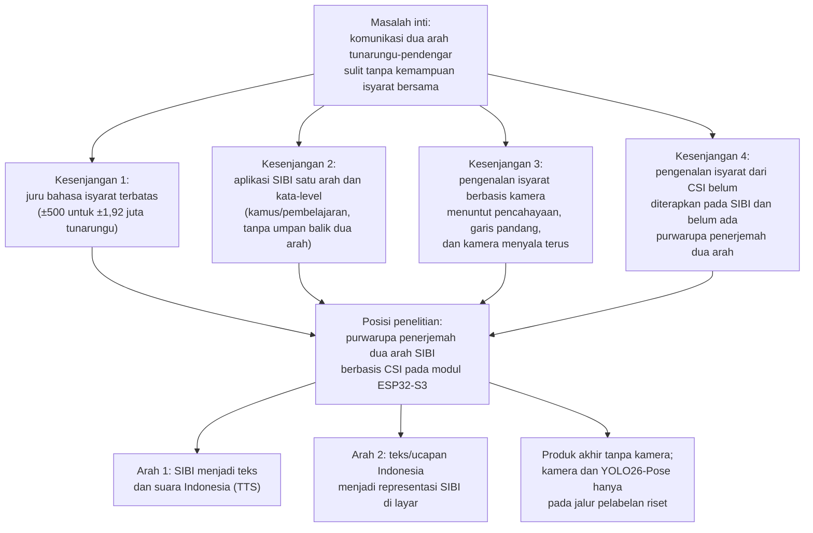
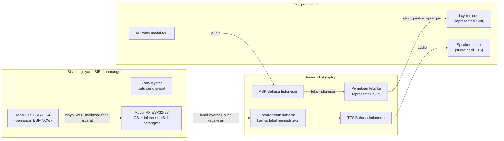

# Purwarupa Penerjemah Dua Arah Isyarat SIBI Berbasis Wi-Fi Channel State Information pada Modul ESP32-S3 dengan Inferensi Tepi dan Pemrosesan Bahasa pada Server: Studi Kelayakan Kosakata Terbatas

**PROPOSAL PENELITIAN**

| Identitas | Keterangan |
|---|---|
| Judul | Purwarupa Penerjemah Dua Arah Isyarat SIBI Berbasis Wi-Fi *Channel State Information* pada Modul ESP32-S3 dengan Inferensi Tepi dan Pemrosesan Bahasa pada Server: Studi Kelayakan Kosakata Terbatas |
| Jenis dokumen | Proposal penelitian (seminar proposal), BAB I–III + Daftar Pustaka |
| Disusun oleh | [PERLU DATA: nama penulis] |
| NIM | [PERLU DATA: NIM penulis] |
| Program studi | [PERLU DATA: program studi] |
| Universitas | [PERLU DATA: nama universitas] |
| Pembimbing | [PERLU DATA: nama pembimbing, bila sudah ditetapkan] |
| Tahun | [PERLU DATA: tahun penyusunan] |

> Catatan penyusunan: dokumen ini adalah revisi menyeluruh dari `Proposal-Sempro-DPJ4-SIBI-CSI.md` (revisi YOLO26, 25 Oktober 2026) sesuai visi produk terbaru pemilik penelitian, yaitu perangkat penerjemah dua arah yang portabel berbasis 2–3 modul ESP32-S3. Sumber diagram tersimpan sebagai berkas Mermaid pada folder `diagram/`. Penanda `[PERLU DATA: ...]` menandai keputusan yang menunggu pemilik penelitian, pembimbing, atau hasil tahap sebelumnya.

---

# BAB I PENDAHULUAN

## 1.1 Latar Belakang

Sebagian besar anak tunarungu lahir di tengah keluarga pendengar. Mitchell dan Karchmer [@mitchell2004], [@mitchell2005] menunjukkan kondisi tersebut melalui data siswa tunarungu di Amerika Serikat sekaligus membantah anggapan lama bahwa sekitar 10% anak tunarungu memiliki orang tua tunarungu; proporsi anak tunarungu dengan orang tua pendengar berkisar 90–95%. Angka sebanding untuk Indonesia belum ditemukan dalam penelusuran penelitian ini (Google Scholar, Crossref, dan OpenAlex hingga Oktober 2026) sehingga angka dari Amerika Serikat itu dipakai sebagai gambaran umum. Keluarga pendengar dari anak yang berkomunikasi dengan isyarat perlu ikut mempelajari bahasa isyarat, padahal proses belajarnya membutuhkan dukungan yang terstruktur [@lieberman2022] dan menghadapi hambatan praktis sehari-hari [@ritmeester2025]. Kondisi tersebut menandakan bahwa komunikasi antara tunarungu dan pendengar di lingkungan keluarga tidak dapat dianggap terjadi dengan sendirinya.

Komunikasi yang dimaksud bersifat dua arah. Penutur tunarungu menyampaikan pikiran melalui isyarat, sedangkan lawan bicara pendengar membalasnya melalui ucapan atau tulisan; kedua arah sama-sama tersendat apabila salah satu pihak tidak menguasai moda lawannya. Di Indonesia, juru bahasa isyarat yang dapat menjembatani kedua arah masih terbatas, yaitu sekitar 500 orang untuk sekitar 1,92 juta penyandang tunarungu atau kira-kira satu juru bahasa untuk 3.840 orang [@kemenkopmk2025]. Secara hukum, Undang-Undang Nomor 8 Tahun 2016 tentang Penyandang Disabilitas mengakui bahasa isyarat dan mewajibkan aksesibilitas komunikasi [@uu8_2016]. Kewajiban itu sulit dipenuhi bila kemampuan menjembatani dua arah hanya dimiliki segelintir juru bahasa sehingga teknologi bantu komunikasi yang murah dan tersedia menjadi salah satu jalur pelengkap [@rodriguez2023].

Sistem Isyarat Bahasa Indonesia (SIBI) dipilih sebagai objek penelitian meskipun bukan moda yang paling banyak dipakai komunitas tunarungu dalam keseharian. Survei ekosistem bahasa isyarat yang dilaporkan Badan Riset dan Inovasi Nasional mencatat penggunaan Bahasa Isyarat Indonesia (BISINDO) sebesar 77,7%, SIBI 1,9%, campuran 14,9%, dan lainnya 5,6% [@brin2026]. Survei serupa pada 100 responden tunarungu di Jawa dan Bali melaporkan 91% memakai BISINDO untuk komunikasi sehari-hari [@mursita2015]. Kedua survei tersebut menegaskan bahwa komunitas tunarungu lebih dekat ke BISINDO, tetapi juga menunjukkan tempat SIBI hidup: jalur pendidikan formal. Melalui Surat Pemberitahuan Direktorat Pendidikan Dasar Nomor 868/C/U/95, sekolah luar biasa yang menerapkan komunikasi total diwajibkan memakai sistem isyarat yang telah dibakukan [@kamussibi2020], dan penelitian di SLB Negeri Ogan Ilir menunjukkan murid tunarungu memakai SIBI dalam pembelajaran sehari-hari di sekolah [@satillah2024]. Dengan demikian, purwarupa penerjemah dua arah yang dibangun untuk konteks pendidikan formal lebih tepat memakai SIBI, sedangkan perluasan ke BISINDO menuntut penggantian kosakata dan validasi ulang bersama penuturnya.

Teknologi yang telah tersedia untuk kebutuhan tersebut masih terbagi menurut arah dan belum menyatu. Pada arah ucapan atau teks menjadi isyarat, aplikasi yang ada berbentuk kamus kata-level: KASIBI mengubah suara menjadi teks lalu menampilkan animasi peraga tiga dimensi dari basis data kosakata [@kasibi2019], sedangkan OpenSIBI memakai layanan pengenal ucapan lalu mencocokkan kata ke model tiga dimensi yang juga dianimasikan di layar [@opensibi2022]; keduanya mengakui cakupan kosakatanya sangat terbatas. Pada arah isyarat menjadi teks, penelitian di Indonesia bertumpu pada citra atau video dari kamera [@sanjaya2023], [@dwijayanti2021], termasuk penerapan berbasis *smartphone* untuk huruf SIBI statis [@soekarta2024], [@dbesti2026]. Pendekatan berbasis kamera menuntut pencahayaan dan garis pandang tertentu sehingga ketangguhannya menurun saat kondisi berubah [@sadeghzadeh2024], sedangkan kehadiran kamera yang terus menyala selama percakapan diduga memengaruhi kenyamanan pengguna dan dikaitkan dengan kelelahan nonverbal [@bailenson2021]. Gambar 1.1 memeringkas kesenjangan tersebut sebagai peta masalah yang menjadi titik berangkat penelitian ini.

Gambar 1.1 Peta masalah dan kesenjangan penelitian

Penginderaan berbasis Wi-Fi *Channel State Information* (CSI) menjadi kandidat pengganti kamera pada arah isyarat menjadi teks. CSI memuat informasi amplitudo dan fase pada setiap *subcarrier* yang berubah ketika gerak tubuh mengganggu jalur propagasi sinyal [@ma2019]. Ma dkk. [@ma2018] membangun SignFi yang mengenali 276 isyarat *American Sign Language* (ASL) dari CSI, sedangkan DF-WiSLR mengenali 49 gestur tanpa perangkat yang dikenakan pengguna [@ahmed2020] dan pendekatan serupa telah dicoba pada *Filipino Sign Language* [@baldeo2024]. Preseden terbaru, WiSign, bahkan mengenali kalimat ASL kontinu dari CSI perangkat Wi-Fi komersial [@wisign2020]. Kepekaan CSI terhadap gerak halus juga telah terbukti pada gerak yang jauh lebih kecil daripada gerak lengan: WiKey mengenali ketukan tombol dengan akurasi klasifikasi 96,4% untuk kunci tunggal pada kondisi terkendali [@wikey2015], dan pemantauan napas dari CSI berhasil mengklasifikasikan pola pernapasan dengan akurasi 99,54% [@mosleh2022]. Meskipun demikian, dalam batas penelusuran literatur penelitian ini hingga Oktober 2026 dengan kata kunci bahasa Inggris dan bahasa Indonesia (Subbab 2.11), belum ditemukan publikasi yang memakai CSI untuk mengenali isyarat SIBI maupun purwarupa penerjemah dua arah yang memadukan penginderaan CSI dengan pemrosesan bahasa Indonesia.

Perangkat penginderaan yang dipakai penelitian ini adalah modul ESP32-S3, yaitu mikrokontroler murah dengan radio Wi-Fi 2,4 GHz yang mendukung perolehan CSI secara resmi [@espcsi] dan direkomendasikan platform RuView untuk node penangkap CSI [@ruvnet2026]. ESP32-S3 memiliki inti ganda 240 MHz, SRAM 512 KB, dan PSRAM terpasang hingga 8 MB [@esp32s3]. Dua fakta teknis menjadi dasar kelayakan rancangan. Pertama, satu chip ESP32-S3 terbukti mampu menjalankan penangkapan CSI, koneksi station ke *access point*, dan pengiriman data secara serentak sebagaimana dijalankan firmware RuView, dengan syarat seluruh perangkat berada pada satu kanal dan radio tidak memasuki mode hemat daya [@ruvnet2026]. Kedua, inferensi model terkuantisasi pada perangkat didukung tolok ukur resmi: pustaka ESP-NN mempercepat model pendeteksi orang dari 2.300 ms menjadi 54 ms pada ESP32-S3 [@espnn], dan pustaka ESP-DL menyediakan model contoh pengenalan gestur tangan dengan waktu inferensi 69,2 ms [@espdl]. Dengan demikian, purwarupa dirancang agar pengenalan isyarat berjalan langsung pada modul sementara hasilnya dikirim ke server untuk diolah menjadi teks dan suara.

Purwarupa yang dirancang terdiri atas 2–3 modul ESP32-S3 yang portabel dan direncanakan memiliki layar, baterai, *speaker*, dan mikrofon, sebagaimana ditunjukkan pada Gambar 1.2. Pada arah pertama, modul pemancar dan modul penerima mengapit zona isyarat; modul penerima menangkap CSI, mengenali isyarat melalui model yang berjalan pada perangkat, lalu mengirim label hasil ke server. Pada arah kedua, ucapan dari mikrofon modul dikirim ke server untuk dienali menjadi teks, kemudian teks dipetakan ke representasi SIBI dan ditampilkan di layar modul. Server prototipe berupa laptop ASUS TUF Dash F15 FX516PR (Intel Core i7-11370H, GPU RTX 3070 Laptop 8 GB VRAM, RAM 16 GB) yang menjadi mesin pengembangan, pelatihan, dan server lokal sekaligus; layanan *cloud* jarak jauh dibahas sebagai alternatif, tetapi tidak diuji pada prototipe. Teknologi pemrosesan bahasanya telah diaudit kelayakannya: pengenal ucapan Whisper mendukung lebih dari 100 bahasa termasuk Indonesia [@radford2022] dan implementasi faster-whisper terbukti jauh lebih cepat daripada waktu nyata pada GPU kelas 8 GB [@fasterwhisper]; untuk sintesis suara, model MMS menyediakan checkpoint Bahasa Indonesia yang dapat dijalankan lokal [@pratap2023], [@mmsttsind], sedangkan layanan *cloud* Google dan Azure menyediakan suara Indonesia tersertifikasi [@googlecloud_tts], [@azure_tts], dan model ringan Kokoro justru tidak mencakup Bahasa Indonesia sehingga tidak dipakai [@kokoro].

Gambar 1.2 Visi purwarupa penerjemah dua arah tanpa kamera

Sebagai studi kelayakan, penelitian ini tidak mengklaim penerjemahan kontinu kosakata penuh. Kosakata dibatasi pada 5–8 isyarat SIBI terisolasi yang dibedakan lintasan lengan, tubuh atas, atau kepala, bukan oleh bentuk jari, dengan alasan resolusi spasial CSI pada satu tautan antarmodu (Subbab 2.3). Model berbasis CSI juga mudah *overfitting* terhadap orang dan ruang tempat data direkam [@chen2023] sehingga kinerja diukur lintas partisipan dan lintas ruang dengan acuan strategi Widar3.0 [@zhang2022]. Kamera dan model pose YOLO26 hanya dipakai pada jalur pelabelan selama pembuatan *dataset* riset, mengikuti pola yang telah ditetapkan revisi sebelumnya, dan tidak menjadi bagian produk akhir [@jocher2026], [@ultralytics_pose]. Pemetaan teks ke representasi SIBI pada arah kedua dibatasi menjadi kamus kata-level dengan *fallback* ejaan jari sebagaimana preseden KASIBI dan OpenSIBI, bukan penerjemahan tata bahasa penuh yang masih menjadi masalah terbuka internasional [@picron2024], [@hakozaki2025]. Setiap tahapan ditutup gerbang keputusan sehingga kegagalan tetap dilaporkan sebagai temuan kelayakan. Berdasarkan uraian tersebut, penelitian ini merancang bangun purwarupa penerjemah dua arah isyarat SIBI berbasis Wi-Fi CSI pada modul ESP32-S3 dan menguji kelayakannya sebagai alat bantu komunikasi kosakata terbatas pada konteks pendidikan formal.

## 1.2 Rumusan Masalah

Berdasarkan latar belakang yang telah dipaparkan, masalah yang dikaji dalam penelitian ini dapat dirumuskan sebagai berikut.

1. Bagaimana merancang purwarupa penerjemah dua arah SIBI berbasis dua hingga tiga modul ESP32-S3 yang menangkap CSI, melakukan inferensi pada perangkat, dan berkomunikasi dengan server lokal, termasuk protokol perekaman *dataset* isyarat terisolasi dengan pelabelan berbantuan model pose YOLO26?
2. Bagaimana kinerja pengenalan 5–8 isyarat SIBI terisolasi dari CSI melalui inferensi pada perangkat, serta kinerja jalur isyarat menjadi teks dan suara dan jalur teks atau ucapan menjadi representasi SIBI, pada skenario dalam sesi, lintas partisipan, dan lintas ruang?
3. Bagaimana kelayakan purwarupa sebagai alat bantu komunikasi dua arah kosakata terbatas ditinjau dari latensi ujung ke ujung, cakupan kosakata, keandalan operasional, dan penilaian validator penutur tunarungu?

## 1.3 Tujuan Penelitian

Berdasarkan rumusan masalah tersebut, penelitian ini bertujuan untuk:

1. Merancang purwarupa penerjemah dua arah SIBI berbasis dua hingga tiga modul ESP32-S3 yang menangkap CSI, melakukan inferensi pada perangkat, dan berkomunikasi dengan server lokal, termasuk protokol perekaman *dataset* isyarat terisolasi dengan pelabelan berbantuan model pose YOLO26.
2. Mengukur kinerja pengenalan 5–8 isyarat SIBI terisolasi dari CSI melalui inferensi pada perangkat, serta kinerja jalur isyarat menjadi teks dan suara dan jalur teks atau ucapan menjadi representasi SIBI, pada skenario dalam sesi, lintas partisipan, dan lintas ruang.
3. Menguji kelayakan purwarupa sebagai alat bantu komunikasi dua arah kosakata terbatas berdasarkan latensi ujung ke ujung, cakupan kosakata, keandalan operasional, dan penilaian validator penutur tunarungu.

## 1.4 Batasan Masalah

Ruang lingkup penelitian ini dibatasi sebagai berikut.

1. Objek pengenalan adalah 5–8 isyarat SIBI terisolasi yang lolos dua saringan, yaitu separabilitas fisik (isyarat dibedakan lintasan lengan, tubuh atas, atau kepala, bukan bentuk jari) dan validitas pedagogis (disetujui validator penutur tunarungu dan dicocokkan dengan *Kamus SIBI* [@kamussibi1994]). Sistem yang dibangun bukan penerjemah kalimat dan tidak menangani pengenalan isyarat kontinu.
2. Konfigurasi jari dan ekspresi wajah tidak dikenali; batas ini mengikat kedua arah sehingga keluaran arah pertama hanya menyangkut lintasan gerak, sedangkan arah kedua menampilkan representasi tingkat kata dan ejaan jari, bukan tata bahasa isyarat penuh beserta penanda nonmanual.
3. Perangkat keras terdiri atas 2–3 modul ESP32-S3 (masing-masing direncanakan memiliki layar kecil, baterai, *speaker*, dan mikrofon I2S) serta satu laptop ASUS TUF Dash F15 FX516PR (Intel Core i7-11370H, RTX 3070 Laptop 8 GB VRAM, RAM 16 GB) sebagai mesin pengembangan, pelatihan, dan server lokal prototipe; layanan *cloud* jarak jauh dibahas sebagai alternatif arsitektur tanpa diuji.
4. Kamera dan model pose YOLO26 hanya dipakai pada jalur pelabelan selama perekaman *dataset* riset di laptop; produk akhir tidak memakai kamera maupun citra, dan modul tidak menjalankan model visi.
5. Pemrosesan bahasa memakai teknologi yang terverifikasi mendukung Bahasa Indonesia: ASR berbasis Whisper pada server lokal, dan TTS lokal MMS-TTS-ind dengan layanan *cloud* berbahasa Indonesia sebagai pembanding; pilihan final ditetapkan pada T4 (Tabel 3.6).
6. Arah kedua dibatasi menjadi kamus kata-level dengan *fallback* ejaan jari (26 huruf dan angka 1–9) sebagaimana preseden OpenSIBI; cakupan kamus diukur dan dilaporkan, tidak dijanjikan mencakup kosakata kamus SIBI penuh.
7. Setiap sesi melibatkan satu pengisyarat pada zona akuisisi; sistem tidak mengidentifikasi individu, dan pengujian dilakukan di sedikitnya dua ruang mitra yang dikalibrasi dalam penelitian ini.
8. Uji pengguna dilakukan dalam skala kecil dengan 3–5 pengguna dan dianalisis secara deskriptif tanpa statistik inferensial.
9. Penelitian ini tidak membahas pengenalan isyarat kontinu, penerjemahan kalimat dengan tata bahasa isyarat penuh beserta penanda nonmanual, penggunaan BISINDO, maupun penerapan layanan *cloud* jarak jauh pada prototipe.

## 1.5 Manfaat Penelitian

Manfaat penelitian ini dibedakan menjadi manfaat teoretis dan manfaat praktis.

### 1.5.1 Manfaat Teoretis

Penelitian ini diharapkan memberikan bukti awal kelayakan pengenalan sekelompok kecil isyarat SIBI terisolasi dari CSI satu tautan antarmodul ESP32-S3, disertai bukti kelayakan inferensi model terkuantisasi pada perangkat untuk tugas tersebut. Bukti itu tidak berlaku bagi kosakata yang dibedakan oleh bentuk jari. Penelitian ini juga menyediakan *dataset* CSI isyarat SIBI berlabel beserta protokol perekamannya sehingga dapat menjadi pembanding bagi penelitian penginderaan nirkabel berbahasa isyarat lain, termasuk perluasan ke BISINDO. Kajian integrasi penginderaan CSI dengan jalur TTS dan ASR Bahasa Indonesia pada satu purwarupa memberikan contoh dokumentasi arsitektur tepi-awan yang dapat ditelusuri ulang peneliti berikutnya.

### 1.5.2 Manfaat Praktis

Bagi lembaga pendidikan mitra, penelitian ini memberikan gambaran kelayakan purwarupa alat bantu komunikasi dua arah berbahasa SIBI yang dapat dipakai guru dan keluarga pada kegiatan pembelajaran, bersama protokol kurasi kosakata yang disusun bersama validator penutur tunarungu. Bila tahapan penelitian mencapai gerbang terakhir, dihasilkan purwarupa yang menampilkan teks dan menyuarakan isyarat SIBI yang dikenali serta menampilkan representasi isyarat bagi lawan bicara pendengar; bila penelitian berhenti lebih awal, artefak berupa laporan karakterisasi sinyal, protokol, atau *dataset* berlabel tetap dihasilkan. Bagi keluarga siswa tunarungu, kosakata yang divalidasi penutur tunarungu memastikan bentuk isyarat yang ditampilkan baku sesuai jalur pendidikan formal. Bagi komunitas riset, *dataset* dan rancangan yang tidak terikat pada satu bahasa isyarat memudahkan replikasi dan pembandingan metode.

## 1.6 Sistematika Penulisan

Proposal penelitian ini terdiri atas tiga bab dengan sistematika sebagai berikut.

**BAB I Pendahuluan** memuat latar belakang, rumusan masalah, tujuan penelitian, batasan masalah, manfaat penelitian, dan sistematika penulisan.

**BAB II Kajian Pustaka** memuat kajian tentang bahasa isyarat dan SIBI, kebutuhan komunikasi dua arah dan sistem terdahulu, Wi-Fi CSI, modul ESP32-S3 dan platform RuView beserta koeksistensi radionya, peran model pose YOLO26 sebagai alat bantu pelabelan riset, pengenalan isyarat dan gestur berbasis CSI serta inferensi pada perangkat, TTS dan ASR Bahasa Indonesia, pemetaan teks ke representasi SIBI di layar, komunikasi perangkat dan server, evaluasi kelayakan, serta penelitian terdahulu yang relevan.

**BAB III Metode Penelitian** memuat desain penelitian; tahapan penelitian beserta gerbang keputusan; waktu dan lokasi penelitian; alat dan bahan; perancangan sistem; protokol perekaman *dataset* beserta partisipan dan etika; pengolahan sinyal, ekstraksi fitur, klasifikasi, dan deployment; skenario pengujian dan metrik evaluasi; jadwal penelitian; parameter rancangan yang ditetapkan kemudian; serta risiko dan alternatif cadangan.
