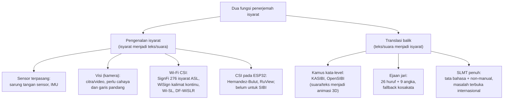

# BAB II KAJIAN PUSTAKA

## 2.1 Bahasa Isyarat dan Sistem Isyarat Bahasa Indonesia

Bahasa isyarat merupakan bahasa visual yang menyampaikan makna melalui gerak tangan, lengan, tubuh, dan ekspresi wajah [@stokoe2005], [@ong2005]. Secara struktural, sebuah isyarat tersusun atas bentuk tangan, lokasi, gerak, orientasi telapak tangan, dan komponen nonmanual seperti ekspresi wajah; perbedaan pada satu parameter saja dapat membedakan makna dua isyarat [@stokoe2005], [@ong2005]. Dalam penelitian ini, parameter tersebut menjadi acuan untuk memisahkan bagian isyarat yang dapat dinilai mesin dari bagian yang tetap memerlukan penilaian manusia (Subbab 2.3 dan 2.8).

Pemakaian bahasa isyarat di Indonesia tidak seragam. Survei ekosistem bahasa isyarat menunjukkan BISINDO jauh lebih banyak dipakai respondennya daripada SIBI, sedangkan SIBI berkembang di jalur pendidikan formal [@brin2026]; angka pemakaian dan keterbatasan sampel survei tersebut telah dipaparkan pada Subbab 1.1. Survei pada responden tunarungu di Jawa dan Bali melaporkan bahwa 91% responden memakai BISINDO untuk komunikasi sehari-hari karena konsep SIBI dianggap sulit [@mursita2015]. SIBI sendiri merupakan sistem isyarat baku yang dikembangkan untuk keperluan pendidikan formal, sedangkan BISINDO berkembang secara alami di komunitas tunarungu; kajian pada mahasiswa tunarungu [@nugraheni2023] dan pada siswa SLB [@malika2025] memerikan perbedaan pemakaian keduanya. Bentuk baku isyarat SIBI didokumentasikan dalam *Kamus Sistem Isyarat Bahasa Indonesia* yang selanjutnya disebut *Kamus SIBI* [@kamussibi1994], dan bentuk digitalnya tersedia melalui Kamus SIBI Digital [@kamussibi2020].

Pemilihan SIBI dalam penelitian ini didasarkan pada jalur pendidikan formal yang menjadi konteks pemakaian purwarupa, bukan pada jumlah penuturnya (Subbab 1.1). Alat yang dirancang tidak dimaksudkan menggantikan BISINDO dalam komunikasi komunitas tunarungu sehari-hari. Rancangan sistem tidak terikat pada satu bahasa isyarat tertentu sehingga perluasan ke BISINDO pada prinsipnya dapat dilakukan dengan mengganti *dataset*, menyeleksi ulang kosakata dengan kriteria yang sama, dan melakukan validasi bersama validator penutur BISINDO; kelayakan perluasan tersebut tidak diuji dalam penelitian ini dan diusulkan sebagai penelitian lanjutan.

## 2.2 Kebutuhan Komunikasi Dua Arah dan Sistem Terdahulu

Komunikasi antara penutur isyarat dan pendengar menuntut kemampuan pada kedua arah, yaitu memahami isyarat yang diperagakan dan membalasnya dengan moda yang dapat dipahami lawan bicara. Sebagian besar anak tunarungu lahir dari orang tua pendengar [@mitchell2004] sehingga keluarga pendengar berada di barisan pertama yang merasakan kebutuhan tersebut; mereka yang belajar bahasa isyarat membutuhkan dukungan belajar terstruktur serta menghadapi hambatan praktis [@lieberman2022], [@ritmeester2025]. Juru bahasa isyarat profesional yang dapat menjembatani kedua arah jumlahnya terbatas [@kemenkopmk2025] sehingga teknologi bantu komunikasi berperan sebagai pelengkap [@rodriguez2023]. Dalam penelitian ini, kebutuhan tersebut diterjemahkan menjadi purwarupa yang bekerja dua arah, bukan sekadar kamus satu arah.

Sistem terdahulu di Indonesia dapat dikelompokkan menurut arah kerjanya, sebagaimana dirangkum pada taksonomi Gambar 2.1. Pada arah ucapan atau teks menjadi isyarat, KASIBI mengubah suara menjadi teks melalui layanan pengenal ucapan, mencocokkan kata pada basis data, lalu menampilkan animasi peraga tiga dimensi; sistem tersebut diuji sebagai media pembelajaran dan memperoleh rata-rata skor 3,362 dari 4 [@kasibi2019]. OpenSIBI memakai mekanisme serupa dengan menyimpan model tiga dimensi format Collada pada *application programming interface* (API) sehingga aplikasi Android dapat menganimasikannya; cakupannya 50 kosakata yang terdiri atas 9 angka, 26 huruf, dan 15 kata, dan penulisnya mengakui keterbatasan kosakata sebagai kelemahan utama [@opensibi2022]. Kedua sistem tersebut membuktikan bahwa arah balik kata-level secara teknis dapat dibangun, tetapi sekaligus menandai biaya pembuatan aset per isyarat yang tinggi. Aplikasi pembelajaran dasar lain menyasar arah manusia belajar isyarat [@intecoms2024].

Gambar 2.1 Taksonomi pengenalan isyarat dan translasi SIBI

Pada arah isyarat menjadi teks, riset Indonesia umumnya bertumpu pada citra atau video dari kamera [@sanjaya2023]. Dwijayanti dkk. [@dwijayanti2021] memakai *convolutional neural network* (CNN) untuk citra huruf dan angka BISINDO, Kindy dkk. [@kindy2025] menyusun *dataset* video BISINDO tingkat kata, Wiguna dan Rojali [@wiguna2025] mengenali kalimat BISINDO dari video, dan Sebastian dkk. [@sebastian2025] memakai pengenalan gestur tubuh yang memperhitungkan informasi spasial. Khusus SIBI, Soekarta dkk. [@soekarta2024] membangun aplikasi Android berbasis MediaPipe untuk 24 huruf statis, disusul aplikasi pengenalan alfabet statis berbasis TensorFlow Lite [@dbesti2026]. Seluruh kelompok ini memerlukan kamera saat sistem dipakai sehingga keberhasilannya bergantung pada pencahayaan dan garis pandang [@sadeghzadeh2024], [@ong2005].

Pendekatan lain yang tidak memerlukan kamera adalah sensor yang dikenakan pada tangan, seperti sarung tangan sensor dan sensor inersia, yang dapat menangkap konfigurasi jari; namun, perangkatnya harus dikenakan dan dikalibrasi setiap kali dipakai [@ong2005], [@baldeo2024] sehingga tidak cocok untuk percakapan yang berlangsung santai. Paparan kamera yang terus menyala selama percakapan juga dikaitkan dengan kelelahan nonverbal [@bailenson2021]. Oleh karena itu, penelitian ini menelusari penginderaan berbasis sinyal Wi-Fi yang bekerja tanpa kamera dan tanpa perangkat yang dikenakan, sementara sistem terdahulu yang paling dekat dengan arah balik, yaitu KASIBI dan OpenSIBI, menjadi preseden perancangan jalur kedua purwarupa (Subbab 2.8).

## 2.3 Wi-Fi Channel State Information

Wi-Fi *Channel State Information* (CSI) merupakan informasi amplitudo dan fase pada setiap *subcarrier* yang menggambarkan kondisi kanal propagasi antara pemancar dan penerima Wi-Fi [@ma2019]. Sinyal Wi-Fi tiba di penerima melalui beberapa jalur, yaitu jalur langsung dan jalur pantulan dari dinding, perabot, serta tubuh manusia. Ketika tubuh bergerak di antara pemancar dan penerima, panjang jalur pantulan berubah sehingga amplitudo dan fase pada setiap *subcarrier* ikut berubah; perubahan itulah yang dimanfaatkan untuk mengenali gerak tanpa sensor yang dikenakan di tubuh [@ma2019].

Amplitudo dan fase memuat informasi yang berbeda tentang perubahan kanal. Cai dkk. [@cai2024] memanfaatkan keduanya sebagai informasi yang saling melengkapi untuk pengenalan gestur. Setiap *subcarrier* menempati frekuensi yang sedikit berbeda sehingga satu gerak yang sama menghasilkan perubahan yang tidak identik pada setiap *subcarrier* [@ma2019]. Dengan demikian, CSI menyediakan banyak kanal pengamatan dari satu pasang pemancar dan penerima.

Gerak lengan juga menghasilkan komponen Doppler, yaitu pergeseran frekuensi yang sebanding dengan laju perubahan panjang jalur pantulan [@ma2019], [@zhang2022]. Komponen tersebut dapat diukur dari deret CSI dan mencerminkan kecepatan gerak. Penelitian ini memusatkan analisis Doppler pada pita frekuensi gerak 1–60 Hz; agar pita tersebut terwakili, laju pencuplikan CSI harus sekurang-kurangnya dua kali frekuensi tertingginya, yaitu 120 Hz, sesuai kriteria Nyquist [@nyquist1928], [@shannon1949]. *Firmware* RuView membatasi pengiriman bingkai CSI paling sering setiap 20 ms, yang setara laju maksimum 50 bingkai per detik, menurut kode sumber *firmware*-nya [@ruvnet2026]; laju aktual pada konfigurasi penelitian diukur pada tahap replikasi (BAB III). Bila laju terukur lebih rendah daripada 120 Hz, pita Doppler yang dapat diamati menyempit hingga setengah laju pencuplikan aktual dan pembatasan itu dilaporkan.

Kepekaan CSI terhadap gerak halus telah dibuktikan pada gerak yang jauh lebih kecil daripada gerak lengan. WiKey mengenali ketukan tombol dari CSI dengan tingkat deteksi lebih dari 97,5% dan akurasi klasifikasi 96,4% untuk kunci tunggal pada lingkungan terkendali [@wikey2015]. Pemantauan pernapasan dari Wi-Fi CSI berhasil mengklasifikasikan pola pernapasan dengan akurasi 99,54% dan laju napas dengan akurasi 98,69% pada kanal yang cukup baik [@mosleh2022], padahal gerak dada akibat napas berada pada orde milimeter. Kedua preseden tersebut menunjukkan bahwa CSI peka terhadap gerak skala sentimeter hingga milimeter pada kondisi jarak dekat dan pengguna tunggal. Meskipun demikian, keduanya bekerja pada kondisi terkendali sehingga keberhasilannya tidak serta-merta berlaku pada konfigurasi penelitian ini; bukti itu dipakai sebagai dasar hipotesis kerja, bukan jaminan hasil.

Pola CSI tidak hanya dipengaruhi oleh gerak isyarat, tetapi juga oleh pengisyarat yang memperagakannya dan ruang tempat perekaman. Akibatnya, model berbasis CSI mudah mengalami *overfitting* terhadap orang dan ruang tempat data pelatihan direkam [@chen2023]. Chen dkk. merangkum strategi generalisasi lintas domain untuk mengatasi persoalan tersebut, sedangkan Zhang dkk. mengusulkan Widar3.0 yang mengenali gestur lintas domain tanpa pelatihan ulang dengan profil kecepatan yang diturunkan dari Doppler [@zhang2022]. Dalam penelitian ini, strategi lintas domain dijadikan acuan rancangan fitur, sedangkan kemampuan generalisasi sistem diukur langsung melalui skenario pengujian (Subbab 2.10 dan 3.8).

Panjang gelombang Wi-Fi pada pita 2,4 GHz berkisar 12,5 cm dan membatasi resolusi spasial CSI. Sejumlah penelitian melaporkan pengenalan isyarat dan gestur tangan dari CSI dengan perangkat riset multi-antena: SignFi memakai NIC Intel 5300 dengan tiga antena penerima [@ma2018], Wi-SL memakai router dengan dua antena pemancar dan tiga antena penerima pada kanal 40 MHz dengan laju cuplik 400 Hz [@hao2020], dan HandFi memakai NIC Intel 5300 sebagai penerima dari router Wi-Fi komersial [@sruthi2024]. Penelitian ini tidak mengasumsikan kemampuan tersebut juga dimiliki perangkat yang digunakan. Dengan satu tautan antara dua modul ESP32-S3 yang masing-masing berantena tunggal, perbedaan konfigurasi jari dan ekspresi wajah diasumsikan terlalu halus untuk dibedakan secara andal; asumsi tersebut diperiksa melalui uji Delta-CSI (BAB III) sehingga cakupan pengenalan dibatasi pada lintasan lengan, tubuh atas, dan kepala. Batas resolusi tersebut menentukan saringan separabilitas fisik pada kurasi kosakata (Subbab 3.6) dan makna keluaran sistem pada kedua arah.

## 2.4 Modul ESP32-S3, Platform RuView, dan Koeksistensi Radio

ESP32-S3 merupakan mikrokontroler dengan radio Wi-Fi 802.11 b/g/n pada pita 2,4 GHz dan tautan tunggal satu antena (1T1R) [@esp32s3]. Inti prosesornya ganda Xtensa LX7 berjalan pada 240 MHz dengan instruksi vektor; memorinya terdiri atas SRAM internal 512 KB, ROM 384 KB, dan PSRAM terpasang hingga 8 MB sesuai varian chip [@esp32s3]. Dukungan CSI tersedia resmi untuk seluruh seri ESP32 termasuk ESP32-S3 melalui repositori esp-csi [@espcsi]; pada kanal 20 MHz 802.11n, CSI yang dilaporkan mencakup 56 *subcarrier* yang terdiri atas 52 *subcarrier* data dan 4 *subcarrier* pilot [@espcsi]. Basis akuisisi CSI mandiri pada keluarga ESP32 dikembangkan oleh Hernandez dan Bulut [@hernandez2020], dan varian ESP32-S3 adalah varian yang direkomendasikan dokumentasi RuView untuk node penangkap CSI [@ruvnet2026].

RuView merupakan proyek sumber terbuka yang menyediakan rantai akuisisi dan pengolahan CSI pada ESP32. Komponennya meliputi *firmware* ESP32 penangkap CSI dengan format bingkai ADR-018 yang dikirim melalui *User Datagram Protocol* (UDP), *server* pengolahan sinyal, kalibrasi ruang bawaan, segmentasi berbasis energi gerak, *dashboard* web, mode privasi, dan *pipeline* akuisisi tersinkron kamera–CSI melalui skrip `scripts/collect-ground-truth.py` (ADR-079) [@ruvnet2026]. ADR atau *architecture decision record* adalah catatan keputusan arsitektur yang dipakai repositori tersebut untuk mendokumentasikan keputusan desain [@ruvnet2026]. Kalibrasi ruang bawaan memakai 600 bingkai dan 8 *anchor* selama kurang lebih empat menit, sedangkan mode privasi menekan fitur biometrik agar tidak diterbitkan keluar dari *server* [@ruvnet2026].

Fakta teknis yang paling menentukan arsitektur purwarupa adalah koeksistensi radio pada satu chip. *Firmware* RuView menjalankan tiga fungsi radio secara serentak pada satu ESP32-S3: menangkap CSI melalui mode promiscuous, terhubung sebagai station ke *access point* untuk mengirim data melalui UDP, dan menerima sinkronisasi ESP-NOW dari modul pemancar [@ruvnet2026]. ESP-NOW sendiri merupakan protokol komunikasi tanpa *access point* yang memuat hingga 250 bita per paket dan dipakai RuView sebagai sumber bingkai bersama antarmodul [@ruvnet2026]. Tiga syarat wajib menyertai pola tersebut: seluruh perangkat berada pada satu kanal mengikuti kanal *access point*, penyaringan paket mode promiscuous dibatasi pada kelompok paket manajemen agar beban interupsi terkendali, dan mode hemat daya radio dimatikan karena CSI menuntut radio tetap terjaga [@ruvnet2026]. Dengan bukti itu, purwarupa tidak memerlukan modul gerbang khusus; setiap modul dapat menjalankan peran ganda sekaligus, dan topologi lengkapnya diuraikan pada Subbab 3.5. Tabel 2.1 memetakan fitur RuView terhadap perannya dalam penelitian ini.

Tabel 2.1 Pemetaan fitur RuView terhadap peran dalam penelitian ini

| Fitur RuView | Peran dalam penelitian ini |
|---|---|
| *Firmware* ESP32 penangkap CSI (format bingkai ADR-018, *streaming* UDP) | Mengalirkan CSI dan label hasil inferensi dari modul ke *server* lokal |
| Koneksi station + UDP + CSI promiscuous + sinkronisasi ESP-NOW pada satu chip | Dasar topologi satu kanal purwarupa (Subbab 3.5) |
| Kalibrasi ruang bawaan (600 bingkai + 8 *anchor*) | Mengkalibrasi ruang mitra pada awal setiap sesi |
| Segmentasi berbasis energi gerak | Memotong deret CSI menjadi segmen isyarat terisolasi |
| *Dashboard* web | Pemantauan sesi riset; tampilan pengguna akhir ada di layar modul |
| Mode privasi | Membuang fitur biometrik selama penelitian |
| *Pipeline* akuisisi tersinkron kamera–CSI (ADR-079) | Jalur pelabelan riset dengan estimator diganti model pose YOLO26 |
| Modul estimasi pose *on-device* | Tidak dipakai |

Modul estimasi pose *on-device* RuView tidak dipakai karena pengenalan isyarat dilakukan langsung dari fitur CSI (Subbab 2.6). Karena RuView bersumber dari repositori perangkat lunak dan tidak melalui telaah sejawat, fungsi yang dipakai diverifikasi lebih dulu pada tahap replikasi melalui gerbang keputusan G0 sebelum dipakai untuk perekaman (BAB III).

## 2.5 Estimasi Pose Berbasis Visi sebagai Alat Bantu Pelabelan Riset

Estimasi pose merupakan tugas visi komputer untuk memperkirakan posisi *keypoint* tubuh manusia dari citra atau video [@zheng2023]. YOLO26 merupakan keluarga model visi waktu nyata terbaru dari Ultralytics yang mendukung deteksi, segmentasi, klasifikasi, dan estimasi pose dalam satu kerangka [@jocher2026]. Model pose YOLO26 dilatih pada *dataset keypoint* COCO dan menghasilkan 17 *keypoint* tubuh per orang, mencakup titik wajah, bahu, siku, dan pergelangan tangan, tanpa *keypoint* jari [@ultralytics_pose]. Analisis independen atas YOLO26 menunjukkan bahwa model ini dirancang untuk efisiensi inferensi dan kesiapan penerapan pada perangkat tepi [@sapkota2025].

Dalam penelitian ini, model pose YOLO26 dipakai sebagai estimator terlatih tanpa pelatihan ulang hanya pada jalur pelabelan riset. *Pipeline* akuisisi tersinkron mengikuti pola ADR-079 RuView yang aslinya memakai MediaPipe PoseLandmarker [@lugaresi2019] dengan estimator diganti model pose YOLO26 yang keluarannya juga 17 *keypoint* format COCO sehingga formatnya setara dengan skrip asli. Pemakaian visi sebagai pemberi supervisi bagi pelatihan model Wi-Fi telah memiliki preseden: Person-in-WiFi memperoleh persepsi tubuh dari sinyal Wi-Fi dengan supervisi kamera [@wang2019], dan DensePose from WiFi memetakan sinyal Wi-Fi ke koordinat permukaan tubuh dengan jaringan visi sebagai guru [@geng2023]. Namun, dalam penelitian ini kamera tidak mengajarkan pose kepada model CSI; label kelas berasal dari kartu pemandu pada protokol elisitasi, sedangkan deret *keypoint* hanya dipakai untuk verifikasi batas segmen, penyaringan segmen buruk, dan diagnosis kesalahan klasifikator secara luring (Subbab 3.8). Distilasi pengetahuan pose secara penuh diusulkan sebagai penelitian lanjutan.

Peran kamera dengan demikian terbatas pada tahap riset dan tidak pernah menyala pada produk akhir. Batas ini penting karena keluaran model hanya mencakup tubuh tanpa *keypoint* jari; batas tersebut sejalan dengan cakupan pengenalan yang memang dibatasi pada lintasan lengan, tubuh atas, dan kepala (Subbab 2.3). Setelah model CSI dilatih dan di-*deploy* ke modul, seluruh jalur operasional berjalan tanpa kamera dan tanpa citra sehingga klaim produk tanpa kamera dapat diuji langsung pada purwarupa.

## 2.6 Pengenalan Isyarat dan Gestur Berbasis CSI serta Inferensi pada Perangkat

Pengenalan bahasa isyarat dari CSI telah diteliti pada beberapa bahasa isyarat di luar Indonesia. SignFi mengenali 276 isyarat ASL [@ma2018], sistem multi-perangkat yang tangguh diajukan Shang dan Wu [@shang2017], DF-WiSLR mengenali 49 gestur tanpa perangkat yang dikenakan [@ahmed2020], model deret waktu berbasis *Long Short-Term Memory* dikembangkan Ahmed dkk. [@ahmed2021], WiASL mengenali tulisan ASL dengan perangkat Wi-Fi komersial [@qin2023], dan pendekatan CSI dicoba pada *Filipino Sign Language* [@baldeo2024]. WiSign memperluas arah tersebut dengan mengenali kalimat ASL kontinu dari CSI dengan segmentasi berbasis kepadatan spektrum [@wisign2020]; keberadaannya menunjukkan bahwa pengenalan kontinu bukan wilayah yang sama sekali belum disentuh sehingga kebaruan penelitian ini tidak diklaim pada pengenalan kontinu, melainkan pada penerapan CSI untuk SIBI dan pada integrasinya dengan jalur pemrosesan bahasa dua arah (Subbab 2.11).

Rancangan fitur mengikuti praktik kelompok penelitian tersebut: amplitudo dan fase *subcarrier* terpilih yang saling melengkapi [@cai2024], spektrum Doppler pada pita 1–60 Hz [@zhang2022], serta statistik ringkas berupa energi, entropi, dan lintasan puncak [@ma2019], [@sruthi2024]. *Support Vector Machine* (SVM) mencari batas pemisah antarkelas dengan margin terbesar [@cortes1995] dan dipilih sebagai pembanding dasar karena kuat pada *dataset* berukuran kecil [@mountrakis2011]. Pembandingnya adalah *one-dimensional Convolutional Neural Network* (1D-CNN) berukuran kecil yang menerapkan konvolusi sepanjang sumbu waktu dan cocok untuk data deret waktu [@kiranyaz2021].

Klasifikator himpunan tertutup selalu memilih salah satu kelas, termasuk ketika gerak yang diperagakan bukan bagian kosakata; mekanisme penolakan dilengkapi agar keluaran berkeyakinan rendah tidak dipaksakan menjadi kelas tertentu [@chow1970]. Keluaran klasifikator dilengkapi skor keyakinan; bila skor berada di bawah ambang, sistem menampilkan pesan isyarat tidak dikenali. Ambang ditetapkan dari data validasi (Tabel 3.6) dan kecukupannya ditelusuri melalui laju deteksi palsu serta penilaian validator (Subbab 3.8).

Inferensi pada penelitian ini dirancang berjalan langsung pada modul penerima, bukan pada *server*. Kelayakannya ditopang tiga tolok ukur resmi pada perangkat ESP32-S3. Pertama, pustaka ESP-NN mempercepat model pendeteksi orang berukuran 293,5 KB dari 2.300 ms menjadi 54 ms pada ESP32-S3 [@espnn]. Kedua, pustaka ESP-DL menyediakan model contoh terkuantisasi int8, termasuk model pengenalan gestur tangan dengan waktu inferensi 69,2 ms dan MobileNetV2 dengan 437,9 ms [@espdl]. Ketiga, contoh TensorFlow Lite Micro pada ESP32, seperti *micro speech* berukuran 18,4 KB, menunjukkan bahwa model kecil berjalan dengan penyangga terkendali [@esptflm]. Masukan klasifikasi CSI berupa vektor fitur deret pendek yang jauh lebih kecil daripada citra sehingga klasifikasi 5–8 kelas berada pada kelas kompleksitas yang lebih rendah daripada contoh-contoh tersebut; meskipun demikian, karena belum ada publikasi tolok ukur model CSI-isyarat pada ESP32-S3, waktu inferensi aktual tetap diukur pada tahap deployment (Subbab 3.7). Model dilatih dengan PyTorch di laptop, dikuantisasi int8, lalu dijalankan melalui TensorFlow Lite Micro atau ESP-DL dengan penyangga pada PSRAM.
