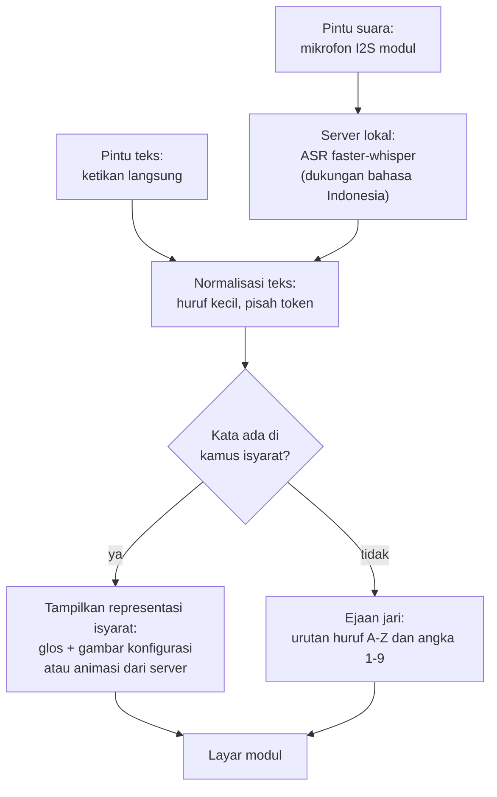

## 2.7 TTS dan ASR Bahasa Indonesia

Purwarupa memerlukan dua teknologi ucapan pada sisi server: *text-to-speech* (TTS) untuk mengubah teks hasil pengenalan menjadi suara pada arah pertama, dan *automatic speech recognition* (ASR) untuk mengubah ucapan menjadi teks pada arah kedua. Kriteria pemilihannya ada tiga: dukungan Bahasa Indonesia yang terverifikasi dari sumber resmi, kemampuan berjalan pada server lokal laptop dengan VRAM 8 GB, dan biaya yang berkelanjutan untuk prototipe. Audit teknologi dilakukan dengan memeriksa langsung model card resmi dan dokumentasi layanan (Subbab 2.7 ini) sehingga pilihan tidak didasarkan pada klaim pihak ketiga.

Untuk TTS, model ringan Kokoro-82M sering menjadi rujukan hemat sumber daya, tetapi model card resminya mencantumkan delapan bahasa dan 54 suara tanpa Bahasa Indonesia sehingga Kokoro tidak dapat dipakai [@kokoro]. Pilihan yang terverifikasi mendukung Indonesia ada tiga. Pertama, proyek Massively Multilingual Speech (MMS) menyediakan checkpoint TTS Bahasa Indonesia facebook/mms-tts-ind berbasis arsitektur VITS yang dapat diunduh dan dijalankan lokal dengan lisensi CC-BY-NC 4.0 [@pratap2023], [@mmsttsind]. Kedua, layanan Google Cloud TTS menyediakan suara id-ID tingkat Standard dan Premium dengan biaya sekitar empat dolar AS per juta karakter untuk tingkat Standard setelah jatah gratis bulanan [@googlecloud_tts]. Ketiga, layanan Azure menyediakan suara neural Indonesia id-ID-GadisNeural dan id-ID-ArdiNeural [@azure_tts]. Dalam penelitian ini, TTS lokal MMS menjadi jalur utama karena berjalan di server prototipe tanpa biaya berlangganan, sedangkan layanan awan menjadi pembanding; lisensi nonkomersial MMS dicatat sebagai batas pemakaian di luar penelitian.

Untuk ASR, Whisper adalah model terbuka yang dilatih pada lima juta jam data dan mendukung lebih dari 100 bahasa termasuk Indonesia [@radford2022]. Implementasi faster-whisper berbasis CTranslate2 mencatat tolok ukur pada GPU RTX 3070 Ti 8 GB yang sekelas dengan server penelitian ini: model large-v3 dalam mode int8 memakai sekitar 2,9 GB VRAM dan menyelesaikan 13 menit audio dalam 59 detik, atau sekitar tiga belas kali lebih cepat daripada waktu nyata [@fasterwhisper]. Dengan anggaran 8 GB VRAM, server dapat menjalankan faster-whisper dan TTS MMS secara bersamaan. Tingkat galat kata Whisper untuk ucapan Indonesia pada domain percakapan pendek belum terverifikasi dari sumber primer sehingga akurasi kata pada pemakaian nyata diukur sendiri pada tahap pengujian (Subbab 3.8).

Alur lengkap arah pertama ditunjukkan pada Gambar 2.2. Modul pemancar memancarkan bingkai bersama melalui ESP-NOW; gerak pengisyarat di zona isyarat mengubah amplitudo, fase, dan komponen Doppler pada deret CSI; modul penerima melakukan segmentasi, ekstraksi fitur, dan inferensi model int8 pada perangkat; label hasil beserta skor keyakinannya dikirim melalui UDP ke server; server mencocokkan label ke teks Indonesia pada kamus, menyintesisnya menjadi suara dengan TTS, lalu mengirim audio ke *speaker* modul. Segmen dengan skor di bawah ambang tidak dikirim sebagai label melainkan sebagai status penolakan.

```mermaid
flowchart LR
    TX["Modul TX<br/>ESP-NOW"]
    ZN["Zona isyarat:<br/>gerak lengan mengubah<br/>amplitudo, fase, Doppler"]
    RX["Modul RX ESP32-S3:<br/>CSI 56 subcarrier HT20,<br/>laju sampai 50 fps"]
    SEG["Segmentasi berbasis<br/>energi gerak"]
    FT["Fitur ringkas:<br/>subcarrier terpilih,<br/>spektrum Doppler, statistik"]
    INF["Inferensi di perangkat:<br/>model int8 (TFLM/ESP-DL),<br/>klasifikasi + skor keyakinan"]
    LBL{"Skor di atas ambang?"}
    NET["Kirim label<br/>via UDP ke server"]
    T2T["Kamus label menjadi<br/>teks Indonesia"]
    TTS["TTS Indonesia:<br/>MMS-TTS-ind / Azure / Google"]
    SPK["Speaker modul"]

    TX --> ZN --> RX --> SEG --> FT --> INF --> LBL
    LBL -- "ya" --> NET --> T2T --> TTS --> SPK
    LBL -- "tidak" --> RJ["Tampilkan:<br/>isyarat tidak dikenali"]
```

Gambar 2.2 Alur arah pertama: SIBI menjadi teks dan suara

Alur arah kedua memakai ASR yang sama pada sisi lawan arah. Ucapan ditangkap mikrofon modul, dialirkan ke server, dienali menjadi teks Indonesia, kemudian teks diproses untuk dipetakan ke representasi SIBI sebagaimana diuraikan pada Subbab 2.8. Latensi setiap komponen jalur ucapan, yaitu pengenalan, pemetaan, dan sintesis, diukur pada tahap pengujian operasional dan dibandingkan dengan indikator layak yang ditetapkan sebelum pengukuran (Tabel 3.6).

Pembagian server lokal dan *cloud* jarak jauh ditetapkan sebagai berikut. Prototipe memakai server lokal laptop sehingga seluruh pemrosesan berlangsung pada jaringan yang sama dengan modul dan tidak bergantung pada koneksi internet; pilihan ini juga memungkinkan pengukuran latensi yang murni berasal dari sistem, bukan dari jaringan luar. Layanan *cloud* jarak jauh dibahas sebagai alternatif skalabel untuk pengembangan lanjutan, tetapi latensi layanan ucapan awan dari Indonesia belum terdokumentasi pada sumber yang diinspeksi sehingga tidak dijadikan dasar klaim apa pun dalam penelitian ini.

## 2.8 Pemetaan Teks ke Representasi SIBI di Layar

Pemetaan teks Bahasa Indonesia menjadi representasi isyarat tidak dapat dilakukan dengan substitusi kata demi kata. Bahasa isyarat memiliki tata bahasa yang berbeda dari bahasa lisan, termasuk penggunaan ruang dan penanda nonmanual sehingga penerjemahan mesin bahasa isyarat tingkat kalimat masih menjadi masalah terbuka dalam literatur internasional [@picron2024]. Evaluasi avatar bahasa isyarat Jepang menunjukkan bahwa komponen mouthing, yaitu gerak mulut yang menyertai isyarat, merupakan isu kelas satu pada keterbacaan avatar [@hakozaki2025]. Oleh karena itu, arah kedua purwarupa dirancang pada tingkat yang lebih rendah dan lebih dapat dipertanggungjawabkan, yaitu kamus kata-level dengan mekanisme ejaan jari sebagai cadangan.

Struktur SIBI sendiri mendukung pendekatan bertingkat tersebut. SIBI memiliki alfabet manual satu tangan yang lengkap: sistem pembelajarannya mencakup 26 huruf A sampai Z dan 9 angka [@opensibi2022], sedangkan dataset riset citra statis hanya memuat 24 kelas huruf tanpa J dan Z karena keduanya melibatkan gerakan [@rabit2026], [@soekarta2024]. SIBI juga memiliki kata berinfleksi: Rakun dkk. mengenali kata jadian SIBI dengan model *Hidden Markov Model* [@rakun2015] dan karya lanjutannya mengurai komponen gestur kata berinfleksi tersebut [@anggraini2019]. Keberadaan struktur ini menandakan bahwa pemetaan teks ke isyarat SIBI secara sistematis mungkin dikembangkan lebih jauh, tetapi mekanisme lengkap pembentukan kata jadian belum terdokumentasi pada sumber yang dapat diakses penelitian ini sehingga tidak dirinci dalam rancangan.

Preseden arah kedua di Indonesia berbentuk kamus kata-level. KASIBI memetakan setiap kata hasil pengenalan ucapan ke satu animasi peraga tiga dimensi [@kasibi2019], sedangkan OpenSIBI menyimpan model tiga dimensi format Collada pada API dan menganimasikannya di aplikasi; cakupan OpenSIBI hanya 50 kosakata dan penulisnya menyebut banyaknya kosakata sebagai keterbatasan utama [@opensibi2022]. Preseden internasional yang memadukan pengenalan dengan pembangkitan isyarat untuk pembelajaran telah ada sejak Sagawa dan Takeuchi [@sagawa2002]. Kedua preseden Indonesia menunjukkan dua fakta sekaligus: arah kedua secara teknis layak dibangun, dan biaya aset per isyarat adalah hambatan utama cakupan kosakata.

Berdasarkan bukti tersebut, tampilan arah kedua purwarupa dirancang dua lapis. Lapis utama menampilkan glos teks dan gambar konfigurasi tangan untuk kosakata yang tersedia, termasuk 26 huruf dan 9 angka; estimasi internal menunjukkan sekitar dua puluh hingga tiga puluh kilobita per gambar kecil sehingga himpunan aset tingkat ini muat di penyimpanan modul. Lapis kedua, yang diaktifkan bila waktu pengembangan memungkinkan, menampilkan animasi per isyarat yang dirender atau dialirkan dari server karena video tidak muat disimpan utuh pada memori modul. Kata yang tidak terdapat pada kamus dijatuhkan ke ejaan jari, yaitu urutan gambar huruf, sebagaimana semangat cakupan OpenSIBI yang menjadikan huruf sebagai bagian inti kosakata. Notasi tulis isyarat seperti SignWriting tidak dipakai karena tidak ditemukan penerapannya untuk SIBI dan keterbacaannya bagi pengguna awam rendah. Alur lengkap arah kedua ditunjukkan pada Gambar 2.3.

Gambar 2.3 Alur arah kedua: teks/ucapan menjadi representasi SIBI

Dengan rancangan tersebut, keluaran arah kedua adalah representasi tingkat kata dan ejaan jari, bukan kalimat isyarat bermutru lengkap. Cakupan kamus, yaitu proporsi kata uji yang terwakili representasi tersedia, diukur dan dilaporkan sebagai metrik utama arah ini (Subbab 3.8); penelitian ini tidak mengklaim cakupan kosakata kamus SIBI penuh karena angka kosakata kamus itu sendiri belum terverifikasi dari sumber yang layak kutip.

## 2.9 Komunikasi Modul, Server, dan Topologi Jaringan

Seluruh komunikasi purwarupa berlangsung pada satu kanal Wi-Fi mengikuti kanal *access point* sehingga modul dapat menjalankan penangkapan CSI dan komunikasi data secara serentak (Subbab 2.4). Antarmodul, sinkronisasi memakai ESP-NOW yang memuat hingga 250 bita per paket [@ruvnet2026]. Dari modul ke *server*, aliran data memakai UDP sebagaimana firmware RuView [@ruvnet2026], sedangkan aliran audio dari mikrofon dan audio hasil TTS ke modul memakai protokol tingkat aplikasi yang dipilih pada tahap perancangan detail; dokumentasi resmi menyediakan contoh protokol tersebut pada platform ESP32 sehingga pemilihannya bukan risiko kelayakan, melainkan keputusan rekayasa.

Server lokal menjalankan empat komponen sekaligus: *server* RuView untuk kalibrasi ruang dan pemrosesan sesi riset, faster-whisper untuk ASR, TTS MMS untuk sintesis suara, dan layanan kamus yang memetakan label ke teks serta teks ke representasi isyarat. Anggaran VRAM 8 GB memadai karena faster-whisper int8 memakai sekitar 2,9 GB [@fasterwhisper] dan model TTS MMS berukuran jauh lebih kecil. Laptop juga dapat berperan sebagai *access point* melalui fitur hotspot sehingga purwarupa dapat dijalankan tanpa router tambahan pada lingkungan demo. Perbandingan dengan arsitektur *cloud* jarak jauh dibahas kualitatif pada laporan akhir dengan dasar pengukuran server lokal.

## 2.10 Evaluasi Kelayakan

Studi kelayakan digunakan untuk menilai apakah suatu pendekatan dapat dijalankan sebelum dikembangkan lebih jauh [@bowen2009]. Dalam penelitian ini, kelayakan dinilai bertahap melalui gerbang keputusan G0–G4 (BAB III). Kriteria gerbang yang menyangkut kinerja klasifikasi dirumuskan relatif terhadap peluang acak, bukan sebagai target akurasi. Setiap tahap menghasilkan artefak tetap berupa laporan karakterisasi sinyal, protokol perekaman, *dataset* berlabel, model terdeploy, atau laporan kelayakan sehingga kegagalan pada suatu gerbang tetap dilaporkan sebagai temuan.

Kinerja klasifikasi diukur dengan akurasi, presisi, *recall*, skor F1 makro, dan *confusion matrix* per isyarat [@sokolova2009]. Skor F1 makro merata-ratakan skor setiap isyarat tanpa pembobotan sehingga setiap isyarat berbobot sama, sedangkan *confusion matrix* memperlihatkan pasangan isyarat yang saling tertukar. Setiap metrik dilaporkan bersama peluang acak, yaitu satu dibagi jumlah kelas. Pengujian mencakup skenario dalam sesi, lintas sesi, lintas partisipan, dan lintas ruang; pembagian acak tidak dipakai pada skenario dalam sesi karena repetisi yang berurutan cenderung mirip sehingga informasi dapat bocor dari data latih ke data uji.

Kelayakan purwarupa sebagai alat komunikasi dinilai dari tiga dimensi tambahan di luar klasifikasi. Pertama, latensi ujung ke ujung diukur untuk setiap arah, yaitu selang dari selesainya isyarat hingga suara tampil pada arah pertama dan selang dari selesainya ucapan hingga representasi tampil pada arah kedua. Kedua, cakupan kamus arah kedua diukur sebagai proporsi kata uji yang terwakili. Ketiga, keandalan operasional ditinjau dari laju deteksi palsu per jam saat tidak ada isyarat dan konsumsi arus modul sebagai indikator ketahanan baterai. Persepsi pengguna diukur dengan kuesioner skala Likert [@likert1932] dan dianalisis secara deskriptif tanpa statistik inferensial, sedangkan kewajaran keluaran sistem dinilai validator penutur tunarungu.

## 2.11 Penelitian Terdahulu

Penelitian ini disusun dengan mempertimbangkan penelitian terdahulu pada empat topik, yaitu pengenalan bahasa isyarat dari sinyal Wi-Fi, kepekaan CSI terhadap gerak halus, transfer visi ke Wi-Fi, dan sistem isyarat SIBI atau BISINDO di Indonesia pada kedua arah. Tabel 2.2 membandingkan penelitian tersebut berdasarkan modalitas, arah kerja, bahasa isyarat, kebebasan dari kamera saat sistem dipakai, dan fokus penelitian.

Tabel 2.2 Perbandingan penelitian terdahulu

| No. | Peneliti (Tahun) | Modalitas dan arah | Bahasa isyarat | Bebas kamera saat dipakai | Fokus penelitian |
|---|---|---|---|---|---|
| 1 | Ma dkk. (2018) [@ma2018] | CSI; isyarat menjadi teks | ASL, 276 isyarat | Ya | Pengenalan isyarat berskala besar |
| 2 | Zhang dkk. (2020) [@wisign2020] | CSI; isyarat menjadi teks | ASL, kalimat kontinu | Ya | Pengenalan kalimat kontinu |
| 3 | Shang dan Wu (2017) [@shang2017] | Wi-Fi multi-perangkat; isyarat menjadi teks | Tidak disebutkan | Ya | Ketangguhan sistem |
| 4 | Ahmed dkk. (2020) [@ahmed2020] | CSI; isyarat menjadi teks | 49 gestur | Ya | Pengenalan tanpa perangkat dikenakan |
| 5 | Baldeo dkk. (2024) [@baldeo2024] | CSI; isyarat menjadi teks | Filipino Sign Language | Ya | Pengenalan bahasa isyarat |
| 6 | Ali dkk. (2015) [@wikey2015] | CSI; ketukan menjadi identitas tombol | Bukan bahasa isyarat | Ya | Bukti kepekaan gerak jari |
| 7 | Mosleh dkk. (2022) [@mosleh2022] | CSI; pola napas | Bukan bahasa isyarat | Ya | Bukti kepekaan gerak milimeter |
| 8 | Wang dkk. (2019) [@wang2019] | Wi-Fi dengan supervisi kamera saat pelatihan | Bukan bahasa isyarat | Ya | Persepsi tubuh dari Wi-Fi |
| 9 | Geng dkk. (2023) [@geng2023] | Wi-Fi dengan jaringan visi sebagai guru | Bukan bahasa isyarat | Ya | Pose padat per bagian tubuh |
| 10 | Dwijayanti dkk. (2021) [@dwijayanti2021] | Citra; isyarat menjadi teks | BISINDO (huruf dan angka) | Tidak | CNN pengenalan citra |
| 11 | Kindy dkk. (2025) [@kindy2025] | Video; isyarat menjadi teks | BISINDO tingkat kata | Tidak | Dataset dan baseline |
| 12 | Wiguna dan Rojali (2025) [@wiguna2025] | Video; isyarat menjadi teks | BISINDO tingkat kalimat | Tidak | Pengenalan kalimat |
| 13 | Soekarta dkk. (2024) [@soekarta2024] | Citra; isyarat menjadi teks | SIBI, 24 huruf statis | Tidak | Aplikasi Android berbasis MediaPipe |
| 14 | Zikky dan Akbar (2019) [@kasibi2019] | Suara menjadi animasi 3D | SIBI | Ya | Kamus suara-isyarat |
| 15 | Fatmawati dkk. (2022) [@opensibi2022] | Suara menjadi animasi 3D | SIBI, 50 kosakata | Ya | Aplikasi pembelajaran OpenSIBI |
| 16 | Rakun dkk. (2015) [@rakun2015] | Citra; isyarat menjadi teks | SIBI, kata berinfleksi | Tidak | HMM kata jadian SIBI |
| 17 | Penelitian ini | CSI dua-tiga modul ESP32-S3 dengan inferensi tepi; dua arah | SIBI | Ya | Purwarupa penerjemah dua arah kosakata terbatas |

Tabel 2.2 memperlihatkan empat kelompok penelitian. Kelompok pertama mengenali bahasa isyarat dari sinyal Wi-Fi [@ma2018], [@wisign2020], [@shang2017], [@ahmed2020], [@baldeo2024] dan membuktikan bahwa isyarat dapat dikenali tanpa kamera saat sistem dipakai, termasuk pengenalan kalimat kontinu oleh WiSign [@wisign2020]; kelompok ini tidak menjangkau SIBI dan tidak memadukan hasilnya dengan jalur pemrosesan bahasa. Kelompok kedua membuktikan kepekaan CSI terhadap gerak halus [@wikey2015], [@mosleh2022] sehingga asumsi kelayakan penginderaan gerak lengan memiliki dasar, tetapi keduanya bukan sistem isyarat. Kelompok ketiga memindahkan pengetahuan visi ke Wi-Fi [@wang2019], [@geng2023] dan menjadi preseden peran kamera yang hanya aktif saat pelatihan, sebagaimana peran YOLO26 dalam penelitian ini. Kelompok keempat menjangkau SIBI dan BISINDO [@dwijayanti2021], [@kindy2025], [@wiguna2025], [@soekarta2024], [@rakun2015], tetapi hampir seluruhnya berbasis kamera pada arah isyarat menjadi teks; hanya dua kamus suara menjadi animasi yang bekerja pada arah balik [@kasibi2019], [@opensibi2022] dan keduanya satu arah dengan kosakata sangat terbatas.

Dalam batas penelusuran literatur penelitian ini, yang mencakup Google Scholar, Crossref, dan OpenAlex hingga Oktober 2026 dengan kata kunci bahasa Inggris dan bahasa Indonesia (Subbab 1.1), belum ditemukan publikasi yang mengenali isyarat SIBI dari CSI maupun purwarupa penerjemah dua arah yang memadukan penginderaan CSI dengan TTS dan ASR Bahasa Indonesia pada perangkat ESP32-S3. Kebaruan penelitian ini dengan demikian bersifat kombinatif, yaitu kombinasi antara penginderaan CSI satu tautan antarmodul untuk SIBI, inferensi pada perangkat, dan integrasi dua arah dengan pemrosesan bahasa Indonesia pada server lokal; penelitian ini tidak mengklaim kebaruan pada pengenalan kontinu yang telah dijangkau WiSign untuk ASL [@wisign2020], tidak mengklaim kebaruan pada arah balik kata-level yang telah dibangun KASIBI dan OpenSIBI [@kasibi2019], [@opensibi2022], dan tidak mengklaim penerjemahan kalimat penuh yang masih menjadi masalah terbuka [@picron2024].
