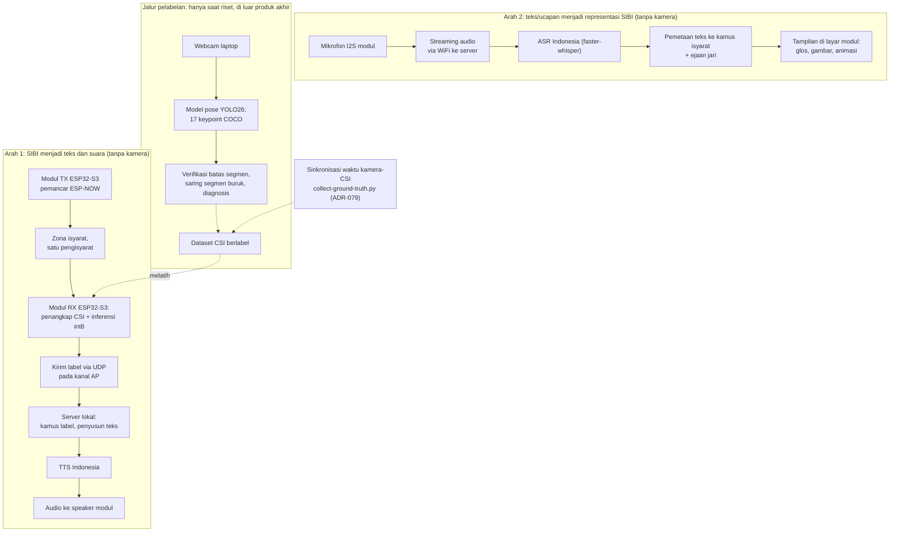
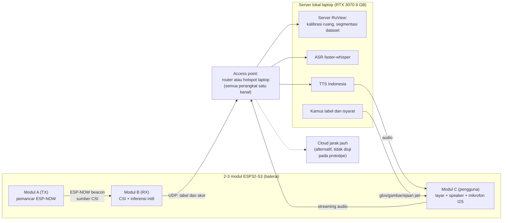

# BAB III METODE PENELITIAN

## 3.1 Desain Penelitian

Penelitian ini dirancang sebagai studi kelayakan kuantitatif bergerbang yang menghasilkan purwarupa penerjemah dua arah. Bagian kuantitatif mengukur sejauh mana Wi-Fi CSI dari tautan antarmodul ESP32-S3 dapat membedakan 5–8 isyarat SIBI terisolasi, sejauh mana model terkuantisasi berjalan pada perangkat, dan sejauh mana jalur isyarat menjadi teks dan suara serta jalur teks atau ucapan menjadi representasi SIBI bekerja pada skenario yang ditetapkan. Setelah komponen diuji, purwarupa dikemas lalu dikaji kelayakannya sebagai alat bantu komunikasi kosakata terbatas melalui uji operasional, uji kegunaan skala kecil, dan penilaian validator penutur tunarungu. Struktur bergerbang dipilih karena kemampuan CSI membedakan isyarat SIBI belum dapat dipastikan sebelum data dikumpulkan; setiap tahap menghasilkan artefak tetap, kegagalan gerbang dicatat sebagai temuan, dan kriteria akurasi dirumuskan relatif terhadap peluang acak (Subbab 2.10).

Rumusan masalah pertama dijawab pada tahap replikasi platform, perancangan arsitektur, serta kurasi isyarat dan protokol. Rumusan masalah kedua dijawab melalui uji klasifikasi, uji deployment, dan uji jalur bahasa pada tahap perekaman dan generalisasi. Rumusan masalah ketiga ditinjau melalui uji operasional, uji kegunaan, dan penilaian validator pada tahap pengemasan purwarupa.

## 3.2 Tahapan Penelitian

Penelitian berlangsung selama empat belas minggu (M1–M14) dalam enam tahap. Tahapan dimulai dari replikasi platform dan uji karakterisasi (T0), kemudian kurasi isyarat dan protokol (T1), perekaman *dataset* dan pelatihan model (T2), uji generalisasi (T3), pengemasan purwarupa dua arah dan uji kegunaan (T4), hingga analisis dan penulisan (T5). Lima tahap pertama ditutup gerbang keputusan G0–G4 seperti ditunjukkan pada Gambar 3.1. Kriteria lolos dan tindakan bila gagal direncanakan ditetapkan sebelum gerbang terkait dinilai; parameter yang belum ditetapkan dihimpun pada Tabel 3.6.

```mermaid
flowchart TD
    T0["T0 Replikasi platform, uji Delta-CSI,<br/>dan uji koeksistensi radio, M1-M2"]
    G0{"G0 akhir M2: akuisisi stabil, pola gerak<br/>terpisah dari diam dan kosong,<br/>CSI + STA + ESP-NOW berjalan serentak"}
    P0["Perbaikan penempatan node satu kali"]
    G0U{"G0 diuji ulang"}
    S0["Jalur CSI dihentikan,<br/>dilaporkan sebagai temuan karakterisasi"]

    T1["T1 Kurasi isyarat, kalibrasi ruang,<br/>protokol, dan etika, M2-M4"]
    G1{"G1 M3: separabilitas awal<br/>2-3 isyarat (nearest-centroid)"}
    P1["Perubahan penempatan atau<br/>orientasi node satu kali"]
    G1U{"G1 diuji ulang"}
    S1["Tindakan sesuai Tabel 3.6,<br/>dicatat sebagai temuan"]

    T2["T2 Perekaman dataset dan pelatihan, M4-M8<br/>kartu pemandu + webcam + YOLO26 (17 keypoint COCO)<br/>disinkronkan dengan CSI (pola ADR-079)"]
    G2{"G2 M6-M7: akurasi dalam sesi<br/>jauh di atas peluang acak"}
    P2["Pemangkasan ke 3-5 isyarat<br/>yang bertumpu pada lintasan"]

    T2B["Kuantisasi int8 dan uji deploy<br/>model ke modul ESP32-S3"]
    T3["T3 Uji generalisasi:<br/>lintas sesi, partisipan, ruang,<br/>dan pengguna baru, M8-M10"]
    G3{"G3 M10: kinerja lintas domain<br/>di atas peluang acak"}
    P3["Cakupan menjadi personalisasi<br/>per pengguna, ditulis sebagai temuan"]

    T4["T4 Pengemasan purwarupa dua arah<br/>dan uji kegunaan, M10-M12"]
    G4{"G4 M12: tiga syarat kegunaan terpenuhi"}
    P4["Hasil negatif dilaporkan<br/>sebagai temuan kelayakan"]
    T5["T5 Analisis dan penulisan, M12-M14"]

    T0 --> G0
    G0 -- "lolos" --> T1
    G0 -- "gagal" --> P0 --> G0U
    G0U -- "lolos" --> T1
    G0U -- "gagal" --> S0 --> T5
    T1 --> G1
    G1 -- "lolos" --> T2
    G1 -- "gagal" --> P1 --> G1U
    G1U -- "lolos" --> T2
    G1U -- "gagal" --> S1
    T2 --> G2
    G2 -- "lolos" --> T2B
    G2 -- "gagal" --> P2 --> T2B
    T2B --> T3
    T3 --> G3
    G3 -- "lolos" --> T4
    G3 -- "gagal" --> P3 --> T4
    T4 --> G4
    G4 -- "lolos" --> T5
    G4 -- "gagal" --> P4 --> T5
```

Gambar 3.1 Alur pelatihan CSI dengan YOLO26-Pose sebagai alat bantu riset

### 3.2.1 Tahap T0: Replikasi Platform dan Uji Karakterisasi (M1–M2)

Dua modul ESP32-S3 disiapkan dengan *firmware* RuView [@ruvnet2026], lalu *pipeline* akuisisi tersinkron diuji tanpa partisipan. Tiga uji dilakukan pada tahap ini. Pertama, uji Delta-CSI (Subbab 3.8.1) untuk mengetahui apakah pola CSI saat bergerak terpisah dari kondisi diam dan ruang kosong. Kedua, uji koeksistensi radio: modul penerima dijalankan dengan penangkapan CSI, koneksi station ke *access point*, dan pengiriman UDP secara serentak, lalu laju CSI aktual dan kehilangan paket diukur, termasuk ketika streaming audio dari mikrofon diaktifkan. Ketiga, pengukuran laju pencuplikan aktual sebagai dasar penetapan pita Doppler (Subbab 3.7.1). Keluaran tahap ini adalah laporan karakterisasi sinyal sebagai bahan G0.

### 3.2.2 Tahap T1: Kurasi Isyarat, Kalibrasi Ruang, dan Protokol (M2–M4)

T1 mencakup kurasi 5–8 isyarat bersama validator penutur tunarungu, kalibrasi ruang mitra, penyusunan protokol perekaman dan etika, serta perizinan (Subbab 3.6). Kurasi juga menetapkan himpunan tampilan arah kedua, yaitu isyarat terpilih ditambah 26 huruf dan 9 angka sebagai kosakata ejaan jari (Subbab 2.8). G1 menguji separabilitas awal 2–3 isyarat dengan uji *nearest-centroid* sederhana yang rata-ratanya dihitung tanpa repetisi yang sedang diuji.

### 3.2.3 Tahap T2: Perekaman Dataset, Pelatihan, dan Uji Deployment (M4–M8)

*Dataset* direkam dengan kurang lebih 30 repetisi per isyarat per sesi disertai video tersinkron (Subbab 3.6). Fitur dari segmen yang lolos penyaringan dipakai melatih SVM sebagai pembanding dasar dan 1D-CNN berukuran kecil (Subbab 3.7). Setelah pelatihan, model terpilih dikuantisasi int8, di-*deploy* ke modul penerima, lalu diukur waktu inferensi dan pemakaian memorinya pada laju bingkai aktual. Keluaran T2 adalah *dataset* CSI berlabel, model terlatih, dan laporan deployment; bila G2 gagal, cakupan dipangkas menjadi 3–5 isyarat yang pembedanya paling bertumpu pada lintasan (Tabel 3.6).

### 3.2.4 Tahap T3: Uji Generalisasi (M8–M10)

Model mudah *overfitting* pada orang dan ruang tempat data latih direkam [@chen2023] sehingga model diuji lintas sesi, lintas partisipan, lintas ruang, dan pada satu pengguna baru tanpa pelatihan ulang (Subbab 3.7.5). Strategi lintas domain Widar3.0 [@zhang2022] dijadikan acuan tanpa mengasumsikan hasil yang sama pada isyarat SIBI. Bila G3 gagal, cakupan menjadi personalisasi per pengguna yang memerlukan data latih singkat dari setiap pengguna dan perubahan itu dilaporkan sebagai temuan.

### 3.2.5 Tahap T4: Pengemasan Purwarupa Dua Arah dan Uji Kegunaan (M10–M12)

Model yang telah berjalan di modul dikemas menjadi purwarupa dua arah (Subbab 3.5) dengan menambahkan jalur server: kamus label menjadi teks, TTS lokal, ASR faster-whisper, pemetaan teks ke representasi SIBI, serta tampilan layar modul dan pemutaran audio pada *speaker*. Selanjutnya dilakukan uji operasional, uji jalur ucapan, uji cakupan kamus, uji kegunaan dengan 3–5 pengguna, dan penilaian validator (Subbab 3.8). G4 menilai kelengkapan data uji dan persetujuan validator atas kewajaran keluaran.

### 3.2.6 Tahap T5: Analisis dan Penulisan (M12–M14)

Seluruh artefak dianalisis dan disusun menjadi laporan kelayakan beserta rekomendasi berdasarkan gerbang yang lolos dan yang gagal. Laporan memuat keterbatasan secara eksplisit, yaitu konfigurasi jari dan ekspresi wajah tidak dikenali, arah kedua berbentuk kamus kata-level dan ejaan jari, serta seluruh klaim terikat pada kosakata terbatas (Subbab 1.4).

## 3.3 Waktu dan Lokasi Penelitian

Penelitian dilaksanakan pada [PERLU DATA: bulan dan tahun pelaksanaan penelitian] di [PERLU DATA: nama sekolah/lembaga mitra]. Perekaman dan pengujian dilakukan di sedikitnya dua ruang, yaitu jumlah minimum bagi skema *leave-one-room-out*, dan setiap ruang dikalibrasi sebelum perekaman (Subbab 3.5.4). Penyiapan sistem secara mandiri oleh pengguna di luar lembaga mitra berada di luar cakupan.

## 3.4 Alat dan Bahan

Perangkat keras penelitian disajikan pada Tabel 3.1. Dua modul ESP32-S3 berperan sebagai modul pemancar dan modul penerima, sedangkan modul ketiga direncanakan sebagai modul pengguna bertipe layar, *speaker*, dan mikrofon; pemakaian dua atau tiga modul ditetapkan sesuai hasil uji beban pada T0.

Tabel 3.1 Perangkat keras penelitian

| No. | Nama | Spesifikasi | Jumlah | Keterangan |
|---|---|---|---|---|
| 1 | Modul ESP32-S3 | Papan pengembangan ESP32-S3 dengan PSRAM, varian yang direkomendasikan RuView [@ruvnet2026] | 3 unit | Modul TX, modul RX, dan modul pengguna (dapat dipakai bergilir dengan cadangan) |
| 2 | Layar modul | Layar SPI/TFT kecil (1,8–2,8 inci) [PERLU DATA: model final] | 1–2 unit | Tampilan representasi SIBI pada modul pengguna |
| 3 | Antarmuka audio modul | Mikrofon I2S dan *speaker* dengan penguat I2S; contoh model yang umum adalah INMP441 dan MAX98357A [PERLU DATA: model final] | 1 set | Pintu suara arah kedua dan pemutaran TTS |
| 4 | Baterai modul | Baterai Li-ion atau Li-Po dengan regulator daya [PERLU DATA: kapasitas target berdasarkan hasil uji arus] | 1–2 set | Ketahanan modul diukur pada uji operasional |
| 5 | Laptop | ASUS TUF Dash F15 FX516PR: Intel Core i7-11370H, RTX 3070 Laptop 8 GB VRAM, RAM 16 GB | 1 unit | Mesin pelatihan, server lokal prototipe, dan jalur pelabelan |
| 6 | *Access point* | Router Wi-Fi 2,4 GHz atau fitur hotspot laptop [PERLU DATA: pilihan final] | 1 unit | Seluruh modul dan server berada pada satu kanal |
| 7 | *Webcam* | Bawaan laptop | 1 unit | Hanya menyala pada jalur pelabelan *dataset* riset |

Perangkat lunak penelitian disajikan pada Tabel 3.2. Versi setiap perangkat lunak dicatat bersama log konfigurasi pelatihan agar eksperimen dapat diulang.

Tabel 3.2 Perangkat lunak penelitian

| No. | Nama | Fungsi dalam penelitian |
|---|---|---|
| 1 | *Firmware* dan *server* RuView | Menangkap CSI pada modul, mengirimkannya melalui UDP, mengalibrasi ruang, dan menyegmentasi deret saat riset |
| 2 | `scripts/collect-ground-truth.py` (ADR-079, diadaptasi) | Menyinkronkan akuisisi kamera dan CSI dengan estimator diganti model pose YOLO26 |
| 3 | Model pose YOLO26 | Menghasilkan deret 17 *keypoint* format COCO pada jalur pelabelan riset |
| 4 | Python, scikit-learn, PyTorch | Ekstraksi fitur, pelatihan SVM dan 1D-CNN, serta evaluasi |
| 5 | TensorFlow Lite Micro dan ESP-DL | Menjalankan model int8 pada modul penerima |
| 6 | faster-whisper | ASR Bahasa Indonesia pada server lokal |
| 7 | MMS-TTS-ind | TTS Bahasa Indonesia pada server lokal |
| 8 | Layanan TTS awan (opsional) | Pembanding kualitas dan latensi sintesis |
| 9 | Kamus label-teks dan teks-isyarat | Dikembangkan sendiri sebagai bagian purwarupa |

Bahan penelitian meliputi *dataset* CSI hasil perekaman sendiri, lembar definisi isyarat, aset tampilan arah kedua (gambar huruf, angka, dan isyarat terpilih), formulir persetujuan partisipan, instrumen uji, serta kuesioner persepsi. *Dataset* direkam sendiri karena penelitian yang mengenali isyarat SIBI dari CSI belum ditemukan dalam penelusuran literatur (Subbab 2.11).

## 3.5 Perancangan Sistem

### 3.5.1 Arsitektur Dua Arah

Sistem dirancang dalam dua jalur operasional tanpa kamera dan satu jalur pelabelan yang hanya aktif saat riset, seperti ditunjukkan pada Gambar 3.2. Pada jalur arah pertama, modul pemancar memancarkan bingkai bersama; gerak pengisyarat mengubah deret CSI pada modul penerima; model int8 berjalan pada modul dan menghasilkan label beserta skor keyakinan; label dikirim ke server; server mencocokkan label ke teks, menyintesis suara, dan mengirim audio ke *speaker* modul. Pada jalur arah kedua, mikrofon modul mengalirkan audio ke server; server mengenali ucapan menjadi teks, memetakan teks ke representasi SIBI, lalu mengirim data tampilan ke layar modul. Jalur pelabelan memakai webcam dan model pose YOLO26 untuk verifikasi batas segmen, penyaringan segmen buruk, dan diagnosis kesalahan secara luring; jalur ini bukan bagian produk akhir.

Gambar 3.2 Arsitektur produk akhir tanpa kamera

### 3.5.2 Topologi Modul dan Jaringan

Topologi jaringan purwarupa ditunjukkan pada Gambar 3.3. Seluruh perangkat, yaitu 2–3 modul dan server laptop, terhubung ke satu *access point* pada kanal yang sama sehingga penangkapan CSI dan komunikasi data berjalan serentak (Subbab 2.4). Modul pemancar dan modul penerima berkomunikasi melalui ESP-NOW untuk bingkai bersama, modul penerima mengirim label melalui UDP, dan modul pengguna mengalirkan audio mikrofon serta menerima audio TTS dan data tampilan dari server. Server menjalankan *server* RuView untuk keperluan riset, faster-whisper untuk ASR, TTS MMS untuk sintesis, dan layanan kamus untuk pemetaan dua arah. Laptop dapat berperan sebagai *access point* melalui hotspot sehingga purwarupa dapat dijalankan tanpa router tambahan.

Gambar 3.3 Topologi perangkat, komunikasi antarmodul, dan server

### 3.5.3 Penempatan Modul dan Zona Isyarat

Modul pemancar dan modul penerima dipasang pada dudukan setinggi dada pengisyarat dan mengapit zona isyarat agar gerak lengan dan tubuh atas berada di antara keduanya; kesesuaiannya diperiksa melalui uji Delta-CSI. Zona isyarat hanya ditempati satu pengisyarat dalam setiap sesi dan sistem tidak mengidentifikasi individu. Jarak antarmodul, ukuran zona, dan penempatan modul pengguna ditetapkan pada T0 dan dicatat dalam metadata sesi (Tabel 3.6).

### 3.5.4 Kalibrasi Ruang

Setiap sesi diawali kalibrasi ruang bawaan RuView selama kurang lebih empat menit dengan 600 bingkai dan 8 *anchor* karena CSI peka terhadap perubahan kondisi ruang [@ruvnet2026], [@chen2023]. Posisi perabot, kipas angin atau pendingin ruangan yang menyala, dan orang yang lewat dicatat sebagai kovariat untuk menganalisis perbedaan kinerja antarsesi dan antarruang.

## 3.6 Protokol Perekaman Dataset, Partisipan, dan Etika

### 3.6.1 Partisipan

Partisipan terdiri atas 3–4 pengisyarat kompeten, sedikitnya satu validator penutur tunarungu, dan 3–5 pengguna uji. Pengisyarat kompeten adalah guru atau pembina SIBI yang memperagakan isyarat untuk *dataset*; validator menentukan pemilihan kosakata, memeriksa sampel segmen, dan menilai kewajaran keluaran purwarupa; pengguna uji mencoba purwarupa dua arah pada uji kegunaan. Kriteria inklusi dan rekrutmen tercantum pada Tabel 3.6. Setiap pengisyarat direkam dalam sedikitnya dua sesi agar skema lintas sesi dapat dijalankan, dan skema lintas ruang hanya memisahkan pengaruh ruang dari pengaruh orang bila pengisyarat yang sama direkam di setiap ruang.

### 3.6.2 Kurasi Isyarat dan Kosakata Tampilan

Isyarat pengenalan dipilih melalui dua saringan (Subbab 1.4) dengan acuan *Kamus SIBI* [@kamussibi1994], sedangkan kosakata tampilan arah kedua mencakup isyarat terpilih tersebut ditambah 26 huruf dan 9 angka sebagai landasan ejaan jari [@opensibi2022]. Hasilnya adalah daftar 5–8 isyarat terisolasi [PERLU DATA: daftar isyarat SIBI terpilih] yang dideskripsikan dalam lembar definisi isyarat sebagai acuan perekaman dan penilaian.

### 3.6.3 Prosedur Perekaman

Perekaman memakai elisitasi terisolasi, yaitu satu isyarat per segmen dengan jeda antarrepetisi. Adapun prosedur perekaman setiap sesi adalah sebagai berikut.

1. Memasang modul pemancar dan modul penerima, lalu menghubungkan seluruh perangkat ke *access point* pada satu kanal.
2. Menjalankan kalibrasi ruang dan mencatat metadata sesi, yaitu tanggal, ruang, kode pengisyarat, posisi modul, dan kondisi latar.
3. Menjalankan `scripts/collect-ground-truth.py` agar perekaman CSI dan *webcam* tersinkron.
4. Menampilkan kartu pemandu isyarat target, merekam satu repetisi, memberi jeda, dan mengulanginya hingga setiap isyarat mencapai kurang lebih 30 repetisi.
5. Membuang segmen bila orang tidak terdeteksi model pose, *jitter keypoint* ekstrem, atau segmen terpotong, lalu mencatat tingkat segmen terbuang per isyarat dan per pengisyarat.
6. Meminta validator mengambil sampel segmen untuk memeriksa kebenaran bentuk isyarat yang diperagakan.

### 3.6.4 Etika Penelitian

Perekaman dimulai setelah persetujuan institusi mitra dan persetujuan tertulis setiap partisipan diperoleh [PERLU DATA: lembaga atau komisi pemberi persetujuan etik]. Partisipan berhak mengundurkan diri kapan saja tanpa konsekuensi. Formulir persetujuan menyatakan bahwa kamera hanya menyala pada sesi pelabelan *dataset*, bahwa produk akhir bebas kamera, dan bahwa mode privasi RuView aktif selama penelitian. Video hanya dipakai untuk verifikasi batas segmen, penyaringan kualitas, dan diagnosis; video disimpan terbatas dan tidak dipublikasikan. *Dataset* publik hanya memuat CSI, label, dan *keypoint* tanpa identitas partisipan. Token apresiasi validator tercantum pada Tabel 3.6.
